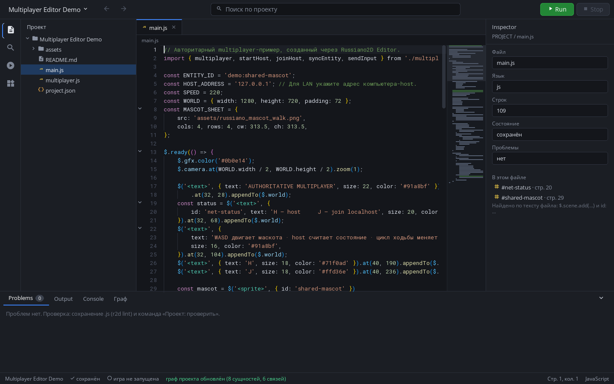

# Multiplayer Editor Demo

Минимальная авторитарная игра, созданная через Russiano2D Editor. Она
показывает полный цикл high-level мультиплеера: host принимает ввод, применяет
его к общей `$`-сущности, а подключённая копия плавно отображает реплицированную
позицию.

## Запуск

Из корня Russiano2D запустите команду в двух окнах:

```sh
"$R2D_BINARY" --game demos/multiplayer-editor-demo
```

В первом окне нажмите **H** для старта host. Во втором нажмите **J** для
подключения к `127.0.0.1:7777`. Удерживайте **WASD**, чтобы двигать общего
маскота. Для игры по LAN укажите IPv4-адрес host в `HOST_ADDRESS` в `main.js` и
разрешите входящий UDP-порт `7777` в firewall.

## Что показывает проект

- `project.json` — проект schema 2; поля сети доступны в Project Settings;
- `multiplayer.js` — bootstrap, созданный кнопкой **«Создать multiplayer.js»**
  в Editor;
- `main.js` — авторитетный ввод, `.net()`-сущность, интерполяция и выбор
  направления/кадра анимации по движению;
- `assets/russiano_mascot_walk.png` — прозрачный 4×4 sprite sheet: четыре
  направления по четыре кадра ходьбы.



Полное объяснение `$.net`, кода, топологий, сообщений и настроек Editor:
[документация по мультиплееру](../../docs/MULTIPLAYER.md).
