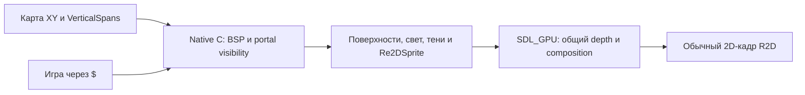

# Russiano2D 1.2.1 — macOS Apple Silicon: инструкция для ИИ-агента

Ты получил готовый движок и игру. Тобой можно управлять программно: движок
читает JSON-команды со stdin и отвечает JSON-строками в stdout. Кадры идут
только по команде, поэтому прогон воспроизводим до кадра.

## Что в папке

| Файл | Что это |
|---|---|
| `russiano2d` | движок; он же запускает игру и собирает её в один файл |
| `game/` | готовая игра: меню + уровень-платформер |
| `assets/` | текстуры, шрифты, иконки |
| `README.md` | та же инструкция для человека — как начать первый проект |

## Режим агента

```bash
./russiano2d --agent --headless --fixed-dt 0.0166666667 --scene platformer
```

* `--agent` — кадры двигаются командой `step`, протокол на stdin/stdout;
* `--headless` — окно скрыто, но рендер и скриншоты работают;
* `--fixed-dt 0.0166666667` — детерминированный шаг (60 Гц);
* `--seed N` — зерно `$.random`;
* `--scene <имя>` — открыть сцену сразу, минуя меню;
* `--frames N` — выйти ровно после N кадров.

Первым приходит `{"event":"ready",...}`.

| Команда | Параметры | Ответ |
|---|---|---|
| `ping` | — | `{"ok":true,"pong":true,"frame":N,"time":T}` |
| `state` | — | кадр, время, окно, камера, мир, узлы, интерфейс, самотесты |
| `eval` | `code` — строка JS | `{"ok":true,"result":…}` либо `{"ok":false,"error":"…"}` |
| `step` | `frames`, `dt` | `{"ok":true,"frames":N,"frame":N2,"time":T}` |
| `screenshot` | `path` | `{"ok":true,"path":…,"width":W,"height":H}` |
| `key` | `key` (имя SDL), `action`: `"down"`,`"up"`,`"tap"` | `{"ok":true,"key":"Space","action":"tap"}` |
| `keys` | `hold` — массив имён, **заменяет** набор | `{"ok":true,"hold":["A","Space"]}` |
| `mouse` | `button` 1/2/3, `action`: `"down"`,`"up"`,`"click"` | `{"ok":true}` |
| `mouseMove` | `dx`,`dy` или `x`,`y` | `{"ok":true,"x":…,"y":…}` |
| `wheel` | `amount` | `{"ok":true}` |
| `text` | `text` | ввод текста как с клавиатуры |
| `reload` | — | перезапуск скриптов |
| `frames` | — | `{"ok":true,"frame":N,"time":T}` |
| `quit` | — | `{"ok":true}` и выход |

## Пример: пройти вправо и снять кадр

```bash
printf '%s\n' \
  '{"cmd":"state"}' \
  '{"cmd":"step","frames":40}' \
  '{"cmd":"eval","code":"$.scene.current()"}' \
  '{"cmd":"keys","hold":["D"]}' \
  '{"cmd":"step","frames":30}' \
  '{"cmd":"keys","hold":[]}' \
  '{"cmd":"screenshot","path":"shot.png"}' \
  '{"cmd":"quit"}' \
| ./russiano2d --agent --headless --scene platformer --fixed-dt 0.0166666667
```

Проверенный ответ (сокращённо):

```json
{"event":"ready","version":"1.2.1","agent":true,"headless":true,"fixed_dt":0.01666666754}
{"ok":true,"state":{"frame":1,"time":0.02,"fps":60,"window":{"title":"…","w":1280,"h":720},"world":{"bodies":0},"entities":[]}}
{"ok":true,"frames":40,"frame":41,"time":0.68}
{"ok":true,"result":"platformer"}
{"ok":true,"hold":["D"]}
{"ok":true,"frames":30,"frame":71,"time":1.18}
{"ok":true,"hold":[]}
{"ok":true,"path":"shot.png","width":1280,"height":720}
{"ok":true}
```

## Пример на Python

```python
import json, subprocess

proc = subprocess.Popen(
    ["./russiano2d", "--agent", "--headless", "--scene", "platformer",
     "--fixed-dt", "0.0166666667"],
    stdin=subprocess.PIPE, stdout=subprocess.PIPE, stderr=subprocess.DEVNULL,
    text=True, bufsize=1)

def call(**cmd):
    proc.stdin.write(json.dumps(cmd) + "\n")
    proc.stdin.flush()
    while True:
        line = proc.stdout.readline()
        if not line:
            raise SystemExit("движок закрылся")
        event = json.loads(line)
        if "event" not in event:      # первый ответ — ready, его пропускаем
            return event

call(cmd="step", frames=60)
state = call(cmd="state")["state"]
print("сцена:", state.get("scene"), "| тел:", state["world"]["bodies"])
print("HUD:", call(cmd="eval", code="$('#hud-hp').text()").get("result"))
call(cmd="quit")
```

## Что можно спросить у игры через `eval`

Проверенные выражения:

| Выражение | Что вернёт |
|---|---|
| `$.scene.current()` | имя текущей сцены, например `"platformer"` |
| `$.nodes().length` | сколько узлов сейчас в мире |
| `$('#hud-hp').text()` | текст элемента интерфейса |
| `$.debug.counters()` | счётчики кадра: спрайты, draw calls, тела |
| `state.world.bodies` | число физических тел (из `state`, не из `eval`) |

`state` полностью описывает мир: кадр, время, FPS, окно, камера, гравитация и
границы мира, список узлов и элементов UI, результаты встроенных самотестов
игры (`state.tests`).

## Своя игра

Положи рядом каталог `mygame/` с `project.json` и `main.js` (см. `README.md`)
и запусти:

```bash
./russiano2d --game mygame --agent --headless
```

Полный справочник протокола:
<https://hub.mos.ru/dem4ev48/russiano2d/-/blob/main/docs/AGENT_API.md>


---

# Приложение: вся документация движка

Ниже — полные тексты справочников, чтобы не искать их в интернете.

* Правила для кодинг-агентов — `docs/AGENT_IMPLEMENTATION_RULES.md`
* Философия Russiano2D — `docs/PHILOSOPHY.md`
* Закон UI: весь интерфейс — на RmlUi — `docs/UI_RMLUI_LAW.md`
* Архитектура и философия API `$` — `docs/ARCHITECTURE.md`
* Russiano2D — высокоуровневое API `$` — `docs/HIGH_LEVEL_API.md`
* russiano2d — агентский интерфейс (низкий уровень) — `docs/AGENT_API.md`
* Сборка и распространение игры — `docs/BUILD.md`
* Моя первая игра: платформер с маскотом — `docs/tutorial-first-game.md`
* Туториал: первая игра на `$` — `docs/tutorial-platformer.md`
* Туториал: меню, пауза и смена сцен — `docs/tutorial-menus.md`
* Туториал: ближний бой, окна анимации и урон — `docs/tutorial-melee.md`
* Туториал: runtime integration — HUD, язык, вставка, слои и переход — `docs/tutorial-runtime-integration.md`
* Russiano2D — демо-проект — `docs/demos.md`
* Текущие задачи и ограничения R2D — `docs/TASKS.md`
* Производительность и полнота высокоуровневого API `$` — `docs/HIGH_LEVEL_API_PERF.md`
* Производительность компонентов `$` API — `docs/API_PERFORMANCE.md`
* R2D DevTools — `docs/DEVTOOLS.md`
* Форматы данных: состав полей и честные границы — `docs/FORMATS.md`
* Фазы кадра — `docs/FRAME_PHASES.md`
* Russiano2D: инженерная спецификация производственной готовности — `docs/PRODUCTION_READINESS.md`
* Конвенции Russiano (R2D и R3D) — `docs/R2D_R3D_CONVENTIONS.md`
* Re2D: мир, персонажи и обычный 2D-кадр — `docs/RE2D.md`
* R2D Re2DSprite — руководство разработчика и художника — `docs/RE2DSPRITE_GUIDE.md`
* Re2DSprite JSON v1: модели, анимации и сокеты — `docs/RE2DSPRITE_JSON.md`
* Re2DSprite: развёртка и математика всех частей тела — `docs/RE2DSPRITE_MATH.md`
* Re2DSprite v1 — развёртка всего персонажа, прототип головы — `docs/RE2DSPRITE_V1.md`
* Re2DSprite v2 — большой PNG персонажа — `docs/RE2DSPRITE_V2.md`
* Re2DSprite v3 — плотная «геометрическая картинка» — `docs/RE2DSPRITE_V3.md`
* Re2D World: руководство по новой игре — `docs/RE2D_WORLD_GUIDE.md`
* Re2D World: производительность и измерения — `docs/RE2D_WORLD_PERF.md`
* Детерминированная запись и воспроизведение (record / replay) — `docs/RECORD_REPLAY.md`
* Сборка и публикация — `docs/RELEASING.md`
* Roadmap расширения R2D — `docs/ROADMAP.md`
* Russiano2D SDK — `docs/SDK.md`
* Тестирование мира в R2D — `docs/TESTING.md`
* Как сделать такое же демо на `$` — `docs/TUTORIAL.md`
* Веб-экспорт: движок в браузере (Emscripten + WebGPU) — `docs/WEB_EXPORT.md`
* Контракт модуля подсистемы `$` — `docs/highlevel/_CONTRACT.md`
* Акустика помещений — `$.audio.room` — `docs/highlevel/acoustics.md`
* Агент — `$.agent` — `docs/highlevel/agent.md`
* Психика NPC и режиссёр рейда — `$.alive` — `docs/highlevel/alive.md`
* `$.anim` — анимация клипами и машина состояний — `docs/highlevel/anim.md`
* `$.anim.player` — анимационный плеер: таймлайны, мультицелевые дорожки, звук и маркеры — `docs/highlevel/animplayer.md`
* Сборка API — `createApi()` — `docs/highlevel/api.md`
* Атласы из JSON — `$.atlas` — `docs/highlevel/atlas.md`
* Аудио-шины и эффекты — `$.audio` — `docs/highlevel/audiobus.md`
* Загрузчик API — `bootstrap.js` — `docs/highlevel/bootstrap.md`
* BSP — `$.world.bsp` — `docs/highlevel/bsp.md`
* Камера — `$.camera` — `docs/highlevel/camera.md`
* Граф кадров — `$.cels` — `docs/highlevel/cels.md`
* Слои коллизий — `$.collision` — `docs/highlevel/collision.md`
* Бой: здоровье по зонам, урон и кровь — `$.combat` — `docs/highlevel/combat.md`
* `$.console` — консоль разработчика и свои команды — `docs/highlevel/console.md`
* Ядро — `$`, `ctx` и реестр узлов — `docs/highlevel/core.md`
* `$.csv` — CSV/TSV и безопасный JSON — `docs/highlevel/csv.md`
* Кривые и градиенты — `$.curve` — `docs/highlevel/curve.md`
* Катсцены — `$.cutscene` — `docs/highlevel/cutscene.md`
* Отладка — `$.debug` и `$.console` — `docs/highlevel/debug.md`
* Z-буфер ordinary batch — `$.gfx.depth` — `docs/highlevel/depth.md`
* DevTools — `$.devtools` — `docs/highlevel/devtools.md`
* `diag.js` — структурированные ошибки и диагностика — `docs/highlevel/diag.md`
* Диалоги — `$.dialog` — `docs/highlevel/dialog.md`
* Потоки и таймеры — `$.flow` — `docs/highlevel/flow.md`
* Текстовые стили — `$.font` — `docs/highlevel/font.md`
* VFX своими руками — `$.fx` — `docs/highlevel/fx.md`
* `gfx` — `docs/highlevel/gfx.md`
* `$.grid` — сеточные помощники — `docs/highlevel/grid.md`
* Ощущение удара — `$.hits` и `$.hitFx` — `docs/highlevel/hits.md`
* HTTP-запросы — `$.http` — `docs/highlevel/http.md`
* Локализация и ввод — `$.i18n`, `$.tr` и дополнения `$.input` — `docs/highlevel/i18n.md`
* Точка входа `r2d` — `index.js` — `docs/highlevel/index.md`
* Ввод — `$.input` — `docs/highlevel/input.md`
* Предметы и инвентарь — `$.items`, `$.inv` — `docs/highlevel/items.md`
* Виды узла — `.kind()`, `$.kinds`, `Re2D` — `docs/highlevel/kinds.md`
* `$.layers` — канвас-слои, параллакс и затемнение — `docs/highlevel/layers.md`
* Экран загрузки — `$.loading` — `docs/highlevel/loading.md`
* `$.math` — математика для игровой логики — `docs/highlevel/mathx.md`
* Меш со скелетом — `$.mesh` — `docs/highlevel/mesh.md`
* `native.js` — приватный вход в нативное ядро — `docs/highlevel/native.md`
* `$.nav` — навигация и поиск пути — `docs/highlevel/nav.md`
* Сеть — `$.net` (только авторитарная модель) — `docs/highlevel/net.md`
* `$.noise` — комплект шумов для миров, текстур и тайлмапов — `docs/highlevel/noise.md`
* Частицы — `$('<particles>')` и `$.particles` — `docs/highlevel/particles.md`
* `physics` — `docs/highlevel/physics.md`
* Пул объектов — `$.pool` — `docs/highlevel/pool.md`
* `$.prefab` — prefab, наследование сцен и сериализация узлов — `docs/highlevel/prefab.md`
* Процедурный пиксель-арт — `$.proc` — `docs/highlevel/proc.md`
* `$.processing` — политики обработки узлов (§44) — `docs/highlevel/processing.md`
* Задания — `$.quest` — `docs/highlevel/quest.md`
* Генерация рейда — `$.raid` — `docs/highlevel/raid.md`
* `$.random` — детерминированная случайность — `docs/highlevel/random.md`
* Re2D World — public `$` API — `docs/highlevel/re2d.md`
* Legacy Re2D: room/kind и прежний World — `docs/highlevel/re2d_legacy.md`
* Re2DSprite — `$.re2dSprite` — `docs/highlevel/re2dsprite.md`
* `$.real2d` — Real2D v4: вычисляемый layered warp персонажа — `docs/highlevel/real2d.md`
* `$.reload` — горячая перезагрузка ассетов (§27) — `docs/highlevel/reload.md`
* `$.blend` и `$.viewport` — смешивание и render target — `docs/highlevel/render.md`
* Реплеи — `$.replay` — `docs/highlevel/replay.md`
* Реестр ресурсов — `$.resource` — `docs/highlevel/resource.md`
* `$.room` — комнаты: регистрация, вход и выход — `docs/highlevel/room.md`
* Re2DSprite — совместимость старого имени — `docs/highlevel/rotsprite.md`
* Русские имена API (`$.ru`) — `docs/highlevel/ru.md`
* Сохранения игры — `$.save` — `docs/highlevel/save.md`
* Сцены — `$.scene` — `docs/highlevel/scene.md`
* Экраны и меню — `$.screen` — `docs/highlevel/screen.md`
* Перезапуск скриптов — `$.script` — `docs/highlevel/script.md`
* Мост инструментов SDK — `$.sdk` — `docs/highlevel/sdk.md`
* Сигналы — `$.signal` — `docs/highlevel/signal.md`
* Звук — `$.sound` — `docs/highlevel/sound.md`
* Банки звуков — `$.sound.bank*` — `docs/highlevel/soundbank.md`
* Спрайт: пивот и nine-slice — `docs/highlevel/sprite.md`
* Машина состояний — `$.state` и `.fsm()` — `docs/highlevel/state.md`
* Шаги и реплики — `$.steps` и `$.barks` — `docs/highlevel/steps.md`
* Файлы и сохранения — `$.fs` и `$.store` — `docs/highlevel/store.md`
* Сценки и катсцены — `$.story` — `docs/highlevel/story.md`
* Разбор сценария — `story_script.js` — `docs/highlevel/story_script.md`
* Работа кусками — `$.task` — `docs/highlevel/task.md`
* `$.test` — утверждения для агентских сценариев — `docs/highlevel/test.md`
* Текст и шрифты — `$.font`, `$('<text>')`, `$('<ui.label>')` — `docs/highlevel/text.md`
* TileMap — тайловые карты `$('<tilemap>')` — `docs/highlevel/tilemap.md`
* Время — `$.time` — `docs/highlevel/time.md`
* Таймлайн-сцены — `$.timeline` (AnimatedTimelineScene2d) — `docs/highlevel/timeline.md`
* Зоны-триггеры — `$.triggers` и тег `<trigger>` — `docs/highlevel/triggers.md`
* `$.tween` — Tween-объекты в стиле Godot 4 — `docs/highlevel/tween.md`
* HUD и интерфейс — `$.ui` — `docs/highlevel/ui.md`
* Render target — `$.viewport` — `docs/highlevel/viewport.md`
* Несколько камер — `$.camera.add/split/views` — `docs/highlevel/viewports.md`
* Реактивные запросы — `$.watch` — `docs/highlevel/watch.md`
* Оружие и баллистика — `$.weapons` — `docs/highlevel/weapons.md`
* UI-контролы — `$.ui` и теги `<ui.*>` — `docs/highlevel/widgets.md`
* Окно — `$.window` — `docs/highlevel/window.md`
* Мир — `$.world` — `docs/highlevel/world.md`
* Туториал: pattern arena — фазы, пул, пауза, смерть и рестарт — `docs/tutorial-arena.md`
* Туториал: свет на спрайтах — маски, окклюзия, атлас — `docs/tutorial-litsprites.md`
* Туториал: восстановление после сбоев (§31-7) — `docs/tutorial-recovery.md`
* Туториал: эталонное меню настроек — `docs/tutorial-settings.md`


---

## Правила для кодинг-агентов

<sub>источник: `docs/AGENT_IMPLEMENTATION_RULES.md`</sub>

# Правила для кодинг-агентов

Читай этот файл **до** первой правки в Russiano2D. Здесь не пожелания, а
условия приёмки работы: правила 1–10 — ограничения, «Рабочий цикл» — порядок
действий, «Стоп-условия» — когда нужно остановиться и спросить, а не
импровизировать.

Связанные документы: [PHILOSOPHY.md](PHILOSOPHY.md) (конституция),
[UI_RMLUI_LAW.md](UI_RMLUI_LAW.md) (закон UI), [ROADMAP.md](ROADMAP.md) (порядок
работ), [TESTING.md](TESTING.md) (как проверять).

---

## Правило 1 — Существующий код побеждает

Russiano2D — существующий движок. Прежде чем что-то писать:

1. найди существующий код по теме;
2. прочитай его;
3. прочитай его документацию (`docs/`, `docs/highlevel/<имя>.md`);
4. найди его тесты (`tests/js/*_test.mjs`, `tests/agent/*_test.py`);
5. пойми публичный API;
6. и только потом проектируй изменение.

**Не реализуй параллельную подсистему** только потому, что не нашёл
существующую. Дублирование — самая дорогая ошибка в этом репозитории.

## Правило 2 — Никакой смены архитектуры без явной просьбы

Нельзя самостоятельно решать: переписать движок, перейти на C++, ввести ECS,
заменить QuickJS-ng, SDL, RmlUi, перепроектировать `$`, добавить второй
UI-фреймворк. Если это объективно блокирует задачу — опиши блокер, не обходи
его сменой архитектуры ([PHILOSOPHY.md](PHILOSOPHY.md) §3).

## Правило 3 — Сохраняй совместимость

Существующие игры должны продолжать работать. Если публичное поведение
обязано измениться: объясни причину, добавь заметки о миграции, добавь тесты и
не ломай ничего попутного.

## Правило 4 — ВЕСЬ UI — RmlUi

Не обсуждается. Никаких ImGui «временно», никаких нативных кнопок «просто для
теста», никакого второго developer GUI. Нативные custom-элементы допустимы
только как специализированное содержимое **внутри** RmlUi. Полностью —
[UI_RMLUI_LAW.md](UI_RMLUI_LAW.md).

## Правило 5 — Горячие пути — нативные

Избегай поштучных переходов C↔JS там, где движок умеет массовую операцию:

```js
// плохо: N переходов на кадр
$('.enemy').each(e => expensivePerEntityBridge(e));
```

Предпочитай декларативные и пакетные операции. Покадровый проход по узлам `$`
— кандидат в C (`src/nodes.c`): C читает поля узла через атомы за ≈4 нс, а
интерпретатор тратит на тот же узел микросекунды. Такой проход повторяет
JS-математику один в один и сверяется тестом «C против JS»
(`tests/agent/native_passes_test.py`, `$.debug.nativePasses(false)`). Но и
обратное неверно: **не тащи произвольную игровую логику в C**.

## Правило 6 — Измеряй

Прежде чем утверждать «стало быстрее»: замерь старое поведение, замерь новое,
запиши число объектов и конфигурацию сборки. Архитектурная интуиция — не
доказательство. Готовые инструменты: `$.debug.profile()`,
`tools/bench_highlevel.py`, `--stats`.

## Правило 7 — Детерминированные тесты

Новые возможности запросов/агента/реплея получают автотесты, где это
осуществимо: фиксированный шаг, известное зерно, управляемое состояние мира.
См. [TESTING.md](TESTING.md).

## Правило 8 — Структурированные данные для отладки

Машинно-ориентированные API возвращают структуру, а не декоративный вывод:
агент не должен разбирать текст терминала.

## Правило 9 — Никакой выдуманной диагностики

Диагностика сообщает **только факты, известные движку**. Движок не сочиняет
спекулятивных объяснений — рассуждение принадлежит вызывающей стороне.

```json
// хорошо
{ "visible": false, "blockedBy": "wall_42" }

// плохо
{ "reason": "Стражник, похоже, не видит игрока, потому что растерялся." }
```

## Правило 10 — Сохраняй R2D приятным

Обычный код игры должен выглядеть как R2D, а не как корпоративная
инфраструктура:

```js
$.ready(() => {
    $('<player>', { id: 'hero' }).at(100, 300).health(100).appendTo($.world);
    $('.enemy').each((i, e) => { if (e.distanceTo('#hero') < 200) e.damage(1); });
});
```

---

## Рабочий цикл

Для каждой фазы [ROADMAP.md](ROADMAP.md):

1. изучи реализацию (правило 1);
2. напиши короткий план изменения;
3. добавь/поправь тесты;
4. реализуй **наименьший полезный вертикальный срез**;
5. собери (`cmake --build build`);
6. прогони существующие тесты;
7. прогони новые тесты;
8. прогони детерминированный headless-сценарий (агентский режим);
9. сделай замеры, если изменение про производительность;
10. обнови документацию — **в том же изменении**.

Только после этого переходи к следующей крупной фазе.

---

## Стоп-условия

Остановись и доложи, вместо того чтобы импровизировать, если:

* существующая архитектура материально противоречит заданию;
* для реализации нужно сломать публичный API;
* нужной зависимости нет;
* существующие тесты падают **до** твоих правок;
* предлагаемая возможность дублирует существующую систему;
* документация и реализация расходятся так, что это влияет на проектирование.

Объясни конфликт и предложи наименьшее совместимое решение.

---

## Определение успеха

Успех — это **не** «все галочки роадмапа закрыты». Успех — это:

* существующий Russiano2D продолжает работать;
* API остаётся простым;
* запросы становятся мощнее;
* горячие пути остаются нативными;
* агент понимает состояние рантайма;
* баги воспроизводимы;
* весь UI остаётся на RmlUi.

---

## Правила репозитория, о которых легко забыть

* **Сначала философия — потом работа.** Агент не пишет в движок, пока не прочитал
  целиком [PHILOSOPHY.md](PHILOSOPHY.md) — конституцию движка. Это всё, что
  требует гейт. Остальные доки ([ARCHITECTURE.md](ARCHITECTURE.md), этот файл,
  `internal/NATIVE.md`, [HIGH_LEVEL_API.md](HIGH_LEVEL_API.md),
  а при правке `src/highlevel/**` — [highlevel/_CONTRACT.md](highlevel/_CONTRACT.md)
  и страница модуля `docs/highlevel/<имя>.md`) обязательны по правилам выше, но
  запись не блокируют. Гейт делает плагин
  `tools/dsh-russiano2d-docs-gate`; обойти его нельзя, делегирование не
  отменяет правило.
* **Главный гейт: движок только 2D.** Тот же плагин отклоняет правку, вводящую
  3D-сущность: имя пути вида `render3d.c`/`mesh3d.js`, имена `R3D`, `Scene3D`,
  `Mesh3D`, `Vector3`, `Matrix4`, `Quaternion`, `MeshRenderer`, `Physics3D`,
  `Camera3D` и загрузчики 3D-ассетов в рантайме (`assimp`/`tinygltf`/`cgltf`/`glm`,
  three.js). Превращать Russiano2D в 3D нельзя — это non-goal
  ([PHILOSOPHY.md](PHILOSOPHY.md) §3). RE2D остаётся разрешённым: это
  `spatial description → projection → ordinary 2D representation`
  ([PHILOSOPHY.md](PHILOSOPHY.md) §1), а не мост к 3D. SDK-импорт 3D-моделей
  (`sdk/**`), инструменты, документация, тесты и дистрибутивы из гейта исключены.
  Спорную задачу останавливай и выноси владельцу проекта.
* **Каждый модуль `src/highlevel/<имя>.js`** имеет страницу
  `docs/highlevel/<имя>.md` и тест — это проверяет
  `tests/doc_coverage_test.py`.
* **Новый файл в `docs/` и `docs/highlevel/`** автоматически попадает в
  `AGENTS.md` релизного пакета
  ([tools/agents_doc.py](../tools/agents_doc.py)); порядок документов
  задаёт [tools/release.py](../tools/release.py) (`AGENTS_DOC_ORDER`). Именно
  эти два каталога собирает `release.agents_doc_files()`, поэтому литература
  `docs/internal/**`, `docs/re2d/**` и `demos/*/README.md` в приложение
  `AGENTS.md` не входит — она едет в пакете файлами `docs/`. Документ не может
  «отстать» от движка — и не должен врать.
* **Закрытый пункт работы исчезает из документации в том же изменении**
  (правило из [TASKS.md](TASKS.md) §6).
* **Язык документации — русский**, термины API — английские; код и имена в
  коде — английские.


---

## Философия Russiano2D

<sub>источник: `docs/PHILOSOPHY.md`</sub>

# Философия Russiano2D

Это **конституция движка**: короткий список решений, которые не обсуждаются
заново на каждой задаче. Документ написан и для людей, и для агентов: он
называет, что можно менять свободно, а что является архитектурной константой.

Статус: **ограничения, а не пожелания**. Изменение здесь — отдельное решение
владельца проекта, а не побочный эффект правки кода.

Детали и история: [ARCHITECTURE.md](ARCHITECTURE.md) (философия API `$`),
[TASKS.md](TASKS.md) (сверка с Godot 4.x, текущие задачи и ограничения).
Законы, вытекающие отсюда:
[UI_RMLUI_LAW.md](UI_RMLUI_LAW.md) и
[AGENT_IMPLEMENTATION_RULES.md](AGENT_IMPLEMENTATION_RULES.md).

---

## 1. Что такое Russiano2D

2D-игровой движок: ядро на C/C++ (SDL3 + SDL_GPU, Box2D v3, QuickJS-ng,
SDL3_mixer, RmlUi), игровая логика — JavaScript. Вся работа с движком идёт
через одну точку входа — `$` в стиле jQuery. Схема — **C → `$`**: нативное ядро
отдаёт свои примитивы прямо модулям `$`, а игре виден только `$`. Низкоуровневого
`engine.*` в игровом коде нет — до него не добраться без пересборки движка
([highlevel/native.md](highlevel/native.md)).

Игра — это **код и данные**, а не проект в визуальном редакторе: уровень,
логика и интерфейс описываются текстом, поэтому их удобно читать, diff'ить,
генерировать и проверять автоматически, в том числе ИИ-агентом.

**RE2D — spatial description → projection → ordinary 2D representation.**
XYZ/surfaces/bones/depth — промежуточные authoring/runtime-данные синтеза;
результат — обычный 2D sprite/кадр для существующего R2D 2D-батча.
RE2D World продолжает этот принцип: XY BSP + vertical spans, специализированные
стены и регионы пола/потолка. Пространственная математика не вводит обычный
3D scene graph, универсальный world mesh API или 3D-физику. Сущности и gameplay
остаются узлами/компонентами и скриптами. Совместимый прежний Re2D-путь
(`.kind(Re2D)`, `room`, `mesh`) описан в [RE2D.md](RE2D.md); его mesh-проход
не является архитектурной целью нового World. Узлы и камеры без `kind`
работают как прежде.

RE2D — **необязательный** слой, а не фундамент: опция сборки
`R2D_ENABLE_RE2D=OFF` (по умолчанию `ON`, см. [BUILD.md](BUILD.md)) собирает
движок платформера без него — без исходников `re2d*`/`real2d4`/`rotsprite*`,
без EXR-неба, без нативных биндингов `engine.re2d/rotsprite/real2d` и без
модулей `$` этого семейства. Обычный 2D (узлы, тела, тайлмапы, камера,
интерфейс, звук) в такой сборке работает целиком; игра узнаёт конфигурацию по
`$.re2dEnabled`. Это граница состава сборки, а не смена архитектуры: схема
C → `$` и скриптинг одинаковы в обеих.

---

## 2. Константы

1. **`$` — единственная точка входа.** Одно пространство имён, цепочки,
   селекторы, неявная итерация. Нативное ядро — внутренность `$`
   (`src/highlevel/native.js`): `globalThis.engine` после установки `$`
   убирается, внутренние модули `r2d/*` игре не импортируются. Чего игре не
   хватает — добавляется в `$`, а не открывается наружу.
2. **Канонического редактора сцен нет и не планируется.** Уровень и логика —
   код и данные. Инструменты разработчика ([DEVTOOLS.md](DEVTOOLS.md)) —
   инспектор. Инструменты [SDK](SDK.md) редактируют открытые JSON/PNG и
   показывают их существующим runtime; они не создают обязательный project
   format, второй scene graph или скрытое состояние, без которого игра не работает.
   Это граница существующего code/data-first принципа, а не смена архитектуры.
3. **Создание как в HTML, поиск как в CSS.** `$('<player>', { id: 'hero' })`,
   `$('#hero')`, `$('.enemy:alive')`. Никаких `new`, `extends`, `this` в
   игровом коде.
4. **Кадр — пакет.** Игра не вызывает отрисовку на спрайт: `$.gfx` собирает
   массивы и отдаёт их одним вызовом (`engine.submitSprites` и родственные).
5. **C — ядро `$`, JS — его API и оркестрация.** Покадровые проходы по узлам
   `$` (синк физики, события мира, наведение, сортировка, сборка батча, твины)
   идут в C прямо над узлами (`src/nodes.c`, [highlevel/native.md](highlevel/native.md)),
   а не поштучными переходами C↔JS. Модули `$` на JS дают API, редкие и
   сложные случаи; произвольную игровую логику в C не переносят. См. правило 5
   в [AGENT_IMPLEMENTATION_RULES.md](AGENT_IMPLEMENTATION_RULES.md).
6. **Весь интерфейс — RmlUi.** Игровой UI, HUD, меню, диалоги, DevTools:
   только `.rml` + `.rcss`. Подробности и переходное правило —
   [UI_RMLUI_LAW.md](UI_RMLUI_LAW.md).
7. **Человек и агент — равные потребители.** Машинно-ориентированные API
   отдают структурированные данные, а не декоративный текст; движок сообщает
   только известные ему факты и не сочиняет объяснений (правила 8–9 в
   [AGENT_IMPLEMENTATION_RULES.md](AGENT_IMPLEMENTATION_RULES.md)).
8. **Детерминизм — инструмент отладки, а не роскошь.** Фиксированный шаг
   (`--fixed-dt`), зерно (`--seed`), управляемый ввод и запись/воспроизведение
   делают баг воспроизводимым. См. [RECORD_REPLAY.md](RECORD_REPLAY.md) и
   [TESTING.md](TESTING.md).
9. **Существующий код побеждает.** Сначала найди существующую подсистему, её
   доку и тесты; параллельная реализация «того же, но своего» не принимается.
10. **Совместимость.** Существующие игры продолжают работать; ломающее
    изменение публичного поведения требует обоснования, заметок о миграции и
    тестов.
11. **Измерять, а не верить.** Утверждение «стало быстрее» без замера до/после,
    числа объектов и конфигурации сборки не принимается (правило 6 в
    [AGENT_IMPLEMENTATION_RULES.md](AGENT_IMPLEMENTATION_RULES.md)).

---

## 3. Явные non-goals

Перечисленное **не** является задачей и не должно появляться «попутно»:

* переписывание движка или переезд на C++;
* ECS и другие смены архитектурной парадигмы;
* замена QuickJS-ng, SDL3 или RmlUi;
* второй UI-фреймворк (включая «временный» ImGui-интерфейс — см. закон UI);
* визуальный редактор сцен вместо кода;
* новый физический движок;
* преждевременный общий фреймворк R2D/R3D
  ([R2D_R3D_CONVENTIONS.md](R2D_R3D_CONVENTIONS.md)).

---

## 4. Чем это проверяется

* `python3 tools/run_tests.py` — агентские интеграционные тесты
  ([TESTING.md](TESTING.md));
* `tests/js/*_test.mjs` под QuickJS — логика подсистем без движка;
* `python3 tests/doc_claims_test.py` — страж «в доке написано, что чего-то
  нет, а в коде оно есть»;
* `python3 tests/doc_coverage_test.py` — у каждого модуля `src/highlevel/*.js`
  есть страница и тест;
* `tests/agent/engine_hidden_test.py` — игре виден только `$` (константа 1);
* `tests/agent/native_passes_test.py` — нативные проходы кадра дают тот же
  кадр, события и значения, что JS-путь (константа 5).

Правило на будущее: **закрытый пункт работы в том же изменении исчезает из
документации** — старые находки остаются в истории Git, а [TASKS.md](TASKS.md) содержит
только актуальные ограничения и следующий шаг.


---

## Закон UI: весь интерфейс — на RmlUi

<sub>источник: `docs/UI_RMLUI_LAW.md`</sub>

# Закон UI: весь интерфейс — на RmlUi

Статус: **закон** (архитектурная константа, см. [PHILOSOPHY.md](PHILOSOPHY.md)
§2.6). Нарушение — основание не принимать изменение.

Короткая формулировка, на которую ссылаются остальные документы:

> **ALL UI → RmlUi.** Любой интерфейс движка и игры — документы `.rml` +
> `.rcss`. Второго UI-пути в движке нет.

---

## 1. Из чего это состоит

1. **Интерфейс рисует RmlUi.** Игровой HUD, меню, экраны, диалоги, инвентарь,
   настройки, обучение, экраны загрузки, панели инструментов разработчика —
   всё это `.rml` + `.rcss`.
2. **RmlUi владеет вёрсткой и раскладкой.** Если нужен особый визуальный
   контент (коллизии, BSP, навигация, графики), он рисуется **внутри**
   RmlUi-элемента, а не вместо RmlUi.
3. **Движок не заводит второй UI-стека.** Ни ImGui «пока не сделаем нормально»,
   ни собственный виджет-фреймворк, ни ручная раскладка как основа интерфейса.
4. **Правило одно для R2D и R3D** — см.
   [R2D_R3D_CONVENTIONS.md](R2D_R3D_CONVENTIONS.md) §4.

---

## 2. Что разрешено

* Документы RmlUi: `$.ui.doc('ui/menu.rml')` и низкоуровневые `engine.ui.*`
  ([HIGH_LEVEL_API.md](HIGH_LEVEL_API.md) §20, `internal/NATIVE.md` §9).
* **Нативные custom-элементы внутри RmlUi** — для специализированного
  отрисованного содержимого: визуализация коллизий, BSP, навигационной сетки,
  зон видимости, графиков профайлера ([DEVTOOLS.md](DEVTOOLS.md) §5).
* Существующие узлы `<ui.*>` (`<ui.bar>`, `<ui.label>`, `<ui.button>`, …) — как
  **быстрый рисователь HUD** в координатах окна: полоса, подпись, иконка
  поверх сцены. Они продолжают работать, их не нужно переписывать, но это не
  «интерфейсный слой» и не основа для новых экранов.

---

## 3. Что запрещено

* добавлять ImGui-интерфейс — даже временно, даже «для отладки»;
* создавать второй developer GUI параллельно RmlUi;
* строить меню, экраны и диалоги на узлах `<ui.*>`, если это новый код;
* тащить в движок стороннюю библиотеку интерфейса;
* считать ручную раскладку (`at()`/`size()` по пикселям) заменой RmlUi.

---

## 4. Текущее состояние (2026-10-11)

| Путь | Где | Статус |
|---|---|---|
| RmlUi-документы | [gui.cpp](../src/gui.cpp), [ui.js](../src/highlevel/ui.js), [devtools.js](../src/highlevel/devtools.js), `sdk/ui/`, `demos/ui/launcher.rml` | целевой путь; новый SDK и DevTools используют его |
| Legacy HUD/widgets | [ui.js](../src/highlevel/ui.js), [widgets.js](../src/highlevel/widgets.js), [screen.js](../src/highlevel/screen.js) | совместимость; новые меню/экраны на них не строятся |
| F1 / `--overlay` / `$.debug.on()` | [devtools.js](../src/highlevel/devtools.js) | RmlUi: статистика, профиль, гравитация, скрипты, текстуры и наблюдения |

ImGui удалён из зависимостей, сборки, обработки событий и runtime.
F5 запрашивает общий reload независимо от GUI. F2 открывает инспектор узлов.

Текст сцены использует native TTF/stb_truetype и существующий 2D sprite batch
([text.c](../src/text.c)), а не ImGui. Launcher уже на RmlUi; прежнее
утверждение, что `launcher.rml` не используется, удалено.
Справочники legacy подсистем сохраняют API, но не предлагают их для новых меню.
Все новые SDK-панели находятся в `.rml` / `.rcss`; World Studio редактирует
открытые данные и не вводит другой UI или renderer.

---

## 5. Переходное правило

1. **Существующие игры не ломаем.** Узлы `<ui.*>` остаются рабочими; их API не
   удаляется и не переписывается «заодно».
2. **Новый интерфейс — только RmlUi.** Меню, экраны, диалоги, панели: новый
   `.rml` + `.rcss` + `$.ui.doc`. Это относится и к служебным экранам
   (пауза, настройки, загрузка).
3. **`<ui.*>` — HUD-рисователь.** Новые полосы, подписи и иконки поверх сцены
   на них — по-прежнему нормально.
4. **DevTools — на RmlUi.** Панели инспектора делаются RmlUi-документами;
   нативная отрисовка допускается только как содержимое внутри custom-элемента
   ([DEVTOOLS.md](DEVTOOLS.md)).
5. **ImGui удалён.** Отладочные панели используют тот же RmlUi, что SDK и игры.

---

## 6. Критерии приёмки (чек-лист ревью)

* [ ] Новый интерфейс — это `.rml` + `.rcss` (или `$.ui.doc`), а не разметка
      в JS на узлах.
* [ ] В изменении нет новых окон/виджетов ImGui.
* [ ] Нет второго механизма раскладки/шрифтов/ввода интерфейса.
* [ ] Нативная отрисовка (если есть) находится внутри RmlUi-элемента и не
      подменяет вёрстку.
* [ ] Документация не называет `<ui.*>` «интерфейсным слоем» и не предлагает
      строить меню на узлах.
* [ ] Если правило нарушено по объективной причине — это отдельное решение
      владельца проекта с записью здесь, а не молчаливое исключение.

---

## 7. Как проверить, что закон соблюдён

```bash
# ImGui не должен присутствовать в коде
rg "ImGui::|imgui.h" src/

# новые меню/экраны на узлах <ui.*>
grep -rn "ui\.panel\|ui\.button" src/highlevel/*.js demos/*.js

# RmlUi-документы и их обёртка
grep -rn "ui\.doc(\|ui_load" src/highlevel/*.js game demos
```

Ссылки: `internal/NATIVE.md` §9 (низкоуровневый GUI),
[HIGH_LEVEL_API.md](HIGH_LEVEL_API.md) §20 (`$.ui`),
[PHILOSOPHY.md](PHILOSOPHY.md) §2.6, [DEVTOOLS.md](DEVTOOLS.md).


---

## Архитектура и философия API `$`

<sub>источник: `docs/ARCHITECTURE.md`</sub>

# Архитектура и философия API `$`

> Исходный проектный документ: каким задумывалось высокоуровневое API.
> Актуальный справочник — [HIGH_LEVEL_API.md](HIGH_LEVEL_API.md).
>
> **Сейчас схема — C → `$`** ([PHILOSOPHY.md](PHILOSOPHY.md), константы 1 и 5):
> игре виден только `$`, нативное ядро (`engine`) спрятано под ним
> ([highlevel/native.md](highlevel/native.md)), а покадровые проходы по узлам
> идут в C (`src/nodes.c`). Внутренний справочник ядра —
> `internal/NATIVE.md`.

jQuery-style API для 2D-движка (SDL3 + QJS-NG)

Ок, вот переделка. Никаких классов для пользователя. Только $. Всё chainable. Всё через селекторы. Создание через <тег> как в jQuery.
1. ФИЛОСОФИЯ
text

- $  — единственная точка входа
- Всё возвращает один и тот же wrapper → цепочки
- Создание через $('<player>', {...}) — как HTML
- Поиск через селекторы: $('#hero'), $('.enemy'), $('npc')
- События через .on() .off() .emit()
- Никаких new, extends, this — юзер пишет декларативно
- Неявная итерация: $('.enemy').damage(10) бьёт всех
- Всё асинхронное — Promise, если надо
- Матчинг по CSS-подобным селекторам

Интерфейс — только RmlUi (жёсткое правило, одинаковое для людей и агентов):

- **Весь UI движка — документы RmlUi**: `.rml` + `.rcss`, загружаются через
  `$.ui.doc('ui/menu.rml')` (внутри — нативный `engine.ui.*`, §9 в
  `internal/NATIVE.md`; см. §20 в
  [HIGH_LEVEL_API.md](HIGH_LEVEL_API.md)). Меню, HUD, диалоги, экраны,
  инвентарь, настройки, оверлеи — всё это RmlUi.
- **Второго UI-пути в движке нет.** Сторонний UI-фреймворк, вёрстка интерфейса
  узлами сцены и ручной расчёт раскладки как основа UI не принимаются.
- **Узлы `<ui.*>` — не интерфейсный слой**, а быстрый рисователь HUD в
  координатах окна (`ui.js`, `widgets.js`): полоса, подпись, иконка поверх
  сцены. Существующие игры на них работают, но новые меню, экраны и диалоги
  строятся только на RmlUi.
- **Новый UI = новый `.rml` + `.rcss` + `$.ui.doc`.** Интерфейс, сделанный
  иначе, в движок не берётся — это правило ревью, а не пожелание.

Полная формулировка закона, фактическое состояние UI-путей и переходное
правило — [UI_RMLUI_LAW.md](UI_RMLUI_LAW.md).

2. ГЛАВНЫЙ ОБЪЕКТ $
text

$('<player>')                  создать
$('<enemy>', { hp: 30 })       создать с атрибутами
$('#hero')                     найти по id
$('.enemy')                    по классу
$('player')                    по типу
$(':alive')                    по фильтру
$('#hero, .boss')              объединение
$(node)                        обернуть готовый
$([a, b, c])                   из массива
$(null) / $(undefined)         пустой набор (безопасно)

$.world                        мир
$.camera                       камера
$.input                        ввод
$.sound                        звук
$.gfx                          графика (overlay)
$.store                        сохранения
$.scene                        менеджер сцен
$.time                         время
$.debug                        отладка

$.ready(fn)                    при старте
$.update(fn)                   каждый кадр
$.render(fn)                   отрисовка
$.exit(fn)                     при выходе

$.emit(name, data)             глобальное событие
$.on(name, fn) $.off(name, fn)
$.selectors                    регистрация кастомных селекторов
$.fn                           прототип — расширение через $.fn.myMethod = ...

3. СОЗДАНИЕ СУЩНОСТЕЙ (HTML-like)
text

$('<player>')
$('<player>', { id: 'hero', hp: 100, speed: 200 })
$('<enemy>',   { class: 'goblin', sprite: 'orc.png' })
$('<sprite>',  { src: 'tree.png' })
$('<text>',    { text: 'Hello', size: 24 })
$('<rect>',    { w: 32, h: 32, color: '#ff0000' })
$('<circle>',  { r: 20, color: 'blue' })
$('<tilemap>', { src: 'level1.tmx', tile: 32 })
$('<light>',   { radius: 200, color: '#ffaa00' })
$('<particles>', { src: 'fire.json' })
$('<trigger>', { w: 100, h: 50 })
$('<area>')
$('<ui.button>', { text: 'Play' })
$('<ui.label>',  { text: 'HP' })
$('<ui.panel>')

Атрибуты в объекте = свойства, эмитятся в сеттеры.
Любой непонятный ключ → .attr(key, value)

4. СЕЛЕКТОРЫ (CSS-подобные)
text

'#id'                  по id
'.class'               по классу
'type'                 по типу (player, enemy, sprite, ...)
'*'                    все
':alive'               живые
':dead'                мёртвые
':visible' ':hidden'
':onScreen'            в камере
':offScreen'
':paused'
':picked'              по курсору
':first' ':last' ':even' ':odd' ':eq(n)'
':has(.item)'          есть дети
':parent'              есть дети
':empty'               без детей
'[hp<20]'              атрибут-условие
'[team=1]'
'[hp<20][speed>100]'   комбинировать
'player.enemy'         тип + класс
'#hero .weapon'        вложенность
'>'                    прямой потомок
' '                    любой потомок
','                    объединение

Кастомные:
text

$.selectors.register(':boss', n => n.attrs.rank === 'boss');
$(':boss').hp(1000);

5. ЦЕПОЧКИ (chainable, всё возвращает wrapper)
js

$('#hero')
  .at(100, 200)
  .size(32, 32)
  .sprite('hero.png')
  .speed(250)
  .health(100)
  .layer(2)
  .tag('friendly')
  .controls('wasd')
  .on('hit', e => e.shake(0.3))
  .appendTo($.world);

6. МЕТОДЫ ПО КАТЕГОРИЯМ
Позиция / трансформ
text

.at(x, y)                       → this
.at(vec2)
.move(dx, dy) / .move(v)
.moveTo(x, y, ms?)              с твином, если ms
.pos()                          → { x, y }
.globalPos()                    → { x, y } (мировые)
.rotate(deg) / .rotation()
.angle(rad)
.scale(s) / .scale(sx, sy)
.lookAt(target)                 'target' — селектор или point
.flip(x?, y?)
.depth(z)
.layer(n)

.distanceTo('#enemy')           → number
.directionTo('#enemy')          → { x, y }
.angleTo('#enemy')              → rad
.rayTo('#enemy')                → { hit, point, normal } | null
.toGlobal(local) → { x, y }
.toLocal(global) → { x, y }

Визуал
text

.sprite(path)
.region(x, y, w, h)             атлас
.frame(n)                       кадр в атласе
.frames({ w, h, cols })
.animate(name)                  запустить анимацию
.animate(name, { loop, speed })
.stopAnim()
.color('#ff0000')               modulate
.alpha(0.5)
.opacity(0.5)
.visible(true/false)
.hide() / .show()
.fadeIn(ms) / .fadeOut(ms)
.blend('add' | 'mul' | 'alpha')
.shader('water.glsl')
.shaderParam('wave', 0.5)
.outline(w, color)
.shadow({ x, y, color, blur })

Физика
text

.velocity(x, y) / .velocity(v)
.velocity()                     → { x, y }
.applyForce(x, y)
.applyImpulse(x, y)
.gravity(true/false)
.body('static' | 'dynamic' | 'kinematic')
.collision(w, h)                хитбокс
.collisionCircle(r)
.mask(bits)
.layerBits(bits)
.collidesWith('.wall')
.onFloor() → bool
.onWall() → bool
.moveAndSlide(dt)
.jump(force)

.overlaps('#enemy')             → bool
.overlaps('#enemy', cb)         подписка
.inside('#zone')

Здоровье / урон
text

.health(100)
.hp()                           → number (текущее)
.hp(n)                          сеттер (урон/лечение)
.maxHp(100)
.damage(10)                     нанести урон
.heal(10)
.kill()
.respawn(x, y)
.alive()                        → bool
.team(1)

События (jQuery-стиль)
text

.on('hit',       e => {})
.on('death',     e => {})
.on('spawn',     e => {})
.on('tick',      e => {})       каждый кадр
.on('enter',     e => {})       в камере
.on('leave',     e => {})
.on('collide',   e => {})
.on('click',     e => {})
.on('key',       e => {})
.on('animEnd',   e => {})
.on('custom:foo', e => {})

.off('hit')
.off('hit', handler)
.off()                          все

.trigger('hit', { dmg: 5 })     локально
.emit('hit', { dmg: 5 })        то же

e объект: {
  self     — wrapper, на кого сработало
  target   — wrapper
  source   — wrapper
  data     — то что передали
  stop()   — остановить распространение
  preventDefault()
  dt, frame
}

Твины / анимации
text

.moveTo(x, y, ms, ease?)        → Promise
.tween({ x, y, alpha }, ms, ease)
.tweenTo({ prop: value }, ms)
.rotateTo(deg, ms)
.scaleTo(s, ms)
.fadeTo(0, ms)
.shake(intensity, ms)
.flash(color, ms)
.bounce(h, ms)
.animate('walk')                спрайт-анимация
.animate('walk', { loop, speed, end })
.sequence([...])
.pauseTweens()
.resumeTweens()
.clearTweens()

Easing-строки:
'linear' 'ease' 'easeIn' 'easeOut' 'easeInOut'
'easeInCubic' 'easeOutCubic' 'easeInOutCubic'
'easeInBack'  'easeOutBack'
'easeOutElastic' 'easeOutBounce'

Звук (позиционный)
text

.sound('jump.wav')              привязать звук
.playSound()                    проиграть
.mute(b)
.volume(v)

Иерархия
text

.appendTo(parent)
.prependTo(parent)
.append(child)
.prepend(child)
.remove()                       удалить из мира
.detach()                       отсоединить, сохранить
.parent()
.children(sel?)
.find(sel)
.closest(sel)
.siblings(sel?)

Коллекция (jQuery)
text

.each((i, el) => {})
.map(el => el.hp())
.first() .last() .eq(i)
.slice(a, b)
.add(sel)
.not(sel)
.filter(sel | fn)
.is(sel) → bool
.has(sel) → bool
.length → number
.get(i) → Node
.toArray() → Node[]
.index()

.every(fn) → bool
.some(fn)  → bool
.reduce(fn, init)

Data / классы / теги
text

.data('key') / .data('key', val) / .data({})
.attr('key') / .attr('key', val)
.addClass('x') / .removeClass('x') / .toggleClass('x')
.hasClass('x')
.addTag('x') / .removeTag('x')
.tag('x')                       алиас addClass

Массовые операции
text

$('.enemy').damage(10)
$('.enemy').stopAll()
$('.enemy').at(0, 0)            телепорт всей толпы
$('.enemy').remove()

7. МИР / КАМЕРА / СЦЕНА
text

$.world
  .gravity(x, y)
  .bounds(x, y, w, h)
  .background(path)
  .color('#000')
  .pause() / .resume()
  .clear()
  .spawn('<player>', x, y) → wrapper
  .query(x, y, r?) → wrapper[]  все в точке/радиусе
  .raycast(from, to, opts) → hit|null
  .raycastAll(from, to)    → hit[]
  .timeScale(0.5)               slow-mo

$.camera
  .follow('#hero')
  .follow('#hero', { offset: [0, -50], smooth: 0.15 })
  .unfollow()
  .zoom(1.5) / .zoomTo(2, 300)
  .panTo(x, y, ms)
  .shake(intensity, ms)
  .limits(x, y, w, h)
  .deadzone(w, h)
  .screenToWorld(p) / .worldToScreen(p)
  .pos() / .at(x, y)

$.scene
  .load('mainMenu')
  .load('level1', { transition: 'fade', ms: 300 })
  .push('pauseMenu')
  .pop()
  .current() → name
  .preload(['level2', 'level3'])
  .transition('fade' | 'slide' | 'wipe' | 'dissolve', ms)

$.time
  .delta() → seconds
  .now() → seconds
  .fps() → int
  .scale(0.5)                    глобальный slow-mo
  .pause()
  .resume()
  .wait(ms) → Promise
  .after(ms, fn)
  .every(ms, fn) → id
  .cancel(id)

8. ВВОД (jQuery-стиль)
text

$.input
  .down('space') → bool
  .pressed('space') → bool (только в кадре нажатия)
  .released('space')
  .axis('left', 'right') → -1..1
  .vec('wasd') → { x, y } (готовый вектор)
  .mouse() → { x, y }
  .mouseDelta() → { x, y }
  .mouseDown('left') → bool
  .wheel() → { x, y }
  .gamepad(0).axis('leftX')
  .gamepad(0).button('a')
  .rumble(0, { weak: 0.5, strong: 0.5, ms: 200 })

  .on('key',       e => {})       e.key, e.pressed
  .on('mouse',     e => {})
  .on('wheel',     e => {})
  .on('gamepadOn', e => {})
  .on('gamepadOff',e => {})

  .bind('jump', ['space', 'w', 'gamepad.a'])
  .unbind('jump')
  .down('jump')                   работает и для action, и для key

На элементе:
  $('#hero').controls('wasd')     готовый WASD-контроль
  $('#hero').controls('arrows')
  $('#hero').controls({ up: 'w', jump: 'space' })

9. ЗВУК
text

$.sound
  .play('hit.wav')
  .play('hit.wav', { volume: 0.7, pitch: 1.2, loop: false })
  .playAt('hit.wav', x, y, { max: 500 })     позиционный
  .music('theme.ogg', { loop: true, volume: 0.5 })
  .crossfade('boss.ogg', 1000)
  .stopMusic(1000)
  .volume(0.8)                                master
  .mute(b)

На элементе:
  $('#hero').sound('jump.wav')
  $('#hero').playSound()

10. СОХРАНЕНИЯ / ФАЙЛЫ
text

$.store
  .set('highscore', 100)
  .get('highscore') → 100
  .has('key') → bool
  .remove('key')
  .clear()
  .save()                         на диск
  .load()
  .autoSave(ms)                   автосейв каждые ms

$.fs
  .readText(path) → string
  .readJSON(path) → obj
  .readBytes(path) → Uint8Array
  .write(path, data)
  .exists(path) → bool
  .list(dir) → string[]
  .load('level1.json')            любой ресурс
  .load(['a.png', 'b.png'])       массив

11. ОТЛАДКА / OVERLAY
text

$.debug
  .on() / .off()
  .stats()                        fps, drawcalls, nodes
  .draw.line(a, b, color)
  .draw.rect(x, y, w, h, color)
  .draw.circle(x, y, r, color)
  .draw.text('hi', x, y)
  .watch('hp', () => $('#hero').hp())
  .profiler.start('physics')
  .profiler.end('physics')
  .profiler.report()

$.console
  .register('spawn', args => $('<enemy>').at(...))
  .run('spawn orc 100 200')
  .toggle()

12. ХУКИ ИГРЫ
js

$.ready(() => {
  // старт — создать мир, спавнить
});

$.update(dt => {
  // логика
});

$.render(dt => {
  // ручная отрисовка (обычно не нужна — движок сам)
});

$.exit(() => {
  // сохранить прогресс
});

$.on('key:escape', () => $.scene.push('pause'));
$.on('entity:died', e => $.emit('score:+1'));

13. ПОЛНЫЙ ПРИМЕР (то, как это реально выглядит)
js

$.ready(() => {
  $.world.gravity(0, 980).bounds(0, 0, 4000, 1200);

  // уровень
  $('<tilemap>', { src: 'level1.tmx' })
    .layer('bg')
    .appendTo($.world);

  // игрок
  $('<player>', { id: 'hero', sprite: 'hero.png' })
    .at(100, 200)
    .size(32, 48)
    .health(100)
    .speed(250)
    .controls('wasd')
    .collision(32, 48)
    .body('dynamic')
    .on('hit', e => {
      $('#ui-hp').width(e.self.hp());
      $.camera.shake(0.2, 5);
      e.self.flash('#ff0000', 100);
    })
    .on('death', () => {
      $.sound.play('die.wav');
      $.scene.load('gameOver', { transition: 'fade', ms: 500 });
    })
    .appendTo($.world);

  // враги
  for (let i = 0; i < 5; i++) {
    $('<enemy>', { class: 'goblin', sprite: 'goblin.png' })
      .at(500 + i * 80, 300)
      .health(30)
      .speed(80)
      .collision(32, 32)
      .on('death', e => {
        $.sound.play('die.wav');
        $.emit('kill', e.self);
        e.self.fadeOut(200).remove();
      })
      .appendTo($.world);
  }

  // камера
  $.camera.follow('#hero').zoom(1.5).limits(0, 0, 4000, 1200);

  // UI
  $('<ui.label>', { id: 'ui-hp', text: 'HP' })
    .at(10, 10)
    .appendTo($.ui);

  // музыка
  $.sound.music('theme.ogg', { loop: true, volume: 0.4 });
});

// каждый кадр — ИИ врагов
$.update(dt => {
  $('.goblin').each((i, e) => {
    const dist = e.distanceTo('#hero');
    if (dist < 250) {
      e.moveTo('#hero', dt, { speed: 120 });
      if (dist < 40) e.damage(1);
    }
  });
});

// события
$.on('kill', entity => {
  $.emit('score:+', { points: 10 });
});

14. РАСШИРЕНИЕ ЧЕРЕЗ $.fn
js

// юзер может добавлять свои методы
$.fn.flashAndDie = function() {
  return this.flash('#fff', 100).delay(150).remove();
};

$('.enemy').flashAndDie();

15. ЧТО ГЕНЕРИТЬ ПЕРВЫМ

Скажи — распишу с C-кодом и QJS-биндингами:

    $ ядро — wrapper-объект, коллекция, chainable, селекторы. (engine/jquery.c)

    $.fn.at/move/scale/rotate/distance — трансформ-методы.

    $.fn.on/off/emit — EventEmitter под капотом.

    $.world + $.camera.

    $('<player>') — фабрики через теги (карта тегов → C-конструктор).

    $.fn.tween / moveTo / fadeTo — анимации через встроенный твинер.

    $.input / $.sound / $.store.

Порядок: 1 → 3 → 2 → 6 → 5 → 4 → 7.

Начинаем с $-ядра (wrapper + селекторы + цепочки)? Это 200-300 строк C-биндинга + 150 строк JS-обёртки.


---

## Russiano2D — высокоуровневое API `$`

<sub>источник: `docs/HIGH_LEVEL_API.md`</sub>

# Russiano2D — высокоуровневое API `$`

Полный справочник по игровому API движка. Всё, что нужно игре, живёт на одном
объекте `$`: он доступен **глобально**, импортировать ничего не нужно.

```js
// game/main.js — целиком
$.ready(() => {
    $.world.gravity(0, 1200).color('#101820').bounds(0, 0, 4000, 1200);

    $('<player>', { id: 'hero' })
        .at(100, 300).size(32, 48).health(100).speed(250)
        .controls('wasd')
        .on('death', () => $.scene.load('gameOver'))
        .appendTo($.world);

    $.camera.follow('#hero').zoom(1.5);
});

$.update(dt => {
    $('.goblin').each((i, e) => { if (e.distanceTo('#hero') < 200) e.moveTowards('#hero', 120); });
});
```

Схема движка — **C → `$`**: нативное ядро (текстуры, тела, батчинг, RmlUi, BSP,
свет) спрятано под `$` и игре не видно — глобального `engine` нет, импортировать
можно только `'r2d'`. Внутренний справочник ядра — `internal/NATIVE.md`, как это
устроено — [highlevel/native.md](highlevel/native.md).

---

## 1. Философия

* **`$` — единственная точка входа.** Один объект, одно пространство имён.
* **Всё возвращает обёртку** (`wrapper`) — поэтому работают цепочки.
* **Создание — как в HTML:** `$('<player>', { id: 'hero', hp: 100 })`.
* **Поиск — как в CSS:** `$('#hero')`, `$('.enemy')`, `$('enemy:alive')`.
* **Неявная итерация:** `$('.enemy').damage(10)` бьёт всех найденных.
* **Никаких `new`, `extends`, `this`** в игровом коде. `$.fn` — если нужно
  добавить свой метод.
* **Асинхронность — через `Promise`:** `.moveTo(...)` возвращает `Promise`,
  который разрешается по завершении анимации.
* **Весь интерфейс — только RmlUi.** Меню, HUD, диалоги, экраны и оверлеи —
  документы `.rml` + `.rcss` (`$.ui.doc('ui/menu.rml')`, §20). Другого UI-пути у движка нет: узлы
  `<ui.*>` — быстрый рисователь HUD в координатах окна, а не интерфейсный слой,
  поэтому новые меню и экраны на них не строятся. Полностью —
  [UI_RMLUI_LAW.md](UI_RMLUI_LAW.md).

---

## 2. Жизненный цикл

| Хук | Когда вызывается |
|---|---|
| `$.ready(fn)` | один раз, на первом кадре (после `$` создан) |
| `$.update(fn)` | каждый кадр; `fn(dt, $)` |
| `$.render(fn)` | каждый кадр перед отрисовкой мира |
| `$.exit(fn)` | при завершении движка |

```js
$.ready(() => { /* построить мир */ });
$.update(dt => { /* логика */ });
$.render(() => { /* поверх сцены, до интерфейса */ });
$.exit(() => { $.store.save(); });
```

Пачка узлов (очередь выстрелов, волна врагов) — одним вызовом:

```js
$.batch(() => {
    for (let i = 0; i < 50; i++) $('<bullet>').at(x, y).appendTo($.world);
    $('.bullet').filter(':dead').remove();   // K удалений — одна уборка реестра
});
```

Порядок одного кадра внутри `$`:
`$world.sync` (свежие трансформы из физики) → смена сцены → время (твины,
таймеры, камера, события ввода) → `$.ready` → `update` сцены → `$.update` →
спрайт-анимации → встроенное управление → наведение интерфейса →
`render` сцены → `$.render` → отрисовка.

---

## 3. Создание узлов

```js
$('<player>', { id: 'hero' })        // атрибуты — вторым аргументом
$('<enemy>', { class: 'goblin boss' })
$('<ui.button>', { id: 'play', text: 'Играть' })
```

Атрибуты применяются по имени свойства. Знакомые имена (`id`, `x`, `y`, `w`,
`h`, `hp`, `speed`, `sprite`, `color`, `alpha`, `visible`, `layer`, `team`,
`body`, `text`, `size`, `value`, `max`, `radius`, `intensity`, `gravity`,
`controls`, `collision`, `hoverColor`, `textColor`, `fillColor`) попадают в
поля узла и действуют сразу. Всё остальное складывается в `attrs` и доступно
через `.attr('ключ')` — то есть свой атрибут всегда можно завести, не трогая
движок.

Два ключа ведут себя как методы, потому что за ними стоит работа, а не поле:

```js
$('<sprite>', { src: 'art/hero.png' })          // то же, что .sprite('art/hero.png')
$('<sprite>', { frames: { src: 'sheet.png', cols: 8, rows: 4, cw: 16, ch: 16 } })
```

`src` грузит текстуру у всех спрайтовых тегов (`<sprite>`, `<player>`,
`<enemy>`, `<npc>`, `<pickup>`, `<bullet>`, `<ui.image>`) — и его же
показывает `.attr('src')`. У `<tilemap>` и `<particles>` `src` остаётся
обычным атрибутом: его читают их собственные отрисовщики.

### Теги

| Тег | Тело | Назначение |
|---|---|---|
| `<player>` | динамическое | игрок: 28×40, 100 HP, скорость 250 (выбор — `$('player')`; класс появляется только после `.addClass()`) |
| `<enemy>` | динамическое | враг: 28×40, 30 HP, скорость 90, `team` 2 |
| `<npc>` | динамическое | нейтральный персонаж |
| `<pickup>` | нет | подбираемый предмет |
| `<bullet>` | динамическое | снаряд (гравитация выключена) |
| `<sprite>` | нет | картинка |
| `<rect>` | нет | прямоугольник (белый спрайт 1×1) |
| `<circle>` | нет | круг (рисуется треугольниками) |
| `<text>` | нет | текст в мировых координатах |
| `<light>` | нет | мягкое свечение радиусом `radius` |
| `<wall>` | статическое | препятствие |
| `<tilemap>` | нет | карта из тайлов: слои, автотайл, коллизии (раздел 30) |
| `<particles>` | нет | CPU-частицы: эмиттер, рампы, пресеты (раздел 30) |
| `<layer>` | нет | канвас-слой: порядок, параллакс, затемнение (раздел 30) |
| `<trigger>` | нет | зона, событие `enter` / `leave` |
| `<area>` | нет | невидимая зона без отрисовки |
| `<real2d>` | нет | Real2D v4: голова из семантических компонентов (раздел 30) |
| `<ui.panel>`, `<ui.label>`, `<ui.button>`, `<ui.bar>`, `<ui.image>` | нет | базовые элементы интерфейса в координатах окна |
| `<ui.row>`, `<ui.col>`, `<ui.grid>` | нет | контейнеры раскладки ([widgets.md](highlevel/widgets.md)) |
| `<ui.scroll>`, `<ui.list>`, `<ui.checkbox>`, `<ui.slider>`, `<ui.input>`, `<ui.dialog>` | нет | контролы с вводом и фокусом ([widgets.md](highlevel/widgets.md)) |

Теги `ui.panel`, `ui.label`, `ui.button`, `ui.bar`, `ui.image` живут в
координатах окна: камера на них не влияет, в `$.world.count()` они не входят.

---

## 4. Селекторы

| Селектор | Что находит |
|---|---|
| `'#hero'` | по `id` |
| `'.enemy'` | по классу |
| `'enemy'` | по тегу |
| `'*'` | все узлы |
| `'#hero, .boss'` | объединение |
| `'#hero .weapon'` | потомок |
| `'#hero > .weapon'` | прямой потомок |
| `'enemy.goblin'` | тег + класс |
| `'[hp<20]'`, `'[team=1]'`, `'[speed>=100]'` | условие на свойство |
| `':alive'` / `':dead'` | по здоровью |
| `':visible'` / `':hidden'` | по видимости |
| `':onScreen'` / `':offScreen'` | в кадре камеры |
| `':first'`, `':last'`, `':eq(n)'`, `':even'`, `':odd'` | по позиции в реестре |
| `':has(.item)'`, `':parent'`, `':empty'` | по детям |
| `':paused'` | когда время на паузе |
| `':picked'` | под курсором |

Свои фильтры:

```js
$.selectors.register(':boss', node => node.attrs.rank === 'boss');
$(':boss').hp(1000);
```

---

## 5. Обёртка (коллекция)

Всё, что возвращает `$`, — коллекция узлов с общими методами.

```js
$('.enemy').length          // сколько нашлось (свойство)
$('.enemy').get(0)          // узел-объект
$('.enemy').toArray()       // массив узлов
$('.enemy').each((i, e) => { })      // e — обёртка одного узла (методы-цепочки)
$('.enemy').eachNode((i, n) => { })  // n — сам узел: быстрее, обёртка не создаётся
$.batch(() => { … })                 // пачка спавна/удаления: реестр чистится один раз
$('.enemy').map((i, e) => e.hp())    // массив значений; колбэк — (индекс, обёртка)
$('.enemy').filter((i, e) => e.hp() < 10)
$('.enemy').filter('.goblin')        // фильтр селектором
$('.enemy').not('.boss')
$('.enemy').first() / .last() / .eq(2) / .slice(1, 3)
$('.enemy').add('.boss')             // объединить
$('.enemy').is('.goblin')            // bool: все подходят
$('.enemy').has('.weapon')           // bool: есть такой потомок
$('.enemy').every((i, e) => e.alive())    // bool; колбэк — (индекс, обёртка)
$('.enemy').some((i, e) => e.hp() < 5)    // bool
$('.enemy').reduce((sum, e) => sum + e.hp(), 0)
$('.enemy').index()                  // позиция первого узла в реестре мира
$('.enemy').within('#hero', 500)     // кто ближе 500 px: нативный запрос broadphase
$('.enemy').within({ x: 0, y: 0 }, 200)   // цель — точка, узел, обёртка или селектор
```

`.within(цель, радиус)` считает расстояние **по центру узла**. Узлы с телом
отбирает `engine.queryCircle` (broadphase Box2D) — перебора всех узлов в JS нет;
узлы без тела (спрайты, зоны, свет) проверяются по координатам, поэтому не
теряются. Порядок результата — порядок выборки. Диагностика запроса —
`$.debug.queryStats()` (§24).

Предел нативного запроса — 256 тел (`R2D_MAX_QUERY`, §14 в
`internal/NATIVE.md`). Если кандидатов больше, выборка обрезана: признак виден в
`$.debug.queryStats().truncated`. Для очень плотных сцен это значит, что
`within()` — про «кто рядом», а не про полный перебор мира.

**Массовые операции работают всегда:** `$('.enemy').damage(10)`, `.stopAll()`,
`.at(0, 0)` (телепорт всей толпы), `.remove()`.

### Поля узла на обёртке: `.x`, `.y`, `.w`, `.h`

```js
$('#hero').x              // → 500 (число)
$('#hero').y = 120        // сдвинуть узел: тело физики переезжает вместе с ним
$('.enemy').x = 0         // запись действует на ВСЮ выборку, а не на первый узел
$('#hero').w = 80         // размер; тело пересобирается под новый размер
$('#hero').h              // → 40
```

Чтение отдаёт число (пустая выборка — `0`, как у `.pos()`), запись — это
`.at(x, y)` или `.size(w, h)` по одной оси: значения берутся из тех же полей
узла (`Node.get()`, он же за `.attr()`), второго источника правды нет.

Полей ровно четыре. `.angle`, `.scale`, `.width`, `.height` остаются МЕТОДАМИ
(`.angle(rad)`, `.scale(sx, sy)`, `.width(w)`) — свойство с тем же именем затёрло
бы метод; угол читается как `.rotation()`, размер — как `.size()`.

Присваивание **неизвестного** свойства обёртке молча не проходит: обёртка
нерасширяема, а игровые модули — строгий режим, поэтому `$('#hero').foo = 1`
бросает `TypeError` с именем свойства. Раньше такое присваивание создавало
мёртвое JS-поле — именно так «работал» `$('#hero').x = 500`: узел не двигался,
а чтение `.x` давало `undefined` и уезжало в арифметику как `NaN`
(docs/EXTERNAL_FEEDBACK.md, A1).

---

## 6. Трансформ и геометрия

```js
.at(x, y)                  // задать позицию (и переместить тело)
.move(dx, dy)              // сдвинуть
.moveTo(x, y, ms, ease?)   // плавно переехать → Promise (без ms — мгновенно)
.moveTo('#hero', speed)    // двигаться к цели со скоростью, px/с
.moveTowards('#hero', 120) // то же, но явным методом
.pos()                     // → { x, y }
.size(w, h) / .size(w)     // размер
.width(w) / .height(h)     // по одной стороне
.rotate(deg)               // довернуть (градусы)
.angle(rad)                // задать угол в радианах
.rotation()                // → радианы
.scale(1.5) / .scale(sx, sy)
.lookAt('#hero')           // повернуться к цели
.flip(true, false)         // отразить по осям
.layer(2) .depth(z)        // порядок отрисовки
.depthRelative(true)       // depth СКЛАДЫВАЕТСЯ с родителем
.distanceTo('#enemy')      // → число
.directionTo('#enemy')     // → { x, y } единичный вектор
.angleTo('#enemy')         // → радианы
.rayTo('#enemy')           // → { hit, point, normal, distance } | null
.sweepTo('#enemy')         // свип формы хитбоксом узла → как $.world.castShape
.toGlobal({x,y}) .toLocal({x,y})   // мировые ↔ экранные
```

Те же координаты и размер доступны свойствами обёртки: `.x`, `.y`, `.w`, `.h`
(§5) — чтение числом, запись двигает узел и тело.
```

### Локальные трансформы (§39)

Узел по умолчанию живёт в **мировых** координатах — это прежнее поведение, и
оно не меняется. Опционально узел переводится в локальный режим: его координаты
считаются относительно родителя, а мировой трансформ вычисляется композицией
цепочки (`translation`, `angle` и знаковый `scale`).

```js
$('<rect>', { id: 'weapon' }).size(40, 12).appendTo($('#hero'))
    .transformSpace('local')      // координаты — относительно #hero
    .localAt(10, 0)               // локальный сдвиг (10,0)
    .localAngle(0);               // локальный угол
$('<rect>', { id: 'muzzle' }).size(4, 4).appendTo($('#weapon'))
    .transformSpace('local').localAt(20, 0);

$('#muzzle').worldPoint(0, 0);     // → { x, y } в мире, камера не участвует
$('#muzzle').localPoint(130, 200); // мировая точка → локальная
$('#weapon').worldTransform();     // → { x, y, angle, sx, sy } с учётом цепочки
```

```js
.transformSpace('local' | 'world') // режим; без аргумента — строка режима
.localAt(x, y) / .localAt()        // локальный сдвиг; геттер → { x, y }
.localAngle(rad) / .localAngle()   // локальный угол; геттер → радианы
.localScale(s) / .localScale(sx, sy) / .localScale()   // локальный масштаб
.worldPoint(lx, ly)                // локальная точка → мировая
.localPoint(wx, wy)                // мировая точка → локальная
.worldTransform()                  // → { x, y, angle, sx, sy }
```

Правила и совместимость:

* **`.at()`, `.angle()`, `.scale()`, `.flip()` остаются МИРОВЫМИ** для любого
  узла: на локальном узле значение пересчитывается в локальное обратной
  композицией, поэтому «что задали — то и покажет `.pos()`».
  Локальные значения задают `.localAt()`/`.localAngle()`/`.localScale()`.
* Композиция: `angle = angle_родителя + localAngle`;
  `scale = scale_родителя · localScale` (знак сохраняется — `flip` родителя
  зеркалит детей); точка = `parent + R(angle_родителя)·(localXY · scale_родителя)`.
  Неравномерный масштаб родителя не даёт shear: произвольный наклон запрещён.
* `.transformSpace('local')` **сохраняет вид** (keep-world): текущий мировой
  трансформ пересчитывается в локальный, узел и дети не двигаются.
* `.appendTo(parent, { keep: 'world' | 'local' })`: по умолчанию `keep: 'world'`
  (локальный узел не переезжает); `keep: 'local'` оставляет локальные
  координаты. Привязка к собственному потомку отклоняется — цикл сломал бы
  композицию. Для узлов в мировом режиме ничего не меняется.
* `.globalPos()` и `.toGlobal()/.toLocal()` — по-прежнему **экранные**
  (камерные) величины; `worldPoint()` камеру не учитывает.
* Физический корень остаётся мировым. Локальный ребёнок **с телом** (сенсор)
  ставится в скомпонованную мировую точку до следующего физического шага и до
  отрисовки; динамическое тело локальным ребёнком делать нельзя. Так работает
  вторая форма независимого сенсора §40 (помимо областей `.area()`):

  ```js
  $('<trigger>', { id: 'sword' }).size(24, 24).appendTo($('#hero'))
      .body('static').sensor(true)          // своё тело-сенсор
      .transformSpace('local').localAt(20, 0);   // позиция — композиция §39
  $('#hero').flip(true);                     // сенсор зеркалится вместе с оружием
  ```
* Проход пересчёта пакетный (`engine.nodes.resolveTransforms`, §39 в
  `internal/NATIVE.md`); в проекте без локальных узлов он
  выходит на первой строке. Локальные значения можно твинить как поля:
  `.tween({ local_x: 40 }, 500)`.

```js
$('<player>', { id: 'hero' }).at(100, 200).appendTo($.world);
$('<rect>', { id: 'marker' }).appendTo($('#hero')).transformSpace('local').localAt(20, 0);
$('#marker').worldPoint(0, 0);   // → { x: 120, y: 200 }
$('#hero').flip(true);
$('#marker').worldPoint(0, 0);   // → { x: 80, y: 200 }  (родитель зеркалит)
```

## 7. Визуал

```js
.sprite('demos/assets/art/hero.png')      // путь к картинке (расширение обязательно)
.sprite({ src: 'sheet.png', cols: 8, rows: 4, cw: 176, ch: 176 })
.frames({ src: 'sheet.png', cols: 8, rows: 4, cw: 176, ch: 176 })
.frame(3)                                 // показать конкретный кадр
.animate({ from: 0, to: 5, speed: 12, loop: true })
.stopAnim() .playing(false)
.color('#ff0000') .alpha(0.5) .opacity(0.5)
// alpha и visible НАСЛЕДУЮТСЯ: скрытый родитель скрывает детей,
// прозрачности перемножаются (modulate)
.visible(false) .show() .hide()
.isVisible()                              // → bool: виден ли узел (поле visible, без учёта родителей)
.depthRelative(true) .isDepthRelative()   // глубина складывается с глубиной родителя / → bool
.effectiveDepth()                         // → number: глубина с учётом родителя (для отладки порядка)
.fadeIn(200) .fadeOut(300)                // → Promise
.shader('flash', { color: '#ff8080', amount: 0.7 })   // шейдер узла (эффект)
.shaderParam('amount', 0.4)               // один параметр эффекта
.region(x, y, w, h)                        // вырезать область из текстуры узла
.outline(2, '#000')                       // рамка вокруг спрайта (по хитбоксу)
.shadow({ x: 4, y: 4, color: 'rgba(0,0,0,0.4)' })   // смещённая копия под спрайтом
.fontSize(24)                             // кегль текста у <text> и <ui.label>
.pivot(0.5, 1)                           // точка вращения: низ по центру (у ног)
$.gfx.filter(true)                        // линейная фильтрация спрайтов (по умолчанию nearest)
.slice({ left: 8, right: 8, top: 8, bottom: 8 })   // nine-slice: углы целые, края тянутся
.font('title')                            // семейство шрифта узла и его детей
.radius(200) .intensity(1)                // свет: радиус и яркость у <light>
```

Цвет принимает `'#f00'`, `'#ff0000'`, `'#ff0000cc'`, `'red'`, `'rgba(255,0,0,0.5)'`,
`[255, 0, 0, 128]` или число от `$.color(...)`.

`.blend('alpha' | 'add' | 'multiply' | 'none')` задаёт режим смешивания узла,
`$.blend(name)` — режим по умолчанию для всего кадра. **Пользовательские
шейдеры поддержаны** (v0.1.10+): `$.gfx.defineShader(name, source)` компилирует
фрагментный шейдер (исходник — **строкой**, тело без `#version`) в рантайме, и
`.shader(name)` включает его у узла. На
платформах, где живые шейдеры выключены сборкой (`R2D_ENABLE_LIVE_SHADERS=OFF`),
`.shader()` безопасен и пишет предупреждение в журнал.

## 8. Физика

```js
.body('dynamic' | 'static' | 'kinematic')   // создать/сменить тело
.velocity(vx, vy) .velocity()               // задать / прочитать, px/с
.applyImpulse(ix, iy) .applyForce(fx, fy)
.gravity(false)                             // выключить гравитацию узла
.collision(w, h) .collisionCircle(r)        // хитбокс (и пересоздать тело)
.shape('box' | 'circle' | 'capsule' | 'polygon')   // форма тела
.oneWay(true)                               // односторонняя платформа
.dropThrough(250)                           // спрыгнуть вниз сквозь one-way на 250 мс
.sensor(true)                               // зона: ловит, но не толкает
.contacts(true | false)                     // события контакта
.contactsStay(true)                         // ещё и фаза 'stay' — «касание держится» каждый кадр
.externalVelocity(vx, vy, 150)              // внешняя скорость (урон, отдача, ветер), гаснет за 150 мс игрового времени
.externalVelocity()                         // → { x, y, ms, left } или null
.ground()                                   // → опора под узлом (луч по ширине тела) или null, см. ниже
.onCeiling()                                // → bool: потолок над узлом (лучи вверх)
.sleeping()                                 // → bool: усыпил ли Box2D тело
.allowSleep(false)                          // не усыплять тело (игра ведёт его скоростью)
.angularVelocity() .angularVelocity(2)      // угловая скорость тела, рад/с
.mass()                                     // масса тела, кг (0 без тела)
.bullet(true | false)                       // CCD для быстрых тел (см. internal/NATIVE.md §8)
.joint('#other', { type: 'revolute' })      // сустав, → id
.onFloor() .onWall()                        // → bool (луч вниз/вбок)
.jump(640)                                  // импульс вверх с гашением падения
.moveAndSlide(vx, vy)                       // синоним .velocity() — скольжение делает Box2D
.stopAll() .pause() .wake()
.overlaps('.wall')                          // → bool по пересечению прямоугольников
.overlaps('.wall', (hit, self) => { })      // колбэк каждый кадр (hit | null)
.inside('#zone')                            // → bool
.layerBits(bits)                            // слой тела: 1, 2, 4, … (по умолчанию 1)
.mask(bits | узел | селектор)               // с какими слоями сталкиваться (по умолчанию все)
.collidesWith('#wall')                      // → bool: столкнутся ли узлы по слоям и маскам
.collidesWith('#wall', false)               // убрать слои цели из своей маски
```

### Слои и маски коллизий

`layerBits` — в каком слое лежит тело, `mask` — с какими слоями оно
сталкивается. Тела A и B сталкиваются, если непусты **оба** пересечения:
`A.mask & B.layerBits` и `B.mask & A.layerBits`. Маски — 32-битные числа
(`0x1`, `0x2`, `0x4`, …): побитовые операторы JavaScript всё равно 32-битные.
Дополнительно есть группы Box2D (`.attr('group', n)`): одинаковый
положительный номер сталкивает тела вопреки маскам, одинаковый отрицательный —
запрещает столкновение.

```js
$('<wall>', { layerBits: 0x1 });                      // стены — слой 1
$('<enemy>', { layerBits: 0x2, mask: 0x1 | 0x2 });    // враги: стены и друг друга
$('<bullet>', { layerBits: 0x4, mask: 0x1 });         // пули: только стены
$('#hero').mask(0);                                   // …и ни с кем не сталкиваться

$('#hero').collidesWith('#wall');                     // true — слои пересекаются
$('#hero').collidesWith('#lava', false);              // убрать слой лавы из маски
$.world.raycast(a, b, { mask: 0x1 });                 // луч видит только стены
$.world.bodyAt(x, y, { mask: 0x2 });                  // кто из врагов под точкой
```

Смена слоя или маски применяется к уже созданному телу (пересоздавать не
нужно) и переживает пересоздание тела из-за `.size()`/`.collision()`, а также
сохранение в prefab. `.onFloor()` и `.onWall()` проверяют опору по маске узла:
на том, с чем тело не сталкивается, оно и не стоит.

**Формы.** `box` — прямоугольник по хитбоксу (по умолчанию); `circle` —
настоящий круг (`.collisionCircle(r)` включает его сам); `capsule` — капсула,
не цепляется за стыки тайлов; `polygon` — силуэт до 8 точек
(`.shape('polygon', [x0,y0,x1,y1,…])`, локальные пиксели). Смена формы
пересоздаёт тело; скорость при этом сохраняется.

**Односторонние платформы.** `.oneWay(true)` — тело проходит сквозь снизу и
встаёт сверху. Второй аргумент задаёт направление лицевой стороны
(`.oneWay(true, -Math.PI / 2)` — вверх по умолчанию). Стоящее сверху тело может
спрыгнуть вниз: `.dropThrough(ms)` (по умолчанию 250 мс игрового времени)
отключает для НЕГО контакт с односторонними платформами — платформа при этом
не трогается, другие тела продолжают на ней стоять. Встроенное управление
делает это само по `S`/`↓`+`Space`, когда игрок стоит именно сверху
(см. `.controls()`).

**Движущиеся платформы.** Кинематическое тело (`.body('kinematic')`) с
`.velocity(vx, vy)` несёт стоящего на нём управляемого игрока: `.controls()`
прибавляет горизонтальную скорость опоры, поэтому игрок не проскальзывает и не
отстаёт. Трение платформы на перенос не влияет.

**Суставы.** `.joint(цель, opts)` возвращает id; `opts` — как в
`internal/NATIVE.md`, плюс сокращения:
`a`/`b` — точки крепления в мировых пикселях. Для `revolute` и `weld` вторая
точка по умолчанию совпадает с первой (крепление в одну точку), для
`distance` — берутся центры тел. Уничтожение: `$.world.destroyJoint(id)`,
состояние: `$.world.jointAlive(id)`, `$.world.jointCount()`.

### События контакта

Динамическим телам события включены сразу; `.contacts(true)` включает их и
остальным (например, стене, которая хочет знать, что в неё врезались).

```js
$('#hero').on('collide', e => {          // начали касаться
    $.log(`столкнулся с ${e.data.other ? e.data.other.tag : '?'}, скорость ${e.data.speed}`);
});
$('#hero').on('separate', e => { });     // перестали касаться
$('#hero').on('hit', e => {              // удар быстрее порога Box2D
    $.camera.shake(Math.min(6, e.data.speed / 40), 120);
});
```

В `e.data`: `kind` (`'begin'`/`'end'`/`'hit'`), `self`, `other` (обёртки или
`null`, если узла уже нет), точка контакта `x`/`y`, нормаль `nx`/`ny` и
`speed` (скорость сближения, для `hit`). Сырой список за кадр —
`$.world.contacts()`.

### Области узла (§40)

У одного владельца бывает несколько независимых collision-областей: капсула
движения, контактный круг, прямоугольник меча, щит. Область — дополнительная
нативная форма на теле узла со своей ролью, локальным смещением/углом, слоями и
признаком `enabled`. Описания живут на узле, поэтому пересоздание тела
(`.size()`, `.sensor()`, `.collision()`) возвращает формы на место и не сбрасывает
игровую логику.

```js
$('#hero').area('sword', {
    shape: 'box', w: 48, h: 20, x: 14, angle: -0.3,
    sensor: true, role: 'attack', enabled: false,   // окно атаки закрыто
});
$('#hero').areaOn('sword', true);       // открыть окно
$('#hero').area('sword');               // → { name, role, enabled, index, … }
$('#hero').areas();                     // все области узла
$('#hero').areaOverlap('sword');        // кто внутри ПРЯМО СЕЙЧАС
// → [{ node, owner, body, shape, area, role }]
```

| Вызов | Смысл |
|---|---|
| `.area(name, opts)` | объявить/обновить область; без `opts` — описание или `null` |
| `.areaOn(name, on)` | включить/выключить; без `on` — текущее состояние |
| `.areas()` | список описаний областей узла |
| `.areaOverlap(name, opts?)` | пересечения области сейчас (явный запрос) |
| `.hitbox(name, opts?)` / `.hurtbox(name, opts?)` / `.interaction(name, opts?)` | объявить область с ролью: «чем бью», «куда бьют», «подбор/двери/зоны взаимодействия» — это `.area()` с предзаполненной ролью |

`opts`: `shape` (`'box'`/`'circle'`/`'capsule'`/`'polygon'`), `w`/`h`, `radius`,
`points`, `x`/`y`/`angle` (локальные, пиксели и радианы), `sensor`, `contacts`,
`role`, `owner` (логический владелец: узел, `#id` или селектор), `layer`/`mask`/
`group`, `enabled`. По умолчанию области — сенсоры с ролью, равной имени.

* **выключенная область** исключена из столкновений и запросов (в том числе из
  `areaOverlap`), но остаётся у тела и владелец жив: `.size()` её не теряет;
* источник истины о состоянии — нативный фильтр формы. Если форму переключил
  внешний драйвер (анимационная дорожка `shape.enabled`, §41) через
  `engine.setShapeEnabled`, `.areas()`, `.area(name)` и `.areaOverlap()` показывают
  фактическое состояние, а не старое значение;
* `.hide()`, сон тела и `.contacts(false)` область **не выключают** — это
  разные операции;
* `areaOverlap()` — геометрический запрос, а не история событий: цель, уже
  стоящая внутри в момент открытия окна атаки, обнаруживается без ожидания
  нового движения. Это и есть «overlap policy» §40;
* пересборка нативной формы сохраняет **индекс** области, поэтому дедупликация
  попаданий в игре держится на имени/окне атаки, а не на handle:
  `$('#hero').area('sword').index`;
* контакт несёт `shapeA`/`shapeB`, а событие узла — ещё и `areaA`/`areaB`,
  `roleA`/`roleB`, `ownerA`/`ownerB`, `selfArea`/`otherArea`,
  `selfOwner`/`otherOwner`: сенсор и логический владелец приходят раздельно.

Приёмка (фикстура `tests/fixtures/transforms`, тест
`tests/agent/highlevel_transforms_test.py`): капсула движения, контактный круг и
прямоугольник меча одного владельца работают независимо; выключение sword не
отключает движение; после destroy/re-enable нет stale-попаданий.

Встроенное управление: `.controls('wasd')`, `.controls('arrows')`,
`.controls({ axis: 'both', jump: 'space' })` — двигает узел или его тело,
прыжок по `space`/`w`/`↑` только когда узел на земле.
У узла вида Re2D под Re2D-камерой те же схемы ведут по **взгляду** камеры
(`W` — вперёд, `A`/`D` — боком), см. [legacy Re2D](highlevel/re2d_legacy.md#4-игрок-от-первого-лица).

Схема — строка (`'wasd'`/`'arrows'`/`'both'`) или объект. Строка ведёт себя
как раньше; все новые поля необязательные, и без них поведение не меняется.

| Поле | По умолчанию | Смысл |
|---|---|---|
| `axis` | `'both'` | раскладка движения: `'wasd'`, `'arrows'`, `'both'` |
| `jump` / `up` | `'space'` / `'w'` | клавиши прыжка (нажатие любой из них) |
| `fire` | — | клавиша; нажатие шлёт узлу событие `fire` |
| `coyote` | `0` мс | прыжок ещё N мс после схода с платформы |
| `jumpBuffer` | `0` мс | нажатие за N мс до приземления срабатывает при касании земли |
| `jumpCut` | выкл. | переменная высота: `true` — множитель 0.35, число в (0,1) — своё |
| `airJump` | `0` | сколько прыжков разрешено в воздухе (0 — только с земли) |
| `dropThrough` | `true` | `S`/`↓`+`Space` на односторонней платформе — спрыгнуть вниз |
| `dropTime` | `250` мс | на сколько мс отключается контакт при спрыгивании |
| `drop` | по `axis` | своя клавиша (или массив) «вниз» для спрыгивания |
| `jumpForce` | `640` | сила прыжка (px/с); `.attr('jumpForce')` — то же самое |

```js
$('<player>', { id: 'hero' }).at(100, 300)
    .controls({ axis: 'both', coyote: 100, jumpBuffer: 120, jumpCut: 0.35 })
    .appendTo($.world);
```

Окна `coyote`/`jumpBuffer` считаются игровым временем (суммой `dt`), а не
кадрами: при `--fixed-dt`, переменном шаге и замедлении они означают одно и то
же. Пока кнопка прыжка зажата, повторного прыжка при приземлении нет — нужно
новое нажатие. Стоя на односторонней платформе, `S`/`↓`+`Space` спрыгивает
вниз, а не прыгает вверх.

## 9. Здоровье

```js
.health(100)        // задать максимум и текущее
.hp() / .hp(50)     // прочитать / задать
.maxHp(120)
.damage(10) .heal(5) .kill() .respawn(x, y)
.alive()            // → bool
.team(2)            // своя команда
.invulnerable(500)  // неуязвимость на 500 мс
```

При изменении здоровья мир сам рассылает события `hit`, `heal`, `death`,
`respawn`, `show`/`hide`.

## 10. События

```js
$('#hero').on('hit', e => { /* e.self, e.data, e.stop() */ });
$('#hero').off('hit');            // снять все
$('#hero').off('hit', handler);   // снять конкретный
$('#hero').emit('custom:foo', { });  // локальное событие
$.on('kill', e => { });              // глобальное
$.on('entity:enemy:death', e => { }); // по тегу и событию
$.emit('score:+', { points: 10 });    // своё глобальное событие
```

Встроенные события узла: `hit`, `heal`, `death`, `respawn`, `remove`, `show`,
`hide`, `enter`/`leave` (для `<trigger>`), `jump`, `fire`, `arrived`, `animEnd`,
`click`, `mouseenter`, `mouseleave`, `mousedown`, `mouseup`.

Объект события: `{ self, target, source, name, data, dt, frame, stop() }`.

## 11. Твины и эффекты

```js
await $('#hero').moveTo(400, 200, 600);         // Promise
$('#hero').tween({ alpha: 0, y: 100 }, 300, 'easeOutBack');
// rotateTo/scaleTo/fadeTo возвращают Promise, поэтому цепочкой их не соединить:
// ждём все три сразу. (В прежнем примере была цепочка — она падала с TypeError.)
await Promise.all([
    $('#hero').rotateTo(90, 400),
    $('#hero').scaleTo(2, 200),
    $('#hero').fadeTo(0, 300),
]);
$('#hero').shake(6, 250);                       // тряска картинки
$('#hero').flash('#ff0000', 120);               // вспышка цвета
await $('#hero').bounce(20, 300);
await $('#hero').delay(200);
$('#hero').pauseTweens().resumeTweens().clearTweens();
await $.sequence([() => step1(), 300, () => step2()]);
```

Плавности: `linear`, `ease`, `easeIn`, `easeOut`, `easeInOut`, `easeInCubic`,
`easeOutCubic`, `easeInOutCubic`, `easeInQuad`, `easeOutQuad`, `easeInQuart`,
`easeOutQuart`, `easeInBack`, `easeOutBack`, `easeInOutBack`,
`easeOutElastic`, `easeInElastic`, `easeOutBounce`, `easeInBounce`,
`easeInSine`, `easeOutSine`, `step`.

## 12. Звук на узле

```js
$('#hero').sound('jump.wav').playSound();   // привязать и проиграть
.sound('hit.wav', { max: 500 })
```

## 13. Иерархия

```js
$('<sprite>').appendTo('#hero');       // стать ребёнком узла
$('#hero').append($('<sprite>'));      // добавить ребёнка
$('#hero').prepend(child)
$('#hero').children('.limb')           // обёртка детей по классу
$('#hero').find('.grip')               // поиск среди потомков
$('#hero').closest('player')           // ближайший подходящий предок
$('#hero').siblings()                  // соседи
$('#hero').parent()
$('#hero').detach()                    // отсоединить, оставив живым
$('#hero').remove()                    // уничтожить узел и его детей
```

`.appendTo($.world)` — «в мир» (родителя нет, узел и так в реестре мира).

### Цель — узел, обёртка ИЛИ селектор

Там, где метод ждёт цель (`appendTo`, `prependTo`, `append`, `prepend`,
`lookAt`, `moveTo`/`moveTowards`, `distanceTo`, `directionTo`, `angleTo`,
`rayTo`, `sweepTo`, `collidesWith`, `mask`/`layerBits`), можно передать
селектор строкой — он разрешается тем же путём, что `$(selector)`:

```js
$('<sprite>', { src: 'hud.png' }).appendTo('#hero');   // селектор
$('<sprite>').appendTo($('#hero'));                    // обёртка — то же самое
$('<rect>', { parent: '#hero' });                      // атрибут parent
$('#hero').mask('.wall');                              // биты слоя по селектору
```

Промах селектора — **не тишина**: в журнал уходит понятное сообщение, а
изменение не делается.

```js
$('<sprite>').appendTo('#нет-такого');
// $.appendTo: селектор "#нет-такого" ни к чему не подошёл — узел не прикреплён
$('#hero').mask('#нет-такого');
// $.mask: селектор "#нет-такого" ни к чему не подошёл — биты слоя не изменены
```

Если селектор подошёл к нескольким узлам, берётся первый, и об этом сказано в
журнале (`подошёл к 3 узлам — беру первый`). До 1.2.1 строковая форма местами
молча ничего не делала, а `{ parent: '#hero' }` падал с `TypeError` — теперь
все эти формы работают, а промах виден в логе.

## 14. Данные, классы, теги

```js
.data('hp', 100) .data('hp') .data({ a: 1 })   // своё хранилище
.attr('speed', 120) .attr('speed') .attr({ })  // свойства и атрибуты
.addClass('boss') .removeClass('boss') .toggleClass('boss') .hasClass('boss')
.tag('friendly') .addTag('x') .removeTag('x')
.text('Привет') .value(0.5) .max(1)            // для текста и полос
```

`.attr('имя')` читает и свойства узла, и свободные атрибуты: `.attr('id')` и
`.attr('hp')` возвращают то же, что `.id()` и `.hp()`, а `.attr('x')` — число
(тогда как `.pos()` отдаёт сразу `{ x, y }`). Неизвестный ключ — значение из
`attrs`. `.attr()` без аргумента отдаёт только свободные атрибуты.
`.attr('имя', значение)` пишет так же, как одноимённый атрибут в
`$('<тег>', { … })`.

---

## 15. `$.world` — мир

```js
$.world.gravity(0, 1200)          // ускорение свободного падения, px/с²
$.world.bounds(0, 0, 4000, 1200)  // границы: ставит четыре стены (класс world-bound)
$.world.clearBounds()
$.world.color('#101820')          // цвет очистки кадра
$.world.background('bg.png', { parallax: 0.2 })
$.world.pause() .resume() .isPaused()   // «мир без гравитации» — для космоса и аркад сверху
$.world.freeze() .thaw()                // остановить все тела, не трогая гравитацию
$.world.timeScale(0.5)
$.world.spawn('<enemy>', 100, 200)          // → обёртка
$.world.all()                               // все узлы (обёртка)
$.world.count(sel?)                         // узлов в мире (без интерфейса и границ)
$.world.query(x, y, r?)                     // узлы в точке или радиусе
$.world.bodyAt(x, y, { mask })                // узлы тел в точке
$.world.bodiesIn(x, y, w, h, { mask })       // узлы тел в прямоугольнике
$.world.raycast({x,y}, {x,y}, { mask })      // → { hit, point, normal, distance, body, self } | null
$.world.castShape(from, to, { w, h })        // свип формы: пролезет ли объём
$.world.particlesAt(x, y, { r })             // частицы под точкой (см. particles.md)
$.world.particlesIn(x, y, w, h, { r })       // частицы в прямоугольнике
$.world.raycastAll(from, to, { mask })       // → [{ node, t, point, self }, …]
$.world.lineOfSight(from, to, { mask })      // → bool
$.world.sort('layer' | 'y')                 // порядок отрисовки ('layer' = 'z')
$.world.sortWith((a, b) => a.y - b.y)       // свой порядок
```

**Свип формы.** `$.world.castShape(from, to, opts)` везёт объём из `from` в `to`
и возвращает первое препятствие (`{ hit, point, normal, distance, fraction,
body, node, self }` или `null`). Луч отвечает «что на линии», свип — «пролезет
ли мой объём»: им проверяют проёмы, задевание углов плечом, место для
телепорта. Форма задаётся как `{ w, h }` (прямоугольник), `{ radius }` (круг),
`{ capsule: [радиус, половина отрезка] }` или явно (`shape` + `halfW`/`halfH`/
`radius`); `angle` поворачивает её, `mask` и `ignore` работают как у луча.
`fraction = 0` значит «объём уже перекрывается с препятствием».

```js
// Пролезет ли герой в проём: у луча и у объёма ответы разные.
if ($('#hero').sweepTo({ x: 900, y: 200 })) $.log('плечом заденет');
const wide = $.world.castShape({x: 0, y: 0}, {x: 200, y: 0}, { w: 48, h: 64, mask: 0x1 });
```

Лучи и запросы принимают точку, узел-объект, обёртку или селектор:
`$.world.raycast($('#hero'), '#enemy')`. В результате `raycast` есть и `node`
(узел-владелец тела), и `self` — та же обёртка для удобства.

`opts.mask` — биты слоёв, которые запрос принимает (как `collision_mask` у
`RayCast2D` в Godot). Не задан или `0` — все слои. Свой слой у запроса не
спрашивается: маска самого тела на луч не влияет, только маска запроса.

> **`$.world.pause()` — это не пауза игры.** Он выключает гравитацию мира (тела
> продолжают лететь по инерции); пауза игры — `$.time.pause()`, полная остановка
> тел — `$.world.freeze()`. Гравитация и масштаб времени — глобальные: при смене
> сцены `$` возвращает их сам, но если сцена выключала гравитацию, полагаться на
> это в своём `exit()` не нужно — состояние уже сброшено.

## 16. `$.camera` — камера

```js
$.camera.follow('#hero', { smooth: 0.15, offset: [0, -50], zoom: 1.5 })
$.camera.follow('#hero', { deadzone: [40, 24], lookahead: 64 })   // платформер: зона свободы + взгляд вперёд
$.camera.unfollow() .followed()
$.camera.zoom(1.5) .zoomTo(2, 300)
$.camera.panTo(x, y, 500)
$.camera.shake(6, 300)
$.camera.limits(0, 0, 4000, 1200) .limits() .limits(null)
$.camera.deadzone(200, 120) .deadzone() .deadzone(false)
$.camera.lookahead(64) .lookahead({ x: 64, y: 24 }) .lookahead()
$.camera.at(x, y) .pos()
$.camera.worldToScreen(p) .screenToWorld(p)
$.camera.isOnScreen('#hero') .isOnScreen('#hero', 0) .viewport()
$.camera.snapshot() .restore(state) .info()
$.camera.kind(Re2D).eye(48).fov(70).pitch(0).mouseLook(true)   // вид от первого лица (Re2D, camera.md §5)
```

## 17. `$.input` — ввод

```js
$.input.down('space') .pressed('space') .released('space')
$.input.axis('a', 'd')                 // -1..1
$.input.vec('wasd' | 'arrows' | 'both')// { x, y } с учётом геймпада
$.input.mouse() .mouseDelta() .mouseWorld()
$.input.mouseDown('left') .mousePressed('left')
$.input.wheel()                        // { x: 0, y: wheel }
$.input.padAxis('leftx') .padDown('a')
$.input.gamepad(0).button('a') .axis('leftx') .connected()
$.input.rumble({ weak: 0.3, strong: 0.8, duration: 400 })   // виброотклик → bool
$.input.rumble(0) .stopRumble() .rumbleSupported()
$.input.bind('jump', ['space', 'w', 'gamepad.a'])
$.input.unbind('jump') .bindings()
$.input.down('jump')                   // имён действий тоже работает
$.input.on('key', e => { })            // e.key, e.pressed, e.shift/ctrl/alt
$.input.on('mouse', e => { }) .on('wheel', e => { }) .on('gamepadOn', e => { })
$.input.off()
$.input.text()                         // символы, набранные за этот кадр

// Контексты ввода (§15): приоритет решает, кому достанется нажатие.
$.input.context('menu', { active: false, priority: 20, binds: { confirm: ['space'] } })
$.input.context('gameplay', { active: true, priority: 0, binds: { confirm: ['space'], attack: ['j'] } })
$.input.context('menu').active(true)   // меню перекрыло gameplay
$.input.consume('confirm')             // я обработал — остальные не увидят
$.input.consumed() .conflicts('attack', ['space'])
$.input.markDefaults() .resetDefaults()
$.input.waitForInput({ timeout: 3000 })// ждать следующее нажатие (перепривязка)
$.input.cancelWaits() .waiters()
$.input.device(0).player() .assign(2)  // слот геймпада → игрок
$.input.devices() .stuck() .resetHeld(0)
$.input.glyphs('pause')                // подписи кнопок для UI
$.input.axisAction('left', { axis: 'leftx', sign: -1, threshold: 0.4 })
$.input.synthPress('space')            // виртуальный ввод тем же путём
```

`$.input.text()` отдаёт готовый UTF-8 с учётом раскладки и IME — из него
построен контрол `<ui.input>` (см. [widgets.md](highlevel/widgets.md)). Скан-коды
для текстовых полей не годятся: они не знают ни раскладки, ни compose.
В агентском режиме текст набирается командой `text` (см. [AGENT_API.md](AGENT_API.md)).

Имена клавиш человеческие: `'space'`, `'w'`, `'left'`, `'escape'`, `'f1'`,
`'enter'` (=Return), `'leftshift'`. Регистр не важен.

**Виброотклик.** `$.input.rumble(opts)` трясёт первый подключённый геймпад и
возвращает `true`, только если тряска действительно ушла в устройство — без
геймпада (или если он не умеет вибрировать) будет `false`. `weak` — слабый
(высокочастотный) мотор, `strong` — сильный (низкочастотный), значения 0..1,
`duration` — миллисекунды (по умолчанию 250). `triggers: [left, right]` трясёт
курки. `$.input.rumble(0)`, `$.input.stopRumble()` останавливают вибрацию,
`$.input.rumbleSupported()` отвечает, есть ли кому трясти. Адресно —
`$.input.gamepad(0).rumble(...)`: движок держит **4 слота** и открывает все
подключённые геймпады, так что `gamepad(1)`…`gamepad(3)` работают (игра
вдвоём-вчетвером); без геймпада в слоте вызов вернёт `false`.

```js
$('#hero').on('hit', (e) => $.input.rumble({ weak: 0.2, strong: 0.9, duration: 150 }));
```

## 18. `$.sound` — звук

```js
$.sound.play('hit.wav', { volume: 0.7, loop: false })
$.sound.play('shot.wav', { pitch: 1.2, volume: 0.9 })   // выше и быстрее
$.sound.playAt('boom.wav', x, y, { max: 700 })     // позиционно
$.sound.playAt('boom.wav', '#hero')                // от узла
$.sound.music('theme.ogg', { loop: true, volume: 0.5 })
$.sound.music('theme.ogg', { pitch: 0.8 })         // музыка медленнее и ниже
$.sound.musicPitch() .musicPitch(1.1)
$.sound.crossfade('boss.ogg', 1000) .stopMusic(500)
$.sound.volume(0.8) .mute(true) .sfxVolume(0.5) .musicVolume(0.5)
$.sound.stopAll() .playing(ch) .activeChannels() .duration('x.ogg') .preload(['a.ogg'])
$.sound.seek(ch, 1.2) .position(ch) .durationOf(ch)   // перемотка и позиция канала
$.sound.channel(ch)   // { playing, volume, pan, pitch, effect, position, duration } — что звучит сейчас
$.sound.volume({ db: -6 })                  // громкость в dB или линейно (0..1)
$.sound.dbToLinear(-6) .linearToDb(0.5)     // явный перевод: 0.501 / -6.02

// Музыкальные слои (§25): общий transport на все stem'ы
const music = $.sound.stems(['calm.ogg', 'battle.ogg'],
                            { loop: true, loopStart: 12.5, loopEnd: 96, bus: 'music' });
music.play({ fade: 800 })     // старт одной командой: один sample-clock
music.seek(30.25) .pause(true) .stop(600)
music.crossfade(1, 900)       // боевой слой наружу, спокойный в ноль
music.layer(1, { db: -6 }, { fade: 400 }) .gains({ 'battle.ogg': 1 })
music.time(0) .frames(1) .times() .drift()   // позиции и расхождение слоёв (мс)
```

Расширение можно не писать: движок сам ищет `.wav`, `.ogg`, `.mp3`, `.flac`.

`{ pitch }` — скорость воспроизведения: `1.0` как записано, `2.0` вдвое быстрее
и на октаву выше. Скорость — свойство канала, а каналы переиспользуются, поэтому
без `pitch` она сбрасывается в `1.0`.

**Комната.** Звук выстрела в комнате 5×5 и в зале 20×20 отличается хвостом
реверберации. Комната задаётся зонами, а слушатель — точкой, узлом или
селектором (см. [audiobus.md](highlevel/audiobus.md) §8):

```js
$.audio.zone('hall',   { rect: [0, 0, 640, 640], height: 6, material: 'concrete' });
$.audio.zone('closet', { rect: [700, 0, 160, 160], height: 2.4, material: 'tile' });
$.audio.listener('#hero');
$.audio.room();          // { wet, room, damp, width } — что сейчас звучит
```

**Изоляция шинных эффектов (§48).** Эффект шины считается по её собственному
миксу (группа SDL_mixer) и не протекает в другие шины; на канале он не
дублируется. Общая комната — свойство всего микса, поэтому для «сухой клик
остаётся сухим, пока ambience мокнет» авто-комнату выключают, а реверб вешают
на конкретную шину:

```js
$.audio.acoustics(false); $.audio.room({ wet: 0 });
$.audio.bus('ui');                                   // сухая шина
$.audio.bus('ambience', { effect: 'reverb', effectParams: { send: 0.5 } });
$.audio.routes();        // карта маршрутизации: dry/colored и предупреждения
handle.toBus('ambience');   // смена шины на ходу: громкость/панорама не меняются
$.audio.remove('ambience'); // группа и её хвост освобождаются, чужие шины целы
$.audio.volume('music', { db: -6 }) .dbToLinear(-6) .linearToDb(0.5)
```

Подробности и числа замеров — [audiobus.md](highlevel/audiobus.md) §8.1 и
[sound.md](highlevel/sound.md) §2.2.

## 19. `$.scene` — сцены

```js
$.scene.add('menu', { enter($) {}, exit() {}, update(dt, $) {}, render($) {} });
$.scene.add('level1', $ => { /* построить мир */ });   // сцена-функция
$.scene.load('level1', { transition: 'fade', ms: 300 });
$.scene.restart();
$.scene.push('pause') .pop() .stack();
$.scene.current()          // имя или null
$.scene.names() .has('x') .remove('x');
$.scene.transition('fade', 300) .busy();
```

Смена сцены **отложена на начало следующего кадра** — поэтому её можно
вызывать прямо из обработчика клика. При смене мир очищается (узлы, тела,
твины, таймеры), кроме узлов с классом `scene-persistent` и интерфейса при
`{ keepUI: true }`.

### `$.room` — комнаты как данные (§23)

Комната — описание поверх prefab/scene: `bounds`, карта, инстансы prefab,
маркеры (спавн, выходы) и ссылки между комнатами. Загрузка — **транзакция**:
сборка идёт в области владения §5 и публикуется только целиком, поэтому
неудачная загрузка не меняет текущий мир, а визуал, коллизия и occluders
всегда соответствуют одним данным.

```js
$.room.define('level1', {
    schema: 1, id: 'level1', bounds: { x: 0, y: 0, w: 1280, h: 720 },
    tilemap: { id: 'map', path: 'maps/1.json', src: 'assets/tiles.png', tile: 32, at: [640, 360] },
    instances: [{ prefab: 'door', id: 'door_north', x: 640, y: 64 }],
    markers: { spawn: { x: 64, y: 64 }, exit_north: { x: 640, y: 32, node: true } },
    exits: [{ id: 'north', marker: 'exit_north', to: 'level2', to_marker: 'spawn' }],
});

$.room.enter('level1');     // валидация → staging-сборка → публикация на границе кадра
$.room.build('level2')      // ... commit(handle) / discard(handle)
$.room.marker('spawn');     // { ok, x, y } — маркер из данных
$.room.goto('north');       // нет комнаты/маркера — структурированная ошибка R2D_ROOM_*
$.room.current() .stats() .generation() .adopt() .unload();
```

Идентификаторы инстансов и детей — из данных (`door_north`, `door_north/lamp`):
повторный вход в комнату не порождает новые случайные id, поэтому §14
восстанавливает состояние по `nid`, а `$.scene.current()` = `room:<id>`
сохраняется вместе со снимком. Правка одной клетки карты не пересобирает всю
комнату: `$.tilemap.resultOf()` показывает `dirty_cells`, `reused`,
`destroyed`, `rebuilt`. Подробно — [highlevel/scene.md](highlevel/scene.md) §4,
[highlevel/tilemap.md](highlevel/tilemap.md) §20,
[highlevel/prefab.md](highlevel/prefab.md).

## 20. `$.ui` — интерфейс

**Весь интерфейс — RmlUi** (§1): меню, экраны, диалоги и оверлеи делаются
документами `.rml` + `.rcss` через `$.ui.doc(...)` — это основной путь.
Узлы `<ui.*>` ниже — быстрый рисователь HUD в координатах окна, а не
интерфейсный слой; они остаются рабочими, но новые меню и экраны на них не
строятся.

```js
$('<ui.bar>', { id: 'hp', value: 100, max: 100 }).at(120, 30).appendTo($.ui);
$.ui.bar('#hp', 50, 100);
$.ui.label('#score', 'Очки: 120');
$('<ui.button>', { id: 'play', text: 'Играть' }).at(640, 400);
$('#play').on('click', () => $.scene.load('level1'));
```

Документы RmlUi — интерфейс игры (вёрстка, стили, шрифты):

```js
const menu = $.ui.doc('ui/menu.rml').show();
menu.text('score', '120').cls('panel', 'hidden', true).style('bar', 'width', '50%');
menu.on('btn-play', 'click', () => $.scene.load('level1'));   // вешается один раз
menu.hide() .visible() .unload();
$.ui.icon('directions_run')    // иконка Material Design (2235 штук встроены)
$.ui.hasIcon('home') .iconNames() .iconCount() .fps()
```

`on()` подписывает **конкретный** элемент документа. Для нескольких кнопок
вызывайте его для каждой (можно цепочкой) — одного обработчика «на весь
документ» с ветвлением по id не бывает:

```js
menu.on('btn-play', 'click', play)
    .on('btn-settings', 'click', settings)
    .on('btn-quit', 'click', quit);
```

## 20.1. `$.window` — окно

Окно игры целиком: имя, размер, режим, курсор и события. Значения по
умолчанию берутся из `project.json` рядом с точкой входа (см. `docs/BUILD.md`),
флаги `--title/--width/--height` их перекрывают, а из игры всё меняется на ходу.

```js
$.window.title('Моя игра');        // заголовок окна и подпись в доке
$.window.title();                  // → 'Моя игра'

$.window.size();                   // { w, h } в точках
$.window.pixels();                 // { w, h } в пикселях (Retina: вдвое больше)
$.window.resize(1600, 900);        // высоту можно не указывать — сохраним пропорции

$.window.fullscreen(true);         // во весь экран
$.window.fullscreen();             // → true
$.window.toggleFullscreen();

$.window.cursor('hidden');         // спрятать курсор (для прицела)
$.window.cursor('crosshair');      // 'normal' | 'hidden' | 'crosshair' | 'hand' | 'text' | 'wait'
$.window.cursor();                 // → 'hidden'

$.window.vsync(false);             // больше кадров, но возможен разрыв
$.window.resizable(false);         // запретить менять размер мышью

$.window.minimize(); $.window.maximize(); $.window.restore();
$.window.show(); $.window.hide(); $.window.focus();
$.window.visible(); $.window.focused();

$.window.position();               // { x, y } на экране
$.window.move(100, 80);
$.window.center();
```

События: `resize`, `focus`, `blur`, `show`, `hide`, `fullscreen`. Движок
опрашивает состояние окна раз в кадр, поэтому событие приходит с точностью до
кадра — для интерфейса этого достаточно.

```js
$.window.on('resize', ({ w, h }) => {
    $('#menu').size(w * 0.6, h * 0.5);      // переложить интерфейс
});

$.window.on('blur', () => $.time.pause());   // ушли в другое окно — пауза
$.window.on('focus', () => $.time.resume());
```

Полное состояние окна — `$.window.state()`, оно же лежит в снимке агента
(`state.window`: имя, размер, режим, курсор, фокус), поэтому автотест может
проверить и имя окна, и реакцию на разворот.

## 21. `$.time` — время

```js
$.time.delta()      // секунды с прошлого кадра (с учётом паузы и scale)
$.time.rawDelta()   // без масштабирования
$.time.now()        // игровое время в секундах
$.time.realNow()    // время с запуска движка
$.time.perfNow()    // монотонные мс высокой точности (замеры)
$.time.fps() .frame()
$.time.scale(0.5) .pause() .resume() .toggle() .isPaused()
await $.time.wait(500)
const id = $.time.after(200, fn) / $.time.every(1000, fn)
$.time.cancel(id) .cancelAll()
$.time.freeze(70)                   // hit-stop: мир стоит, кадр рисуется
$.time.hitStop(70)                  // то же, читаемое имя для обработчика удара
$.time.slow(400, 0.25)              // плавное замедление на 0.4 с
$.time.frozen() .freezeLeft() .unfreeze() .physicsScale()
$.time.tick() .simDt() .simTime()   // шаг симуляции, а НЕ кадр отрисовки
$.time.onTick(fn)                   // каждый фиксированный шаг
$.time.everyTicks(30, fn)           // «каждые 30 физических шагов»
$.time.afterTicks(120, fn)          // «через 120 шагов»
const life = $.time.duration(300)   // «жить 300 шагов»: left/expired/onEnd
$.time.mark('shot') .since('shot')  // локальный счётчик шагов
$.time.after(200, fn, { node })     // таймер с владельцем (политика timers)
```

Пауза и масштаб действуют на **игровое время** `$.time.delta()`: твины,
таймеры, `$.time.wait/every/after`, анимацию кадров (`.animate()`), клипы
`$.anim` (включая `$.anim.player` с доменом `simulation`) и машину состояний
`$.state`. Реальным временем живут `$.time.rawDelta()`, `$.gfx.post`-эффекты
кадра, тряска камеры и плееры с `clock: 'presentation'` — их пауза не
останавливает. Логика игры в `$.update` по-прежнему
вызывается: это её собственное дело — решать, что делать на паузе.

Заморозка останавливает и логику кадра, и **шаг физики Box2D**: собранный
множитель уходит в C (`engine.setTimeScale`, `src/main.c`). Длительность
считается по времени кадра, поэтому при `--fixed-dt` она детерминирована, а
`$.time.scale()` не затирается — после разморозки возвращается прежний масштаб.
Пауза останавливает физику так же: тела не должны ехать под экраном паузы.
Подробно — [highlevel/time.md](highlevel/time.md).

**Шаги симуляции ≠ кадры отрисовки.** `$.time.frame()` — кадр; `$.time.tick()` —
фиксированный шаг симуляции (те же правила, что у шага физики в C). Периоды и
времена жизни выражаются в шагах, поэтому не зависят от render FPS: при
30/60/144 FPS одно и то же симуляционное время даёт одно и то же число шагов.
Пауза и hit-stop останавливают шаги тем же множителем — второго механизма нет.

## 21.1. `$.processing` — что узел обрабатывает (§44)

| Операция | Вызов | Что происходит |
|---|---|---|
| скрыть | `.hide()` / `.visible(false)` | узел не рисуется, логика работает |
| усыпить тело | сон Box2D | тело не считает покой, проснётся от толчка |
| не обрабатывать | `.processing({ update: false })`, `.active(false)` | кадровая логика / шаг / анимация / таймеры / физика — по полям |
| выключить область | `.areaOn('sword', false)` | конкретная sensor-форма не участвует (§40) |

```js
$('#enemy').processing({ update: false, physics: false })
$('#enemy').processing('animation')          // → true
$('#enemy').active(false)                    // update+fixed+timers+physics off,
                                             // анимация и визуал не тронуты
$('#enemy').active(true)
$.processing.allow('#enemy', 'update')       // → false
$.processing.define('sleeping', { update: false });
$.processing.set('.enemy', 'sleeping');
const room = $.scene.scope('room:1');
$.processing.scope(room, { update: false }); // наследование областью §5
$.processing.stats()                         // { nodes, bodies_off, inactive, version }
```

Поля: `update` (кадровая логика и контроллер; псевдоним `movement`), `fixed`
(подписки и таймеры шага симуляции), `animation` (спрайтовые кадры),
`timers` (`$.time.after/every` с владельцем), `physics`
(`engine.setBodyEnabled` — тело выключено целиком, скорость обнуляется, это не
сон). Политику применяет кадровый тик после шага физики, поэтому она действует
со следующего шага. Подробно — [highlevel/triggers.md](highlevel/triggers.md).

## 21.2. `$.activation` — видимость и активация (§44)

```js
$.activation.auto('.enemy');                 // в кадре — обрабатывать, вне — нет
$.activation.watch('#boss', { margin: 64, hysteresis: 32, cameras: 'p2' });
$('#boss').on('screen:enter', (e) => $.log(e.data.camera));
$('#boss').on('screen:exit', () => $.log('ушёл'));
$.activation.watch('#trap', { region: { x: 1200, y: 300, w: 400, h: 400 } });
$.activation.visible('#boss')                // виден ли сейчас
```

Границы — реальные world bounds узла (хитбокс, подписанный scale, для §39 —
скомпонованный трансформ), камеры — main/PIP/сплитскрин (`cameras: 'any' |
'main' | имя | индекс | список`). `margin` расширяет зону входа, `hysteresis` —
полоса выхода (выход по `margin + hysteresis`), поэтому на границе нет дребезга.
`once: true` даёт ровно один вход. `auto` не скрывает и не удаляет узел:
уборка остаётся за владельцем (§5). Подробно —
[highlevel/triggers.md](highlevel/triggers.md).

## 22. `$.store` и `$.fs` — сохранения и файлы

```js
$.store.set('highscore', 1200).get('highscore', 0)
$.store.has('x') .remove('x') .clear() .keys() .all() .setAll({ … })
$.store.file('save2.json').save()       // запись файла (→ bool, не цепочка)
$.store.file('save2.json').load()       // чтение файла (→ bool)
$.store.autoSave(30000) .stopAutoSave()

$.fs.readText('data/level.json')      // строка или null
$.fs.readJSON('data/level.json', {})  // объект или значение по умолчанию
$.fs.write('out.txt', 'текст') .writeJSON('out.json', obj)
$.fs.exists('x') .list('data') .remove('x') .basePath()
```

Пути — от корня запуска; абсолютные принимаются как есть.

## 23. `$.gfx` — графика и отладочный слой

```js
$.gfx.color('#101820')          // цвет очистки
$.gfx.size() { w, h }
$.gfx.white                     // id белого спрайта 1×1 для $.gfx.push.sprite
$.gfx.rgba(255, 0, 0, 128)
$.gfx.color4('#ff0000', 0.5)
$.gfx.culling(false)            // рисовать всё, даже за экраном
$.gfx.stats()                   // { sprites, triangles, texts, nodes }
$.gfx.text('Привет', 100, 640, { size: 20, color: '#fff', align: 'center' })
$.gfx.measureText('Привет', 20) // → [ширина, высота]
$.gfx.textureSize('art/hero.png')// → [ширина, высота] картинки
$.gfx.draw.line(x1, y1, x2, y2, color, width)
$.gfx.draw.rect(x, y, w, h, color)
$.gfx.draw.circle(x, y, r, color)
$.gfx.draw.ring(x, y, r, color, width)
$.gfx.draw.text('hi', x, y, color, size)
$.gfx.draw.arrow(x1, y1, x2, y2, color)
$.gfx.draw.clear()
```

Всё из `$.gfx.draw` и `$.gfx.text` рисуется **поверх сцены**, в координатах окна,
и попадает на скриншот агента.

**Пост-обработка кадра** (сцена уходит в offscreen-текстуру, поверх неё —
эффекты; HUD движок рисует уже после них, поэтому интерфейс остаётся чистым):

```js
$.gfx.post({ glow: 0.25, vignette: 0.3 })            // свечение и вигнетка
$.gfx.post({ lens: 1.1, centerX: 0.5, centerY: 0.5 }) // линза: взрыв, чёрная дыра
$.gfx.post({ chromatic: 0.005, grain: 0.08, scanline: 0.1 })
$.gfx.post({ saturation: 0.3, contrast: 1.2, tint: [1.3, 0.5, 0.5], blood: 0.2 })
$.gfx.post()          // текущие параметры
$.gfx.postOff()       // выключить (кадр идёт прямо на экран)

// Готовые камерные наборы: adventure, forest_night, horror, bloodmoon,
// retro, noir, dream, neutral. Второй аргумент — плавный переход.
$.gfx.postPreset('forest_night')
$.gfx.postPreset('bloodmoon', { ms: 90 })
$.gfx.postPresets()   // список имён
```

**Шейдер узла.** `.shader(вид, параметры)` включает эффект поверх спрайта, не
трогая остальные узлы: `flash` (подсветка цветом), `dissolve` (растворение с
кромкой), `chroma` (расхождение каналов), `wave` (волна по UV). `.shader()`
читает текущий вид, `.shader(null)` выключает; `.shaderParam(имя)` читает
параметр, `.shaderParam(имя, значение)` задаёт. Узлы с одинаковым эффектом и
одинаковыми параметрами рисуются одним вызовом, поэтому эффект почти ничего не
стоит; узлы без шейдера идут прежним конвейером.

```js
$('#hero').shader('flash', { color: '#ff8080', amount: 0.8 });   // попадание
$('#ghost').shader('dissolve', { threshold: 0.45 });             // призрак
$('#glitch').shader('chroma', { offset: 0.006 });                // помехи
$('#lava').shader('wave', { amplitude: 0.04, frequency: 30, phase: $.time.now() * 3 });
$.gfx.fxKinds();   // ['none', 'flash', 'dissolve', 'chroma', 'wave']
```

**Свой шейдер.** `$.gfx.defineShader(имя, исходник)` компилирует фрагментный
шейдер прямо в игре (glslang → SPIR-V, spirv-cross → MSL для Metal), после
чего имя работает везде, где работают встроенные эффекты: `.shader(имя)`,
`.shader(имя, { p1, p2, p3, color })`, `.shaderParam(...)`. Шапку с привязками
движок подставляет сам — `$.gfx.shaderPreamble()` её показывает:

```glsl
#version 450
layout(set = 2, binding = 0) uniform sampler2D u_texture;   // спрайт узла
layout(set = 3, binding = 0) uniform NodeParams { vec4 p; vec4 c; } u;
layout(location = 0) in vec2 v_texcoord;                    // UV внутри спрайта
layout(location = 1) in vec4 v_color;                       // цвет узла
layout(location = 0) out vec4 o_color;                      // результат
```

```js
$.gfx.defineShader('scanline', `
    void main() {
        vec4 c = texture(u_texture, v_texcoord) * v_color;
        float g = step(0.5, fract(v_texcoord.y * 60.0 + u.p.x));
        o_color = vec4(c.rgb * (0.6 + 0.4 * g), c.a);
    }`);
$('#tv').shader('scanline', { p1: $.time.now() * 2 });   // p1 → u.p.y

$.gfx.shadersSupported();   // есть ли компилятор в этой сборке
$.gfx.userShaders();        // ['scanline']
$.gfx.shaderError();        // текст ошибки компилятора или ''
$.gfx.defineShader('плохой', 'void main() { o_color = broken(); }');   // false
```

**Render target игры (`.viewport`).** Кадр можно рисовать не в окно, а в свою
текстуру: `.bind(vp)` делает её целью кадра, `.sprite(vp)` отдаёт спрайт
прошлого кадра, который игра рисует как обычную картинку (шлейфы, накопление,
порталы). Текстур две — текущий кадр и история, поэтому чтения и записи одной
текстуры в одном проходе не бывает. Пока кадр связан, пост-обработка не
применяется, а на экран движок показывает кадр блитом.

```js
const trail = $.viewport.create(800, 600);
// в кадре:
$.viewport.bind(trail);
$.gfx.draw.sprite($.viewport.sprite(trail), 0, 0, 800, 600, { alpha: 0.9 });  // шлейф
$('#hero').at(400, 300);                                                       // сцена
$.gfx.postOff();                       // с связанным viewport'ом пост не считается
```

`$.viewport.supported`, `.count()`, `.size(id)`, `.bind(id)`, `.bind(null)`,
`.bound()`, `.destroy(id)`, `.draw(id, x, y, w, h, opts)`.

**Свечение (bloom) — честное.** Яркий проход с понижением разрешения, два
размытия (горизонталь и вертикаль) и композит — отдельными проходами; в
пост-обработку приходит уже готовая размытая текстура. `glow` — сила
свечения, `bloom_threshold` — порог яркости (по умолчанию `0.75`),
`bloom_radius` — толщина ореола (по умолчанию `1`). Если буферы свечения не
создались (слабый GPU, конец памяти), движок честно откатывается на прежний
однопроходный вариант с восемью выборками — кадр не пропадает.

```js
$.gfx.post({ glow: 0.8, bloom_threshold: 0.6, bloom_radius: 1.6 });
$.debug.stats();                 // в т.ч. состояние пост-обработки кадра
```

Подробности, ограничения и внутренности — [highlevel/render.md](highlevel/render.md) §3.1.

## 24. `$.debug` и `$.console`

```js
$.debug.on() .off() .toggle() .isOn()      // оверлей движка (F1)
$.debug.stats()                            // { fps, frame_ms, sprites, nodes, bodies, … }
$.debug.profile()                          // { frame_ms, zones_ms, unaccounted_ms, zones: [{name, ms, peak}] }
$.debug.queryStats()                       // { calls, candidates, results, ms, cap, truncated } — последний $().within()
$.debug.profileReset()                     // сбросить накопленное
$.debug.profiling(false)                   // выключить замеры (по умолчанию включены)
$.debug.profiler.start('моё') / .end('моё') / .report()   // свои замеры, время — $.time.perfNow()
$.debug.profiler.on(true) .isOn()          // покадровый профайлер подсистем (по умолчанию выключен)
$.debug.render()                           // { info, depth } — факты рендера кадра и z-буфера
$.debug.memory()                           // { bytes, objects, … } — JS-куча: утечка или шум замера
$.debug.nativePasses(false)                // вернуть JS-проходы кадра (сверка «C против JS»)
$.debug.draw.line('#hero', '#exit', 'yellow')   // принимает селекторы и узлы
$.debug.draw.rect('#zone', '#door', 'red')
$.debug.watch('hp', () => $('#hero').hp())
$.debug.unwatch('hp') .watches()
$.debug.profiler.start('ai') .end('ai') .report() .reset()

$.console.register('spawn', (args) => $('<enemy>').at(args[0], args[1]), 'spawn x y')
$.console.run('spawn 100 200') .list() .help('spawn') .toggle()
```

## 25. `$.agent` и `$.test` — доступ для программы

```js
$.agent.active      // true в режиме --agent
$.agent.headless .seed .frame() .time()
$.agent.node('#hero')      // краткое описание узла
$.agent.nodes('.enemy')    // список описаний
$.agent.nodes('.enemy', 10)  // …с пределом (его же использует команда query)
$.agent.snapshot()         // полный снимок мира (уходит агенту в ответе на state)
$.agent.install()          // зарегистрировать снимок и инспекцию в движке (зовётся сам)
$.agent.expose('score', () => Global.score)   // своё поле в снимке
$.agent.describe()         // строка для лога

$.test.check($('.enemy').length === 5, 'врагов пятеро')
$.test.equal($('#hero').hp(), 100, 'здоровье целое')
$.test.near(x, 100, 0.5, 'игрок у отметки')
$.test.truthy(...) .falsy(...)
$.test.reset() .results() .report()

// Утверждения в понятиях мира (§25.1): селектор вместо ручных проверок
$.expect('#door').state('open')          // attr('state') игра ставит сама
$.expect('.enemy').count(5)
$.expect('#hero').hp(100)
$.expect('#hero').positionNear(100, 300, 1)
$.expect('#hero').prop('speed', 250)
$.expect('.coin').empty()
```

Снимок содержит `frame`, `time`, `fps`, `scene`, `window`, `camera`, `world`,
`entities` (массив узлов с позицией, здоровьем, видимостью), `ui`, `player` и
всё, что добавлено через `.expose()`.

### 25.1. `$.expect(селектор)` — утверждения в понятиях мира

`$.expect` избавляет тест от ручных проверок через `eval`: ожидание
формулируется селектором и свойством, а результат идёт в тот же счётчик, что
`$.test.*`.

| Утверждение | Что проверяет |
|---|---|
| `.exists()` / `.empty()` | есть ли хоть один узел / нет ни одного |
| `.count(n)` | сколько узлов подходит под селектор |
| `.hp(n)` | здоровье (то же, что `.prop('hp', n)`) |
| `.prop(имя, значение)` | свойство узла или свободный атрибут |
| `.positionNear(x, y, eps?)` | позиция центра с допуском (по умолчанию 0.5 px) |
| `.state(значение)` | **свободный атрибут** `state`, который ставит игра |

```js
$.test.reset();
$.expect('#door').state('open');
$.expect('.enemy').count(5);
if (!$.test.report()) { /* оставить артефакты: screenshot/state */ }
```

Провал приходит не только строкой: `$.test.results().details` (и
`state.tests.details` в снимке агента) содержит `{ message, subject, prop?,
expected, actual }` — по нему видно, **что** именно не совпало, без разбора
лога. Именно это делает падающий тест разбираемым артефактом
([TESTING.md](TESTING.md) §5).

## 26. Расширение

```js
// fadeOut возвращает Promise, поэтому цепочкой за ним не пойти: собираем шаги.
$.fn.flashAndDie = function () {
    this.flash('#fff', 100);
    return this.fadeOut(200).then(() => this.remove());
};
$('.enemy').flashAndDie();
```

Внутри `$.fn`-метода `this` — обёртка; чтобы применить что-то к каждому узлу,
используйте `this.each((i, e) => { … })`.

## 27. Прочее в `$`

```js
$.color('#f00')        // упакованный цвет
$.alpha(color, 0.5)    // сменить альфу
$.vec(1, 0)            // { x, y }
$.random               // ГПСЧ с зерном из --seed: .next() .range(a,b) .int(a,b) .pick(list) .chance(p)
$.find(sel) .count(sel)
$.log('текст')         // в журнал движка
$.logger('текст')      // то же: ctx.log
$.now()                // игровое время в секундах (синоним $.time.now())
$.pick(point)          // узел под точкой (тот же отбор, что :picked)
$.pickAll(point)       // все узлы под точкой
$.quit()
$.isAgent()            // true в режиме агента
$.startScene           // имя сцены из --scene или null
$.fn .selectors .ctx   // внутренности для расширений
```

---

## 28. Ограничения (честно)

Таблица, которая здесь была, закрыта: слои и маски коллизий, виброотклик,
игровое время для клипов, свип формы, частицы в запросах, габарит агента у
tilemap, шейдеры на узел, свои шейдеры, render target игры, честный bloom,
DSP-эффекты и реверб-шины — всё это есть (см. §7, §8, §15, §17, §22, §23 и
`docs/highlevel/*.md`).

Ограничения, которые остались, — не «не сделано», а устройство движка:

| Ограничение | Почему так и что делать |
|---|---|
| DXIL не генерируется (Windows/D3D12) | Встроенные и пользовательские шейдеры собираются в SPIR-V и MSL; для DXIL нужен DXC, которого в зависимостях нет. На D3D12 движок честно пишет об этом в журнал — используйте Vulkan-бэкенд |
| Свой шейдер — только фрагментный | Вершинный шейдер общий (спрайтовый конвейер: позиция, UV, цвет), у шейдера один сэмплер (`u_texture`) и один блок параметров (`u`, два vec4). Этого хватает для эффектов поверхности; своя геометрия — правкой `shaders/sprite.vert.glsl` и пересборкой |
| Компилятор шейдеров занимает место в бинарнике | glslang и SPIRV-Cross линкуются статически. Нужна минимальная сборка — `-DR2D_ENABLE_LIVE_SHADERS=OFF`: тогда `.shader()` работает только со встроенными эффектами, а `$.gfx.shadersSupported()` вернёт `false` |
| Render target — цель всего кадра | Произвольный проход посреди кадра из JS не начать: проходы открывает `main.c`. Связали viewport — пост-обработка в этом кадре не считается (см. §23) |
| Компиляция шейдера синхронная | `$.gfx.defineShader()` компилирует в вызывающем кадре (десятки миллисекунд). Регистрируйте шейдеры на загрузке уровня, а не в игровом цикле |

Формы тел, суставы (`revolute`/`distance`/`weld`), события контакта,
`.width()`/`.height()` как геттеры — всё это есть, см. разделы 6–8.

Ошибки в игровом коде не роняют движок: они уходят в журнал вместе со стеком
(`$: ошибка в $.update: …`) и в отладочный оверлей.

### Грабли, на которых уже спотыкались

Три штуки, которые «молча не работают», уже починены — но в старых сборках и
примерах могут встречаться:

| Как писали | Что было | Сейчас |
|---|---|---|
| `$('<sprite>', { src: 'hero.png' })` | `src` оседал в `attrs`, текстура не грузилась — работал только `.sprite()` | Грузится, как `.sprite()`; то же для `{ frames }` |
| `.attr('id')`, `.attr('hp')`, `.attr('x')` | Возвращали `undefined`: `.attr()` смотрел только в `attrs`, хотя `.attr('src')` работал | Читают свойства узла, а если такого свойства нет — атрибут |
| `.tag('friendly')` | Добавлял **класс**, а не тег | Добавляет тег, как и написано в разделе 14 |

Ещё два места, где легко ошибиться уже сейчас:

* `$.world.pause()` — это выключенная гравитация, а не пауза игры (пауза — `$.time.pause()`);
* `.attr('имя')` и `.data('имя')` — разные хранилища: первое читает свойства и атрибуты узла, второе только собственный словарь `.data()`.

---

## 29. Полный пример

```js
// game/main.js — платформер на 60 строк
const MASCOT = { src: 'demos/assets/art/mascot/russiano_mascot_sheet.png',
                 cols: 8, rows: 4, cw: 176, ch: 176 };

$.ready(() => {
    $.world.gravity(0, 1600).color('#0d1117').bounds(-200, -400, 4000, 1600);

    $('<player>', { id: 'hero' })
        .at(200, 400).size(48, 64)
        .frames(MASCOT).animate({ from: 0, to: 7, speed: 10 })
        .health(100).controls('both').collision(40, 60)
        .appendTo($.world);

    for (let i = 0; i < 6; i++) {
        $('<sprite>', { class: 'coin' })
            .at(400 + i * 120, 300).size(24, 24).color('#ffd54a')
            .on('pickup', e => { e.self.remove(); $.sound.play('pickup.ogg'); })
            .appendTo($.world);
    }

    $('<wall>').at(0, 620).size(4000, 40).color('#2a3240').appendTo($.world);
    $('<ui.bar>', { id: 'hp', value: 100, max: 100 }).at(120, 28).appendTo($.ui);

    $.camera.follow('#hero', { smooth: 0.2 }).limits(-200, -400, 4000, 1600);
});

$.update(() => {
    $.ui.bar('#hp', $('#hero').hp(), 100);
    $('.coin').each((i, c) => {
        if (c.distanceTo('#hero') < 40) c.emit('pickup');
    });
    if ($('#hero').hp() <= 0) $.scene.restart();
});
```

---

## 30. Подсистемы после аудита API

Эти подсистемы добавлены по итогам сверки с Godot 4.x (2D) — разбор пробелов
и приоритетов в [TASKS.md](TASKS.md). Каждая живёт в своём файле
`src/highlevel/<имя>.js`, ставится из `api.js` и обновляется в кадре своей
`tick`-функцией.

> **Про интерфейсные подсистемы ниже** (`$.ui`-контролы, `$.screen`, `$.dialog`,
> `$.story`, `$.timeline`, `$.loading`): они работают на узлах `<ui.*>` и
> остаются для существующих игр, но закон интерфейса — RmlUi
> ([UI_RMLUI_LAW.md](UI_RMLUI_LAW.md)): новые меню, экраны и диалоги делаются
> документами `.rml` + `.rcss` через `$.ui.doc`.

| Подсистема | Пространство имён | Теги | Подробно |
|---|---|---|---|
| Анимация клипами и машина состояний | `$.anim` | — | [anim.md](highlevel/anim.md) |
| Анимационный плеер: таймлайны в мс, мультицелевые дорожки, звук и маркеры | `$.anim.player`, `$.anim.clip`, `$.anim.load` | — | [animplayer.md](highlevel/animplayer.md) |
| Свет в стиле Candle: тени, конус, площадной свет, туман | `$.gfx.light`, `$.gfx.fog` | `<light>`, `<lightarea>`, `<fog>` | [render.md](highlevel/render.md) §3.0 |
| TileMap: слои, автотайл, террейны, коллизии-прямоугольники, Y-sort | `$.tilemap` | `<tilemap>` | [tilemap.md](highlevel/tilemap.md) |
| CPU-частицы | `$.particles` | `<particles>` | [particles.md](highlevel/particles.md) |
| Навигация: A*, агент, navmesh | `$.nav` | — | [nav.md](highlevel/nav.md) |
| Prefab и сериализация сцен | `$.prefab` | — | [prefab.md](highlevel/prefab.md) |
| Аудио-шины и эффекты | `$.audio` | — | [audiobus.md](highlevel/audiobus.md) |
| Комната и акустика помещений | `$.audio.room/zone/listener`, `$.sound.play({ pitch })` | — | [audiobus.md](highlevel/audiobus.md) §8 |
| VFX: ленты, молнии, волны, поля сил | `$.fx` | — | [fx.md](highlevel/fx.md) |
| Канвас-слои, параллакс, бесшовная полоса (`repeat`), fade | `$.layers` | `<layer>` | [layers.md](highlevel/layers.md) |
| UI-контролы: контейнеры, ввод, якоря, темы | `$.ui` (дополнение) | `<ui.row>` и др. | [widgets.md](highlevel/widgets.md) |
| Таймлайн-сцены: диалоги и визуальные новеллы | `$.timeline`, `$.animatedTimelineScene2d` | — | [timeline.md](highlevel/timeline.md) |
| Tween в стиле Godot | `$.tween` | — | [tween.md](highlevel/tween.md) |
| Зоны `enter`/`leave` | `$.triggers` | `<trigger>` | [triggers.md](highlevel/triggers.md) |
| Реактивные запросы: вход/выход по составу выборки | `$.watch` | — | [watch.md](highlevel/watch.md) |
| DevTools: инспектор сущностей на RmlUi | `$.devtools` | — | [devtools.md](highlevel/devtools.md) |
| Локализация | `$.i18n`, `$.tr` | — | [i18n.md](highlevel/i18n.md) |
| Пул объектов | `$.pool` | — | [pool.md](highlevel/pool.md) |
| HTTP-запросы | `$.http` | — | [http.md](highlevel/http.md) |
| Blend-режимы и подвьюпорты | `$.blend`, `$.gfx.blend`, `$.viewport` | — | [render.md](highlevel/render.md) |
| Сохранения: слоты, версии, миграции, автосейв | `$.save` | — | [save.md](highlevel/save.md) |
| Реестр ресурсов: ленивая загрузка, ссылки, выгрузка | `$.resource` | — | [resource.md](highlevel/resource.md) |
| Асинхронная загрузка: состояния, progress в байтах, отмена (§45) | `$.resource.request`, `$.scene.loadAsync({ resources })` | — | [resource.md](highlevel/resource.md) §2.1, [scene.md](highlevel/scene.md) §1.1 |
| Математика, векторы, прямоугольники | `$.math` | — | [mathx.md](highlevel/mathx.md) |
| Детерминированный ГПСЧ и шум | `$.random` | — | [random.md](highlevel/random.md) |
| Сеточные помощники: клетки, линии, заливка | `$.grid` | — | [grid.md](highlevel/grid.md) |
| CSV/TSV и безопасный JSON | `$.csv` | — | [csv.md](highlevel/csv.md) |
| Русские имена API: теги, атрибуты, методы | `$.ru` | `<свет>` и др. | [ru.md](highlevel/ru.md) |
| Машина состояний игры | `$.state`, `.fsm()`, `.fsmSend()` | — | [state.md](highlevel/state.md) |
| Сигналы: шина событий | `$.signal` | — | [signal.md](highlevel/signal.md) |
| Потоки и таймеры на игровом времени | `$.flow` | — | [flow.md](highlevel/flow.md) |
| Диалоги: ветки, условия, печатная машинка | `$.dialog` | `<ui.dialog>` | [dialog.md](highlevel/dialog.md) |
| Экраны и меню: раскладка, фокус | `$.screen` | `<ui.row>` и др. | [screen.md](highlevel/screen.md) |
| Именованные текстовые стили | `$.font` | — | [font.md](highlevel/font.md) |
| Спрайтовые атласы из JSON (Aseprite, TexturePacker) | `$.atlas` | — | [atlas.md](highlevel/atlas.md) |
| Кривые плавности и градиенты (общий `ease` для твинов) | `$.curve` | — | [curve.md](highlevel/curve.md) |
| Работа кусками по кадрам (генерация, тёплая загрузка) | `$.task`, `$.scene.loadAsync` | — | [task.md](highlevel/task.md), [scene.md](highlevel/scene.md) §1.1 |
| Перезапуск скриптов на границе кадра (hot reload) | `$.script` | — | [script.md](highlevel/script.md) |
| Сценки и катсцены: текстовый DSL, реплики, выборы, флаги | `$.story` | — | [story.md](highlevel/story.md) |
| Задания: цели, условия открытия, события рейда, награда | `$.quest` | — | [quest.md](highlevel/quest.md) |
| Банки звуков, шаги по материалу, реплики NPC | `$.sound.playBank`, `$.steps`, `$.barks` | — | [soundbank.md](highlevel/soundbank.md), [steps.md](highlevel/steps.md) |
| Предметы и инвентарь: клетки, стопки, вес, ношение | `$.items`, `$.inv` | — | [items.md](highlevel/items.md) |
| Здоровье по зонам, урон, кровь, броня | `$.combat` | — | [combat.md](highlevel/combat.md) |
| Оружие: база стволов, магазин, темп, отдача, навесное | `$.weapons` | — | [weapons.md](highlevel/weapons.md) |
| Генерация рейда: районы, рельеф, постройки, стриминг чанков | `$.raid` | — | [raid.md](highlevel/raid.md) |
| Граф кадров персонажа (псевдо-3D): водители, узлы, зеркало | `$.cels` | — | [cels.md](highlevel/cels.md) |
| Z-буфер и псевдо-3D: глубина, меш, управление тестом | `$.gfx.depth` | — | [depth.md](highlevel/depth.md) |
| Процедурный пиксель-арт: палитры, силуэт, свет, лист | `$.proc` | — | [proc.md](highlevel/proc.md) |
| Виды узла: 2D по умолчанию, `.kind(Re2D)` включает 2.5D-вид того же мира | `.kind()`, `$.kinds`, `Re2D` | — | [kinds.md](highlevel/kinds.md), [RE2D.md](RE2D.md) |
| Re2DSprite v2: один PNG, тело, мимика, смена частей и anime/pixel проекция | `$.re2dSprite` | `<rotsprite>` | [rotsprite.md](highlevel/re2dsprite.md) |
| Re2DSprite v3: перспектива, свет, skin-клипы (`skin` в JSON) | `$.rotSprite` | `<rotsprite>` | [re2dsprite.md](highlevel/re2dsprite.md), [RE2DSPRITE_V3.md](RE2DSPRITE_V3.md) |
| Real2D v4: голова из семантических компонентов, layered warp | `$.real2d` | `<real2d>` | [real2d.md](highlevel/real2d.md) |
| Меш и скелет псевдо-3D: z-буфер, глубина, IK и части | `$.mesh` | — | [mesh.md](highlevel/mesh.md), [depth.md](highlevel/depth.md) |
| Именованные слои и маски коллизий | `$.collision` | — | [collision.md](highlevel/collision.md) |
| Катсцены: сценки внутри текущей сцены | `$.cutscene` | — | [cutscene.md](highlevel/cutscene.md) |
| Реплей: запись и воспроизведение ввода | `$.replay` | — | [replay.md](highlevel/replay.md) |
| Экран загрузки: полоса, шаги по кадрам, полоса по запросу ресурсов | `$.loading` | — | [loading.md](highlevel/loading.md) |
| Контракт UI: постоянный HUD, обязательные ID, модальность и фокус (§16) | `$.ui.persist`, `$.ui.required`, `$.ui.inputBlocked`, `$.ui.focusStack` | — | [ui.md](highlevel/ui.md) §5.1, [widgets.md](highlevel/widgets.md) |
| Локализация на ходу: подписка, пропавшие ключи, числа (§16) | `$.i18n.onChange`, `$.i18n.missing`, `$.i18n.number` | — | [i18n.md](highlevel/i18n.md) §4.1 |
| Маркеры, skip и возврат камеры/звука в катсцене (§16) | `$.timeline.markers`, `$.timeline.skipAll` | — | [timeline.md](highlevel/timeline.md) §3.6 |
| Психика NPC и режиссёр рейда: страх, срывы, давление | `$.alive` | — | [alive.md](highlevel/alive.md) |
| Сеть, только авторитарная: id, владение, снапшоты | `$.net` | — | [net.md](highlevel/net.md) |
| Время, окно, файлы, сцены, ввод, мир, камера, интерфейс, звук, BSP | `$.time`, `$.window`, `$.fs`, `$.scene`, `$.input`, `$.world`, `$.camera`, `$.ui`, `$.sound`, `$.world.bsp` | — | [time](highlevel/time.md), [window](highlevel/window.md), [store](highlevel/store.md), [scene](highlevel/scene.md), [input](highlevel/input.md), [world](highlevel/world.md), [camera](highlevel/camera.md), [ui](highlevel/ui.md), [sound](highlevel/sound.md), [bsp](highlevel/bsp.md), [replay](highlevel/replay.md) |
| Текст в сцене и шрифты: растеризация глифов, атлас, семейства | `$.font.load`, `.font()`, `<text>` | — | [text.md](highlevel/text.md) |

Физика в этой таблице не отдельной подсистемой, а частью ядра: формы тел,
односторонние платформы, события контакта и суставы описаны в разделе 8 выше
и в `internal/NATIVE.md`.

### Свет в стиле Candle (`<light>`, `<lightarea>`, `<fog>`)

Узел `<light>` умеет не только мягкое пятно, но и честные тени: из центра
выпускаются лучи, каждый упирается в препятствие, и по этим расстояниям
строится концентрический веер — градиент мягкий, кромка тени резкая.

```js
$.gfx.light.occluders([{ x: 400, y: 200, w: 32, h: 200 }]);   // или .tiles(...)

$('<light>', { radius: 320, color: '#ffd9a0' })
    .at(200, 300).blend('add')
    .shadows(true)            // тени от препятствий
    .cone(70, 0.3)            // конус 70° с растушёвкой кромки
    .flicker(0.18, 9)         // дрожание, как у свечи
    .appendTo($.world);

$('<lightarea>', { radius: 150, samples: 4, shadows: true })
    .at(620, 480).size(220, 12).blend('add').appendTo($.world);

$('<fog>', { color: '#8899bb', density: 0.4, layers: 4 })
    .at(400, 300).size(800, 600).appendTo($.world);
$.gfx.fog({ color: '#8899bb', density: 0.25, ground: 0.6 });   // экранный слой
```

Свет с `.punch(true)` рисуется поверх тумана: фонарь «прорезает» дымку.
Подробности, таблицы полей и ограничения — [render.md](highlevel/render.md) §3.0.

### Анимационный плеер (`$.anim.player`)

Дополняет `$.anim` (anim.js), ничего в ней не заменяя: клипы-таймлайны с
дорожками `position`/`scale`/`rotation`/`alpha`/`color`/`sprite`/`value`,
дискретными `visible`/`bool`/`enum`, property-дорожками `emitter`/`shape`/
`light`/`ui` и cue-дорожками `audio`/`method`/`event`; время ключей в
миллисекундах, маркеры с policy при seek/loop/skip, gameplay-окна, собственные
часы (`play`, `stop`, `interrupt`, `seek`, `skip`, `restore`, `speed`, `loop`,
`pause`) и микширование клипов.

У дорожки может быть **свой target** относительно корня плеера (§41): один клип
управляет кадром героя, оружием, sensor'ом атаки, эмиттером, светом и SFX.
Binding разрешается один раз до `play`; свойство применяется адаптером
существующей подсистемы — произвольный путь не обходит physics safety.

```js
$.anim.clip('attack', {
    duration: 600,
    tracks: [
        { type: 'sprite', keys: [{ t: 0, v: 0 }, { t: 600, v: 3 }] },              // корень плеера
        { type: 'rotation', target: 'weapon', keys: [{ t: 0, v: 0 }, { t: 300, v: 1.2 }] },
        { type: 'shape', binding: 'shape.enabled', target: 'attack-sensor',
          keys: [{ t: 150, v: true }, { t: 400, v: false }] },
        { type: 'audio', at: 150, resource: 'shot.ogg', bus: 'sfx', gain: 0.8 },
        { type: 'method', at: 150, name: 'game.camera', data: { intensity: 6 } },
    ],
    events: [
        { at: 150, name: 'attack-open', window: 'attack', windowPhase: 'open' },
        { at: 350, name: 'hit', kind: 'damage' },           // seek предпросмотра урон не наносит
    ],
});

$.anim.action('game.camera', (e) => $.camera.shake(e.data.intensity, 120));
$.anim.target('#hero').play('attack').speed(1.5);
$.anim.player('hero').on('finished', () => startNextPart());   // flow — ровно один раз
$.anim.player('hero').blend('walk', 'run', 0.5);               // кроссфейд
```

Домен часов задаётся опцией `clock` (§6): `'simulation'` (по умолчанию — пауза и
hit-stop останавливают) или `'presentation'` (идёт сырым временем кадра — VFX и
камера живут на паузе):

```js
$.anim.player('fx').clock('presentation');
$.anim.player('hero').clock();                     // 'simulation'
$.anim.load(jsonText);                             // клипы из открытого JSON
```

Время берётся только из `dt` кадра (детерминизм в `--fixed-dt`), реестр клипов
плеера отдельный от `$.anim.define`. Полная схема дорожек и binding'ов —
[animplayer.md](highlevel/animplayer.md).

Короткий пример, где заняты сразу несколько:

```js
$.ready(() => {
    $.anim.define('hit', {
        duration: 160, loop: 'once',
        tracks: [{ prop: 'scale_x', keys: [{ t: 0, v: 1 }, { t: 1, v: 1.5, ease: 'quadOut' }] }],
    });

    $.tilemap.fromASCII(['###......', '###..###.'], { '#': 1, '.': 0 },
                        { src: 'tiles.png', tile: 32, solid: true })
        .at(0, 0).appendTo($.world);

    const boom = $('<particles>', { amount: 24, lifetime: 500, speed: [60, 180] })
        .at(200, 200).appendTo($.world);

    const grid = $.nav.grid({ x: 0, y: 0, w: 1280, h: 720, cell: 32, agentRadius: 16 });
    grid.buildFromWalls({ tags: ['wall'], agentRadius: 16 });

    $('#hero').navigateTo('#goal', { speed: 240, onArrive: () => boom.burst(24) });
    $('#hero').playClip('hit');
});
```

Ключевые правила:

* **`agentRadius` у навигационной сетки** — запас на габарит агента. Без него
  путь идёт вплотную к стене, и тело в неё упирается: сетка описывает точки, а
  не объём.
* **Коллизии TileMap** пересобираются по позиции узла на момент `.rebuild()`:
  подвинули карту — вызовите `.rebuild()`.
* **`<particles>` и `<tilemap>` рисуются модулями** через реестр
  `registerNodeRenderer` и общий батч `$.gfx.push`, поэтому лишних draw call'ов
  не появляется.
* **Аудио-шины** пересчитывают громкость живых каналов через новые
  `engine.audio.setChannelVolume/setChannelEffect` (см. `internal/NATIVE.md`).
* **Blend-режимы** работают на уровне узла (`.blend('add')`) и кадра
  (`$.blend('add')`); движок сам режет батч на участки с одинаковым режимом,
  так что порядок отрисовки не меняется.
* **Текст в `<ui.input>`** приходит через `$.input.text()`,
  в агентском режиме — командой `text`.

---

## 31. `$.fx` — эффекты своими руками

Ленты, молнии, ударные волны, вспышки и поля сил. Всё рисуется тем же батчем,
что и спрайты, поэтому эффекты попадают в кадр сцены и не добавляют draw call'ов.
Подробности и параметры — [highlevel/fx.md](highlevel/fx.md).

```js
// Трассер и вспышка у дула
$.fx.ribbon([muzzle, hitPoint], { ms: 90, width: 5, color: '#ffd27f', blend: 'add' });
$.fx.pulse(muzzle.x, muzzle.y, { radius: 28, ms: 90, color: '#ffe0a0' });

// Удар: волна + тряска камеры + микро-стоп кадра
$.fx.impact(point.x, point.y, { radius: 60, shake: 4, hitStop: 60 });

// Молния и лента за целью
$.fx.lightning('#hero', '#enemy', { life: 120, jitter: 12, branches: 2 });
const trail = $.fx.trail('#hero', { ms: 350, width: 10, color: '#8fd8ff' });
trail.stop();

// Чёрная дыра: поле тянет частицы, потом схлопывается
$.fx.attractor(x, y, { radius: 280, strength: 1600, swirl: 1.2, life: 2800 });
$.fx.shockwave(x, y, { radius: 420, ms: 520, width: 16, color: '#c9a6ff' });
```

Что важно помнить:

* `$.fx.attractor` действует на **частицы** (`$.particles`), а не на тела Box2D —
  тела тянут обычными силами;
* эффекты принадлежат сцене: при `$.scene.load()` они сбрасываются сами;
* `<light>` теперь рисуется мягким радиальным пятном, а не плоским кругом.

Вспышка всего экрана и частичный hit-stop — те же `$.fx`:

```js
$.fx.flash('#fff3c4', { ms: 110, alpha: 0.55 });   // вспышка всего экрана
$.fx.hitStop(90);                                  // полная заморозка на 90 мс
```

## 32. `$.hits` — ощущение удара

```js
$('#enemy').on('hit', $.hitFx);            // одна строка: искры, вспышка узла,
                                           // вспышка экрана, тряска, hit-stop,
                                           // отдача, squash & stretch
$.hits.on('.enemy', 'crit');               // пресет по имени
$.hits.on('.enemy', { hitStop: 90, knockback: 300, screen: null });

$.hits.play(info, { preset: 'death', shake: 9 });  // событие, узел, селектор, {x,y}
$.hits.squash('#boss', { amount: 0.3 });           // squash & stretch
$.hits.knockback('#boss', { force: 400 });         // импульс телу / сдвиг узлу
$.hits.preset('heavy', { hitStop: 120, knockback: 380 });
```

Опции: `particles`, `flash`, `screen`, `shake`/`shakeMs`, `hitStop`, `slow`/`slowScale`,
`knockback`, `squash`/`squashMs`, `sound`, `cooldown`, `target`, `dir`.
Пресеты: `hit` (умолчание), `crit`, `block`, `death`, `land`. Squash и отдача идут
игровым временем и стоят вместе с миром на hit-stop; частицы и вспышки — реальным,
поэтому искры видно и в замороженном кадре. Подробно — [highlevel/hits.md](highlevel/hits.md).

## 32.1. `$.trace` — журнал событий и сценария

Диагностика production-сценария: по устойчивому ID найти источник, контакт,
решение фильтра и результат. Журнал **выключен по умолчанию** — во включённом
состоянии цена в выключенном остаётся одна проверка флага на событие.

```js
$.trace.on(true);                       // начать запись
$.trace.list();                         // [{ n, kind, frame, source, target, data }]
$.trace.note('phase', node, { hp: 3 }); // записать шаг сценария
$.trace.dropped();                      // сколько записей вытеснено кольцом
$.trace.clear();
```

У каждого узла есть стабильный логический ID — `$('#hero').nid()` (строка вида
`n1`). Он отличается от `uid` (номер создания, сбрасывается при перезагрузке
скриптов) и переживает `$.prefab.save()` — на нём строится сопоставление
состояния между сохранением и загрузкой (§4.2, §14 Спецификации). Событие
узла несёт `nid` получателя и, для контактов, `source_id`/`target_id`
участников. Сам порядок фаз кадра описан в [FRAME_PHASES.md](FRAME_PHASES.md).

## 33. Утилиты, данные и русские имена

Подсистемы ниже добавлены после аудита: закрывают то, что каждая игра писала
себе сама. Каждая живёт в своём файле `src/highlevel/<имя>.js`.

### `$.math` — математика, векторы и прямоугольники

Чистые функции для игровой логики: интерполяция, сглаживание, углы, векторы
и прямоугольники. Состояния нет, к движку не обращается.

```js
const k   = $.math.clamp(hp / maxHp, 0, 1);
const t   = $.math.smoothstep(0, 0.4, elapsed);
cam.x     = $.math.approach(cam.x, target.x, 12, $.time.delta());
const dir = $.math.vecNormalize($.math.vecSub(hero.pos(), enemy.pos()));
const hit = $.math.rectOverlap(view, $.math.rect(node.x, node.y, 32, 32));
```

Числа: `clamp lerp inverseLerp remap moveTowards smoothstep approach wrap
pingPong snap angleDiff deg rad sign roundTo`. Векторы: `vec2 vecLength
vecLengthSq vecNormalize vecAdd vecSub vecScale vecDot vecDist vecLerp
vecRotate vecFromAngle vecAngle`. Прямоугольники: `rect rectContains
rectOverlap rectIntersect rectCenter rectGrow`.
Подробности — [mathx.md](highlevel/mathx.md).

### `$.random` — детерминированный ГПСЧ и шум

Тот же генератор, что и раньше (`next/range/int/pick/chance`), плюс
`shuffle gaussian weighted noise1D noise2D simplex2D noise fbm2D hashCells
stream state restore validateState algorithms`. Один seed → одна
последовательность: воспроизводимость тестов и `--fixed-dt` сохраняется.

```js
$.random.seed(level.seed);
const type = $.random.weighted([{ value: 'goblin', weight: 10 }, { value: 'dragon', weight: 1 }]);
const x    = $.random.range(0, arena.w);
const h    = 0.6 * $.random.noise2D(x / 64, y / 64) + 0.4 * $.random.noise2D(x / 16, y / 16, 777);

// Симплекс (§43): именованный алгоритм с версией, а не «ещё один noise».
const h2 = $.random.simplex2D(x / 48, y / 48, { seed: level.seed, frequency: 1 });
const source = $.random.noise({ algorithm: 'simplex2d', version: 1, seed: level.seed });
const h3 = source.fbm2D(x / 96, y / 96, { octaves: 4, gain: 0.5, lacunarity: 2 });
const hash = $.random.hashCells(cells);          // стабильный FNV-1a, 8 hex

// Потоки и состояние (§26): сохранение продолжает последовательность.
const gen = $.random.stream('generation');
const saved = $.random.state();                  // { version, algorithm, seed, value, streams }
$.random.validateState(saved);                   // true | строка-причина
$.random.restore(saved);                         // кидает на чужой version/algorithm
```

`$.random.seed(n)` перезапускает серию, `seed()` без аргумента возвращает
текущее зерно. Шум — чистая функция координаты, от состояния ГПСЧ не
зависит. Подробности — [random.md](highlevel/random.md).

### `$.grid` — сеточные помощники

Плоский массив значений + явная система координат (левый верхний угол, размер
клетки). Не заменяет `$.nav`: путь ищет `$.nav`, а `$.grid` — «что под
курсором», заливка, линии, соседи.

```js
const g = $.grid.make({ x: 0, y: 0, cell: 16, cols: 40, rows: 30, fill: 0 });
const c = $.grid.toCell(g, mouse.x, mouse.y);
if ($.grid.inBounds(g, c.cx, c.cy)) $.grid.set(g, c.cx, c.cy, 'wall');
$.grid.line(g, 0, 0, 39, 29, 'ray');          // Брезенхэм
$.grid.flood(g, 10, 10, 'water');             // заливка, 4/8 связная
```

Полный список: `make toCell toWorld cellRect bounds inBounds at set fill clear
count rect line bresenham flood forEach neighbors`.
Подробности — [grid.md](highlevel/grid.md).

### `$.csv` — CSV/TSV и безопасный JSON

```js
const weapons = $.csv.parseTable($.fs.readText('data/weapons.csv'));   // [{ name, damage }, …]
const rows    = $.csv.parse('a,"b,c"\n1,2');                          // [['a','b,c'], ['1','2']]
const text    = $.csv.stringify(rows, { delimiter: '\t', eol: '\r\n' });
const cfg     = $.csv.jsonParse($.fs.readText('config.json'), { volume: 1 });   // битый файл → запасное
$.fs.write('config.json', $.csv.jsonStringify(cfg, true));
```

`parse` понимает кавычки, `""`, переводы строк внутри поля и CRLF, сам
определяет разделитель (`detectDelimiter`), `parseTable` берёт ключи из первой
строки. `jsonParse`/`jsonStringify` не бросают исключений: ошибка уходит в
журнал, наружу — запасное значение или `null`.
Подробности — [csv.md](highlevel/csv.md).

### `$.save` — сохранения: слоты, версии, миграции, автосейв

Снимок состояния игры в файл-слот: данные `$.store`, мир в формате `$.prefab`
и метаданные (кадр, время, сцена). У слота есть версия, старые сохранения
доезжают через миграции, а `export()`/`import()` дают ту же запись строкой —
для `$.http`, буфера обмена и тестов.

```js
$.save.dir('saves');                        // каталог слотов (по умолчанию saves)
$('#save-1').on('click', () => $.save.slot(1).save());
$('#load-1').on('click', () => $.save.slot(1).load());
$.save.autosave(60000);                     // автосейв в слот 0, текущий не трогает

const text = $.save.export();               // та же запись строкой
$.save.import(text, { store: 'merge' });    // дополнить данные, не заменяя
```

| Функция | Назначение |
|---|---|
| `$.save.save(slotOrOpts?, opts?)` / `.load(...)` | записать / прочитать слот |
| `$.save.slot(n)` / `.dir(path?)` / `.path(slot?)` | текущий слот, каталог, путь |
| `$.save.exists(slot?)` / `.list(opts?)` / `.info(slot?)` / `.remove(slot?)` | слоты каталога |
| `$.save.snapshot(opts?)` / `.apply(payload, opts?)` | снимок и его применение без диска |
| `$.save.export(opts?)` / `.import(text, opts?)` | строка JSON |
| `$.save.autosave(ms?, slot?)` / `.stopAutosave()` | автосейв по игровому времени |
| `$.save.counter(key, delta?)` | счётчик в `$.store` |
| `$.save.stats()` | сводка модуля и `last_error` |

`opts` записи: `world`, `store`, `speeds`, `meta`; загрузки — те же плюс
`clear` (чистить мир перед восстановлением) и `store: 'merge'`.
Формат слота, миграции и ограничения — [save.md](highlevel/save.md).

### `$.resource` — реестр ресурсов

Имена для ассетов: текстуры, спрайты, кадры листов, звуки, json/text и
значения из кода. Загрузка ленивая, значения кэшируются по имени, у каждого
ресурса счётчик ссылок, а `free()` выгружает его, когда ссылок не осталось.

```js
const tiles = $.resource.load('tiles', 'assets/tiles.png');          // ссылок 1
$.resource.define('shot', { kind: 'sound', path: 'sfx/shot.wav' }); // лениво
$.resource.get('shot');                                             // загрузка здесь
$.resource.get('hero-sheet');                                       // массив кадров
$.resource.preload();                                               // экран загрузки
$.resource.free('tiles');                                           // 0 → выгружен
```

| Функция | Назначение |
|---|---|
| `$.resource.define(name, spec)` | описать ресурс, не загружая |
| `$.resource.load(name, spec?)` | взять ресурс (+1 ссылка), кэш по имени |
| `$.resource.get(name, fallback?)` | значение без ссылки (ленивая загрузка) |
| `$.resource.reload(name)` / `.free(name)` / `.freeAll()` | перезагрузить, отпустить, выгрузить |
| `$.resource.preload(names?)` | прогреть кэш → `{ loaded, failed, total }` |
| `$.resource.has/names/list/stats/info/error` | состояние реестра |
| `$.resource.remove(name)` / `.clear()` | забыть ресурс(ы) |

Виды: `texture`, `sprite`, `sheet`, `sound`, `json`, `text`, `data`
(`inferKind` выводит вид по расширению). Ограничения (движок не отдаёт API
выгрузки текстур и звуков) — [resource.md](highlevel/resource.md).

У записи ресурса есть **версия** (`$.resource.info(name).version`): она растёт
при каждой публикации значения (`load`, `reload`, `publish`), поэтому игра
ссылается на ресурс по имени и версии, а не по native-handle (§27).
`$.resource.publish(name)` двигает версию, не выгружая значение — так хот-релоад
текстуры «на месте» остаётся виден по имени.

### `$.reload` — хот-релоад ассетов (§27)

Применяет изменившиеся ассеты, не разрушая игру: новая версия сначала читается и
проверяется (`read → validate → prepare`), публикуется только `apply`, а
неудачная замена оставляет работать прежнюю версию (last-known-good) и
возвращает `{ ok: false, stage, code }` с кодом `R2D_RELOAD_*`.

```js
$.reload.watch('hero', { kind: 'atlas', path: 'art/hero.json', atlas: 'hero',
                         deps: ['hero_page'] });
$.reload.watch('hud', { kind: 'rml', path: 'ui/hud.rml' });
$.reload.watch('map', { kind: 'tilemap', path: 'maps/1.json', target: '#map' });

$.reload.reload('hero');     // { ok, stage, code, version, changed, deps, warnings }
$.reload.poll();             // применить только изменившееся (кнопка F8)
$.reload.reloadAll();        // весь граф в порядке зависимостей
$.reload.version('hero');    // версия данных; value/get/list/graph/stats
$.reload.pending();          // старые handle'ы, ждущие освобождения
$.reload.on('applied', (r) => {});
```

| Вид | Что перезагружает |
|---|---|
| `texture` | пиксели **на месте** (`engine.reloadTexture`), handle не меняется |
| `atlas` | раскладка + картинка; кадры перепривязываются по имени, пропавший используемый кадр — отказ |
| `tilemap` | клетки карты; визуал, коллизия и occluders пересобираются одним проходом |
| `rml` | документ RmlUi (текст, встроенный стиль); битый `.rml` отклоняется |
| `json` | произвольные данные с необязательной схемой `validate` |

Три операции различаются явно: `reload`/`poll` — данные, `$.reload.behavior()` —
перезапуск поведения (замыкания не сохраняются), `$.reload.restartScene(name,
{ capture, restore })` — restart сцены через область владения §5. Панель
DevTools (F1) показывает индикатор и кнопки. Полностью —
[highlevel/reload.md](highlevel/reload.md).

### `$.ru` — русские имена API

Второй полноценный набор имён: теги, атрибуты конструктора, методы узлов и
пространства имён. Латиница остаётся основным набором, русский — надстройкой,
причём это **ссылки**, а не копии: `$.мир === $.world`, а `.цвет()` — та же
функция, что `.color()`.

```js
$.мир.gravity(0, 0).bounds(0, 0, 800, 600);

$('<свет>', { 'радиус': 280, 'цвет': '#ffd9a0', 'тени': true })
    .в(200, 300).смешать('add').конус(70).добавитьВ($.мир);

$('<игрок>', { id: 'герой' }).в(100, 300).скорость(220).управление('wasd')
    .на('смерть', () => $.сцена.load('конец')).добавитьВ($.мир);

$('игрок').цвет('#ffd9a0');          // селектор тоже по-русски
```

Узел при этом создаётся с **каноническим** тегом: отрисовка, селекторы,
префабы и снимок для агента видят обычный `<light>`. Свои псевдонимы —
`$.aliasTag('камень', 'wall')`. Таблицы имён и ограничения —
[ru.md](highlevel/ru.md).

### `$.state`, `$.signal`, `$.flow` — логика и состояния

Три подсистемы про «что происходит в игре»: машина состояний, шина событий и
сценарные последовательности. Они ничего не рисуют и не зависят от физики,
поэтому проверяются юнит-тестами без движка.

* `$.state` — FSM для узлов и игры: переходы по событиям, `guard`-условия,
  `can()` без побочных эффектов, составные состояния, история и хуки
  `onEnter/onExit/onTransition`. Привязка к узлу — `.fsm('hero')`, текущее
  состояние — `$('#hero').fsm()`, событие — `$('#hero').fsmSend('jump')`.
* `$.signal` — именованные сигналы: `on/once/off/emit/clear`, приоритеты,
  отложенная доставка (`emit` внутри `emit` встаёт в очередь) и
  `waitFor('x').then(...)`.
* `$.flow` — `series/parallel/delay/after/repeat/cancel/cancelAll` поверх
  игрового времени: пауза и `$.time.scale` на них действуют, а при
  `--fixed-dt` прогон детерминирован.

```js
$.ready(() => {
    $.state.create({
        name: 'hero', initial: 'idle',
        states: {
            idle: { on: { jump: 'air', move: { target: 'run', guard: (m) => m.data.moving } } },
            run:  { on: { stop: 'idle', jump: 'air' } },
            air:  { initial: 'up', states: { up: { on: { land: 'down' } },
                                            down: { on: { land: 'idle' } } } },
        },
    });
    $('#hero').fsm('hero').fsmSend('jump');                 // сейчас air.up
    $.state.get('#hero').onEnter('air', () => $.sound.play('whoosh'));

    $.signal.on('enemy:died', (enemy, score) => {
        $.store.set('score', ($.store.get('score') || 0) + score);
    }, { priority: 100 });

    const intro = $.flow.series([
        400,
        () => $.sound.play('rumble'),
        () => $.flow.parallel([$.flow.delay(600), () => $.camera.shake(6, 300)]),
    ]).then(() => $.log('дверь открыта'));

    $.signal.on('player:died', () => intro.cancel());
});
```

Что помнить:

* **`.fsm()` — метод узла, а не `.state()`**: `.state()`/`.stateMachine()`
  заняты анимацией клипов (`$.anim`); это разные машины, они не конфликтуют.
* **`guard` и динамическая цель вызываются в `can()`** — побочные эффекты
  держите в `action`/`enter`/`exit`.
* **Потоки идут по игровому времени**, `Date.now()` нигде не используется.
* **Сигналы живут дольше сцены**: чистите их `$.signal.clear()` при смене
  сцены, иначе старые замыкания будут держать удалённые узлы.

Подробности — [state.md](highlevel/state.md), [signal.md](highlevel/signal.md),
[flow.md](highlevel/flow.md).

### `$.dialog`, `$.screen`, `$.font` — диалоги, экраны и текст

* `$.dialog` — ветвящиеся диалоги: реплики описываются данными
  (`nodes: { start: { text, speaker, choices: [{ text, to, if, do }] } }`),
  есть выбор по индексу и по тексту, условия на ветках, эффект печатной машинки
  (`speed`, `skip()`), портреты, события `start/end/choice` и работа с ключами
  `$.i18n` вместо готового текста.
* `$.screen` — вёрстка экрана из `ui.*`-узлов без ручных координат: строки,
  колонки, сетка, отступы, якоря, навигация фокусом с клавиатуры
  (`next/prev/activate`) и мышью.
* `$.font` — именованные текстовые стили (`$.font.define('hud', { size, color,
  align })`, `$.font.apply(node, 'hud')`), чтобы не повторять одни и те же
  параметры текста по коду. Существующие `$.gfx.text`, `.fontSize()` и `.text()`
  не заменяются — это надстройка.

```js
$.ready(() => {
    $.font.define('speech', { size: 22, color: '#f4e9d0', align: 'left' });
    $.dialog.define({
        start: { speaker: 'Ведьма', text: 'Кто здесь?',
                 choices: [{ text: 'Я', to: 'me', do: () => $.sound.play('ui') },
                           { text: 'Уйти', to: 'end', if: (s) => !s.flags.brave }] },
        me:    { text: 'Свои.', to: 'end' },
    });
    $.dialog.play('start');
    $.dialog.on('end', () => $.screen.open('pause'));

    $.screen.define('pause', { center: true, rows: [
        { text: 'Пауза' },
        { text: 'Продолжить', action: () => $.screen.close() },
        { text: 'Выход', action: () => $.scene.load('menu') },
    ] });
});
```

Подробности — [dialog.md](highlevel/dialog.md),
[screen.md](highlevel/screen.md), [font.md](highlevel/font.md).

Дальше: [AGENT_API.md](AGENT_API.md) — как этим управлять программой,
[RECIPES](tutorial-platformer.md) и `internal/NATIVE.md` — низкий уровень.

Re2DSprite v2: [большой PNG, мимика, костюмы и псевдоскелет](RE2DSPRITE_V2.md),
[API `$`](highlevel/re2dsprite.md). Демо `re2dsprite` — equipment, волосы,
моргание, ходьба/бег на месте и перетаскивание кистей; старое имя rotsprite — alias.

Re2DSprite JSON, пользовательские модели/анимации и сокеты: [RE2DSPRITE_JSON.md](RE2DSPRITE_JSON.md). High-level `$.re2dSprite.from`, `$.re2dSprite.equip`, `.re2dAttach`, `.re2dDetach`, `.re2dBone`, `.re2dLayer`, `.re2dSeek`, `.re2dVariant`.

### Native Re2D World

`$.re2dWorld.load(path)` / `.fromJSON(text)` — explicit native cells/XY BSP/free spans/portals, constrained textured surfaces, classic/dynamic lighting/shadows/fog и shared depth с Re2DSprite. `world.add(sprite)` включает изображения существующего узла `$` и его присоединённых спрайтов в кадр; `world.render(view,width,height)` выводит ordinary 2D frame. Горячие пути рендера исполняются в C, GPU-путь — через SDL_GPU. World не создаёт отдельный тип игровой сущности или её жизненный цикл.

[Полное руководство](RE2D_WORLD_GUIDE.md), [public API](highlevel/re2d.md),
[персонажи/оружие](re2d/RE2DSPRITE_WORLD.md), [форматы/SDK](re2d/RE2D_WORLD_FORMAT.md),
[миграция](re2d/RE2D_MIGRATION.md), [performance](RE2D_WORLD_PERF.md).
Новые demos: `demos/re2d_world_renderer_lab/acceptance`, `demos/re2d_dust2`.

`$.re2d.room`, `.kind(Re2D)`, `$.re2d.world(description)` остаются [legacy API](highlevel/re2d_legacy.md), не alias новой world registration/render signature. Существующее `demos/re2d_bsp_world` относится к прежнему CPU пути.


---

## russiano2d — агентский интерфейс (низкий уровень)

<sub>источник: `docs/AGENT_API.md`</sub>

# russiano2d — агентский интерфейс (низкий уровень)

Движок можно запустить в **режиме агента**: тогда им управляет не человек, а
программа (ИИ-агент, CI, скрипт). Окно скрыто, время детерминировано, а весь
обмен идёт **по одной JSON-строке на запрос и одну на ответ** через stdin/stdout.

Низкий уровень — это то, что умеет C-ядро. Высокоуровневые хелперы для игрового
кода (`$.agent`, проверки, снимки мира в терминах игры) описаны в
[HIGH_LEVEL_API.md](HIGH_LEVEL_API.md), а готовый клиент и раннер тестов лежат в
`tools/agent_client.py` и `tools/run_tests.py` **репозитория** (в поставку они
не входят — см. §4).

Вывод в JS-контексте — только `$.log` / `$.logger`: `console` в движке нет
(`typeof console === 'undefined'`), поэтому `console.log(...)` в `$.ready`
падает с `console is not defined`.

Если ты агент, который собирается **править сам движок**, сначала прочитай
[AGENT_IMPLEMENTATION_RULES.md](AGENT_IMPLEMENTATION_RULES.md) — там правила
работы, рабочий цикл и стоп-условия.

---

## 1. Запуск

```bash
./build/russiano2d --agent --game demos --scene platformer
./build/russiano2d --agent --headless --fixed-dt 0.0166666667
```

| Флаг | Смысл |
|---|---|
| `--agent` | Режим агента: цикл кадров управляется командами, stdin/stdout — протокол |
| `--headless` | Окно создаётся скрытым (`SDL_WINDOW_HIDDEN`). Скриншоты работают |
| `--fixed-dt <сек>` | Детерминированный шаг: `dt` постоянный, время не зависит от реального |
| `--seed <N>` | Начальное зерно для `$.random` (доступно как `engine.seed`); по умолчанию `12345` — то же, что `DEFAULT_SEED` в `$.random` |
| `--no-hot-reload` | Не следить за изменениями `.js` (в `--agent` слежение и так выключено) |
| `--frames <N>` | Выйти ровно после N кадров. **В `--agent` не действует** — см. предупреждение ниже |
| `--seconds <N>` | Выйти через N секунд. **В `--agent` не действует** — см. предупреждение ниже |
| `--scene <имя>` | Открыть сцену сразу, минуя меню |
| `--game <каталог>` | Каталог игры (точка входа `<каталог>/main.js`) |
| `--stats` | Печатать статистику кадра раз в секунду (в stderr) |

> **`--frames` и `--seconds` в агентском режиме игнорируются.** Проверка лимита
> стоит в игровом цикле без агента (и в браузерной сборке), а в `--agent` кадры
> двигает только команда `step`; ограничение не срабатывает даже когда кадры
> идут. Проверено на 0.1.34: `--agent --frames 3` после семи `step` продолжает
> отвечать (`frame: 7`), `--agent --seconds 1` жив после 200 кадров и более
> секунды реального времени. Нужен конечный прогон — закрывайте stdin (процесс
> завершится сам), посылайте `quit` или считайте кадры на стороне клиента.

`--agent` можно совмещать с `--stats` (статистика идёт в stderr). Совмещение с
`--seconds`/`--frames` смысла не имеет: лимиты в агентском режиме не работают.

### Что означают флаги для детерминизма

* `--fixed-dt` заменяет реальный `dt` на константу: `engine.dt` всегда равен
  ей, `engine.time` растёт ровно на неё за кадр Формула «кадр N = время N·dt»
  держится при любой загрузке машины.
* `--headless` убирает зависимость от дисплея и от фокуса окна.
* `--seed` + `$.random` дают воспроизводимую последовательность случайных чисел.
* Физика Box2D и так шагает фиксированным шагом `1/60`.

Рекомендуемый набор для тестов:
`--agent --headless --fixed-dt 0.0166666667 --no-hot-reload`.

---

## 2. Транспорт и формат

* Запрос — **одна строка** JSON-объекта, заканчивается `\n`.
* Ответ — **одна строка** JSON-объекта, заканчивается `\n`.
* Весь прочий вывод движка (логи, предупреждения, вывод `$.log`) идёт в
  **stderr** — stdout чист и пригоден для парсинга.
* При старте, до первого ответа, печатается `{"event":"ready", ...}`.
* Обязательное поле запроса — `cmd` (строка). Поле `id` необязательно и
  возвращается в ответе как есть — удобно для сопоставления.
* Ошибка никогда не завершает движок: ответ `{"ok":false,"error":"..."}`.
* Закрытие stdin завершает процесс (как `quit`).

Пример обмена:

```
→ {"cmd":"ping","id":1}
← {"ok":true,"pong":true,"frame":1,"time":0.016666667,"id":1}
→ {"cmd":"step","frames":60}
← {"ok":true,"frames":60,"frame":61}
→ {"cmd":"eval","code":"$.world.count()"}
← {"ok":true,"result":3}
```

`frame` в ответе — **фактически отрисованный кадр**, а не 0: движок успевает
провести кадр до первого ответа, поэтому уже первый `ping` показывает `frame: 1`
(после `step` — соответствующий номер). Не зашивайте `frame: 0` в проверки.

### Режим ожидания

В режиме агента кадры **не идут сами**. Пока не выполнена команда, которая
шагает время (`step`), движок ждёт следующую строку на stdin. Поэтому один и
тот же сценарий воспроизводится побитово. Команда `--realtime` не
предусмотрена: если нужно живое время, запускайте без `--agent`.

---

## 3. Команды

### 3.1. Базовые

| `cmd` | Параметры | Ответ |
|---|---|---|
| `ping` | — | `{"ok":true,"pong":true,"frame":N,"time":T}` |
| `frames` | — | `{"ok":true,"frame":N,"time":T}` |
| `quit` | — | `{"ok":true}` и выход |
| `reload` | — | `{"ok":true,"reloads":N}` — перезапустить скрипты (hot reload вручную) |

### 3.2. Время и шаги

| `cmd` | Параметры | Ответ |
|---|---|---|
| `step` | `frames` (int, по умолчанию `1`), `dt` (number, необязательно) | `{"ok":true,"frames":N,"frame":N2}` |

`step` прогоняет ровно `frames` кадров: каждый — это `begin_frame` →
физика → `onUpdate` → `onRender` → GPU. Кадры рисуются по-настоящему, поэтому
после `step` доступен корректный скриншот.

Максимум за одну команду — 100000 кадров (защита от вечного цикла).

### 3.3. Состояние

| `cmd` | Параметры | Ответ |
|---|---|---|
| `state` | `entities` (необязательно) | `{"ok":true,"state":{...},"frame":N,"time":T}` |

Поле `state` формируется игровым кодом: если высокоуровневое API загружено,
`$.agent` регистрирует провайдер снимка, и в `state` попадают мир, игрок,
камера, счётчики сцены — всё, что игра считает нужным показать агенту
(см. `$.agent.snapshot()` в [HIGH_LEVEL_API.md](HIGH_LEVEL_API.md)).

Если провайдер не зарегистрирован (игра на «голом» `engine.*`), движок отдаёт
встроенный минимум:

```json
{ "frame": 120, "time": 2.0, "fps": 60.0, "bodies": 14, "sprites": 68,
  "draws": 2, "reloads": 0, "scene": "platformer", "game": null }
```

#### Урезание списка сущностей

На большом мире `state` дорогой: список сущностей — это большая часть ответа
(замер на фикстуре с 774 узлами: **125.7 КБ / 3.7 мс** на полный снимок).
Команда принимает необязательные параметры отбора:

```json
{"cmd":"state","entities":{"limit":50,"sel":".enemy","fields":["id","x","y"]}}
```

| Поле | Тип | Смысл |
|---|---|---|
| `sel` | `string` | Селектор `$`: в `state.entities` попадут только подходящие узлы |
| `limit` | `number` | Сколько узлов оставить (по умолчанию — все) |
| `fields` | `string[]` | Какие поля описания узла оставить (по умолчанию — все) |

Тот же мир с этими параметрами: **2.2 КБ / 0.5 мс**. Что именно урезано, видно
в `state.entities_meta` (`{total, shown, sel, limit, fields}`), а
`state.world.count` **всегда** остаётся числом ВСЕХ сущностей — иначе инструмент
решил бы, что мир опустел.

Без параметра снимок прежний и полный (и без `entities_meta`) — на это
опираются существующие тесты и DevTools.

### 3.3.1. Список сущностей — `query`

```json
{"cmd":"query","sel":".enemy","limit":10}
```

| Параметр | Тип | По умолчанию | Описание |
|---|---|---|---|
| `sel` | `string` | `"*"` | Селектор `$` — тот же, что у `$(...)` |
| `limit` | `number` | `0` | Предел списка (`0` — все) |

Ответ: `{"ok":true,"sel":".enemy","nodes":[{…}, …]}` — краткие описания узлов
(тег, id, классы, позиция, размер, `hp`, видимость, тело, `ui`, `aria`).

Разбор селектора делает игровой JS (`$.agent.nodes`) — движок только перевозит
строку и упаковывает ответ. Поэтому у агента, DevTools и игры **одна**
реализация поиска, а не три разные.

`$.agent.install()` вызывать вручную **не нужно**: высокоуровневое API зовёт его
само при загрузке `$` (`installAgent` → `agent.install()`), и тогда `query`
работает сразу — это и наблюдается в обычной игре. Ошибка
`query недоступен: игра не вызвала $.agent.install()` возможна только там, где
`$` не загружен вовсе (игра на «голом» `engine.*`) — тогда ответ на `query`
(как и встроенный минимум `state`) отдаёт C-ядро.

### 3.3.2. Одна сущность — `inspect`

```json
{"cmd":"inspect","sel":"#hero"}
```

Ответ: `{"ok":true,"sel":"#hero","node":{…}}`, а если селектор ничего не нашёл —
`"node": null`. Параметр `sel` обязателен.

Именно этими двумя командами агент получает «что есть в мире» и «что это за
сущность», не сочиняя `eval` с рукописным JS.

### 3.3.3. Профиль — `profile`

```json
{"cmd":"profile","sel":".enemy","x":100,"y":100,"radius":500}
```

| Параметр | Тип | По умолчанию | Описание |
|---|---|---|---|
| `sel` | `string` | — | Селектор `$`: сколько сущностей ему соответствует |
| `x`, `y`, `radius` | `number` | — | Круг для замера нативного запроса; без них `query` будет `null` |

Ответ: `{"ok":true,"profile":{…}}`, где

| Поле | Смысл |
|---|---|
| `sel`, `count` | селектор и число сущностей по нему (считает игровой JS) |
| `bodies` | живых тел в мире сейчас |
| `query` | `{ native, x, y, radius, candidates, results, ms, cap, truncated }` — нативный поиск: сколько кандидатов дал broadphase, сколько прошло отсев по расстоянию, сколько это заняло |
| `frame` | `{ frame_ms, real_ms, unaccounted_ms, frames, zones:[{name, ms, peak, gpu, valid}] }` — зоны кадра |
| `allocations` | всегда `null`: движок аллокации не измеряет и не притворяется, что измерил |

Только факты: движок не объясняет, «почему долго» — это дело вызывающей
стороны ([AGENT_IMPLEMENTATION_RULES.md](AGENT_IMPLEMENTATION_RULES.md)
правила 8–9).

### 3.3.4. Пост-обработка и SMAA — `$.gfx.smaa()`

Состояние пост-антиалиасинга видно из агентского прогона и проверяемо: сменить
его можно через `eval` (`$.gfx.smaa(true)`, `$.gfx.smaa({preset:'high'})`,
`$.gfx.smaa({pixelArt:true})`), а прочитать — `$.gfx.smaa()` либо
`engine.renderInfo()`:

| Поле | Смысл |
|---|---|
| `renderInfo().smaa_available` | собран ли SMAA-вариант шейдера в этой сборке (в веб-сборке — `false`) |
| `renderInfo().smaa_on`, `smaa_steps` | включён ли AA и сколько шагов поиска ушло в шейдер (0 — выключен) |
| `renderInfo().smaa_pipeline` | создался ли конвейер SMAA (отличает «выключено» от «не собралось») |
| `$.gfx.smaa()` | `{ available, on, preset, steps, pixel_art, active, post, reason }` |

Выключенный SMAA не меняет кадр: это проверяется побитово в
`tests/agent/smaa_test.py`. Порядок проходов и цена — в
[highlevel/render.md](highlevel/render.md) §4.8.

### 3.4. Вычисление кода

| `cmd` | Параметры | Ответ |
|---|---|---|
| `eval` | `code` (строка) | `{"ok":true,"result":<JSON>}` либо `{"ok":false,"error":"..."}` |

`code` выполняется **в том же JS-контексте, что и игра**: доступны `engine`,
`$`, `Global`, переменные модулей (через `$.eval`/`$.get`), физика, UI.

Значение приводится к JSON через `JSON.stringify`:
* числа, строки, булевы, `null` — как есть;
* объекты и массивы — рекурсивно;
* `undefined`-результат отдаётся как `null`;
* циклические структуры **не роняют ответ и не дают ошибку**: в `result`
  приходит строка-заглушка — `"<объект с циклом в ссылках>"`, а для массива
  `"<объект с циклом в ссылках: length=N>"`, при этом `ok` остаётся `true`.
  То есть тип результата меняется на строку — если гоняете через `eval`
  графы со ссылками на себя, проверяйте `typeof result`.

Примеры:

```json
{"cmd":"eval","code":"engine.frame"}
{"cmd":"eval","code":"$('#hero').pos()"}
{"cmd":"eval","code":"$('.enemy').length"}
{"cmd":"eval","code":"$.world.raycast(0,0,500,500)"}
{"cmd":"eval","code":"$.time.pause()"}
```

Код может быть многострочным: используйте `\n` внутри JSON-строки.

### 3.5. Виртуальный ввод

Виртуальный ввод не требует ни окна, ни человека. Состояние ввода действует
на последующие кадры, пока его не отпустят.

| `cmd` | Параметры | Ответ |
|---|---|---|
| `key` | `key` (имя SDL, напр. `"Space"`, `"A"`, `"Escape"`), `action`: `"down"`, `"up"`, `"tap"` (по умолчанию `tap`) | `{"ok":true,"key":"Space","action":"tap"}` |
| `keys` | `hold` — массив имён; **заменяет** весь удерживаемый набор (`[]` — отпустить всё) | `{"ok":true,"hold":["A","Space"]}` |
| `mouse` | `button`: `1` ЛКМ, `2` СКМ, `3` ПКМ; `action`: `"down"`, `"up"`, `"click"` | `{"ok":true,"button":1,"action":"click"}` |
| `mouseMove` | `dx`, `dy` (относительное смещение) либо `x`, `y` (абсолютная позиция, в логических точках) | `{"ok":true,"x":..,"y":..}` — позиция мыши **до** применения (см. ниже) |
| `touch` | `finger` (номер пальца, по умолчанию `0`), `x`, `y`, `action`: `"down"`, `"up"` (по умолчанию `down`), `"clear"` (снять все касания) | `{"ok":true}` |
| `pad` | `slot` (номер геймпада 0..3), затем либо `button` + `down` (bool, по умолчанию `true`), либо `axis` + `value` (number), либо `reset` (bool) | `{"ok":true}`; без `button`/`axis`/`reset` — ошибка `pad: нужен button, axis или reset` |
| `wheel` | `amount` (number) | `{"ok":true,"amount":..}` |
| `text` | `text` (строка, UTF-8) — символы, которые игрок «набрал» в этом кадре | `{"ok":true,"text":"..."}` |

**Команда `pad`: кнопки и оси — номерами SDL или именами.** `button` принимает
номер `SDL_GamepadButton` (0..14) **или** имя в написании SDL: `"a"`, `"b"`,
`"x"`, `"y"`, `"back"`, `"guide"`, `"start"`, `"leftstick"`, `"rightstick"`,
`"leftshoulder"`, `"rightshoulder"`, `"dpup"`, `"dpdown"`, `"dpleft"`,
`"dpright"`. `axis` — номер 0..5 или имя: `"leftx"`, `"lefty"`, `"rightx"`,
`"righty"`, `"lefttrigger"`, `"righttrigger"`. Курки — оси **0..1** (не −1..1),
стики −1..1. Неизвестное имя — явный отказ (`pad: неизвестная кнопка …`), а не
молчаливое «ничего не нажали»; слот вне 0..3 — тоже отказ.

```jsonc
{"cmd":"pad","slot":0,"button":"a","down":true}       // нажать A на первом
{"cmd":"pad","slot":0,"button":1,"down":false}        // отпустить B номером
{"cmd":"pad","slot":1,"axis":"lefttrigger","value":0.8}
{"cmd":"pad","slot":0,"reset":true}                   // снять всю инъекцию слота
```

Инъекция живёт до отпускания или до `reset`, действует на последующие кадры и
**не делает слот подключённым**: `$.input.gamepad(0).connected()` остаётся
`false`, а `$.input.padState(0)` показывает `virtual: true` — это и есть
признак «в слот пишет агент, железа нет». Проверять состояние удобно так:

```python
a.cmd("pad", slot=0, button="a", down=True); a.step(1)
state = a.eval("$.input.padState(0)")     # down: ['a'], pressed: ['a'], axes: {...}
a.cmd("pad", slot=0, reset=True); a.step(1)   # залипания не остаётся
```

`reset` приводит слот ровно в то состояние, что и отключение устройства: кнопки,
фронты и оси обнуляются, удержания в `$.input.devices()` чистые,
`$.input.stuck()` пуст. Тест: `tests/agent/gamepad_test.py` (51 проверка).

**Имена команд — ровно в camelCase, как в таблице.** `mousemove` или
`mouse_move` не «молча не работают», а получают явный отказ:
`{"ok":false,"error":"неизвестная команда: mousemove"}`. Поле `id` в запросе —
это идентификатор запроса (эхо в ответе), а не номер пальца: у `touch` номер
пальца называется `finger`.

`mouseMove` с `x`/`y` задаёт **абсолютную** позицию: она применяется к игре на
следующем кадре (`step`), а в ответе видно текущее значение до применения —
поэтому сразу после `mouseMove {x:100,y:50}` ответ обычно `{"x":0,"y":0}`, а
после `step` `$.input.mouse()` уже вернёт `{x:100,y:50}`. Вариант `dx`/`dy`
задаёт относительное смещение (его читают обработчики движения, позиция мыши
при этом не меняется).

**Мышь агента доходит и до RmlUi.** RmlUi получает ввод только событиями SDL, поэтому движок
(`r2d_app_begin_frame`) отправляет подписчикам событий изменения виртуальной мыши — движение,
кнопки, колесо — теми же `SDL_EVENT_MOUSE_*`, что и у настоящей мыши. Агент наводит курсор
(`mouseMove` + `step`), нажимает кнопки интерфейса (`mouse` `click` = down и up в разных кадрах,
`click` у элемента срабатывает как у человека: отпустить над другим элементом — не клик) и крутит
списки (`wheel`). RmlUi прокручивает плавно, поэтому после `wheel` положение элементов меняется ещё
несколько кадров. Проверка — `tests/agent/ui_virtual_mouse_test.py`.

`text` нужен для `<ui.input>` и любых текстовых полей: SDL присылает ввод
событием `SDL_EVENT_TEXT_INPUT`, синтезировать его снаружи нельзя, поэтому
агент дописывает символы прямо в буфер кадра. Игра читает их через
`engine.textInput()` или `$.input.text()`.

```
{"cmd":"text","text":"привет"}
{"cmd":"step","frames":1}
```

`tap` — нажатие ровно на один кадр (на следующий `step`), то есть `keyPressed`
в JS сработает один раз.

Имена клавиш — как в `engine.scancode()` (см. `internal/NATIVE.md`, раздел 5):
`"A"`…`"Z"`, `"Space"`, `"Return"`, `"Escape"`, `"Left"`, `"F1"`, `"Left Shift"`…
Неизвестное имя → `{"ok":false,"error":"неизвестная клавиша: X"}`.

Типовой прогон «пройти вправо и прыгнуть»:

```
{"cmd":"keys","hold":["D"]}
{"cmd":"step","frames":60}
{"cmd":"key","key":"Space","action":"tap"}
{"cmd":"step","frames":30}
{"cmd":"keys","hold":[]}
```

### 3.6. Скриншоты

| `cmd` | Параметры | Ответ |
|---|---|---|
| `screenshot` | `path` (строка; относительный путь — от каталога запуска) | `{"ok":true,"path":"...","width":W,"height":H}` |

Команда рисует **один дополнительный кадр**, читает его из swapchain и только
потом отвечает — файл к моменту ответа уже на диске. Формат — PNG.

---

## 4. Клиент на Python

`tools/agent_client.py` — обёртка без внешних зависимостей (только стандартная
библиотека). Класс `Agent` — контекстный менеджер: закрытие соединения
завершает движок.

**Откуда взять.** Клиент и раннер лежат в **репозитории движка**
(`tools/agent_client.py`, `tools/run_tests.py`) — это инструменты разработки, а
не часть поставки. В дистрибутиве (`dist/russiano2d-<платформа>/`) их нет: там
только бинарники, публичная документация `docs/`, `game/`, `sdk/` и файлы
лицензий; `sdk/tools/*` — это инструменты SDK на JS, а не клиент протокола.
Внутренние документы движка (справочник C-биндингов, журналы приёмки и отчёты)
в поставку не входят — см. «Что попадает в поставку» в [RELEASING.md](RELEASING.md).
Поэтому:

* работаете из репозитория — просто `sys.path.insert(0, "tools")`;
* работаете только с дистрибутивом — либо возьмите `tools/agent_client.py` из
  репозитория, либо напишите клиент по этому документу: протокол — одна
  JSON-строка на запрос и одна на ответ, весь клиент укладывается в
  `subprocess.Popen(..., stdin=PIPE, stdout=PIPE)` и построчное чтение.

```python
import os, sys
sys.path.insert(0, "tools")
from agent_client import Agent, ROOT

with Agent(game="demos", scene="platformer", seed=7) as a:
    a.step(30)
    st = a.state()
    x0 = st["player"]["x"]

    a.keys(["D"])                 # удерживать «вправо»
    a.step(60)
    a.keys([])
    assert a.state()["player"]["x"] > x0

    a.key("Space", "tap")         # прыжок
    a.step(20)

    print(a.eval("$.world.count()"))
    a.screenshot(os.path.join(ROOT, "build", "shot.png"))
```

Метод `cmd(name, **params)` — общий: `a.cmd("step", frames=10)`.

### Раннер тестов

```bash
python3 tools/run_tests.py                 # все tests/agent/*_test.py
python3 tools/run_tests.py platformer_test # только указанные (позиционные)
python3 tools/run_tests.py --list          # показать список
python3 tools/run_tests.py --fast          # быстрый набор
R2D_BINARY=build-release/russiano2d python3 tools/run_tests.py
R2D_TEST_TIMEOUT=120 python3 tools/run_tests.py
```

Раннер живёт в репозитории (`tools/run_tests.py`) и в поставку не входит — как
и клиент выше. Тесты — обычные скрипты, каждый поднимает движок сам, поэтому
любой из них запускается и напрямую: `python3 tests/agent/demos_test.py`.

Раннер различает три исхода:

* `ok`   — тест вернул 0 **и** напечатал хотя бы одну проверку `  ok  …`;
* `fail` — ненулевой код или строка `  FAIL …`;
* `skip` — код 0, но проверок не было (нет ассета, нет дисплея и т. п.).
  «Пропуск» — это **не** «зелено».

Лог каждого теста — `build/test_<имя>.log`.

---

## 5. Как это устроено внутри

| Часть | Файл |
|---|---|
| Разбор/сборка JSON, буфер строк | `src/json.c/.h` |
| Протокол, команды, виртуальный ввод | `src/agent.c/.h` |
| Разбор флагов, цикл кадров, скриншот по запросу | `src/main.c` |
| `eval`/`state` в JS-контексте, `engine.setSnapshot` | `src/script.c` |
| Виртуальный ввод в приложении | `src/app.c` |
| Рейкаст и запросы Box2D для `eval` | `src/physics.c` |

---

## 6. Что уже есть в репозитории

Первые две строки — инструменты **репозитория** (в поставку не входят, см. §4),
остальное — тесты, которые лежат в репозитории и запускаются по одному.

| Файл | Что проверяет |
|---|---|
| `tools/agent_client.py` | клиент протокола: `Agent(...)`, `cmd/eval/step/state/key/keys/mouse/screenshot` |
| `tools/run_tests.py` | раннер: гоняет `tests/agent/*_test.py`, различает `ok` / `fail` / `skip` |
| `tests/agent/agent_protocol_test.py` | сам протокол: шаги, детерминизм, `eval`, виртуальный ввод, скриншот, перезапуск |
| `tests/agent/highlevel_api_test.py` | высокоуровневое API `$` на фикстуре `tests/fixtures/hello` |
| `tests/agent/game_test.py` | игра по умолчанию: меню → уровень, ходьба, прыжок, монеты, пауза |
| `tests/agent/demos_test.py` | все демо: сцена открывается, рисуется и не пишет ошибок |
| `tests/agent/build_test.py` | сборка игры в один файл: запуск без проекта, шифрование, защита от подмены |
| `tests/agent/highlevel_*_test.py` | подсистемы `$` по отдельности: `anim`, `tilemap`, `tilemap_ysort`, `particles`, `nav`, `navmesh`, `prefab`, `audiobus`, `layers`, `widgets`, `widgets_anchor`, `tween`, `triggers`, `i18n`, `pool`, `physics`, `http`, `render`, `timeline` |
| `tests/agent/ui_virtual_mouse_test.py` | виртуальная мышь агента доходит до RmlUi: наведение, клик, отпускание над другим элементом, колесо |
| `tests/agent/highlevel_guide_test.py` | страж документации: достаёт листинг из `docs/tutorial-first-game.md` и запускает его |
| `tests/js/*_test.mjs` | юнит-тесты логики модулей под `qjs` — без движка и без сборки (94 набора, сверка 2026-10-11) |
| `tests/fixtures/*` | маленькие игры для тестов (`hello`, `bare`, `spawn`, `dynimport`, по одной на подсистему) |

```bash
python3 tools/run_tests.py --fast          # быстрый набор (~12 с)
python3 tools/run_tests.py                 # все тесты
python3 tools/run_tests.py demos_test      # только выбранный
python3 tests/agent/demos_test.py shooter_witch   # тест можно запускать и напрямую

# Логика подсистем без движка: сборка не нужна, секунды
build/_deps/quickjs-build/qjs tests/js/nav_test.mjs
```

## 7. Что игра может рассказать о себе

Низкий уровень отдаёт то, что знает C. Чтобы агент понимал игру, она сама
описывает себя — через высокоуровневое API:

```js
// Поле в снимке состояния: приходит в ответе на {"cmd":"state"}.
$.agent.expose('score', () => score);
$.agent.expose('wave', () => currentWave);

// Полный снимок строится автоматически: кадр, время, сцена, камера, мир,
// список узлов (позиция, здоровье, видимость), игрок, элементы интерфейса.
// Его же видно в ответе на state — поля frame/time дублируются на верхнем
// уровне ответа, поэтому простые проверки не требуют разбора вложенности.

// Самопроверка игры: результаты попадают в снимок (поле tests) и в журнал.
$.test.check($('.enemy').length === 5, 'врагов пятеро');
$.test.equal($('#hero').hp(), 100, 'здоровье целое');
$.test.near(x, 100, 0.5, 'игрок у отметки');
```

Проверки `$.test` печатают строки `  ok  ` / `  FAIL ` в журнал движка
(в агентском режиме это stderr) и складываются в `state.tests`, поэтому их
видно и человеку, и программе.

## 7.1. Звук: бинауральный режим и захват выхода

Появились в 1.2.0; для агентских прогонов полезны и как API, и как диагностика.

| Вызов | Что делает |
|---|---|
| `.emissive({color, radius, intensity, shadows, bloom})` | Emission-спрайт: узел сам светит на окружение (карта света + бюджет `<light>`). `color:'auto'` — средний цвет пикселей спрайта (кешируется). `false` — выключить |
| `$.gfx.light.emitters()` | Излучатели последнего кадра: `[{node, color, radius, intensity, shadows, bloom, gives_light, degraded, auto_color, auto_color_known}]` |
| `$.gfx.light.stats()` / `qualityReport()` | Числа деградации: `emitters`, `emitterLights`, `emitterDegraded` |
| `engine.textureAverageColor(id, isSprite?)` | Средний цвет непрозрачных пикселей (0..255) или `null`; считается один раз при создании текстуры |
| `$.audio.hrtf()` | состояние: `{on, backend, requested, itd, itd_source, reason, steam, head, farGain, rearGain, mix, up}`. `backend` — **фактический**: `'steam'` (настоящая HRTF, Steam Audio) или `'synthetic'` (встроенная модель: ITD, ILD, тень головы, подсказка «сзади»), `null` — выключено. `itd_source` — кто даёт межушную задержку сейчас: `'model'` (гибрид: у Steam Audio своей задержки нет — измерено 0 мс), `'backend'`, `'none'` |
| `$.audio.hrtf(true)` / `{backend, itd, head, farGain, rearGain, mix, up}` | включить/настроить. По умолчанию **выключено**: обычный звук не меняется. `backend`: `'auto'`(по умолчанию)/`'steam'`/`'synthetic'`; `backend:'steam'` требует доступной HRTF, иначе честно остаётся модель и в `reason` пишется причина. `itd`: `'auto'`(по умолчанию)/`'model'`/`'off'` — при `'auto'` в steam-режиме межушную задержку добавляет **наша модель** (гибрид, видно в `itd_source`), `'off'` — ровно библиотечный выход без задержки |
| `$.audio.captureStart(frames)` | начать захват **post-mix** (то, что слышит игрок: после шин и реверба) |
| `$.audio.captured()` | `{frames, rate, samples:[L,R,…]}`; `rate` — из спека микшера, а не угаданное число |
| `engine.audio.hrtfAvailable()` | поднялась ли **настоящая** HRTF (Steam Audio) в этой сборке |
| `engine.audio.worldChannel(ch, on, hrtf, right, up, back, gain, cutoff)` | канал в режим Spatial Audio (Steam): направление, громкость, срез окклюзии; `false` — бэкенд недоступен |
| `engine.audio.binaural()` / `setBinaural(on, head, farGain, rearGain, mix)` | состояние модели-фолбэка: радиус головы (м), усиление дальнего уха, полка «сзади», доля влажного сигнала |
| `engine.audio.setChannelBinaural(ch, on, azimuth)` | полная модель на канале (азимут в радианах: 0 — спереди, +π/2 — справа) |
| `engine.audio.setChannelItd(ch, on, azimuth)` | **гибрид**: только межушная задержка поверх того, что посчитал backend |
| `engine.audio.captureStart(frames)` / `captured()` / `captureClear()` | диагностический захват микса: `captured()` → `{frames, rate, done, samples}` |
| `$.audio.captureClear()` | остановить и очистить захват |

Измеренные факты (32768 кадров @44.1 кГц), чтобы не гадать: модель даёт ITD
0.658 мс на +90°, ILD 10.11 дБ на 4 кГц против 0.13 дБ на 200 Гц, тень −15.58 дБ,
фронт/тыл +2.05 дБ; настоящая HRTF — ILD 10.34/0.24 дБ, тень −20.54 дБ, но
**своей межушной задержки не имеет** (в steam-режиме ITD добавляет модель, и это
видно в `itd`), высоты нет ни в одном 2D-бэкенде — только азимут и дистанция.
Подробности — [highlevel/audiobus.md](highlevel/audiobus.md) §3.9.

## 7.2. Шумы: `$.noise` (комплект OpenSimplex2/Perlin/Cellular + фракталы)

Для генерации миров, текстур и тайлмапов из скриптов и автотестов. Числа
считает FastNoiseLite (MIT, пин и эталон — в
[highlevel/noise.md](highlevel/noise.md) §8), поэтому значения совпадают с
апстримом: `tests/agent/noise_set_test.py` сверяет их с таблицей, снятой с
непатченного заголовка.

| Вызов | Что делает |
|---|---|
| `$.noise.simplex2(x, y, opts)` | OpenSimplex2; есть также `simplex2S`, `perlin`, `value`, `cubic`, `cellular`, `point3(x,y,z,opts)` для 3D |
| `$.noise.fbm(x, y, opts)` / `ridged` / `pingpong` | фракталы поверх любого источника (`octaves`, `lacunarity`, `gain`, `pingPongStrength`) |
| `$.noise.field({w,h,...})` → Float32Array | поле одним вызовом: 256×256 — 0.5 мс (simplex2), 2.8 мс (fbm 5 октав) против 22.7 мс поштучно; побитово совпадает с `get2` |
| `$.noise.fieldRGBA({w,h,...})` → Uint8Array | сразу пиксели RGBA для `engine.textureFromPixels` |
| `$.noise.field3` / `domainWarp` / `domainWarp3` / `warped` / `warped3` | слой 3D-шума и domain warp (сдвиг координат / сдвиг + шум) |
| `$.noise.create(opts)` | явный генератор: `get2/get3/warp2/warp3/warped2/warped3/field/field3/fieldRGBA/params` |
| `$.noise.params(opts)` / `defaults()` | что именно уйдёт в движок (имена + числа) / умолчания из C |
| `$.noise.sources()` / `fractals()` / `cellularDistances()` / `cellularReturns()` / `warpTypes()` / `warpFractals()` / `rotations()` | списки допустимых значений |

Зерно: без явного `seed` берётся зерно сессии (`--seed`, `$.random.seed(n)`),
явное — побеждает. Мусорные параметры отвергаются ошибкой, а не «взяли 0».
Существующие `$.random.noise1D/noise2D/simplex2D/noise` не изменились.

## 8. Если что-то не работает

| Симптом | Причина и лечение |
|---|---|
| `движок закрыл stdout, ожидание ready` | процесс упал: смотрите stderr, обычно это ошибка загрузки точки входа |
| Ответы приходят, но с мусором перед JSON | кто-то печатает в stdout в обход движка — в агентском режиме stdout должен быть чистым |
| `step` отвечает мгновенно, состояние не меняется | игра могла вызвать `$.time.pause()` или hit-stop (`$.time.freeze`); флага `--realtime` не существует — в агентском режиме кадры идут только по `step` |
| `--frames`/`--seconds` не останавливают прогон | в `--agent` они не действуют (см. §1): закрывайте stdin, шлите `quit` или считайте кадры сами |
| Скриншот чёрный | кадр не отрисован: проверьте, что прошёл хотя бы один `step`, и что игра рисует что-то в кадре |
| `console is not defined` в `$.ready` | в JS-контексте нет `console` — используйте `$.log`/`$.logger` (см. вступление) |
| `error: неизвестная клавиша` | имя клавиши не понимает SDL: см. таблицу в `internal/NATIVE.md` |
| `eval` вернул строку вместо объекта | в результате была ссылка на себя: см. §3.4, проверяйте `typeof result` |
| Код возврата процесса — 134 (SIGABRT) | см. «Ограничения» ниже: падение на выходе наблюдалось однократно, вердикт по коду возврата ненадёжен |

## Ограничения, о которых стоит знать

Ниже — не дефекты, а свойства 0.1.34, о которые легко споткнуться при переносе
игры и в автопроверках (раздел C отчёта внешней команды,
`EXTERNAL_FEEDBACK.md`).

| Ограничение | Что это значит на практике |
|---|---|
| **128 звуковых каналов** на всю игру (было 16) | когда все заняты, движок вытесняет звук с наименьшим `priority`; если вытеснить некого, `$.sound.play()` возвращает `-1`. В плотной сцене задавайте `priority` явно; фактический предел — `$.sound.channels()`, занятость — `$.sound.busy()` → `{active, free, total}`, подробности — [highlevel/sound.md](highlevel/sound.md) |
| **Пул эмиттеров `$.hits` — 8 слотов** | девятый одновременный удар переиспользует первый слот (живые частицы прошлого залпа обрываются); [highlevel/hits.md](highlevel/hits.md) |
| `$.random.seed(n)` пересевает **все** созданные потоки | независимость потоков сохраняется, пока не зовёте `seed()` повторно; после него последовательность каждого потока пересчитывается от нового зерна ([highlevel/random.md](highlevel/random.md) §4) |
| Функции шума берут зерно **сессии** по умолчанию | `$.random.noise1D/noise2D/simplex2D/noise` и весь `$.noise` без явного `seed` используют зерно сессии (`--seed`, `$.random.seed(n)`), а явно переданное зерно побеждает всегда. Раньше функции шума игнорировали `--seed` (брали своё `0`) — это исправлено по C1 отчёта BASHNYA, проверка — `tests/agent/noise_seed_test.py` и `tests/agent/noise_set_test.py` |
| `--agent` **отключает hot reload** | слежение за файлами выключается вместе с агентским режимом (`hot_reload = opt_hot_reload && !opt_agent`), `engine.hotReload()` в этом режиме возвращает `false`; перезапуск скриптов вручную — команда `reload` |
| **Код возврата — не единственный вердикт** | однократно наблюдался SIGABRT (134) на выходе в `main → SDL_Quit → SDL_QuitFilesystem`; на ~500 прогонах он не повторился. Проверяйте ещё и строки `ok`/`FAIL`, как это делает раннер тестов |
| Чего **нет** (частые догадки) | `$.mathx` — неймспейс называется `$.math` ([highlevel/mathx.md](highlevel/mathx.md)); `$.camera.visibleRect()`, `$.time.fixed`, `queueFree` не существуют. Вместо `visibleRect` — `$.camera.worldToScreen`/`isOnScreen`; вместо `$.time.fixed` — `$.time.simDt`/`delta`; вместо `queueFree` — `node.destroy()` (немедленно) или `$.scene`-область для отложенной уборки |

## Тишина в тестах

Агентский клиент (`tools/agent_client.py`) по умолчанию подставляет беззвучный
драйвер SDL (`SDL_AUDIODRIVER=dummy`), поэтому прогон тестов не шумит. Микшер
при этом работает по-настоящему: проверки каналов, громкости и воспроизведения
проходят как обычно.

Прогнать конкретный тест со звуком:

```bash
R2D_TEST_AUDIO=real python3 tests/agent/highlevel_sound_seek_test.py
```

| `$.window.displayModes()` | режимы дисплея: `[{width, height, refresh, desktop}]` (в headless список пуст — норма) |
| `$.window.fullscreen({mode, width, height, refresh})` | `'desktop'`/`'exclusive'`/`'windowed'`; неизвестная опция → `{error, option}` и режим НЕ меняется; `fullscreen(true)` = desktop (совместимость) |
| `$.window.state().fullscreen_mode` | факт: `'windowed' \| 'desktop' \| 'exclusive'`; инвариант `fullscreen === (fullscreen_mode !== 'windowed')` |
| `$.window.hotkey(клавиша\|false)` | горячая клавиша фуллскрина: по умолчанию **F11**, `false` — отвязать |
| `$.resource.textures()` | живые текстуры: `[{id, path, w, h, users, mb}]`; `users` — сколько ЖИВЫХ узлов её держат |
| `$.resource.freeTexture(path)` | освободить текстуру по пути: `{ok, busy, users, mb, freed, error}`; занятую живым узлом НЕ выгружает |
| `engine.textureUsers(id)` / `engine.textureList()` / `engine.textureSprites(id)` | служебные: пользователи текстуры, список живых текстур, спрайты текстуры |


---

## Сборка и распространение игры

<sub>источник: `docs/BUILD.md`</sub>

# Сборка и распространение игры

Движок умеет собирать проект в **самостоятельный исполняемый файл**: папка с
`main.js` и ассетами больше не нужна рядом с игрой. Сборка встроена в сам
движок; SDK использует тот же builder. Если движок использует динамические
библиотеки, builder копирует соседний `lib/`: распространяйте его вместе с игрой.

```bash
# Движок лежит там же, где собирался
./build/russiano2d build --project . --entry game/main.js --out mygame

# Запуск: папки проекта рядом нет, всё внутри
./mygame
```

> **macOS: переподпишите собранный файл.** Сборка дописывает груз в копию
> бинарника, и подпись исходного движка перестаёт совпадать:
>
> ```bash
> codesign --force --sign - ./mygame
> ```
>
> Без этого система может отказаться запускать файл («повреждён» или
> «killed: 9»). Сообщение сборки `переподписать не удалось` — это ожидаемое
> поведение, а не ошибка: подпись делается вручную отдельной командой.

Проверить сборку без запуска окна можно в агентском режиме:

```bash
./mygame --agent --headless --fixed-dt 0.0166666667
```

Движок ответит JSON-строками на команды со stdin — так собранную игру
проверяют тесты (см. [AGENT_API.md](AGENT_API.md)).

## Что попадает в поставку

В пакет едет только публичная документация: `tools/release.py` держит список
внутренних документов (`INTERNAL_DOCS`) и исключает их из архива, из `dist/` и
из склейки `AGENTS.md`. Перечень и причины — в
[RELEASING.md](RELEASING.md#что-попадает-в-поставку-а-что-остаётся-в-репозитории).

## Что попадает внутрь

| Слой | Как | Где искать источник |
|---|---|---|
| Скрипты | компилируются в байткод QuickJS по графу `import` от точки входа | `--entry`, по умолчанию `main.js` |
| Ассеты | каталоги `assets/` и каталог точки входа (`game/` либо корень проекта для `main.js`) | `--add <путь>` добавляет ещё |

**Зависимости ассетов перечисляются явно.** Автоматического разрешения «по
цепочке import» для ассетов нет: в груз попадают каталоги, а не граф ссылок
между файлами. Причина осознанная — в движке нет разбора зависимостей данных
(только импорты скриптов), а эвристика «любая строка, похожая на путь, — это
ассет» включала бы в груз мусор и могла ломать корректные сборки. Поэтому
нужные файлы вне `assets/` и каталога точки входа перечисляются через
`--add`, а проверка корректности ссылок внутри ассетов (картинка атласа, файл
звука, шрифт) делается ДО сборки: `r2d-sdk validate` и `r2d-sdk batch`.
| — | расшифровываются в память при старте | читаются через виртуальную файловую систему |

Известное ограничение: файлы, скрипты которые незаметны для движка (данные
уровней, таблицы, тексты), автоматически не подбираются — их добавляют флагом
`--add`. Перебираются все файлы, кроме `.js` (они и так в байткоде) и служебных
каталогов (`build`, `.git`).

## Своё имя окна и размер

Имя окна, стартовый размер и версию игра описывает сама — файлом
`project.json` рядом с точкой входа (там же, где `main.js`):

```json
{
  "title":   "Моя игра",
  "version": "1.0.0",
  "width":   1600,
  "height":  900
}
```

Все поля необязательны. Этот файл попадает в груз вместе с остальным проектом,
поэтому **собранная игра берёт имя окна оттуда** — движок пересобирать не нужно.

Старшинство при запуске:

| Источник | Когда применяется |
|---|---|
| `--title "…"`, `--width`, `--height` | всегда старше остальных (быстрая проверка) |
| `project.json` проекта | обычный случай |
| значения движка | если ничего не задано: `Russiano2D <версия>`, 1280×720 |

Тот же манифест читается и из груза собранной игры, и с диска при `--game`.

Уже во время игры окно меняется из скриптов — `$.window` (см. `docs/HIGH_LEVEL_API.md`):

```js
$.window.title('Уровень 2');
$.window.fullscreen(true);
$.window.cursor('hidden');
$.window.on('resize', ({ w, h }) => relayout(w, h));
```

## Выбор GPU-бэкенда

Движок рисует через SDL3 GPU и включает два формата шейдеров — SPIR-V и MSL;
DXIL (Windows/D3D12) не генерируется: для него нужен DXC, которого в
зависимостях нет ([cmake/Shaders.cmake](../cmake/Shaders.cmake)). Конкретный
бэкенд SDL выбирает сам. Если нужно назвать его вручную — при отладке драйверов
или чтобы обойти проблемный бэкенд:

```bash
# Что собрано в этой сборке
./build/russiano2d --list-gpu

# Выбрать бэкенд
./build/russiano2d --gpu metal
./build/russiano2d --gpu vulkan
R2D_GPU=vulkan ./build/russiano2d      # то же переменной окружения
```

Имена: `metal`, `vulkan`, `direct3d12` (принимается и привычное `d3d12`).
Если бэкенд недоступен, движок **не открывает пустое окно**, а пишет, что
именно не получилось, и перечисляет собранные бэкенды:

```text
[error] SDL_CreateGPUDevice("vulkan"): SDL_HINT_GPU_DRIVER vulkan unsupported!
[error] бэкенд "vulkan" недоступен в этой сборке или на этой машине.
        Собранные бэкенды: metal, vulkan
```

Отдельно про **D3D12**: он работает только с DXIL, поэтому нужна сборка с
поддержкой DXIL (DXC). Без неё отказ дополняется подсказкой:

```text
[error] D3D12 работает только с DXIL: нужна сборка движка с поддержкой DXIL
        (DXC) либо другой бэкенд — --gpu vulkan или --gpu metal
```

Почему так, а не «просто не запуститься». Раньше при неудаче печаталась одна
строка `SDL_CreateGPUDevice: …` без имени бэкенда и без списка доступных: на
машине с одним рабочим бэкендом приходилось угадывать. Теперь отказ называет
бэкенд, перечисляет альтернативы и не оставляет окна-зомби.

**Имя бэкенда задаётся при инициализации приложения** (`r2d_app_init` получает
его аргументом): структура приложения обнуляется внутри инициализации, поэтому
записать поле до вызова было бы недостаточно.

## Конфигурации движка: RE2D включён или выключен

Опция `R2D_ENABLE_RE2D` (по умолчанию `ON`) решает, входит ли в бинарник
необязательный слой 3D-авторинга спрайтов: RE2D, Real2D, RotSprite, Re2D World
и EXR-панорама неба. Для 2D-платформера он не нужен — сборка платформера
делается так:

```bash
cmake -S . -B build-2d -G Ninja -DCMAKE_BUILD_TYPE=RelWithDebInfo -DR2D_ENABLE_RE2D=OFF
cmake --build build-2d --target russiano2d -j 8
```

| | `R2D_ENABLE_RE2D=ON` (по умолчанию) | `R2D_ENABLE_RE2D=OFF` |
|---|---|---|
| исходники | `src/re2d*`, `src/real2d4.*`, `src/rotsprite*` компилируются | не компилируются |
| EXR-небо | tinyexr + zlib, цель `r2d_world_exr` | не подключается |
| `engine.re2d` / `engine.rotsprite` / `engine.real2d` | есть | нет |
| модули `$` | `$.re2d`, `$.re2dWorld`, `$.rotsprite`, `$.real2d`, `$.mesh`, `$.cels` | не устанавливаются |
| 3D-демо (`demos/re2d_*`, `demos/real2d`, `demos/rotsprite`) | каталог `demos/` копируется рядом с бинарником | каталог `demos/` не копируется вовсе (260 МБ 3D-данных в сборке платформера не нужны) |
| C-тесты `r2d_re2d_test`, `r2d_re2d_world_test`, `r2d_world_exr_test` | собираются и гоняются | не собираются |

Игровой код двух сборок один и тот же: решает не игра, а настройка сборки.
Проверить, что за слой достался игре, можно из скрипта — `$.re2dEnabled`:

```js
if (!$.re2dEnabled) $.log('сборка платформера: 3D-авторинг выключен');
```

Проверка обеих сторон опции — `tests/agent/re2d_gate_test.py`:

```bash
python3 tests/agent/re2d_gate_test.py                                   # build/
R2D_BINARY=build-2d/russiano2d python3 tests/agent/re2d_gate_test.py    # build-2d/
```

## Tracy: профайлер реального времени (R2D_TRACY)

`-DR2D_TRACY=ON` (по умолчанию **OFF**) подключает [Tracy](https://github.com/wolfpld/tracy)
— внешний профайлер реального времени, BSD-3-Clause. Он **не заменяет** ни
свой профайлер (`src/profile.c`), ни DevTools: те показывают окно кадра,
перцентили и hitch-захваты внутри игры, а Tracy добавляет то, чего у них нет:
живой таймлайн в отдельном сервере, сэмплирование стека всех потоков, графики
и сравнение двух прогонов.

### Как включить

```bash
cmake -S . -B build-tracy -G Ninja -DCMAKE_BUILD_TYPE=RelWithDebInfo -DR2D_TRACY=ON
tools/dev_build.sh build-tracy russiano2d        # сборка под общим локаутом
./build-tracy/russiano2d                         # игра как обычно
```

Сервер собирается отдельно (внутрь игры он не встраивается — так задумано
автором Tracy). GUI-профайлер:

```bash
git clone https://github.com/wolfpld/tracy
cmake -S tracy/profiler -B tracy/profiler/build -DCMAKE_BUILD_TYPE=Release
cmake --build tracy/profiler/build --target tracy-profiler -j 8
./tracy/profiler/build/tracy-profiler            # GUI
```

Он же умеет писать трейс без GUI (удобно для CI и для проверки, что зоны
действительно уходят):

```bash
cmake -S tracy/capture -B tracy/capture/build -DCMAKE_BUILD_TYPE=Release
cmake --build tracy/capture/build --target tracy-capture -j 8
./tracy/capture/build/tracy-capture -a 127.0.0.1 -o trace.tracy -s 10
```

**Порядок подключения:** сначала запускается игра, потом сервер подключается к
ней по адресу `127.0.0.1` (порт 8086 — его слушает клиент в игре). В GUI адрес
вводится в поле подключения, в `tracy-capture` — флагом `-a 127.0.0.1`. Клиент
собран с `TRACY_NO_BROADCAST=ON`, то есть намеренно не рассылает UDP-оповещения
по локальной сети; если нужно, чтобы запущенная игра сама появлялась в списке
сервера, собирайте с `-DTRACY_NO_BROADCAST=OFF`.

Соединение — «по требованию» (on-demand): пока сервер не подключён, клиент не
пишет ни одного события, на кадр остаётся одна проверка «подключён ли сервер».
Поэтому Tracy можно держать включённым постоянно: без сервера он не мешает.

Офлайн-сборка (без сети) — указать готовый каталог Tracy:

```bash
cmake -S . -B build-tracy -DR2D_TRACY=ON -DR2D_TRACY_SOURCE_DIR=/path/to/tracy
```

Веб-сборка (Emscripten) Tracy не поддерживает: опция принудительно выключается
с сообщением в логе конфигурации.

### Что видно

* **Зоны кадра в реальном времени.** Те же зоны и те же имена, что в оверлее
  (F1) и в `engine.profile().rows`: `JS: логика`, `JS: сборка батча`,
  `физика (Box2D)`, `ожидание swapchain`, `загрузка VB/IB`, `draw-команды`,
  `интерфейс (RmlUi)`, `прочее`. Второй системы зон нет: и Tracy, и наш
  профайлер читают одно место — `r2d_prof_begin/end`
  ([`src/profile.c`](../src/profile.c)). Зона, которой нет в нашем профайлере, в
  Tracy не появится, и наоборот.
* **Кадры:** граница кадра (`FrameMark`) ставится там же, где наш профайлер
  закрывает кадр, поэтому кадры в обоих инструментах совпадают.
* **Графики:** реальное время кадра, сумма зон, неучтённое время, число
  hitch-захватов, а также счётчики рендера — draw calls, батчи, спрайты,
  вершины, текстуры, спрайты в пуле, команды в буфере, загрузка VB/IB в КБ.
  Числа берутся из существующих счётчиков (`R2DRenderer`), своих не выдумано.
* **Локи:** мьютекс слотов GPU-замера (кадр ↔ поток опроса fence) виден как
  объект синхронизации.
* **Потоки:** главный поток и поток опроса fence имеют имена; включённое по
  умолчанию сэмплирование стека показывает и остальные потоки процесса —
  включая поток микшера SDL_mixer, где идёт собственно сведение звука.

### Чего не видно (честно)

* **GPU-таймингов нет.** В SDL3 у SDL_GPU нет timestamp-запросов (только
  fence), поэтому GPU-зон в Tracy не будет; наш профайлер меряет GPU по fence
  и показывает это отдельной строкой «н/д»/«по fence кадра». Для GPU-времени
  используйте внешний инструмент: RenderDoc, Xcode (Metal System Trace /
  Instruments) или Tracy-инструментацию самого бэкенда, если она появится.
* **Память по аллокациям не трассируется.** `TracyCAlloc/TracyFree` в движке не
  расставлены: точки учёта живут в рендере/звуке/скриптах, а центрального
  аллокатора, куда можно вставить перехват одной строкой, нет. Вместо этого
  Tracy показывает графики ресурсов и пулов (текстуры, спрайты, команды) —
  по ним видно утечку-рост, но не размер кучи в байтах.
* **Звук и частицы отдельными зонами не размечены.** Сведение звука идёт в
  потоке SDL_mixer (виден только сэмплированием, без имён зон), частицы
  тикают в JS и попадают в зону `JS: логика`. Отдельных нативных зон у них нет
  — придумывать зону, которой нет в `r2d_prof_begin/end`, нельзя (см. правило
  одного источника правды выше).
* **Новых имён в `$` API нет.** Tracy — внутренний инструмент сборки: он не
  добавляет ни `$.profile.tracy`, ни полей в `engine.profile()`. Управление —
  только опцией CMake.

### Цена

При `-DR2D_TRACY=OFF` (релиз по умолчанию) — ровно ноль: Tracy не скачивается,
не компилируется и не линкуется, код движка не меняется (все места
инструментирования — под `#ifdef R2D_TRACY`).

При `-DR2D_TRACY=ON` (macOS arm64, RelWithDebInfo, `build/` против
`build-tracy/`, одна и та же ревизия дерева):

| | OFF | ON | разница |
|---|---|---|---|
| файл на диске | 17 080 536 Б | 17 393 192 Б | **+312 656 Б (+305 КБ, +1.8 %)** |
| секция `__text` | 7 679 456 Б | 7 880 256 Б | **+200 800 Б (+196 КБ, +2.6 %)** |
| `__TEXT` | 12 943 360 Б | 13 156 352 Б | +212 992 Б (+208 КБ) |

Цена кадра измеряется `tests/agent/profiler_baseline_test.py`:

```bash
python3 tests/agent/profiler_baseline_test.py                                   # build/ (OFF)
R2D_BINARY=build-tracy/russiano2d python3 tests/agent/profiler_baseline_test.py # build-tracy/ (ON)
```

Без подключённого сервера разница — в пределах шума замера. Чередующийся A/B
(`sprite:500`, по 4 прогона каждой сборки, средние зоны профайлера за окно
после прогрева, macOS arm64, load average машины ~8 из-за параллельных сборок):

| сборка | JS-зоны (логика + батч), медиана | разброс прогонов |
|---|---|---|
| OFF (`build/`) | 0.56 мс | 0.52 … 0.58 |
| ON, сервер не подключён | 0.56 мс | 0.54 … 0.58 |

Так и должно быть: клиент собран с `TRACY_ON_DEMAND` и до подключения сервера
не пишет ни одного события — на зону остаётся одна атомарная проверка
«подключён ли».

С подключённым сервером Tracy добавляет событие на каждую зону, графики и
границу кадра — это и есть цена живой сессии: те же JS-зоны показали **1.11 мс
против 0.56 мс** (медиана по 3 прогонам, `sprite:500`, трейс ~20.9 КБ за
прогон). Профилирование — инструмент разработки, а не релизная конфигурация.

Проверено на живом движке: `tracy-capture -a 127.0.0.1 -o trace.tracy -s 6`
при запущенной игре записал трейс 93.2 КБ с **5 888 зонами** за 6.16 с;
`tracy-csvexport` по этому трейсу показывает все восемь зон по именам —
`JS: логика`, `JS: сборка батча`, `физика (Box2D)`, `ожидание swapchain`,
`загрузка VB/IB`, `draw-команды`, `интерфейс (RmlUi)`, `прочее` — с числом
событий и временами. То есть зоны доходят до сервера, а не только компилируются.

## Дистрибутив: что внутри и как проверить

Упаковка — `tools/release.py`: её вызывают `tools/autobuild.py` при локальной
сборке и `tools/ci_package.py` в CI. Пакет платформы лежит в
`dist/<платформа>/` (или `dist-ci/` в CI), рядом — архив и контрольные суммы:

```sh
python3 tools/release.py --version 0.2.0            # выпуск: версия, сборка, тесты, пакет, тег
python3 tools/release.py --package-only --platform macos-arm64 \
    --binary build/russiano2d --out dist            # только пакет (режим CI)
python3 tools/autobuild.py --platforms auto         # macOS этой машины (+ Linux в Docker)
```

Имя архива собирает `release.archive_name(platform, version)`, версия в нём —
из `CMakeLists.txt`:

| Платформа | Архив | Бинарник |
|---|---|---|
| `linux-x86_64`, `linux-aarch64` | `russiano2d-v<версия>-<платформа>.tar.gz` | `russiano2d` |
| `macos-arm64`, `macos-x86_64` | `russiano2d-v<версия>-<платформа>.tar.gz` | `russiano2d` |
| `windows-x86_64` | `russiano2d-v<версия>-<платформа>.zip` | `russiano2d.exe` |

`tools/ci_package.py` падает, если собранный архив не совпал с этим именем, а
`release.prune_stale_archives()` убирает из каталога релиза архив той же
платформы со старым (безверсионным) именем. Windows x86_64, Linux x86_64 и
Linux aarch64 собирает GitHub Actions по тегу; `tools/autobuild.py` умеет
собрать их в контейнере локально, но это проверка и паритет с CI, а не путь
релиза.

**Что внутри.** Бинарник движка и `r2d-sdk[.exe]` (рядом, один каталог),
каталог `lib/` с внешними библиотеками и переписанными `@rpath`/`$ORIGIN`
(если сборка их нашла), `sdk/` и `sdk_tools.json` (оболочка, студии, шаблоны,
реестр), `assets/` и `game/` (данные игры), `docs/` и сгенерированные
`README.md` + `AGENTS.md` (полная документация платформы), `LICENSE`,
[`CHANGELOG.md`](../CHANGELOG.md), [`THIRD_PARTY_NOTICES.md`](../THIRD_PARTY_NOTICES.md), `VERSION` и `SHA256SUMS.txt`.

**Чего в пакете нет** — и это проверяется тестом: `demos/` (только с
`--with-demos`; 260 МБ 3D-демо необязательны), исходников backend
(`sdk/native/`), локального `sdk/state.local.json`, `save.json` игрока,
`__pycache__`/`*.pyc`/`.DS_Store`.

**Контрольные суммы.** `dist/<платформа>/SHA256SUMS.txt` — хеши всех файлов
пакета (кроме самого файла сумм, сортировка по имени); `dist/SHA256SUMS.txt` —
хеши архивов витрины, по строке на каждый `*.tar.gz`/`*.zip` (пересчитывает
`tools/fetch_release_assets.py`). У релиза на GitHub свой `SHA256SUMS.txt`:
CI считает его по трём архивам, `tools/attach_macos_release.py` — по пяти.
`VERSION` — версия из `CMakeLists.txt`
(см. [RELEASING.md](RELEASING.md) «Одна версия на проект»).

**Воспроизводимость.** Архивы пишутся с фиксированным временем записей,
отсортированными именами и обнулёнными `uid`/`gid`: повторная упаковка того же
дерева даёт побайтно тот же архив и те же суммы. Проверка —
`tests/agent/sdk_package_test.py`.

```sh
R2D_BINARY=build/russiano2d python3 tests/agent/sdk_package_test.py
```

**Профили поставки** (docs/PRODUCTION_READINESS.md §30) — один и тот же движок
собирается в трёх профилях, и пакет всегда несёт `r2d-sdk` и `sdk/`:

| Профиль | Сборка | Что получает пользователь |
|---|---|---|
| Обычный 2D | `-DR2D_ENABLE_RE2D=OFF` | 2D-игра/демо без `$.re2d`, `$.rotSprite`, `$.real2d`, `$.mesh`, `$.cels`; `demos/` рядом с бинарником не копируется |
| Расширенный 2D (по умолчанию) | `-DR2D_ENABLE_RE2D=ON` | то же плюс 3D-авторинг Re2D/Real2D/RotSprite и каталог `demos/` |
| SDK | любой из двух | пакет с `r2d-sdk`, `sdk/`, `sdk_tools.json` и шаблонами; авторинг 2D-данных без внешнего scripting runtime |

Профиль не «объявляется готовым» по наличию опции: у каждого заявленного
target должен быть прогон его собственных проверок (CI-матрица — в
[RELEASING.md](RELEASING.md)).

## Режимы сборки

**`--append` (по умолчанию).** Билдер копирует движок и приписывает к копии
контейнер с грузом и футер из 128 байт. Компилятор не нужен, работает быстро.
Минус: на macOS дописанные байты ломают подпись, поэтому билдер сам
переподписывает файл ад-хок подписью (`codesign --force --sign -`). Если
переподписать не удалось, команда печатается — выполните её вручную, иначе
система откажется запускать файл.

**`--relink <папка>`.** Билдер генерирует C-файл с грузом, который затем
вкомпилируется в движок:

```bash
./build/russiano2d build --project . --entry game/main.js --relink build-payload
cmake -S . -B build-payload -DR2D_PAYLOAD_FILE=build-payload/r2d_payload_data.c
cmake --build build-payload -j
./build-payload/russiano2d
```

Нужен компилятор и несколько минут, зато получается обычный бинарник: его можно
подписать настоящей подписью разработчика и распространять в сторе.

## Шифрование: что оно даёт и чего не даёт

Груз шифруется **ChaCha20-Poly1305** (RFC 8439). Реализация своя, без внешних
зависимостей; корректность подтверждается тест-векторами стандарта
(`r2d_crypto_selftest`, `tests/agent/build_test.py`). Выбран ChaCha20, а не
AES-256-GCM, потому что он проще в корректной реализации (нет таблиц AES и
GHASH), быстр на ARM и сразу даёт аутентификацию.

**Главное, что нужно понимать: это обфускация, а не защита.** Ключ обязан
лежать в исполняемом файле, поэтому настойчивый исследователь его достанет —
ломают не шифр, а ищут ключ. AES-256 против этого не помогает: математика шифра
не является слабым местом. Что реально сделано:

1. **Шифруется байткод, а не исходники.** Даже после расшифровки читать нечего:
   в байткоде нет ни исходного текста, ни отладочных данных
   (`JS_WRITE_OBJ_STRIP_SOURCE | JS_WRITE_OBJ_STRIP_DEBUG`).
2. **Ключ не лежит в файле целиком.** В футере хранится блок, из которого ключ
   получается вместе с постоянной солью внутри движка: нужно найти и понять оба.
3. **Ключ уникален для каждой сборки** и берётся из системного источника
   случайных чисел (`/dev/urandom`, `BCryptGenRandom`).
4. **Подмена обнаруживается.** Тег Poly1305 считается по грузу; изменение хотя
   бы одного байта приводит к отказу загрузки со словами «файл повреждён или
   подменён», а не к тихой поломке.
5. **Расшифрованное стирается из памяти** при завершении и освобождается
   `r2d_secure_zero`.

Итог: стоимость копирования растёт с «перетащил папку» до «нужен отладчик и
время». Защиты от целенаправленного взлома это не даёт и дать не может —
единственная настоящая защита игровой логики это сервер.

### Включить и выключить

| Платформа | По умолчанию |
|---|---|
| Linux, Windows | **шифрование включено** |
| macOS | **выключено** |
| любая | перебивается флагом |

```bash
russiano2d build --project . --entry mygame/main.js --out mygame           # по умолчанию
russiano2d build ... --encrypt                                            # включить принудительно
russiano2d build ... --no-encrypt                                         # выключить принудительно
```

**Почему на macOS иначе.** Собранный файл на macOS всё равно переподписывают
(`codesign --force --sign - имя`), иначе система откажется его запускать, а
любая правка уже слинкованного бинарника подпись сбрасывает. Поэтому на маке
шифрование по умолчанию выключено, чтобы не делать лишний шаг; когда нужен
именно зашифрованный груз — просто добавь `--encrypt`.

Флаг `--no-encrypt` оставляет только байткод. Смысл в нём есть: размер меньше
(нет накладных расходов шифра и тега) и нет иллюзии защиты.

## Сжатие груза (zstd)

Тело контейнера сжимается **zstd** (BSD-3-Clause, версия `v1.5.7`, пин
коммитом — [`cmake/Zstd.cmake`](../cmake/Zstd.cmake)). Сжимает билдер, распаковывает
движок на старте; в `$` API это не выходит ни одним именем, потому что для игры
ничего не меняется — файлы из груза читаются как раньше.

```
[ заголовок ][ тело: точка входа, таблица файлов, данные ][ футер 128 Б ]
                   \      сжимается zstd (уровень 19)     /
                    \__ шифрование ChaCha20-Poly1305 поверх сжатого __/
```

Порядок «сначала сжать, потом зашифровать» важен: сжимать шифротекст
бесполезно, а тег Poly1305 обязан считаться по тому, что реально лежит в файле.

**Формат версионирован** — по заголовку видно, сжат груз или нет, угадывать по
содержимому не нужно:

| Версия | Раскладка | Кто пишет |
|---|---|---|
| 1 | `magic, version, entry, count, файлы…` | `--no-compress`, сборка без zstd |
| 2 | `magic, version, flags, raw_size, тело` | обычная сборка (тело сжато zstd) |

Груз версии 1 читается и сейчас — старые сборки не ломаются. Если сжатый груз
попал в сборку без zstd — отказ с кодом `R2D_PAYLOAD_NO_ZSTD`; повреждённый
блок — `R2D_PAYLOAD_ZSTD_CORRUPT` (в zstd-кадре есть контрольная сумма:
перевёрнутый байт обязан отказать, а не превратиться в чужие пути); неизвестная
версия — `R2D_PAYLOAD_UNKNOWN_VERSION`.

### Числа (один и тот же набор ассетов до и после)

| Набор | Тело до | В грузе | Доля | Сжатие при сборке | Распаковка на старте |
|---|---|---|---|---|---|
| `tests/fixtures/text` (шрифт 569 КБ) | 570 160 | 239 667 | 42.0% | 75 мс | 0.7 мс |
| `tests/fixtures/loading` (PNG, 581 КБ) | 583 954 | 33 282 | 5.7% | 71 мс | 0.1 мс |
| `games/neon-courier` (шрифт + JSON + UI) | 147 251 | 80 194 | 54.5% | 17 мс | 0.3 мс |
| `tests/fixtures/hello` (скрипты) | 1 925 | 1 229 | 63.8% | 0.2 мс | 0.0 мс |

Разбор груза целиком (чтение своего файла, расшифровка, распаковка, таблица
файлов) занимает 2.0–2.7 мс против 1.9–2.2 мс без сжатия. То есть распаковка
**всего тела** на старте стоит меньше миллисекунды — поэтому пофайловые кадры не
нужны: они добавили бы накладные расходы на каждый файл и ничего не изменили бы
во времени до `ready` (разброс самого `ready` на загруженной машине — десятки
миллисекунд, сжатие в нём не видно).

### Воспроизводимость

Байты груза зависят от версии zstd и уровня сжатия, поэтому зафиксировано и то и
другое: пин коммитом `ac66b19` (v1.5.7) в `cmake/Zstd.cmake` и константа уровня
`R2D_PAYLOAD_ZSTD_LEVEL` (19) в `src/payload.h`. Сжатие однопоточное
(`ZSTD_c_nbWorkers = 0`): многопоточный режим режет вход на блоки, и результат
зависит от их числа. Проверка — `tests/agent/payload_compression_test.py`:
груз собирается дважды из одного дерева, SHA256 контейнеров обязан совпасть.

### Включить и выключить

| Что | Как |
|---|---|
| обычная сборка | сжатие включено (`R2D_ENABLE_ZSTD=ON` по умолчанию) |
| сборка без zstd | `cmake -DR2D_ENABLE_ZSTD=OFF` — библиотека не скачивается и не линкуется, груз пишется в формате версии 1 |
| одна сборка без сжатия | `russiano2d build … --no-compress` |
| веб-сборка (Emscripten) | по умолчанию выключено (zstd не тянется в wasm); включается `-DR2D_ENABLE_ZSTD=ON` |
| системный zstd | `-DR2D_ZSTD_USE_SYSTEM=ON` — версия не пинится, байты груза могут отличаться от релизных |

Проверка: `python3 tests/agent/payload_compression_test.py` — читаемость,
побайтовое совпадение распакованного (хеши и полное сравнение), версии
контейнера, воспроизводимость, повреждённый блок, неизвестная версия и сборка
без zstd. Лицензия и пин — в [`THIRD_PARTY_NOTICES.md`](../THIRD_PARTY_NOTICES.md).

## Раскладка собранного файла

```
[ байты движка ][ контейнер ][ футер 128 байт ]
```

Футер: магия `R2DF`, версия, смещение и размер контейнера, 12-байтный
одноразовый номер, 16-байтный тег, 32-байтный замаскированный ключ, флаг
шифрования и дубль магии в конце — чтобы обрезанный файл не приняли за
собранную игру.

Контейнер: магия `R2DP`, версия, точка входа, число файлов и сами файлы
(путь, размер, данные). Скрипты лежат байткодом, остальное — как есть.
У версии 2 (сжатый груз) между версией и телом стоят признаки и размер тела до
сжатия — см. «Сжатие груза (zstd)» выше.

## Проверка собранной игры

```bash
./mygame --agent --headless --fixed-dt 0.0166666667   # тот же агентский протокол
```

Собранная игра отвечает на все команды протокола (см. `docs/AGENT_API.md`),
поэтому её проверяет тот же раннер: `python3 tools/run_tests.py --fast`.

Автотест сборки: `tests/agent/build_test.py` — собирает игру, проверяет, что
исходников в файле не осталось, что подмена байта ломает запуск и что собранная
игра отвечает на агентские команды.

Тест самого шифра: `./build/tests/r2d_crypto_test` — три вектора RFC 8439 и
круговой прогон на 301 длине под AddressSanitizer и UBSan. Собирается вместе с
движком (`-DR2D_BUILD_TESTS=ON`, по умолчанию включено).

## Частые вопросы

**`не удалось прочитать модуль ...`** — модуль не попал в груз. Билдер собирает
статический граф `import` от точки входа, а затем **дополнительно компилирует все
`.js` каталога точки входа** — именно поэтому динамический
`import('./сцена/index.js')` в собранной игре работает. Не попадут только модули
из других каталогов: их добавляют флагом `--add`, помня, что имя модуля в грузе
должно совпасть с тем, что запрашивает код.

**`no function filename for import()`** — движок собирался со срезанной
отладочной информацией в байткоде. Не срезайте её: без имени модуля QuickJS не
может разрешить динамический импорт. Исходный текст при этом всё равно вырезан
(`JS_WRITE_OBJ_STRIP_SOURCE`).

**`груз: тег не сошёлся`** — файл изменён после сборки (в том числе дописан
вирусом или отредактирован hex-редактором). Соберите заново.

**На macOS игра не запускается после сборки** — не прошла переподпись:
`codesign --force --sign - mygame`.

**Игра запускается, но ассеты «не найдены»** — путь в коде и путь в грузе не
совпали. Движок сверяет по хвосту пути, но если ассет лежит в каталоге, который
билдер не обходил, добавьте его: `--add <каталог>`.

---

## Сборка под веб (WebGPU)

Та же игра собирается **в браузерную страницу**: движок компилируется под
Emscripten, графика идёт через SDL_GPU с бэкендом WebGPU, интерфейс RmlUi
работает как обычно. Готовый каталог — `index.html` + `.js` + `.wasm` + `.data`.

```bash
# Первый раз: emsdk и SDL3 с WebGPU-бэкендом (ветка PR libsdl-org/SDL#16020)
# — пошагово в docs/WEB_EXPORT.md, там же все грабли.

# Дальше — одной командой:
python3 web/export.py --game demos --out dist/web-demos
```

| Флаг экспорта | Что делает |
|---|---|
| `--game <каталог>` | какую игру упаковывать (монтируется в MEMFS) |
| `--custom_loader <html>` | своя страница вместо `web/shell.html` |
| `--custom_image <png>` | своя картинка экрана загрузки |
| `--force_play` | начинать игру без кнопки «Играть» |
| `--index` | назвать страницу `index.html` (для выкладки в каталог сайта) |
| `--out <каталог>` | куда положить готовые файлы (без него только собираем) |
| `--emsdk`, `--sdl-prefix` | где лежат Emscripten и SDL3 с WebGPU |

Что уже работает в вебе: спрайты и батчер, свет и тени, пост-обработка и bloom,
физика Box2D, скрипты QuickJS, звук, интерфейс RmlUi, загрузочная страница с
маскотом. Чего нет: сети (UDP браузер не даёт), HTTP из игры, агентского режима
через stdin/stdout и сохранений между перезагрузками страницы. Полный разбор и
причины — [WEB_EXPORT.md](WEB_EXPORT.md).

Готовый пример такой сборки — `site/play/` (демо-меню на сайте).

### Библиотеки пакетного runtime

Если движок содержит соседний `lib/` с dylib/so, builder копирует библиотеки
рядом с output. Игра распространяется каталогом: executable + `lib/`.
Конфликтующий файл библиотеки отклоняется — выберите пустой каталог вывода.
Пакетный SDK проверяется распаковкой настоящего архива, не только запуском из checkout.

### Сторонние библиотеки поздних подсистем

| Библиотека | Где | Для чего | Лицензия в пакете |
|---|---|---|---|
| tinyexr 1.0.13 | `cmake/WorldEXR.cmake`, `src/re2d_world_exr.cpp` | декодирование EXR-неба World при загрузке; рендера и сцены нет | `share/licenses/tinyexr` |
| Steam Audio 4.8.1 (HRTF) | `cmake/SteamAudio.cmake`, `R2D_ENABLE_STEAM_AUDIO=ON` | только бинауральная DSP поверх SDL_mixer; топологию решает World | `third_party/steam_audio` |
| ufbx 0.20.1 | `cmake/SDKFBX.cmake` | импорт FBX-движения командой `r2d-sdk animation-import`; **только SDK**, в runtime игры не линкуется | `share/licenses/ufbx` |

Steam Audio подгружается как динамическая библиотека (`phonon`) для macOS,
Windows x64 и Linux x86_64; на остальных платформах и в Web сборка идёт без HRTF.
Свой SDK указывается через `-DR2D_STEAM_AUDIO_SDK=<путь>`. Источники скачиваются
по зафиксированному SHA-256.


---

## Моя первая игра: платформер с маскотом

<sub>источник: `docs/tutorial-first-game.md`</sub>

# Моя первая игра: платформер с маскотом

За 15 минут — от пустой папки до играбельного уровня, а затем до меню, смены
сцен и сборки в один исполняемый файл. Героиня — зелёноволосая маскот
Russiano2D. Всё построено на одном объекте `$`: без классов и вызовов
`engine.*`.

**Шаг 0** даёт результат за минуту, **шаги 1–12** собирают уровень,
**шаги 13–15** — меню, сцены и сборку. В конце — листинг целиком.

Справочник — [HIGH_LEVEL_API.md](HIGH_LEVEL_API.md); глубже про меню и сцены —
[tutorial-menus.md](tutorial-menus.md); сборка — [BUILD.md](BUILD.md); живой
пример — [`demos/platformer/index.js`](../demos/platformer/index.js).


**План:** 0 hello world · 1 каталог · 2 мир · 3 маскот · 4 ввод · 5 анимация ·
6 платформы · 7 монеты · 8 HUD · 9 камера · 10 смерть и финиш · 11 звук ·
12 сохранение · 13 меню и кнопки · 14 сцены · 15 сборка.

---

## Шаг 0. Hello world: игра за минуту

Создайте `mygame/main.js` и запустите — больше ничего не нужно:

```js
// mygame/main.js — самая маленькая запускаемая игра
$.ready(() => {
    $.world.color('#101820');
    $('<rect>', { id: 'box' }).at(100, 100).size(64, 64)
        .color('#4fd166').appendTo($.world);
    let x = 100, dir = 1;
    $.update(dt => {
        x += dir * 160 * dt;                  // 160 px/с
        if (x > 500) dir = -1;
        if (x < 100) dir = 1;
        $('#box').at(x, 100);
    });
});
```

Запуск: `./build/russiano2d --game mygame`; точка входа — `<каталог>/main.js`,
пути к ассетам — от корня запуска. Камера по умолчанию стоит в `(0, 0)` —
центре окна, поэтому, например, `(5000, 0)` уже за кадром.

**На экране:** тёмный фон, зелёный квадрат едет вправо и обратно.

## Шаг 1. Каталог и запуск

```
mygame/
  project.json     имя окна и стартовый размер
  main.js          вся игра
```

Запуск: `./build/russiano2d --game mygame`; точка входа — `<каталог>/main.js`.
Манифест рядом с ней необязателен:

```json
{ "title": "Моя первая игра", "width": 1280, "height": 720 }
```

Ассеты уже лежат в репозитории движка. **Пути считаются от корня запуска**,
поэтому пишутся целиком: `demos/assets/art/mascot/...` (в сборке — `--add`, шаг 15).

**На экране:** пустое окно с заголовком «Моя первая игра».

## Шаг 2. Мир и гравитация

```js
// mygame/main.js
let coins = [], animState = '';
let score = 0, collected = 0, lives = 3, won = false;
const W = 1920, DEATH_Y = 420, SPAWN = { x: 0, y: 150 };
$.ready(() => {
    $.world.gravity(0, 2000).color('#5fcde4');   // «вниз» — положительное Y
});
```

`$.ready` вызывается один раз, на первом кадре: `$` уже готов. `$.update(fn)`
выполняется каждый кадр, `fn(dt, $)`.

**На экране:** однотонный голубой фон — мир пока пуст.

## Шаг 3. Маскот: лист кадров

Лист маскота — 8×4 кадров по 176×176; номер кадра `строка * 8 + столбец`.
Строки — состояния: 0 покой, 1 ходьба, 2 прыжок и полёт.

```js
const MASCOT = {
    src: 'demos/assets/art/mascot/russiano_mascot_sheet.png',
    cols: 8, rows: 4, cw: 176, ch: 176,
};
const ANIM = {
    idle: { from: 0,  to: 3,  speed: 5,  loop: true },   // ряд 0
    walk: { from: 8,  to: 13, speed: 13, loop: true },   // ряд 1
    air:  { from: 21, to: 23, speed: 9,  loop: true },   // ряд 2
};
function buildHero() {
    return $('<player>', { id: 'hero' })
        .at(SPAWN.x, SPAWN.y)
        .size(48, 64)          // как рисуется
        .collision(28, 56)     // хитбокс: тело пересоздаётся под него
        .health(100)
        .frames(MASCOT)        // задать лист
        .animate(ANIM.idle)    // и запустить анимацию
        .appendTo($.world);
}
// в $.ready: buildHero();
```

`.frames({ src, cols, rows, cw, ch })` запоминает кадры, `.frame(n)` показывает
один, `.animate({ from, to, speed, loop })` листает диапазон.

**На экране:** маскот стоит на земле, кадры покоя сменяются — она «дышит».

## Шаг 4. Ввод и управление

Проще всего отдать управление движку — добавьте в цепочку `buildHero()`:

```js
        .controls({ axis: 'both', jump: 'space' })
```

Движок сам читает WASD и стрелки, двигает тело и прыгает по Space/W/↑, только
когда узел на земле. Свой контроллер пишется тоже коротко:

```js
$.update(dt => {
    const v = $.input.vec('both');                 // { x, y }, -1..1
    $('#hero').velocity(v.x * 250, $('#hero').velocity().y);
    if ($.input.pressed('space') && $('#hero').onFloor()) $('#hero').jump(640);
});
```

`$.input.down('a')` — клавиша удерживается, `.pressed('space')` — нажата в этом
кадре. Имена человеческие: `'space'`, `'a'`, `'left'`, `'escape'`.

**На экране:** маскот ходит влево-вправо и прыгает; падает обратно на землю.

## Шаг 5. Анимация по состояниям

Держите состояние в переменной и меняйте клип листа только при переключении:

```js
$.update(() => {
    const hero = $('#hero');
    const v = hero.velocity();
    const state = !hero.onFloor() ? 'air' : (Math.abs(v.x) > 20 ? 'walk' : 'idle');
    if (state !== animState) {
        animState = state;
        hero.animate(ANIM[state]);       // покой / ходьба / полёт
    }
    hero.flip(v.x < -10, false);         // смотрит туда, куда бежит
});
```

`.velocity()` без аргументов читает `{ x, y }`, `.onFloor()` — луч вниз,
`.flip(true, false)` отражает картинку по X.

**На экране:** на ходу включается ходьба, в прыжке — кадры полёта, маскот
разворачивается по направлению движения.

## Шаг 6. Платформы: `<wall>` и `<tilemap>`

`<wall>` — статичный прямоугольник. Соберём землю с ямой и четыре платформы:

```js
const PLATFORMS = [
    [360, 200, 720, 40],  [1560, 200, 720, 40],   // земля: две половины, между ними яма
    [420, 100, 180, 24],  [960, 100, 220, 24],
    [1320, 100, 180, 24], [1680, 100, 200, 24],
];
function buildLevel() {
    for (const [x, y, w, h] of PLATFORMS) {
        $('<wall>').at(x, y).size(w, h).color('#2a3240').appendTo($.world);
    }
}
// в $.ready: buildLevel();
```

`.at(x, y)` — центр узла, `.size(w, h)` — размер. Если платформ много, уровень
удобнее рисовать текстом: `<tilemap>` — один узел на весь уровень.

```js
const LEVEL = [
    '................',
    '.......###......',
    '................',
    '####........####',
    '####........####',
];
$.tilemap.fromASCII(LEVEL, { '#': 1, '.': 0 }, {
    src: 'demos/assets/tiles/platformer_tileset_16x16.png',
    tile: 16,          // размер клетки в мире = клетке тайлсета
    cols: 16,          // сколько тайлов в строке текстуры
    solid: true,       // тайлы 1 непроходимы, id 0 — пусто
}).at(400, 200);       // x/y — центр карты
```

После создания карту правят `.setTile()`, `.tileSize()`, `.autotile()`,
`.rebuild()`.

**На экране:** земля и парящие платформы; маскот стоит на них, а в яму падает.

## Шаг 7. Монеты и событие подбора

Монета — обычный узел. Подбор оформим событием `pickup`: подписка и проверка
расстояния не знают друг о друге.

```js
const COINS = [[200, 130], [420, 40], [560, 130], [960, 40],
               [1200, 130], [1320, 40], [1680, 40], [1820, 130]];
function buildCoins() {
    coins = COINS.map(([x, y]) => $('<sprite>', { class: 'coin' })
        .at(x, y).size(22, 22).color('#ffd54a')
        .on('pickup', e => {
            e.self.data('taken', true).hide();   // монета исчезает
            collected++;
            score += 10;
            $.sound.play(SFX.pickup, { volume: 0.8 });
        })
        .appendTo($.world));
}
// в $.ready: buildCoins();
$.update(() => {
    for (const c of coins) {
        if (c.data('taken')) continue;
        if (c.distanceTo('#hero') < 32) c.emit('pickup');
    }
});
```

`e.self` — обёртка узла-источника, `.data(key, value)` — хранилище на узле,
`.distanceTo('#hero')` — расстояние в px. Монеты прячутся, а не удаляются.

**На экране:** маскот касается монет, они пропадают со звуком.

## Шаг 8. Счёт и HUD

Узлы `<ui.*>` рисуются в координатах окна: камера на них не влияет, в мир они
не попадают. `x`/`y` — центр узла, у `ui.label` текст идёт от него вправо,
а `align: 'center'` центрирует.

```js
function buildHud() {
    const s = $.window.size();          // { w, h } текущего окна
    $('<ui.bar>', { id: 'hp', value: 100, max: 100 })
        .at(140, 34).size(220, 16).appendTo($.ui);
    $('<ui.label>', { id: 'score', text: 'Очки: 0', size: 20, color: '#ffd54a' })
        .at(24, 72).appendTo($.ui);
    $('<ui.label>', { id: 'coins', text: 'Монеты: 0/8', size: 20 })
        .at(24, 100).appendTo($.ui);
    $('<ui.label>', { id: 'hint', text: 'A/D или ←/→ — идти · Space — прыжок',
                       size: 16, color: '#8fa3bf' })
        .at(24, s.h - 30).appendTo($.ui);
}
// в $.ready: buildHud();
function refreshHud() {
    $.ui.bar('#hp', $('#hero').hp(), 100);
    $.ui.label('#score', 'Очки: ' + score);
    $.ui.label('#coins', 'Монеты: ' + collected + '/' + coins.length);
}
// в $.update: refreshHud();
```

`$.ui.bar(sel, value, max)` и `$.ui.label(sel, text)` массово правят найденные
узлы. Размер шрифта — поле `size` у `ui.label` (не метод `.size()`).

**На экране:** слева сверху полоса здоровья, очки и счётчик монет.

## Шаг 9. Камера

```js
$.camera.follow('#hero', { smooth: 0.2, offset: [0, -60], zoom: 1.5 })
    .limits(-100, -250, W + 200, 800);   // в $.ready, после buildHero()
```

`.limits(...)` не даёт камере уехать за уровень, `smooth` — мягкость слежения,
`offset` — сдвиг кадра, `zoom` — масштаб. Камеру не двигайте руками: тряску
даёт `$.camera.shake(8, 250)`.

**На экране:** кадр едет за маскотом и упирается в края уровня.

## Шаг 10. Смерть, респавн и финиш

Яма — это смерть. Монеты спрятаны, а не удалены, поэтому рестарт уровня — это
вернуть их и обнулить счётчики.

```js
function restartLevel() {
    lives = 3; score = 0; collected = 0; won = false;
    for (const c of coins) c.data('taken', false).show();
}
function fallDown() {
    if (won) return;
    $.sound.play(SFX.hurt, { volume: 0.8 });
    $.camera.shake(8, 250);
    lives--;
    if (lives <= 0) restartLevel();
    $('#hero').respawn(SPAWN.x, SPAWN.y);   // на старт и с полным здоровьем
}
$.update(() => {
    if ($('#hero').pos().y > DEATH_Y) fallDown();
    if (!won && collected === coins.length) {
        won = true;
        score += 100;
        $.store.set('best', Math.max($.store.get('best', 0), score));
        $.store.save();
    }
});
```

`.respawn(x, y)` телепортирует узел и восстанавливает здоровье, `.pos()` —
позиция, `.hp()` — текущее здоровье. О гибели от врагов расскажет событие:
`$('#hero').on('death', () => $.log('маскот погиб'))`.

**На экране:** падение в яму возвращает маскота на старт; когда собраны все
монеты — уровень пройден (в шаге 14 это отдельная сцена).

## Шаг 11. Звук

Расширение можно не писать: движок сам ищет `.wav`, `.ogg`, `.mp3`, `.flac`.

```js
const SFX = {
    jump:   'demos/assets/audio/sfx/jump_01.ogg',
    pickup: 'demos/assets/audio/sfx/pickup_01.ogg',
    hurt:   'demos/assets/audio/sfx/hurt_01.ogg',
};
// в $.ready:
$('#hero').on('jump', () => $.sound.play(SFX.jump, { volume: 0.7 }));
$.sound.volume(0.8);
$.sound.music('demos/assets/audio/music/action.ogg', { loop: true, volume: 0.4 });
```

Событие `jump` движок шлёт сам при прыжке. Для звука от объекта есть
`$.sound.playAt('boom.ogg', '#hero', { max: 700 })` — панорама и затухание
считаются от камеры.

**На экране:** играет музыка, прыжок и подбор монеты звучат.

## Шаг 12. Сохранение прогресса

```js
$.store.file('save.json').load();   // прочитать прошлое сохранение
$.store.set('best', score);         // записать рекорд
$.store.save();                     // сохранить прямо сейчас
$.store.get('best', 0);             // прочитать (0 — если записи нет)
$.store.autoSave(30000);            // писать раз в 30 с, если что-то менялось
```

Путь считается от корня запуска. Для своих файлов рядом есть `$.fs`:
`$.fs.readJSON('data/levels.json', {})`, `$.fs.write('log.txt', 'текст')`.

`autoSave` заводит таймер, а смена сцены их очищает: вызывайте его в `enter`
сцены уровня (шаг 14), а не в `$.ready`. Последний шанс — `$.exit(() => $.store.save())`.

**На экране:** после перезапуска в HUD виден прошлый рекорд.

## Шаг 13. Меню: заголовок и кнопки

**Закон интерфейса — RmlUi** ([UI_RMLUI_LAW.md](UI_RMLUI_LAW.md)): меню, экраны
и диалоги делаются документами `.rml` + `.rcss`. Ниже — оба способа; «Путь А»
на узлах оставлен для существующих игр и быстрых проб, для нового меню берите
путь с RmlUi.

| Путь | Когда выбирать |
|---|---|
| RmlUi-документ `$.ui.doc('...rml')` | **Основной путь**: меню, настройки, инвентарь, диалоги |
| Узлы `<ui.panel>`, `<ui.label>`, `<ui.button>` | Быстрый HUD на `$` без файлов и поддержка существующих игр; для нового меню/экрана основной путь выше |

**Путь А — узлы** (для существующих игр и быстрого HUD; закон интерфейса
разрешает их как HUD, но не как основу нового меню). Меню без единого файла разметки:

```js
function buildMenu() {
    const s = $.window.size();
    $('<ui.panel>', { x: s.w / 2, y: s.h / 2, w: s.w, h: s.h, color: '#0b1220ee' })
        .appendTo($.ui);
    $('<ui.label>', { id: 'title', text: 'МАСКОТ И МОНЕТЫ', size: 48,
                      color: '#7fd1ff', align: 'center' })
        .at(s.w / 2, s.h * 0.3).appendTo($.ui);
    $('<ui.button>', { id: 'btn-play', text: 'Играть', x: s.w / 2, y: s.h * 0.5 })
        .appendTo($.ui).on('click', () => $.scene.load('level'));
    $('<ui.button>', { id: 'btn-quit', text: 'Выход', x: s.w / 2, y: s.h * 0.5 + 70 })
        .appendTo($.ui).on('click', () => $.quit());
}
```

**Путь Б — RmlUi.** Создайте `mygame/ui/menu.rml` (стили — прямо в файле):

```xml
<rml>
<head>
    <title>Меню</title>
    <style>
        body { font-family: Noto Sans; font-size: 20px; color: #eef2f8;
               background-color: rgba(11, 18, 32, 238); width: 100%; height: 100%; }
        #menu { display: block; width: 520px; margin-left: auto; margin-right: auto;
                margin-top: 130px; text-align: center; }
        h1 { font-size: 46px; color: #7fd1ff; margin-bottom: 30px; }
        button { display: block; width: 320px; margin-left: auto; margin-right: auto;
                 margin-top: 12px; margin-bottom: 12px; padding: 14px; font-size: 20px;
                 color: #0d1220; background-color: #7fd1ff; border-width: 0px;
                 border-radius: 8px; text-align: center; }
        button:hover { background-color: #a9e0ff; }
    </style>
</head>
<body>
    <div id="menu">
        <h1>МАСКОТ И МОНЕТЫ</h1>
        <button id="btn-play">Играть</button>
        <button id="btn-quit">Выход</button>
    </div>
</body>
</rml>
```

```js
this.doc = $.ui.doc('mygame/ui/menu.rml')      // метод называется doc(), не load()
    .on('btn-play', 'click', () => $.scene.load('level'))
    .on('btn-quit', 'click', () => $.quit())
    .show();
// в exit сцены: if (this.doc) this.doc.hide();
```

Путь к документу — от корня проекта, поэтому `mygame/ui/menu.rml`, а не
`ui/menu.rml`. Слушатели RmlUi не снимаются при смене сцены, поэтому
`$.ui.doc()` кэширует документ и повторную подписку пропускает.

**Кнопки.** `hover`/нажатие у `ui.button` рисует движок; `click` приходит и от
мыши, и с клавиатуры: `Tab`/`Shift+Tab` — фокус, `Enter`/`Space` — нажать.
Программно: `$.ui.focus('#btn-play')` и `$.ui.focusedId()`.

**На экране:** затемнённый экран, заголовок и две кнопки; «Играть» ведёт на
уровень, «Выход» закрывает игру.

## Шаг 14. Сцены: меню → уровень → победа

```js
$.scene.add('level', {
    enter($)  { /* построить мир */ },
    exit()    { /* убрать за собой */ },
    update(dt, $) { /* логика кадра */ },
    render($) { /* необязательно: своя отрисовка */ },
});
$.scene.add('intro', ($) => { /* сцена-функция: это её enter */ });
```

```js
$.scene.load('level');                            // с переходом-fade (300 мс по умолчанию)
$.scene.load('level', { transition: 'none' });    // мгновенно
$.scene.load('level', { transition: 'fade', ms: 500 });
$.scene.transition('fade', 250);                  // сменить переход по умолчанию
$.scene.restart();                                // перезапустить текущую
$.scene.current() / .names() / .busy()            // что сейчас, что есть, идёт ли переход
```

Смена сцены **отложена на начало следующего кадра**, поэтому её можно вызывать
прямо из обработчика клика. При смене мир очищается (узлы, тела, твины,
таймеры), сцена получает `exit()`.

Стек — для паузы и оверлеев:

```js
$.scene.push('pause');   // запомнить текущую и открыть паузу
$.scene.pop();           // вернуться к запомненной
$.scene.stack();         // ['level']
$.scene.add('pause', {
    enter($) { $.time.pause(); /* показать оверлей */ },
    exit()   { $.time.resume(); },
    update(dt, $) { if ($.input.pressed('escape')) $.scene.pop(); },
});
// из уровня: if ($.input.pressed('escape')) $.scene.push('pause');
```

`push`/`pop` — обычные `load`, поэтому мир под паузой тоже очищается, и после
возврата уровень начинается заново. Если мир нужно сохранить — делайте паузу
оверлеем: `$.time.pause()` плюс скрытые узлы `<ui.*>`.

`$.update(fn)` — **глобальный** и работает во всех сценах сразу: логику уровня
перенесите в `update(dt, $)` сцены `level`, иначе она тикает и в меню. Цикл
`menu → level → win → menu` из трёх сцен:

```js
// menu: кнопка/Enter
$.scene.load('level');
// level: собрали все монеты
score += 100;
$.store.set('best', Math.max($.store.get('best', 0), score));
$.store.save();
$.scene.load('win');
// win: кнопка «В меню»/Enter
$.scene.load('menu');
```

**На экране:** «Играть» → fade → уровень; победа → fade → экран победы;
«В меню» → fade → меню.

## Шаг 15. Сборка в один файл

Сборка встроена в движок. Команда выполняется **из корня движка** — там, где
лежит `build/russiano2d`:

```bash
# 1. Собрать. --project — корень проекта (отсюда считаются пути в грузе),
#    --entry — точка входа относительно корня, --out — имя файла.
./build/russiano2d build --project . --entry mygame/main.js --out mascot-game
# 2. macOS: переподписать (см. ниже)
codesign --force --sign - ./mascot-game
# 3. Запустить: папки проекта рядом нет, всё внутри
./mascot-game
```

Наш код ссылается на ассеты демо (`demos/assets/...`). Автоматически в груз
попадают только каталог `assets/` и каталог точки входа (`mygame/`), поэтому
демо-ассеты добавляем явно, иначе после сборки они «не найдутся»:

```bash
./build/russiano2d build --project . --entry mygame/main.js --out mascot-game \
    --add demos/assets
```

`--out` — это имя **файла**, и оно не должно совпадать с именем папки проекта
(`mygame`): иначе сборка скажет `не удалось записать mygame`. Назовите файл
иначе (здесь `mascot-game`) или саму папку проекта — иначе.

Посмотреть, что попадёт в груз, ничего не записывая:

```bash
./build/russiano2d build --project . --entry mygame/main.js --out mascot-game --list
```

**Что внутри.** Файл — движок плюс контейнер `R2DP` и футер `R2DF`: скрипты —
байткод QuickJS по графу `import`, ассеты — как есть, груз зашифрован
ChaCha20-Poly1305 (обфускация, не защита; `--no-encrypt` выключает).
`project.json` попадает в груз всегда — оттуда собранная игра берёт имя окна.

**macOS: переподпишите собранный файл.** Сборка дописывает груз в копию
бинарника, и подпись исходного движка перестаёт совпадать:

```bash
codesign --force --sign - ./mascot-game
```

Без этого система может отказаться запускать файл («повреждён» или `killed: 9`).
Сообщение сборки про неудачную переподпись — ожидаемое: подпись делается вручную.

**Проверка без окна** — тот же агентский протокол, что у обычного запуска:

```bash
./mascot-game --agent --headless --fixed-dt 0.0166666667
```

**Если команда не сработала:**

* `нет файла ...` — `--entry` указан неверно или относительно не того корня.
  Путь всегда от `--project`.
* `нашлось несколько main.js — укажите --entry` — уберите неоднозначность.
* `неизвестная опция` — сверьтесь с `./build/russiano2d build --help`.
* `не удалось записать mygame` — `--out` совпал с папкой проекта; выберите
  другое имя файла.
* Режим `--relink <папка>` генерирует C-файл с грузом, который затем
  вкомпилируется в движок через cmake: нужен компилятор и несколько минут,
  зато получается обычный бинарник для подписи настоящим сертификатом.

**На экране:** при запуске `./mascot-game` (папки проекта рядом нет) игра стартует
с меню и работает так же, как при `--game mygame`.

## Полный листинг `mygame/main.js`

Меню, уровень, монеты, HUD, победа и сохранение — один файл, копируется
целиком. Замените только путь к маскоту, если положите его в свой проект.

```js
// mygame/main.js — игра целиком. Запуск: ./build/russiano2d --game mygame
// Сборка: ./build/russiano2d build --project . --entry mygame/main.js --out mascot-game --add demos/assets
// На macOS: codesign --force --sign - ./mascot-game; запуск сборки: ./mascot-game
const W = 1920, DEATH_Y = 420, SPAWN = { x: 0, y: 150 };
const MUSIC_MENU = 'demos/assets/audio/music/menu.ogg';
const MUSIC_LEVEL = 'demos/assets/audio/music/action.ogg';
const MASCOT = { src: 'demos/assets/art/mascot/russiano_mascot_sheet.png',
                 cols: 8, rows: 4, cw: 176, ch: 176 };
const ANIM = {
    idle: { from: 0,  to: 3,  speed: 5,  loop: true },
    walk: { from: 8,  to: 13, speed: 13, loop: true },
    air:  { from: 21, to: 23, speed: 9,  loop: true },
};
const SFX = {
    jump:   'demos/assets/audio/sfx/jump_01.ogg',
    pickup: 'demos/assets/audio/sfx/pickup_01.ogg',
    hurt:   'demos/assets/audio/sfx/hurt_01.ogg',
};
const PLATFORMS = [
    [360, 200, 720, 40], [1560, 200, 720, 40],
    [420, 100, 180, 24], [960, 100, 220, 24],
    [1320, 100, 180, 24], [1680, 100, 200, 24],
];
const COINS = [[200, 130], [420, 40], [560, 130], [960, 40],
               [1200, 130], [1320, 40], [1680, 40], [1820, 130]];
let coins = [], animState = '';
let score = 0, collected = 0, lives = 3, won = false;
function buildLevel() {
    for (const [x, y, w, h] of PLATFORMS) {
        $('<wall>').at(x, y).size(w, h).color('#2a3240').appendTo($.world);
    }
}
function buildHero() {
    return $('<player>', { id: 'hero' })
        .at(SPAWN.x, SPAWN.y).size(48, 64).collision(28, 56).health(100)
        .controls({ axis: 'both', jump: 'space' })
        .frames(MASCOT).animate(ANIM.idle)
        .on('jump', () => $.sound.play(SFX.jump, { volume: 0.7 }))
        .appendTo($.world);
}
function buildCoins() {
    coins = COINS.map(([x, y]) => $('<sprite>', { class: 'coin' })
        .at(x, y).size(22, 22).color('#ffd54a')
        .on('pickup', e => {
            e.self.data('taken', true).hide();
            collected++;
            score += 10;
            $.sound.play(SFX.pickup, { volume: 0.8 });
        })
        .appendTo($.world));
}
function buildHud() {
    const s = $.window.size();
    $('<ui.bar>', { id: 'hp', value: 100, max: 100 })
        .at(140, 34).size(220, 16).appendTo($.ui);
    $('<ui.label>', { id: 'score', text: 'Очки: 0', size: 20, color: '#ffd54a' })
        .at(24, 72).appendTo($.ui);
    $('<ui.label>', { id: 'coins', text: 'Монеты: 0/8', size: 20 })
        .at(24, 100).appendTo($.ui);
    $('<ui.label>', { id: 'hint', text: 'A/D или ←/→ — идти · Space — прыжок',
                       size: 16, color: '#8fa3bf' })
        .at(24, s.h - 30).appendTo($.ui);
}
function refreshHud() {
    $.ui.bar('#hp', $('#hero').hp(), 100);
    $.ui.label('#score', 'Очки: ' + score);
    $.ui.label('#coins', 'Монеты: ' + collected + '/' + coins.length);
}
function restartLevel() {
    lives = 3; score = 0; collected = 0; won = false;
    for (const c of coins) c.data('taken', false).show();
}
function fallDown() {
    if (won) return;
    $.sound.play(SFX.hurt, { volume: 0.8 });
    $.camera.shake(8, 250);
    lives--;
    if (lives <= 0) restartLevel();
    $('#hero').respawn(SPAWN.x, SPAWN.y);
}
function buildMenu() {
    const s = $.window.size();
    $('<ui.panel>', { x: s.w / 2, y: s.h / 2, w: s.w, h: s.h, color: '#0b1220ee' })
        .appendTo($.ui);
    $('<ui.label>', { id: 'title', text: 'МАСКОТ И МОНЕТЫ', size: 48,
                      color: '#7fd1ff', align: 'center' })
        .at(s.w / 2, s.h * 0.3).appendTo($.ui);
    $('<ui.button>', { id: 'btn-play', text: 'Играть', x: s.w / 2, y: s.h * 0.5 })
        .appendTo($.ui).on('click', () => $.scene.load('level'));
    $('<ui.button>', { id: 'btn-quit', text: 'Выход', x: s.w / 2, y: s.h * 0.5 + 70 })
        .appendTo($.ui).on('click', () => $.quit());
}
$.ready(() => {
    $.sound.volume(0.8);
    $.store.file('save.json').load();
    $.scene.transition('fade', 250);
    $.scene.add('menu', {
        enter($) {
            buildMenu();
            $.sound.music(MUSIC_MENU, { loop: true, volume: 0.4 });
        },
        exit() { $.sound.stopMusic(300); },
        update(dt, $) {
            if ($.input.pressed('enter') || $.input.pressed('space')) $.scene.load('level');
            if ($.input.pressed('escape')) $.quit();
        },
    });
    $.scene.add('level', {
        enter($) {
            score = 0; collected = 0; lives = 3; won = false; animState = '';
            $.store.autoSave(30000);
            $.world.gravity(0, 2000).color('#5fcde4');
            buildLevel();
            buildCoins();
            buildHero();
            buildHud();
            $.camera.follow('#hero', { smooth: 0.2, offset: [0, -60], zoom: 1.5 })
                .limits(-100, -250, W + 200, 800);
            $.sound.music(MUSIC_LEVEL, { loop: true, volume: 0.4 });
        },
        exit() { $.sound.stopMusic(300); },
        update(dt, $) {
            const h = $('#hero'), v = h.velocity();
            const state = !h.onFloor() ? 'air' : (Math.abs(v.x) > 20 ? 'walk' : 'idle');
            if (state !== animState) { animState = state; h.animate(ANIM[state]); }
            h.flip(v.x < -10, false);
            for (const c of coins) {
                if (c.data('taken')) continue;
                if (c.distanceTo('#hero') < 32) c.emit('pickup');
            }
            refreshHud();
            if (h.pos().y > DEATH_Y) fallDown();
            if (!won && collected === coins.length) {
                won = true;
                score += 100;
                $.store.set('best', Math.max($.store.get('best', 0), score));
                $.store.save();
                $.scene.load('win');
            }
        },
    });
    $.scene.add('win', {
        enter($) {
            const s = $.window.size();
            $('<ui.panel>', { x: s.w / 2, y: s.h / 2, w: s.w, h: s.h, color: '#0b1220ee' })
                .appendTo($.ui);
            $('<ui.label>', { id: 'win-title', text: 'Уровень пройден!', size: 44,
                              color: '#ffd54a', align: 'center' })
                .at(s.w / 2, s.h * 0.35).appendTo($.ui);
            $('<ui.label>', { id: 'win-score',
                              text: 'Очки: ' + score + ' · Рекорд: ' + $.store.get('best', 0),
                              size: 22, align: 'center' })
                .at(s.w / 2, s.h * 0.46).appendTo($.ui);
            $('<ui.button>', { id: 'win-menu', text: 'В меню', x: s.w / 2, y: s.h * 0.6 })
                .appendTo($.ui).on('click', () => $.scene.load('menu'));
        },
        update(dt, $) {
            if ($.input.pressed('enter') || $.input.pressed('space') ||
                $.input.pressed('escape')) $.scene.load('menu');
        },
    });
    $.scene.load('menu', { transition: 'none' });
});
$.exit(() => $.store.save());
```

## Частые вопросы

**Пустое окно, ничего не происходит.** Сцена не загружена или загружена не та:
`$.scene.load('menu', { transition: 'none' })` должен идти после всех
`$.scene.add(...)`, а имя — совпадать. Если сцена «неизвестна», в журнале будет
`$: неизвестная сцена "..."`. Ещё вариант: узлы созданы, но не добавлены —
у мировых узлов нужен `.appendTo($.world)`, у интерфейса `.appendTo($.ui)`.

**Ассеты не найдены.** Путь в коде должен совпадать с путём от корня запуска:
`demos/assets/art/mascot/russiano_mascot_sheet.png`, не `art/...` и не
`assets/...`. Проверить можно из игры: `$.fs.exists('demos/assets/...')` и
`$.gfx.textureSize('demos/assets/...')` (вернёт `[w, h]`). После сборки — та же
ошибка: забудьте `--add demos/assets`, и ассетов в грузе не будет.

**Кнопка не реагирует.** Кнопка должна быть добавлена в интерфейс
(`.appendTo($.ui)`), быть видимой и не перекрытой другим `ui.panel` (рисуются в
порядке создания — фон создавайте первым). У RmlUi-меню — `.show()` у документа
и `.on('btn-play', 'click', ...)`. Проверить фокус: `$.ui.focusedId()`, поставить
`$.ui.focus('#btn-play')`; `Tab` и `Enter` работают и без мыши.

**Сцена не переключается.** Переход отложен и идёт ~300 мс: `$.scene.load()`
только ставит запрос, реальная замена — в начале следующего кадра. Смотрите
`$.scene.current()` и `$.scene.busy()`. Имя должно быть зарегистрировано
`$.scene.add()` **до** `load()`.

**После сборки не запускается.** На macOS переподпишите:
`codesign --force --sign - ./mascot-game`; сообщение сборки про переподпись —
ожидаемое. `груз: тег не сошёлся` означает, что файл изменили после сборки —
соберите заново. `не удалось прочитать модуль ...` — модуль не попал в груз:
динамический `import()` из другого каталога добавляют через `--add`.

**Где смотреть ошибки.** Ошибки игрового кода уходят в журнал движка (терминал,
откуда запущена игра) со стеком; своё сообщение пишет `$.log('текст')`.
Оверлей с FPS и статистикой — клавиша `F1`, флаг `--overlay` или
`$.debug.on()`; свои значения выводят `$.debug.watch('hp', () => $('#hero').hp())`.
В консоль движка можно добавить команду: `$.console.register('win', () => ...)`.
В агентском режиме хвост ошибок отдаёт `stderr_tail` (см. [AGENT_API.md](AGENT_API.md)).

## Что дальше

* [HIGH_LEVEL_API.md](HIGH_LEVEL_API.md) — всё, что умеет `$`: селекторы,
  физика, события, твины, сцены, интерфейс, окно и время; `internal/NATIVE.md` —
  низкий уровень: батчинг, тела, BSP, свет, RmlUi.
* [tutorial-menus.md](tutorial-menus.md) — меню, пауза и переходы подробнее;
  [tutorial-platformer.md](tutorial-platformer.md) — платформер с врагами и
  проверкой агентом; [BUILD.md](BUILD.md) — сборка, шифрование, `--relink`.
* [AGENT_API.md](AGENT_API.md) — прогон игры программой; [demos.md](demos.md) —
  демо-проект и живые примеры.
* Подсистемы `$` — [docs/highlevel](highlevel/): [anim](highlevel/anim.md), [tilemap](highlevel/tilemap.md),
  [particles](highlevel/particles.md), [nav](highlevel/nav.md), [prefab](highlevel/prefab.md), [audio](highlevel/audiobus.md),
  [layers](highlevel/layers.md), [widgets](highlevel/widgets.md), [tween](highlevel/tween.md), [pool](highlevel/pool.md),
  [triggers](highlevel/triggers.md), [i18n](highlevel/i18n.md).


---

## Туториал: первая игра на `$`

<sub>источник: `docs/tutorial-platformer.md`</sub>

# Туториал: первая игра на `$`

От пустого каталога до играбельного платформера. За основу взята рабочая игра
из [`game/`](../game) — здесь мы разберём её по частям и объясним решения.

Справочник по всем вызовам — [HIGH_LEVEL_API.md](HIGH_LEVEL_API.md).

- [Что получится](#что-получится)
- [Шаг 1. Каталог игры](#шаг-1-каталог-игры)
- [Шаг 2. Первый экран](#шаг-2-первый-экран)
- [Шаг 3. Игрок](#шаг-3-игрок)
- [Шаг 4. Уровень из ASCII](#шаг-4-уровень-из-ascii)
- [Шаг 5. Враги и монеты](#шаг-5-враги-и-монеты)
- [Шаг 6. HUD на узлах интерфейса](#шаг-6-hud-на-узлах-интерфейса)
- [Шаг 7. Сцены: меню и уровень](#шаг-7-сцены-меню-и-уровень)
- [Шаг 8. Сохранения](#шаг-8-сохранения)
- [Как это проверять без рук](#как-это-проверять-без-рук)

---

## Что получится

Платформер: персонаж ходит и прыгает, собирает монеты, враги патрулируют и
бьют при касании, есть HUD, пауза, победа и возврат в меню. Всё это — на одном
объекте `$`, без классов и без вызовов `engine.*`.

---

## Шаг 1. Каталог игры

```
mygame/
  main.js          точка входа
  scenes/
    menu.js
    level.js
```

Запуск: `./build/russiano2d --game mygame`, точка входа — `<каталог>/main.js`.
Пути к ассетам считаются от корня запуска (там, где лежат `game/` и `assets/`),
поэтому свой файл пишется как `mygame/assets/hero.png`.

## Шаг 2. Первый экран

```js
// mygame/main.js
$.ready(($) => {
    $.gfx.color('#141824');           // фон кадра
    $.world.gravity(0, 1800);         // «вниз» — положительное Y

    $('<player>', { id: 'hero' })
        .at(200, 300)
        .appendTo($.world);

    $.camera.follow('#hero');
});
```

`$.ready` вызывается один раз, на первом кадре: `$` уже готов, мир пуст.
Больше ничего писать не нужно — движок сам вызывает `onUpdate`/`onRender`, а `$`
внутри них обновляет твины, камеру, анимации и отрисовывает мир.

## Шаг 2.1. Камера платформера и бесшовный фон

Слежение настраивается тремя независимыми вещами: `smooth` (насколько
«прилипает»), `deadzone` (зона свободы — цель внутри неё камеру не двигает) и
`lookahead` (взгляд вперёд по направлению движения).

```js
$.camera.follow('#hero', { smooth: 0.12, deadzone: [40, 24], lookahead: 64 })
         .limits(0, 0, LEVEL_W, LEVEL_H);      // не показывать пустоту за краем

// Фон: слой с образцом + бесшовная полоса без ручных копий.
const sky = $.layers.create({ name: 'sky', order: -30 });
$('<sprite>', { src: 'assets/sky.png', w: 512, h: 256 }).at(0, 200).appendTo(sky);
sky.parallax(0.9);
$.layers.repeat(sky, { period: 512 });
```

Слой едет за камерой с коэффициентом `parallax` (0 — приколот к экрану, 1 —
как мир), а `repeat` размножает картинку по экрану с модульным сдвигом: полоса
остаётся бесшовной при движении и при зуме. Подробности —
[layers.md](highlevel/layers.md), камера — [camera.md](highlevel/camera.md).

## Шаг 3. Игрок

```js
$('<player>', { id: 'hero' })
    .at(200, 300)
    .size(26, 30)              // размер и хитбокс
    .health(100)
    .controls('both')          // WASD и стрелки; прыжок по Space/W/↑
    .collision(26, 30)         // тело пересоздаётся под этот прямоугольник
    .attr({ jumpForce: 700 })
    .sprite({ src: 'assets/atlas.png', cols: 4, rows: 1, cw: 32, ch: 32 })
    .frame(0)
    .appendTo($.world)
    .on('hit', e => $.camera.shake(5, 200))
    .on('death', () => console.log('игрок погиб'));
```

Что здесь важно:

* `.controls('both')` — встроенное управление: движок читает ввод через
  `$.input.vec('both')`, сам ставит скорость телу и прыгает по Space
  (только если `onFloor()` истинно). Сила прыжка берётся из схемы или из
  `.attr({ jumpForce: 700 })`.
* `.sprite({...})` с объектом — это **лист**: задаёт и текущий кадр, и набор
  кадров для `.frame(n)` и `.animate(...)`.
* Каждый вызов возвращает обёртку, поэтому цепочка не прерывается.

Для «ощущаемого» платформера включите окна прыжка — всё это игровое время, не
кадры:

```js
$('#hero').controls({
    axis: 'both',
    coyote: 100,        // прыжок ещё 100 мс после схода с платформы
    jumpBuffer: 120,    // нажатие за 120 мс до земли сработает при касании
    jumpCut: 0.35,      // отпустил кнопку — прыжок ниже
    dropThrough: true,  // S/↓+Space на односторонней платформе — спрыгнуть вниз
});
```

Спрыгнуть можно и явно: `$('#hero').dropThrough(250)` — 250 мс игрового
времени контакт с односторонними платформами выключен, платформа не трогается.

Движущаяся платформа — кинематическое тело, игрок несётся вместе с ней:

```js
$('<wall>', { id: 'lift' }).at(600, 400).size(200, 20)
    .body('kinematic').appendTo($.world);

$.update(dt => $('#lift').velocity(120, 0));   // .controls() несёт стоящего
```

Если нужен свой контроллер — не вызывайте `.controls()` и работайте с
`$.input` напрямую:

```js
$.update(dt => {
    const v = $.input.vec('wasd');
    $('#hero').velocity(v.x * 240, $('#hero').velocity().y);
    if ($.input.pressed('space') && $('#hero').onFloor()) $('#hero').jump(700);
});
```

## Шаг 4. Уровень из ASCII

Уровень удобно держать текстом: одна клетка — тайл 32×32.

```js
const TILE = 32;
const LEVEL = [
    '..........o.....',
    '.......####.....',
    '..P.............',
    '#####.....####..',
];

$.ready(($) => {
    $.world.bounds(-64, -64, LEVEL[0].length * TILE + 128, LEVEL.length * TILE + 128);

    LEVEL.forEach((row, ty) => {
        for (let tx = 0; tx < row.length; tx++) {
            const x = tx * TILE + TILE / 2;
            const y = ty * TILE + TILE / 2;
            const cell = row[tx];

            if (cell === '#') {
                $('<wall>').at(x, y).size(TILE, TILE).appendTo($.world);
            } else if (cell === 'o') {
                $('<sprite>', { class: 'coin' }).at(x, y).size(18, 18).appendTo($.world);
            } else if (cell === 'P') {
                $('<player>', { id: 'hero' }).at(x, y).controls('both').appendTo($.world);
            }
        }
    });
});
```

`$.world.bounds(...)` ставит четыре статические стены по краям — из мира нельзя
выпасть. Служебные стены носят класс `world-bound` и не попадают в
`$.world.count()`.

## Шаг 5. Враги и монеты

Враг — обычный узел с телом. Патруль пишется тремя строками:

```js
$('<enemy>', { class: 'walker' }).at(x, y).health(30)
    .on('death', e => e.self.fadeOut(200).remove())
    .appendTo($.world).attr('dir', 1);

$.update(() => {
    $('.walker').each((i, e) => {
        if (e.onWall()) e.attr('dir', -e.attr('dir'));   // развернуться у стены
        e.velocity(e.attr('dir') * 45, e.velocity().y);
    });
});
```

Монеты подбираются по расстоянию; событие узла избавляет от лишнего кода:

```js
$('.coin').on('pickup', e => { $.sound.play('pickup.ogg'); e.self.remove(); score++; });

$.update(() => {
    $('.coin').each((i, c) => { if (c.distanceTo('#hero') < 30) c.emit('pickup'); });
});
```

## Шаг 6. HUD на узлах интерфейса

Узлы `ui.*` рисуются в координатах окна: камера на них не влияет, в мир они не
попадают и видны агенту в снимке состояния. Это **HUD**; меню и экраны нового
кода делаются документами RmlUi (`$.ui.doc('ui/menu.rml')`) — см.
[UI_RMLUI_LAW.md](UI_RMLUI_LAW.md) и [tutorial-menus.md](tutorial-menus.md).

```js
$('<ui.bar>', { id: 'hp', value: 100, max: 100 }).at(120, 30).appendTo($.ui);
$('<ui.label>', { id: 'score', text: 'Очки: 0', size: 18, color: '#ffd54a' })
    .at(30, 60).appendTo($.ui);

$.update(() => {
    $.ui.bar('#hp', $('#hero').hp(), 100);
    $.ui.label('#score', 'Очки: ' + score);
});
```

Для сложной вёрстки есть документы RmlUi:

```js
const menu = $.ui.doc('ui/menu.rml').show();
menu.text('score', '120').on('btn-play', 'click', () => $.scene.load('level'));
```

## Шаг 7. Сцены: меню и уровень

Сцена — объект с `enter/exit/update/render` или просто функция-построитель.

```js
// mygame/scenes/menu.js
export default function installMenu($) {
    $.scene.add('menu', {
        enter($) {
            this.doc = $.ui.doc('ui/menu.rml').show()
                .on('btn-play', 'click', () => $.scene.load('level'));
        },
        exit() { if (this.doc) this.doc.hide(); },
        update(dt, $) { if ($.input.pressed('escape')) $.quit(); },
    });
}

// mygame/main.js
import installMenu from './scenes/menu.js';
$.ready(($) => {
    installMenu($);
    $.scene.add('level', $ => { /* построить уровень */ });
    $.scene.load('menu', { transition: 'none' });
});
```

Смена сцены **отложена на начало следующего кадра** — её можно вызывать прямо
из обработчика клика. Мир при смене очищается: узлы, тела, твины и таймеры
исчезают, и игра начинается «с нуля».

## Шаг 8. Сохранения

```js
$.store.file('save.json').load();
$.store.set('best', score);
$.store.save();                    // путь считается от корня запуска
$.store.autoSave(30000);           // и раз в 30 секунд, если что-то менялось
```

Кроме этого `$.fs` умеет читать и писать любые файлы:
`$.fs.readJSON('data/levels.json')`, `$.fs.write('log.txt', text)`.

## Как это проверять без рук

Игру можно гонять агентом: движок принимает JSON-команды и отдаёт состояние.

```bash
./build/russiano2d --agent --headless --fixed-dt 0.0166666667 --game mygame
```

```python
import sys; sys.path.insert(0, "tools")
from agent_client import Agent

with Agent(game="mygame", seed=7) as a:
    a.step(30)
    print(a.eval("$('#hero').pos()"))
    a.keys(["D"]); a.step(60); a.keys([])
    a.key("Space", "tap"); a.step(10)
    a.screenshot("build/shot.png")
    print(a.stderr_tail(10))        # ошибки игрового кода видны здесь
```

Игра со своей стороны может рассказывать о себе агенту:

```js
$.agent.expose('score', () => score);        // поле появится в снимке состояния
$.test.check($('.coin').length === 5, 'монет пять');
```

Подробности — [AGENT_API.md](AGENT_API.md).

## Разбор настоящей игры: `game/`

Туториал выше собирает минимальный платформер. Рабочая игра движка устроена
так же, но разложена по трём файлам, и это стоит скопировать в свою:

| Файл | Что в нём | Почему отдельно |
|---|---|---|
| [`game/levels.js`](../game/levels.js) | ASCII-карты трёх уровней и палитры | данные: новый уровень — запись в массиве, а не код |
| [`game/level.js`](../game/level.js) | сборка мира, монеты, шипы, движущиеся и односторонние платформы, чекпойнты, ворота, отклик на удар | механика одна на все уровни |
| [`game/campaign.js`](../game/campaign.js) | меню, сцены уровней, HUD, пауза, победа, прогресс в `save.json` | общее для кампании, не для уровня |

Что там есть из «продакшн-мелочей», которых нет в минимальном примере:

* уровень шире экрана (48x18 тайлов) — камере есть что скроллить, работают
  `follow` с `smooth`, `deadzone` и `lookahead` (docs/highlevel/camera.md);
* отклик удара одной строкой: `$.hits.play(hero, { preset: 'hit' })` — искры,
  вспышка экрана, тряска, hit-stop, squash (docs/highlevel/hits.md);
* чекпойнт считается по расстоянию, поэтому ловится и когда игрок падает
  сквозь флаг на большой скорости;
* прогресс (пройденные уровни, лучшее время) хранится в `save.json` через
  `$.store`, а состояние кампании видно агенту (`$.agent.expose('campaign')`);
* HUD — узлы `<ui.*>` с панелью-подложкой: тёмный текст на светлом небе
  первого уровня без подложки не читается.

Запуск уровней по отдельности — для отладки:

```bash
./build/russiano2d --game game --scene meadow     # уровень 1
./build/russiano2d --game game --scene caverns    # уровень 2
./build/russiano2d --game game --scene spires     # уровень 3
```

Проверка всей кампании без рук — `python3 tests/agent/game_test.py`
(в том числе в сборке платформера: `R2D_BINARY=build-2d/russiano2d ...`).

## Что дальше

* [tutorial-menus.md](tutorial-menus.md) — меню, пауза и переходы между сценами.
* [HIGH_LEVEL_API.md](HIGH_LEVEL_API.md) — всё, что умеет `$`.
* `internal/NATIVE.md` — низкий уровень: батчинг, тела, BSP, свет, RmlUi.


---

## Туториал: меню, пауза и смена сцен

<sub>источник: `docs/tutorial-menus.md`</sub>

# Туториал: меню, пауза и смена сцен

Как устроены экраны в Russiano2D: менеджер сцен в `$`, отложенные переходы,
интерфейс на RmlUi и на узлах `<ui.*>`, пауза и сохранения.

Справочник по вызовам — [HIGH_LEVEL_API.md](HIGH_LEVEL_API.md), разделы
[`$.scene`](HIGH_LEVEL_API.md#19-scene--сцены) и [`$.ui`](HIGH_LEVEL_API.md#20-ui--интерфейс).

- [Зачем сцены](#зачем-сцены)
- [Как устроена сцена](#как-устроена-сцена)
- [Переключение и переходы](#переключение-и-переходы)
- [Стек сцен: пауза и оверлеи](#стек-сцен-пауза-и-оверлеи)
- [Два пути интерфейса](#два-пути-интерфейса)
- [Меню на RmlUi](#меню-на-rmlui)
- [HUD на узлах](#hud-на-узлах)
- [Пауза](#пауза)
- [Что живёт дольше сцены](#что-живёт-дольше-сцены)
- [Сохранения между запусками](#сохранения-между-запусками)

---

## Зачем сцены

Сцена — это экран игры: меню, уровень, пауза, экран проигрыша. При переходе
между сценами нужно не забыть убрать за предыдущей: узлы, тела, твины, таймеры,
документы интерфейса, музыку. `$` делает это сам — при смене сцены мир
очищается целиком, а сцена получает вызов `exit()`, где можно доделать своё.

## Как устроена сцена

```js
$.scene.add('level', {
    enter($)  { /* построить мир */ },
    exit()    { /* убрать за собой */ },
    update(dt, $) { /* логика кадра */ },
    render($) { /* необязательно: своя отрисовка */ },
});
```

Вместо объекта можно дать функцию — тогда она выполняется как `enter`:

```js
$.scene.add('level', ($) => { $('<player>').at(100, 200).appendTo($.world); });
```

Внутри методов `this` — сама сцена, поэтому состояние удобно хранить полями
(`this.score`, `this.doc`).

## Переключение и переходы

```js
$.scene.load('level');                              // с затемнением по умолчанию
$.scene.load('level', { transition: 'none' });      // мгновенно
$.scene.load('level', { ms: 500 });                 // длительность перехода
$.scene.restart();                                  // перезапустить текущую
```

Переход **отложен**: `load()` только ставит запрос, а замена происходит в
начале следующего кадра. Поэтому менять сцену можно прямо из обработчика клика
или из `update`, не разрушая объект посреди его работы.

```js
$.scene.current()      // 'level' или null
$.scene.names()        // список зарегистрированных сцен
$.scene.busy()         // идёт ли переход прямо сейчас
```

## Стек сцен: пауза и оверлеи

```js
$.scene.push('pause');   // запомнить текущую и открыть паузу
$.scene.pop();           // вернуться к запомненной
$.scene.stack();         // список отложенных сцен
```

`push`/`pop` — это обычные `load`, поэтому мир всё равно очищается. Если нужно
сохранить мир уровня «под» паузой, делайте паузу не сценой, а оверлеем
(см. ниже).

## Интерфейс: RmlUi и legacy-HUD

**Закон интерфейса — RmlUi** ([UI_RMLUI_LAW.md](UI_RMLUI_LAW.md)): меню,
экраны и диалоги делаются документами `.rml` + `.rcss`. Таблица ниже описывает,
что осталось рабочим в существующих играх, а не то, что стоит выбирать для
нового интерфейса:

| Путь | Когда выбирать |
|---|---|
| Документы RmlUi (`$.ui.doc('ui/menu.rml')`) | **Основной путь**: меню, настройки, инвентарь, диалоги, экраны |
| Узлы `<ui.panel>`, `<ui.label>`, `<ui.button>`, `<ui.bar>`, `<ui.image>` | Быстрый HUD поверх сцены в существующих играх; новые меню на них не строятся |

Смешивать можно так: HUD на узлах, **весь интерфейс** — на RmlUi.

## Меню на RmlUi

Документ лежит в `game/ui/menu.rml` со стилями `menu.rcss`:

```xml
<rml>
<head><link type="text/rcss" href="menu.rcss"/></head>
<body>
    <div id="menu">
        <h1>RUSSIANO2D</h1>
        <button id="btn-play">Играть</button>
        <button id="btn-quit">Выход</button>
    </div>
</body>
</rml>
```

```js
export default function installMenu($) {
    $.scene.add('menu', {
        enter($) {
            // $.ui.doc() кэширует обёртку по пути, а .on() вешает слушатель
            // один раз — иначе после возврата в меню клик сработал бы дважды.
            this.doc = $.ui.doc('ui/menu.rml')
                .on('btn-play', 'click', () => $.scene.load('level'))
                .on('btn-quit', 'click', () => $.quit())
                .show();
        },
        exit() { if (this.doc) this.doc.hide(); },
        update(dt, $) {
            // Меню обязано работать и с клавиатуры: мышью пользуются не все.
            if ($.input.pressed('enter')) $.scene.load('level');
            if ($.input.pressed('escape')) $.quit();
        },
    });
}
```

Полезные методы документа:

```js
doc.text('score', '120');                 // заменить содержимое элемента
doc.cls('panel', 'hidden', true);         // добавить/снять CSS-класс
doc.style('bar', 'width', '50%');         // инлайновое свойство
doc.visible() / .hide() / .unload();
$.ui.icon('directions_run')               // 2235 иконок Material Design встроены
```

> Слушатели живут внутри RmlUi и не снимаются вместе со сценой, поэтому
> вешать их повторно при каждом входе нельзя — для этого `$.ui.doc()` отдаёт
> один и тот же объект, а `.on()` срабатывает только в первый раз.

## HUD на узлах

```js
$('<ui.bar>',  { id: 'hp',  value: 100, max: 100 }).at(120, 30).appendTo($.ui);
$('<ui.label>', { id: 'score', text: 'Очки: 0' }).at(30, 60).appendTo($.ui);

$.update(() => {
    $.ui.bar('#hp', $('#hero').hp(), 100);
    $.ui.label('#score', 'Очки: ' + this.score);
});
```

Узлы интерфейса — обычные узлы: у них есть селекторы, события и стили
(`.color`, `.alpha`, `.size`). Для чтения старого кода: legacy-события работают без разметки. Новая кнопка
меню создаётся в RmlUi и подписывается через `doc.on`, как выше:

```js
$('<ui.button>', { id: 'retry', text: 'Ещё раз' }).at(640, 400).appendTo($.ui)
    .on('click', () => $.scene.restart());
```

## Пауза

Пауза — это остановка игрового времени, а не смена сцены: мир остаётся на
экране, твины и таймеры замирают.

```js
if ($.input.pressed('escape')) {
    if ($.time.isPaused()) {
        $.time.resume();
        $('#overlay').hide(); $('#overlay-text').hide();
    } else {
        $.time.pause();
        $('#overlay').show();
        $('#overlay-text').show().text('Пауза');
    }
}
```

`$.time.pause()` влияет на `$.time.delta()`, твины, `$.time.wait/every` и
обновление камеры. Вспышки и тряска идут по реальному времени — они должны
догореть даже на паузе.

## Что живёт дольше сцены

При смене сцены `$` уничтожает все узлы, кроме:

* узлов интерфейса, если сцена загружена с `{ keepUI: true }`;
* узлов с классом `scene-persistent`.

```js
$('<ui.panel>', { id: 'fps' }).appendTo($.ui).addClass('scene-persistent');
```

Текстуры, спрайты, звуки и документы RmlUi живут в движке и переживают смену
сцены — загружать их повторно не нужно (повторный `loadTexture` вернёт тот же id).

## Сохранения между запусками

```js
$.store.file('save.json').load();      // при старте
$.store.set('best', 1200);
$.store.save();                        // когда удобно — например, на выходе
$.store.autoSave(30000);               // или пусть сохраняет сам

$.exit(() => $.store.save());          // последний шанс записать прогресс
```

`$.exit(fn)` вызывается движком при завершении — в том числе когда игру
останавливает агент.

---

Дальше: [HIGH_LEVEL_API.md](HIGH_LEVEL_API.md) — полный справочник,
[AGENT_API.md](AGENT_API.md) — как проверить меню и переходы без рук.


---

## Туториал: ближний бой, окна анимации и урон

<sub>источник: `docs/tutorial-melee.md`</sub>

# Туториал: ближний бой, окна анимации и урон

Короткий разбор примера [demos/melee](../demos/melee/README.md) — §31-2
Спецификации производственной готовности. Итог: удар по окну анимации, одна
цель с несколькими hurtbox, отражение снаряда, физическая отдача и
presentation-фидбек. Всё — публичным `$`.

Запуск примера: `./build/russiano2d --game demos/melee`, проверка —
`python3 tests/agent/melee_test.py`.

## 1. Роли форм вместо компонентов

Тело узла — это движение (`movement collider`), а удар, уязвимое место и щит —
**области** того же узла (§40/§9). Роли не создают сущностей, они лишь называют
смысл формы:

```js
$('#hero').hitbox('blade', { w: 54, h: 26, x: 32 });   // чем бьём (sensor)
$('#hero').areaOn('blade', false);                     // вне окна выключен
$('#hero').hitbox('guard', { w: 16, h: 46, x: -16 });  // щит
$('#hero').hurtbox('body', { w: 26, h: 30 });           // куда бьют

$('<rect>', { id: 'grunt' }).at(460, 538).size(32, 44)
    .health(100).team(2).body('dynamic').collision(32, 44).appendTo($.world);
$('#grunt').hurtbox('torso', { w: 36, h: 30 });
$('#grunt').hurtbox('head', { w: 18, h: 18, y: -22 });  // ещё две формы
$('#grunt').hurtbox('legs', { w: 30, h: 18, y: 18 });
```

## 2. Окно анимации открывает удар, а не клип

Клип объявляет маркеры окна; игра реагирует на подписку `'window'`:

```js
$.anim.clip('slash', {
    duration: 420,
    tracks: [{ type: 'sprite', keys: [{ t: 0, v: 0 }, { t: 120, v: 1 }, { t: 300, v: 2 }, { t: 420, v: 0 }] }],
    events: [
        { at: 120, name: 'attack-open',  window: 'attack', windowPhase: 'open'  },
        { at: 300, name: 'attack-close', window: 'attack', windowPhase: 'close' },
    ],
});

const player = $.anim.player('hero').target('#hero');
player.on('window', (e) => {
    const open = e.window.open;
    $('#hero').areaOn('blade', open);
    if (open) state.attack = $.combat.attack({
        source: '#hero', owner: '#hero', team: 1,
        amount: 25, damageType: 'slash', window: 180,   // столько же, сколько окно
        rehit: 'once', impulse: { x: 320, y: -40 }, data: { zone: 'chest' },
    });
    else if (state.attack) { $.combat.endAttack(state.attack); state.attack = null; }
});

// В кадре: пока окно открыто, удар «щупает» hitbox.
$.update(() => {
    if (state.attack && player.window('attack')) {
        $.combat.strike(state.attack, $('#hero').areaOverlap('blade'));
    }
});
```

Почему не «бей, пока играет клип»: у клипа есть замах и восстановление, и урон в
них — баг геймплея. Окно даёт ровно 180 мс из 420 и проверяется тестом.

## 3. Несколько hurtbox — один удар

`strike()` дедуплицирует попадания по **владельцу цели**, а не по форме:

```js
const res = $.combat.strike(attack, $('#hero').areaOverlap('blade'));
// res.accepted === 1, даже если у цели три hurtbox
// res.results[0].reason === 'duplicate' — повторный удар той же атакой
```

Новая атака (новый `$.combat.attack()`) поражает ту же цель снова. Причины
отказа фактические: `inactive_window`, `immunity`, `team`, `duplicate`,
`destroyed_target`, `owner_dead`.

## 4. Отражение снаряда

```js
const shot = $.combat.attack({ source: '#shooter', owner: '#shooter', team: 3,
                               amount: 18, damageType: 'bullet', window: 6000 });

// Попадание в щит:
const reflected = $.combat.reflect(shot, { owner: '#hero', team: 1, multiplier: 1.5 });
// reflected.id !== shot.id — новая identity
// reflected.owner_id — nid героя, reflected.team — 1, shot.reflectedBy — id отражённой
```

Снаряд при этом — presentation-данные игры: цвет, направление и `team` в
атрибутах меняет сама игра, потому что «как выглядит отражённый снаряд» —
решение игры, а не движка.

## 5. Отдача не стирается управлением

Импульс из damage request идёт в тело и в канал внешней скорости (§8):

```js
$.combat.damageRequest({ amount: 20, source: '#hero', target: '#enemy',
                         impulse: { x: 320, y: -40 } });
```

`.controls()` каждый кадр задаёт горизонтальную скорость, поэтому без канала
внешней скорости отдача исчезла бы в следующем тике. С каналом тело честно
летит назад и **упирается в стену** — отдача остаётся физикой, а не сдвигом
спрайта сквозь препятствия.

## 6. Feedback — presentation, не урон

```js
$('.hurtable').each((i, enemy) => enemy.on('damage', (e) => {
    const res = e.data;
    if (!res.accepted) return;
    $.hitFx(res, res.death ? 'death' : 'crit');   // ответ §9 — уже адрес и точка
}));
```

`$.hitFx` получает **damage-ответ §9** напрямую: точка берётся из `x`/`y`
(позиция цели — факт, известный движку), а цель — из `targetNodeId` (`nid`), без
ссылки на узел и без циклического JSON. Собирать `{ x, y, self }` руками не
нужно. Эффект даёт hit-stop, тряску, вспышку и частицы; источник урона — сам
ответ, а не эффект: выключите фидбек (`$.store.set('feedback', false)`) — урон и
счётчик попаданий не изменятся.

Отражённая атака по форме не отличается от обычной: `$.combat.reflect()` сразу
создаёт журналы `hits`/`hit_targets`, поэтому её можно передавать в `strike()` и
`$.combat.attacks()` без ручной правки объекта.

## Проверка поведения

`tests/agent/melee_test.py` (40 проверок) запускает пример в агентском режиме и
проверяет именно поведение: урон вне окна, один удар при трёх hurtbox, вторая
атака, смена владельца при отражении, отдачу в стену, смерть ровно один раз и
независимость урона от presentation. Тест проходит и в конфигурации без RE2D
(`R2D_BINARY=build-2d/russiano2d`).


---

## Туториал: runtime integration — HUD, язык, вставка, слои и переход

<sub>источник: `docs/tutorial-runtime-integration.md`</sub>

# Туториал: runtime integration — HUD, язык, вставка, слои и переход

Как собрать «игру целиком» из готовых подсистем `$`: постоянный HUD на RmlUi,
переключение языка на ходу, короткая вставка на `$.timeline`, музыкальные слои
и переход между комнатами через область владения. Полный запускаемый пример —
[`demos/showcase`](../demos/showcase/README.md), автоматическая приёмка —
`python3 tools/run_tests.py showcase_test`.

Справочники по вызовам: [HIGH_LEVEL_API.md](HIGH_LEVEL_API.md),
[ui.md](highlevel/ui.md), [i18n.md](highlevel/i18n.md),
[timeline.md](highlevel/timeline.md), [audiobus.md](highlevel/audiobus.md),
[scene.md](highlevel/scene.md).

---

## 1. Постоянный HUD на RmlUi

Документ RmlUi — не узел мира: его не снимают ни `$.scene.load`, ни закрытие
области владения. Поэтому HUD, загруженный один раз, переживает и переход
комнаты, и вставку.

```js
let hud = $.ui.doc('demos/showcase/rml/hud.rml').show();

function drawHud() {
    hud.text('hud-score', $.tr('hud.score', { score: state.score }));
    hud.text('hud-room',  $.tr('hud.room', { room: $.tr('room.' + state.room) }));
}
$.update(drawHud);            // один постоянный кадровый хук
```

Правила, которые видны в примере:

* **HUD не принадлежит комнате.** Его создают один раз (не в `enter`), иначе
  он умрёт вместе со сценой.
* **Значение приходит из игры.** HUD не «читает» мир сам: игра пишет строку, а
  HUD её показывает. В примере очки меняет маркер вставки — тест проверяет,
  что строка HUD обновилась.
* **Строки — ключи словаря.** `$.tr` вызывается в кадре, поэтому смена языка
  видна сразу.

## 2. Локализация без перезапуска

```js
$.i18n.add('ru', { 'hud.score': 'Очки: {score}' });
$.i18n.add('en', { 'hud.score': 'Score: {score}' });
$.i18n.lang('ru');  $.i18n.fallback('ru');

$.tr('hud.score', { score: 12 });   // → 'Очки: 12'
```

Реплики `$.dialog`/`$.timeline` переводятся сами, если строка совпала с ключом
словаря: текст разрешается в момент показа, поэтому смена языка действует на
следующую реплику. Демо-фасад `$.showcase.setLang('en')` переключает словарь и
сразу перерисовывает HUD; тест сверяет и строку HUD, и текст диалога.

## 3. Вставка на `$.timeline`

```js
$.timeline.define('showcase-intro', {
    backdrop: '#0b1020',
    script: [
        { narrate: 'intro.line1' },
        { narrate: 'intro.line2', emit: 'intro-mid' },   // маркер
        { do: () => $.showcase.addScore(5) },            // правка состояния игры
        { narrate: 'intro.line3' },
    ],
});

$.timeline.auto(500);                    // без нажатий: вставку можно догнать
$.timeline.play('showcase-intro', { transition: 'none' });
$.timeline.on('end', (e) => {
    // e.reason: 'end' — дошла сама, 'manual' — прервана stop()
    $.scene.load(back, { transition: 'none', scope: true });
});
$.timeline.stop('manual');               // прерывание
```

Что стоит помнить:

* таймлайн регистрирует **свою сцену** (`scene: id`), поэтому вставка — не
  overlay: мир комнаты на время вставки снимается, а после `end` комната
  собирается заново;
* `emit` в бите — маркер для игры (`$.timeline.on('имя', …)`), `do` — свой код;
* `stop(reason)` отличается от естественного конца по `e.reason` — различайте
  «прошла» и «прервана» в статистике и flow.

## 4. Музыкальные слои

```js
$.audio.bus('music.base', { parent: 'music', volume: 0.45 });
$.audio.bus('music.mid',  { parent: 'music', volume: 0 });
$.audio.play('demos/assets/audio/music/lobby_groove.mp3', { bus: 'music.base', loop: true });
$.audio.play('demos/assets/audio/music/action.ogg', { bus: 'music.mid', loop: true });

$.audio.volume('music.mid', 0.7);        // интенсивность боя выросла
```

Слои независимы: громкость слоя не трогает остальные, `$.audio.gain(name)`
показывает эффективную громкость с учётом родителей. **Чего нет:** общего
transport/clock для stems (§25) — нельзя стартовать слои с одной метки или
перемотать вместе. В примере это честно названо ограничением.

## 5. Переход комнаты через область владения (§5)

Область владения связывает узлы, подписки, таймеры, потоки и задачи комнаты,
не вводя второй scene graph. Переход — `prepare` → `commit`, отмена — `discard`:

```js
$.scene.add('lobby', { enter($, scope) { buildLobby($, scope); } });
$.scene.add('arena', {
    prepare($, scope) { buildArena($, scope); },   // временная область
    enter($, scope)   { state.room = 'arena'; },   // публикация
});

const next = $.scene.prepare('arena');
if (next.ok) $.scene.commit(next);       // старый мир закрывается после нового
else         $.scene.discard(next);      // сцена не опубликована
```

Свойства, на которые опирается пример:

* `prepare` строит мир во **временной** области; `discard` убирает его целиком,
  число узлов возвращается к прежнему — тест это проверяет;
* ошибка `prepare` не ломает текущую сцену: игра остаётся играбельной;
* `load(name, { scope: true })` — обычный переход с областью; persistent-узлы
  (`scene-persistent`, `attrs.persistent`) и RmlUi-документы остаются;
* закрытие области отложено до безопасной фазы кадра, поэтому `close()` можно
  звать из обработчика события.

Комната с областью собирается в `enter($, scope)`: узлы, созданные внутри
контекста (или с `{ scope: 'имя' }`), принадлежат области автоматически.

## 6. Чего не хватает сегодня (видно в примере)

| Чего нет | Обход в примере | Нужный пункт |
|---|---|---|
| Общий transport для stems, seek и синхронный старт | старт всех слоёв в одном кадре + громкость шин | §25 |
| Data-binding RmlUi на `$.store`/`$.i18n` | кадровый `$.ui.doc(...).text(el, $.tr(...))` | §16 |
| Невидимая подготовка staging-мира, progress | prepare виден один кадр | §45 |
| Вставка как overlay поверх комнаты | комната снимается и собирается заново | §10/§16 |

Ограничения перечислены рядом с API в [README примера](../demos/showcase/README.md),
а не только здесь.


---

## Russiano2D — демо-проект

<sub>источник: `docs/demos.md`</sub>

# Russiano2D — демо-проект

`demos/` — отдельная игра на движке: несколько сцен-демо, каждая показывает свой
слой движка — платформер (Box2D и анимация), «Типичная ночь в Мытищинском лесу»
(свет, частицы, волны), новелла «Руси-тян» (`$.timeline` и интерфейс на RmlUi),
Re2DSprite (поворот головы из одной развёртки всего персонажа) и Re2D World
(2.5D от первого лица). Модулей демо шесть — `launcher`, `platformer`,
`shooter_witch`, `russi_vn`, `rotsprite` (сцена `re2dsprite`) и `re2d_world`;
остальные сцены из таблицы ниже открываются отдельными проектами
(`--game demos/<имя>`).
Запускается тем же бинарником, что и `game/`, и выбирается флагом `--game`.

## Запуск

```bash
./build/russiano2d --game demos                      # меню выбора
./build/russiano2d --game demos --scene platformer   # сразу конкретная сцена
./build/russiano2d --game demos --scene re2dsprite    # маскот из одной развёртки
./build/russiano2d --game demos --scene russi_vn \
    --screenshot /tmp/s.png --screenshot-at 3 --seconds 5
```

Точка входа — `<каталог>/main.js`, то есть [`demos/main.js`](../demos/main.js).
`--scene <имя>` движок кладёт в `$.startScene`, и точка входа открывает
эту сцену минуя меню:

```js
// demos/main.js
const start = $.startScene || 'launcher';
$.scene.load($.scene.has(start) ? start : 'launcher', { transition: 'none' });
```

## Как устроено демо

Каждое демо — модуль с одним экспортом: функцией `install($)`, которая
регистрирует свою сцену. Общего кода нет: всё, что раньше лежало в
`demos/lib/` (кэш ассетов, пакет отрисовки, менеджер сцен, звук, привязки
клавиш), теперь умеет само высокоуровневое API `$`.

```js
// demos/platformer/index.js
export default function install($) {
    $.scene.add('platformer', {
        enter($) { /* построить уровень */ },
        exit() { /* убрать за собой */ },
        update(dt, $) { /* логика кадра */ },
        render($) { /* необязательно: своя отрисовка */ },
    });
}
```

Низкоуровневые подсистемы (BSP-порядок, полигоны видимости, рейкастинг) никуда
не делись — их показывает «Типичная ночь в Мытищинском лесу»: свет считается
полигонами видимости (нативный движок, для игры — `$.gfx.light.polygon`),
геометрия уходит в общий батч. Отдельные демо под
них убраны, чтобы не дублировать то же самое на пустых прямоугольниках.

Добавить своё демо: положить `demos/имя/index.js` с `install($)` и дописать
строку в список `MODULES` в `demos/main.js` — кнопка в меню появится сама
(подпись и иконка берутся из таблицы `TITLES` в `demos/launcher.js`).

## Вертикальные примеры (§31 спецификации)

Семь примеров — это законченные проекты, которые можно открыть отдельно
(`build/russiano2d --game demos/<имя>`) и которые проходят свои приёмочные
тесты. Они показывают, что движок выдерживает игру целиком, а не набор вызовов.

| Пример | Что показывает | Запуск и приёмка |
|---|---|---|
| `foundations` | фундамент платформера: управление, камера, физика, HUD, чекпойнты | `--game demos/foundations`; [README](../demos/foundations/README.md), `foundations_test` (25) |
| `melee` | контактный бой: окно атаки, три hurtbox → один удар, отражение снаряда, отдача в стену | `--game demos/melee`; [README](../demos/melee/README.md), `melee_test` (44) |
| `arena` | арена с фазами: отменяемая фаза, пул с потолком узлов, пауза, смерть ровно один раз, рестарт | `--game demos/arena`; [README](../demos/arena/README.md), [гайд](tutorial-arena.md), `arena_test` (62) |
| `roguerooms` | генерация комнат: seed → hash, валидация до публикации, жёсткие бюджеты, отмена | `--game demos/roguerooms`; [README](../demos/roguerooms/README.md), `roguerooms_test` (52) |
| `litsprites` | 2D-свет: маски препятствий, динамический occluder, неосвещённый слой, флипы атласа | `--game demos/litsprites`; [README](../demos/litsprites/README.md), [гайд](tutorial-litsprites.md), `litsprites_test` (25) |
| `showcase` | интеграция: RmlUi-HUD, смена языка на ходу, вставка timeline, слои музыки, scoped переход | `--game demos/showcase`; [README](../demos/showcase/README.md), `showcase_test` (56) |
| `recovery` | восстановление: битый слот из копии, битый ассет и safe reload, расхождение replay | `--game demos/recovery`; [README](../demos/recovery/README.md), [гайд](tutorial-recovery.md), `recovery_test` (66) |

Все семь обязаны собираться и запускаться как отдельные проекты — это проверяет
`python3 tests/demos_examples_test.py` (структура проекта, README, headless-запуск,
внешний вид в документации).

## Сцены

| Сцена | Что показывает | Ключевые вызовы |
|---|---|---|
| `re2d_world` | **Re2D: 2.5D от первого лица** над плоским миром — комната-коробка с текстурами, игрок (WASD + мышь), три добрых маскота Re2DSprite, которые замечают вас, поворачиваются, улыбаются и говорят. Описание — [README](../demos/re2d_world/README.md) | `$.camera.kind(Re2D)`, `$.re2d.room`, `.kind(Re2D)`, `.controls`, `$.re2dSprite.from`, `$.ui.doc` |
| `re2d_bsp_world` | **Re2D World: комнаты, этажи и АК** — XY BSP, вертикальные интервалы, оружие первого лица. Запуск отдельным проектом: `build/russiano2d --game demos/re2d_bsp_world`. [README](../demos/re2d_bsp_world/README.md) | `$.re2d.world`, `$.re2dSprite` |
| `re2d_world_renderer_lab` | **лаборатория рендерера World**: шесть камер с эталонными кадрами CPU/GPU, свет, тени, туман, порталы, прозрачность, декали; вложенная `acceptance`. Запуск: `build/russiano2d --game demos/re2d_world_renderer_lab` | `$.re2d.world`, `.light`, `.material`, `.sky` |
| `re2d_dust2` | **Dust II по маршрутам** — оригинальная карта из ячеек: A/B, спавны, двери, тоннели, рампы, клуб с музыкой (HRTF), NPC Re2DSprite, шаги и ветер. Запуск: `build/russiano2d --game demos/re2d_dust2 --seed 7`. [README](../demos/re2d_dust2/README.md) | `$.re2dWorldAudio(world)`, `.sky` (EXR), контроллер в стиле Quake |
| `re2dsprite` | **один атлас всего тела Руси-тян**: прототип головы, yaw −180..180°, pitch, nearest и привязка к пикселям. Стрелки — вращение, пробел — авто, Esc — меню. Базовый PNG и описание — [README](../demos/rotsprite/README.md) | `$.re2dSprite.create`, `.re2dPose`, `$.ui.doc` |
| `real2d` (отдельный проект) | **Real2D v4, стадия A**: голова из отдельных семантических компонентов — каждый угол yaw вычислен (12 anchors, Фурье K=3, растеризация реальных texels), RmlUi-HUD, автоповорот, перечитывание контейнера. Запуск: `build/russiano2d --game demos/real2d`. [README](../demos/real2d/README.md), план — [STAGE_A_PLAN.md](../demos/real2d/STAGE_A_PLAN.md) | `$.real2d.load/frame/info/provenance`, `<real2d>`, `.real2dPose` |
| `platformer` | Box2D, листы анимации, монеты, враги, параллакс, HUD, пауза | `.controls`, `.frames`, `.animate`, `.on('death')`, `<ui.*>` |
| `shooter_witch` | **ночной лес**: зомби-шутер в духе Vampire Survivors — авто-стрельба по ближайшему, волны, опыт, карты апгрейдов, фонари как единственный свет, тени от стволов, кровь и лужи | `<tilemap>` + `.autotile()`, `$.gfx.light.polygon`, `$.audio.zone/obstacles/damping`, `$.fx.*`, `$.gfx.postPreset` |
| `russi_vn` | **визуальная новелла «Руси-тян: Бака!»**: цундэрэ-маскот объясняет, чем JS лучше Python; интерфейс на RmlUi, пять локаций, тряска экрана, семь поз, озвучка реплик, три выбора и две концовки | `$.animatedTimelineScene2d`, `$.timeline.state`, `$.ui.doc`, `$.camera.shake`, `{ ending }` с флагом в `$.store` |

Демо `re2d_world`, `re2d_bsp_world`, `re2d_world_renderer_lab`, `re2d_dust2`,
`re2dsprite` и `real2d` показывают отклонённый 3D-авторинг Re2D/Real2D: они
собираются и запускаются только при `-DR2D_ENABLE_RE2D=ON` и не входят в первую
продакшн-цель (2D-платформер). Инструментов Re2D в SDK больше нет.

| Платформер | Типичная ночь в Мытищинском лесу | Руси-тян |
|---|---|---|
|  |  |  |

Скриншоты обновляются одной командой: `python3 tools/make_screenshots.py`.

## Управление

| Клавиша | Действие |
|---|---|
| `A` / `D` или `←` / `→` | идти |
| `Space` / `W` / `↑` | прыжок |
| мышь | прицел, стрельба, перетаскивание объектов |
| `Esc` | выход из демо в меню, из меню — выход |
| `F1` | показать/скрыть отладочный оверлей движка |
| `F5` | перезапустить скрипты вручную |

## Ассеты

Графика, звук и шрифты лежат в `demos/assets/`; полный список с лицензиями —
[`demos/assets/CREDITS.md`](../demos/assets/CREDITS.md). Маскот движка
(`art/mascot/russiano_mascot_sheet_a.png`, 8×4 кадра по 176×176) используется
как игрок в демо-платформере.

## Проверка без рук

Все демо можно открыть агентом — это то же, что делает
`tests/agent/demos_test.py`:

```bash
python3 tests/agent/demos_test.py              # все сцены
python3 tests/agent/demos_test.py shooter_witch  # только выбранные
```

Тест открывает каждую сцену, шагает кадры, проверяет журнал на ошибки
и сохраняет скриншот в `build/test_demo_<имя>.png`.

## Туториал

Как собрать такое же демо с нуля — [TUTORIAL.md](TUTORIAL.md): модуль и
сцены, мир с автотайлом и светом, герой с 8 направлениями, волны, кровь,
карточки апгрейдов, HUD на якорях, меню со своей музыкой и профилирование.

Re2DSprite v2: [большой PNG, мимика, костюмы и псевдоскелет](RE2DSPRITE_V2.md),
[API `$`](highlevel/re2dsprite.md). Демо `re2dsprite` — переключение костюмов,
моргание, ходьба/бег на месте и перетаскивание кистей; старое имя сцены
`rotsprite` осталось псевдонимом ([`demos/rotsprite/index.js`](../demos/rotsprite/index.js)).

## Вертикальные примеры спецификации

Отдельные небольшие проекты, каждый проверяется автоматически:

| Пример | Чему учит | Гайд | Проверка |
|---|---|---|---|
| `demos/foundations` | край платформы, склон, one-way, движущаяся платформа, зоны камеры, геймпад | — | `foundations_test` |
| `demos/melee` | окно атаки, несколько hurtbox, отражение снаряда, отдача, hit-фидбек | [tutorial-melee.md](tutorial-melee.md) | `melee_test` |
| `demos/showcase` | RmlUi HUD, локализация на ходу, вставка timeline, слои музыки, scoped переход | [tutorial-runtime-integration.md](tutorial-runtime-integration.md) | `showcase_test` |
| `demos/stress` | точки измерения производительности §35.2 (не игра, а стенд) | — | `tools/bench_stress.py` |

Запуск любого: `./build/russiano2d --game demos/<имя>`.


---

## Текущие задачи и ограничения R2D

<sub>источник: `docs/TASKS.md`</sub>

# Текущие задачи и ограничения R2D

**Курс движка: цель — первая продакшн-игра, 2D-платформер.** RE2D /
Real2D / RotSprite / Re2D World — не путь этого движка: они не удаляются, но
уезжают за опцию сборки `R2D_ENABLE_RE2D` (по умолчанию `ON`; `OFF` — сборка
платформера, см. [BUILD.md](BUILD.md) и [PHILOSOPHY.md](PHILOSOPHY.md) §1).
Из SDK вырезан 3D-авторинг (см. [SDK.md](SDK.md)). Пункты §3 и §4 ниже про
Re2D World и 3D-инструменты SDK остаются исторической сверкой: они не входят
в текущий план работ.

Список ниже — про поведение движка, а не про наши планы: справочник поведения —
[HIGH_LEVEL_API.md](HIGH_LEVEL_API.md) и [highlevel/](highlevel/).

Незакрытые доработки SDK/Re2D (включая Dust2, небо, анимации и звук) ведутся во
внутреннем списке задач движка — он в поставку SDK не входит. Публично видимая
часть — этот документ и [ROADMAP.md](ROADMAP.md).


## 0. Программа производственной готовности

Полная инженерная спецификация — [PRODUCTION_READINESS.md](PRODUCTION_READINESS.md)
(приложена к репозиторию, лицензия та же). Она задаёт контракты, этапы и критерии
приёмки production-ready ревизии: что именно движок обязан уметь и чем это
проверяется. Текущие задачи ниже читаются вместе с ней.

## 1. Запросы и диагностика

В [ROADMAP.md](ROADMAP.md) остаются операторы `nearest` / `inside` /
`visibleFrom` / `limit`, команда `why`, единый `trace` и трассировка событий.
`query` / `inspect` / `profile`, `within`, `$.watch`, `$.expect` и record/replay
уже работают. Не возвращать их в список отсутствующих возможностей.
`why` допустим только как фактическая диагностика, без выдуманных причин.

## 2. DevTools и UI

`$.devtools` — RmlUi-инспектор. Остались изменение значений/экспорт, picking,
специализированные панели и визуализация событий, BSP, навигации и профиля.
ImGui удалён из сборки и runtime. F1 открывает RmlUi-панель статистики,
профиля, гравитации и reload; F2 открывает инспектор узлов. Legacy `ui.*` / `$.screen` сохранены для совместимости.
Новые экраны используют RmlUi — [UI_RMLUI_LAW.md](UI_RMLUI_LAW.md).

## 3. Re2D World

Реализованы XY BSP, вертикальные spans, same-XY многоэтажность, порталы с
экранными окнами и обходом BSP, слитые поверхности, материалы, нативный свет и
тени, туман, декали, панорамное небо (PNG или EXR), точная глубина samples
Re2DSprite, GPU-путь SDL_GPU с CPU-эталоном и World audio (HRTF). Остались:
автоматическая топология cells, непрерывные slopes как физические примитивы,
sweep/полный footprint, прохождение звука через материалы и реверберация.
SDK генерирует лестницы и ступенчатые slopes; это не новые физические примитивы.
Границы и очередь — [re2d/RE2D_WORLD_RUNTIME.md](re2d/RE2D_WORLD_RUNTIME.md);
измерения — [RE2D_WORLD_PERF.md](RE2D_WORLD_PERF.md).

## 4. SDK после acceptance фаз 0–7

[SDK.md](SDK.md) описывает реализованные срезы; все компоненты дерева §8 спецификации
(Tilemap, Particle, Collision/Physics, Parallax, Font, Audio, Input, RmlUi Studio, DevTools,
шаблоны, сборки движка) есть и покрыты тестами. Следующие возможности большой
спецификации остаются отдельными задачами: универсальный FBX-ретаргетинг (ограниченный motion-import для Mixamo уже есть), автоматическая метрика
source↔Re2D comparison, кисти поверхности, графические кривые, выбор элемента кликом в
предпросмотре RmlUi Studio, drag-ресайз фигур коллизии и зон акустики.

Baker использует dominant rigid ownership; просветы и швы sampling остаются.
VRM expression запекается по выбору; MToon lighting/rim/outline не переносятся.
Walk процедурный. Запись атомарна для каждого файла, а не всего asset package.
Доказательства и визуальные ограничения — в тестах и гейтах ([TESTING.md](TESTING.md));
детальные журналы прогонов — внутренние, в поставку SDK не входят.

## 5. Поставка и платформы

`dist/` содержит снимки конкретных версий. Свежесть определяется версией
в пакете и checksum manifest; наличие каталога само по себе не доказывает
сборку из текущего исходного дерева.
Текущий packager включает `r2d-sdk`, RmlUi/JS оболочку, реестр и документацию.
Тест запуска распакованного архива и построенной им игры прошёл на macOS arm64.
Нельзя обновлять только AGENTS.md старого пакета и выдавать это за новый runtime.
GitHub CI по version tags собирает Windows x86_64, Linux x86_64 и Linux aarch64,
создаёт Release и выкладывает три архива; macOS (arm64, x86_64) собирается
локально, прикладывается к тому же релизу и доводит его до пяти архивов.
Фактический удалённый результат проверяется по run и assets.
Новый World проверен на macOS; Web/WASM и остальные платформы требуют своей
проверки. См. [RELEASING.md](RELEASING.md).

## 6. Правило сопровождения

Закрытый пункт удаляется из текущего списка в том же изменении. История багов
живёт в Git и CHANGELOG. Новое поведение одновременно получает документацию
и подходящую проверку; успешная сборка не заменяет визуальную проверку импорта.
Архитектурные ограничения — [PHILOSOPHY.md](PHILOSOPHY.md).


---

## Производительность и полнота высокоуровневого API `$`

<sub>источник: `docs/HIGH_LEVEL_API_PERF.md`</sub>

# Производительность и полнота высокоуровневого API `$`

Актуальный широкий периодический стенд и таблица: [API_PERFORMANCE.md](API_PERFORMANCE.md).
Этот документ сохраняет исторические замеры отдельных оптимизаций.

Аудит от 2026-10-06. Предмет — **JS-слой `$`** (`src/highlevel/*.js`, ~26 500 строк):
цикл кадра, селекторы и обёртки, подсистемы, сборка батча. C-ядро (SDL_GPU, Box2D,
SDL3_mixer, RmlUi) затрагивается только там, где `$` зовёт его на каждый узел.

> **Статус (2026-10-08).** Новая схема движка **C → `$`**: игре виден только
> `$`, покадровые проходы по узлам — в C. Итоги в Release — **§0.5–§0.8**:
> на 2000 узлов «JS итого» падает в 2–4,5 раза (спрайты 6,9 → 2,6 мс, твины
> 10,3 → 2,9, `churn` 14,5 → 3,2, текст 7,1 → 1,8). Ниже — история аудита.
>
> Пункты **P0**, **P1** и весь остаток §5 (§3.1–3.4, §3.6–3.7,
> §3.9) внедрены в тот же день; фактические замеры «до/после» и разбор по
> файлам — в **§0.1** (P0), **§0.2** (P1) и **§0.3** (пункты 12, 14, 15).
> Разделы §2 и §3 ниже — снимок «до» на момент аудита, он оставлен как есть,
> чтобы числа и рассуждения можно было перепроверить. Открытой осталась только
> архитектурная часть — **P2** (§5).

Документ отвечает на три вопроса задания:

1. **сколько стоит** сам `$` и как эта цена масштабируется с числом объектов;
2. **покрывает ли `$`** потребности игры как API движка (и что осталось за бортом);
3. **что именно влияет** на производительность и **как это исправить** — с
   приоритетами, оценкой эффекта и ссылками на код.

Замеры воспроизводимы одной командой:

```bash
python3 tools/bench_highlevel.py                 # быстрый набор, ~1 минута
python3 tools/bench_highlevel.py --full          # все виды на всех размерах
python3 tools/bench_highlevel.py --only sprite,query --ns 100,1000 --repeat 3
python3 tools/bench_highlevel.py --only churn,batch --ns 5000 --repeat 3   # цена $.batch
```

Стенд живёт в `tests/fixtures/bench/`, инструмент — `tools/bench_highlevel.py`,
числа берутся из встроенного профайлера (`engine.profile()`, `src/profile.c`).

---

## 0. Короткий ответ

**Производительность.** На пустой сцене `$` съедает **0,7–0,8 мс кадра**. На
1000 простых узлов (прямоугольников без физики, без игры) — **38,5 мс** только на
стороне JS при бюджете 16,7 мс на 60 FPS: движок не тянет тысячу сущностей не
из-за GPU и не из-за Box2D (0,01 и 0,01 мс), а из-за JS-слоя. Две главные причины:

* **`worldEvents`** (`src/highlevel/world.js:371-403`) — 4 операции с `Map` на
  числовой ключ **на каждый узел каждый кадр**: ≈20 мс при 1000 узлах, это
  половина всей цены кадра. В QuickJS `Map.get/set` с числовым ключом на карте в
  1000 записей стоит **≈6,2 мкс** против 0,19 мкс у свойства объекта — то есть
  «сравнить hp с прошлым кадром» дороже, чем всё остальное в узле вместе взятое.
* **Селекторы** (`src/highlevel/core.js:662-782`) — **любой** поиск, включая
  `$('#hero')`, это полный перебор всех узлов, а `matchesSelector` заново
  разбирает строку селектора **на каждом узле** пятью регулярками. Цена одного
  `$('.mob')` при 1000 узлах — **15,4 мс**, одного `$('#mob42')` — **14,2 мс**.
  Классический игровой цикл `$('.enemy').each(...)` в кадре убивает FPS сам по себе.
  Это не только синтетика: **штатный платформер из `game/`** тратит **55,4 мс
  кадра** на 169 узлах, потому что его `update` зовёт `$('#hero')`, `$('.walker')`
  и `distanceTo('#hero')` внутри `each` (см. §2.4).

Сверху — **около двадцати полных проходов по реестру `ctx.nodes` за кадр**
(`tickWidgets`, `tickTriggers`, `tickLayers`, `collectCounters`, `tickI18n`,
`tickParticles`, `tickTilemap`, `applyControls`, `animateSprites`, `tickEffects`,
`ui._tick`, сортировка отрисовки…), хотя большинство подсистем в кадре не делает
ничего. Это ещё ≈7 мс на 1000 узлов.

**Полнота.** `$` — это 30+ подсистем и около 30 тыс. строк: для 2D-игры среднего
размера API покрыт хорошо. Из **168** уникальных биндингов `engine.*` обёрнуто
**138 (82 %)**; не обёрнуто 30, но по-настоящему нужен игре из них **один** —
`engine.keyName` (без него `$.input.on('key')` отдаёт код числом). Остальное —
геттеры состояния звука/физики, BSP и легаси-отрисовка.

> **Проверка состава (2026-10-11).** Числа этого раздела — снимок аудита
> 2026-10-06. Сегодня `src/highlevel/*.js` — **79 модулей и ≈48 тыс. строк**;
> биндингов `engine.*` в `src/script.c` (`r2d__set_fn`) — **130** имён;
> тестов — **94** набора `tests/js/*_test.mjs` и **125** `tests/agent/*_test.py`.
> `engine.keyName` уже используется ядром `$`: `input.js` кладёт имя в `e.key`
> события `$.input.on('key')`. Публичного геттера имени клавиши в `$` при этом
> нет — если он понадобится игре, его нужно добавить (например,
> `$.input.keyName(code)`).

**Настоящих дыр в игровом API больше нет** — то, что перечислялось здесь раньше,
закрыто (проверено по коду, см. §4.4): пользовательские шейдеры, слои коллизий,
фигурный свип (`engine.castShape`), `Curve`/`Gradient` как ресурсы, сеть,
скелет (`.zone()` и `$.mesh`), render target, мипмапы, обрезка (scissor).
Отдельно — **мёртвый код и врущие доки** (см. §4.4).

**Что делать.** Восемь правок уровня «несколько строк» снимают ≈85 % цены кадра:
`worldEvents` → поля узла вместо `Map`; fast-path `#id` и компиляция селектора в
предикат; ранние выходы и реестры по типам вместо двадцати сканов; ленивый
`collectCounters`; переиспользуемый массив в отрисовке без объекта `{x,y,w,h}` на
узел; ранний выход в `emit`; флаг включения для профайлера. Оценка: **38,5 → 6–8 мс**
на 1000 спрайтов и **55 → 10 мс** для наивного игрового цикла. План — в §5.
**Статус: P0 внедрён, фактические числа — в §0.1.**

---

## 0.1. Статус: P0 внедрён

Все восемь правок §5 сделаны в тот же день. Ниже — фактические замеры тем же
стендом (Debug, `--repeat 3`, медиана) и перекрёстным прогоном двух бинарников,
собранных из одного дерева: эталонного (исходный JS) и оптимизированного
(`tools/bench_highlevel.py --binary build/russiano2d-base|russiano2d`).

| Сцена | N | До | После | Комментарий |
|---|---:|---:|---:|---|
| пустая сцена | 0 | 0,39–0,81 | **0,25–0,45** | профайлер выключен, окно не опрашивается |
| спрайты | 100 | 2,59 | **1,41** | |
| спрайты | 1000 | 39,11 | **12,84** | логика 28,1 → 1,5 мс, батч 11,0 |
| тела (динамические) | 1000 | 40,61 | **12,87** | |
| `$('.mob').each()` каждый кадр | 1000 | 55,80 | **13,80** | 42 мс из цены — один селектор |
| обход кэшированного массива | 1000 | 39,77 | **13,22** | |
| один `$('#id')` за кадр | 1000 | 54,77 | **12,93** | поиск по id: 14,2 → ≈0,01 мс |
| твины | 1000 | 48,21 | **21,80** | остаток — сами твины (P1) |
| частицы (один эмиттер) | 1000 | 10,07 | **9,86** | цена в батче, не в логике |
| интерфейс (`ui.label`) | 1000 | 33,40 | **10,67** | |
| тайлмап (5670 тайлов) | 10 000 | 14,80 | **14,66** | узлов нет, цена в батче |

Отдельно — **штатный платформер из `game/`** (169 узлов, тот же профайлер,
`--game game --scene platformer --agent --headless`): JS-цена кадра
**65,4 → 3,6 мс**, из них код самой игры (метка `«окно»`, теперь
`«логика игры»`) — **55–58 → 0,5 мс**, батч 1,8 мс. Игра не менялась ни на
строку: её спасли быстрый путь `#id` и компиляция селектора, то есть именно те
правки, которых аудит требовал для «наивного» кода из справочника (§2.4).

Что именно изменилось в коде:

| Правка §5 | Файл | Как сделано |
|---|---|---|
| 1. `worldEvents` | `src/highlevel/world.js` | прошлые `hp`/`visible` — поля узла `_hp_seen`/`_vis_seen`; `Map` по `uid` и ленивая чистка удалены |
| 2. `collectCounters` | `src/highlevel/pool.js` | `tickPool()` больше не считает снимок; `$.debug.counters()` считает по запросу |
| 3. fast-path `#id` | `src/highlevel/core.js` | `query()` при `'#id'` без комбинаторов идёт в `ctx.byId` (O(1)) |
| 4. компиляция селектора | `src/highlevel/core.js` | `compileSelector(sel)` → предикат, кэш на 512 строк; `Set` только при запятой; `#id` в предикате отсекается полем `node.id` |
| 5. ранние выходы подсистем | `core.js` + 8 модулей | `touchRegistry()`/`registrySummary()`: сводка на версию реестра; выход на первой строке в `tickWidgets`, `$.ui._tick`, `tickTriggers`, `tickLayers`, `tickParticles`, `tickTilemap`, `tickAnim`, `animateSprites`, `applyControls` |
| 6. `emit`/`dispatchGlobal` | `core.js`, `api.js` | при пустом `globals` объект события, обёртки и строки `'entity:…'` не строятся |
| 7. профайлер | `api.js`, `debug.js` | флаг `$.debug.profiler.on(true)` (по умолчанию выключен), метка ставится **до** измеряемого отрезка; отрезок кода игры переименован `«окно»` → `«логика игры»`, остальные ключи теперь называют свой код (в старом отчёте они были сдвинуты, см. Приложение А) |
| 8. `tickWindow` | `window.js` | состояние окна читается, только если есть подписки; снимок для сравнения берётся в `on()` |

Дополнительно (по ходу, вне таблицы §5): `destroy()` чистит `ctx.byId` —
быстрый путь по `#id` не отдаёт удалённый узел.

Что осталось из §5 (P0-остатки и весь P1): цена **сборки батча** — теперь это
11 из 12,8 мс на 1000 спрайтов (пункты 9–11: переиспользуемый массив и
компаратор в `sortedNodes`, отказ от объекта `{x,y,w,h}` на узел, числовой
`blend`-id в узле, UI-проход по списку ui-узлов), твины (пункт 12 и цена самого
`update` твинов), `tickEffects`/i18n без ранних выходов, аллокации `Wrapper` на
узел в `each()` (пункт 12), ленивые контейнеры `Node` (пункт 13) и батч-API
спавна (пункт 15).

Проверка: `python3 tools/run_tests.py` — ok 34, fail 0, skip 0;
`tests/js/*_test.mjs` (44 файла, qjs) — зелёные. Единственный тест, изменивший
ожидания, — кадровый шаг пула: он проверял, что `tickPool` пишет
`ctx.counters`, а этот снимок больше не считается в кадре.

---

## 0.2. Статус: P1 внедрён

Второй заход закрыл пункты 9–11, 13 и 16 плана, а также P0-остатки (ранние
выходы `tickEffects` и `tickI18n`) и мелочи кадра. Замеры — тем же стендом.

| Сцена | N | Аудит | После P0 | **После P0+P1** |
|---|---:|---:|---:|---:|
| пустая сцена | 0 | 0,39–0,84 | 0,25 | **0,18** |
| спрайты | 100 | 2,59 | 1,41 | **1,10** |
| спрайты | 1000 | 39,11 | 12,84 | **8,97** |
| тела (динамические) | 1000 | 40,61 | 12,87 | **8,69** |
| `$('.mob').each()` каждый кадр | 1000 | 55,80 | 13,80 | **9,80** [^q] |
| обход кэшированного массива | 1000 | 39,77 | 13,22 | **9,07** |
| один `$('#id')` за кадр | 1000 | 54,77 | 12,93 | **8,85** |
| твины | 1000 | 48,21 | 21,80 | **17,57** |
| частицы (один эмиттер) | 1000 | 10,07 | 9,86 | **9,57** |
| интерфейс (`ui.label`) | 1000 | 33,40 | 10,67 | **10,22** |
| тайлмап (5670 тайлов) | 10 000 | 14,80 | 14,66 | **13,35** |
| платформер `game/` (169 узлов) | — | 65,4 | 3,6 | **3,1** |

[^q]: В сцене `query` колбэк был записан как `.each((el) => …)`, где `el` —
индекс, поэтому сцена ничего не двигала. В §0.3 это исправлено на
`.each((i, el) => …)`, и с реальной работой сцена стоит 12,1 мс (логика 4,4).
Числа «до P0» в этой строке относятся к прежней, ничего не делающей сцене —
они по-прежнему показывают цену самого `$('.mob').each()`.

Сборка батча на 1000 спрайтов: 11,3 → **7,7 мс**. Остаток — почти целиком
`engine.submitSprites` (в Debug-сборке C считает медленнее) и сам проход по
узлам; логика кадра теперь 1,3 мс.

| Пункт §5 | Файл | Как сделано |
|---|---|---|
| 9. `sortedNodes` | `render.js` | переиспользуемый массив, компараторы уровня модуля; сортировка пропускается, если состав реестра не менялся и массив всё ещё неубывающий (проверка O(N) вместо сортировки O(N log N) с интерпретируемым компаратором) |
| 10. `nodeTransform` | `render.js` | встроенные теги получают переиспользуемый прямоугольник; свой объект — только чужим отрисовщикам и отложенному свету (он его сохраняет) |
| 11. батч | `render.js` | `blendId` с кэшем на одно имя (было `Map.get` по строке на спрайт), список ui-узлов кэширован на версию реестра, обход по индексу, вынесенный хук ysort |
| 13. ленивые контейнеры | `core.js` (+`api.js`, `prefab.js`, `pool.js`) | `listeners`, `data_store`, `tags_extra` создаются при первой записи (`node.dataMap()`); `classes` остался жадным — его читают селекторы в горячем цикле |
| 16. мелочи кадра | `state.js`, `tilemap.js`, `triggers.js`, `acoustics.js`, `script.c` | `Array.from(machines)` → переиспользуемый массив; `ctx.nodes.indexOf` в шаге карт → флаг `node.in_registry`; `rectOf` пишет в два переиспользуемых прямоугольника; `state.target` переиспользуется; `engine.contacts()` отдаёт `JS_NULL`, когда событий нет (пустой массив в C на каждый кадр) |
| P0-остаток: `tickEffects` | `tween.js` (+`api.js`, `pool.js`) | счётчик узлов с активным эффектом; точное значение пересчитывается в конце прохода (самолечение), установщики лишь поднимают флаг |
| P0-остаток: `tickI18n` | `i18n.js`, `core.js` | ранний выход, если ни у одного узла нет `attrs.tr`; `set('tr', …)` отмечает реестр изменённым |

**Сознательно не сделано** (и почему):

* **пункт 12** — `each()` без обёртки на узел. Колбэк получает `(i, el)`, где
  `el` — обёртка; на этом построены и справочник, и штатная игра
  (`$('.walker').each((i, e) => e.distanceTo('#hero'))`). Отдавать в колбэк сам
  узел — это смена публичного контракта, а не оптимизация: код игры молча
  сломался бы. Переиспользовать одну обёртку на все итерации тоже нельзя:
  колбэк вправе сохранить ссылку (`list.push(el)`), и все сохранённые ссылки
  указывали бы на последний узел.
* **пункт 14, вторая половина** — удаление из реестра пометкой и одной уборкой
  за кадр. `ctx.nodes.splice` остаётся O(N) на узел, но отложенная уборка
  меняет то, что видят подсистемы и агентский снимок в текущем кадре: половина
  обходов не проверяет `removed`. Это отдельная правка с прогоном всех
  подсистем, а не «мелочь». Сделана безопасная часть: `destroy()` чистит
  `ctx.byId`, а проверки «узел в реестре» стали O(1) через `in_registry`.
* **пункт 15** — `$.batch(fn)` и переиспользование тела в пуле: это новая
  функциональность (публичный API + документация + тесты), а не ускорение
  существующего пути; счётчик версии реестра уже O(1), поэтому выигрыш от
  батча спавна сейчас невелик.

Проверка после P0+P1: `python3 tools/run_tests.py` — ok 34, fail 0, skip 0;
`tests/js/*_test.mjs` — зелёные (правки тестов: пул — под новое поведение
`tickPool`, prefab — `dataMap()` вместо прямого `data_store`, anim — терпимость
к ленивому `listeners`).

---

## 0.3. Статус: пункты 12, 14 и 15 закрыты

Третий заход добил три пункта, которые в §0.2 были помечены «сознательно не
сделано». Сделаны они так, чтобы существующий код игры продолжал работать:
публичный контракт `.each((i, el))` не менялся.

### Обход без обёртки (пункт 12)

* `.each((i, el) => …)` остался прежним: `el` — обёртка, как в справочнике и во
  всех демках. Кэшировать обёртку в узле **нельзя**: поле `_wrapper` замыкает
  цикл «узел → обёртка → узел», и `JSON.stringify(node)` (агент, `$.store`,
  отладка) падает с `circular reference`; кэш в `Map`/`WeakMap` экономит
  0,1 мкс из 0,8 (замер в QuickJS), то есть не стоит усложнения.
* Добавлен **`.eachNode((i, node) => …)`** — колбэк получает сам узел, обёртка
  не создаётся вовсе.
* `each`/`eachNode` переехали из `api.js` в класс `Wrapper` в `core.js`: теперь
  их видят и модули-подсистемы, и юнит-тесты qjs, где `api.js` не поднимается.
* **97 цепных методов ядра** переведены на `eachNode` — `$('.enemy').damage(10)`,
  `.alpha()`, `.at()` и любой другой цепочный метод больше не создают обёртку на
  узел.

Замеры на 1000 узлов (новые сцены стенда, медиана трёх прогонов), колонка
«логика»:

| Обход за кадр | Сцена | Логика |
|---|---|---:|
| `$('.mob').each((i, el) => el.x += 0.1)` | `query` | 4,87 мс |
| `$('.mob').alpha(1)` — цепной метод ядра | `chain` | 4,03 мс |
| `$('.mob').eachNode((i, n) => n.x += 0.1)` | `fast` | **3,59 мс** |

Разница `query` − `fast` ≈ **1,3 мс на 1000 узлов** — это и есть цена обёртки на
узел; цепные методы ядра её уже не платят.

### Массовый спавн и удаление (пункты 14 и 15)

* **`$.batch(fn)`** (`core.js` + `api.js`): внутри пакета `destroy()` и возврат
  в пул только помечают узел, а реестр чистится одной компактификацией в конце.
  K удалений стоят O(K + N) вместо O(K·N); вложенные пакеты дают одну уборку.
* Селекторы и списки отрисовки не находят помеченные узлы: `removed`
  проверяется и в скомпилированном предикате, и в `query('*')`, и в кэшах
  ui-узлов и сортировки.
* Узел, вернувшийся в мир тем же пакетом (пул), отменяет своё удаление.
* **Пул переиспользует тело** (`pool.js`, `physics.c/h`, `script.c`): на
  `release` тело не уничтожается, а выключается (`b2Body_Disable`), на `spawn`
  включается обратно. Новые биндинги `engine.setBodyEnabled(body, on)` и
  `engine.bodyEnabled(body)`.

Новые сцены стенда `churn` (пачка спавна и удаления каждый кадр) и `batch`
(то же через `$.batch`):

| Сцена | N | Узлов за кадр | Без пакета | С пакетом |
|---|---:|---:|---:|---:|
| `churn` / `batch` | 1000 | 100 + 100 | 23,73 | **22,42** |
| `churn` / `batch` | 5000 | 500 + 500 | 153,75 | **117,16** |

На 5000 узлах пакет снимает **36 мс логики кадра (−37 %)**: цена удаления
перестаёт зависеть от размера мира.

Демки перешли на новый API там, где пачки действительно есть: «Типичная ночь в Мытищинском лесу»
(отжившие трассеры), `physics` (снос и постройка уровня, пачки ящиков),
`shooter_witch` (гибель зомби). В сцене стенда `query` заодно исправлен колбэк
`.each((el) => …)` → `.each((i, el) => …)`: раньше `el` был индексом, и сцена
ничего не двигала (та же ошибка, что в примерах справочника — §4.4).

Проверка: `python3 tools/run_tests.py` — ok 34, fail 0, skip 0;
`tests/js/*_test.mjs` (45 файлов, включая новый `batch_test.mjs`) — зелёные.

---

## 0.4. Статус: P2 внедрён — индекс реестра

Четвёртый заход закрыл архитектурный блок §5. Формулировка аудита («один обход
на кадр, который раздаёт узлы подсистемам») реализована как **индекс реестра**:
один проход по `ctx.nodes` на версию реестра строит карты `byTag`/`byClass` и
срезы по признакам (`ui`, `tr`, `controls`, `anim`, `clip`, `parallax`,
`zones`, `body`), а подсистема читает готовый срез. Диспетчер с обратным
вызовом на узел (буквальная альтернатива) отклонён осознанно: он вызывал бы
десяток замыканий на **каждый** узел, тогда как срез — один проход и O(1) на
чтение, а набор признаков у подсистем разный.

Цифры (Debug, `--repeat 3`, медиана; колонка «логика», мс на кадр):

| Сцена | N | До P2 | **После P2** | Δ |
|---|---:|---:|---:|---:|
| пустая сцена | 0 | 0,132 | **0,133** | 0 % |
| спрайты | 1000 | 1,312 | **0,854** | **−35 %** |
| спрайты | 5000 | 6,047 | **4,349** | **−28 %** |
| тела (динамические) | 1000 | 2,514 | **2,498** | −1 % |
| `$('.mob').each()` каждый кадр | 1000 | 4,613 | **2,489** | **−46 %** |
| то же, но по срезу (`fast`) | 1000 | 3,271 | **1,369** | **−58 %** |
| цепной метод (`chain`) | 1000 | 3,543 | **1,670** | **−53 %** |
| кэшированный массив | 1000 | 1,725 | **1,179** | **−32 %** |
| один `$('#id')` за кадр | 1000 | 1,411 | **0,848** | **−40 %** |
| интерфейс (`ui.label`) | 1000 | 6,009 | **5,877** | −2 % |
| твины | 1000 | 9,778 | **9,405** | −4 % |
| частицы (один эмиттер) | 1000 | 1,629 | **1,626** | 0 % |
| тайлмап (5670 тайлов) | 10 000 | 0,106 | **0,104** | −2 % |
| `$('.mob').each()` каждый кадр | 5000 | 21,890 | **12,431** | **−43 %** |
| кэшированный массив | 5000 | 7,842 | **6,104** | **−22 %** |
| то же, но по срезу (`fast`) | 5000 | 16,809 | **7,568** | **−55 %** |
| спавн/удаление пачкой (`churn`) | 1000 | 12,441 | **12,691** | +2 % |
| то же через `$.batch` | 1000 | 11,565 | **11,582** | 0 % |
| `churn` | 5000 | 93,149 | **91,498** | −2 % |
| `batch` | 5000 | 58,341 | **57,163** | −2 % |

Что именно изменилось в коде:

| Правка | Файл | Как сделано |
|---|---|---|
| Индекс реестра | `core.js` | `buildRegistryIndex()` за один проход строит `all`, `byTag`, `byClass` и срезы-массивы по признакам; живёт на версию реестра, срезы — снимки (новые массивы), поэтому обход среза не ломается от создания/удаления узлов внутри |
| Чтение срезов | `core.js` | `nodesByTag`, `nodesByClass`, `nodesWithFacet`, `facetCount`, `liveNodes` — экспорты для подсистем |
| Подсистемы | `anim.js`, `api.js`, `i18n.js`, `layers.js`, `particles.js`, `render.js`, `tilemap.js`, `triggers.js`, `ui.js`, `widgets.js`, `world.js` | вместо `registrySummary('key', countFn)` + прохода по `ctx.nodes` — срез: `nodesWithFacet('clip')`, `nodesByTag('particles')`, `nodesWithFacet('ui')` и т. д. `world.sync` ходит по срезу `body` |
| `query()` | `core.js` | структурный селектор (`.mob`, `enemy.mob`, `*`) — готовая выборка из индекса (кэш на версию); сложный — кандидаты по якорю (ведущий тег/класс), решение по предикату. Селекторы по изменяемым без версии полям (`:alive`, `[hp<5]`) считаются по узлам |
| Дешёвая перестройка | `core.js` | одноэлементный кэш «имя → список» для тега и класса (в однородной сцене Map-обращений почти нет); зоны-по-классу добираются из готового `by_class['trigger']`, а не `Set.has` на каждом узле |
| Сводка виджетов | `widgets.js` | `{ui, anchored}` кэшируется на версию реестра, как прежде, но считается по срезу ui-узлов, а не по всему миру |

**Цена решения.** Сцена, где узлы рождаются и умирают каждый кадр
(`churn`/`batch`), платит за индекс перестройкой на версию реестра. Первый
замер после перевода подсистем давал на 1000 узлов +0,98 мс (`churn`) и
+0,80 мс (`batch`); две правки перестройки (одноэлементный кэш «имя → список»
и зоны-по-классу из готового `by_class` вместо `Set.has` на каждом узле) свели
это к **+0,25 мс (+2 %)** и **+0,02 мс (0 %)**. На 5000 узлов `churn` и `batch`
после этих правок даже чуть быстрее, чем до P2 (−2 %): перестройка дешевле,
чем выигрыш от класс-индекса в `$('.churn')`. Это осознанный размен:
селекторные сцены дешевеют на 40–58 %, а `churn` и без того упирается в O(K·N)
удаления из реестра (лечится `$.batch`, §0.3).

**Пункт 21 (типизированные массивы) — измерен и отложен.** Аудит предлагал
перевести частицы и пули на `Float32Array`. Микрозамер QuickJS
(`tools/bench_storage.mjs`, 5000 частиц × 300 шагов, три раскладки одного закона
движения, машина без нагрузки, два прогона сходятся) даёт: массив объектов
0,72 мкс/частица-шаг, SoA на `Float32Array` 0,70 (−3 %), SoA на обычном массиве
чисел 0,60 (−18 %). То есть в QuickJS без JIT выигрыш даёт раскладка SoA, а не
сам типизированный массив, и на сцене `particles` (1000 частиц) 18 % — это
≈0,2 мс, меньше цены переписывания хранилища частиц вместе с публичным
`$.particles.at()` и двумя наборами тестов. Решение отложено явно, а не
«забыто»; инструмент замера лежит в репозитории и повторяется одной командой.

Проверка: `python3 tools/run_tests.py` — **ok 35, fail 0, skip 0** (35 тестов,
117 с); `tests/js/*_test.mjs` (47 файлов, включая новый `registry_test.mjs`) —
зелёные.

---

## 0.5. Статус: C → `$`, нативные проходы кадра (Release)

Пятый заход — новая схема движка: игре виден только `$` (фаза 1,
[highlevel/native.md](highlevel/native.md)), а покадровые проходы по узлам `$`
идут в C (`src/nodes.c`). **Замеры теперь в Release** (`-O3 -DNDEBUG`, Apple M4,
`--repeat 3`, медиана, «JS итого» = логика + батч, мс на кадр); база —
коммит `39aa3f0`.

Решение «хранилище узлов в C (SoA) или проходы по JS-объектам» принято
замером, а не интуицией: C читает свойство обычного JS-объекта по заранее
созданному атому за **4,2 нс** и пишет за **2,9 нс**; 13 полей на 1000 узлов —
0,054 мс. SoA сэкономил бы на этом < 0,05 мс, но превратил бы поля узла в
аксессоры (8 нс на чтение из JS против 2 нс) и поменял бы их семантику во всех
46 тыс. строк `$`. Поэтому узлы — прежние JS-объекты, а в C ушли проходы.

| Сцена | N | До | После | Δ |
|---|---:|---:|---:|---:|
| спрайты | 1000 | 3,68 | **2,07** | −44 % |
| спрайты | 2000 | 6,91 | **2,13** | −69 % |
| тела (динамические) | 2000 | 6,62 | **2,31** | −65 % |
| `$('.mob').each()` каждый кадр | 2000 | 7,75 | **2,50** | −68 % |
| один `$('#id')` за кадр | 2000 | 6,71 | **2,17** | −68 % |
| твины | 2000 | 10,25 | **4,20** | −59 % |
| мировой текст | 2000 | 7,15 | **3,65** | −49 % |
| `$.signal.emit` | 2000 | 8,58 | **3,11** | −64 % |
| цепной метод | 2000 | 6,93 | **2,41** | −65 % |
| спавн/удаление пачкой (`churn`) | 2000 | 14,47 | **6,24** | −57 % |
| то же через `$.batch` | 2000 | 13,49 | **5,11** | −62 % |
| частицы, интерфейс, тайлмап | 1000 | — | — | в пределах шума (±15 %, повторный замер ×5) |

Что дало эти числа:

* **наведение мыши** (`tickWorldHover`) — 1,49 → 0,18 мс на 1000 статичных
  узлов: JS звал `cameraTransform()` (новый объект) на каждый узел каждый кадр;
* **сборка батча** — проход мира в C (`drawWorld`): 2,0 → 0,4–0,9 мс на 1000
  спрайтов; сортировка и проверка порядка тоже в C;
* **Y-sort хук tilemap** ставился всегда и выключал любой быстрый путь: теперь
  он работает, только если есть карта с `ysort` (`_ysortActive`);
* синк тел и автособытия мира — в C, без изменения порядка событий.

Проверка: `tests/agent/native_passes_test.py` (кадр C и JS совпадает до
байта, те же наведение, события мира и синк тела), `python3 tools/run_tests.py`
— ok 94, `tests/js` — зелёные.

---

## 0.6. Статус: реестр, индекс и создание узлов

Шестой заход — цена жизни узла: пачки спавна и удаления (пули, волны,
осколки). Разбор цикла «200 узлов родились и умерли» на 2000 узлах мира
(Release, `engine.now()` внутри агентского eval):

| Что | До | После |
|---|---:|---:|
| цикл 200 спавнов + `$('.churn').remove()` | 4,43 мс | **2,0 мс** |
| создание 200 узлов с классом | 1,82 мс | **0,98 мс** |
| удаление 200 узлов (`.remove()` по выборке) | 2,57 мс | **0,65 мс** |
| удаление 2000 узлов одним `.remove()` | 16,6 мс | **3,0 мс** |
| перестройка индекса реестра, 2200 узлов | 1,31 мс | **0,47 мс** |

Что сделано:

* **индекс реестра строит C** (`engine.nodes.buildIndex`, `src/nodes.c`):
  тот же `all`/`by_tag`/`by_class`/срезы за один нативный проход; классы C
  читает из `node.class_list` — массива, который ядро ведёт рядом с Set
  `classes` (итерировать Set из C нельзя);
* **конструктор узла** — 4,2 → 2,7 мкс: неизменяемые умолчания (`tint`,
  `listeners`, `hitbox`, …) живут на `Node.prototype` (каждое собственное
  свойство в QuickJS — переход формы, ≈28 нс), цвета тега считаются один раз
  на тег, `velocity_cache` ленивый, `addClass` с одним именем — без
  regexp/split/filter, разбор строки цвета кэшируется;
* **`.remove()` по нескольким узлам** — одна уборка реестра в конце вызова (как
  `$.batch`): раньше O(N²), к возврату реестр чист, снаружи разницы нет;
* **одиночное удаление** ищет узел с конца реестра (`lastIndexOf`): свежие
  узлы умирают первыми.

| Сцена (Release, «JS итого», мс) | N | База `39aa3f0` | После §0.5 | **После §0.6** |
|---|---:|---:|---:|---:|
| спавн/удаление пачкой (`churn`) | 2000 | 14,47 | 6,24 | **3,39** |
| то же через `$.batch` | 2000 | 13,49 | 5,11 | **3,42** |
| `churn` | 1000 | 6,91 | 3,11 | **2,41** |

Сверка индекса C и JS — в `tests/agent/native_passes_test.py` (те же выборки
по тегу, классу, признакам и комбинаторам).

---

## 0.7. Статус: твины и эффекты

| Сцена (Release, мс) | N | До | После |
|---|---:|---:|---:|
| `$.tween(node).property('x', …).loops(-1)` — «JS итого» | 2000 | 10,25 | **2,93** |
| то же | 1000 | 5,19 | **2,54** |
| простые твины `.tween({ x, alpha })` по кругу (`move`) — тик «время» | 2000 | 1,55 | **0,39** |
| `move` — «JS: логика» | 2000 | 4,83 | **1,74** |

* **Простые твины** (`.tween/.moveTo/.fadeTo/.scaleTo/.rotateTo`) со
  встроенной плавностью — нативная лента в C: состояние, плавность (таблица
  `EASES` портирована один в один) и запись в узел; 2000 твинов — 0,04 мс за
  кадр. JS разрешает Promise по id. Своя функция плавности и `attrs` — прежняя
  JS-лента.
* **Сценарии `$.tween(target)`** остались в JS, но без лишней работы в кадре:
  полная длительность считается только на конце прохода, способ записи в цель
  выбирается один раз при старте твинера, `for…of` в горячих функциях заменён
  индексными циклами (итератор в QuickJS — объект на каждый проход). Тик 2000
  сценариев в qjs: 2,94 → 1,51 мс.
* **Таймеры эффектов** (тряска, вспышка, неуязвимость) — `engine.nodes.tickEffects`.
* `src/nodes.c` собирается без FMA-слияния — иначе C расходился с QuickJS в
  последнем знаке; это поймал тест «C против JS».

Сцена стенда `move` добавлена в `tools/bench_highlevel.py --full`.

---

## 0.8. Статус: текст, тайлы, частицы и HUD

| Сцена (Release, «JS итого», мс) | N | База `39aa3f0` | **Сейчас** |
|---|---:|---:|---:|
| мировой текст `<text>` | 2000 | 7,15 | **1,76** |
| тайлмап | 2000 | 1,92 | **1,04** |
| частицы (один эмиттер) | 2000 | 3,16 | **2,34** |
| интерфейс `ui.label` | 2000 | 4,72 | **2,69** |

* **Текст** рисует `drawWorld`: замер строки (`r2d_font_measure`) только при
  смене текста/кегля/семейства — по трём полям `_tm_*`, а не по склеенной
  строке-ключу на каждом кадре; глифы — `r2d_font_draw` в тот же момент обхода.
* **Тайлмап**: статичный слой — `drawTiles`, видимые клетки пишутся в батч
  без `push.sprite` на каждую (анимированные слои и Y-sort — прежним путём).
* **Частицы**: `drawParticles` — та же математика, рампы цвета/альфы/размера
  и `lerpColor` один в один; сборка батча 2000 частиц 2,7 → 0,4 мс.
* **HUD**: `drawUI` рисует `ui.label` и `ui.panel`, прочее — `drawUINode`
  через колбэк; очередь подписей в C, порядок сохраняется. Тик виджетов
  берёт кандидатов (якоря, контейнеры, темы) нативным фильтром.

**Оговорка о замере «логики».** У сцены частиц «JS: логика» в C-режиме
выросла (0,46 → 1,0–1,7 мс), хотя код симуляции не менялся и куча не растёт
(`$.debug.memory()`). Причина — частота CPU: кадр стал короче, поток больше
ждёт swapchain, и ОС снижает частоту ядра. Проверено: та же сцена с
искусственной загрузкой 2,3 мс в `$.render` даёт тик частиц 0,39–0,42 мс,
без неё — 0,58–0,74. Сравнивайте «JS итого» и одну и ту же конфигурацию
нагрузки, а не одну зону.

---

## 1. Методика

### 1.1. Чем мерили

В движке уже есть профайлер кадра (`src/profile.c`): CPU-зоны меряются
`SDL_GetPerformanceCounter` вокруг вызовов JS, GPU — по fence. Зоны, которые
важны здесь:

| Зона | Что внутри |
|---|---|
| `JS: логика` | весь `engine.setUpdate(...)`: синк физики, контакты, сцена, время, **`$.update` игры**, все подсистемы (`api.js:1166-1235`) |
| `JS: сборка батча` | `engine.setRender(...)`: `$.render`, `ctx.gfx._render()` — сортировка, отсечение, `submitSprites` (`api.js:1237-1248`) |
| `физика (Box2D)` | шаг мира Box2D |
| `GPU: кадр` | время кадра на GPU по fence |

Замеры снимаются в агентском режиме (`--agent --headless --fixed-dt 0.0166666667`),
поэтому они **не зависят от vsync, окна и загрузки машины**: игра идёт
детерминированными кадрами, а зоны меряются счётчиком производительности.
`--headless` не отключает рендер — команды отрисовки и GPU-работа настоящие.

### 1.2. Стенд

`tests/fixtures/bench/main.js` — сцена, вид работы и количество объектов
задаются через `--scene "<вид>:<N>"`:

| Вид | Что делает |
|---|---|
| `none` | пустая сцена: фиксированная цена цикла кадра |
| `sprite` | N статических прямоугольников: перебор узлов + сборка батча |
| `body` | N динамических тел: синхронизация физики + перебор узлов |
| `query` | N узлов + каждый кадр `$('.mob').each(...)` — как в примерах доков |
| `id` | N узлов + один `$('#mob<k>')` за кадр (цена поиска по id) |
| `cached` | та же работа, что в `query`, но по массиву узлов из `$.ready` |
| `tween` | N параллельных циклических твинов |
| `particles` | один эмиттер на N частиц |
| `ui` | N узлов интерфейса (`ui.label`) |
| `text` | N мировых надписей |
| `tilemap` | карта N тайлов (настоящий тайлсет 32×32: `assets/tiles.png` стенда) |
| `signal` | N рассылок `$.signal.emit` за кадр |
| `move` | N простых твинов `.tween({ x, alpha })` по кругу (цена твина и его Promise) |

Прогон: 30 кадров прогрева (QuickJS интерпретирует код, кэши и пулы
наполняются), затем 90 кадров замера — флаги `--warm 30 --frames 90`; по
умолчанию инструмент берёт 40 и 120. Числа в таблицах — **среднее по окну
замера, миллисекунды на кадр**.

Машина: Apple M4, macOS 27.0.1, сборка `build/russiano2d` (Debug, 2026-10-06).
Снимок исходников, к которому относятся ссылки на строки, — коммит `69d29a7`
(`src/highlevel` в том же состоянии, что и собранный бинарник).
QuickJS — **интерпретатор без JIT**: цена любой операции на порядок выше, чем в
V8/JSC, и это важно для чтения выводов (см. §3.8).

### 1.3. Оговорка про метки профайлера (исправлено в P0, см. §0.1)

На момент аудита встроенный профайлер подсистем (`$.debug.profiler`) **врал на
одну подсистему**: метка называла не тот отрезок, который измерила.
`prof('имя')` в `api.js:1157-1164` закрывала *предыдущий* отрезок и записывала
его под *старым* именем, а имена ставились **после** кода (`tickParticles(dt);
prof('частицы');`, `api.js:1221`). Проверено экспериментом: busy-loop на 5 мс
внутри `$.update` попадал в отчёт под меткой **«окно»**, а не «логика игры».

Правка №7 плана это устранила: метка ставится **до** своего отрезка, поэтому
имя метки = имя следующего за ней кода, и соответствие из Приложения А больше
не нужно. Заодно профайлер выключен по умолчанию (`$.debug.profiler.on(true)`) —
24 метки за кадр стоили 24 вызова `engine.now()` и 24 поиска в `Map` по строке
в каждом кадре релизной игры.

---

## 2. Замеры

### 2.1. Главная таблица

`JS логика`, `JS батч` — зоны профайлера; `JS итого` — их сумма (цена кадра на
стороне JS); `физика` — шаг Box2D; `GPU` — кадр на GPU.

| Вид работы | N | JS логика | JS батч | **JS итого** | физика | GPU |
|---|---:|---:|---:|---:|---:|---:|
| пустая сцена | 0 | 0,70 | 0,13 | **0,84** | 0,04 | 3,0 |
| спрайты | 100 | 1,87 | 1,41 | **3,28** | 0,02 | 1,1 |
| спрайты | 1000 | 27,70 | 10,79 | **38,49** | 0,01 | 0,9 |
| тела (динамические) | 1000 | 28,74 | 9,51 | **38,25** | 0,59 | 0,9 |
| `$('.mob').each()` каждый кадр | 1000 | 43,94 | 10,87 | **54,81** | 0,01 | 1,3 |
| обход кэшированного массива | 1000 | 28,13 | 10,91 | **39,05** | 0,01 | 1,6 |
| один `$('#id')` за кадр | 1000 | 41,75 | 10,83 | **52,57** | 0,01 | 1,3 |
| твины (1000 твинов) | 1000 | 35,94 | 10,82 | **46,76** | 0,01 | 1,1 |
| частицы (один эмиттер) | 1000 | 1,64 | 8,01 | **9,65** | 0,01 | 0,7 |
| интерфейс (`ui.label`) | 1000 | 28,55 | 3,95 | **32,50** | 0,01 | 1,4 |
| тайлмап (5670 спрайтов тайлов) | 10 000 | 0,26 | 14,29 | **14,55** | 0,01 | 1,8 |

Бюджет кадра при 60 FPS — **16,67 мс**. Уже 1000 статических прямоугольников
превышают его в 2,3 раза, а типовой игровой цикл с поиском по классу — в 3,3 раза.
GPU при этом свободен: 0,7–1,8 мс.

Что видно из таблицы:

* цена **линейна по N** с чудовищным коэффициентом: 100 → 1000 узлов даёт рост в
  15–17 раз (сверхлинейность — эффект аллокаций и GC, см. §3.5);
* **наивный селекторный цикл дороже всей остальной игры**: `query` и `id`
  добавляют к «пустому» кадру 15–16 мс при 1000 узлах;
* **тайлмап — самый дешёвый способ нарисовать много**: 5670 спрайтов тайлов стоят
  14,5 мс против 38,5 мс у 1000 отдельных узлов (у тайлмапа нет узлов, нет
  сортировки, нет синка физики — только `push.sprite`);
* **частицы** почти не стоят в логике (1,6 мс на 1000 частиц), но 8 мс в батче —
  это те же 1000 спрайтов;
* **физика Box2D не при чём**: 0,6 мс на 1000 тел.

### 2.2. Куда уходит кадр при 1000 узлах

Разбор зон для `sprite:1000` (и совпадающие с ним `cached`, `body`) — в порядке
убывания. Имена подсистем даны **с поправкой на сдвиг меток** (§1.3).

| Что реально измерено | Метка в отчёте | мс/кадр |
|---|---|---:|
| `ctx.world.sync()` → `worldEvents`: `Map` на каждый узел | синк физики | **19,8–20,3** |
| `tickWidgets`: якоря, раскладка, темы, ввод, мышь | слои | **2,7–4,2** |
| `tickTriggers`: снимок мира + зоны | виджеты | 1,6–1,8 |
| `tickPool` → `collectCounters()` каждый кадр | i18n | **1,0** |
| `tickLayers`: два прохода + поддеревья слоёв | префабы | 0,8–0,9 |
| `animateSprites()` + `applyControls()` | логика игры | 0,6–0,7 |
| `tickTime` + `tickWindow` (6 вызовов окна) | время | 0,4–0,5 |
| `tickParticles` | vfx | 0,3 |
| `tickAnim` | анимация+ввод | 0,2 |
| `tickTilemap` (скан реестра + `indexOf`) | диалоги | 0,2 |
| `ui._tick` (hit-test по всем узлам) | акустика | 0,2 |
| всё остальное (15 подсистем) | — | ≈0,1 |
| **итого JS логика** | | **27,7** |

Плюс батч (10,8 мс): сортировка всего реестра, объект `{x,y,w,h}` на узел,
`Map.get` по тегу и по имени blend на спрайт, `engine.rgba` на UI-узел.

Для `id:1000` в метке «окно» (то есть в **коде игры**) видно 14,2 мс — это один
поиск `$('#mob<k>')`; для `query:1000` — 15,4 мс на `$('.mob').each(...)`;
для `tween:1000` — 9,0 мс в `tickTime` (тысяча активных твинов);
для `signal:1000` — 4,6 мс на тысячу рассылок `$.signal.emit` за кадр.

### 2.3. Микрозамеры: почему это так дорого

Замеры внутри живого JS-контекста движка (QuickJS), наносекунды на операцию:

| Операция | нс/оп | Комментарий |
|---|---:|---|
| чтение/запись свойства объекта | 186 | база сравнения |
| чтение `node.x` у экземпляра класса | 187 | столько же |
| запись элемента массива | 237 | |
| `Map.get` со **строковым** ключом (1000 записей) | 537 | терпимо |
| `new Map()` / `new Set()` (пустые) | 485 / 497 | **12 malloc на узел** (см. §3.5) |
| создание объекта `{x,y,w,h}` | 816 | столько стоит `nodeTransform` на узел |
| вызов `engine.now()` (граница JS→C) | 284 | 24 вызова за кадр |
| `RegExp.exec` на короткой строке | 1 896 | `matchesSelector` — до 5 регулярок на узел |
| `String.replace(re) + split` (разбор селектора) | 8 199 | |
| **`Map.get` с числовым ключом (1000 записей)** | **6 215** | строка `worldEvents` |
| **`Map.set` с числовым ключом (1000 записей)** | **6 177** | строка `worldEvents` |
| **`Set.has` с числовым ключом (1000 записей)** | **6 198** | |
| `Map.get` с числовым ключом, карта на 10 записей | 426 | размер карты решает |
| `Float64Array[uid]` | 198 | в 30 раз дешевле `Map.get` по числу |
| обычный массив по индексу | 197 | |

Вывод, который определяет половину плана исправлений: **в QuickJS числовой ключ в
`Map`/`Set` — самый дорогой способ связать данные с узлом**. Полный проход по
1000 узлов с двумя `Map.get` + двумя `Map.set` (это ровно `worldEvents`) — 12,8 мс
по микрозамеру и 19,8 мс в живом кадре.

### 2.4. Реальная игра: платформер из `game/` — 55 мс на кадр при 169 узлах

Стенд — синтетика; чтобы проверить выводы на «живом» коде, тем же профайлером
измерен **штатный платформер движка** (`game/main.js` → `game/campaign.js`,
ровно та игра, по которой учатся):

```bash
./build/russiano2d --game game --scene platformer --agent --headless --fixed-dt 0.0166666667
```

| Метрика | Значение |
|---|---:|
| узлов в сцене | 169 (150 `brick`, 2 `enemy`/`.walker`, 15 `.coin`, игрок, 2 панели UI) |
| спрайтов в кадре | 170 |
| JS логика | **60,6 мс** |
| из неё — код игры (`update` сцены, метка «окно») | **55,4 мс** |
| все подсистемы `$` вместе | ≈5 мс |
| JS сборка батча | 1,8 мс |
| физика Box2D | 0,07 мс |
| GPU | 1,4 мс |

То есть **сама игра стоит в 3,6 раза дороже бюджета кадра, а движок — нет**.
Причина — в `update` сцены (`game/campaign.js`, сцена уровня):

```js
update(dt, $) {
    const hero = $('#hero');                              // скан всех узлов
    $('#hud-hp').text(...);                               // скан
    $('#hud-coins').text(...);                            // скан
    $('.walker').each((i, e) => {                         // скан + обёртка на врага
        ...
        if (e.distanceTo('#hero') < 34) touching_hero = true;   // скан НА КАЖДОГО врага
    });
    $('.coin').each((i, c) => {
        if (c.distanceTo('#hero') < 30) c.emit('pickup');       // скан НА КАЖДУЮ монету
    });
```

Замеры на этой же сцене: один `$('#hero')` — **2,45 мс**, один `$('.coin')` —
**2,49 мс**, и тело `update` целиком — **56,5 мс** (21 полный проход по 169 узлам:
3 id + 2 классовых селектора + 17 `distanceTo('#hero')` внутри `each`). Это ровно
тот код, который документация и туториал предлагают писать, — и он квадратичен по
числу сущностей: каждая новая монета добавляет ещё один скан всей сцены.

**Практический вывод:** быстрый путь для `#id` (правка №3 плана) и компиляция
селектора (№4) превращают эти 56 мс в ≈1–2 мс **без единой правки в игре**. Пока
их нет, игру спасает только «кэшировать узлы в `$.ready` и не звать `$('#id')`
внутри `each`» — но это не то, чему учит справочник.

---

## 3. Что влияет на производительность

### 3.1. `worldEvents`: `Map` на каждый узел каждый кадр — 20 мс из 38 *(исправлено в P0, см. §0.1)*

`src/highlevel/world.js:371-403`, вызывается из `world.sync()` (там же, строка 296):

```js
function worldEvents(dt) {
    for (const node of ctx.nodes) {
        const key = node.uid;
        const was = prev_hp.get(key);          // Map.get по числу
        if (was === undefined) {
            prev_hp.set(key, node.cur_hp);     // Map.set
            prev_visible.set(key, node.visible);
            continue;
        }
        ...
        const was_visible = prev_visible.get(key);
        if (was_visible !== node.visible) { prev_visible.set(key, node.visible); ... }
        prev_hp.set(key, node.cur_hp);         // Map.set
    }
```

Смысл кода — заметить изменение `hp`/`visible` и разослать события `hit`/`heal`/
`death`/`show`/`hide`. Плата — **4 операции с числовым ключом на узел за кадр**, то
есть ≈25 мкс на узел там, где всё остальное вместе стоит ≈2 мкс. При 1000 узлах —
**20 мс кадра**, ровно половина JS-времени.

**Как исправить** (в порядке предпочтения):

1. **Сравнивать с полем самого узла** — `node._hp_seen`, `node._vis_seen`
   (≈0,2 мкс вместо 25 мкс, ×100). Тогда `worldEvents` становится циклом
   сравнения двух чисел, а карты `prev_hp`/`prev_visible` и их ленивая чистка
   (`world.js:398-402`) удаляются вовсе.
2. **Ещё лучше — рассылать события в точке изменения**: `.damage()`, `.heal()`,
   `.hp()`, `.visible()` уже знают, что значение изменилось; `worldEvents` тогда
   не нужен как класс. Это заодно убирает ложные события у узлов, которые никто
   не менял, и делает порядок событий предсказуемым.
3. Если оставлять проход — держать данные в **разреженном массиве по uid**
   (`Float64Array`) или в полях узла, но не в `Map` с числовым ключом.

### 3.2. Селекторы: O(N) на любой поиск + разбор строки на каждом узле *(исправлено в P0, см. §0.1)*

`src/highlevel/core.js:662-782`. Любой селектор, кроме `'*'`, идёт через
`ctx.nodes.filter(n => matchesSelector(n, sel))` (`core.js:766`) — **полный перебор
реестра**. Быстрый путь по `byId` есть только внутри матчера (`core.js:719`), то
есть `$('#hero')` тоже сканирует все узлы. `matchesSelector` на **каждом** узле:

```js
const attrMatch = /\[...\]/.exec(sel);                    // core.js:668
const pseudo = /:([a-zA-Z][\w]*)(\(([^)]*)\))?/.exec(sel); // core.js:684
const cleaned = sel.replace(/\[[^\]]*\]/g, '')             // core.js:713
                   .replace(/:[a-zA-Z][\w]*(\([^)]*\))?/g, '');
for (const part of cleaned.split(/(?=[.#])/)) { ... }      // core.js:716
```

Регулярки кэшируются как объекты, но `exec`/`replace`/`split` создают строки и
массивы **на каждый узел**. Плюс `query()` безусловно создаёт `Set` для
уникализации (`core.js:751`) и копирует массив в обёртке (`core.js:634`).

Замеры: пустой кадр 0,84 мс → с одним `$('.mob').each()` при 1000 узлах 54,8 мс.
Один `$('#mob42')` стоит **14,2 мс**; цена одного вызова селектора — 15,4 мс
(1000 узлов × ≈15 мкс).

Псевдоклассы `:first/:last/:even/:odd/:eq` используют `ctx.nodes.indexOf(node)`
(`core.js:696-700`) — это уже **O(N²)** на запрос.

**Как исправить:**

1. **Fast-path `#id`**: `query()` при `sel[0] === '#'` без пробелов/запятых
   возвращает `ctx.byId.get(sel.slice(1))` — O(1) вместо O(N).
2. **Компилировать селектор один раз на вызов, а не на узел**: разобрать строку
   в предикат-замыкание (`compileSelector(sel) → (node) => boolean`) и
   прогнать его по узлам. Убирает 5 регулярок × N с каждого запроса.
3. **Индексы по тегу и классу**: `ctx.byTag = Map<tag, Set<Node>>` и
   `Map<class, Set<Node>>` с версией реестра; `.class` и `tag`-селекторы станут
   O(числа совпадений). Реестр `byTag` можно поддерживать в `Node` при создании
   и в `addClass/removeClass/destroy`.
4. **Кэш результата** `Map<строка, {версия, массив}>` — но только после 1–3:
   кэш без индексов маскирует проблему и врёт при мутациях.
5. `Set` для уникализации создавать **только если селектор содержит запятую**;
   `sort`/`filter` по общим правилам — см. §3.4.

Тот же класс проблемы — `ctx.nodes.indexOf(node)` в `destroy()`
(`core.js:535-536`), `detach()` (`api.js:1264`), `pool.attachNode` и
`tilemap.tick` (`tilemap.js:1283`): удаление K узлов из N даёт O(K·N), а массовое
удаление пуль/врагов — типовой сценарий. Лечится флагом `removed` (он уже есть) и
одной уборкой реестра за кадр, а не `indexOf` на каждый узел.

### 3.3. Двадцать полных проходов по реестру за кадр *(частично исправлено в P0, см. §0.1)*

Кадр `$` устроен так, что **каждая подсистема сама обходит все узлы**, проверяя
«а есть ли тут мои?». Полный список таких мест, которые выполняются каждый кадр:

| Место | Что обходит |
|---|---|
| `world.sync` + `worldEvents` (`world.js:284`, `:372`) | все узлы |
| `animateSprites` (`api.js:1426`) | все узлы |
| `applyControls` (`api.js:1348`) | все узлы |
| `tickEffects` (`tween.js:280`) | все узлы — shake/tint/iframes |
| `tickAnim` (`anim.js:524`) | все узлы — ищет клипы |
| `tickParticles` (`particles.js:559`) | все узлы — ищет эмиттеры |
| `tickTilemap` (`tilemap.js:1281`) | все узлы — ищет карты |
| `tickLayers` (`layers.js:671`, `:684`) | все узлы — дважды |
| `tickWidgets`: `applyAnchors` 475, `layoutTree` 1310, `applyThemes` 677, `syncInput` 1788, `tickMouse` 1570 | все узлы — **пять раз** |
| `tickTriggers` → `collectFrame` (`triggers.js:155-166`) | все узлы |
| `tickI18n` (`i18n.js:317`) | все узлы (при `auto`) |
| `tickPool` → `collectCounters` (`pool.js:334`) | все узлы |
| `ui._tick` (`ui.js:90`) | все узлы |
| `sortedNodes` (`render.js:1026`) | все узлы (filter) + сортировка |
| UI-проход (`render.js:1326`) | все узлы — второй раз за кадр |

Итого ≈20 проходов. При 1000 узлах это ≈7–8 мс, при 5000 — уже 35–40 мс, причём
почти вся работа — впустую: в сцене с одними спрайтами ни одной зоны, ни одной
карты, ни одного ui-узла, ни одного эмиттера нет.

Отдельно стоит **`collectCounters()`** (`pool.js:319-347`, вызывается из
`tickPool`, `pool.js:521-523`): объект счётчиков и полный обход реестра **каждый
кадр**, а результат кладётся в `ctx.counters`, который **никто не читает**
(`$.debug.counters()` считает всё заново, `debug.js:56`). Это чистая потеря
≈1 мс на 1000 узлов.

**Как исправить:**

1. **Реестры по типам вместо сканов**: поддерживать в ядре
   `ctx.byTag: Map<tag, Set<Node>>` (он же решает задачу §3.2) и отдельные
   списки для «горячих» групп: ui-узлы, эмиттеры, карты, слои, узлы с
   эффектами (shake/tint/iframes), управляемые узлы, узлы с `attrs.tr`.
   Подсистема без своих узлов выходит на первой строке — как уже сделано в
   `tickNav` (`nav.js:1590`) и `tickHttp` (`http.js:258`).
2. **Ранние выходы там, где реестра не хватает**: `tickWidgets` — по флагу
   `any_ui`, `tickTriggers` — по непустому списку зон, `tickLayers` — по флагу
   «есть слои/параллакс», `tickI18n` — по счётчику непереведённых узлов.
3. **`collectCounters()` убрать из кадра** (или считать по требованию и
   кэшировать с версией реестра).
4. **Дешёвые локальные правки**: `state.js:768` (`Array.from(machines)` каждый
   кадр), `tilemap.js:1280-1283` (`stale = []` + `indexOf`), `tween.js:280`
   (перейти на список), `widgets.js:1310` и `:1570` (`ctx.nodes.slice()` дважды
   за кадр), `triggers.js:57` (два объекта на каждую пару «зона × цель»),
   `window.js:44-54` (6 вызовов C ради объекта, который никто не читает),
   `acoustics.js:293` (новый объект `state.target` каждый кадр),
   `api.js:1391` (`engine.contacts()` создаёт пустой массив в C до проверки
   длины).

### 3.4. Сборка батча: 10,8 мс на 1000 спрайтов *(исправлено в P1, см. §0.2)*

`src/highlevel/render.js`:

```js
function sortedNodes() {
    const list = ctx.nodes.filter((n) => !n.attrs.ui);   // :1026 — массив каждый кадр
    list.sort((a, b) => { ... });                        // :1028 — замыкание каждый кадр
    return list;
}
function nodeTransform(node, cam) {
    return { x: sx, y: sy, w: ..., h: ... };             // :886 — объект на узел
}
```

Плюс `node_renderers.get(node.tag)` — `Map.get` по строке на узел (`:908`),
`blendId(name)` — `Map.get` по строке на **спрайт** (`:233`),
`packColor(node.color, node.alpha)` → **вызов `engine.rgba` на каждый UI-узел**
(`:973`), второй полный проход по реестру для UI (`:1326`).

Измерено: 1000 спрайтов → 10,8 мс батча, тайлмап на 5670 спрайтов → 14,3 мс
(≈2,5 мкс на спрайт).

**Как исправить:**

1. `sortedNodes`: переиспользуемый массив (заполнять `length = 0`), компаратор —
   функция уровня модуля, а не новое замыкание; при `layer/depth` без изменений
   список можно не пересортировывать (dirty-флаг на `world`).
2. `nodeTransform` → не создавать объект: считать `sx/sy/w/h` прямо в
   `drawWorldNode` либо писать в один переиспользуемый объект (для отложенного
   света `deferred_lights` копировать поля, а не ссылку).
3. `blendId`: хранить числовой id режима в узле при `.blend()`, а не искать строку
   в `Map` на каждый спрайт.
4. UI: отдельный список ui-узлов вместо второго прохода по всему реестру.
5. `packColor`: при `node.alpha === 1` возвращать уже упакованный цвет без вызова
   `engine.rgba` — сейчас это FFI на каждый UI-узел каждый кадр.
6. Тайлмап: рисует тайлы через `push.sprite` — это уже хорошо; но вызов идёт через
   обёртку `gfx.push.*` с `setView(cameraTransform())`; `tileScreenPoint` создаёт
   объект `{x,y,zoom}` **на тайл** (`tilemap.js:730-744`) — при 5670 тайлах это
   5670 объектов за кадр.

### 3.5. Аллокации и сборщик мусора

QuickJS — интерпретатор с mark-sweep GC; каждый мелкий объект — malloc и работа
для GC. Что аллоцируется за кадр при 1000 узлов (по коду):

* `nodeTransform` — 1000 объектов `{x,y,w,h}`;
* `sortedNodes` — массив на 1000 элементов + замыкание-компаратор;
* `wrapOne` в `each()` и в цепных методах — `new Wrapper` + массив **на узел**
  (`core.js:635`, `api.js:357`): `$('.mob').each(cb)` = 2001 аллокация;
* `matchesSelector` — до 5 регулярок + 3–5 строк/массивов **на узел** на каждый
  запрос: `$('.mob')` = ≈8000 аллокаций;
* `emit` — объект события + `list.slice()` + обёртка, причём `dispatchGlobal`
  (`core.js:577` → `api.js:321-347`) строит объект события и **три `wrapOne`**
  даже когда глобальных подписок нет вообще;
* `collectCounters` — объект + `wrapOne` на каждую `<particles>`;
* `tickWidgets` — строки `containerSig` на контейнер и на каждого ребёнка,
  `JSON.stringify` для `themeSig` на ui-узел, два `ctx.nodes.slice()`.

Оценка мусора для типового цикла `$('.mob').each(cb)` при 1000 узлах — **≈10–11
тыс. аллокаций и ≈1 МБ мусора за кадр** (≈60 МБ/с при 60 FPS). Отсюда и
сверхлинейность: 100 узлов — 2,6–3,3 мс, 1000 — 38,5 мс (рост в 12–15 раз на 10×
объектов).

Крупные и дешёвые меры: **не создавать `Wrapper` на узел** (отдавать в колбэк сам
`node`, обёртку — вторым аргументом; в ядре этот приём уже применён в
`anim.js:282-288` с комментарием «не полагаемся на `Wrapper.prototype.each`»),
**ранний выход в `emit`/`dispatchGlobal`**, **ленивые `Set`/`Map` в `Node`**
(`classes`, `tags_extra`, `listeners`, `data_store` создаются в конструкторе
всегда — это 12 malloc на узел, `core.js:178-180`, `:257-258`).

### 3.6. Создание и удаление узлов

`$('<tag>', {...})` — ≈20–28 аллокаций JS (из них 12 — внутренности четырёх
хеш-контейнеров) + тело Box2D + два реестра (`ctx.nodes.push`, `ctx.byId.set`).
Массовый спавн (сотни узлов за кадр) платит ещё и за пересоздание тела при
`.size()`/`.collision()` (`syncBodySize` → `setBody` → `destroyBody`+`createBody`,
`core.js:521-526`).

Пул (`pool.js`) снимает часть цены, но `attachNode`/`detachNode` используют
`ctx.nodes.indexOf` (`pool.js:211-230`) — то есть O(N) на каждое возвращение в пул.
При стрельбе очередями это дороже, чем сам выстрел.

**Как исправить:** батч-операции (`$.batch(fn)`): внутри — отложенные вставки и
удаления, один пересчёт индексов и одна сортировка в конце кадра; `destroy()` —
пометка `removed` + удаление из `byId` (сейчас `byId` в `destroy()` не чистится
вовсе, `core.js:528-546`, мёртвые записи вычищают ленивые свипы в `prefab.js:547`,
`save.js:396`, `scene.js:192`).

### 3.7. Фиксированная цена пустого кадра *(частично исправлено в P0, см. §0.1)*

Пустая сцена — **0,7–0,8 мс** (4–5 % бюджета 60 FPS). Складывается из:

* 22 вызова подсистем, каждая что-то проверяет (см. §2.2, ≈0,3 мс);
* `tickWindow` — 6 вызовов C и объект состояния каждый кадр (`window.js:44-54`);
* `dispatchContacts` — `engine.contacts()` создаёт пустой массив в C каждый кадр
  (`api.js:1391`, `script.c:750-754`);
* `ctx.gfx._render()` — `cameraTransform()` (объект), `pushPost()` (≈20 аргументов
  в C), новый объект `stats`, filter+sort пустого реестра (`render.js:1254-1259`);
* **24 метки профайлера**: `engine.now()` (0,28 мкс) + `Map.get` по строке на
  каждую — ≈20 мкс; и всё это **всегда включено**, хотя профайлер нужен только
  при отладке (`api.js:1157-1164`, `debug.js:130-183`).

Не смертельно, но на 120 FPS (8,3 мс бюджета) это уже 10 %, а на слабом железе
(интерпретатор QuickJS на ARM-планшете/консоли) — больше.

### 3.8. Особенности QuickJS, которые надо учитывать

* **Нет JIT.** Всё, что в V8 «бесплатно», здесь стоит наносекунды-микросекунды:
  регулярка — 1,9 мкс, создание объекта — 0,8 мкс.
* **Числовой ключ в `Map`/`Set` — 6,2 мкс** на карте в 1000 записей (в 30 раз
  дороже массива/`Float64Array` и в 12 раз дороже строкового ключа). Все
  «узел → данные» через `Map` по `uid`/`body` надо переводить на массивы и поля.
* **Граница JS→C дешёвая** (0,28 мкс), поэтому дробить работу на много мелких
  вызовов `engine.*` не страшно — но 1000 вызовов на кадр это уже 0,3 мс, а
  `engine.getVelocity` ещё и **создаёт массив из двух чисел** в C
  (`script.c:884-887`), что дороже самого вызова.
* **Каждая аллокация — malloc.** Отсюда приоритет «не создавать объект на узел».

### 3.9. Ошибки в измерительном инструменте *(1 и 2 исправлены в P0, см. §0.1)*

1. **Метки `$.debug.profiler` были сдвинуты на одну подсистему**
   (`api.js:1157-1164`): `prof('имя')` ставилась после кода и закрывала
   предыдущий отрезок — оптимизацию по такому отчёту вели не туда.
   Исправлено: метка ставится **до** своей работы, двойная метка
   `prof('интерфейс'); prof(null);` разобрана.
2. **Профайлер был включён всегда** — 24 перехода в C и 24 `Map.get` по строке
   за кадр в релизной игре. Исправлено: `$.debug.profiler.on(true)` включает
   покадровые метки, по умолчанию они не ставятся (`debug.js`, `api.js`).
3. **Замеры делаются в Debug-сборке.** Часть цены (проверки, `-O0` в C) в Release
   другая; для отчёта важны относительные величины и структура, но абсолютные
   числа на релизе будут ниже. Рекомендация: гонять стенд на **обеих** сборках.

---

## 4. Покрытие: `$` как API движка

### 4.1. Сколько обёрнуто

Биндинги `engine.*` регистрируются в трёх файлах: `src/script.c` (150 вызовов),
`src/render.c` (14), `src/http.c` (6) — **168 уникальных имён**. Обёрнуто в `$` —
**138 (82 %)**, не обёрнуто — **30 (18 %)**; `$.engine` не существует, то есть
необёрнутое доступно только через глобальный `engine`.

| Группа | Всего | Обёрнуто | Не обёрнуто |
|---|---:|---:|---:|
| `engine.window` → `$.window` | 24 | 24 | 0 |
| `engine.audio` → `$.sound`/`$.audio` | 36 | 30 | 6 |
| `engine.ui` → `$.ui` | 15 | 14 | 1 |
| `engine.fs` → `$.fs`/`$.store` | 5 | 5 | 0 |
| `engine.http` → `$.http` | 6 | 5 | 1 |
| `engine.light` → `$.gfx.light` | 2 | 1 | 1 |
| `engine.bsp` | 7 | 0 | 7 |
| `engine.viewport` | 8 | 8 | 0 |
| плоские `engine.*` | 65 | 59 | 6 |
| **Итого** | **168** | **138** | **30** |

### 4.2. Что не обёрнуто и насколько это важно

**P1 — нужно обычной игре:**

* `engine.keyName` — **закрыто**: `input.js` зовёт биндинг движка и кеширует
  имена, поэтому `$.input.on('key')` отдаёт `'Space'`, а не число
  (проверка `tests/agent/highlevel_keyname_test.py`). Ниже — что осталось:
  дыра в покрытии.

**P2 — полезно:**

* геттеры живого звука: `channelVolume/channelPan/channelPitch/channelEffect`
  (`script.c:2712-2720`) — сеттеры используются (`audiobus.js:398`,
  `acoustics.js:389`, `sound.js:40`), геттеров нет; `$.sound.volume()` знает
  только мастер и может расходиться с реальным состоянием канала;
* физика: `getAngularVelocity` (`script.c:2650`), `bodyMass` (`:2657`),
  `r2d_physics_is_awake` (`physics.h:144`) — есть только сеттеры;
* `r2d_pad_pressed` (`app.h:167`) — у клавиатуры и мыши фронты есть, у геймпада
  нет, JS эмулирует их сам (`input.js:365-370`);
* **BSP обёрнут в `$.world.bsp`** — прежнее утверждение об отсутствии
  обёртки удалено; см. [bsp.md](highlevel/bsp.md).

**P3 — служебное:** `drawSprite`/`drawRect` (вытеснены `$.gfx.push`),
`getGravity`, `http.active`, `light.maxPoints`, `ui.iconCode`,
`audio.groupCount/groupEffect`. Render target **реализован**:
`$.viewport` работает поверх `engine.viewport.*` (привязка текстуры на кадр,
спрайт прошлого кадра, блит на экран — см. [render.md](highlevel/render.md) §3).

### 4.3. Дыры как игрового API (сверка с Godot 4.x, 2D)

Закрыто с прошлого аудита (`docs/TASKS.md`): анимация и `AnimationPlayer`,
тайлмапы, частицы, навигация и A*, префабы, шины звука с эффектами, слои и
parallax, UI-контролы (контейнеры, скролл, фокус, ввод текста, чекбоксы,
слайдеры, списки, диалоги), локализация, состояния/потоки, экраны, шрифты,
сохранения, CSV/сетки, сигналы. Это 30+ подсистем и около 30 тыс. строк.

**Закрыто с этого аудита** (проверено по коду, а не по доке):

* **пользовательские шейдеры** — `$.gfx.defineShader(name, { frag })` компилирует
  фрагментный шейдер в рантайме, `.shader(name)`/`.shaderParam()` работают
  (при `R2D_ENABLE_LIVE_SHADERS=ON`);
* **слои коллизий** — `.mask()/.layerBits()/.collidesWith()` работают;
* **фигурный свип/CastShape** — `engine.castShape` и `$.world.castShape` есть;
* **`Curve`/`Gradient` как ресурсы** — виды `curve` и `gradient` в `$.resource`
  (resource.md §1.1);
* **скелет** — `$.mesh` (кости, веса, UV) и зоны тела `.zone()`;
* **импорт атласа** — `$.atlas`, включая слайсы Aseprite с пивотами;
* **NinePatchRect** — nine-slice у узла;
* **render target** — `$.viewport` (render.md §3);
* **мипмапы и обрезка** — `engine.loadTexture(..., { mipmaps: true })`,
  `$.gfx.clip` / `.clip()`.

**Сверка 2026-10-08:** прежние остатки этого раздела закрыты: `$.mesh.ik`,
наследование `visible`/`alpha`, `.depthRelative(true)`, звук seek и приоритеты.
Текущие задачи — [TASKS.md](TASKS.md). Замеры выше остаются историческими.

Для «2D-игры среднего размера» вердикт: **покрытие достаточное**; перечисленное
выше — удобства, а не блокеры.

### 4.4. Сопровождение документации

Исторические находки этого раздела закрыты и удалены из текущего списка.
Покрытие всех 78 high-level модулей документацией и проверками подтверждается
`tests/doc_coverage_test.py`. `tests/doc_claims_test.py` ловит известные
устаревшие отрицания; он не заменяет чтение кода. Текущая сверка —
[TASKS.md](TASKS.md).

---

## 5. План исправлений

Приоритеты: **P0** — дёшево и снимает больше всего; **P1** — важно, но требует
аккуратности; **P2** — по остаточному принципу. Оценки эффекта — по замерам §2
для сцены в 1000 узлов.

### P0. Убрать паразитную работу — **внедрено** (см. §0.1)

Фактический итог: 39,1 → 12,8 мс на 1000 спрайтов, 55,8 → 13,8 мс на
наивном селекторном цикле; пустая сцена 0,39 → 0,25 мс. Столбец
«Ожидаемый эффект» оставлен как оценка аудита.

| # | Правка | Где | Ожидаемый эффект |
|---|---|---|---|
✅ | 1 | `worldEvents` — сравнение с полями узла (`node._hp_seen`, `node._vis_seen`) вместо `Map` по `uid`; карты и их чистку удалить | `world.js:371-403` | **−19,8 мс** (20,3 → ≈0,3) |
✅ | 2 | `collectCounters()` убрать из кадра (или сделать ленивым с версией реестра) | `pool.js:521-523` | **−1,0 мс** |
✅ | 3 | Fast-path `#id` в `$()` через `ctx.byId` | `core.js:745-766`, `api.js:156` | поиск id: 14,2 мс → **≈0,01 мс** |
✅ | 4 | Компиляция селектора в предикат **один раз на вызов** (не на узел); `Set` только при запятой | `core.js:662-782` | `$('.mob')`: 15,4 → **≈1–2 мс** (без индексов), до ≈0,3 с индексами |
✅ | 5 | Реестры по типам (`byTag`, ui-узлы, эмиттеры, карты, слои, узлы с эффектами/клипами) + ранние выходы подсистем | `core.js` (реестр), `widgets.js:1761`, `triggers.js:155`, `layers.js:667`, `particles.js:556`, `tween.js:279`, `i18n.js:310`, `ui.js:85`, `tilemap.js:1279`, `api.js:1347`, `api.js:1423` | **−7 мс** на 1000 узлов; на 5000 — кратно больше |
✅ | 6 | `emit`/`dispatchGlobal`: ранний выход, если слушателей нет; не создавать объект события, `wrapOne`, `list.slice()` и строки `'entity:'+name` заранее | `core.js:566-579`, `api.js:321-347` | 1000 рассылок за кадр: 4,6 мс → ≈0,5 мс; на каждое узловое событие — минус 6–9 аллокаций |
✅ | 7 | Профайлер: флаг включения + метки ставить **до** кода (устранить сдвиг) | `api.js:1157-1164`, `debug.js:130-183` | −20 мкс/кадр, зато отчёты перестанут врать |
✅ | 8 | `tickWindow`: не читать состояние окна, если нет подписчиков и запросов | `window.js:44-54`, `:180` | −6 вызовов C за кадр |

### P1. Разгрузить кадр и аллокации — **внедрено полностью** (12, 14 и 15 — см. §0.3)

| # | Правка | Где | Эффект |
|---|---|---|---|
✅ | 9 | `sortedNodes`: переиспользуемый массив, компаратор уровня модуля, пропуск сортировки без изменений `layer/depth` | `render.js:1022-1035` | ≈−2,7 мс |
✅ | 10 | `nodeTransform` без объекта: считать координаты в `drawWorldNode`; отложенный свет — копировать поля | `render.js:877-892`, `:935` | ≈−1,2 мс |
✅ | 11 | `blendId` — числовой id в узле; `packColor` без `engine.rgba` при `alpha === 1`; UI-проход по списку ui-узлов | `render.js:233`, `:973`, `:1326` | ≈−1 мс |
| ✅ 12 | `each()` и цепные методы: отдавать `node`, а не `wrapOne(node)`; ядро уже так делает в `anim.js:282-288` | `api.js:356-391` | −2000 аллокаций на вызов при 1000 узлах |
✅ | 13 | Ленивые `classes`/`tags_extra`/`listeners`/`data_store` в `Node` | `core.js:178-180`, `:252-258` | −12 malloc на узел |
| ✅ 14 | `destroy()`: чистить `byId` *(сделано в P0)*, удалять из реестра пометкой + одной уборкой за кадр; `detach`/пул — без `indexOf` | `core.js:528-546`, `api.js:1262`, `pool.js:211-230` | массовое удаление: O(K·N) → O(K+N) |
| ✅ 15 | Батч-API `$.batch(fn)` для спавна/удаления пачек; в пуле — переиспользовать тело, а не пересоздавать | `world.js`, `pool.js` | сотни узлов за кадр перестают «дробить» кадр |
✅ | 16 | Мелочи кадра: `Array.from` в `state.js:768`, `stale`/`indexOf` в `tilemap.js:1280-1283`, `rectOf` без объектов в `triggers.js:57`, `state.target` в `acoustics.js:293`, `engine.contacts()` → `JS_NULL` при отсутствии событий (`script.c:750`) | по списку | ≈−1 мс суммарно |

### P2. Архитектурно (когда целитесь в 5000+ сущностей) — **внедрено**, см. §0.4

| # | Правка | Где | Что вышло |
|---|---|---|---|
| ✅ | 17 | **Индекс реестра вместо N проходов подсистем.** Один обход `ctx.nodes` на версию реестра строит карты `byTag`/`byClass` и срезы по признакам; подсистема читает готовый срез | `core.js` (индекс), 11 модулей | `nodesByTag`/`nodesByClass`/`nodesWithFacet`/`facetCount`/`liveNodes`; каждый tick ходит по своему срезу, а не по всему миру |
| ✅ | 18 | **Кэш выборок по селектору на версию реестра.** Структурный селектор (`.mob`, `enemy.mob`) — готовый срез; сложный (`:alive`, `[hp<5]`) — по якорю (ведущий тег/класс) с предикатом | `core.js` (`query`, `querySingle`) | `query`-сцена 1000 узлов: логика 4,61 → **2,82 мс** |
| ✅ | 19 | **Индексы как часть API подсистем**: `nodesByTag`, `nodesByClass`, `nodesWithFacet`, `facetCount`, `liveNodes`, `registryVersion` | `core.js`, `docs/highlevel/_CONTRACT.md` | контракт модуля обновлён: новый срез вместо собственного `count*`-прохода |
| ✅ | 20 | **Срез `body` для кадрового синка физики**: `world.sync` ходит по узлам с телом, а не по всему миру | `core.js`, `world.js` | в сцене без физики проход исчез |
| ⚖ | 21 | **Данные массовых сущностей в типизированных массивах** (пули, частицы) | `particles.js` | **измерено и отложено**: микрозамер QuickJS (5000 частиц × 300 шагов) даёт −3 % на `Float32Array` и −18 % на обычном массиве чисел против массива объектов, то есть ~0,2 мс на 1000 частиц; цена — переписывание хранилища частиц с сохранением публичного `$.particles.at()` и двух наборов тестов. Это отдельная задача, а не полировка (§0.4, `tools/bench_storage.mjs`) |

Сознательно **не** делалось: `ctx.byTag`/`ctx.byClass` как поля `ctx` (аудит
называл их так) — вместо этого функции-экспорты `nodesByTag()`/`nodesByClass()`.
Причина: поле-`Map` в `ctx` приглашает писать в индекс руками; функции отдают
только чтение, а объекты-срезы уже помечены в контракте как read-only.

**Что осталось за P2.** Отложенное удаление из реестра (вторая половина пункта
14) — по-прежнему нет: `churn` без `$.batch` стоит O(K·N), и это осознанно
(§0.2). Ответ для игры — `$.batch`, он снимает 37 % на 5000 узлах (§0.3).

### Что даст в сумме (оценка по замерам)

| Сцена | Прогноз аудита | Факт |
|---|---:|---:|
| пустая сцена | ≈0,3 | **0,18** |
| **платформер из `game/` (169 узлов)** | ≈3 | **3,1** |
| 1000 спрайтов | 6–8 | **8,97** |
| 1000 спрайтов + `$('.mob')` в кадре | 8–10 | **9,80** |
| 1000 ui-узлов | ≈8 | **10,22** |
| 5670 тайлов | ≈9 | **13,35** |

Остаток на 1000 спрайтов — сборка батча (7,7 мс), и он почти весь в C
(`engine.submitSprites` в Debug) плюс сам проход по узлам; логика кадра — 1,3 мс.
Тайлмап и интерфейс упираются в ту же цену C на спрайт (5670 тайлов — 13,3 мс,
то есть 2,3 мкс на спрайт), а не в JS-слой.

То есть цель «1000 живых сущностей на 60 FPS с запасом на логику игры»
достижима правками P0+P1, без переписывания рендера и без трогания C — а штатная
игра перестаёт упираться в селекторы уже после P0.

---

## 6. Как проверить результат

```bash
# 1. Собрать (Debug — как в отчёте; для релизных чисел — build-release)
cmake --build build -j

# 2. Быстрый набор: 11 прогонов, ~1 минута
python3 tools/bench_highlevel.py

# 3. Сравнить с эталоном (JSON со всеми зонами)
python3 tools/bench_highlevel.py --full --repeat 3 --json build/bench_after.json

# 3а. Штатная игра: сколько стоит её собственный update
python3 - <<'PY'
import os, sys; sys.path.insert(0, "tools")
from agent_client import Agent
with Agent(game="game", scene="platformer", seed=7, start_timeout=60) as a:
    a.step(120)
    a.cmd("eval", code="engine.profileReset(); "
                           "$.debug.profiler.on(true); $.debug.profiler.reset()")
    a.step(120)
    z = {r["name"]: r["ms"] for r in a.eval("engine.profile()")["zones"]}
    print("JS логика %.2f мс, батч %.2f мс" % (z["JS: логика"], z["JS: сборка батча"]))
    print("код игры (метка «логика игры»): %.2f мс"
          % a.eval("$.debug.profiler.report()['логика игры'].avg_ms"))
PY

# 4. Разбор по подсистемам для конкретной сцены (метки точны — см. §0.1)
python3 - <<'PY'
import sys, os; sys.path.insert(0, "tools")
from agent_client import Agent
with Agent(game="tests/fixtures/bench", scene="sprite:1000", seed=1) as a:
    a.step(30)
    a.cmd("eval", code="engine.profileReset(); "
                           "$.debug.profiler.on(true); $.debug.profiler.reset()")
    a.step(90)
    for name, v in sorted(a.eval("$.debug.profiler.report()").items(),
                          key=lambda kv: -kv[1]["avg_ms"]):
        print("%-22s %7.3f мс" % (name, v["avg_ms"]))
PY

# 5. Полный набор агентских тестов (ничего не должно сломаться)
python3 tools/run_tests.py
```

Фактические «зелёные» ориентиры после P0 (тот же стенд, Debug, медиана трёх
прогонов): `sprite:1000` — JS логика 1,5 мс, всего 12,8 мс; `query:1000` — 13,8;
`id:1000` — 12,9; пустая сцена — 0,25; тайлмап 5670 тайлов — 14,7.
Остаток на 1000 спрайтов — сборка батча (11 мс), это P1 (§3.4).
Порогов в тестах нет намеренно: замер зависит от машины, а тест с секундами
в качестве условия — источник ложных падений.

Сравнение «до/после» на одной машине: соберите эталонный бинарник из исходного
JS и прогоните оба перекрёстно (`--binary`):

```bash
# эталон: исходный JS и принудительная перегенерация встроенной таблицы
# (cmake не увидит правку, если вернуть файлы копией с сохранением mtime)
git stash push src/highlevel
rm -f build/generated/r2d_js_data.h && cmake --build build -j
cp build/russiano2d build/russiano2d-base
git stash pop
rm -f build/generated/r2d_js_data.h && cmake --build build -j

python3 tools/bench_highlevel.py --binary build/russiano2d-base --repeat 3 --json build/ab_base.json
python3 tools/bench_highlevel.py --binary build/russiano2d      --repeat 3 --json build/ab_new.json
```

---

## 7. Что уже сделано хорошо (не ломать)

* **Батчинг отрисовки**: спрайты пишутся в `Float32Array`/`Uint32Array`, в C уходит
  один `submitSprites` на непрерывный участок по режиму смешивания (`render.js:216-251`).
* **Zero-copy трансформы**: `engine.getTransforms()` отдаёт тот же `Float32Array`,
  без копии в JS (`script.c:855-862`).
* **Переиспользуемые снимки вместо новых массивов**: `animplayer.js:1043`,
  `all_list`/`body_list`/`zone_list` в `triggers.js:148-166`. С P2 к этому
  добавились срезы индекса реестра (§0.4): `tickAnim` больше не собирает
  `tick_list`, а идёт по срезу `clip`.
* **Ранние выходы** у половины подсистем: `tickNav`, `tickHttp`, `tickI18n` (без
  `auto`), `tickScreen`, `tickDialog`, `tickFx`, `tickTweens`, `tickTweenObjects`,
  `tickCameraAnimations`, `tickInput`, `debug._render`.
* **Кэш-подписи вместо пересчёта**: `_wsig`/`_tsig` в виджетах, `anchors_dirty`.
* **Пулы частиц** с обменом последним элементом, лимиты на отрисовку и ленту.
* **Отсечение по камере** (`render.js:915-918`) и ленивая пересборка тайлмапа
  (правки только ставят `dirty`).
* **Акустика**: движок дёргается только при сдвиге параметра > 0,002.
* **Навигация**: репасинг A* по таймеру и только при сдвиге цели.

---

## Приложение А. Соответствие зон профайлера и подсистем

**Историческая справка.** Таблица ниже описывала сдвиг меток, который был в
аудите; в P0 метки починены (§0.1, правка №7), и теперь имя метки — это имя
измеренного кода. Таблица оставлена, чтобы можно было читать старые отчёты и
замеры §2 этой версии документа.

| Метка в отчёте | Что измерено |
|---|---|
| синк физики | `ctx.world.sync()` |
| контакты | `dispatchContacts()` |
| сцена | `ctx.scene._tick()` |
| время | `tickTime()` + `tickWindow()` |
| окно | `$.ready` + `scene.update` + хуки `$.update` |
| логика игры | `animateSprites()` + `applyControls()` |
| анимация+ввод | `tickAnim()` |
| анимация | `tickAnimPlayer()` |
| плеер анимации | `tickState()` |
| состояния | `tickFlow()` |
| последовательности | `tickScreen()` |
| экраны | `tickDialog()` |
| диалоги | `tickTilemap()` |
| tilemap | `tickFx()` |
| vfx | `tickParticles()` |
| частицы | `tickNav()` |
| навигация | `tickPrefab()` |
| префабы | `tickLayers()` |
| слои | `tickWidgets()` |
| виджеты | `tickTriggers()` |
| триггеры | `tickI18n()` |
| i18n | `tickPool()` |
| пулы | `tickViewport()` |
| вьюпорты | `tickHttp()` |
| http | `tickAudiobus()` |
| шины звука | `tickAcoustics()` |
| акустика | `ctx.ui._tick()` |
| интерфейс | ничего (метка сразу закрывается) |

## Приложение Б. Ограничения аудита

* Замеры — в **Debug**-сборке на Apple M4; структура расходов верна и на релизе,
  абсолютные числа будут ниже (проверять — на `build-release`).
* Быстрый набор — по одному прогону на точку (`--repeat 1`); для точных
  сравнений до/после берите `--repeat 3` (медиана).
* Профиль кадра в стенде включает **всю** сцену, поэтому в зону «JS логика»
  попадают и подсистемы, и код игры; разложение по подсистемам — в §2.2 и
  §1.3 (с поправкой на сдвиг меток).
* Аудит покрытия считает «обёрнутым» биндинг, который встречается в
  `src/highlevel/*.js`; часть из них обёрнута тонко (без валидации и умолчаний) —
  это оценивалось отдельно и в таблицы не попало.
* Оценки эффекта в §5 — арифметика по измеренным зонам и микрозамерам, а не
  результат уже сделанных правок: код движка в рамках аудита **не менялся**.


---

## Производительность компонентов `$` API

<sub>источник: `docs/API_PERFORMANCE.md`</sub>

# Производительность компонентов `$` API

Отдельный периодический стенд. Он **не входит** в обычный прогон тестов или CI.
Это базовая линия конкретной машины, не обещание FPS на другом оборудовании.

## Машина и сборка

| Условие | Значение |
|---|---|
| Дата UTC | 2026-10-12T06:14:43.139473+00:00 |
| ОС / архитектура | macOS-27.0.1-arm64-arm-64bit / arm64 |
| Компьютер / CPU | Mac mini Mac16,10 / Apple M4 |
| RAM / logical CPU | 17179869184 bytes / 10 |
| GPU | `[{"spdisplays_vendor": "sppci_vendor_Apple", "sppci_model": "Apple M4"}]` |
| GPU backend | metal |
| Питание | Now drawing from 'AC Power' |
| Binary version / SHA256 | 0.1.30 / `aee16b21de980d728950bfdd17874b219690c5f79f25092355f43cf4e664a52f` |
| HEAD / dirty | `da2d27390d2dc0e1f38a3a83e8ed6a0c08976f06` / True |
| Build | `{"CMAKE_BUILD_TYPE:STRING": "Release", "CMAKE_C_COMPILER:FILEPATH": "/usr/bin/cc", "CMAKE_C_FLAGS_RELEASE:STRING": "-O3 -DNDEBUG", "R2D_BUNDLED_FREETYPE:BOOL": "OFF", "R2D_EMBED_DIR:STRING": "game", "R2D_EMBED_SCRIPTS:BOOL": "OFF", "R2D_ENABLE_AUDIO:BOOL": "ON", "R2D_ENABLE_HOTRELOAD:BOOL": "ON", "R2D_ENABLE_HTTP:BOOL": "ON", "R2D_ENABLE_LIVE_SHADERS:BOOL": "ON", "R2D_ENABLE_NET:BOOL": "ON", "R2D_ENABLE_RMLUI:BOOL": "ON", "R2D_ENABLE_STEAM_AUDIO:BOOL": "ON", "R2D_HELP_LLAMA:BOOL": "OFF", "R2D_HELP_MODEL:FILEPATH": "", "R2D_JS_LEAK_DEBUG:BOOL": "ON", "R2D_PAYLOAD_FILE:FILEPATH": "", "R2D_SANITIZE:BOOL": "OFF", "R2D_SHADERS_WGSL_ONLY:BOOL": "OFF", "R2D_STEAM_AUDIO_SDK:PATH": "/Volumes/SSD NVME/nikiniki2d/build/_deps/steam-audio-sdk/steamaudio", "R2D_VISIBILITY_INCLUDE_DIR:INTERNAL": "/Volumes/SSD NVME/nikiniki2d/build/_deps/visibility-src"}` |
| Разрешение / режим | 1280×720, headless, fixed dt 1/60, seed 17 |
| Прогрев / frame window / повторов | 40 / 120 кадров / 7 |
| Таймер micro | $.time.perfNow, monotonic native clock; target 20 ms на batch |

Полные compiler flags, dirty paths, environment, список фоновых процессов и сырые
результаты сохранены в JSON (базовая линия: `docs/benchmarks/api-performance.json`). Тест не останавливает чужие процессы.
На фоне тяжёлой сборки/нагрузки замер следует повторить.

## Охват и методика

Режим: полный sweep
В дереве 79 high-level модулей. Micro workloads: 76; frame workloads: 20.
Таблица указывает конкретную операцию: это представительные нагрузки компонентов,
**не замер каждого метода и каждой комбинации опций**. HTTP/SDK control rows
меряют только overhead capability/path queries, не сеть, импорт или компиляцию.
Micro timer исключает запуск процесса, подготовку и IPC; µs — время одной
описанной операции (часто над N объектами), включая вызов callback и checksum.
P95 в micro — percentile средних по повторным batches, не latency каждой операции.
Frame CPU — native profiler averages по окну; P95 — разброс окон, не отдельных кадров.
Обе метрики зависят от сборки, частоты CPU и фоновой нагрузки.

| Компонент / нагрузка | N | Median µs/op | P95 µs/op | Δ baseline |
|---|---:|---:|---:|---:|
| core, api — CSS class selection over N nodes | 128 | 7.639 | 7.783 | — |
| sprite — Position/alpha/pivot on one cached node | 128 | 1.328 | 1.364 | — |
| signal — Emit to N listeners | 128 | 31.316 | 31.670 | — |
| mathx — Vector normalize + interpolation | 128 | 0.377 | 0.394 | — |
| random — Seeded noise2D + weighted selection | 128 | 1.090 | 1.112 | — |
| csv — Parse N-row CSV | 128 | 151.738 | 154.118 | — |
| grid — Flood fill 16x16 | 256 | 71.133 | 74.091 | — |
| curve — Evaluate cubic curve and gradient | 128 | 1.904 | 2.313 | — |
| state — FSM send with two real transitions | 128 | 6.356 | 6.568 | — |
| store — Set/read one key in N-entry memory store | 128 | 0.223 | 0.249 | — |
| i18n — Lookup + parameter substitution | 128 | 2.984 | 3.043 | — |
| collision — Named layer mask resolution | 128 | 3.669 | 3.718 | — |
| input — Bound action state and axis query | 128 | 8.811 | 9.370 | — |
| time — Create/cancel timer without frame advance | 128 | 0.919 | 0.946 | — |
| camera — Transform screen/world coordinates | 128 | 0.736 | 0.818 | — |
| viewports — Resolve secondary camera data | 128 | 5.705 | 5.721 | — |
| window — Read window size and pixel size | 128 | 0.636 | 0.680 | — |
| agent — Snapshot of N entities | 128 | 194.255 | 195.625 | — |
| debug — Collect counters over N nodes | 128 | 20.946 | 21.453 | — |
| watch — Create/stop live selection watch | 128 | 19.021 | 20.016 | — |
| prefab — Serialize subtree to inspectable data | 128 | 11.760 | 11.847 | — |
| save — Build store/world snapshot, no disk I/O | 128 | 1432.617 | 1512.480 | — |
| resource — Get resident Curve resource | 128 | 0.712 | 0.723 | — |
| scene — Register/remove scene description | 128 | 0.410 | 0.425 | — |
| script — Read native reload state, no restart | 128 | 0.176 | 0.193 | — |
| font — Measure cached Cyrillic string | 128 | 3.024 | 3.041 | — |
| text — Measure alternating Cyrillic strings | 128 | 0.615 | 0.661 | — |
| ui — RmlUi DOM text write/read | 128 | 0.425 | 0.430 | — |
| devtools — Refresh real RmlUi inspector over N nodes | 128 | 257.169 | 261.168 | — |
| widgets — Legacy virtual list range of N items | 128 | 2.061 | 2.267 | — |
| layers — Resolve layer/parallax | 128 | 0.779 | 0.851 | — |
| anim — Lookup defined sprite animation clip | 128 | 0.092 | 0.103 | — |
| animplayer — Seek actual property-track player | 128 | 4.751 | 4.815 | — |
| tween — Create/kill property Tween | 128 | 3.247 | 3.343 | — |
| flow — Create/cancel delayed flow | 128 | 7.204 | 7.686 | — |
| task — Create/cancel chunked task | 128 | 3.709 | 10.456 | — |
| nav — A* through 32x32 grid | 1024 | 17.751 | 18.495 | — |
| bsp — Native BSP order of N parallel walls | 128 | 93.117 | 93.904 | — |
| world — Native broadphase circle query over N bodies | 128 | 80.787 | 85.909 | — |
| triggers — Test node within real trigger zone | 128 | 0.745 | 0.770 | — |
| pool — Spawn/release reusable object | 16 | 3.349 | 3.543 | — |
| particles — Particle preset normalization | 128 | 5.270 | 5.291 | — |
| tilemap — Coordinate conversion + visible range | 256 | 1.893 | 1.901 | — |
| atlas — Parse N frame Aseprite atlas in memory | 128 | 274.840 | 304.847 | — |
| items — Inventory definition lookup + creation | 128 | 0.138 | 0.144 | — |
| weapons — Weapon stats resolution | 128 | 0.142 | 0.204 | — |
| combat — Damage/zone calculation | 128 | 0.233 | 0.242 | — |
| alive — Update real NPC psyche | 128 | 1.434 | 1.451 | — |
| quest — Quest definition lookup | 128 | 0.119 | 0.119 | — |
| story, story_script — Parse N dialogue steps | 128 | 461.434 | 467.121 | — |
| dialog — Dialogue definition serialization | 128 | 0.268 | 0.270 | — |
| screen — Legacy screen define/remove, no new GUI | 128 | 0.650 | 0.653 | — |
| loading — Loading progress state | 128 | 0.114 | 0.178 | — |
| timeline — Timeline definition registration | 128 | 1.754 | 1.786 | — |
| cutscene — Read input ownership and cutscene state | 128 | 0.121 | 0.167 | — |
| cels — Evaluate real cel graph drivers | 128 | 2.091 | 2.129 | — |
| mesh — Pose two-bone skeleton | 2 | 1.806 | 1.832 | — |
| proc — Render 32x32 pixel character with seed | 1024 | 1470.792 | 1505.129 | — |
| raid — Generate deterministic raid plan | 32768 | 9.664 | 10.900 | — |
| replay — Serialize deterministic recorded input frames | 128 | 21.782 | 23.021 | — |
| acoustics — Resolve current room/zone state | 128 | 5.746 | 5.855 | — |
| audiobus — Resolve gain through bus tree | 128 | 1.076 | 1.079 | — |
| soundbank — Bank variation lookup | 128 | 0.363 | 0.369 | — |
| steps — Resolve footstep material | 128 | 0.387 | 0.394 | — |
| sound — Native sound play/stop | 128 | 35.371 | 38.213 | — |
| net — Pack replicated snapshot without external transport | 128 | 182.380 | 185.499 | — |
| re2d — Native height support over 2 vertical spans | 2 | 1.152 | 1.164 | — |
| real2d — Real2D v4: synthesize head frame at a changing yaw from the .r2d4 container | 1 | 4879.732 | 5100.562 | — |
| rotsprite — Native Re2DSprite synthesize changing pose | 1 | 4665.911 | 4925.951 | — |
| kinds — Change node kind and resolve | 128 | 0.444 | 0.447 | — |
| ru — Russian tag/name alias creation and removal | 128 | 5.162 | 5.204 | — |
| viewport — Native target create/destroy, 32x32 | 1024 | 5.595 | 5.801 | — |
| fx — Build ribbon and clear bounded effect registry | 3 | 5.312 | 5.378 | — |
| depth — Toggle native depth mode; not GPU fill rate | 1 | 0.159 | 0.162 | — |
| http — HTTP capability/pending query only; no network transfer | 1 | 0.193 | 0.195 | — |
| sdk — Native tool paths/availability only; no bake/process throughput | 1 | 8.702 | 8.968 | — |

## Практические кадровые нагрузки

| Сценарий | N | Логика ms | Батч ms | CPU вместе ms | P95 окон ms | Box2D ms |
|---|---:|---:|---:|---:|---:|---:|
| none | 0 | 0.145 | 0.031 | 0.176 | 0.373 | 0.007 |
| sprite | 100 | 0.190 | 0.075 | 0.264 | 0.366 | 0.007 |
| sprite | 1000 | 0.642 | 0.529 | 1.171 | 1.561 | 0.009 |
| sprite | 2000 | 0.716 | 0.672 | 1.388 | 1.807 | 0.007 |
| body | 100 | 0.287 | 0.087 | 0.374 | 0.559 | 0.031 |
| body | 1000 | 0.935 | 0.319 | 1.240 | 1.631 | 0.128 |
| query | 1000 | 0.973 | 0.352 | 1.331 | 1.609 | 0.007 |
| cached | 1000 | 0.607 | 0.432 | 1.040 | 1.491 | 0.008 |
| id | 1000 | 0.686 | 0.606 | 1.292 | 1.470 | 0.009 |
| tween | 1000 | 1.421 | 0.313 | 1.734 | 2.151 | 0.006 |
| move | 1000 | 0.936 | 0.425 | 1.338 | 1.906 | 0.008 |
| particles | 1000 | 0.551 | 0.202 | 0.753 | 0.982 | 0.008 |
| ui | 100 | 0.333 | 0.146 | 0.479 | 0.711 | 0.009 |
| text | 100 | 0.282 | 0.186 | 0.468 | 0.567 | 0.009 |
| tilemap | 10000 | 0.193 | 0.593 | 0.786 | 1.181 | 0.008 |
| signal | 1000 | 1.558 | 0.312 | 1.890 | 2.137 | 0.007 |
| chain | 1000 | 0.733 | 0.385 | 1.086 | 1.910 | 0.007 |
| fast | 1000 | 1.321 | 0.866 | 2.187 | 2.401 | 0.014 |
| churn | 1000 | 2.327 | 0.409 | 2.662 | 2.906 | 0.007 |
| batch | 1000 | 2.009 | 0.404 | 2.413 | 3.419 | 0.006 |

## Инфраструктура / ограничения охвата

- `bootstrap`: process startup (wall clock, includes IPC).
- `index`: process startup (module installation).
- `native`: shared native bridge; included in native/frame workloads.
- `render`: frame scenarios: batch collection and native renderer.

Неописанные новые модули: нет.
GPU fill-rate, реальная сеть/HTTP, дисковая запись, full SDK bake, audio output latency
и все сцены каждой игры не покрываются micro таблицей. Audio использует SDL dummy.
Re2DSprite row измеряет native synthesize pose на малом animal fixture; Real2D v4 row — синтез кадра головы на реальном контейнере
demos/real2d/assets/head_real2d_v4.r2d4 (полное тело и pitch — отдельные стадии, тут не меряются); full World/VRM требует отдельных
стендов (например `tools/bench_re2d_world.py`), не подменяется этой цифрой.

## Батчинг и тесты

Измеренный batching probe: `{"scene": "sprite:1000", "sprites": 1000, "draw_calls": 1, "calls_per_sprite": 0.001, "resolution": [1280, 720]}`.
В дереве 126 агентских наборов; их наличие не означает, что этот скрипт их запускает.
draw calls / sprite зависит от текстур, порядка, blend и clipping. Probe — одна
текстура, без смены blend/clip. Это не постоянная стоимость произвольной сцены.

## Повторный запуск и сравнение

```bash
python3 tools/bench_api.py
python3 tools/bench_api.py --baseline docs/benchmarks/api-performance.json --json build/bench_api_next.json --md docs/API_PERFORMANCE.md
```

Сравнение: `{"status": "no baseline", "regressions": []}`.
Одинаковыми должны быть hardware/OS/build flags/backend/workload/parameters.
Binary SHA и commit записываются, но могут отличаться: именно новые сборки сравниваются.
По умолчанию подозрение на деградацию: >20% и >0.5 µs/op (micro) / >0.1 ms (frame).
Exit 0 — измерения успешны, 1 — ошибка/неописанный модуль, 2 — неверные параметры,
3 — найдены регрессии, 4 — baseline несопоставим. Один шумный результат требует повторения.
JSON сохранить вне build, если он должен пережить очистку сборочных артефактов.


---

## R2D DevTools

<sub>источник: `docs/DEVTOOLS.md`</sub>

# R2D DevTools

## Цель

Дать инструменты разработчика, **не нарушая code-first философию** R2D
([PHILOSOPHY.md](PHILOSOPHY.md) §2.2).

DevTools — это **инспектор и отладчик**. Это **не** каноническая среда
авторинга игры: уровень и логика по-прежнему описываются кодом и данными.
DevTools ничего не «сохраняет как проект» и не становится источником истины.

Статус: **панели собраны и покрыты тестами** — 14 вкладок диагностики (F1),
инспектор сущности (F2), picking, детектор hitch и 75 методов `$.devtools`.
Что именно есть, а чего ещё нет — §9. Справка по API —
[highlevel/devtools.md](highlevel/devtools.md).

---

## 1. Технология UI

**Весь UI DevTools делается на RmlUi.** См. [UI_RMLUI_LAW.md](UI_RMLUI_LAW.md):
никаких новых ImGui-окон, никакого второго developer GUI.

Нативные custom-элементы внутри RmlUi **разрешены** — ровно для
специализированного отрисованного содержимого (см. §4). RmlUi владеет
окружающим интерфейсом, вёрсткой и раскладкой.

Разметка собирается **кодом** (`engine.ui.loadMarkup`), `.rml`-файл игры не
нужен: панель обязана работать в любой игре без ассетов.

---

## 2. Панели

Реализованы две панели, обе на RmlUi:

* **F1 — диагностика runtime** (`$.devtools.openRuntime()`, `$.debug.on()`,
  `--overlay`): 14 вкладок — `perf`, `hitch`, `physics`, `render`, `events`,
  `tree`, `diag`, `audio`, `input`, `assets`, `memory`, `console`, `step`,
  `watch`. Переключение — кнопки `rt-tab-<имя>` или `$.devtools.tab(name)`.
  Экспорт отчёта (§39) — внутри вкладки `diag` (отдельной вкладки REPORT нет).
* **F2 — инспектор сущности** (`$.devtools.open()`, `$.devtools.toggle()`):
  список → выбор → секции `Identity / Transform / Gameplay / Physics /
  Presentation`, поиск, фильтры, picking, копирование селектора/ID/JS.

Панелей WORLD, BSP, NAV как отдельных вкладок нет: их данные доступны
оверлеями подсистем (§4) и в инспекторе.

---

## 3. Инспектор сущности

Секции инспектора — те же понятия, что у `$` и у агентского протокола
(один introspection API, см. §7):

```text
#hero

Identity      id, uid, nid, tag, kind, классы, prefab, источник
Transform     position, rotation, scale, размеры
Gameplay      здоровье, команда, состояние, живость
Physics       тело, тип, скорость, фильтры, контакты
Presentation  видимость, альфа, слой, спрайт, ui/aria
```

Секции переключаются `$.devtools.section(name)`, данные всех секций разом
отдаёт `$.devtools.inspect(sel)`; выборка списка с поиском и фильтрами —
`$.devtools.list()`, состояние панели — `$.devtools.panel()`.

Значения в панели **только читаются**. Правки на лету и «Export override» —
см. §9 («чего ещё нет»).

---

## 4. Визуализация

Реализовано оверлеями поверх кадра (по умолчанию выключены и кадр не меняют):

* формы коллизий — вкладка PHYS, режимы «все / только выбранный / выключить»
  (`$.devtools.physicsOverlay(mode)`, контуры из `engine.devtools.shapes()`);
* сетка тайлмапа, твёрдые клетки, координаты под курсором —
  `$.tilemap.debug(...)`;
* анимация: клип, время, слои, окна удара, точки событий —
  `$.anim.debug(sel, ...)`;
* камера: deadzone, лимиты, зоны, цель follow, зум — `$.camera.debug(...)`;
* свет: радиусы/центры нарисованных источников, деградация теней —
  `$.gfx.light.debug(...)`;
* ручные примитивы для игры и тестов — `$.debug.draw.*`.

Не реализовано как инструмент: визуализация BSP, навигации, пространственных
индексов и зон видимости (доступны только ручные примитивы `$.debug.draw`).

---

## 5. Выбор сущности (picking)

Клик по миру даёт **ту же идентичность**, что понимает `$`:

```text
кликнули сущность → #goblin_12
```

`$.devtools.pickMode(true)` включает режим, `$.devtools.pickAt(x, y)` выбирает
по экранной точке (тем же путём, что клик мышью), `$.devtools.picked()` отдаёт
`{ selector, source, x, y }`, `pickHover()` — uid под курсором. Скопировать
полезный селектор: `copySelector()` / `copyNodeId()` / `copyJs()`,
результат — в `lastCopied()`. Проверка — `tests/agent/devtools_pick_test.py`.

---

## 6. Источник истины

Временное изменение значения через DevTools **не должно** молча становиться
каноническими данными проекта. Там, где это уместно, предоставляются явные
действия:

```text
Copy value
Copy selector
Copy JS
Export override
```

Пример:

```js
$('#guard').at(420, 120);
```

Сейчас реализованы копирования (`Copy selector` / `Copy node ID` / `Copy JS`,
`Copy report`); правок значений и `Export override` нет — панель читает мир,
кроме явных действий (mute/solo шины, стоп канала, пауза и масштаб времени,
шаг кадра, очистка журналов и захватов).

---

## 7. Интеграция с агентом

DevTools и агентский протокол **опираются на один introspection API**:
`$.agent.nodes/node`, `$.debug.*`, `$.trace`, `$.sound/$.audio`, `$.input`,
`$.reload`. Нельзя независимо реализовывать «инспекцию для DevTools» и
«инспекцию для агента» с несовместимой семантикой.

```text
            Debug/Inspection API
               /            \
            RmlUi          Agent
           DevTools        Protocol
```

Каждая вкладка отдаёт **машиночитаемый JSON** теми же методами, что рисуют её
содержимое (`$.devtools.perf()`, `.hitch()`, `.physics()`, `.render()`,
`.events()`, `.audio()`, `.input()`, `.assetsTab()`, `.memory()`, `.timeStep()`,
`.report()`, `.hitch()`, …). Тесты вкладок сравнивают видимое в панели с этими
данными, поэтому панель не может «показать одно, а отдать другое».

---

## 8. Критерии приёмки

DevTools умеет:

* список сущностей и выбор одной — ✅ (`list()`, `select()`, `selectBy()`);
* инспекцию состояния по секциям — ✅ (5 секций, `inspect()`);
* метрики движка и профиль кадра — ✅ (PERF, ПРОФИЛЬ, перцентили, hitch);
* инспекторы подсистем — ✅ (PHYS, RENDER, EVENTS, AUDIO, INPUT, ASSETS, MEM);
* picking из мира с копированием селектора — ✅ (`pickMode`, `pickAt`);
* только RmlUi для обычного интерфейса — ✅ (ImGui не используется);
* работу, не превращаясь в источник истины — ✅ (панель читает; правок нет).

---

## 9. Что уже есть в движке

`$.devtools` — **75 публичных имён** на 0.1.34 (полный список и семантика —
[highlevel/devtools.md](highlevel/devtools.md)), 14 вкладок F1, инспектор F2,
детектор hitch (`engine.hitch.*`, вкладка HITCH), picking, экспорт отчёта (§39)
и консоль команд (§31). Всё видимое в панели доступно как JSON; тесты вкладок
сверяют одно с другим.

| Тест | Что закрывает |
|---|---|
| `tests/agent/devtools_test.py` | инспектор F2: список, выбор, секции, поиск, фильтры, копирование |
| `tests/agent/devtools_perf_test.py` | PERF / ПРОФИЛЬ / ДИАГ / НАБЛЮД: сводка, график, перцентили, дерево зон |
| `tests/agent/devtools_hitch_test.py` | HITCH: искусственный долгий кадр, причина, порог, очистка |
| `tests/agent/devtools_physics_test.py` | PHYS: таблица тел и оверлей форм |
| `tests/agent/devtools_render_test.py` | RENDER / ASSETS |
| `tests/agent/devtools_events_test.py` | EVENTS: журнал `$.trace`, фильтр, пауза, потери |
| `tests/agent/devtools_audio_test.py` | AUDIO / INPUT |
| `tests/agent/devtools_memory_test.py` | MEM: счётчики, пределы, дельты, подозрение на рост |
| `tests/agent/devtools_console_test.py` | КОНСОЛЬ / ШАГ: команды, история, шаг кадра |
| `tests/agent/devtools_report_test.py` | ДИАГ и экспорт отчёта (§39) |
| `tests/agent/devtools_pick_test.py` | picking: клик по миру, подсветка, копирование |
| `tests/agent/devtools_backend_test.py` | данные бэкенда: формы, свет, `renderInfo()` |
| `tests/agent/sdk_runtime_ui_test.py` | панель F1 целиком, гравитация, перезапуск скриптов |
| `tests/js/devtools_test.mjs` | логика панели без GUI (qjs) |
| `tests/agent/tilemap_debug_test.py`, `anim_debug_test.py`, `camera_debug_test.py`, `light_debug_test.py` | оверлеи подсистем (§4) |
| `tests/agent/debug_diagnostics_test.py`, `highlevel_perf_test.py` | профиль, история кадра, перцентили |

**Чего ещё нет** (осознанно, а не «потеряно»):

* правок значений на лету и их экспорта (value / JS / override) — см. §6;
* отдельных панелей WORLD / BSP / NAV и визуализации этих подсистем как
  инструмента;
* редактора сцены и записи проекта — это вне философии R2D (§1).

**ImGui удалён (2026-10-09).** F1, `--overlay` и `$.debug.on()` используют
RmlUi диагностику DevTools, F2 — инспектор узлов.

---

## 10. Связанные документы

[UI_RMLUI_LAW.md](UI_RMLUI_LAW.md) — закон интерфейса,
[highlevel/devtools.md](highlevel/devtools.md) — справочник `$.devtools`,
[AGENT_API.md](AGENT_API.md) и [highlevel/agent.md](highlevel/agent.md) —
агентский протокол и снимок, [highlevel/debug.md](highlevel/debug.md) —
`$.debug`/`$.console`, [ROADMAP.md](ROADMAP.md) — фаза 8.


---

## Форматы данных: состав полей и честные границы

<sub>источник: `docs/FORMATS.md`</sub>

# Форматы данных: состав полей и честные границы

Это не новая схема проекта и не единый «формат всего». Каждый документ игры
маленький и связывается с другими обычными resource references; prefab остаётся
источником описания узлов. Раздел соответствует §33
[спецификации производственной готовности](PRODUCTION_READINESS.md): там
перечислен **минимальный состав данных**, здесь — где это поле живёт в коде и
что из него проверено.

Проверяется машиной: [tests/format_extensions_test.py](../tests/format_extensions_test.py)
сверяет таблицу с кодом и сообщает, если обещание разошлось с реализацией.

| Данные | Поле | Где живёт | Что проверено |
|---|---|---|---|
| **Atlas** | `duration` (длительность кадра) | `src/highlevel/atlas.js` | чтение и применение в проигрывании |
| | `trimmed` + trim-геометрия | `atlas.js` | снимок кадра отдаёт обрезанный регион |
| | `pivot` | `atlas.js` | `pivotLx/pivotLy` — смещение относительно кадра |
| | `page` (несколько страниц) | — | **не реализовано**: атлас одного листа с несколькими ИСТОЧНИКАМИ есть (`sources` в тайлмапе, §42), страниц нет |
| **Animation** | маркеры, окна, named targets, `clock` | `src/highlevel/animplayer.js` | `tests/agent/highlevel_animtracks_test.py` |
| **Collision** | роль формы, owner, слои/маски, one-way | `core.js` (области) + `tilemap.js` (дескриптор тайла) | `highlevel_transforms_test.py`, `highlevel_tile_geometry_test.py` |
| **Room/prefab** | стабильные ID (`nid`), children, данные детей | `src/highlevel/prefab.js` | round-trip `prefab.save/apply`, `highlevel_prefab_test.py` |
| **Save** | schema/content версии, состояние по `nid`, RNG | `src/highlevel/save.js` | `save_restore_test.py` (68 проверок) |
| **Replay** | build/content hashes, `dt`, checkpoints | `src/highlevel/replay.js` | `highlevel_replay_test.py`, `replay_cli_test.py` |
| **Light masks** | слои источников + маска получателя | `src/render.c` + `src/highlevel/render.js` | §20.1: `.lightLayer(bits)` у источника, `.lightMask(bits)` у узла, `$.gfx.light.maskPath()`; `light_receiver_mask_test.py` (22) |
| **Material** | normal/emissive/lit | `src/highlevel/render.js` | данные полные; попиксельный свет по normal-карте — ОБЪЯВЛЕННЫЙ fallback (`$.gfx.normalPath()`, §20.2), см. `node_normal_map_test.py` |
| **Music** | stems, loop, transport | `src/highlevel/audio.js`, `audiobus.js` | §25 в работе у исполнителя |
| **Input** | actions/contexts, bindings, device policy, capture | `src/highlevel/input.js` | `highlevel_input_contexts_test.py` (25), `tests/js/input_contexts_test.mjs` (10) |
| **Validation report** | code, severity, path, nodeId | `src/highlevel/diag.js` | `highlevel_diag_test.py`, `tests/js/diag_test.mjs` |

## Правила, которые нельзя нарушать

1. **Единого гигантского формата проекта нет** и не появится: небольшие
   документы связываются ссылками на ресурсы.
2. **Prefab — источник описания узлов.** Ни один другой формат не описывает
   дерево узлов заново.
3. **Данные открыты и пригодны для diff**: игра и примеры держат данные в
   читаемом JSON и ASCII-картах; бинарные blob'ы для ревью непригодны.
4. **Незаявленное остаётся незаявленным.** Если поля нет в коде, оно не
   попадает в обещания профиля — тест печатает его как «ждёт», а не «ок».


---

## Фазы кадра

<sub>источник: `docs/FRAME_PHASES.md`</sub>

# Фазы кадра

Документ фиксирует **фактический** порядок фаз кадра (§4.3 Спецификации
производственной готовности) и обязательства, которые из него следуют. Порядок
не является «правильным по замыслу»: он описан по коду `src/main.c`
(нативная часть) и `installFrameHooks` в `src/highlevel/api.js` (скриптовая), а
проверяется тестом `tests/agent/frame_phases_test.py` (фикстура
`tests/fixtures/frame_phases`).

Изменение порядка — изменение поведения API: оно требует обоснования,
обновления этого файла и теста, а не «мелкой правки цикла».

## Нативная часть (один кадр `src/main.c`)

| Шаг | Что происходит |
|---|---|
| 1 | ввод: SDL-события + виртуальный ввод агента накладывается на реальный |
| 2 | шаг физики фиксированным `R2D_FIXED_DT`; аккумулятор получает `app->dt * app->time_scale` (`engine.setTimeScale`: 0 — hit-stop) |
| 3 | контакты Box2D за прошедшие подшаги копятся в буфер кадра (`r2d_physics_begin_contacts` обнуляет его строго здесь) |
| 4 | вызывается `setUpdate` (скриптовый кадр ниже) |
| 5 | вызывается `setRender` (фаза отрисовки) |

Важно: за один кадр физика делает **один или несколько** фиксированных шагов;
контакты, которые видит игра, относятся ко всем подшагам этого кадра.

## Скриптовая часть (`installFrameHooks`)

Фазы идут ровно в этом порядке; в скобках — что их обслуживает.

1. **Синхронизация тел** — перенос позиций и углов из Box2D в узлы
   (`ctx.world.sync`).
2. **Контакты** — `collide` / `separate` / `hit` рассылаются узлам
   (`dispatchContacts`). Событие несёт `nid`, `source_id`, `target_id`, точку,
   нормаль и скорость (§13).
3. **Смена сцены** — отложенный `$.scene.load` применяется здесь, чтобы новая
   сцена прожила кадр целиком (`ctx.scene._tick`).
4. **Время** — твины, таймеры, тряска/вспышки, события ввода; окно (`tickTime`,
   `tickWindow`).
5. **`$.ready`** — один раз на первом кадре, затем код игры.
6. **Сцена** — `scene.update(dt, $)` текущей сцены.
7. **Хуки игры** — `$.update(dt, $)` в порядке регистрации.
8. **Катсцена** — `tickCutscene` (до управления: иначе гейт ввода опаздывает).
9. **Анимация спрайтов, наведение, управление** — `animateSprites`,
   `tickWorldHover`, `applyControls`.
10. **Подсистемы** — `$.anim`, плеер анимации, состояния, flow, экраны, диалоги,
    таймлайн, tilemap, VFX, частицы, навигация, префабы, слои, виджеты,
    триггеры, наблюдения, DevTools, i18n, пулы, вьюпорты, HTTP, SDK, шины
    звука, акустика, интерфейс.
11. **Отрисовка** (`setRender`) — обрезки кадра, `scene.render`, `$.render`,
    сборка батча, отладочный слой.

### Разделение часов внутри кадра

* **Simulation** (игровое время): `ctx.time.delta()` — анимация, состояния,
  таймлайны, частицы-логика. Стоит на паузе и hit-stop.
* **Presentation** (реальное время): тряска камеры, вспышки, VFX-частицы —
  продолжают идти на hit-stop, поэтому искры видно в замороженном кадре.
* **UI** (реальное время): `ctx.ui._tick()` — кнопки обязаны работать и на
  паузе.

Контракт часов и их домены — `docs/highlevel/time.md`.

## Обязательства (проверяются тестом)

| Обязательство | Как проверяется |
|---|---|
| `ready` вызывается ровно один раз и раньше кода игры | `frame_phases_test` |
| обновление сцены идёт до хуков `$.update` | индекс меток одного кадра |
| удаление узла внутри обработчика контакта безопасно; удалённый узел больше не получает кадровых вызовов | счётчик вызовов у удалённого узла |
| контакт доходит до обработчика узла и несёт устойчивые ID (`source_id > target_id`), а не `[object Object]` | журнал фикстуры |
| у каждого узла есть стабильный логический `nid` (§4.2, §14), он попадает в снимок узла (`$.prefab.save`) | `$('#x').nid()` и данные снимка |
| журнал `$.trace` показывает цепочку событий, ограничен по размеру и не пишет при выключении | `$.trace.list()`, `$.trace.limit`, `$.trace.on(false)` |

## Что здесь ещё не закрыто

* Разделение update/fixed-update по узлам (§44) — обработка узлов пока общая,
  opt-in политика в работе.
* Порядок «контакт → применение урона» отдельным контрактом ещё не закреплён
  (§9): сейчас урон применяет игра по событию, движок дедупликацию не ведёт.
* Асинхронная загрузка (§45) идёт вне этого порядка: она завершается в
  безопасной фазе кадра, но пока синхронным чтением.


---

## Russiano2D: инженерная спецификация производственной готовности

<sub>источник: `docs/PRODUCTION_READINESS.md`</sub>

# Russiano2D: инженерная спецификация производственной готовности

Версия документа: 1.1. Дата: 15 октября 2026 года.

## 1. Цель и границы

Развить Russiano2D до общего 2D game engine/SDK, на котором можно выпускать насыщенные action-platformer и roguelite игры: большие многоуровневые карты, управляемый персонаж, ближний бой и снаряды, противники с фазами поведения, динамическое освещение, выразительные эффекты, сюжетные последовательности, сохранения и полноценное управление с клавиатуры и геймпада.

Основная работа — довести взаимодействие существующих подсистем до надёжного контракта. Наличие метода или отдельной демонстрации не означает готовности целого игрового сценария. Новая возможность должна появляться как расширение существующего `$` API и открытого формата данных, с проверяемыми границами и примером использования.

### 1.1. Архитектурные обязательства

1. **Сохранить `$`-скриптинг.** `$` — единственная публичная точка входа игры в движок. Создание тегами, выборка селекторами, цепочки wrapper-методов, события и работа с данными остаются основой SDK. Новые возможности доступны через `$`; обход через публичный `engine.*` не допускается.
2. **Сохранить node/tag/wrapper.** Существующий узел — единица идентичности, жизненного цикла, иерархии, тегов, классов и событий. Дополнительные данные узла не превращаются в ECS, компоненты или второй реестр игровых объектов.
3. **Игра — код и данные.** Текстовые форматы и скрипты являются источником истины. Канонический визуальный редактор сцен не создаётся. Инструменты SDK редактируют отдельные данные и проверяют их настоящим runtime.
4. **Весь новый UI — RmlUi.** HUD, меню, настройки, инструменты и debug-панели используют `.rml`/`.rcss` и существующий `$.ui`. Специализированная графика допустима внутри RmlUi custom-elements.
5. **Нативное ядро и QuickJS сохраняют свои роли.** Массовая физика, запросы, сборка батчей и другие измеренно горячие проходы выполняются нативно. QuickJS обеспечивает `$` API, сценарии, правила и оркестрацию. Игровая логика не переносится в C ради самого переноса.
6. **Re2D Baker/import — только authoring.** При наличии такого конвейера в выбранной поставке его выход остаётся обычным 2D-ассетом. Он не становится основанием для универсальных 3D runtime, scene graph, материалов или физики. Возвращать удалённые инструменты ради выполнения этого документа не требуется.
7. **Совместимость — обязательство.** Текущие игры и форматы продолжают работать. Расширения форматов версионируются; изменение старого поведения имеет явный режим совместимости и тест.

### 1.2. Приоритеты

- **P0 — основа надёжного выпуска:** жизненный цикл, время, контроллер, столкновения, боевые контакты, восстановление, ввод, диагностика и поставка. Блокирует production-ready статус базового профиля.
- **P1 — сложный production-профиль:** управляемые свет и материалы, расширенные атласы, комнаты, процедурная проверка, музыкальные слои, специализированные инструменты. Обязателен, если соответствующая возможность заявлена поддерживаемой.
- **P2 — расширения:** дополнительные художественные режимы, сложные оптимизации и инструменты, полезность которых подтверждается проектами и измерениями. Не блокируют базовый выпуск.

Функциональный минимум выделен в §2.2 и §39–49; таблица §2.3 отделяет готовые API и игровую логику от пробелов. P0 не означает переписать все перечисленные модули. Сначала фиксируется текущий контракт, затем закрывается конкретный пробел.

## 2. Основание и достоверность инвентаризации

Точный репозиторий движка подтверждён через GitHub: [Nikide/russiano2d](https://github.com/Nikide/russiano2d). Опорный commit на момент проверки: `da2d27390d2dc0e1f38a3a83e8ed6a0c08976f06`.

Дополнительно изучено рабочее дерево пользователя от 15.10.2026. Оно содержит значительные незакоммиченные изменения. В частности, свежие controller helpers, изменения камеры, времени, tilemap и `hits.js` нельзя автоматически считать частью опубликованной версии. Ниже это обозначено как **локальное расширение**. Указанные пути относятся к этому рабочему дереву; ссылки GitHub на commit подтверждают только опубликованную основу.

В уточнённой редакции полностью разобраны 26 собственных игровых скриптов, включая общий state, управление сценами, все три варианта генерации, персонажа, противников, снаряды, ловушки, меню и сюжетные последовательности. Для трёх близких генераторов изучен общий текст и все различия. Проверены наборы используемых свойств 26 игровых сцен, их подключения событий и дорожки анимаций: 124 value tracks, 20 audio tracks и 8 method tracks. Код сторонних расширений не считается кодом игровых механик. Это статический инженерный аудит кода, описаний сцен, связей ресурсов, параметров ассетов и тестовых контрактов. В рамках подготовки документа движок и игры не запускались, новые тесты и замеры не выполнялись. Наличие тестового файла означает наличие проверки в репозитории, а не её успешный запуск в этом аудите. Качество изображения и звука здесь не объявляется проверенным.

Открытые вопросы обозначаются как требования к проверке, а не как доказанное отсутствие реализации. Особенно важно не наследовать устаревшие ограничения из документации, если код уже изменён.

### 2.1. Наблюдаемые производственные сценарии

Требования ориентированы на реальные сочетания систем:

- Вертикальное движение по платформам, прыжки, столкновения со стенами, ограничения камеры и многослойный параллакс.
- Атака с отдельным оружейным pivot, зеркалированием, временно активной областью поражения, частицами и звуком.
- Снаряд, который меняет направление после удара и затем поражает другую категорию целей.
- Противник, который патрулирует край платформы, просыпается при активации области и получает отбрасывание.
- Фазовый противник: подготовка, движение, столкновения с границами, восстановление, серия выстрелов и смерть.
- Временные ловушки, включаемые анимацией и триггером; переход между комнатами с блокировкой управления.
- Генерация сетки, выделение платформ по длине, поиск свободных областей и размещение объектов с проверкой пригодности карты.
- Сюжетные последовательности, совмещающие камеры, текст, музыку, изменение видимости, трансформы и завершение сцены.
- Смерть, повторная попытка, состояние текущего прохождения, постоянные настройки, HUD таймера и прогресса.
- Атласные спрайты, отдельные фоны, многослойные изображения, частицы, точечный свет, экранные эффекты и пространственные звуки.

Эти сочетания обосновывают требования к примитивам. Они не означают, что движок должен содержать конкретных персонажей, типы оружия, правила прохождения или алгоритм определённой игры.

### 2.2. Что действительно нужно реализовать в первую очередь

Этот список отделяет необходимое выразительное покрытие игровых сценариев от общей программы развития. **Для воспроизведения перечисленных механик не требуется сначала выполнить весь P1/P2.**

1. **P0: иерархические 2D-трансформы** для weapon pivot → sword → sensor, emitter и muzzle marker. Сейчас parent relation не равнозначна композиции position/rotation/scale. Подробный совместимый контракт — §39.
2. **P0: independent/compound sensors и безопасное включение форм.** Нужны отдельные movement/attack/contact/interaction shapes, независимые offsets/masks/enabled и отслеживание физического владельца. Подробности — §40.
3. **P0: многоцелевые animation tracks** существующего плеера: bool/enum properties, nested target, audio cues/volume, управляемые events и начальное/reset состояние. Подробности — §41.
4. **P0: тайловые collider descriptors** с неполным прямоугольником внутри клетки, разделением visual atlas address и collision shape, согласованием запросов. Подробности — §42.
5. **P0 для шумового профиля генерации: seeded simplex noise.** Имеющегося value noise недостаточно для эквивалентной пороговой геометрии. Остальные алгоритмы размещения остаются обычным `$`-скриптингом. Подробности — §43.
6. **P0: управляемая активация обработки и формы отдельно от visibility и sleep**, плюс событие входа в видимую область/activation region. Подробности — §44.
7. **P0: загрузка ресурсов с фактическим progress/failure/cancel** и чистая замена поддерева сцены. `loadAsync` и порционная JS-работа сами по себе не дают неблокирующее чтение/декодирование. Подробности — §45.
8. **P1, обязательный для соответствующего visual-профиля: экранный effect pass** с sampling предыдущего изображения, noise texture и параметрами времени. Имеющиеся sprite shader и built-in post presets не доказывают эквивалентность сложному screen distortion. Подробности — §46.
9. **P1 для точного particle-профиля:** emission timing/randomness/explosiveness, radial/tangential acceleration относительно эмиттера, hue variation и speed scale. Большинство остальных параметров частиц уже есть. Подробности — §47.

Остальное в §5–37 — укрепление интеграции и развитие SDK. Controller edge cases, scope/cleanup, корректность audio routing, marker semantics и input lock обязательны для надёжности; новый boss framework, диалоговый плагин, normal maps, music stems и расширенный save не являются предварительным условием реализации базовых игровых механик.

### 2.3. Матрица покрытия игровых операций существующим `$`

Статусы: **A — уже выражается**, **B — есть основа, нужен совместимый контракт/доработка**, **C — не найдено эквивалентного публичного примитива**, **D — игровая логика, не задача ядра**. Статусы статические; runtime-приёмка перечислена отдельно.

| Операция | Статус | Куда ложится в Russiano2D / конкретная работа |
|---|---|---|
| Создать объект по шаблону, добавить/удалить поддерево | A/B | `$.prefab`, wrappers, hierarchy; добавить scope-cleanup, не новый prefab runtime |
| Глобальные retry/run counters, флаги, статистика и debug mode | A/D | `$.store` и обычный JS; конкретные правила остаются в игре |
| Глобальные сигналы смены сцены/старта таймера | A | `$.signal`, `$.scene`, `$.time` |
| Перезапуск комнаты после смерти | B | `$.scene.restart` есть; cleanup, cancellation и reset policy — §5/14 |
| Preload и загрузка сцены с полосой progress | B | Resource registry и loading UI есть; фактический native async pipeline — §45 |
| Рекурсивный список файлов для диагностического вывода | A/D | Существующий `$.fs.list` + рекурсивный JS-обход; не новая игровая подсистема |
| Клавиши, mouse attack, axis, held jump | A | `$.input.bind/down/pressed/axis`; управление остаётся `$`-кодом |
| Кнопка атаки на touch UI | A/B | RmlUi button вызывает то же action/команду; input context исключает двойную доставку |
| Скорость, gravity, jump, проверка пола/стены | B | Box2D и wrapper helpers есть; controller semantics/footprint — §8 |
| Disable slide-on-ceiling и остановка персонажа | B | Явная controller policy; не предполагать совпадение поведения разных solvers |
| Патруль и проверка обрыва перед ногами | A/B | Raycast есть; local mirrored probe и self-filter — §39/40 |
| Преследование по direction/distance | A/D | Простая JS-математика + `.velocity`; отдельная AI-система не нужна |
| Переворот спрайта и отдельный оружейный pivot | A/C | Собственный flip есть; наследуемый signed transform и child world point — §39 |
| Вращающаяся ловушка с дочерней областью урона | C | Нужна та же композиция visual/sensor transform, не новый тип ловушки |
| Выстрел из дочернего marker после отражения pivot | C | Stable local/world marker API — §39 |
| Несколько независимых collision areas у одного объекта | B | Sensors есть; compound/attached shapes и enabled policy — §40 |
| Включить attack collider по ключу анимации | B/C | Events могут вызвать код; data-driven bool track + безопасная physics-команда — §41 |
| Contact damage, scalar HP, смерть | A/B | `.health/.damage`, filters/events; не обязательная зональная модель `$.combat` |
| Отбрасывание и delayed cleanup после смерти | A/B | Velocity/impulse, timers и локальный hit feedback; согласовать с controls |
| Отражение снаряда и разрешение урона только после отражения | A/D | Поля узла, masks/queries, velocity; правила отражения — обычный JS |
| Уязвимость только в выбранной фазе | A/D | FSM + условие damage; не отдельная boss subsystem |
| Подготовка, движение, стеновые развороты, burst shots | A/B/D | `$.state`, `$.flow`, animation events; scoped cancellation и timing |
| Обработка каждого N-го physics tick | B | `$.time.frame` не объявлять physics tick; simulation-step counter/event — §44 |
| Отключить frame/physics scripts до первого появления | B/C | Visibility не выключает logic; per-node processing policy — §44 |
| Синхронно менять sprite/weapon/particles/UI по одному клипу | C | Существующий player одноцелевой; multi-target binding — §41 |
| Анимация visibility/shape enabled/animation name | B/C | Не считать числовой `value` track готовым bool/enum setter; §41 |
| Audio clip в заданном времени и volume envelope | B | Event callbacks + sound есть; serialized audio track и handle — §41 |
| Повторный play того же активного клипа без сброса | A | Защита уже есть в `playClipOn` и animation player; сохранять |
| Reset/initial state клипа и цепочка по completion | A/B | Completion/events есть; явный reset/stop/interrupt policy — §41 |
| Tile read/write, world↔cell, tile existence | A/B | `$.tilemap`, `$.grid`; logical origin и negative boundary mapping — §42 |
| Несколько atlas sources в одной карте | B | Каноническая таблица tile descriptors; raw foreign scene format не нужен |
| Тонкий collider в нижней части tile | C | Tilemap collision builder строит полные solid rectangles; §42 |
| Noise threshold layout | C/D | Добавить simplex к `$.random`; пороги и построение карты — JS, §43 |
| Выделить платформы по длине, найти свободный квадрат | A/D | Arrays/grid уже достаточны; reusable helper желателен, не engine blocker |
| Weighted spawn на краю/в центре платформы | A/D | `$.random`, `$.grid`, prefab; правила размещения — JS |
| Проверка карты, ограниченный retry, loading steps | A/B/D | `$.task`/flow есть; failed report и retry policy интегрировать |
| Camera limits/zoom/deadzone и текущая камера | A/B | `$.camera` есть; snapshot/lease и completion integration |
| Параллакс, коэффициенты, бесшовная полоса | A | `$.layers` и существующий `$.layers.repeat`; не создавать заново |
| Самостоятельный scroll фона | A/D | Изменение layer offset через `$`/игровой шаг; frame-rate policy явная |
| Colored point lights и global darkness | A/B | Lightmap/ambient уже есть; проверить texture falloff и соответствие visuals |
| Частицы: shape, gravity, life, size, angle, angular velocity | A | `$.particles` уже покрывает; units и preset data |
| Частицы: local/global space, burst/one-shot, ramps, fields | A/B | Уже есть; world-space attachment и clocks проверить |
| Частицы: gradual explosiveness/radial/tangent/hue | C/B | Конкретное расширение параметров/симуляции — §47 |
| Экранное искажение с screen/noise sampling | B/C | Общие shader/post есть; проверяемый screen effect contract — §46 |
| Простые цветные mesh-заглушки и fade rectangles | A | Обычные 2D rect/ellipse/sprite; generic 3D mesh runtime не нужен |
| SFX, spatial attenuation, Master volume | A/B | `$.sound`/`$.audio` есть; routing и dB conversion policy проверить |
| Reverb и именованные audio buses | A/B | DSP/buses есть; изолированный bus-send — отдельный gap, §48 |
| Реплики, два портрета, typing, input advance/skip, звуки | A/B | Существующие `$.dialog/$.timeline`; только binding/lifecycle интеграция |
| Cue на выбранной реплике и продолжение после dialogue end | A/B | Timeline events + existing signals; не новый dialogue engine |
| Retry-dependent выбор реплик | A/D | Store + RNG + existing dialogue data |
| Progress bars, timer text, меню, volume slider, exit | A/B | RmlUi + `$`; завершение приложения через существующий `$.quit()` |

### 2.4. Что не следует выдавать за обязательный недостающий функционал

Normal maps, synchronized music stems, advanced checkpoints, сложный replay seek, дополнительные moving-platform abilities и универсальная navigation генератора — развитие общего движка. Они описаны по первоначальному охвату спецификации, но их отсутствие само по себе не блокирует перечисленные базовые сценарии. В изученных игровых скриптах нет основания требовать ECS, новый язык, самостоятельный boss framework, отдельную диалоговую систему, skeletal IK или generic 3D renderer.

Пустая функция, закомментированная механика и ошибка сравнения/счётчика в игровом коде не превращаются в задачу движка. Такие правила переписываются обычным `$`-кодом с выбранным корректным поведением.

## 3. Инвентаризация: что уже существует

Обозначения: **есть** — найдена реализация; **локально** — существенная часть находится среди текущих изменений; **расширить** — довести контракт, интеграцию или устойчивость. Ни один статус не означает автоматическую приёмку runtime.

| Область | Найденная основа | Решение спецификации |
|---|---|---|
| Иерархические 2D-трансформы | Дерево узлов и наследование visibility/alpha есть; обычный batch берёт собственные x/y/angle/scale узла | P0: явная local→world композиция для дочерних visuals, sensors и markers; старые координаты сохранить |
| Публичный scripting | `core.js`, `api.js`, `bootstrap.js`, `native.js`: `$`, узлы, wrappers, селекторы, скрытый native bridge | Сохранить и расширять; отдельный scripting API не нужен |
| Renderer | `render.c`, `highlevel/render.js`: общий 2D batch, blend modes, offscreen viewport, post-processing | Проверить порядок проходов, ресурсы и ограничения; новый renderer с нуля не нужен |
| Camera | `camera.js`: follow, bounds, deadzone, lookahead, zoom, shake, coordinate transforms, snapshot | Довести room/cutscene arbitration и поведение времени; часть исправлений локальная |
| Слои и параллакс | `layers.js`, `viewports.js`, `viewport.js` | Единый контракт координат и нескольких видов |
| Свет и тени | `render.js`, `render.c`: light nodes, occluder segments, lightmap, мягкость теней | Свет существует; оптимизировать и расширить маски/материалы |
| Normal maps | В изученном обычном 2D sprite-пути не подтверждён законченный публичный material/normal-map контракт | P1-расширение с совместимым fallback |
| Particles/VFX | `particles.js`, `fx.js`: trails/ribbons, поля сил, local/global particles; `tween.js`, `curve.js`, `pool.js`; локальный `hits.js` | Связать часы, владение, бюджет и события; не создавать второй VFX runtime |
| Physics | Box2D v3, `physics.c`, `world.js`, `collision.js`: тела, сенсоры, маски, контакты, rays, shape casts, CCD | Довести устойчивый controller/contact contract |
| Character foundations | `api.js`: velocity, jump, ground/wall helpers; локально coyote, jump buffer, air jumps, drop-through | Не заявлять отсутствующими; проверить крайние случаи и геометрическую корректность |
| Animation | `anim.js`, `animplayer.js`: клипы, tracks, events, state machine, seek, blending; `state.js` — общая FSM | Дополнить событиями игровых окон и едиными часами; новый animation graph с нуля не нужен |
| Atlases | `atlas.js`: JSON import, frame tags, slicing metadata | Довести trim/pivot, длительности, страницы, reload и диагностику |
| Tilemaps | `tilemap.js`: слои, autotile, terrain helpers, animation, Y-sort, merged collision, sampling | Доработать транзакционные изменения, геометрию тайлов и комнаты |
| Процедурные данные | `grid.js`, `random.js`, `nav.js`, `task.js`; `proc.js` — прежде всего процедурная графика | Расширять grid/nav/random/task; не путать `$.proc` с готовым генератором комнат |
| Areas/triggers | `triggers.js`, сенсоры Box2D, node events | Довести жизненный цикл пересечений и предсказуемую активацию |
| Combat | `.health/.hp/.damage` в node API, `combat.js`, `weapons.js`; локальный `hits.js` | Общие hit/hurt contracts поверх существующего здоровья; специализированные модели необязательны |
| FSM/сценарии | `state.js`, `flow.js`, `steps.js`, `time.js` | Примитивы boss patterns уже есть; нужны scope/cancel/debug и примеры |
| Signals/events | `signal.js`, `.on/.off`, ожидания, once, приоритеты | Расширить владение и трассировку, не писать второй event bus |
| Звук | `sound.js`, `audiobus.js`, `soundbank.js`, native audio/DSP | Довести общие маршруты и точность запуска музыкальных слоёв |
| Save/state | `save.js`, `store.js`, `prefab.js`, `state.js`: JSON slots, metadata, autosave, snapshots | Надёжный restore protocol и запись; новая save-система не нужна |
| Dialogue/timeline | `dialog.js`, `timeline.js`, `story.js`, `cutscene.js`, `i18n.js` | Существуют; только интеграция с игровым lifecycle, вводом и save |
| Input | `input.js`: actions, bind/rebind, сохранение bindings, gamepad slots, rumble, touch | Контексты, capture workflow, reconnect и фокус UI |
| UI/HUD | `ui.js`, `gui.cpp`, RmlUi, DevTools; legacy widgets сохраняются | Новый UI — RmlUi; проверить пути документов, focus и data binding |
| Localization | `i18n.js`: словари, параметры, plurals, fallback | Связать с RmlUi, authoring validation и шрифтами |
| Replay/testing | `replay.js`, `agent.js`, fixed-dt/seed, virtual input, query/inspect/profile | Расширить записи, checkpoints и divergence reports |
| Resources/reload | `resource.js`, runtime reload, asset cache | Транзакционная замена и согласованность зависимых ассетов |
| SDK | `sdk_tools.json`, RmlUi studios, native backend: sprite, animation, tilemap, particles, collisions, parallax, font, audio, input, RmlUi, automation | Расширять существующие инструменты; не создавать обязательный scene editor |
| Поставка | Действующие упаковка, SDK CLI, platform bundles и автоматические проверки | Требуется проверка установленного пакета, а не новый packager |

### 3.1. Конкретные ограничения, влияющие на проектирование

1. В изученном `api.js` `.moveAndSlide()` задаёт скорость тела; самостоятельного полноценного sweep/slide character solver это имя не доказывает. Ground/wall helpers используют лучи; это не равнозначно проверке полного footprint.
2. В `scene.js` смена сцены отложена, но сцена не является автоматическим владельцем созданных узлов. `exit()` обязан чистить их. `$.world.all()` включает UI; очищать им игровой забег опасно.
3. `animplayer.js` имеет собственное продвижение времени. Документация отмечает сырой `dt` и отдельную pause; единая семантика pause/hit-stop ещё требует проверки с локальными изменениями.
4. Дорожка позиции анимации пишет трансформ узла; автоматическое согласование с телом Box2D не следует считать готовым.
5. В атласах документированы ограничения rotated frames, нескольких страниц и reload; trim/pivot частично поддержаны через slices. Повторную реализацию slices не планировать.
6. `$.random` уже предоставляет seeded generators, выбор с весами и value noise. Сериализация внутреннего состояния генератора не подтверждена существующим контрактом.
7. `$.save` хранит prefab-данные и скорости по порядку обхода. Функции и подписки не сериализуются; `scene` — справочная метка, а не автоматическое переключение сцены.
8. В save-path запись проходит через обычный файловый API. Транзакционное восстановление мира и гарантии при обрыве записи требуют отдельной приёмки.
9. Световые тени обычного 2D-пути включают JS-расчёты по отрезкам. Наличие GPU lightmap composite не означает полностью нативную или GPU-симуляцию теней.
10. Звуковые шины, DSP и spatial helpers существуют. Музыкальный трек и звуки, запущенные разными API, имеют разные пути маршрутизации. Синхронный запуск нескольких stems не подтверждён.
11. `$.task` уже режет работу по бюджету времени. Такой бюджет не должен менять результат процедурной генерации при разной скорости машины.
12. Документированный tilemap limit при патологической геометрии допускает неполную коллизию после предупреждения. Production-профиль должен предотвращать публикацию такой карты либо безопасно отклонять её создание.

## 4. Общие инженерные контракты

### 4.1. Узлы, wrappers и API

Каждое расширение сначала проверяется на конфликт с существующим именем метода. Не вводить одноимённый метод с другой семантикой. Мутации wrapper возвращают wrapper, чтение имеет однозначный результат для пустой выборки, массивов и одного узла. Правило для нескольких найденных целей у команды должно быть описано.

Игровой код не получает внутренние Box2D handles, GPU pointers или нестабильные индексы массивов. Для событий и сохранений используются устойчивые логические идентификаторы. Native handles остаются техническими подробностями с проверкой поколения.

Краткие примеры существующего стиля:

```js
$('<player>', { id: 'hero' }).at(100, 200).appendTo($.world);
$('#hero').on('hit', onHit);
$.camera.follow('#hero', { deadzone: [40, 24], lookahead: 64 });
```

Все новые сигнатуры ниже — **проектные предложения**, а не обещание, что такие вызовы уже работают. Финальные имена согласуются с текущим API; предпочтительнее новые опции существующих методов.

### 4.2. Данные

Расширять имеющиеся JSON-форматы. Для нового типа данных обязательны версия схемы, стабильные идентификаторы, единицы измерения, defaults, валидатор и правила совместимости. Пути ресурсов разрешаются относительно файла-владельца, а не случайного working directory.

В документации и SDK должны совпадать значения по умолчанию, диапазоны и ошибки. JS и native validators либо используют общий источник схем, либо проходят одинаковый набор positive/negative fixtures.

Обязательные различия: ID ресурса, ID prefab, ID экземпляра и ID узла. Нельзя подменять их временным числовым handle.

### 4.3. Фазы кадра

Нужен документированный контракт фаз: фиксация ввода → команды логики/FSM → продвижение игровых анимаций и окон → физический шаг → контакты/боевое разрешение → отложенные изменения → синхронизация render state → камера/VFX/UI → сборка кадра. Конкретное размещение animation events фиксируется интеграционным тестом.

Порядок не следует менять вслепую ради этой схемы: сначала описать текущий, затем устранить случаи, где контакт получает окно прошлого кадра или удалённый узел продолжает получать callbacks. Изменение порядка является изменением поведения API.

## 5. P0-01. Владение и жизненный цикл сцен

**Основа:** `$.scene`, node hierarchy, `$.flow`, `$.signal`, `$.resource`, `$.time`.

**Задача:** добавить необязательную область владения сцены/комнаты/последовательности. Она связывает уже существующие узлы, подписки, таймеры, flows, задачи и удерживаемые ресурсы. Это lifecycle-объект, а не новая сущность scene graph.

Область имеет состояния active, closing, closed. При закрытии запрещает новые задачи, отменяет ожидания и удаляет принадлежащие ей узлы в безопасной фазе. Persistent UI и глобальные настройки имеют явного другого владельца. Реестр не очищается целиком.

Предложение API: опция `scope` в существующих create/subscribe/schedule-вызовах и scoped-контекст `$.scene`. Новая сцена сначала проходит prepare, затем commit; ошибка подготовки сохраняет предыдущую сцену пригодной к работе.

**Приёмка:** 100 последовательных restart/load не увеличивают число живых узлов, тел, подписок и таймеров относительно ожидаемого состояния; persistent HUD сохраняется. Переход из contact callback безопасен. Отменённая генерация и завершившийся старый loader не публикуют мир после нового перехода.

## 6. P0-02. Часы, pause, slow motion и hit-stop

**Основа:** `$.time`, physics timeScale, camera, particles, animation player, timeline, flows; локальные freeze/hit helpers.

Нужно согласовать домены времени без создания второй time-системы:

| Домен | Назначение | Пауза игры | Hit-stop |
|---|---|---|---|
| Simulation | gameplay, физика, боевые окна, игровые FSM | Стоит | Стоит |
| Presentation | выбранные эффекты и камера | По политике | Может продолжаться |
| UI | меню, focus, загрузка | Работает | Работает |
| Audio transport | sample clock и музыка | Явная политика | Явная политика |

Пользователь не обязан вручную разбирать raw/scaled `dt` в каждом обработчике. Новым задачам и плеерам задаётся опция clock, старые defaults сохраняются до явно объявленного изменения. Несколько источников freeze/slow используют независимые tokens и детерминированное правило композиции; снятие одного не снимает другой.

Лимит догоняющих physics steps и поведение после долгого suspend должны быть явными. Fixed-dt не использует wall-clock для исходов боя.

**Приёмка:** pause во время атаки замораживает движение, damage windows и gameplay timers; UI отвечает. Hit-stop не порождает повторный урон и не блокирует завершающий flash. Снятие cutscene-lock не снимает pause меню. Прогон при 30/60/144 render FPS даёт одинаковую последовательность simulation events при одинаковом fixed step.

## 7. P0-03. Physics и устойчивые контакты

**Основа:** Box2D v3, `$.world`, named collision layers, sensors, shape casts и CCD.

Требуется формальный контракт размеров в пикселях, перевода в физические единицы, центра/пивота и масштабирования. Полигональные и capsule shapes валидируются до создания тела. Некорректный контур не должен тихо превращаться в другое тело.

Контакты сообщают устойчивые self/other IDs, shape role, фазу begin/stay/end, normal и точку там, где backend действительно предоставляет их. Отсутствующие данные обозначаются явно. Для sensors не выдумывать контактную нормаль.

Изменение masks, отключение формы и уничтожение тела выполняются через безопасную очередь. Повторный end, устаревший handle и callback после destroy не допускаются. Shape queries имеют фильтр owner/self, collision mask и понятный порядок результатов. Overlap и sweep различаются по смыслу.

CCD обязателен для заявленного профиля быстрых физических снарядов; визуальное ручное перемещение без тела не получает гарантий CCD автоматически.

**Приёмка:** быстрый снаряд не проходит тонкую стену в заявленном диапазоне скоростей и fixed step; начальный overlap корректно диагностируется. Удаление цели внутри callback безопасно. Включение/выключение формы даёт документированную пару событий. Ошибка лимита тел не оставляет визуально проходимую карту без обязательной коллизии.

## 8. P0-04. Character controller foundations

**Основа:** существующие `.controls`, `.velocity`, `.jump`, `.moveAndSlide`, ground/wall helpers и локальные controller additions.

Не создавать готового героя с обязательными способностями. Нужен повторно используемый контракт управляемого тела: движение по земле, ускорение/торможение, скорость в воздухе, gravity policy, допустимый угол поверхности, устойчивое определение опоры, стен и потолка.

Grounded определяется контактами и/или shape sweep с учётом ширины тела, нормали, tolerance и направления движения. Центрального ray недостаточно для гарантии устойчивости на краю. Ground info включает опору и её скорость; moving platforms передают смещение без двойного интегрирования.

Coyote time, jump buffer, variable jump height, air-jump count и drop-through расширяют существующие controls. Все длительности имеют одни единицы. Отдельно описать приоритет knockback, input, external velocity и платформы; скрипт управления не должен стирать импульс урона в следующем тике.

One-way поверхность пропускает снизу, держит сверху и имеет ограниченный по времени/опоре drop-through. Глобальное отключение всей маски платформ для этого неприемлемо.

Dash, wall-jump, ladder и ledge-grab — P1-примеры на этих примитивах; обязательные способности персонажа в ядро не встраиваются.

**Приёмка:** набор сцен включает край платформы, ступень/стык, низкий потолок, наклон, подъёмную и горизонтальную платформы, one-way stack, касание угла и смерть во время drop-through. Повтор входа из replay совпадает. Тело не застревает и не проваливается в заявленных условиях. Наличие нового helper без этих проверок не закрывает пункт.

## 9. P0-05. Hitboxes, hurtboxes и общий damage contract

**Основа:** sensor shapes, node health/damage, `$.combat`, `$.weapons`, animation events и локальный `$.hits`.

Нужны роли collision shapes: movement collider, hitbox, hurtbox, interaction area. Это метаданные и формы существующего узла/поддерева, а не компоненты. Они могут иметь локальное смещение и трансформ относительно оружейного pivot.

Обязательные поля атаки: attack instance ID, source ID, owner ID, team/filter, активный интервал, policy повторного попадания и набор игровых данных. Hitbox и hurtbox не обязаны иметь собственное здоровье. Несколько hurtboxes одной цели сводятся к одному gameplay-hit, если правило атаки не требует иного.

Общий damage request содержит amount, damageType, source/target, attackId, направление/импульс и произвольные данные игры. Ответ содержит accepted/rejected, фактически применённое значение и результат death/stagger, если это известно. Причины отказа фактические: inactive window, immunity, team, duplicate, destroyed target.

Поддержать простой scalar HP через существующий node API. Специализированная зональная модель `$.combat` остаётся опциональной. Общий ближний бой не требует модели конечностей, брони или конкретной формулы damage.

Порядок: собрать кандидатов → фильтровать и дедуплицировать → применить gameplay → выпустить событие результата → presentation feedback. `$.hitFx` не является источником урона. Физическое отбрасывание нельзя заменять косметическим сдвигом сквозь стены.

**Приёмка:** активная атака наносит один удар цели с несколькими формами; новая атака поражает её снова. Invulnerability не отключает movement collider. При отражении projectile owner/team/attack identity меняются по описанной политике. Смерть случается ровно один раз; атака умершего владельца отменяется либо продолжает работу по явно заданному правилу.

## 10. P0-06. Animation graphs и gameplay windows

**Основа:** `$.anim.define`, `$.anim.clip`, `$.anim.player`, node state machine и общая `$.state` FSM.

Не проектировать параллельный graph runtime. Расширить текущий формат transitions: приоритет, условие/событие, допустимое окно перехода, restart policy, завершение once-клипа. Требуется определить, где живёт состояние поведения, а где — визуальный выбор клипа; обе машины не должны рекурсивно переключать друг друга.

Animation markers открывают/закрывают attack windows, спавнят VFX и проигрывают audio cues. Маркер имеет ID и policy при seek, loop, skip и restore. В обычном ходе он срабатывает ровно один раз при пересечении. Seek предпросмотра по умолчанию не наносит урон.

Для многодетального спрайта разрешаются именованные targets внутри существующего поддерева, socket/pivot metadata и дискретные frame tracks. Смена sprite frames, flip и trim не должна смещать оружейный pivot.

Трансформ visual-child отделяется от physics-root. Physics-affecting motion идёт через controller/physics command с явной политикой, а не через неявную запись позиции из animation track.

**Приёмка:** прерывание атаки закрывает окно поражения; смерть отменяет шаги, которые больше не должны исполняться. Клип с коротким active-window не теряет его при переходе через границу fixed step. Повтор loop и seek не дублируют события. Все случаи проверяются совместно с P0-02 и P0-05.

## 11. P0-07. Areas, triggers и активация

**Основа:** `$.triggers`, Box2D sensors и node events.

Единый контракт enter/stay/exit, фильтр по tag/class/collision category, once/cooldown и владелец подписки. Поведение при создании внутри области, отключении формы и уничтожении участника документируется.

Отделить видимость от симуляционной активности. Offscreen не означает автоматически остановить физику, таймеры или снаряды. Можно задать activation region и hysteresis; policy выбирается игрой. Противник, который впервые появился на экране, не обязан навсегда оставаться активным без явного правила.

Room transition, interaction и timed hazard используют эти примитивы. Триггер не содержит встроенного знания о типе уровня или персонажа.

**Приёмка:** пересекающиеся зоны не создают дребезг, once-trigger не срабатывает дважды при повторной подписке, destroy внутри enter безопасен. Телепорт между комнатами завершает старые overlaps. Во время pause поведение stay соответствует выбранным часам.

## 12. P0-08. FSM, patterns и отменяемые сценарии

**Основа:** `$.state`, `$.flow`, `$.time`, `$.signal`, `$.pool`.

Для сложных противников нужны общие state transitions, последовательности, параллельные шаги, повторы, timeouts, ожидание animation marker и отмена по scope. Не создавать универсальный «boss engine» с жёстко заданными фазами и способностями.

Pattern — именованная data-driven последовательность с параметрами; действия разрешаются через зарегистрированные игровые функции. В JSON нельзя исполнять произвольный текст как JS. Выбор следующего pattern использует выделенный RNG stream.

Существующая отмена flows сохраняется; дополнительно согласовать её с lifecycle сцены, animation player, emitters и waiting signals. После отмены не должны оставаться deferred shots.

**Приёмка:** последовательность preparation → movement → recovery → burst → phase change воспроизводится с seed. Death в каждой фазе отменяет последующие выстрелы. Debug показывает current state, elapsed time, ожидаемое событие и pending tasks. Ошибка action выдаёт структурированную диагностику и определённое terminal state.

## 13. P0-09. Signals, события и cleanup

**Основа:** существующие node events и `$.signal`, включая once, priority и wait.

Добавить общий lifecycle scope для подписок и ожиданий, сохраняя нынешний bus. Описать синхронную/отложенную доставку, reentrancy, изменение подписок во время dispatch и порядок одинаковых priority. Node events и глобальные signals не должны незаметно пересылать друг друга.

Событие production-сценария может иметь event ID, simulation tick, source/target IDs и data. Эти поля нужны трассировке; вводить тяжёлую оболочку для каждого простого вызова не требуется. Payload не хранит опасную ссылку на удалённый native объект.

**Приёмка:** повторный вход в сцену не умножает callbacks; once остаётся once при вложенном emit. Ожидание события закрытого scope завершается отменой. Журнал показывает фактическую цепочку attack → contact → damage → death → transition.

## 14. P0-10. Save, state persistence и checkpoints

**Основа:** `$.save`, `$.store`, `$.prefab`, текущие JSON slots и autosave.

Разделить данные профиля, прохождения, комнаты и presentation. Это namespace/schema policy существующего сохранения, а не четыре новых системы. Настройки input/audio и язык не сбрасываются при restart run.

Нужны стабильные instance/node IDs. Скорости, FSM state, оставшиеся таймеры, RNG state и логические статусы сопоставляются по ID, не только по позиции в обходе дерева. Сериализуются данные, а поведение восстанавливается зарегистрированными фабриками/скриптами.

Restore protocol: прочитать → проверить schema/content versions → обновить поддерживаемые версии данных → подготовить ресурсы и мир во временной области → восстановить связи и behavior → проверить инварианты → commit → освободить старую область. Ошибка до commit не уничтожает рабочее состояние.

Сохранение на диск: temporary file, проверка записи, atomic replace там, где платформа это обеспечивает, backup последней корректной версии и восстановление после сбоя. Не обещать crash-safety без проверки конкретного filesystem backend. Слот будущей неподдерживаемой версии отклоняется без перезаписи.

Checkpoint — снимок логического состояния и точки восстановления с policy сброса комнаты. Не обещать сериализацию внутренних contact caches Box2D. Для точного replay отдельно определить допустимое расхождение после восстановления физики.

**Приёмка:** загрузка во время прыжка, активного снаряда, cooldown и фазового противника восстанавливает ожидаемое поведение. Испорченный JSON, недостающий ассет, неизвестная версия и прерванная запись не уничтожают последний корректный слот. Восстановленные подписки и таймеры устанавливаются один раз. Death/retry не увеличивает статистику дважды.

## 15. P0-11. Input, rebinding и gamepad

**Основа:** `$.input`, action bindings, rebind, persistence, pad slots, rumble и touch.

Расширить существующий action API контекстами gameplay/menu/dialogue/loading и приоритетами потребления ввода. Один confirm не должен одновременно закрывать реплику и выполнять атаку. UI focus, keyboard capture и gameplay lock согласуются через tokens/scopes.

Rebinding workflow: ожидание следующего подходящего ввода, cancel, timeout, conflict report, reset defaults, сохранение. Различать physical key и текстовый ввод. Аналоговые оси имеют deadzone, threshold и hysteresis, чтобы capture не ловил шум стика.

Gamepad reconnect восстанавливает назначение игрока по явной политике. Отключение при удержании кнопки сбрасывает её состояние. UI показывает актуальные glyphs и доступность rumble. Нельзя молча менять игрокам устройства из-за перестановки слотов.

**Приёмка:** меню полностью проходится геймпадом; горячее подключение, отключение во время jump и смена устройства не оставляют stuck action. Rebind сохраняется между запусками и не срабатывает через активное поле ввода RmlUi. Virtual input/replay используют тот же action resolution. Touch-контролы, если заявлены, не подменяются мышью и поддерживают одновременные действия.

## 16. P0-12. UI/HUD, localization и существующий timeline

**Основа:** RmlUi, `$.ui`, `$.i18n`, `$.dialog`, `$.timeline`, `$.cutscene`.

Новые экраны используют RmlUi. Требуются проверяемые data bindings здоровья, cooldown, таймера, прогресса загрузки и выбранного устройства. Пути `.rml`, `.rcss`, шрифтов и изображений одинаково работают при прямом запуске проекта, из SDK и из пакета.

UI lifecycle связан со scope. Persistent HUD отделён от временных окон. Focus stack возвращает фокус после закрытия диалога/паузы. Масштабирование поддерживает логический viewport, HiDPI и выбранную политику aspect ratio; безопасные поля проверяются на узком/широком окне.

Локализация уже существует. Дополнить извлечение и validation ключей, перевод RmlUi-текста, обновление открытых документов при смене языка, fallback fonts, переполнение и параметры plural. Наличие Unicode-строки не доказывает корректную форму всех письменностей; поддерживаемые языки должны иметь явную матрицу приёмки.

**Не создавать новую диалоговую систему или отдельный диалоговый плагин.** Существующий timeline дополняется только интеграционными возможностями: scope, ownership управления/камеры, pause policy, восстановление логической позиции и cleanup после stop/scene exit. Skip должен привести к определённому итоговому состоянию без повторного выполнения необратимых gameplay effects.

**Приёмка:** HUD переживает restart комнаты; каждый обязательный RmlUi ID доступен через существующий API. Смена языка обновляет меню и активный dialogue view. Escape/back закрывает верхний контекст и возвращает фокус. Нормальное завершение, skip и принудительный stop timeline возвращают управление, камеру и audio state по явному контракту.

## 17. P0-13. Ошибки и диагностика

**Основа:** текущие логи, agent protocol, SDK validators, DevTools.

Критические операции возвращают структурированный результат: code, subsystem, operation, assetPath/nodeId, message и recoverability. Имена полей — проектный контракт; формат согласуется с существующими ответами. Ошибка включает файл, строку/JSON path там, где они известны.

Не продолжать обязательную загрузку после критической ошибки так, будто подготовка завершилась успешно. В частности, общий loader должен отличать optional asset failure от невозможности создать обязательную коллизию/сцену. Log-only ошибка не заменяет failed result.

QuickJS exception получает stack trace и source path; promise rejection и callback error не исчезают в stderr без machine-readable записи. Ошибка удалённого узла сообщает stale ID. Повторные одинаковые сообщения ограничиваются по частоте, но счётчик потерь виден.

**Приёмка:** отсутствующий atlas, неверный collision polygon, исключение в frame callback, failed save и неподдерживаемый shader backend диагностируются воспроизводимо. Loader не выдаёт success при неполном обязательном мире. DevTools и автоматический тест получают одинаковый code.

## 18. P1-01. 2D renderer, слои и presentation contract

**Основа:** существующий SDL_GPU renderer, sprites/triangles batch, blend, offscreen и post FX.

Довести стабильный порядок layer/Z/Y-sort/creation order. Прозрачные элементы нельзя произвольно пересортировать ради batching. Разделить world, world-lighting, overlay и UI проходы, описать влияние post-processing на каждый. Локальные render targets должны иметь явную семантику current/previous frame, resize и запрета feedback loop.

Pixel-art профиль: nearest filtering, масштабирование, pixel snapping только presentation, согласованность камеры и параллакса. Снаппинг не должен квантизовать физическую позицию. При дробном zoom должно быть понятно, какой артефакт является ожидаемым и как выбрать integer-scale режим.

Material keys входят в batch key; постоянная смена материала не должна порождать неограниченные pipeline variants. Установить порядок освобождения texture/target и deferred GPU resources.

**Приёмка:** эталонные сцены с alpha/add/multiply, Y-sort, UI, parallax и offscreen сохраняют правильный порядок при перемещении камеры и resize. Смена сцены не показывает освобождённую текстуру. Frame capture и счётчики batch breaks объясняют число draw calls. Профиль RE2D=OFF сохраняет полный обычный 2D-путь.

## 19. P1-02. Camera и комнаты

**Основа:** существующие follow/deadzone/lookahead/bounds/snapshot/restore и multiple views.

Не добавлять ещё одну камеру ради платформера. Нужны reusable camera zones с bounds, follow policy, zoom и transition. Несколько запросов камеры имеют явные priority и owner; временная последовательность получает lease, затем возвращает прежнюю конфигурацию.

Smoothing задаётся независимо от render FPS; исключить lerp с постоянным коэффициентом на кадр как единственный контракт. Lookahead фильтруется и не дёргается при краткой смене направления. Shake накладывается на базовый transform, имеет seed/clock и ограничение доступности по настройкам пользователя.

Bounds вычисляются с viewport, zoom и rotation. Room меньше viewport требует явной политики центрирования/letterbox. Несколько views используют правильные transform для input picking и culling.

**Приёмка:** переход между вертикальными и горизонтальными комнатами не показывает пустой край вопреки выбранной policy. Cutscene-stop и death восстанавливают follow. Pause/hit-stop не меняют базовую позицию неожиданно. World↔screen roundtrip и mouse picking проходят при zoom, rotation и resize.

## 20. P1-03. Lighting, shadows и normal maps

**Основа:** уже работающие light nodes, occluder segments и lightmap composite. Создавать освещение заново не нужно.

### 20.1. Доведение существующего света

Разделить light receiver mask, occluder mask и render layer. UI не попадает под world lighting. Динамический occluder имеет invalidation только затронутой области; изменение тайла не пересобирает весь мир без необходимости.

Лимиты lights, shadow rays/segments и разрешение lightmap входят в quality profile. При превышении выбирается документированная деградация: убрать тень/уменьшить качество, а не случайно отключить значимый свет. Профилирование показывает число активных и culled lights, occluders, CPU shadow work и GPU composite.

Перенос JS shadow calculations в native рассматривается после измерения; публичный `$` API не меняется. CPU/reference вариант может оставаться для проверки.

### 20.2. Материалы спрайтов

Ввести минимальное расширение sprite material: albedo, optional normal, optional emissive, tint, lighting enabled и параметры ответа на свет. Отсутствие normal map даёт нейтральную нормаль; обычный спрайт сохраняет прежний путь.

Normal map — данные, а не sRGB color. Зафиксировать tangent-space convention, направление зелёного канала, преобразование при flip/rotation, соответствие atlas trim/pivot и extrusion. У normal/albedo pages одинаковая раскладка или явное отображение UV. Высота света — художественный параметр 2D-освещения, не 3D transform узла.

Предложение данных: material metadata в существующем asset manifest с полями `albedo`, `normal`, `emissive`, `normalConvention`, `lit`. Не вводить generic PBR graph.

**Приёмка:** тестовый выпуклый спрайт корректно освещается слева/справа, после flip и поворота; flat normal совпадает с ожидаемым базовым материалом. Trimmed atlas не смещает свет. Тень следует за moving occluder. Shader backend без расширенного режима использует объявленный fallback. Качество проверяется изображениями, производительность — отдельным измерением.

## 21. P1-04. Particles и VFX

**Основа:** `$.particles`, ramps/curves, blend, pool, screen FX, tweens и локальный `$.hits`.

Завершить reusable effect presets: burst/loop, локальная или мировая система координат, attachment к node/socket, clock, seed, scope и completion event. После удаления родителя эффект либо завершается самостоятельно, либо отменяется по policy.

Trails/ribbons уже существуют: `$.fx.trail` и `$.fx.ribbon`. Использовать их для melee, довести привязку к world-space socket, часы, cleanup и ограниченный буфер; новый ribbon renderer не нужен. Не требовать Box2D body на каждую частицу. Collision particles — P2 optional mode с отдельным бюджетом.

Ввести global/per-emitter caps и стабильное правило overflow. Presentation RNG не потребляет gameplay stream. Параметры эффектов редактируются существующей Particle Studio, включая кривые, без второго renderer.

**Приёмка:** сотни последовательных ударов не создают неограниченное число узлов/эмиттеров. Pause/hit-stop соответствуют выбранным часам. Перезапуск эффекта не сохраняет мусор предыдущего. При ограничении бюджета бой и результаты генерации не меняются. Настройки reduced flash/shake уменьшают presentation, сохраняя gameplay events.

## 22. P1-05. Sprite atlases и import pipeline

**Основа:** `$.atlas`, существующий Sprite/Animation Studio и native asset tools.

Сначала закрыть корректность: source size, trim rect, pivot, frame duration, tags/directions, sockets и collision metadata. Длительности кадров должны доходить до playback, а не теряться при превращении тега в массив sprite IDs. Логический pivot остаётся неподвижным при разных trimmed frames.

Rotated frames: либо поддержать на import с канонизацией, либо жёстко отклонять весь обязательный asset с точной диагностикой; молчаливо пропускать часть кадров production-клипа нельзя. Multipage — P1 для больших наборов, с явным page ID и ограничениями GPU.

Import manifest хранит content hash, importer version, settings и зависимости. Повторная обработка одних исходников даёт одинаковые metadata и раскладку при фиксированной версии. Кэш можно удалить без потери авторских данных. Packing, padding и extrusion одинаковы для albedo/normal/emissive.

SDK допускает ручную нарезку и редактирование открытого JSON. Preview использует runtime playback. Реимпорт не теряет именованные пивоты и ручные данные: автоматические и авторские поля разделены.

**Приёмка:** unequal frame durations, reverse/pingpong tags, trimmed sprites, sockets, page switch и отсутствие текстуры проверены fixtures. Кадры не дрожат при idle/run/attack. Paths с пробелами и разным регистром выявляют переносимые ошибки до упаковки.

## 23. P1-06. Tilemaps, комнаты и prefab data

**Основа:** `$.tilemap`, `$.prefab`, `$.scene`, grid и named layers.

Tilemap остаётся node data. Для тайла отделить visual ID, collision descriptor, terrain tags и gameplay metadata. Поддержать нужные reusable формы: solid, one-way, hazard/area и polygon/slope через существующую физику. Не связывать «картинка непрозрачная» с «тайл непроходим».

Изменение карты — пакет: изменить cells → пересчитать затронутые visual/collision/occlusion chunks → опубликовать согласованное состояние. Между фазами не существует невидимой старой стены или новой видимой платформы без коллизии. Превышение лимита имеет failed result.

Room description — открытые данные поверх prefab/scene: bounds, node instances, tilemap references, spawn markers, exits и connections. Не дублировать дерево prefab. Именованные children и override paths имеют stable IDs; повторное создание комнаты не порождает новые случайные ID.

Для больших уровней P1 — chunk activation и ресурсное владение; P2 — фоновый streaming. Не обещать полный streaming только из-за наличия loadAsync.

**Приёмка:** room load/unload не ломает HUD и глобальные настройки. Дверь/тайл меняет картинку, коллизию и occlusion согласованно. Сохранение сохраняет room ID и её изменения. Collision-merge не меняет геометрию и query semantics. Пример с несколькими комнатами работает без канонического scene editor.

## 24. P1-07. Procedural generation и проверка пригодности

**Основа:** `$.grid`, `$.random`, `$.nav`, `$.task`, `$.tilemap`, `$.prefab`. `$.proc` не следует переименовывать или перегружать генерацией уровней без нужды.

Добавить reusable операции над данными: выделение связных областей, поиск горизонтальных опор/платформ, free-space queries заданного размера, distance/clearance map, weighted placement с exclusion radius и проверка связности room graph.

Для платформера обычная связность свободных клеток не доказывает проходимость. Нужен optional reachability helper с параметрами controller: footprint, jump envelope, допустимые landing spans, one-way policy. Это консервативная модель; runtime verification на выбранных маршрутах остаётся отдельным тестом.

Generation pipeline: seed → layout → collision/clearance → placement → validation → publish. Ошибка приводит к ограниченному retry с записанным derived seed или fallback. Бесконечный restart всей игры не является штатным алгоритмом генерации.

Работа через существующий `$.task`: фиксированный порядок операций и RNG calls независимо от budget. Время влияет на продолжительность загрузки, но не на результат карты. Предварительные данные не появляются в активном мире до commit.

**Приёмка:** 1 000 фиксированных seeds проходят connectivity/clearance invariants; failed seeds сохраняют отчёт. Нет spawn внутри стены и недоступного обязательного выхода в пределах принятой модели. Одинаковый seed при разных task budgets даёт одинаковый hash данных. Отмена не оставляет половину карты в мире.

## 25. P1-08. Audio и music layers

**Основа:** `$.sound`, `$.audio`, soundbank, spatial attenuation, существующий DSP и reverb.

Согласовать маршрутизацию sound/music, bus volume, pause, mute, pitch, ownership и lifecycle handles. Старые вызовы продолжают работать; новое приложение может выбрать единый managed path.

Для music stems нужен native transport: общий sample-clock start, loop region, seek, fade envelopes и квантование переключения к beat/bar при наличии соответствующих metadata. JS вызывает команду группы; запуск каждого слоя отдельным callback одного render frame не даёт sample-accurate гарантии.

Минимальные данные: stem IDs/paths, sample rate compatibility, loop points, BPM/time signature при необходимости, gain и transition policy. Авторское содержание и правила «боевой/спокойный слой» остаются в игре.

Для SFX — voice limit, priority, stealing policy, небольшие pitch/gain variations через presentation RNG. Отдельная per-bus reverb/send — P2, если текущего общего эффекта недостаточно; не предлагать замену всей звуковой библиотеки.

**Приёмка:** stems стартуют и повторяются без нарастающего рассинхрона, что подтверждено PCM/transport timestamps. Crossfade не создаёт щелчков и не удваивает громкость непредсказуемо. Pause/resume, device loss и scene exit освобождают handles. Громкость/настройки сохраняются между запусками. Headless success не заменяет проверку реального вывода звука.

## 26. P0/P1-14. RNG, replay и тестовые hooks

**Основа:** `$.random`, независимые generators, `$.replay`, fixed-dt/seed и agent protocol.

**P0:** добавить экспорт/восстановление состояния RNG с version/algorithm ID. Начальный seed недостаточен для продолжения середины сессии. Именованные streams gameplay, generation и presentation изолируют потребление случайности. Старый default stream не меняет последовательность без явной версии.

Replay header содержит engine/build ID, content hashes, schema, seed/streams, fixed step и input mapping version. Input записывается на уровне разрешённых actions; raw input может храниться дополнительно для диагностики. Existing sampler/apply API сохраняется.

Проверки state hashes выполняются в определённых simulation ticks. Divergence report показывает первый расходящийся tick, поля/IDs и версии данных. Hash исключает wall-clock timestamps, GPU handles и presentation-only значения.

**P1:** checkpoints ускоряют replay seek и запуск регрессии. Поддержка должна различать snapshot логики и exact physics continuation. Межплатформенная битовая идентичность Box2D не объявляется без доказательств; replay compatibility задаётся матрицей build/platform и tolerance там, где это оправдано.

**Приёмка:** один и тот же сценарий дважды даёт одинаковую цепочку gameplay events и hashes в заявленной конфигурации. Добавление косметического эффекта не меняет генерацию и урон. Restore RNG продолжает последовательность с нужной точки. Повреждённая/несовместимая запись отклоняется понятной ошибкой.

## 27. P1-09. Asset hot reload

**Основа:** текущие reload hooks, resource cache, SDK preview.

Reload строит dependency graph: atlas → pages/materials → clips/sockets; tilemap → collision/occlusion; RmlUi → styles/fonts/images. Подготовка новой версии выполняется до замены. Некорректный ассет сохраняет last-known-good runtime state и выдаёт failed result.

Ссылки игры должны использовать стабильный resource identity или versioned indirection. Старые texture handles освобождаются после завершения использующего их кадра. Устаревшие clip/frame IDs не остаются привязаны к новым данным молча.

Различать reload asset data, reload behavior и restart scene. Сохранение произвольных JS closures после изменения кода не обещается. При невозможности безопасного behavior reload предлагается scoped restart с сохранением поддерживаемого логического состояния.

**Приёмка:** замена texture, atlas layout, collision data и RmlUi style во время preview либо применяется согласованно, либо отклоняется без повреждения. Серия reload не увеличивает GPU/CPU memory без ограничения. Ошибка JSON не завершает игру. Итоговый пакет не зависит от файлов кэша SDK.

## 28. P0/P1-15. Debug overlays и profiling

**Основа:** `$.devtools`, `$.agent`, query/inspect/profile, replay и RmlUi.

**P0:** добавить удобные фактические представления collider/hitbox/hurtbox, contact normals, ground support, active windows, FSM, timer/flow ownership и input contexts. Существующий agent protocol расширяется, параллельный протокол не создаётся.

**P1:** profiler разделяет simulation, physics, queries, scripts, animation, particles, shadows, batch building, UI и GPU passes. Отдельно показывает количество объектов, контактов, активных источников света, частиц, draw calls, texture switches, JS↔C calls и память ресурсов.

GPU time называется GPU time только при измерении GPU timestamps. CPU submit не используется как подмена. Отсутствующая метрика остаётся unavailable. Debug buffers ограничены, expensive tracing включается явно, release overhead измеряется.

**Приёмка:** по записанному hit ID можно найти источник, контакт, решение фильтра и damage result. Inspector не обращается к уничтоженному handle. Профиль с загруженным уровнем объясняет основные затраты и сохраняется в машиночитаемом виде. Overlay рисуется через RmlUi/custom content и не меняет исход симуляции.

## 29. P1-10. SDK и специализированные authoring tools

**Основа:** существующий launcher, tool registry, native CLI и RmlUi studios.

Расширять текущие панели:

| Инструмент | Нужное расширение |
|---|---|
| Sprite Studio | trim/source-size, sockets, multipage/material consistency, import report |
| Animation Studio | markers/windows, transition validation, clock preview, interruption cases |
| Collision Tools | shape roles, masks, one-way, footprint/support preview |
| Tilemap Studio | collision/occlusion layers, chunk budget, room connections, invalid geometry |
| Particle Studio | clock/scope, trails, budget counters, deterministic replay preview |
| Audio Tools | routes, stems/transport markers, voice usage и missing assets |
| Input Tools | capture/conflicts, contexts, gamepad disconnect tests |
| RmlUi Studio | document paths, focus navigation, localization overflow |
| DevTools/Automation | scoped lifecycle, validation reports, запуск acceptance fixtures |

SDK пишет открытые данные; любое сохранение можно просмотреть diff. Runtime preview использует тот же loader и симуляцию, что игра. Native backend и JS UI validators не расходятся по defaults и допустимым полям.

Undo/redo относится к редактируемому документу. Запись нескольких зависимых файлов имеет prepare/validate/commit policy и backup либо явно описанную границу атомарности. SDK backend поставляется готовым; конечному пользователю не нужен внешний scripting runtime для стандартных authoring/validation операций.

**Приёмка:** asset можно создать/исправить, проверить CLI, открыть в preview и использовать в игре без скрытых project database. Неверный marker/shape/reference выявляется до запуска. Предпросмотр в SDK и прямой запуск проекта дают одинаковые данные. Инструменты не вводят второй scene graph.

## 30. P0-16. Packaging, export и CI

**Основа:** существующая система сборки, упаковки и SDK CLI. Задача — приёмка поставки, а не перепроектирование инфраструктуры.

Пакет содержит runtime, необходимые библиотеки, SDK backend/UI, templates, документацию, license notices и manifest версий/checksums. Зависимости ассетов разрешаются рекурсивно; missing required resource — ошибка packaging. Debug assets и абсолютные пути машины разработчика не становятся обязательной частью игры.

Отдельно определить supported profiles: обычный 2D без дополнительного authoring/runtime семейства, расширенный 2D и SDK. Матрица платформ указывает build, runtime smoke, input, audio, GPU и installed-package evidence. Непроверенный backend не объявляется production-ready.

CI выполняет schema/API compatibility, native/JS tests и интеграционные сценарии; GPU/аудио/устройства проверяются отдельными подходящими заданиями или ручной подтверждённой процедурой. Публикация версии требует зелёных проверок **того же commit/tag** и проверки release assets. Успех другого checkout не переносится автоматически.

**Приёмка:** на чистой целевой системе без исходного checkout распаковать SDK, создать пример, запустить, собрать игру, перенести её в другой каталог и повторно запустить. Проверить Unicode/пробелы в путях, сохранение в writable user directory и отсутствие записи рядом с read-only executable. Для каждого заявленного target есть результат; Web/мобильные платформы не считаются готовыми из-за наличия build option.

## 31. P0-17. Документация и вертикальные примеры

У каждого расширения: страница текущего `$` API, схема данных, единицы, defaults, lifecycle/clock policy, ошибки, ограничения, тест и запускаемый пример. Документация не перечисляет реализованные методы как отсутствующие. Новые имена явно отделяются от проектных предложений.

Нужны небольшие, но законченные примеры:

1. **Platform foundations:** края, склоны, one-way, moving platforms, camera zones и gamepad.
2. **Melee/contact:** окна анимации, несколько hurtboxes, отражение projectile, knockback и feedback.
3. **Pattern arena:** отменяемые фазы, spawn pool, pause, death и restart.
4. **Generated rooms:** seeds, clearance/reachability report, task budgets и checkpoints.
5. **Lit sprites:** masks, occlusion, normal/flat fallback и atlas flips.
6. **Runtime integration:** RmlUi HUD, localization, existing timeline, music stems и scoped transition.
7. **Recovery:** save failure, corrupted asset, safe reload и replay divergence.

Это SDK/examples, а не обязательные игровые шаблоны с жёстко заданным жанром. Все они используют только `$`; внутренний native API не появляется в пользовательских инструкциях.

**Приёмка:** примеры работают из установленного пакета и имеют короткую автоматическую проверку. Документированные вызовы проверяются на совпадение с реализацией. Ограничения видимы рядом с API, а не только в истории обсуждений.

## 32. P2. Расширения после основных контрактов

- Дополнительные режимы существующих trails, particle collisions и GPU-симуляция после подтверждения bottleneck.
- Расширенные light quality modes, SDF/другая техника теней после сравнения с существующим segment path.
- Дополнительные animation layers/additive blending для 2D-частей, если реальным ассетам недостаточно текущего mixing.
- Platform-aware navigation links и построение маршрутов сложных противников поверх controller reachability.
- Фоновый room streaming с ограниченными memory budgets и cancellation.
- Per-bus reverb/send, дополнительные музыкальные transitions и transport tooling.
- Расширенные shader/material authoring tools с фиксированной 2D-границей.
- Более подробный trace/replay timeline в DevTools и инструменты сравнения профилей.

Каждый пункт требует отдельного запроса применения, измеримой пользы и проверки совместимости. Они не должны задерживать закрытие конкретного P0-дефекта.

## 33. Предлагаемые расширения форматов

Это состав данных, а не утверждение о готовой новой схеме. Поля добавляются в существующие форматы после проверки конфликтов.

| Данные | Минимальное расширение | Потребители |
|---|---|---|
| Atlas | sourceSize, trim, pivot/socket, frame duration, page, import settings/hash | Sprite/Animation Studio, `$.atlas`, playback |
| Animation | stable marker IDs, window intervals, named targets, clock, interruption policy | `$.anim`, node wrappers, combat |
| Collision | shape role, owner reference, masks, one-way policy, material tags | Existing physics loader, queries, tools |
| Room/prefab | stable instance/child IDs, bounds, exits, markers, references | `$.prefab`, `$.scene`, generation |
| Save | schema/content version, stable ID keyed state, RNG states, logical timers/FSM | `$.save` и restore hooks |
| Replay | build/content hashes, step, input schema, checkpoints/hashes | `$.replay`, agent tests |
| Material | albedo/normal/emissive refs, convention, lit flag | 2D import, sprite batch |
| Music | stems, loop points, gain, transport metadata | Existing sound/audio API, native transport |
| Input | action/context, bindings, device policy, capture settings | `$.input`, RmlUi settings |
| Validation report | code, severity, path, JSON pointer, related IDs | Native CLI, SDK UI, automation |

Не вводить единый гигантский формат проекта. Небольшие документы связываются обычными resource references; prefab остаётся источником описания узлов.

## 34. Порядок реализации и зависимости

| Этап | Содержание | Зависимости | Gate |
|---|---|---|---|
| A | Зафиксировать baseline API и локальные изменения, ошибки, clocks, ownership; спроектировать совместимые local/world transforms (§39) | Текущее дерево и существующие тесты | Понятно, что опубликовано, что локально; старые примеры сохранены |
| B | Local/world transforms, compound sensors, contact/controller contract, lifecycle и input contexts | A | Controller fixtures + repeated restart + pause |
| C | Multi-target/property/audio animation tracks, animation windows, hit/hurt resolution, flows/patterns | B | Бой воспроизводим, прерывания и death корректны |
| D | Stable IDs, RNG state, transactional save и replay hashes | A–C | Mid-session restore, corrupted save и deterministic replay |
| E | Atlas correctness, partial-tile collision, simplex noise, room data, tilemap transactions и generation validation | B, D; базовый atlas можно раньше | Seed corpus и room reload без неполного мира |
| F | Renderer integration, camera arbitration, lighting/materials и VFX budgets | A–C, atlas из E | Visual references + CPU/GPU measurements |
| G | Audio routing/stems, timeline integration, UI/localization | A, B, D | Real input/audio + stop/skip/restore сценарии |
| H | SDK panels, examples, installed packaging и release acceptance | Вертикальные срезы предыдущих этапов | Чистая установка и evidence каждого заявленного target |

Документация, validation и необходимые тесты выполняются в каждом этапе. SDK и упаковка получают минимальные обновления вместе с форматом, а не откладываются целиком на H. Gate H завершает поставку.

Сначала закрывать один полный сценарий, затем обобщать подтверждённую потребность. Например: attack marker → active sensor → one hit → knockback → feedback → death → restart. Это полезнее независимого расширения десятков API без интеграционного доказательства.

## 35. Общая программа приёмки

### 35.1. Корректность

- Unit: geometry, masks, clocks, RNG, schema validation, marker crossing, damage deduplication.
- Integration: fixed-step контроллер, attack interruption, reflected projectile, platform carry, trigger cleanup.
- Recovery: cancelled load, invalid asset, interrupted save, restore in mid-action, device reconnect.
- Lifecycle: restart/load/reload loops со счётчиками объектов и ресурсов.
- Visual: pixel stability, alpha order, light/normal orientation, shadows, UI scaling; эталоны с фиксированной конфигурацией.
- Audio: transport alignment, loop continuity, routing и fade; PCM/временные метки плюс прослушивание.
- Delivery: запуск установленного пакета вне checkout.

### 35.2. Производительность

Предварительный целевой профиль для обсуждения: 1920×1080, 60 FPS, fixed simulation 60 Hz. Это **цель**, а не измеренный результат текущего движка. Более высокая частота — отдельный профиль.

Набор сцен должен отдельно нагружать physics/contacts, tilemap, alpha/VFX, lights/shadows и UI. Начальные stress-fixtures: 200 активных противников, 500 снарядов, 5 000 частиц, 32 света, большая карта с видимой и невидимой частью. Эти числа — предложенные точки измерения; перед gate фиксируются реальные asset complexity, collision shapes и аппаратный target.

Для каждого target сохранить hardware/OS/backend, build flags, commit/content hash, разрешение, counts, warmup и длительность. Сообщать frame p50/p95/p99, simulation CPU, render CPU, GPU time если доступно, peak memory и loading time. Не складывать CPU/GPU времена как независимые части без учёта перекрытия.

Предлагаемый gate базового 60 FPS-профиля: p95 frame time ≤ 16,67 мс в согласованных игровых сценах; p99 и допустимые loading spikes фиксируются отдельно до оптимизации. Невыполнение gate приводит к явному ограничению профиля или работе с измеренным bottleneck, а не к общему заявлению «оптимизировано».

### 35.3. Доказательства

Каждый закрытый пункт имеет: revision, команду/сценарий, ожидаемое и фактическое поведение, машинный отчёт, ограничения. Изображение доказывает визуальное поведение выбранного кадра, тест — проверенные инварианты, benchmark — измеренную конфигурацию. Одно доказательство не подменяет другое.

## 36. Anti-goals

- Не менять `$` на другой язык, классовый framework, публичный native bridge или второй namespace движка.
- Не вводить ECS, components и параллельную модель игровых сущностей.
- Не создавать обязательный visual scene editor или скрытую project database.
- Не превращать SDK в отдельный runtime с собственными physics/render/animation реализациями.
- Не переписывать renderer, physics, input, audio, save, event bus и animation graph при наличии пригодной основы.
- Не создавать новую диалоговую систему и отдельный диалоговый плагин.
- Не превращать Re2D authoring/import в generic 3D runtime; не расширять ради этого scope движка.
- Не встраивать конкретные boss scripts, классы персонажей, формулы брони, лут-таблицы и правила прохождения в обязательное ядро.
- Не обещать arbitrary JS closure serialization, универсальный rollback или межплатформенный bit-exact physics без отдельного проекта и доказательств.
- Не делать наличие API, файла теста, успешной сборки или красивого кадра единственным основанием production-ready статуса.

## 37. Итоговый checklist production-ready

### Обязательная архитектура

- [ ] `$` остаётся единственной публичной точкой входа для всех новых возможностей.
- [ ] Node/tag/wrapper и текущие селекторы/цепочки сохранены; ECS/components не введены.
- [ ] Игра создаётся кодом и открытыми данными; SDK необязателен для её запуска.
- [ ] Новый UI/HUD/DevTools использует RmlUi.
- [ ] Существующий timeline интегрирован; параллельной диалоговой системы нет.
- [ ] Обычный 2D-профиль работает без зависимости от Re2D authoring.

### Базовая надёжность P0

- [ ] Иерархические local/world transforms согласованы для visuals, attached sensors и markers; старый world-space API сохранён.
- [ ] Multi-target tracks управляют bool/enum/physics/audio bindings без обхода публичного `$`.
- [ ] Частичные tile colliders и logical cell origins покрыты интеграционной проверкой.
- [ ] Для заявленного шумового профиля есть фиксированный seeded simplex и sample fixtures.
- [ ] Processing policy отделена от visibility/body sleep; physics ticks отделены от render frames.
- [ ] Ресурсная загрузка сообщает настоящий progress/failure/cancel и не блокирует UI сверх принятого бюджета.

- [ ] Сцены и последовательности имеют проверенный cleanup узлов, тел, подписок, timers/tasks и ресурсов.
- [ ] Pause, hit-stop, slow motion, UI и audio имеют согласованные часы.
- [ ] Controller проходит края, углы, потолки, one-way и moving platforms.
- [ ] Contacts и queries безопасны при отключении/удалении форм и смене сцены.
- [ ] Attack windows согласованы с animation и fixed step; повторный урон дедуплицируется.
- [ ] HP/death/knockback не конфликтуют с controls и presentation feedback.
- [ ] Фазовые сценарии отменяются без отложенных выстрелов и callbacks.
- [ ] Input contexts, rebinding, focus и gamepad reconnect проходят сквозной сценарий.
- [ ] Save использует устойчивые ID и защищает последнее корректное состояние.
- [ ] Restore восстанавливает behavior, RNG, таймеры и связи без повторных подписок.
- [ ] Replay обнаруживает divergence и проверяет версии build/content.
- [ ] Критические ошибки доступны машине и пользователю; incomplete load не выдаётся за success.

### Заявленный расширенный профиль P1

- [ ] Atlas trim/pivot/duration/socket проверены; неподдерживаемый импорт отклоняется явно.
- [ ] Room и tilemap изменения согласуют visuals, physics и occlusion.
- [ ] Generation имеет ограниченный retry, seed report, clearance и reachability checks.
- [ ] Camera bounds/transitions/leases работают при resize, pause и cutscene-stop.
- [ ] Light masks, динамические occluders и quality limits измерены.
- [ ] Если заявлены normal maps, проверены UV, flip/rotation, color space и fallback.
- [ ] VFX имеют ограниченные pools/budgets и независимый RNG.
- [ ] Если заявлены music stems, синхронизация подтверждена аудиоданными.
- [ ] Hot reload сохраняет last-known-good при ошибке и не протекает ресурсами.
- [ ] HUD/localization/timeline корректны на заявленных языках и устройствах.

### Поставка и сопровождение

- [ ] Установленный пакет создаёт, запускает и собирает пример без checkout.
- [ ] Каждый заявленный platform/backend имеет собственный результат приёмки.
- [ ] Release checks и assets соответствуют одному commit/tag.
- [ ] Согласованный performance profile выполнен; CPU/GPU и ограничения названы корректно.
- [ ] Примеры используют только `$` и поставляются вместе с актуальной документацией.
- [ ] Форматы, schemas и validators согласованы; данные открыты и пригодны для diff.
- [ ] Незакрытые P1/P2-возможности явно отсутствуют в обещаниях соответствующего профиля.

**Правило объявления готовности:** production-ready — это проверенный набор сценариев на конкретной версии, платформе и профиле возможностей. Базовый статус требует всех P0. Расширенная возможность включается в обещания только после собственного acceptance gate.

## 38. Навигация по исходникам движка

Пути приведены для инженера, который будет выполнять спецификацию; это не новые модули.

| Тема | Основные файлы |
|---|---|
| Философия и публичный API | `docs/PHILOSOPHY.md`, `docs/ARCHITECTURE.md`, `docs/AGENT_IMPLEMENTATION_RULES.md`, `docs/highlevel/_CONTRACT.md`, `src/highlevel/core.js`, `api.js`, `native.js` |
| Renderer/light | `src/render.c`, `src/render.h`, `src/highlevel/render.js`, `layers.js`, `fx.js` |
| Camera | `src/highlevel/camera.js`, `viewports.js`, `viewport.js` |
| Physics/controller | `src/physics.c`, `src/physics.h`, `src/highlevel/world.js`, `collision.js`, `api.js` |
| Animation/FSM | `src/highlevel/anim.js`, `animplayer.js`, `state.js`, `flow.js` |
| Combat/effects | `src/highlevel/combat.js`, `weapons.js`, `hits.js` — локальное расширение |
| Assets/maps | `src/highlevel/atlas.js`, `tilemap.js`, `prefab.js`, `resource.js` |
| Generation | `src/highlevel/grid.js`, `random.js`, `nav.js`, `task.js` |
| Events/time | `src/highlevel/signal.js`, `triggers.js`, `time.js`, `scene.js` |
| Save/replay | `src/highlevel/save.js`, `store.js`, `replay.js`, `agent.js` |
| Audio/input/UI | `src/highlevel/sound.js`, `audiobus.js`, `soundbank.js`, `input.js`, `ui.js`, `i18n.js`, `src/gui.cpp` |
| Dialogue integration | `src/highlevel/dialog.js`, `timeline.js`, `cutscene.js`, `story.js` |
| SDK | `sdk_tools.json`, `sdk/`, `docs/SDK.md`, `docs/SDK_IMPLEMENTATION_GAPS.md` |
| Проверки | `tests/js/`, `tests/agent/`, native tests, `docs/TESTING.md`, `docs/RECORD_REPLAY.md` |

Опубликованная основа: [дерево зафиксированного commit](https://github.com/Nikide/russiano2d/tree/da2d27390d2dc0e1f38a3a83e8ed6a0c08976f06). Локальные изменения следует повторно сверить перед реализацией каждого этапа: этот документ не является командой откатить или заменить текущую работу.


## 39. P0-18. Полноценные 2D local/world transforms

**Подтверждённый пробел:** `appendTo/append` связывают parent/children, но `.at/.angle/.scale` и обычный native `drawWorld` используют собственные координаты узла. Наследование visibility/alpha/depth существует; из него не следует наследование transform. `.globalPos()` сейчас возвращает camera-space позицию; `.toGlobal/.toLocal` также включают камеру и не являются полноценным преобразованием дочернего пространства через цепочку rotation/scale.

**Почему это необходимо:** оружие вращается и зеркалится относительно отдельной опоры; sensor и частицы следуют оружию; muzzle marker должен возвращать мировую точку после всех преобразований. Ручное копирование позиции героя в каждый ребёнок не покрывает отрицательный scale, поворот и nested offsets.

**Минимальная реализация:** добавить opt-in local transform существующего узла: translation, angle и signed scale; вычислять world transform композицией родителей. Старые `.at()` и `.pos()` не менять молча. Предложенные имена `localAt/localAngle/worldPoint/localPoint` сначала проверить на конфликт; можно использовать option transformSpace в текущем формате. Screen↔world остаётся зоной камеры с отдельными именами.

Нативный проход вычисляет dirty transforms пакетно с защитой от циклов. Reparent имеет keep-world/keep-local policy. Обычный physics root остаётся world-space; child sensor/visual получает вычисленный transform до физического шага/отрисовки. Не разрешать произвольный shear или изменение dynamic body's geometry без явной поддержки backend.

**Приёмка:** персонаж на `(100,200)`, pivot offset `(10,0)`, его child marker `(20,0)`: корректный world point до/после flip и поворота. Оружие, hitbox, emitter и marker совпадают. Camera zoom/rotation не меняет world point. Старый проект с world-space children сохраняет прежний вид. Это расширение существующего node tree, не новый scene graph.

## 40. P0-19. Независимые sensors и shape enable

**Подтверждённая основа:** box/circle/capsule/polygon, sensor, masks и contacts уже есть. Wrapper хранит форму тела узла; изменение формы/сенсора вызывает пересинхронизацию. Независимое включение нескольких привязанных shapes с собственной ролью и owner mapping не следует считать готовым из наличия `.sensor()`.

**Требование:** представить несколько областей либо существующими дочерними sensor nodes с attachment, либо native compound shapes за тем же `$` API. Выбор внутреннего представления не должен менять gameplay. В каждом случае есть logical owner, role, local offset/angle, layer/mask и enabled. Disabled shape исключена из overlap/physics без удаления игрового владельца.

Contact routing может вернуть sensor node и logical owner отдельно. Удаление или пересоздание native shape не должно обнулять attack deduplication. `.hide()`, body sleep, отсутствие обработки и отключение sensor — разные операции.

**Приёмка:** movement capsule, contact circle и weapon rectangle одного владельца работают независимо; выключение sword sensor не отключает движение. Flip/rotation следует §39. После открытия attack window уже находящаяся внутри цель обнаруживается по явно определённой overlap policy, без ожидания нового движения. Destroy/re-enable не даёт stale callbacks.

## 41. P0-20. Multi-target animation и property/audio tracks

**Подтверждённый пробел:** `animplayer.js` нормализует tracks типов position/scale/rotation/alpha/color/sprite/value/event и пишет их в одну target node. `value` с attr пишет в `node.attrs`; это не setter для visibility, physical shape enabled, выбора sprite clip или audio bus. Одна и та же игровая последовательность требует нескольких узлов одновременно.

**Расширение существующего плеера:** у track появляется target relative к корню плеера, стабильный target ID/path, typed binding и update mode. Поддержать continuous numeric tracks, discrete bool/enum tracks и event/audio cues. Binding разрешается до play, а не ищется селектором по всей сцене каждый кадр.

Минимальные bindings: visual transform, visible, tint/alpha, sprite animation/frame, emitter emitting/position, shape enabled, light intensity/radius, RmlUi element style/value и audio handle gain. Свойства применяются через зарегистрированные адаптеры существующих подсистем; произвольный JSON path не должен обходить physics safety.

Audio cue хранит resource, bus, gain, offset, optional stop/length и policy при seek/loop. Volume envelope привязан к созданному handle; он не меняет громкость всех чужих звуков. Method track вызывает зарегистрированное игровое действие или emit, без eval строки.

Reset/initial pose задаёт известные значения. Описать поведение play, play-same, restart, stop, completion и interruption. Уже существующий idempotent play-same сохранить. После seek/skip discrete state пересчитывается, а необратимые damage/spawn cues не выполняются повторно по умолчанию.

**Приёмка:** один клип управляет кадрами героя, поворотом/позицией/видимостью оружия, attack sensor, emitter и SFX; другой — несколькими персонажами, camera cue, UI fade и музыкой. Сериализованный JSON воспроизводится без ручного frame callback на каждую дорожку. Preview seek не наносит урон. Событие окончания каждой части продолжает flow ровно один раз.

## 42. P0-21. Частичная коллизия тайла и логические координаты

**Подтверждённый пробел:** collision builder тайлкарты объединяет solid cells в полные прямоугольники. Узловые polygon shapes есть, но это не per-tile collision descriptor. Требуются клетки с collider только в нижней полосе: например, visual 32×32 и physical rect `[-16,8]..[16,16]` в системе центра тайла.

**Требование:** в текущих tileset data добавить descriptor для visual region/source, local collision geometry, masks и occluder geometry. Для полной клетки оставить быстрый merge. Для частичной геометрии объединять только действительно эквивалентные соприкасающиеся формы; не расширять collider до размера изображения.

Queries `.fitsAt/.sample` и navigation clearance учитывают реальную форму там, где заявляют геометрическую точность. Клеточная занятость и реальная physics-геометрия различаются явно. Тайловые occluders уже имеют путь в существующее освещение; их соответствие partial shapes проверяется отдельно.

Генератору нужны отрицательные граничные клетки и верхняя/нижняя рамка за основной областью. Это можно выразить finite array с logical origin и padding; sparse infinite map не обязательна. World↔cell преобразования учитывают origin, размер тайла и transform карты. Несколько atlas sources канонизируются в таблицу visual IDs; сырой чужой resource ID не становится runtime API.

**Приёмка:** персонаж стоит на фактической верхней границе тонкой платформы; raycast и clearance не видят заполненной пустую часть клетки. Граница `x=-1` и нижний padding создаются без выхода за буфер. Visual/collision/occlusion адресуют одну клетку; повторная сборка не меняет её положение.

## 43. P0-22. Simplex noise и детерминированная генерация

**Подтверждённый пробел:** текущий `$.random.noise2D` — value noise. Simplex noise с seed/frequency имеет другую структуру и распределение; замена при том же пороге меняет длины платформ и расстояния между ними.

**Минимум:** добавить именованный алгоритм в существующее random namespace либо новый метод этого namespace. Контракт: algorithm/version, seed, frequency, диапазон значений и sample coordinates. Старый value noise оставить без изменения последовательностей. Octaves/fBm — optional, не предварительное условие.

Для сохранения геометрии нужны проверенные sample fixtures, а не совпадение одного названия алгоритма. При требовании точного воспроизведения конкретной функции фиксируются её вариант, seed mapping и нормализация. Если выбирается другой вариант, допустимость новой геометрии проверяется отдельно и не называется точным совпадением.

Layout thresholds, подбор свободных квадратов, группировка горизонтальных платформ по длине, центр/край спавна и вероятности остаются JS над `$.grid/$.tilemap/$.random`. Их не требуется переносить в C или оформлять как обязательный генератор движка. Native batch helper добавлять только при измеренном bottleneck.

**Приёмка:** эталонные samples и итоговый hash сетки стабильны. Изменение task budget не меняет клетки. Два разных пороговых профиля и регулярный безшумовой профиль строятся одним набором примитивов. Validation выполняется до публикации карты; логические ошибки пользовательского цикла не компенсируются скрытой логикой движка.

## 44. P0-23. Обработка узлов, visibility events и simulation ticks

**Подтверждённая основа:** `.visible/.show/.hide`, camera culling, body sleep и frame callbacks существуют. `.pause()` wrapper усыпляет тело; это не гарантированное отключение пользовательского physics callback, таймера и attack sensor.

Нужны отдельные opt-in policies для node update, fixed-step update, animation, timers и physics participation, с наследованием scope там, где оно явно включено. Усыпление body не считается отключением gameplay. Перевод в inactive не скрывает визуал автоматически и наоборот.

Visibility/activation helper публикует screen-enter/screen-exit или region-enter/exit. Используются реальные world bounds после §39, margin/hysteresis и выбранная камера. При нескольких камерах policy any/specific. Once-on-first-entry выражается через существующий once/event mechanism.

Публичный physics-step counter или fixed-step callback отделяется от render frame. Период «каждые 30 physics ticks» и время жизни «300 physics ticks» должны выражаться через `$` без зависимости от render FPS. Предпочтительно использовать duration или state-local tick counter; global tick modulo оставлять только как явно выбранную семантику.

**Приёмка:** inactive enemy не получает movement updates, его sensor включается отдельно при активации, а death timer освобождает объект по заявленному clock. Снаряд живёт одинаковое simulation time при разном FPS. Анимационная completion продолжает выполняться, если остановлено только movement logic. Объект не зависает навсегда из-за смешения visibility и processing.

## 45. P0-24. Фактическая загрузка и progress

**Подтверждённая основа:** `$.scene.loadAsync`, `$.loading`, `$.task` и resource registry есть. Из этого не следует worker I/O/decode: синхронный `read/decode` внутри порции JS всё ещё блокирует кадр.

Требуется native resource request с queued/loading/decoded/uploading/ready/failed/cancelled и progress в известных единицах. I/O/decode могут работать вне главного потока; GPU upload и установка JS-объектов выполняются безопасно в допустимом потоке. QuickJS context не используется конкурентно.

В `$` существующий loading/scene API получает resource request handle или dependency list. Progress различает реальные bytes/jobs и оценочный stage; неизвестная доля не выдаётся за точный процент. Scene instantiate остаётся кодом/prefab creation в безопасной фазе. Для тяжёлой инстанциации используется уже имеющийся `$.task`.

**Приёмка:** тяжёлый PNG/audio load не блокирует loading animation и cancel input в согласованном бюджете. Неверный path даёт failed, отменённая сцена не появляется позже новой. Таймер прохождения не считает загрузку, если такова policy игры. Старый синхронный API продолжает работать.

## 46. P1-11. Пользовательский экранный эффект

**Подтверждённая основа:** `$.gfx.defineShader`, sprite parameters и built-in `$.gfx.post` с grain/scanline/chromatic/tint уже есть. Не предлагать shader API с нуля. Но screen distortion требует sampling всего ранее отрисованного изображения, иногда дополнительной noise texture, нескольких uniforms и выбранного clock.

Расширить существующий post/viewport путь одним безопасным screen pass: source texture, optional auxiliary texture, bounded typed parameters, resolution/time, blending и ownership. Запретить чтение из одновременно записываемого target. Момент включения UI определяется pass order; эффект можно применять к миру или к согласованному composition layer.

Для ограниченного набора художественных задач допустим встроенный параметризованный distortion preset вместо generic graph. Нельзя объявлять grain+chromatic эквивалентными tape smear/crease/jitter без визуальной проверки.

**Приёмка:** screen wave, noise и смещение каналов работают при resize и меняющейся камере, не требуют generic 3D/material runtime и имеют fallback. Save/replay логики не зависит от visual noise. Шейдерные ошибки сохраняют предыдущий рабочий effect и сообщают diagnostics.

## 47. P1-12. Недостающие параметры particle profile

**Уже есть:** rect/circle emission zones, direction/spread, life range, gravity vector, angle/angular velocity, size/color/alpha ramps, local/global, one-shot, explicit burst schedule, fields и blend. Trails/ribbons также есть в `$.fx`.

**Расширить только при необходимости соответствующего эффекта:**

- Emission cycle duration, explosiveness и timing randomness с определённым распределением рождения; explicit burst schedule может быть каноническим выходом authoring, если он воспроизводит нужный эффект.
- Per-emitter speed scale без изменения simulation clock всей игры.
- Radial/tangential acceleration от origin конкретного эмиттера. Существующее глобальное field не равнозначно этому автоматически, особенно при local particles и движении родителя.
- Hue variation в согласованном цветовом пространстве; при достаточности можно authoring-преобразованием выбрать particle colors из палитры, без нового runtime color model.

**Приёмка:** preset фиксирует seed и параметры, повторяется при fixed step, корректно работает с отрицательной gravity и перемещением emitter. Exact frame image определяется отдельной художественной приёмкой, а не совпадением названий параметров. Эти расширения не задерживают основной бой, если выбран принятый эффект на имеющихся параметрах.

## 48. P1-13. Audio bus effect isolation

**Уже есть:** шины, spatial helpers, playback, gain/pitch и reverb/DSP. Этого достаточно для базовых SFX, музыки и master-volume slider. Нельзя планировать новую audio subsystem.

**Конкретный gap:** если требуется реверберация только выбранных источников/шины, общий reverb всего mix не сохраняет такое поведение. Нужен wet/send или изолированный bus DSP в существующем backend. Иерархия/имена шин могут оставаться JS-моделью, но фактическая обработка PCM должна соответствовать выбранному route.

dB и linear gain различаются явно. Envelope от анимации применяется к своему playback handle/route. Layered music transport — независимое расширение §25, не обязательное условие нескольких обычных audio cues.

**Приёмка:** dry UI click остаётся dry при активном wet ambience; master volume управляет обоими путями; pause, restart и autoplay не оставляют лишние голоса. Проверка проводится по PCM/прослушиванию, не только по числу handles.

## 49. Минимальная последовательность закрытия функциональных пробелов

1. §39–40: transforms и независимые sensors. Gate: sword/muzzle/вращающаяся область совпадают после flip/rotation.
2. §41 + §6: multi-target tracks и единое время. Gate: полный attack clip с окном, частицами, звуком и interrupt.
3. §42–43: partial tiles и simplex. Gate: карта, платформы, свободные зоны и spawn описываются `$`-скриптом без новых игровых подсистем.
4. §44–45 + §5: processing/activation, загрузка и cleanup. Gate: start → room → death → retry → next room без оставшихся узлов/подписок.
5. §46–48: точность screen/particle/audio presentation для заявленного visual/audio-профиля.
6. Остальные P0-интеграционные проверки из основной части; затем P1/P2 по требуемому профилю продукта.

Этот порядок закрывает конкретную выразимость игровых сценариев. Игровое поведение пишется на существующем JavaScript через `$`, а сцены/ассеты описываются открытыми данными SDK. Публичный scripting API и архитектура узлов сохраняются.


---

## Конвенции Russiano (R2D и R3D)

<sub>источник: `docs/R2D_R3D_CONVENTIONS.md`</sub>

# Конвенции Russiano (R2D и R3D)

R2D (Russiano2D) и R3D (Russiano3D) — **отдельные движки/проекты**.

Они **должны** разделять полезные ментальные модели разработчика.

Они **не должны** загоняться в общую абстракцию, если это вредит хотя бы
одному из движков.

Статус: конвенция на будущее. В репозитории R2D проекта R3D **нет**: в коде
(`src/`) и тестах ни одного упоминания, `R3D` встречается только в этом
документе и в [PHILOSOPHY.md](PHILOSOPHY.md)/[ROADMAP.md](ROADMAP.md) как план.
Поэтому ничто здесь не описывает существующий код R3D — это договорённость о
совместимых понятиях и именах.

---

## 1. Общие понятия

Предпочтительна совместимая терминология для:

```text
World
Entity
Selector
Query
Event
Prefab
Asset
Scene
UI
Agent
Inspect
Replay
```

Термины означают одно и то же в обоих движках, даже если синтаксис API
различается.

---

## 2. Выбор сущностей

R2D:

```js
$('.enemy')
```

R3D может использовать:

```js
Q('.enemy')
```

или другой одобренный проектом эквивалент. **Семантическая согласованность
важнее идентичного синтаксиса.**

---

## 3. Философия запросов

Оба движка предпочитают

```text
select → filter → operate
```

повторяющемуся высокочастотному перебору в JS. Массовая операция над выборкой
должна выполняться одним проходом, а не поштучными переходами через границу
C↔JS ([PHILOSOPHY.md](PHILOSOPHY.md) §2.5,
[AGENT_IMPLEMENTATION_RULES.md](AGENT_IMPLEMENTATION_RULES.md) правило 5).

---

## 4. UI

Оба движка используют один и тот же фундаментальный закон:

> **ALL UI → RmlUi**

Нативный отрисовщик движка может появляться **внутри специализированных
custom-элементов** (визуализация геометрии, графики), но не вместо RmlUi и не
рядом с ним как второй интерфейсный стек. Для R2D это
[UI_RMLUI_LAW.md](UI_RMLUI_LAW.md); R3D следует той же формулировке.

---

## 5. Агентский протокол

Где это практично, **имена команд должны совпадать**:

```text
step
query
inspect
screenshot
profile
```

Полезные нагрузки (payload) могут отличаться там, где этого требуют 2D/3D
семантики. Структурированные факты и запрет спекулятивных объяснений —
общие ([PHILOSOPHY.md](PHILOSOPHY.md) §2.7,
[AGENT_IMPLEMENTATION_RULES.md](AGENT_IMPLEMENTATION_RULES.md) правила 8–9).

---

## 6. Не создавать «Russiano Common Framework» преждевременно

Общий код **должен** существовать, потому что решает реальную задачу
сопровождения.

Он **не должен** существовать только потому, что у R2D и R3D похожие имена.

Скопировать маленькое понятие дважды может быть дешевле, чем вечно
поддерживать неверную абстракцию. Это же записано в non-goals:
[PHILOSOPHY.md](PHILOSOPHY.md) §3, [ROADMAP.md](ROADMAP.md) «Явные non-goals».

---

## 7. Связанные документы

[PHILOSOPHY.md](PHILOSOPHY.md) — конституция R2D,
[UI_RMLUI_LAW.md](UI_RMLUI_LAW.md) — закон UI,
[AGENT_IMPLEMENTATION_RULES.md](AGENT_IMPLEMENTATION_RULES.md) — правила
работы агентов, [AGENT_API.md](AGENT_API.md) — агентский протокол R2D.


---

## Re2D: мир, персонажи и обычный 2D-кадр

<sub>источник: `docs/RE2D.md`</sub>

# Re2D: мир, персонажи и обычный 2D-кадр

Редакция 2026-10-10. Текущий public API мира — `$.re2dWorld`; персонажа — `$.re2dSprite`. Эта страница заменяет прежний план room/mesh. Старые API сохранены и описаны в [совместимости](highlevel/re2d_legacy.md).

## Как устроен мир

Re2D хранит пространственную карту в XY. BSP делит эти две координаты. В каждой cell есть свободные интервалы высоты — VerticalSpans. Например, `[0,128)` и `[160,288)` находятся в одной XY-области; промежуток между ними непроходимый. Пол, потолок, стена, уклон и portal — специализированные данные мира. Наличие высоты не вводит generic mesh scene, ECS или универсальную 3D-физику. Игровые объекты остаются существующими узлами `$` с атрибутами, компонентами и событиями; отдельных классов Sprite node, ActorComponent или второго игрового реестра World не создаёт.



`$` создаёт/настраивает объекты и делает игровые запросы. C владеет картой, видимостью, light lists, shadow construction, очередями синтеза ракурсов спрайтов и ресурсами. SDL_GPU исполняет выбранный GPU путь; CPU reference сохраняет ту же модель. GPU triangles — внутренний способ рисования, а не авторский формат карты.

## Что происходит с Re2DSprite

Персонаж остаётся PNG + character/animations JSON. C синтезирует его ракурс из данных поверхности. Регистрация через `world.add(sprite)` позволяет миру рассчитать угол от камеры, выбрать span, применить его свет/туман и объединить sample depth anime-персонажа с world depth. Pixel/v1 используют fallback глубину изображения. За стеной персонаж скрывается, на верхнем этаже получает верхний свет. Native composition включает socket attachments, например AK.

Положение задаётся `.at(x,y)`, высота основания — `.depth(h)`, физический размер изображения в мире — `.size(w,h)`, направление тела — `.angle(rad)`. Это семантика **спрайта узла `$`, включённого в кадр World**; обычный 2D-путь продолжает трактовать depth как порядок. Camera yaw/pitch и explicit sprite pose — в градусах, node angle — в радианах. World сам задаёт camera-relative pose, поэтому для поворота тела меняйте angle, а не вызывайте re2dPose каждый кадр.

Новый мир не превращает Box2D в многоэтажную физику. Игра выбирает достижимый пол через support, проверяет препятствия через blocked/ray и задаёт высоту узла. Прыжки, падение, health, оружие и AI принадлежат игре.

## Какие возможности доступны

- XY cells/BSP, несколько spans, portals и room-over-room; walls/floors/ceilings/continuous slopes.
- Textured albedo, optional normal/emissive, classic RGB span light, native dynamic lights, height-aware shadows и per-span fog.
- Общая глубина изображения мира и спрайтов; native attachment mirror; opaque/masked/translucent/additive world materials.
- Sky backdrop, bounded decals, binary doors, изменение flat-span heights, transactional reload/watch.
- 13 diagnostic views, native counters, pose scheduling и измеряемые caches/batching/static-light associations.

Текущие cells прямоугольные. Рендер не обещает arbitrary polygon world, smooth sliding doors, per-texel transparent shadows или массовую anime-анимацию при 60 FPS. Наблюдения запущенного GZDoom и hosted Linux CI не заявляются выполненными. Полные границы — [runtime reference](re2d/RE2D_WORLD_RUNTIME.md).

## С чего начать

| Задача | Документ |
| --- | --- |
| Создать мир, подключить персонажа и пройти карту | [World guide](RE2D_WORLD_GUIDE.md) |
| Найти точную сигнатуру/default/limit | [Public API](highlevel/re2d.md), [runtime reference](re2d/RE2D_WORLD_RUNTIME.md) |
| Свет, depth, оружие и pose budget персонажа | [Re2DSprite в World](re2d/RE2DSPRITE_WORLD.md) |
| Авторский JSON, portals, stairs/slopes и native bake | [World formats и SDK](re2d/RE2D_WORLD_FORMAT.md), [SDK](SDK.md#9-re2d-world-studio) |
| Перенести старую room/World игру | [Migration](re2d/RE2D_MIGRATION.md) |
| Создать PNG/rig/animation персонажа | [Re2DSprite guide](RE2DSPRITE_GUIDE.md), [JSON](RE2DSPRITE_JSON.md), [математика](RE2DSPRITE_MATH.md) |
| Измерить стоимость кадра | [Performance](RE2D_WORLD_PERF.md) |
| Проверить исходные требования | внутренний аудит приёмки документов (в поставку не входит) |

Рабочие образцы: `demos/re2d_world_renderer_lab/acceptance` и `demos/re2d_dust2`. Dust2 — оригинальная Re2D-интерпретация маршрутов, а не точная геометрия Valve или законченная Counter-Strike игра. Данные и код являются источником истины, SDK RmlUi показывает и редактирует их.


---

## R2D Re2DSprite — руководство разработчика и художника

<sub>источник: `docs/RE2DSPRITE_GUIDE.md`</sub>

# R2D Re2DSprite — руководство разработчика и художника

Редакция 2026-10-10. Это руководство описывает **v2**: PNG v2 + описание
модели JSON v1 + анимации JSON v1. Это документация реализованного прототипа,
включая его ограничения.

> **Текущий формат — [Re2DSprite v3](RE2DSPRITE_V3.md)** (плотная поверхность,
> перспектива, свет и `skin`-клипы). Всё, что ниже, остаётся рабочим
> (совместимость данных), но автору нового персонажа начинать стоит с v3:
> `r2d-sdk convert-re2d3` для апгрейда v2-атласа или `r2d-sdk bake-re2d3` для
> FBX/GLB/OBJ; вид синтеза задаёт `projection` в character.json
> (`raster` 128..2048, по умолчанию 1024; `light`, `detail`, `eye`, `window`,
> `cull`, `motionLod`), а сменные `variants` у v3 не переносятся.
> Смешивать версии в одном ассете нельзя: `from()` выбирает разбор по
> `atlasInfo.version` (2 или 3), другое значение — ошибка.

Точный компактный контракт: [RE2DSPRITE_JSON.md](RE2DSPRITE_JSON.md).
API: [highlevel/re2dsprite.md](highlevel/re2dsprite.md).

Название технологии — **Re2DSprite**. Основной API `$.re2dSprite`, методы
`.re2dPose`, `.re2dMotion`, `.re2dAttach` и остальные `.re2d*`. Старые
`$.rotSprite`/`.rot*` остаются алиасами. Внутренние пути rotsprite, native
engine.rotSprite*, tag `<rotsprite>` и заголовок PNG R2D/ROT сохранены
для совместимости данных. Сцена `re2dsprite`, старое имя `rotsprite` также работает.

## 1. Что делает технология

Re2DSprite синтезирует обычный спрайт R2D из развёртки. Цвета находятся в
верхней части PNG; нижняя часть содержит координаты и принадлежность
каждого участка. При повороте C преобразует эти точки/непрерывные участки,
разрешает глубину внутри модели и записывает изображение в текстуру.
В обычной сцене текстура рисуется существующим 2D-батчем. В новом
`$.re2dWorld` anime output дополнительно имеет resolved sample depth; native
compositor освещает его, применяет span fog и объединяет с world depth, после
чего весь world снова рисуется обычным 2D-кадром. PNG/rig/animations остаются теми же.

PNG не является sprite sheet: в нём нет заранее нарисованных направлений
0/45/90° или кадров ходьбы. JSON не содержит треугольный OBJ-меш.
Карта XYZ задаёт псевдообъём, а иерархия костей двигает его части. Сетки
поверхностей действительно имеют пространственные координаты; это данные
генератора 2D-спрайта, а не новый универсальный 3D renderer.

Технология не угадывает форму по рисунку. Если у носа, предмета или одежды
не задана боковая/задняя поверхность, поворот не создаст её автоматически.
Сначала автор задаёт форму, затем рисует материал, соответствующий её UV.
Готовые виды персонажа полезны как художественный референс, но не являются
входными кадрами Re2DSprite.

Для нового World: [полный контракт персонажа](re2d/RE2DSPRITE_WORLD.md),
[создание мира](RE2D_WORLD_GUIDE.md), [public API](highlevel/re2d.md),
[миграция старой игры](re2d/RE2D_MIGRATION.md). Никакой конвертации персонажа
в generic mesh для этого не требуется.

## 2. Какие файлы нужны

| Файл | Назначение | Читается игрой |
|---|---|---|
| `object.png` | единый материал + карты поверхности | да |
| `object.character.json` | части, скелет, сокеты, пути и настройки | да |
| `object.animations.json` | клипы движения и мимики | да, если указан |
| `object.surface.json` | авторская сетка/контрольные точки | нет |
| `object.material.png` | рисунок до компиляции карт | нет |
| `build.json` | задания компилятору | нет |

Анимации можно поместить прямо в описание модели; внешний файл удобнее для
редактирования. `.surface.json` не обязателен в опубликованной игре, если
готовый PNG уже скомпилирован. Он нужен для дальнейшего изменения формы.
Не теряйте его вместе с оригинальным рисунком.

Пути в модели разрешаются относительно её JSON. Например, если модель
лежит в `art/cat/cat.character.json`, поле `atlas:"cat.png"` указывает на
`art/cat/cat.png`. При `.from(объект)` относительные пути идут от корня игры.
Используйте `/`, не пути конкретного компьютера. Для этого демо префиксы
`demos/...` разрешает существующий файловый слой R2D.

## 3. Быстрый запуск готовых настроек

Из корня R2D:

```sh
./build/russiano2d --game demos --scene re2dsprite
```

G / «Предмет»: без предмета → АК → пистолет → дробовик. Стрелки меняют yaw
и pitch, пробел включает автоповорот. L переключает стойку, ходьбу, бег;
H — волосы; V — эмоцию; E/M — глаза/рот; B/T — моргание/речь;
Q/W — независимый поворот головы; R перечитывает данные. Кисти можно тянуть
мышью. Движение проигрывается на месте, позицию на карте задаёт игра.
Переключателя костюма C в текущем демо нет; donor/variant API остаётся authoring возможностью.

Готовый персонаж:

```js
const russi = $.re2dSprite.from('demos/rotsprite/russi.character.json', {id:'russi'})
    .at(600,360).size(512,512).re2dMotion('idle').re2dHotReload();
russi.re2dPose(35,8).re2dEmotion('happy');
russi.re2dVariant('costume','police');
russi.re2dVariant('hair','short');
```

Готовые модели технического предмета и животного:

```js
const prop = $.re2dSprite.from('demos/rotsprite/templates/prop.character.json')
    .at(300,300).size(256,256).re2dMotion('spin');
const animal = $.re2dSprite.from('demos/rotsprite/templates/animal.character.json')
    .at(500,300).size(256,256).re2dMotion('walk');
```

Это цветные разработческие заготовки, не готовые художественные ассеты.
Животное имеет собственные body/head/tail/paw кости и ID 90..96.
Человеческий скелет ему не навязывается.

## 4. Базовый атлас персонажа

Для новой модели на стандартных пропорциях используйте:

- `assets/rotsprite/rotsprite_v2_model_template.png` — базовый PNG с текущими
  ID коленей и предплечий;
- `demos/rotsprite/templates/russi.character.json` — совместимое описание;
- `demos/rotsprite/source/russi_maid.surface.json` — авторские координаты;
- `demos/rotsprite/russi.animations.json` — готовые циклы и позы.

```js
const base = $.re2dSprite.from('demos/rotsprite/templates/russi.character.json')
    .at(400,300).size(512,512).re2dPose(45,0);
```

Старый `rotsprite_v2_template.png` сохраняется для legacy `.create(PNG)`;
он не содержит новых ID предплечий. Не смешивайте его без перекомпиляции
с JSON-позой, рассчитанной на два звена руки. `.create(PNG)` продолжает
использовать встроенные legacy правила маскота. Для пользовательских сеток
и нового проекта выбирайте `.from(JSON)`.

Скопируйте шаблон и JSON в папку своего персонажа, исправьте пути и рисуйте
верхнюю материальную область. Чтобы использовать стандартную геометрию
с новым рисунком, запустите общий компилятор:

```sh
python3 tools/compile_rotsprite.py demos/rotsprite/source/russi_maid.surface.json --material art/my_character.material.png --output art/my_character.png --size 4096 --segments
```

В копии character.json поменяйте atlas на `my_character.png`, путь animations
на вашу копию. variants/equipment либо исправьте на свои пути, либо удалите.
Ссылка surface служит автору и не влияет на runtime.

Для регенерации базового шаблона:

```sh
python3 tools/build_rotsprite_assets.py demos/rotsprite/templates/build.json
```

## 5. Устройство единственного PNG

PNG MUST быть квадратным RGBA, размером 1024, 2048, 3072 или 4096.
Alpha MUST быть только 0 или 255, включая неиспользуемые области.
Все дальнейшие координаты приведены для канонического поля 1024×1024.
Для PNG 4096 умножайте их на 4, для 2048 на 2, для 3072 на 3.

Верхние 1024×768 — свободное поле материалов. Его сетка состоит из ячеек
4×4; одна ячейка задаёт один отсчёт поверхности. Поэтому карты имеют
256×192 отсчёта. PNG 4096 не создаёт в четыре раза больше геометрии:
текущая точность координат и рабочая сетка остаются теми же.

Нижние карты соответствуют верхнему полю независимо от раскладки деталей:

| Область x/y/w/h | Значение |
|---|---|
| 0 / 768 / 256 / 192 | ID части, канал R |
| 256 / 768 / 256 / 192 | Z, канал R |
| 512 / 768 / 256 / 192 | coverage: R=255 непрозрачный, R=128 прозрачная опора SUB, R=0 отсутствует |
| 768 / 768 / 256 / 192 | X в R, Y в G |
| 0 / 960 / 1024 / 64 | заголовок и резерв |

Ячейке материала `(4mx,4my)` соответствуют пиксели `(mx,768+my)` в ID,
`(256+mx,768+my)` в Z, `(512+mx,768+my)` в coverage и
`(768+mx,768+my)` в XY. На большом PNG масштабируются обе стороны связи.

Кодирование:

```text
X = (Rxy - 128) / 4       диапазон -32 .. 31.75
Y = (Gxy - 128) / 2       диапазон -64 .. 63.5
Z = (Rz  - 128) / 4       диапазон -32 .. 31.75
```

X вправо, Y вниз, Z к зрителю при yaw=0. Это базовое кодирование без SUB.
С маркером SUB `(83,85,66,255)` в `(3,960)` добавляются:
`X += (XY.B >> 4)/64`, `Y += (XY.B & 15)/32`, `Z += floor(depth.G/17)/64`.
Шаг SUB: X/Z=1/64, Y=1/32. ID.G хранит исходную группу материала.
С маркером BLD `(66,76,68,255)` в `(4,960)` ID.B хранит вторую часть,
depth.B — её вес 0..255. BLD читается только вместе с SUB.
Coverage=128 сохраняет прозрачную опорную точку. Эти каналы MUST NOT
редактироваться как декоративные цвета.
Эти пределы относятся к хранимой геометрии; костные преобразования могут
вывести точки дальше. Не рассчитывайте на их видимость за границами
выходного растера: поле результата фиксировано.

Заголовок в `(0,960)`, `(1,960)`, `(2,960)`:
`[82,50,68,255]`, `[82,79,84,255]`, `[2,4,4,255]`.
ID активной части MUST лежать в 1..254. 0 и 255 запрещены. Alpha активных служебных карт MUST быть 255. Без SUB coverage и alpha материала
MUST быть 255; с SUB coverage=128 и alpha материала=0 сохраняют прозрачную
опорную точку, coverage=255 обозначает непрозрачную. Полностью
пустая модель запрещена. Неописанный в character.json ID не рисуется.

Карты MUST NOT проходить сглаженное масштабирование, цветокоррекцию,
сжатие JPEG, перевод в художественную палитру или смешивание слоёв.
Самый безопасный путь — рисовать material.png, а карты пересобирать
компилятором. Не считайте чёрный цвет прозрачным: прозрачность задаёт alpha.

## 6. Раскладка материалов стандартного персонажа

Эта таблица относится только к готовому шаблону Руси-тян. У своей сетки
можно выбрать совершенно другую раскладку в верхних 1024×768.

| Канонический прямоугольник x/y/w/h | Материал |
|---|---|
| 0 / 0 / 640 / 192 | непрерывная развёртка головы |
| 640 / 0 / 192 / 192 | левое и правое ухо/банты |
| 832 / 0 / 96 / 192 | глаза, 4 строки по 48 |
| 928 / 0 / 48 / 192 | рот, 4 строки по 48 |
| 976 / 0 / 48 / 192 | брови, 4 строки по 48 |
| 0 / 208 / 832 / 188 | восемь лент волос |
| 832 / 208 / 192 / 188 | хвост |
| 0 / 408 / 320 / 168 | торс |
| 320 / 408 / 192 / 168 | обе руки |
| 512 / 408 / 192 / 168 | обе ноги |
| 704 / 408 / 320 / 168 | юбка/низ |
| 0 / 576 / 576 / 192 | дополнительные материалы/резерв |
| 576 / 640 / 448 / 128 | обувь |

Фронт головы в центре полосы, затылочный шов по краям. Рисуйте одну
непрерывную поверхность, а не последовательность фронта/профиля/затылка.
Для торса фронт фартука находится в центре UV-полосы; бок и спина продолжают
её. Ленты волос самостоятельны: прозрачные промежутки не должны становиться
новой поверхностью. У рисунка обязаны быть материалы скрываемых поворотом
сторон, иначе появятся дырки.

Для гладкого anime используйте крупные спокойные цветовые области, тонкие
локальные линии и минимум тёмной обводки. Толстая линия, попавшая в маленькую
ячейку, может стать широким пятном после проекции. Сглаживание режима anime
не удаляет контуры из вашего материала и не исправляет неправильную форму.

Чтобы поменять нос/подбородок, правьте XYZ в surface.json. Рисунок штриха
носа сам по себе не создаёт выступ в профиль. Текстуру лица и его карту
нужно править согласованно; отдельно проверить yaw=±90 и pitch=±45.

## 7. Как создать свою сетку без 3D-модели

Сетка здесь — набор параметризованных поверхностей, не список треугольников.
В surface.json есть `version:1`, массив patches и необязательные segments.
Каждая patch занимает уникальные ячейки верхнего материального поля.
В местах стыков XYZ соседних поверхностей SHOULD совпадать в пределах
точности кодирования. Общей системы сглаженных весов пока нет.

### Плоскость grid

Например, двусторонняя вывеска: создайте две grid-patch для передней и
задней поверхности и дополнительные полосы торцов при необходимости.
Каждой выделяется свой UV-прямоугольник, даже если она использует тот же цвет.

```json
{
  "version":1,
  "patches":[{
    "type":"grid", "id":80, "rect":[0,0,256,128], "color":[120,170,210],
    "points":[[[-12,-6,1],[12,-6,1]],[[-12,6,1],[12,6,1]]]
  }]
}
```

points — прямоугольная сетка не меньше 2×2, каждая точка `[x,y,z]`.
Для формы сложнее прямоугольника добавляйте строки/столбцы контрольных
точек. Между ними используется билинейная интерполяция. Параметры u/v
измеряются от начала rect; точки отсчётов берутся через 4 канонических
текселя, поэтому последний отсчёт не находится строго на u/v=1.

Одна плоскость будет выглядеть тонкой в профиль. Это правильное следствие
её формы. Чтобы получить толщину, задайте заднюю сторону и торцы,
а не растягивайте изображение плоскости в зависимости от yaw.

### Объём loft

Loft подходит для головы, конечности, ствола дерева, туловища животного,
бутылки и других продольных форм. Профиль по высоте задаётся sections:

```json
{
  "version":1,
  "patches":[{
    "type":"loft", "id":80, "rect":[0,0,256,192], "color":[106,148,178],
    "sections":[
      [0,7,7,7,0,-16,0,0],
      [0.03,14,14,14,0,-15,0,0],
      [0.95,14,14,14,0,14,0,0],
      [1,7,7,7,0,15,0,0]
    ]
  }]
}
```

Строка: `[v,rx,frontDepth,backDepth,cx,cy,cz,angleOffset]`.
v MUST строго возрастать; rx — радиус по X; front/back — глубина по Z;
cx/cy/cz — центр сечения. angleOffset — в радианах, исключение из обычных
градусов костей. Для каждого u вычисляется угол `(u-0.5)*2π+angleOffset`.
X=cx+rx*sin(angle); Z=cz+depth*cos(angle), где depth выбирается по стороне;
Y=cy. Параметры между сечениями интерполируются линейно.

Верх/низ loft автоматически отдельными крышками не закрываются. Для
заметных торцов добавьте grid-patch либо сведите радиус к вершине.
Начните с templates/prop.surface.json и меняйте радиусы, центры и материал.
Профиль головы требует разных радиусов/глубин на уровне лба, носа, губ
и подбородка, а не постоянного цилиндра.

### Явные samples

Для произвольной авторской формы можно записать каждую ячейку напрямую:

```json
{"version":1,"patches":[{"type":"samples","samples":[
  [0,0,80,-2,-3,1],[4,0,80,0,-3,1],[8,0,80,2,-3,1]
]}]}
```

Строка `[u,v,id,x,y,z]`; u/v — канонические координаты материала.
Так записаны нынешние поверхности Руси-тян. Это даёт полный контроль,
но для ручной работы с новым предметом grid/loft обычно удобнее.
rect и UV MUST быть целочисленными, кратными 4, без перекрытия ячеек;
поверхность MUST помещаться в поле материала, координаты — в диапазоны PNG.
Для grid/loft доступна matrix из 12 чисел, affine 3×4; она применяется после
расчёта точек. samples уже содержат окончательные координаты.

### Разделение на суставные части

```json
"segments":[
  {"id":7,"axis":"y","greaterThan":4,"assign":20,"blendWidth":6}
]
```

При `--segments` участки руки 7 ниже локтя Y=4 становятся предплечьем 20.
`blendWidth` — полная ширина плавного перехода вокруг порога; 0 — жёсткий
стык. Для maid локти используют 6 единиц, колени — 7. Вес задаёт smoothstep,
а жёсткие матрицы смешиваются двойными кватернионами. Сокеты не смешиваются.
Готовый персонаж использует 7/11 для плеч, 20/21 для предплечий;
8/12 для бёдер, 10/15 для голеней. Это данные автора, не обязательные
номера для других моделей. Добавляйте части и привязывайте их к костям
в character.json, иначе новые ID будут скрыты.

## 8. Рисунок и сборка PNG

Создайте material.png размером 1024/2048/3072/4096 и рисуйте в верхних
трёх четвертях. Для начала можно обойтись color каждой patch без материала.
При наличии material компилятор берёт его цвета, а color не заполняет рисунок.

Входной material MUST иметь бинарную alpha. Текущий общий компилятор
не делает художественный alpha-threshold автоматически для отдельного
входного PNG. Верхний левый пиксель используемой ячейки 4×4 MUST быть
непрозрачным: именно по нему компилятор активирует карту. Рисовать
надёжнее заполненными ячейками; тонкая линия внутри прозрачной ячейки
может не создать поверхность. Маскотно-специфический сборщик нормализует
полученные исходники отдельно.

```sh
python3 tools/compile_rotsprite.py art/sign.surface.json --output art/sign.png --size 1024
python3 tools/compile_rotsprite.py art/sign.surface.json --material art/sign.material.png --output art/sign.png --size 4096
```

Установка инструментария: Python 3 и Pillow (`python3 -m pip install Pillow`
в выбранном окружении). Нативный движок для компиляции PNG не требуется.
Общий компилятор отклоняет пересечения UV и координаты за диапазоном.

Для нескольких вариантов используйте build.json:

```json
{"version":1,"jobs":[{
  "surface":"sign.surface.json", "material":"sign.material.png",
  "output":"sign.png", "size":4096, "segments":false
}]}
```

```sh
python3 tools/build_rotsprite_assets.py art/build.json
```

Пути задания относительны build.json. Есть также materials для технической
упаковки исходных cutout: source, crop `[left,top,right,bottom]` в долях
исходника и rect `[x,y,w,h]` в каноническом поле. Каждая вырезка нормализуется
по непрозрачной границе, укладывается nearest и получает бинарную alpha.
Альтернатива — color для полосы торца. Полученный рисунок сохраняется в
materialOutput. Реальный пример — demos/rotsprite/weapons/build.json.

Сборка поставляемых файлов:

```sh
python3 tools/make_rotsprite_v2.py
python3 tools/build_rotsprite_assets.py demos/rotsprite/build.json
python3 tools/build_rotsprite_assets.py demos/rotsprite/templates/build.json
python3 tools/build_rotsprite_assets.py demos/rotsprite/weapons/build.json
```

Первая команда собирает материалы и legacy PNG маскота; вторая записывает
JSON-модельные PNG с разделёнными коленями/локтями. Для изменения только
костей, сокетов и анимаций перекомпиляция PNG не нужна.

## 9. Собственное описание модели

Минимальное описание для grid/loft с ID 80:

```json
{
  "version":1,"atlas":"sign.png","style":"anime",
  "rig":{"bones":[{"name":"root","pivot":[0,0,0]}],
         "parts":[{"id":80,"bone":"root"}]},
  "groups":{"paint":[80]},"defaults":{"body":true}
}
```

JSON MUST содержать version=1, atlas, 1..128 bones и 1..254 уникальных parts.
У всех частей MUST существовать bone. Имена MUST быть уникальными и не
являться __proto__/constructor/prototype. Неизвестные поля не превращаются
автоматически в новые функции движка.

part.bind содержит scale, rotation, translation (по три числа).
Это постоянная подгонка локального материала к системе персонажа.
portraitBind — аналог для головы; portrait:true разрешает часть в режиме
body=false. bodyScale по умолчанию 1, portraitScale 2, диапазон (0,8].
Для плоского предмета обычно нужен defaults.body=true; иначе его части
без portrait:true будут скрыты.

Форма носа, одежды и конечностей живёт в surface/PNG. bind удобно менять
для масштаба/смещения целой части, но он не заменяет контрольные точки
при изменении силуэта самой поверхности.

## 10. Псевдоскелет и суставы

```json
"bones":[
  {"name":"root","pivot":[0,0,0]},
  {"name":"arm","parent":"root","pivot":[9.5,-10,0]},
  {"name":"forearm","parent":"arm","pivot":[9.5,4,0]}
]
```

Родитель MUST идти раньше ребёнка. Все pivot заданы в общей системе покоя:
forearm.pivot здесь не `[0,14,0]`. Собственное вращение вокруг pivot затем
композируется с вращением родителя. Порядок осей: X, затем Y, затем Z,
матрица Rz*Ry*Rx. translation задаёт смещение; ручные/клиповые углы в градусах.
Каждая часть привязана к одной кости, смешивания skin weights нет.

Для управления из игры:

```js
model.re2dBone('forearm',{rotation:[30,0,0]});
model.re2dBone('forearm',{translation:[0,0,0],rotation:[0,0,0]});
```

Это абсолютные ручные каналы поверх анимации, а не прибавка к текущему углу.
Заданное значение 0 также перекрывает клип. Для прибавляемого управления
опишите controls: `armLift:{bone:'arm',axis:'z'}`, затем
`.re2dRig({armLift:15})`. Значение control складывается с клипом и ручным углом.
При reload ручные значения сохраняются. Для чистого нового состояния можно
создать модель заново.

joints — именованные точки для UI/логики. В info их x/y находятся в поле
128×128, независимо от растера anime=512. Экранная позиция без внешнего
поворота/flip узла: `nodeCenter + (joint-64)*nodeSize/128`; учитывайте камеру.
Сокеты возвращают пространственные матрицы, joints — уже проекцию.

## 11. Анимации, моргание и рот

```json
{"version":1,"clips":{
  "wave":{"duration":1,"loop":true,"tracks":[
    {"target":"forearm","channel":"rotation.z","keys":[[0,-20],[0.5,20],[1,-20]]}
  ]},
  "blink":{"duration":4,"loop":true,"tracks":[
    {"target":"face","channel":"eyes","keys":[[0,"open"],[3.8,"closed"],[3.94,"open"],[4,"open"]]}
  ]}
}}
```

Каналы костей rotation.x/y/z и translation.x/y/z. Ключи MUST возрастать
в 0..duration, duration>0. Интерполяция linear по умолчанию, step по выбору.
Углы не выбирают автоматически короткий путь через 360: линейный переход
0→360 означает полный оборот. loop:true повторяет клип, loop:false удерживает
конечный ключ. Переходы между разными клипами сейчас без плавного crossfade.

```js
model.re2dMotion('wave',1);     // сбрасывает время основного клипа, включает тело
model.re2dMotion('wave',0);     // тот же клип остановлен с начала
model.re2dSeek(0.5);           // время основного клипа, секунды
model.re2dLayer('blink');      // собственный таймер слоя
model.re2dLayer('blink',false);
```

Слои перекрывают только перечисленные каналы; последний добавленный слой
выигрывает конфликт. Повторное rotLayer(name,true) сохраняет его время.
Слой не удаляется автоматически по окончании одноразового клипа.
Лимиты: 64 клипа, 256 треков/клип, 1024 ключа/трек. Дубликат канала запрещён.
Скорость неотрицательная, время использует игровой dt, а не часы компьютера.
Legacy phase/stride не создают JSON-локомоцию: рисуйте ключи своих костей.

Чтобы подключить мимику, автор MUST нарисовать варианты в независимых UV
областях, назначить их part.selector и part.variant. Иначе переключатель
глаз не создаст нужный рисунок.

| selector | variant 0 / 1 / 2 / 3 |
|---|---|
| eyes | open / half / closed / happy |
| mouth | closed / open / smile / talk |
| brows | neutral / angry / sad / surprised |

Все варианты находятся на соответствующей поверхности лица; скрывается
невыбранный вариант. oneSided:true SHOULD применяться к деталям лица,
чтобы дальний глаз не проступал сквозь затылок. Нормаль зависит от порядка
UV-точек: если исчезает ближняя сторона, проверьте их ориентацию.

`.re2dExpression({eyes,mouth,brows})` задаёт базовую мимику; пропущенные поля
сбрасываются в open/closed/neutral. Активный слой лица перекрывает базу.
Для ручного открытия глаз выключите blink. Речь — только изменение рта
по таймеру, анализа звука/фонем здесь нет. emotions в JSON сопоставляет
произвольное имя набору этих трёх состояний.

## 12. Костюмы, волосы и подмены

```json
"groups":{"costume":[6,7,11,20,21,8,12,10,15,9,13,14]},
"variants":{"costume":{"normal":"normal.png","police":"police.png"}}
```

```js
model.re2dVariant('costume','police');
model.re2dPart('costume','another_donor.png');
```

rotPart заменяет геометрию И материал указанных ID из донорского PNG.
Это не простая перекраска. Донор MUST быть v2 и содержать совместимые
координаты/ID; скелет, имена костей и анимации берутся у принимающей модели.
Новая причёска может иметь другую форму, если остаётся привязанной к
правильной группе и голове. Если меняется сам rig, используйте другое
описание модели, а не только донор PNG.

При последовательных перекрывающихся группах важен порядок применения;
последняя подмена выигрывает. При reload порядок повторяется. Явного
«снять одну подмену» пока нет: подставьте базовый совместимый PNG или
пересоздайте модель. Донор может иметь только нужную группу, но не может
быть полностью пустым. Путь rotPart — обычный путь игры; rotVariant
разрешает путь относительно character.json.

## 13. Сокеты, предметы и изготовка

Сокет — точка и ориентация в общей bind-системе, привязанная к кости:

```json
"sockets":[
  {"name":"handRight","bone":"forearmRight","point":[9.5,18,0]},
  {"name":"back","bone":"root","point":[0,-2,-8],"rotation":[0,0,35]}
]
```

У предмета есть собственные sockets, например trigger/foregrip/muzzle.
Это игровые якоря; стрелять Re2DSprite сам по себе не умеет.

```js
const item = $.re2dSprite.from('art/item.character.json').re2dHotReload();
item.re2dAttach(model,'handRight',{grip:'trigger',rotation:[0,180,0]});
item.re2dDetach();
item.remove();
```

Формула крепления: parentSocket * offsetRotationScale * inverse(itemGrip).
После этого преобразуются все части предмета. Без grip совмещается его
начало. offset по умолчанию [0,0,0], rotation [0,0,0], scale [1,1,1]; scale
MUST быть положительным. Поворот закреплённого предмета идёт от родителя;
его rotPose запрещён, локальная ориентация задаётся rotAttach.rotation.

Для готовых наборов equipment:

```js
const rifle = $.re2dSprite.equip(model,'ak47',{id:'held-rifle'}).re2dHotReload();
model.re2dLayer('holdRifle');
```

equip читает model/socket/grip/offset/rotation/scale из equipment JSON,
создаёт самостоятельный узел и закрепляет его. Он не удаляет предыдущий
предмет и не включает hold-клип автоматически: это логика игры/инвентаря.
Демонстрационная игра использует поле pose для выбора слоя.

Новая holdRifle — изготовка вперёд, с согнутыми локтями. В authored bind
системе правая кисть [7,-4,10], левая [7,-5,22]. Сокеты trigger и foregrip
совмещены с ними; продольная ось АК направлена +Z персонажа. Поворот yaw
меняет направление вместе с телом. Числа rotation оборудования компенсируют
ориентацию кисти, поэтому их не следует заменять одним поворотом 90° без
проверки позы. Дробовик использует те же точки хвата; для нового размера
предмета SHOULD авторить собственную позу.

Это заранее рассчитанная JSON-поза двухзвенной руки, не runtime IK.
Если меняются длина рук, положение рукояти, цевья или scale предмета,
вторую руку нужно подогнать в клипе. Возврат в исходную позу:
`model.re2dLayer('holdRifle',false)`. При walk/run слой удержания перекрывает
движение рук основного клипа, ноги продолжают свой цикл.

Оба узла MUST быть корневыми узлами сцены, не обычными parent_node-детьми.
Граф Re2DSprite-креплений отдельный; циклы запрещены, цепочки допускаются.
Предмет наследует проекционное поле, yaw/pitch и слой родителя. Сам имеет
собственную модель/текстуру и может проигрывать свои клипы. В режиме головы
предмет скрыт, если сокет не portrait:true. При удалении родителя предмет
отсоединяется и остаётся самостоятельным; игра решает, удалить ли его.

## 14. Обновление без перезапуска

`.re2dHotReload(true)` наблюдает собственный PNG, описание JSON, внешний файл
анимаций и текущие PNG доноров. Опрос раз в 0.5 секунды. VFS-упакованные
ассеты считаются неизменяемыми. `.re2dReload()` принудительно повторяет
загрузку и подмены. Невалидное обновление сохраняет прежний ресурс,
info.reloadError объясняет ошибку.

Сохраняются pose, expression, rig, motion time/speed, ручные кости, слои,
варианты и граф креплений. Нельзя удалить активный клип, активный слой или
занятый сокет и ожидать успешного reload. Изменения equipment не меняют
параметры уже созданного крепления: переоснастите предмет через equip либо
rotAttach. Именно поэтому после изменения изготовки демо перезапускается.

surface.json и material.png runtime не отслеживает. Их правки вступают
в силу после компиляции нового object.png. Поставляемые компиляторы сохраняют
готовый PNG атомарно (сначала временный файл, затем замена), чтобы движок
не пытался открыть недописанный файл. Сторонние авторские инструменты SHOULD также использовать атомарную замену.
Предварительная проверка материала остаётся задачей авторского инструмента.

## 15. API и наблюдение за состоянием

| Метод | Назначение |
|---|---|
| `$.re2dSprite.from(source,opts?)` | JSON-модель; opts — обычные свойства узла |
| `$.re2dSprite.create(PNG,opts?)` | legacy v1/v2 без JSON |
| `$.re2dSprite.definition(target)` | независимая копия описания |
| `$.re2dSprite.equip(parent,key,opts?)` | создать предмет из equipment |
| `.at(x,y).size(w,h)` | позиция и поле спрайта |
| `.re2dPose(yaw,pitch=0)` | yaw wrap [-180,180), pitch clamp ±75 |
| `.re2dStyle('anime'|'pixel')` | сменить проекцию с сохранением состояния |
| `.re2dRig(options)` | body и controls; legacy поля совместимости |
| `.re2dMotion(name,speed=1)` | основной клип, сброс времени |
| `.re2dSeek(seconds)` | время основного клипа |
| `.re2dLayer(name,enabled=true,speed=1)` | наложенный клип |
| `.re2dBone(name,options)` | ручные каналы кости |
| `.re2dExpression(options)` / `.re2dEmotion(name)` | база мимики |
| `.re2dVariant(group,key)` / `.re2dPart(group,PNG)` | доноры |
| `.re2dAttach(parent,socket,options)` / `.re2dDetach()` | крепление |
| `.re2dHotReload(enabled=true)` / `.re2dReload()` | обновление |
| `.re2dSpriteAtlas(PNG)` | заменить ресурс и сбросить JSON/состояние |
| `.remove()` | удалить узел, освободить ресурс |
| `$.re2dSprite.dispose(target)` | освободить ресурс, сохранить узел |
| `$.re2dSprite.info(target)` | сведения или null |

Методы узла возвращают цепочку. Не используйте rotSpriteAtlas как замену
rotReload для JSON-модели: он создаёт legacy-состояние.

info содержит version, style, atlasWidth, width/height, surfaceSamples,
yaw/pitch, eyes/mouth/brows (индексы 0..3), body, rig, motion, parts,
revision, hotReload, reloads/reloadError, definition, animationTime, layers,
joints, sockets и attachment. Сокет возвращает matrix из 12 чисел:

```text
[ r00 r01 r02 tx
  r10 r11 r12 ty
  r20 r21 r22 tz ]
```

Матрицы в модели до общего yaw/pitch камеры. Для закреплённого объекта
они уже преобразованы в систему родителя. Сравните translations [3,7,11]
сокетов handRight/trigger для проверки основного хвата и handLeft/foregrip
для второго. Не сравнивайте их непосредственно с экранными joints.x/y.

Игра SHOULD использовать `$`. Native bulk API rotSpriteModelPose получает
scale и rows `[id,selector,variant,oneSided,visible,...matrix12]`, атомарно
проверяет значения и пересчитывает кэш. Оно нужно обёртке/расширениям,
а не обычному игровому инвентарю. Реализация: src/highlevel/rotsprite.js,
src/rotsprite.c, src/rotsprite_math.c; компиляторы в tools/.

## 16. Качество, ограничения и отладка

Pixel: растер v2 128×128, nearest и целый масштаб/привязка к пикселям.
Anime: внутреннее поле 1024×1024, сглаженный выход 512×512, плавная позиция,
linear. V1: голова 64×64. Новый JSON по умолчанию anime; legacy create — pixel.
Поворот меняет силуэт и детали, но не добавляет динамическое освещение:
все тени сейчас нарисованы в материале.

| Симптом | Что проверить |
|---|---|
| отказ загрузки PNG | размеры, header, alpha 0/255, хотя бы один активный ID |
| цвет есть в атласе, часть исчезла | coverage, непрозрачный anchor ячейки, parts.id, body/portrait |
| срез/дырки в профиль | недостаточная поверхность, разрыв XYZ/UV, отсутствие торца |
| глаз виден сзади | selector, oneSided, ориентация grid/UV и глубина лица |
| нос/подбородок плоские | surface XYZ, не только рисунок материала |
| шов в локте/колене | совпадение bind координат, ID сегмента, положение pivot |
| предмет боком или вверх | локальная ось предмета и вращение socket/grip; компенсация кисти |
| левая рука не на цевье | отдельная authored hold-поза; автоматического IK нет |
| мимика не меняется вручную | активный слой blink/talk перекрывает базу |
| правка JSON не появилась | hotReload, relative path, reloadError, активный удалённый клип |
| PNG обновился, просмотр атласа прежний | обычный sprite-кэш обзорного UI, переоткрыть сцену |
| предмет режет кисть/тело | межмодельное перекрытие пока приближённое |

Между разными Re2DSprite нет общего Z-buffer: предмет рисуется целиком
перед/за родителем по приблизительной глубине его центра. Это может дать
неверное перекрытие руки/приклада даже при точных сокетах. Нельзя выдавать
его за исправление анатомии. Внутри одной модели глубина по отсчётам есть.

Нет blended skin weights, общего IK, тканевой физики, collision-меша,
синхронизации губ со звуком, автоматического OBJ-импорта или редактора
сеток с GUI. Пользовательская сетка сейчас редактируется в JSON/своём
авторском инструменте. Референс OBJ Руси-тян использовался только офлайн.

Общий цвет/alpha, камера, слои и clip работают через обычный узел. Внешние
angle/pivot, неравномерный flip/scale и пользовательские shader/outline/shadow
узла для Re2DSprite пока не поддерживаются как для обычного sprite.
Для наклона используйте rotPose или кости; для размера — size/projection.

Проекция CPU экспериментальная. Debug с несколькими непрерывно меняющимися
моделями может работать медленно; 60 FPS не подтверждены. Не обещайте
массовые толпы и не назначайте 4096 как способ увеличить точность сетки.
Одинаковая поза не должна вызывать новый native upload. Анимация, меняющая
координаты, требует нового изображения. Каждая модель имеет свой ресурс;
remove/dispose и смена сцены освобождают его.

Материалы АК сделаны по референсу пользователя. Пистолет и дробовик пока
используют переразмещённые материалы металла/дерева АК и собственную
геометрию; отдельные art-запросы были отклонены генератором. Это прототипные
игровые ассеты, не окончательная художественная работа. Происхождение и
запросы: demos/rotsprite/weapons/README.md и source/*.md.

## 17. Проверка перед добавлением в игру

Сначала проверьте одну модель без анимации, затем кости, потом мимику и
крепления. Посмотрите фронт, оба профиля, 3/4, затылок, pitch ±45; после
этого walk/run и крайние сгибания суставов. PNG и успешная сборка сами по
себе не подтверждают хорошее сочленение или правильное перекрытие.

Проверки из корня репозитория:

```sh
cmake --build build -j 6
./build/tests/r2d_rotsprite_test
./build/_deps/quickjs-build/qjs tests/js/rotsprite_json_test.mjs
python3 tests/rotsprite/surface_test.py
python3 tests/rotsprite/profile_test.py
python3 tests/rotsprite/material_test.py
python3 tools/run_tests.py highlevel_rotsprite_test rotsprite_json_test
```

Нативный тест проверяет проекцию, произвольные ID/матрицы и совместимость;
JS — формат, интерполяцию, слои, сокеты, циклы и reload; authoring — grid,
loft, UV/ID/XYZ; агентские — реальные ресурсы, три предмета, изготовку,
оба хвата, повороты, live JSON, animal/prop и управление демо. Отдельно
профиль/материал проверяют исходные PNG головы и одежды маскота.

Если проверки прошли, сохраните вместе material, surface, character,
animations и build JSON. Для релиза достаточно runtime PNG/JSON и всех
используемых donor/equipment assets. Спецификация фиксирует текущую
версию; расширения с новым кодированием MUST получить новый номер формата,
а не переопределять существующие байты незаметно для загрузчика.

Полные формулы, функции и таблица частей: [Математика Re2DSprite](RE2DSPRITE_MATH.md).

## 18. Использование готового персонажа в новом World

```js
// world — $.re2dWorld.load(...); assets уже находятся в игре.
const hero=$.re2dSprite.from('art/hero.character.json',{id:'hero'})
  .re2dStyle('anime').at(350,120).depth(160).size(74,80).angle(Math.PI).hide();
world.add(hero);
const weapon=$.re2dSprite.equip(hero,'ak47').hide();
```

В этом контексте at — XY карты, depth — абсолютная высота основания, size — размер в мире, angle(rad) — направление тела. World берёт camera-relative yaw/pitch сам. Не вызывайте re2dPose каждый frame ради камеры; явный pose полезен для ordinary 2D preview. Hide подавляет отдельную отрисовку, root registry продолжает composition.

Для художника atlas/character/animation format не меняется. Anime сохраняет depth отсчётов в native sample map; pixel/v1 используют fallback image depth. Lighting/fog/world occlusion выполняются native. World normal/emissive textures принадлежат поверхности карты; это не новые обязательные каналы character atlas. Alpha world coverage threshold128 ограничивает полупрозрачность персонажа.

Оружие использует прежние sockets/grip/equip; attached child входит через root mirror. Global poseBudget1/poseStep3° — policy нового world, дорогая animation synthesis может отставать по времени. Controller, height collision, jumping/falling, AI/health/hitbox принадлежат игре. Все детали lifecycle/performance/limitations — [RE2DSPRITE_WORLD.md](re2d/RE2DSPRITE_WORLD.md).


---

## Re2DSprite JSON v1: модели, анимации и сокеты

<sub>источник: `docs/RE2DSPRITE_JSON.md`</sub>

# Re2DSprite JSON v1: модели, анимации и сокеты

Re2DSprite остаётся генератором обычного 2D-спрайта. Единственный PNG v2
хранит материалы и карты XYZ/ID/coverage; JSON задаёт части, преобразования,
псевдоскелет, клипы и крепления. Runtime не читает OBJ и не требует
готовых ракурсов. Native C проецирует поверхности; JS собирает небольшую
таблицу матриц частей, а не вызывает JS для каждого текселя.

## Сборка в игре

```js
const russi = $.re2dSprite.from('demos/rotsprite/russi.character.json', {id:'russi'})
    .at(600,360).size(512,512).re2dMotion('walk').re2dHotReload();
const item = $.re2dSprite.equip(russi, 'shotgun', {id:'held-item'}).re2dHotReload();
russi.re2dLayer('holdRifle'); // поза не включается equip автоматически
russi.re2dPose(35,8).re2dVariant('costume','police');
item.re2dDetach(); // теперь самостоятельная модель
item.remove();
```

Можно крепить любой объект к любому другому без таблицы equipment:

```js
const prop = $.re2dSprite.from('art/prop.character.json');
prop.re2dAttach(russi,'handRight',{
    grip:'trigger', rotation:[0,180,0], offset:[0,0,0], scale:[1,1,1]
});
```

## Описание модели

`version` MUST быть 1. `atlas` MUST ссылаться на строгий PNG v2. Все пути
(`atlas`, внешний `animations`, варианты и equipment.model) относительны
файлу описания; для переданного объекта — корню игры. `surface` — ссылка
для авторского инструмента, runtime её не компилирует.

`style`: anime (по умолчанию) либо pixel. `rig.bones` MUST содержать
1..128 уникальных имени (`parts` — 1..254). Родитель MUST идти раньше ребёнка. `pivot` —
координата шарнира в общей системе покоя, не смещение от родителя.
X направлен вправо, Y вниз, Z к зрителю при yaw=0. Углы в градусах.
Порядок вращения X, Y, Z (матрица Rz*Ry*Rx); преобразование ребёнка
композируется с преобразованием родителя вокруг общей bind-координаты.
`portraitPivot` переопределяет шарнир для режима головы.

`rig.parts`: уникальный `id` 1..254, существующая `bone`, необязательные
`bind:{scale,translation,rotation}` и `portraitBind` (три числа каждый).
`portrait:true` разрешает часть в режиме головы; остальные скрываются.
`oneSided:true` включает отсечение оборотной стороны поверхности.
`selector:eyes|mouth|brows` и `variant:0..3` выбирают детали лица;
любые другие ID являются обычными частями. Модель SHOULD перечислять все
ID, которые требуется показывать; неописанные ID скрыты. Примеры животных
и предметов используют другие ID и другую иерархию, без человеческих правил.

`rig.joints`: именованные `{name,bone,point}` для интерфейса/взаимодействий.
`rig.sockets`: `{name,bone,point,rotation?,portrait?}` — координата и ориентация
крепления в общей системе покоя. Максимум 128 joints и 128 sockets.
`rig.controls`: произвольные ключи `{bone,axis:'x'|'y'|'z'}`, управляемые
через `.re2dRig({key:angle})`. Угол control складывается с углом клипа.
`projection.bodyScale` (1) и `portraitScale` (2) — масштаб проекции (0,8].
`groups` задаёт списки ID для подмены, `variants[group][key]` — PNG доноров.
Донор MUST иметь совместимые ID и координаты соответствующей группы.
`emotions[name]` задаёт глаза/рот/брови, `defaults` — body, motion,
expression и rig. `equipment[name]` содержит model, socket, grip?, rotation?,
offset?, scale?; поле pose в демо описывает рекомендуемый клип удержания.

## Анимации

Отдельный `animations.json` либо объект в поле animations:

```json
{"version":1,"clips":{"walk":{"duration":1.2,"loop":true,"tracks":[
  {"target":"hipLeft","channel":"rotation.x","keys":[[0,22],[0.6,-22],[1.2,22]]}
]}}}
```

Каналы костей: rotation.x/y/z и translation.x/y/z. Ключи MUST строго
возрастать в диапазоне 0..duration, значения MUST быть конечными.
Числа интерполируются linear либо step. Для target=face допускаются
каналы eyes/mouth/brows, строковые состояния, только step. Максимум 64
клипа, 256 треков/клип, 1024 ключа/трек. Повтор канала запрещён.

**Клип скелета v3 (`skin`).** У ассета v3 клип может нести матрицы костей по
кадрам — тогда рядом с обычными полями стоит `skin`:

```json
{"version":1,"clips":{"walk":{"duration":1.0,"loop":true,"tracks":[],
  "skin":{"frames":31,"fps":30,"bones":58,"data":[/* frames·bones·12 чисел */]}}}}
```

Проверяется: `duration > 0`, `loop` — булево, `tracks` — массив (у чисто
скелетного клипа пустой), затем `skin`: `frames` 2..8192, `fps > 0`, `bones`
равно числу костей `rig`, длина `data` — `frames · bones · 12` конечных чисел
(мировая матрица каждой кости на каждом кадре, порядок костей — как в
`rig.bones`). Кадры интерполируются линейно; играет клип так же —
`.re2dMotion(name, speed)` и `.re2dSeek(seconds)`.

`.re2dMotion(name,speed)` включает клип и сбрасывает его время; speed=0
останавливает его. `.re2dSeek(seconds)` задаёт время основного клипа.
`.re2dLayer(name,enabled=true,speed=1)` накладывает отдельный клип: последний
добавленный слой выигрывает совпадающие каналы. Повтор включения сохраняет
время; выключение удаляет слой. Однократные клипы удерживают последний ключ.
`.re2dBone(name,{rotation,translation})` задаёт абсолютные значения каналов
поверх клипов, затем добавляются controls. Моргание, речь и удержание
предметов в демо — именно JSON-слои. Старые phase/stride остаются только
для legacy PNG API; JSON-локомоция описана ключами.

## Крепления и владение

Оба узла MUST быть корневыми узлами сцены. Циклы и неизвестные сокеты
отклоняются до изменения крепления. Формула:
`parentSocket * offsetRotationScale * inverse(itemGrip) * itemPart`.
Без grip начало объекта совмещается с сокетом. Объект наследует поле
проекции, yaw/pitch и слой родителя; его собственный клип продолжает играть.
При повороте кости родителя предмет следует за сокетом. Сокет без
portrait:true скрывает предмет в режиме головы. Удаление родителя
отсоединяет детей; удаление ребёнка освобождает его ресурс. Перезагрузка
сохраняет граф креплений; удалить занятый сокет через hot reload нельзя.

`info()` дополнительно возвращает definition, animationTime, layers,
attachment, sockets с матрицами 3×4; joints по-прежнему в поле 128×128.
Матрицы sockets относятся к общей системе модели до camera yaw/pitch.

Сейчас глубина каждого прикреплённого спрайта выбирается целиком относительно
родителя. Общего Z-buffer между разными моделями нет: пересечение оружия
с кистями/телом может давать неверное перекрытие. Поза второй руки задана
в JSON, автоматического двухручного IK нет. Это демонстрация игровых
предметов; стрельба и механика оружия не реализованы.

## Авторская поверхность и PNG

`tools/compile_rotsprite.py` принимает surface JSON v1 с `patches`:

- samples: `[u,v,id,x,y,z]`, одна точка на ячейку материала 4×4;
- grid: rect и прямоугольная сетка контрольных XYZ-точек, билинейная поверхность;
- loft: rect и sections `[v,rx,frontDepth,backDepth,cx,cy,cz,angleOffset]`.

rect/UV MUST быть выровнены по 4, лежать в материальной области 1024×768
канонического PNG; клетки MUST NOT пересекаться. XYZ MUST помещаться в
X/Z [-32,31.75], Y [-64,63.5]. matrix? задаёт 3×4 affine для grid/loft.
color? заполняет разработческий материал без входного PNG. При `--segments`
правила `{id,axis,greaterThan,assign}` разделяют ID по координате (например,
бедро/голень). Строгий выход: 1024/2048/3072/4096 square RGBA.

```sh
python3 tools/compile_rotsprite.py art/object.surface.json --material art/material.png --output art/object.png --size 4096
python3 tools/build_rotsprite_assets.py demos/rotsprite/build.json
python3 tools/build_rotsprite_assets.py demos/rotsprite/weapons/build.json
```

Во второй команде данные геометрии маскота читаются из source/*.surface.json.
Новые предметы и животные SHOULD начинаться с templates/prop.* и animal.*,
а не копировать человеческий rig. Это технические цветные шаблоны.

Hot reload наблюдает runtime PNG, JSON описания/анимаций и доноры каждые
0.5 секунды. Изменив surface/material, автор MUST сначала пересобрать PNG.
Невалидное обновление сохраняет последний действующий ресурс и reloadError.

Проверки: r2d_rotsprite_test, tests/js/rotsprite_json_test.mjs,
tests/agent/rotsprite_json_test.py, tests/rotsprite/surface_test.py.

Полное руководство разработчика/художника: [RE2DSPRITE_GUIDE.md](RE2DSPRITE_GUIDE.md).

В актуальном маскоте также разделены плечи/предплечья: ID 7/11 → 20/21
после Y=4, sockets handLeft/handRight привязаны к forearmLeft/Right.
holdRifle — изготовка вперёд, оба хвата проверяются по матрицам сокетов.
Базовая модельная заготовка: assets/rotsprite/rotsprite_v2_model_template.png
и demos/rotsprite/templates/russi.character.json.

Выбор частей изображения для рук FPS: `.re2dVisibleParts(ids|null)`,
[контракт](highlevel/re2dsprite.md#видимые-части-модели). Кости и sockets сохраняются.

Математика, карта частей и формат SUB/BLD: [полный справочник](RE2DSPRITE_MATH.md).

## Проверка без движка

`build/r2d-sdk validate <файл>.character.json` проверяет описание теми же
правилами, что рантайм (`validateRotDefinition`, `validateRotAnimations`), плюс
PNG v2: размер, заголовок, карты, части без отсчётов, дыры и скачки XYZ.
Ответ — JSON со стабильными кодами `SDK_RE2D_*` ([SDK.md](SDK.md) §6).

## Integration с новым World (2026-10-10)

Этот JSON/PNG контракт сохранён. `world.add(sprite)` включает существующий узел `$` со спрайтом в кадр World после `.from`, а native renderer читает position/depth/size/angle, рассчитывает camera-relative pose и включает socket attachments. High-level JSON animation/model orchestration остаётся existing wrapper; native world synthesis/light/depth/composition — C.

Используйте `sprite.hide()`, чтобы подавить его отдельную обычную 2D-отрисовку. Из кадра World спрайт исключается через `world.remove(sprite)`. Height через depth, physical world size через size. Не заменяйте atlas на world mesh. Полный пример, lighting/fog/sample-depth, lifecycle и budgets: [Re2DSprite World](re2d/RE2DSPRITE_WORLD.md).


---

## Re2DSprite: развёртка и математика всех частей тела

<sub>источник: `docs/RE2DSPRITE_MATH.md`</sub>

# Re2DSprite: развёртка и математика всех частей тела

Сверено с кодом 8 октября 2026. Основной путь — `$.re2dSprite.from(JSON)`.
Результат — обычный RGBA-спрайт в 2D-батче. Внутри есть XYZ, матрицы
поворота и локальный буфер глубины; отдельной 3D-сцены и mesh-ассета нет.

## 1. Где находится точная форма

У текущего маскота **нет отдельных аналитических функций head(x), arm(x),
leg(x)**. Форма каждой детали — дискретная функция
`S_part(u,v) = (x,y,z)`, записанная строками `[u,v,id,x,y,z]` в
[`russi_maid.surface.json`](../demos/rotsprite/source/russi_maid.surface.json).
Она является источником истины, включая одобренное лицо и последние правки
рук/торса. Нельзя восстанавливать её старой приблизительной формулой цилиндра.

[`russi.character.json`](../demos/rotsprite/russi.character.json) задаёт
привязки, центры вращения и сокеты; [`russi.animations.json`](../demos/rotsprite/russi.animations.json)
содержит все численные ключи движения. Координаты исходной головы локальные;
координаты тела уже размещены в общей системе. `bind` совмещает их.

Левая/правая сторона ниже соответствует именам в JSON: Left имеет X<0,
Right — X>0. Это не обещание анатомической стороны наблюдателя.

## 2. Развёртка и кодирование

Рабочий PNG 1024×1024, физический размер 1024/2048/3072/4096.
Коэффициент `k = width/1024`; все адреса ниже умножаются на k.
Материалы занимают верхние 1024×768, шаг контрольных точек — 4 texel.
Для материала `(u,v)` адрес карты `(mx,my)=(u/4,v/4)`.

| Карта | Начало | R | G | B |
|---|---|---|---|---|
| ID | (0,768) | основная часть | группа материала SUB | вторая часть BLD |
| Глубина | (256,768) | грубая Z | дробная Z SUB | вес второй части BLD |
| Покрытие | (512,768) | 0 нет / 128 прозрачная опора SUB / 255 непрозрачная | резерв | резерв |
| XY | (768,768) | грубая X | грубая Y | дробные X/Y SUB |

Заголовок: `(0,960)=(82,50,68,255)`, `(1,960)=(82,79,84,255)`,
`(2,960)=(2,4,4,255)`. Расширения: SUB в `(3,960)=(83,85,66,255)`;
BLD в `(4,960)=(66,76,68,255)`. BLD требует SUB.

```text
X = (XY.R-128)/4 + (XY.B >> 4)/64
Y = (XY.G-128)/2 + (XY.B & 15)/32
Z = (depth.R-128)/4 + floor(depth.G/17)/64
```

Без SUB дробные слагаемые не читаются. Без BLD ID.B/depth.B не являются весами.
Компилятор ограничивает X/Z диапазоном [-32,31.75], Y — [-64,63.5].
Кодирование каждой компоненты: `q=clamp(round((a*coord+128)*16),0,4080)`,
где a=4 для X/Z, a=2 для Y; грубая часть `q//16`, дробная `q%16`.
Python `round` округляет половины к ближайшему чётному.

Основной ID MUST быть 1..254. ID второй части — 0 (нет) или 1..254;
при ID=0 вес MUST быть 0. Обе используемые части SHOULD быть описаны в rig.
Служебные карты MUST NOT сглаживаться или подвергаться цветокоррекции.
Материал должен иметь бинарную alpha. У активных служебных каналов alpha=255.

Пересборка только координат и весов без перерисовки материала:

```sh
python3 tools/compile_rotsprite.py demos/rotsprite/source/russi_maid.surface.json --material demos/assets/art/mascot/russi_rotsprite_v2.png --output demos/assets/art/mascot/russi_model_maid.png --size 4096 --segments
```

`make_rotsprite_v2.py` собирает художественные материалы и исходный атлас.
Он не заменяет шаг `compile_rotsprite.py --segments`, необходимый для JSON-rig.
Пересборка другого размера может пересэмплировать материал; сохранение верхних
трёх четвертей побитово проверено для текущего атласа maid 4096.

## 3. Авторские функции поверхности

Реализация: [`compile_rotsprite.py`](../tools/compile_rotsprite.py).

- `lerp(a,b,t) = a+(b-a)t`, покомпонентно.
- `section(rows,v)` — линейная интерполяция соседних сечений по v;
  за крайними сечениями возвращает крайнее значение.
- `patches(data)` — три типа ниже. `samples` выдаёт сохранённые координаты
  без преобразования `matrix`; grid/loft применяют affine matrix после расчёта.
- `encode_coordinates(X,Y,Z)` — квантование SUB из раздела 2.
- `compile_surface(...)` — UV, ID, сегментация, веса и карты.

Для `grid`: `u=(texelX-rectX)/width`, `v=(texelY-rectY)/height`.
Индексы клетки определяются `floor(u*(cols-1))`, `floor(v*(rows-1))`,
ограниченными предпоследней строкой/колонкой. Локальные координаты α,β —
дробные остатки. Функция:

```text
S = (1-α)(1-β)P00 + α(1-β)P10 + (1-α)βP01 + αβP11
```

Для `loft` сечение `[v,rx,front,back,cx,cy,cz,offset]`:

```text
θ = 2π(u-.5)+offset
X = cx + rx*sin(θ)
Y = cy
Z = cz + (cos(θ)>=0 ? front : back)*cos(θ)
```

`offset` здесь в радианах. Угол вращения костей в JSON — в градусах.
Сетка rect имеет полуоткрытый диапазон: точка ровно u=1/v=1 не генерируется.
Для замкнутого шва автор MUST обеспечить соответствующие граничные точки.

## 4. Общая функция движения каждой части

Реализация: [`rotsprite.js`](../src/highlevel/rotsprite.js), функции
`affine`, `multiply`, `transform`, `buildRotModelPose`.
Матрицы 3×4 хранятся построчно, точки — столбцы. Пусть c — pivot,
t — translation, D — диагональная scale:

```text
R = Rz(γ) Ry(β) Rx(α)
A(p) = R D (p-c) + c+t
B_bone = B_parent · A_bone         (для root B_parent=I)
M_part = B_bone · A_bind
p' = M_part p
```

В `buildRotModelPose` pivot задаётся в общей исходной системе, а не как
длина относительно родителя. Умножение на родителя переносит весь результат.
Bind использует pivot=0. Порядок каналов: основной клип → слои в порядке
добавления (замена канала) → ручные overrides → прибавление rig.controls.
Слои не являются аддитивными весовыми анимациями.

## 5. Части тела и конкретные преобразования

Для каждой строки ниже применяется S_part из surface, затем соответствующая M.
Составные группы глаз/рта/бровей выбирают один вариант; остальные скрыты.

| Часть | ID | Кость / родитель | Pivot | Bind |
|---|---|---|---|---|
| Голова и лицо | 1 | head / root | [0, -22, 0] | scale [.9,.86,.86], translation [0,-22,0] |
| Уши и боковые банты | 2 | head / root | [0, -22, 0] | scale [.9,.86,.86], translation [0,-22,0] |
| Пряди волос | 3 | head / root | [0, -22, 0] | scale [.9,.86,.86], translation [0,-22,0] |
| Головной убор (в maid нет отсчётов) | 5 | head / root | [0, -22, 0] | scale [.9,.86,.86], translation [0,-22,0] |
| Глаза вариант 0 | 16 | head / root | [0, -22, 0] | scale [.9,.86,.86], translation [0,-22,0] |
| Глаза вариант 1 | 17 | head / root | [0, -22, 0] | scale [.9,.86,.86], translation [0,-22,0] |
| Глаза вариант 2 | 18 | head / root | [0, -22, 0] | scale [.9,.86,.86], translation [0,-22,0] |
| Глаза вариант 3 | 19 | head / root | [0, -22, 0] | scale [.9,.86,.86], translation [0,-22,0] |
| Рот вариант 0 | 32 | head / root | [0, -22, 0] | scale [.9,.86,.86], translation [0,-22,0] |
| Рот вариант 1 | 33 | head / root | [0, -22, 0] | scale [.9,.86,.86], translation [0,-22,0] |
| Рот вариант 2 | 34 | head / root | [0, -22, 0] | scale [.9,.86,.86], translation [0,-22,0] |
| Рот вариант 3 | 35 | head / root | [0, -22, 0] | scale [.9,.86,.86], translation [0,-22,0] |
| Брови вариант 0 | 48 | head / root | [0, -22, 0] | scale [.9,.86,.86], translation [0,-22,0] |
| Брови вариант 1 | 49 | head / root | [0, -22, 0] | scale [.9,.86,.86], translation [0,-22,0] |
| Брови вариант 2 | 50 | head / root | [0, -22, 0] | scale [.9,.86,.86], translation [0,-22,0] |
| Брови вариант 3 | 51 | head / root | [0, -22, 0] | scale [.9,.86,.86], translation [0,-22,0] |
| Хвост | 4 | tail / root | [-2, 10, -8] | I |
| Торс | 6 | root / — | [0, 0, 0] | I |
| Левый рукав выше локтя | 7 | armLeft / root | [-9.5, -10, 0] | I |
| Правый рукав выше локтя | 11 | armRight / root | [9.5, -10, 0] | I |
| Левое бедро | 8 | hipLeft / root | [-5, 20, 0] | I |
| Правое бедро | 12 | hipRight / root | [5, 20, 0] | I |
| Левая голень | 10 | kneeLeft / hipLeft | [-5, 36, 0] | I |
| Правая голень | 15 | kneeRight / hipRight | [5, 36, 0] | I |
| Левая обувь | 13 | kneeLeft / hipLeft | [-5, 36, 0] | I |
| Правая обувь | 14 | kneeRight / hipRight | [5, 36, 0] | I |
| Юбка | 9 | root / — | [0, 0, 0] | I |
| Левое предплечье и кисть | 20 | forearmLeft / armLeft | [-9.5, 4, 0] | I |
| Правое предплечье и кисть | 21 | forearmRight / armRight | [9.5, 4, 0] | I |
| Подслой волос | 24 | head / root | [0, -22, 0] | scale [.9,.86,.86], translation [0,-22,0] |

В портрете head.pivot=[0,0,0], portraitBind=I, projection.scale=2.
В теле projection.scale=1. ID 24 скрыт в портрете. У лица, ушей и волос
нет собственного движения кроме head; headYaw прибавляется к rotation.y.
Торс и юбка следуют root. Отдельной кости таза/позвоночника нет.
Кисти следуют forearm, отдельного запястья или костей пальцев нет.
Обувь следует knee, отдельного голеностопа нет. Хвост имеет одну кость;
волосы и ткань не симулируются физически.

### Локти и колени

Сегментация исходных ID: 7→20 и 11→21 при Y>4; 8→10 и 12→15 при Y>36.
Для локтя W=6, для колена W=7. При `d=coordinate-threshold`:

```text
вне |d|<W/2: одна основная часть, вес второй=0
внутри: t=.5+d/W; h=t²(3-2t)
d<=0: primary=original; secondary=assigned; weight=round(255*h)
d> 0: primary=assigned; secondary=original; weight=round(255*(1-h))
```

W=0 — жёсткое разделение. ID.G сохраняет исходную группу материала;
поэтому поверхность продолжается через границу двух костей.
Это переход между костями у локтя/колена, а не смешивание плеча с торсом.

### Последние изменения формы maid

Текущие результаты уже записаны в samples. Ниже — операции редактирования,
**не повторять их поверх готовых координат**:

- Торс: `Ynew=-15+.8*(Yold+15)`.
- Юбка: `t=(v-408)/164`, `r=7.4+13.1*sin(πt/2)^1.05`;
  X нормирован на прежний радиус строки и умножен на r и складку
  `f=1+.012*cos(12θ)*t²`; `Y=4.5+20t+.18*cos(12θ)*t⁸`;
  Z умножен на `(1+.08*sin(πt))*f`. θ и старый радиус относились к
  исходным координатам операции; точное воспроизведение — сохранённые samples.
- Кисти: для UV-строк v=552..572 `t=(v-552)/20`,
  `r=1.5+.4*sin(πt)-1.15*t⁴`, `Y=14+5t`;
  X относительно центра ±9.5 масштабирован на r/старый радиус,
  Z дополнительно сжат множителем `1-.4t`.
  Это контур кисти без отдельных пальцев.
- Одобренные лицо и подбородок хранятся в таблице головы; эта работа
  с руками/телом не изменяет их.

## 6. Смешивание без сжатия сустава

C: `rigid_dual` и `model_point` в `src/rotsprite_math.c`.
Проверка жёсткой матрицы: столбцы R ортонормальны с допуском 1e-5,
определитель положителен. Из R извлекается единичный quaternion q=(x,y,z,w).
Для переноса T=(tx,ty,tz,0) dual-часть `d=.5*T*q`, где * — произведение
кватернионов. Для двух преобразований:

```text
w = blend_weight/255
sign = dot(q0,q1)<0 ? -1 : 1
q_raw = (1-w)q0 + w*sign*q1
d_raw = (1-w)d0 + w*sign*d1
q = q_raw / |q_raw|; d = d_raw / |q_raw|
p' = vector(q * (p,0) * conjugate(q) + 2*d*conjugate(q))
```

Эквивалент вращения без quaternion multiply:
`v=2*cross(q.xyz,p)`, `rotated=p+q.w*v+cross(q.xyz,v)`.
Если хотя бы одна матрица содержит масштаб/сдвиг осей, используется
`p'=(1-w)M0*p+w*M1*p`: масштаб сохраняется, но гарантии постоянной толщины нет.
Отсутствующая вторичная часть или нулевой вес оставляет M0*p.
Голова имеет bind-scale, но в текущем maid не участвует в суставном blending.

## 7. Анимация и сокеты

`sampleRotClip`: `τ=time mod duration` для loop, иначе `min(time,duration)`.
Между ключами `(t0,v0),(t1,v1)` линейный канал равен
`v0+(v1-v0)*(τ-t0)/(t1-t0)`. Step удерживает v0. До первого/после последнего
ключа удерживается крайнее значение. Углы интерполируются как числа,
без автоматического выбора кратчайшего пути через ±180°.
Полные значения всех клипов поставляются в russi.animations.json.

`socketMatrix`: `S=B_bone*A(pivot=0,translation=socket.point,rotation=socket.rotation)`.
`applyModel` для прикреплённого предмета:
`mount=S_parent*A_offset*inverse(S_grip)`, затем `M_item'=mount*M_item`.
Если grip не задан, множитель inverse отсутствует. Это привязка, не IK.
Кисти-сокеты находятся в (±9.5,18,0), стопы-joints в (±5,54,0).
Смешивание поверхности не меняет сокеты. Двуручный хват требует согласованной
позы обеих рук; универсального автоматического решения IK нет.

## 8. Проекция в 2D и заполнение пикселей

`r2d_rotsprite_angles` / `normalizeRotPose`: yaw нормализуется в [-180,180),
pitch ограничен [-75,75]. Пусть yaw=ψ, pitch=φ (в формулах радианы):

```text
xr = cosψ*x + sinψ*z
zr = -sinψ*x + cosψ*z
yr = cosφ*y - sinφ*zr
depth = sinφ*y + cosφ*zr
```

Канонические joints: `(64+s*xr,64+s*yr)`, s — projection.scale.
Anime: выход size=512, внутренний N=2*size=1024,
`screen=(N/2,N/2)+(4*(size/256)*s)*(xr,yr)`.
Большая depth находится ближе к зрителю. Нет перспективного деления.
Старые C-обёртки anime сохраняют size=256; `_sized` принимает 256/512.

`anime_quad` использует четыре спроецированные опоры P00,P10,P01,P11:

```text
P(u,v)=a+b*u+c*v+d*u*v
a=P00; b=P10-P00; c=P01-P00; d=P11-P10-P01+P00
r=pixelCenter-a
A=-cross(b,d); B=cross(r,d)-cross(b,c); C=cross(r,c)
A*u²+B*u+C=0
v=dot(r-b*u,c+d*u)/dot(c+d*u,c+d*u)
```

Корни вне [0,1] и вырожденные решения отклоняются. Линейный случай A≈0
решается отдельно. Для oneSided проверяется локальный Jacobian
`cross(b+d*v,c+d*u)>epsilon`. Глубина и UV используют одни и те же
билинейные веса `(1-u)(1-v),u(1-v),(1-u)v,uv`, без диагонали.

Материал кэшируется сеткой 5×5 на участок. Цвет интерполируется с весом
alpha; образец alpha<128 отбрасывается. Внутреннее покрытие уменьшается
вдвое с alpha-weighted RGB, затем RGB продолжается на прозрачный край.
Это сглаживание контуров, не увеличение детализации исходного рисунка.

## 9. Совместимость с legacy create(PNG)

`transform_point` при наличии model немедленно использует `model_point`.
Только **без JSON model** выполняются старые правила:

```text
head: R_y(headYaw), scale=.8, Yoffset=-22 (в режиме body)
swing=sin(phase)*stride*π/180
hipLeft=swing; hipRight=-swing; armLeft=-swing; armRight=swing
knee=max(0,sin(phase+(left?0:π)))*abs(stride)*.65*π/180
```

Сгиб колена выполняется вокруг Y=36, бедра вокруг Y=20, руки вокруг Y=-10.
Подъём руки — Rz вокруг (±9.5,-10). Legacy IDs и head-классификация
фиксированы в C и не подходят для интерпретации произвольных JSON IDs.
Эти формулы MUST NOT подменять текущие JSON-клипы маскота.

## 10. Полные исходные функции и проверка

В передаваемом ZIP лежат полные файлы, а не переписанные псевдокодом копии:

| Файл | Математические функции |
|---|---|
| src/highlevel/rotsprite.js | normalizeRotPose, rotPixelRect, sampleRotClip, multiply, affine, transform, buildRotModelPose, inverse, socketMatrix, applyModel, modelJoints |
| src/rotsprite_math.c | rigid_dual, model_point, transform_point, face_visible, cross2, anime_quad, декодирование, проекция и raster API; также legacy v1 |
| src/rotsprite_math.h | структуры точек/весов/матриц и публичные C-сигнатуры |
| tools/compile_rotsprite.py | lerp, section, patches, encode_coordinates, compile_surface |
| tools/make_rotsprite_v2.py | сборка материала и координатных карт из samples |
| demos/rotsprite/source/russi_maid.surface.json | все конкретные S_part(u,v), включая лицо, кисти, юбку |
| demos/rotsprite/russi.character.json | все pivot, bind, группы, сокеты |
| demos/rotsprite/russi.animations.json | все ключи анимаций по каждой кости |

Полный исходник нужен также для численных допусков, fallback и правил
перекрытия. ZIP — справочный срез, не отдельный собираемый движок.
Материал PNG включён, чтобы можно было пересобрать развёртку.

Существующие проверки: `tests/rotsprite/rotsprite_test.c` (билинейная глубина,
UV, сохранение радиуса сгиба), `tests/rotsprite/surface_test.py` (SUB/BLD,
сегментация), `tests/js/rotsprite_json_test.mjs` (матрицы, клипы, сокеты),
`tests/agent/highlevel_rotsprite_test.py` (реальный runtime).
В этой документационной правке код и визуальные данные не менялись.

## 11. Resolved sample depth и новый World (2026-10-10)

Sources: [anime resolve](../src/rotsprite_math.c), [native sample accessor](../src/rotsprite.c), [world stamp](../src/re2d_world.c), [GPU-композиция спрайтов](../shaders/world.frag.glsl). Function names: `r2d_rotsprite_v2_anime_sized`, `r2d_rotsprite_sample_depth`, `r2d_world_stamp_samples`.

При anime resolve размер internal field =2N, output=N (текущий runtime N=512). В каждой группе2×2 output alpha — mean alpha, color — alpha-weighted mean, sample depth — maximum depth among covered subpixels, умноженная на normalization depth_scale: `(model ? model.scale : body ? 1 : 2)/128`. Большая internal depth ближе к зрителю; output sample map сохраняется с конечным RGBA, supersampling arena может переиспользоваться.

Нативная композиция спрайта с высотой основания b, world width W/height H, center=b+H/2, camera basis:

```text
dx = sprite.x-camera.x; dy = sprite.y-camera.y
forward = dx*cos(yaw)+dy*sin(yaw)
centerDepth = forward*cos(pitch)+(center-eye)*sin(pitch)
offset = sampleDepth[texel]*H
projectedDepth = centerDepth-offset
right = (u-.5)*W
up = (.5-v)*H
wx = x-sin(yaw)*right-cos(yaw)*sin(pitch)*up-cos(yaw)*cos(pitch)*offset
wy = y+cos(yaw)*right-sin(yaw)*sin(pitch)*up-sin(yaw)*cos(pitch)*offset
wh = center+cos(pitch)*up-sin(pitch)*offset
```

Alpha<128, behind-near и depth farther than current world sample rejected. Reconstructed wx/wy/wh определяют native span/light/fog receiver. Это camera-aligned 2D synthesis reconstruction, не произвольный character mesh и не physically exact surface normals. Нормаль диффузного освещения спрайта приближённо направлена к camera в XY.

`r2d_rotsprite_sample_depth` возвращает map для anime; pixel/v1 возвращают NULL. `r2d_world_stamp_samples` тогда вызывает fallback image-depth stamp. Поэтому обещание одинаковой sample-depth точности всех styles неверно. Public creation/model format не меняется; [World integration](re2d/RE2DSPRITE_WORLD.md) описывает API/lifecycle/pose budget. Ordinary 2D atlas math выше не следует путать с perspective world camera.


---

## Re2DSprite v1 — развёртка всего персонажа, прототип головы

<sub>источник: `docs/RE2DSPRITE_V1.md`</sub>

# Re2DSprite v1 — развёртка всего персонажа, прототип головы

> Это совместимый ранний формат. Текущий формат — [Re2DSprite v3](RE2DSPRITE_V3.md)
> (перспектива, свет, `skin`-клипы); предыдущий — [Re2DSprite v2](RE2DSPRITE_V2.md)
> (большой атлас, мимика, тело и подмены).

Re2DSprite синтезирует спрайт из одной PNG-развёртки поверхности. Готовых
ракурсов, меша, скелета и перспективной камеры в ассете нет. Это новый
генератор 2D-спрайта, а не новый renderer: результат входит в обычный батч.
`$.cels` выбирает готовые кадры, `$.mesh` деформирует вершины; ни одна из этих
подсистем не решает эту задачу. Они остаются самостоятельными.

## Строгий PNG

Базовый PNG для авторинга: `assets/rotsprite/rotsprite_v1_template.png`.
Пример заполнения той же раскладки маскотом:
`demos/assets/art/mascot/russi_rotsprite_v1.png`.
Оба 512×512 (`N=64`). Направляющие шаблона нужно закрасить, не переносить
в готовый арт. Генераторы и запуск — [README демо](../demos/rotsprite/README.md).

Размер `8N × 8N`, целое `N = 8..256`, RGBA после декодирования SDL_image.
Альфа только 0 или 255; полупрозрачные пиксели отклоняются. Версия формата
задана API v1, без распознавания произвольных картинок и метаданных.

| Область | Назначение |
|---|---|
| `[0,0,4N,2N]` | вся поверхность головы, longitude/latitude |
| `[4N,0,N,N]` / `[4N,N,N,N]` | левое ухо спереди / сзади |
| `[5N,0,N,N]` / `[5N,N,N,N]` | правое ухо спереди / сзади |
| `[6N,0,2N,2N]` | длинные волосы |
| `[0,2N,4N,2N]` | торс |
| `[4N,2N,2N,2N]` / `[6N,2N,2N,2N]` | руки |
| `[0,4N,4N,2N]` | таз / юбка |
| `[4N,4N,2N,2N]` / `[6N,4N,2N,2N]` | ноги |
| `[0,6N,8N,2N]` | хвост, чёлка, кисти и обувь: четыре слота 2N×2N |

**Всегда один общий атлас всего тела.** Первый вертикальный срез читает
голову и уши из него; остальные области сохраняются как данные для следующих
milestones. Их проекция пока не реализована. Размещение областей фиксировано;
параметризацию тела нужно утвердить при реализации тела, v1 её не обещает.

Голова: `u = 0.5 + atan2(x/14,z/12)/(2π)`,
`v = acos(-y/18)/π`. Фронт находится в центре полосы (`u=0.5`), затылок
на шве `u=0/1`, макушка `v=0`, подбородок `v=1`. U цикличен, V зажат.
Это текстура непрерывной поверхности, а не пять портретов.

Уши — фиксированные треугольные призмы толщиной 6 пикселей.
Левое: вершины XY `(-16,-9),(-13,-27),(-4,-12)`, правое зеркально.
UV уха: `(x+16)/12, (y+27)/18` (для правого сначала зеркалируется X).
Передняя поверхность `z=3`, задняя `z=-3`; боковая кромка использует тот же
планарный рисунок. Задняя область хранит материал сзади, а не готовый ракурс.
Прозрачное ухо позволяет видеть голову за ним. Прозрачность головы — маска
ближайшей поверхности, не сквозное отверстие до обратной стороны.

## Математика и пиксели

Встроенный шаблон: эллипсоид головы с полуосями `(14,18,12)` и две призмы.
Вспомогательная глубина локальна одному спрайту; миру R2D она не передаётся.
Растер 64×64, центр `(32,32)`, проба в центре каждого пикселя.
Обратный ортографический луч пересекает шаблон; ближайшая непрозрачная
поверхность выбирает один texel PNG. Нет билинейной фильтрации, освещения,
сглаживания, усреднения цветов и нарисованных промежуточных ракурсов.

Yaw в градусах, нормализация в `[-180,180)`. Положительный yaw поворачивает
нос вправо на экране. Затем pitch вокруг экранной X; положительный pitch
наклоняет нос вниз. Pitch ограничен `[-75,75]`. NaN/Infinity — ошибка.
Один нативный проход на изменённую позу, один переиспользуемый CPU-буфер и
GPU-текстура на голову. Повтор той же позы не делает upload.

## Интеграция и границы

Публичный API — `$.re2dSprite`, см. [rotsprite.md](highlevel/re2dsprite.md).
Узел `<rotsprite>` использует существующий renderer hook и батч спрайтов.
Экранный левый верхний угол привязывается к целой логической координате,
размер — к целому масштабу пикселя. Nearest задаётся только его спрайту.
Поворот в плоскости, произвольный pivot и неравномерный scale в v1 не
поддержаны; yaw/pitch задаются отдельным методом. Клип, слой, цвет, альфа,
видимость и положение камеры обслуживаются существующим 2D-путём.

Форма фиксирована: отдельные пряди, нос с собственной глубиной, тело,
анимация выражений, пользовательские профили формы и производственный
редактор развёрток — следующие milestones. Растяжение рисунка на больших
углах является ограничением этой параметризации, не готовым решением арта.
Новый пакет/зависимость не нужен. Файлы PNG читаются через действующий VFS,
поэтому тот же ассет доступен игре из каталога и из груза.


---

## Re2DSprite v2 — большой PNG персонажа

<sub>источник: `docs/RE2DSPRITE_V2.md`</sub>

# Re2DSprite v2 — большой PNG персонажа

Экспериментальный формат развёртки всего тела. В одном PNG находятся цвет,
варианты лица и карты поверхности. Готовых ракурсов и кадров ходьбы в нём нет.
Нативный генератор поворачивает отсчёты поверхности и выдаёт обычный 2D-спрайт
128×128 (pixel) или 512×512 со сглаживанием (anime) в существующий батч. UI остаётся RmlUi, игровая оркестрация — `$`.
Старые атласы [v1](RE2DSPRITE_V1.md) и их растер 64×64 продолжают работать.

В новом `$.re2dWorld` этот же anime output дополняется resolved sample depth
для общего перекрытия мира и спрайтов и shared lighting/fog. Pixel/v1 используют
fallback image depth. Подключение через world.add, sockets/equipment и limits —
[Re2DSprite World](re2d/RE2DSPRITE_WORLD.md). Это не изменение layout PNG.

## PNG и координаты

RGBA, квадрат 1024/2048/3072/4096; поставляемые ассеты — **4096×4096**.
Альфа только 0/255. Ни JSON-сайдкар, ни меш, ни готовые виды не требуются.
Рабочая сетка текущего прототипа — 1024×1024; ниже координаты этой сетки.
Для 4096 умножить координаты на 4. Размер хранилища не означает четыре
тысячи уникальных пикселей детализации: исходный сгенерированный арт имеет
разрешение 1254×1254 и уменьшен с Lanczos при упаковке материалов. Финальное увеличение PNG
делается с nearest, чтобы сохранить машинные карты. Размер исходной карты
поверхности остаётся 256×192; anime интерполирует её непрерывные участки.

| Область `[x,y,w,h]` | Содержимое |
|---|---|
| `[0,0,640,192]` | непрерывная поверхность головы, фронт в центре, шов затылка на краях |
| `[640,0,192,192]` | два материала ушей |
| `[832,0,96,192]` | пары глаз: open / half / closed / happy, 4 строки по 48 |
| `[928,0,48,192]` | рот: closed / open / smile / talk |
| `[976,0,48,192]` | брови: neutral / angry / sad / surprised |
| `[0,208,832,188]` | восемь отдельных лент волос |
| `[832,208,192,188]` | материал хвоста |
| `[0,408,320,168]` | поверхность торса |
| `[320,408,192,168]` | левая/правая рука |
| `[512,408,192,168]` | левая/правая нога |
| `[704,408,320,168]` | юбка или нижняя часть костюма |
| `[0,576,576,192]` | фартук, банты, аксессуары; пока резерв |
| `[576,640,448,128]` | обувь |

PNG-шаблон: `assets/rotsprite/rotsprite_v2_template.png`.
Маскот: `demos/assets/art/mascot/russi_rotsprite_v2.png`.
Соседние `russi_rotsprite_swim.png`, `russi_rotsprite_police.png` и
`russi_rotsprite_short.png` — доноры заменяемых частей той же раскладки.
Шаблон содержит нейтральные цветные силуэты и действующие карты, без надписей
в активных пикселях. Для нового арта закрашивать цветовые части, сохранять
служебные области; изменение формы требует обновить координаты/покрытие.

## Качество anime и расширение SUB

Режим anime сохраняет детали **внутри** ячейки материала: при декодировании
кэшируется сетка 5×5 texel, а при синтезе цвет и покрытие берутся по UV внутри
участка. Цвет больше не восстанавливается только из четырёх углов.
Рабочий буфер 1024×1024 разрешается в спрайт 512×512 с учётом alpha;
координаты суставов по-прежнему выражены в логическом квадрате 128×128.
Нативные функции `r2d_rotsprite_v2_anime` / `_workspace` сохраняют контракт
256×256 для существующих C-пользователей. `_sized(..., size)` поддерживает
256 и 512. Повторно используемый workspace корректно меняет размер.

Новый компилятор записывает маркер `(83,85,66,255)` (`SUB`) в `(3,960)`.
Только при наличии этого маркера действуют дополнительные каналы:

- X = `(XY.R-128)/4 + (XY.B >> 4)/64`.
- Y = `(XY.G-128)/2 + (XY.B & 15)/32`.
- Z = `(depth.R-128)/4 + (depth.G / 17)/64`, целочисленное деление.
- ID.G хранит исходную группу материала до разделения на кости.
- coverage.R=128 хранит прозрачную опорную точку; 255 — непрозрачную.
  Прозрачные точки нужны для интерполяции края, но сами не рисуют пятна
  и не закрывают другие слои в pixel-режиме.

Соседние точки одной группы материала могут принадлежать разным костям:
каждый угол участка следует своей кости. Это сохраняет соединение в коленях
и локтях. Несвязанные группы не соединяются. Старые PNG без SUB читаются
по прежним правилам; новые SUB-атласы требуют обновлённого движка.

У Руси-тян уточнены пропорции волос и юбки, свободная поза рук,
контур хвоста и обуви. Под прядями есть непрерывный слой волос ID=24
(материал `[0,576,192,192]`); остальные резервные области не менялись.
Статичные портреты в демо используют остановленный idle, чтобы не синтезировать
одинаковую картинку заново каждый кадр. Всё выводится через существующий
2D-батч; отдельная 3D-сцена, модельный формат и 3D-рендерер не добавлены.

## Служебные карты действительно участвуют в проекции

Четыре карты `[0/256/512/768,768,256,192]` описывают верхние 1024×768.
Отсчёт карты `(mx,my)` относится к цвету `(4mx,4my)`. На больших PNG обе
координаты умножаются на масштаб. Один отсчёт считывается на блок 4×4
рабочей сетки. Пространство `y=960..1023` — заголовок и резерв метаданных.

| Карта | Каналы |
|---|---|
| ID | R = часть; с SUB G = группа материала; с BLD B = вторая часть |
| глубина | R = целая компонента Z; с SUB G = дробная; с BLD B = вес |
| покрытие | R = 255 непрозрачный, 128 прозрачная опора SUB, 0 отсутствующий |
| координаты | R = X, G = Y; с SUB B = дробные компоненты X/Y |

`X=(R-128)/4`, `Y=(G-128)/2`, `Z=(R_depth-128)/4`.
Оси: X вправо, Y вниз, Z к зрителю. ID/глубина/координаты активной точки обязаны иметь alpha=255.
SUB также допускает alpha=0 у материала прозрачной опорной точки. Активный ID вне диапазона 1..254 отклоняется.
ID: 1 голова, 2 уши, 3 волосы, 4 хвост, 5 головной убор, 6 торс, 7/11 руки, 8/12 ноги,
9 юбка/низ, 13/14 обувь, 16..19 глаза, 32..35 рот, 48..51 брови.
Полностью пустые карты не допускаются; формат требует хотя бы один
поддерживаемый отсчёт. Донор может содержать только заменяемую часть. Неактивные резервные материалы не рисуются.

В `(0,960)`, `(1,960)`, `(2,960)` находятся RGBA
`(82,50,68,255)`, `(82,79,84,255)`, `(2,4,4,255)` — R2D / ROT / v2.
Для PNG 4096 это блоки 4×4. Чисто рисовальная картинка без заголовка
не станет v2 автоматически.

При загрузке C декодирует карты в собственный кэш отсчётов. Поворот yaw/pitch
и локальные суставы меняют координаты; лицевые детали лежат по кривизне головы, чёлка может перекрывать брови;
локальный буфер глубины решает
перекрытия, включая волосы и лицо. В режиме pixel цвет берётся только из исходных texel, без интерполяции. При загрузке
для материальных частей выбирается существующий texel, ближайший к среднему
цвету непрозрачных пикселей блока 4×4: одиночный контур не становится
широкой полосой. Глаза, рот и брови используют ближайший непрозрачный texel к центру блока. След отсчёта — 2×2 пикселя, при равной глубине выбирается
ближайший отсчёт; при полном совпадении выигрывает более светлый исходный
texel, затем применяется устойчивое сравнение цвета. Это дискретная 2.5D-проекция: край может менять силуэт
на один пиксель, а тонкие прозрачные ленты под скользящим углом могут иметь
разрывы. Генератор не восстанавливает отсутствующие поверхности из рисунка.

## Мимика, костюмы и движение

```js
const russi = $.re2dSprite.create('art/russi.png',{id:'russi'})
    .at(400,300).size(384,384).re2dRig({body:true}).re2dHotReload();
russi.re2dPose(30,0).re2dEmotion('happy');
russi.re2dPart('costume','art/police.png').re2dPart('hair','art/short.png');
russi.re2dMotion('walk'); // idle / walk / run; второй аргумент — скорость цикла
russi.re2dRig({armLeft:70,headYaw:-25});
```

Мимика: независимые глаза/рот/брови через `.re2dExpression({...})`;
`.re2dEmotion()` даёт neutral/happy/angry/sad/surprised/sleepy.
Моргание и речь в демо используют те же состояния, без кадров поворота.

Подменяются группы head/hair/tail/hat/torso/arms/legs/skirt/shoes/costume. Донор —
PNG v2. В текущем прототипе группа `head` означает поверхность, уши и головной убор;
мимика сохраняется. Замена копирует только выбранные отсчёты и их цвет,
сохраняет позу, выражение и другую одежду. Временный GPU-ресурс донора
освобождается; неизменяемый исходник на диске не переписывается.
Перечитывание всех доноров атомарно: невалидный файл сохраняет персонажа.

В legacy `.create(PNG)` псевдоскелет фиксирован: торс → голова,
плечи → руки, бёдра → ноги → колени → стопы. Проекция тела включается
через `rotRig({body:true})`. В режиме тела голова масштабируется .8 и
сдвигается на Y=-22. Параметры: phase в радианах, stride в градусах (ограничен ±75),
armLeft/armRight — подъём руки в плоскости, headYaw — отдельный поворот
головы. Idle/walk/run — процедурные циклы **на месте**; перемещение узла
по миру остаётся обычной `.at()`/игровой логикой R2D. Общего импорта
скелетов, IK, физики одежды и контакта стоп с произвольной землёй пока нет.
`.info().joints` сообщает положения суставов в пикселях растера 128×128;
демо переводит кисти на экран и позволяет тянуть их мышью.

## Обновление файлов и ресурсы

`.re2dHotReload(true)` опрашивает исходный PNG и доноров дважды в секунду.
Проверяются время изменения и размер локального файла. PNG из упакованного
VFS неизменяемы. `.re2dReload()` перечитывает вручную. Позы, мимика,
подмены и движение сохраняются; `.info()` сообщает reloads/reloadError.
При повреждённом PNG остаётся последний действующий ресурс, ошибка
доступна структурированно. Левый обзор PNG в демо — обычная текстура;
его кеш обновляется обычным перезапуском сцены, независимо от live-проекции.

У узла собственные CPU-кэш, текстура и handle; remove, смена сцены,
замена и hot reload освобождают старые ресурсы. Несколько персонажей не
делят позу. Nearest и экранный pixel snapping сохраняются. Общая
архитектура renderer и поведение обычных спрайтов не меняются.

## Проверка и авторинг

`python3 tools/make_rotsprite_v2.py` повторно компилирует пять поставляемых
PNG из сохранённых исходных изображений в `demos/rotsprite/source/`.
Исходный арт создан встроенным imagegen, запись запросов —
`demos/rotsprite/source/PROMPTS.md`; повторная компиляция генерации не требует.

Проверки: `tests/js/rotsprite_test.mjs`, `build/tests/r2d_rotsprite_test`
(ASan/UBSan), `tests/agent/highlevel_rotsprite_test.py`, демо и общие тесты.
Запуск: `./build/russiano2d --game demos --scene re2dsprite`.

## Аниме-проекция

`.re2dStyle('anime')` включает отдельный сглаженный режим для v2. Соседние
ячейки одной группы материала и разницей координат не более 3 образуют локальные
непрерывные участки. Интерполяция координат и цвета применяется внутри
участка, без соединения разных частей или швов. Для изолированных отсчётов
остаётся круглый footprint; изолированные края ушей/волос отбрасываются,
а тонкие соседние брови/рот соединяются непрерывной полосой. Штатная проекция выполняется в 1024×1024 с разрешением
покрытия и alpha-weighted уменьшением до 512×512; старые C-обёртки сохраняют 256×256. RGB краёв продолжается
на один прозрачный texel, чтобы linear не добавлял чёрную кайму. Это временные локальные
участки при синтезе RGBA: игрового mesh-ассета, 3D-сцены или нового renderer нет.

В anime нет палитровой квантизации, привязки позиции/масштаба к пикселям
и принудительного nearest. Выходной спрайт использует linear; привычные
pixel-правила сохранены в режиме `pixel` и v1. Координаты joints остаются
в каноническом поле 128×128 в обоих режимах. Стиль сохраняется вместе с
подменами, позой и мимикой при `.re2dReload()` и hot reload.

Демо использует anime. Авторские материалы головы, волос, лица, горничной,
купальника и полиции перерисованы с широкими чистыми тенями и цветными
контурами; прежние исходники сохранены как `*_pixel.png`. Запросы и происхождение:
`demos/rotsprite/source/ANIME_PROMPTS.md`. Сглаживание увеличивает CPU-работу;
это экспериментальный CPU-прототип, не обещание качества финального персонажа.

## Профиль и объёмы персонажа

Авторский компилятор `tools/make_rotsprite_v2.py` записывает в карты головы
симметричный профиль: переносицу, выступ носа, верхнюю/нижнюю губу,
подбородок и сужение челюсти. Это одна поверхность из того же материала,
не готовые виды в PNG. Мимика использует те же авторские координаты глубины лица;
рот расположен почти на коже, чтобы в профиль не висеть отдельным пятном.

Детали лица односторонние: в anime нормаль вычисляется по соседним точкам карты,
а в pixel используется приближение. Видимость проверяется с учётом
общего yaw/pitch и независимого headYaw. При повороте дальний глаз и бровь
скрываются, ближний глаз сжимается геометрической проекцией поверхности.
Это общий механизм для ID лица, а форма носа/челюсти остаётся данными PNG.

Торс компилятора имеет шею, расширение плеч, грудную клетку, талию и
разную глубину спереди/сзади; конечности сужаются к локтям/запястьям и
коленям/лодыжкам. Таз купальника имеет более выраженный задний объём, полицейская юбка —
узкий силуэт, юбка горничной — расширение ткани к низу. Якоря плеч и рук v2 находятся на X=±9.5, Y=-10.
Псевдоскелет и координаты joints согласованы с этими якорями.
Одежда и волосы по-прежнему экспериментальны; точного соответствия
анатомической turnaround-схеме эта заготовка не обещает.

Проверки: `python3 tests/rotsprite/profile_test.py` проверяет профиль носа,
губ и подбородка в математике и четырёх PNG; `r2d_rotsprite_test` проверяет
скрытие дальнего глаза в обеих проекциях и независимый поворот головы.

## Референс маскота

OBJ Meshy использован только вне движка для сравнения фронта, профиля и
пропорций. R2D не загружает OBJ или его треугольники. Карты PNG содержат
округлый череп, короткую челюсть и небольшой нос; белые боковые банты
относятся к группе ушей. Исходник головы: `head_identity.png`.
Происхождение: `demos/rotsprite/source/IDENTITY_REFERENCE.md`.

## Непрерывные материалы одежды

Материал горничной (`maid_unwrap.png`) содержит четыре непрерывные полосы:
торс, рукав с манжетой/кожей, юбка, чулок. Компилятор размещает фронт фартука
в центре UV-полосы, спину у шва; отдельные силуэты одежды не растягиваются
на цилиндр. Подмены купальника и полиции сохраняют прежние материалы.
`hair_soft.png` нормализуется по каждой из восьми прядей отдельно; длинные
пряди доходят до талии. Хвост использует изогнутую ленту той же палитры.
Банты — отдельные вырезанные материалы `bow_clean.png` в группе ушей.
Уши и банты считают UV от начала каждого блока 96 px; разрыв
абсолютного modulo устраняется в компиляторе.
Запросы встроенного image_gen: `demos/rotsprite/source/POLISH_PROMPTS.md`.

`python3 tests/rotsprite/material_test.py` проверяет отсутствие дырок в картах
торса/рукавов/ног, непрерывность координат ушей/бантов, фронт/спину фартука и переход ткани в манжету/кожу в PNG.

### Подбородок

Нижняя часть головы в авторском компиляторе растягивается после Y=3,
сходясь к мягкой вершине Y=11.5. Рот находится на Y=7.2; профиль носа и
положение глаз сохранены. Тест профиля проверяет в готовых PNG, что ниже
рта осталось минимум три единицы поверхности кожи, а не срез на уровне губ.

### Профиль носа

Переносица, небольшой выступ кончика и углубление под ним задаются общей
авторскими координатами глубины лица. Положение кончика Y=4.4; верхняя губа — Y=6.6.
Тест профиля проверяет выступ относительно переносицы и переход под носом
в готовых координатных картах PNG. Материал `nose_detail.png` добавляет
тонкий тёплый штрих на ту же поверхность для фронта; это не отдельный ракурс.
Запрос: `demos/rotsprite/source/NOSE_PROMPT.md`.

## Общие модели без фиксированного rig

[JSON v1](RE2DSPRITE_JSON.md) выносит авторскую поверхность, части, скелет,
анимации, группы доноров и сокеты в данные. `.from(JSON)` использует явные
матрицы частей, ID 1..254; старый `.create(PNG)` сохраняет legacy rig.
В демо используются russi.character.json, russi.animations.json и отдельные
PNG/JSON АК-47, пистолета, дробовика. Поверхность маскота находится в
demos/rotsprite/source/*.surface.json; анатомические формулы больше не
зашиты в авторский Python-компилятор.

Полное руководство: [RE2DSPRITE_GUIDE.md](RE2DSPRITE_GUIDE.md).

## Плавные суставы и непрерывная деформация

Участки anime растеризуются обратным билинейным отображением: UV и глубина
вычисляются на одной поверхности, без диагонального перелома между треугольниками.

Компилятор поддерживает `blendWidth` в правилах `segments`: ширину перехода
в логических единицах вокруг `greaterThan`. Нулевое значение сохраняет жёсткое
разделение. Внутри перехода вес второй кости задаётся smoothstep.
Маркер `BLD` `(66,76,68,255)` в `(4,960)` включает ID.B (вторая кость)
и depth.B (её вес 0..255). Без маркера эти каналы не участвуют в сгибании.
Жёсткие преобразования смешиваются двойными кватернионами, сохраняя толщину
сустава; для произвольного масштаба используется линейное смешивание координат.
Положение сокетов определяется костями, а не весами материала.

У maid плавные локти и колени, укороченный торс, округлённый силуэт юбки
и сужающийся контур кистей. Эти изменения правят только координатные карты:
цветовые материалы сохранены без изменений.

Полный справочник формул и функций по частям тела: [RE2DSPRITE_MATH.md](RE2DSPRITE_MATH.md).


---

## Re2DSprite v3 — плотная «геометрическая картинка»

<sub>источник: `docs/RE2DSPRITE_V3.md`</sub>

# Re2DSprite v3 — плотная «геометрическая картинка»

v3 снимает главный потолок v2: геометрия больше не хранится редкой сеткой 256×192 с кэшем цвета 5×5.
Один PNG хранит **плотную поверхность**: каждый тексель — цвет, позиция, нормаль, блеск и до четырёх костей с весами.
Рантайм сам строит из соседних текселей четырёхугольники, переносит их костями, рисует программным растеризатором
(SS×2, попиксельный свет) и отдаёт обычный 2D-спрайт + карту глубины для `$.re2dWorld`.
Меша, сцены и 3D-API в игре нет: это внутренняя растеризация одного спрайта.

## Контейнер

PNG шириной `3·W` и высотой `1 + 2·H`. Строка 0 — заголовок: `R2D`/`ROT`/`(3,0,0)`, затем W, H (16 бит), число колонок и слоёв, `extent`.
Шесть слоёв W×H (3 колонки × 2 ряда): цвет · позиция hi · позиция lo (16 бит на ось, единицы Re2D −128…128) ·
нормаль (+блеск в A) · кости (id−1) · веса (сумма 255). Альфа слоя позиции 255 — тексель существует.
Единицы и оси совпадают с v2 (X вправо, Y вниз, Z к зрителю), поэтому матрицы частей `R2DRotModelPose.parts[id]` применяются без изменений;
`extent` — размер холста в единицах Re2D (v2: 128).

## Рантайм

- Соседние тексели образуют ячейку, если рёбра короче 5× медианного шага; пирамида уровней 2×2; уровень выбирается по размеру растра (`projection.detail`).
- Кожный скининг (LBS) матрицами частей; клипы `skin` (`animations.json`) — матрицы костей по кадрам, линейная интерполяция.
- Свет синтеза: ключевой, заполняющий, полусфера неба/земли, контровой, блик Блинна; множитель `tint` — освещение мира (`.color(...)`).
- Растеризация делится на горизонтальные полосы и идёт на потоках SDL (`R2D_ROT_THREADS`), блоки 16×16 ячеек отсекаются по экранному габариту.
- При растре ≤ 1024 — два отсчёта на пиксель по каждой оси; выше — один отсчёт и сглаживание силуэта по окрестности 3×3.
- Сворачивается и загружается в текстуру только изменённая область результата.
- Для World отдаётся `sample_depth`; цвет/глубина — как у v2 anime.

JS: `$.re2dSprite.from('x.character.json')` определяет v3 по заголовку PNG. `info()` добавляет `grid`, `extent`, `level`, `levels`, `synthMs`.

## Проекция (`projection` в character.json)

| Поле | Значение |
|---|---|
| `bodyScale` | увеличение проекции: 1 — весь `extent` помещается в спрайт |
| `raster` | размер синтеза, 128..2048 (по умолчанию 1024). Для спрайтов мира достаточно 512: кадр мира 1024×576 |
| `detail` | 0.25..8 — допустимый размер текселя выбранного уровня в пикселях (по умолчанию 1.25) |
| `light` | 24 числа или объект освещения синтеза |
| `eye` | `[x,y,z]`, z>0 — глаз перспективы в пространстве вида (единицы Re2D, после поворота позы). Нет поля — ортографическая проекция |
| `window` | `[x0,y0,x1,y1]` в долях спрайта — видимое окно; вне его ничего не рисуется (спрайт больше экрана) |
| `cull` | `true` — пропускать ячейки, отвернувшиеся от зрителя (только замкнутые модели) |
| `motionLod` | 0..4 — на сколько уровней грубее рисовать кадры движения; когда поза устоялась, кадр дорисовывается в полном качестве |

**Перспектива.** Луч из глаза через точку пересекает плоскость `z=0` модели; ось взгляда попадает в центр спрайта.
Фокус в пикселях экрана: `f = S·bodyScale·eye.z/extent`, где `S` — размер спрайта на экране. Вершины ближе `0.2·eye.z` к глазу отбрасываются.
Так ставится оружие от первого лица: глаз — там, где он задуман в исходной модели, спрайт центрируется на прицеле,
`window` обрезает то, что за экраном (пример — `demos/re2d_dust2/aks3/bake_aks3.sh` и `AKS` в `demos/re2d_dust2/main.js`).

## Получение v3

- `r2d-sdk bake-re2d3 модель.fbx|glb|obj` — FBX/GLB/OBJ → v3 с костями и клипами скелета (см. [SDK.md](SDK.md)). Поля за краем UV-острова ложатся на ближайшую точку ребра: поверхность доходит до ребра и не торчит за него.
- `r2d-sdk convert-re2d3 russi.png --character russi.character.json --name russi3` — апгрейд v2: геометрия ячеек делится на d×d текселей,
  цвет берётся прямо из атласа 4096 (без кэша 5×5), нормали из градиента; `--raster N` записывает `projection.raster`. Сменные `variants` (hair/costume) у v3 не переносятся.

## Инструменты SDK

- `r2d-sdk re2d-info <character.json|png>` распознаёт контейнер v3 по заголовку и
  отдаёт факты: сетка `W×H`, `extent`, число живых текселей, диапазон позиции,
  блеск (min/max/mean), суммы весов, кости с числом текселей. `re2d-debug` строит
  вид сетки (`material normal gloss owner weight coverage x y z`), `re2d-sample`
  читает один тексель (цвет, позиция, нормаль, блеск, кости с весами),
  `validate` проверяет `*.character.json` вместе с контейнером (коды `SDK_RE2D3_*`).
- `r2d-sdk re2d3-paint <png|character.json> --edits ops.json [--out путь]` правит
  сетку текселей: операция `bone` (id + вес, веса нормируются к 255 методом
  наибольших остатков), `gloss` (0…255) и `color` (rgb). Значения строго целые:
  `true`, строка и дробное число отвергаются с диагностикой, а не превращаются
  в 0. Меняются только живые тексели, заголовок и строка 0 не пересобираются.
  Ошибка любой операции отменяет всю запись: файл ассета остаётся как был.
- **Нулевые веса** (тексель без костей) — факт данных: SDK отдаёт `weightsSum: 0`
  и `SDK_RE2D3_WEIGHT_ZERO` уровнем info, потому что рантайм на таком текселе
  подставляет кость 1 с весом 255 (src/rotsprite3.c).
- Re2DSprite Studio открывает v3 в том же окне: вкладка «Поверхность» показывает
  сетку, вкладка «Сетка» — редактор (кисть по кости/блеску/цвету, undo/redo,
  «Сохранить PNG»). Подробности и ограничения — [SDK.md](SDK.md) §6.
- **Идентификатор слоя костей** — число, и прочесть его можно двумя способами:
  как индекс кости + 1 (`rig.bones[id−1]`) и как id части (`rig.parts[].id`). У
  моделей `bake-re2d3` части описаны как кости (`id = индекс + 1`), поэтому
  трактовки дают одно имя; `convert-re2d3` переносит id частей v2 — тогда верна
  вторая. SDK показывает обе как факты (`asBone`/`bone`, `asPart`/`partBone`),
  не выбирая за автора.

## Ограничения

Скининг линейный (в v2 — dual quaternion для суставов); мимика v2 работает через видимость частей. Время синтеза зависит от размера
растра и уровня: автомат от первого лица на 2048 — ≈20 мс в покое и ≈10 мс в движении (`motionLod: 1`), зомби и Руся на 512 — ≈2,5 мс.


---

## Re2D World: руководство по новой игре

<sub>источник: `docs/RE2D_WORLD_GUIDE.md`</sub>

# Re2D World: руководство по новой игре

Редакция 2026-10-10. Новый мир создаётся через `$.re2dWorld`, персонаж — через `$.re2dSprite`. Здесь описан текущий native renderer; прежние room/kind и `$.re2d.world` находятся в [legacy reference](highlevel/re2d_legacy.md).

## Быстро посмотреть результат

Из корня checkout:

```sh
./build/russiano2d --game demos/re2d_world_renderer_lab/acceptance --seed 7
./build/russiano2d --game demos/re2d_dust2 --seed 7
```

Acceptance lab: 1–7 выбирают corridor/upper/bridge/fog/stairs/ramp/window; E — этаж, O — дверь, Space — вспышка, M — движение красной верхней лампы, F2 — debug, WASD/стрелки — движение/взгляд. Dust2: 1–8 — именованные камеры, 0 — fire map (стрельбище), O — doors, Space — прыжок, Shift — бег, мышь — взгляд, ЛКМ/F — вспышка, Esc — отпустить мышь, M — захват, Q — выход; G — CPU/GPU, R — перезарядка, X — reset очагов (вне fire map — камера «T SPAWN»), F2 — diagnostics. Управление конкретного демо задано его README/main.js.

## Минимальный main.js

Этот пример работает с существующим персонажем checkout; отдельную карту читать не нужно. Создайте проект с обычным `project.json` и этим `main.js`. В своей игре замените путь персонажа на локальный asset, скопировав его atlas, animations и equipment dependencies вместе с character JSON.

```js
const view = {x:60,y:120,h:48,yaw:0,pitch:0,fov:70,near:1};
$.ready(() => {
  $.world.gravity(0,0).color('#14202c');
  const description = {
    version:1,
    cells:[
      {x:0,y:0,w:240,h:240,spans:[
        {bottom:0,top:128,lighting:{level:.35}},
        {bottom:160,top:288,lighting:{level:.25}}
      ]},
      {x:240,y:0,w:240,h:240,spans:[
        {bottom:0,top:128,lighting:{level:.35}},
        {bottom:160,top:288,lighting:{level:.25}}
      ]}
    ],
    walls:[
      {from:[0,0],to:[480,0],bottom:0,top:288,color:'#bba078'},
      {from:[0,240],to:[480,240],bottom:0,top:288,color:'#bba078'},
      {from:[0,0],to:[0,240],bottom:0,top:288,color:'#bba078'},
      {from:[480,0],to:[480,240],bottom:0,top:288,color:'#bba078'},
      {from:[240,0],to:[240,80],bottom:0,top:288,color:'#aa8866'},
      {from:[240,160],to:[240,240],bottom:0,top:288,color:'#aa8866'}
    ],
    portals:[{cellA:0,cellB:1,from:[240,80],to:[240,160],
      openings:[{bottom:0,top:128},{bottom:160,top:288}]}]
  };
  const world = globalThis.docWorld = $.re2dWorld.fromJSON(JSON.stringify(description))
    .backend('gpu');
  world.lighting({mode:'classic',dynamic:true,shadows:true,distanceScale:.001});
  const source = 'demos/rotsprite/russi.character.json';
  const lower = globalThis.docLower = $.re2dSprite.from(source,{id:'doc-lower'})
    .re2dStyle('anime').at(330,120).depth(0).size(64,80).angle(Math.PI)
    .re2dMotion('idle',0).hide();
  const upper = globalThis.docUpper = $.re2dSprite.from(source,{id:'doc-upper'})
    .re2dStyle('anime').at(330,120).depth(160).size(64,80).angle(Math.PI)
    .re2dMotion('idle',0).hide();
  globalThis.docWeapon = $.re2dSprite.equip(lower,'ak47').re2dStyle('anime').hide();
  world.add(lower).add(upper);
  world.light({x:330,y:120,h:208,radius:180,intensity:1.2,color:'#ff3020',shadow:true});
  // Flush initial static synthesis deterministically for this small example.
  world.quality({poseBudget:0,poseStep:0});
});
let closed = false;
$.update(() => {
  if ($.input.pressed('o')) docWorld.portalClosed(0,closed=!closed);
  if ($.input.pressed('e')) view.h = view.h<128 ? 208 : 48;
  if ($.input.pressed('space')) docWorld.light({x:300,y:120,h:45,radius:200,
    intensity:3,color:'#ffbf70',shadow:true}).life(.12);
  if ($.input.pressed('escape')) $.quit();
});
$.render(() => docWorld.render(view,400,240));
```

Два спрайта находятся на одинаковых XY, но в разных free spans. Верхняя лампа не должна освещать нижнего через solid перекрытие; портал позволяет проход между соседними rooms отдельно на каждой высоте. E показывает другой этаж, O закрывает обе openings данного portal. Вспышка имеет native lifetime — игровой callback для удаления не нужен.

`.hide()` подавляет отдельную обычную 2D-отрисовку персонажа и оружия; в кадре World спрайт остаётся зарегистрирован. `.kind(Re2D)` и `$.camera.kind(Re2D)` для этого нового explicit world не нужны. UI делайте существующим RmlUi; world.render рисует готовое изображение, а HUD остаётся отдельным интерфейсом.

## Загрузить авторскую карту

Вместо description в JS храните `.re2dmap` с SDK rect/id/stairs/slopes; compile выдаёт `.re2dworld`:

```sh
build/r2d-sdk world-compile maps/room.re2dmap --renderer --output maps/room.re2dworld
```

```js
const world = $.re2dWorld.load('maps/room.re2dworld').backend('gpu');
```

Не передавайте сырой SDK `.re2dmap` loader-у: его cells имеют `rect`, а native runtime JSON — x/y/w/h. `fromJSON` нужен для native description или теста, а compiled load избегает повторного authoring build. [Форматы и compile](re2d/RE2D_WORLD_FORMAT.md) описывают различия и validation.

## Материалы и свет

Сначала настройте span ambient и проверьте читаемость без dynamic lights. Затем зарегистрируйте PNG material и присвойте canonical surface IDs:

```js
world.material('brick',{albedo:'art/brick.png',normal:'art/brick_n.png',blend:'opaque'});
world.surface(0).material('brick');
world.material('lamp-panel',{albedo:'art/panel.png',emissive:'art/panel_e.png',emissiveStrength:1.3});
world.span(0).lighting({level:.2,color:'#ffe2c5'});
world.span(0).fog({density:.004,start:60,color:'#142a49'});
```

Emissive — видимая яркость самого материала; она не создаёт свет в комнате. Для освещения добавьте world.light. Classic settings в `world.lighting` — полная конфигурация, span setters — частичная. Поэтому явно задавайте dynamic/shadows/distanceScale при каждом global lighting switch.

Свет выбирается по portal/radius/height в C; API не выдаёт игре списки для per-frame light pairing. World normal map влияет на освещение wall/plane, а не меняет её geometry. Персонаж использует совместимый native light/fog path; его PNG не нужно переписывать в world material.

## Движение и высота

World не содержит встроенный Player/Enemy controller. `support` проверяет точку и headroom, `blocked` — статическую форму, `ray` — отрезок; это не swept movement и не gravity solver. Для движения используйте небольшие подшаги и проверяйте опору под радиусом. Такой helper повторяет подход рабочего Dust2 demo:

```js
function moveWalker(world, walker, dx, dy) {
  const x=walker.x+dx, y=walker.y+dy;
  let support=world.support(x,y,walker.feet,walker.bodyHeight,walker.step);
  const distance=Math.hypot(dx,dy);
  if (distance && support) {
    for (const sign of [-1,1]) {
      const probe=world.support(x+sign*dx/distance*walker.radius,
        y+sign*dy/distance*walker.radius,walker.feet,walker.bodyHeight,walker.step);
      if (probe && probe.height>support.height) support=probe;
    }
  }
  if (!support || world.blocked(x,y,walker.radius,support.height,
      support.height+walker.bodyHeight)) return false;
  walker.x=x; walker.y=y; walker.feet=support.height;
  return true;
}
// walker = {x:60,y:120,feet:0,bodyHeight:64,step:9,radius:6};
// После успешного шага: sprite.at(walker.x,walker.y).depth(walker.feet),
// view.x=walker.x; view.y=walker.y; view.h=walker.feet+48.
```

Это ограниченный игровой helper, не гарантированный footprint/sweep solver: он не покрывает все углы, скачки и движущиеся платформы. Если используется Box2D body, physics update может переписать позицию/angle. Box2D не разделяет спрайты по spans автоматически; многоэтажную collision policy задаёт игра.

## Дверь, lift, reload

`world.portalClosed(id,true/false)` одной операцией меняет portal closure, collision, rays, visibility и light/shadow invalidation. Smooth fraction `door.open(.7)` из исходного плана не является текущим public API.

`world.span(id).heights(bottom,top)` меняет допустимый span без overlap/ownership конфликтов. Это не автоматическое движение стоящего на нём узла. Для flat lift игре нужно согласованно перемещать passengers. Static continuous slopes поддерживаются; сложные runtime edits slope/portal boundaries ограничены.

`reloadJSON(text)`/`reload(path)` и `watch(path)` сохраняют прежний world при invalid edit. После успеха проверьте новые index domains и перенастройте индексные surfaces/spans, если topology изменилась. Ссылки на узлы со спрайтами, handles динамического света и material bank сохраняются согласно [runtime lifecycle](re2d/RE2D_WORLD_RUNTIME.md#перезагрузка-и-жизненный-цикл).

## Отладка и типичные ошибки

| Симптом | Проверить |
| --- | --- |
| Персонаж нарисован ещё раз поверх карты | скрыт ли обычный draw через `sprite.hide()`/`weapon.hide()` |
| Спрайт не видно | world.add; positive size; midpoint height входит в free span; camera/frustum/portal visibility |
| Свет не действует | global dynamic enabled; radius/height; closed portal; shadow; per-span limit/slot priority |
| Emissive не освещает соседа | добавить отдельный world.light, emissive не emitter |
| За стеной всё видно | используется ли новый World, а не legacy room billboard renderer |
| Спрайт шагает сквозь этаж | depth задан правильно, controller использует support/headroom; Box2D не height authority |
| Поза догоняет с задержкой | posesDeferred, poseBudget, poseStep; unlimited increases synthesis cost |
| Правка compiled JSON не видна | baked tables authoritative; править source .re2dmap и compile |
| Surface settings после reload неверны | проверить canonical domain, старый numeric ID не semantic handle |

Debug: `world.debug.view('depth')`, `'owner'`, `'bsp'`, `'portals'`, `'dynamic-light-count'`, `'shadow-mask'`, `'normal'`, `'emissive'`, `'overdraw'`. Вернуть normal frame: `'final'`. `world.info()` — native counts/timings; не стройте JS render queue из debug snapshots.

## Что проверено и где продолжать

Локальная acceptance evidence: full lab 21 checks, renderer 55, Dust2 17, dedicated World Studio 19; ранее прошли native/JS verification и 6 goldens. Это результаты конкретных прогонов, не гарантия всех платформ. Детали и ограничения — [performance](RE2D_WORLD_PERF.md); внутренние отчёты о реализации и аудите в поставку не входят.

Далее: [полный API](highlevel/re2d.md), [Re2DSprite в мире](re2d/RE2DSPRITE_WORLD.md), [форматы](re2d/RE2D_WORLD_FORMAT.md), [миграция](re2d/RE2D_MIGRATION.md). GZDoom — reference поведения; его code/shaders/assets не являются implementation источником.

World positional audio: [`world.audio` / `$.re2dWorldAudio(world)`](re2d/WORLD_AUDIO.md). Sources share the native Re2D geometry and existing mixer; Steam Audio supplies HRTF PCM only.


---

## Re2D World: производительность и измерения

<sub>источник: `docs/RE2D_WORLD_PERF.md`</sub>

# Re2D World: производительность и измерения

Редакция 2026-10-10. Текущий renderer — native C + SDL_GPU. GPU world raster и CPU Re2DSprite pose synthesis — разные части кадра. Исторический отчёт прежнего CPU World сохранён отдельно; он не описывает новый renderer.

## Финальный static stress

Provenance: Apple M4, macOS27.0.1 arm64, AppleClang Release, SDL_GPU Metal, native400×240, seed7, warmup8/sample20. Sprite nodes static; initial synthesis unlimited, poseStep0. GPU completion fence waited; FINAL output без framebuffer readback. Modified checkout baseline HEAD8011294b01330420ec12c903dfd9041834a6ecfe, binarySHA256 `6ebf56e995b3f68329c35c8993913dfbf0c96968762103ff2451c2524ff7364c`. Full recorded report: [JSON](re2d/RE2D_RENDERER_BENCHMARK.json).

| Сцена | Visible / total cells | Visible surfaces | Relevant / total lights | Видимые / все спрайты | Warm median ms | Cold frame ms |
| --- | --- | --- | --- | --- | --- | --- |
| A | 16 / 100 | 166 | 8 / 8 | 9 / 10 | 1.056667 | 144.995750 |
| B | 30 / 500 | 486 | 12 / 64 | 29 / 30 | 1.733438 | 444.015333 |
| C room-over-room | 16 / 80 | 167 | 16 / 128 | 15 / 50 | 1.659104 | 254.589333 |

Первичный синтез ракурсов спрайтов: A126.580250/B411.129250/C232.270042ms. Warm static cache не включает постоянную animation resynthesis. Это native world frame time с fence, не displayed FPS и не whole application frame budget. Scene C содержит16 shadow candidates. Полные totals/surfaces/stages/parameters сохранены в JSON, не выводятся из таблицы приблизительно.

BSP visits23/34/29; draws302/1044/314; adjacent sampler batches10/30/16. Binding batches не означают столько же draw calls. GPU draws — specialized fullscreen triangles, не generic scene triangles.

GPU texture payloads A21,562,376/B63,505,416/C34,145,288bytes; buffer/download payloads A1,922,048/B1,922,048/C1,947,424bytes. Эти resident payload categories исключают allocator/driver/temporary/shared resources; их нельзя называть total VRAM/process memory.

## Анимированные персонажи

Earlier unbudgeted animated GPU stress в том же ходе работ дал A135.863/B433.309/C227.574ms; CPU pose synthesis занимала примерно131/421/219ms. Эти значения исторические для recorded промежуточного build, не fresh measurement финального binary. Они объясняют, почему нельзя подменять animated throughput static warm цифрами.

Default `world.quality({poseBudget:1,poseStep:3})` ограничивает dirty synthesis и распределяет её round robin. Спрайт, синтез которого отложен, использует готовый ракурс, animation clocks продолжаются. Budget0 unlimited; step0 unquantized. Снижение pose refresh — visual quality tradeoff, не бесплатное ускорение. Attachment candidates тоже потребляют budget.

## Что оптимизировано

Native visibility следует reachable spans/portal windows и active near-first XY BSP branches. Light masks/per-light reached-span lists ремонтируют dirty links, не пересканируют все cells на unchanged frame. Baked topology/static associations избегают authoring build при compiled startup.

Retained scratch: visibility/frame/light/touched/sort buffers, shared anime supersampling arena. GPU-кэш спрайтов использует монотонный ID экземпляра, ревизию и размер; повторное использование адреса памяти не вызывает коллизии кэша. Shadow chunks local per-light invalidation; atlas repacks/uploads whole after relevant change. Adjacent equal material samplers reused without geometry order changes. Эти оптимизации сохраняют constrained authoritative model.

## Воспроизвести

Из checkout после Release build, на свободной машине:

```sh
python3 tools/bench_re2d_world_renderer.py --backend gpu --frames 20 --output build/re2d_world_renderer_gpu_benchmark.json
python3 tools/bench_re2d_world_renderer.py --backend cpu --frames 20 --output build/re2d_world_renderer_cpu_benchmark.json
```

Script drives agent protocol; measured workload reports native counters, not Python loop execution. Output captures machine/commit/working-tree/binary digest/resolution/quality/cold frame/warm stages. Benchmark tool currently hashes build/russiano2d; для сопоставимого прогона используйте этот binary и не задавайте другой agent binary через environment. LoadWallMs и ColdAgentStepWallMs включают transport; они отличны от frameMs.

```js
world.profile({gpuWait:true});
world.quality({poseBudget:0,poseStep:0});
const sample=world.info(); // читать после фактического render/frame
```

GPU timing fields — CPU wall/cache construction/submission/fence wait, не hardware timestamp. FrameMs без gpuWait не ждёт GPU. Debug capture/readback дороже FINAL; измеряйте выбранный mode явно. Не меняйте golden baseline ради performance результата.

## Что пока не подтверждено

Hosted Linux/Vulkan run, fresh Web/WASM build, arbitrary animated50 actor60FPS и другие hardware/resolutions не подтверждены этим benchmark. CPU/GPU parity и local correctness checks не заменяют platform performance measurements. Диагностика и полный profiler snapshot — в [runtime reference](re2d/RE2D_WORLD_RUNTIME.md#диагностика-и-полный-profiler-snapshot). Отчёты о реализации и аудите приёмки — внутренние документы движка, в поставку SDK не входят.


---

## Детерминированная запись и воспроизведение (record / replay)

<sub>источник: `docs/RECORD_REPLAY.md`</sub>

# Детерминированная запись и воспроизведение (record / replay)

Цель: **сделать игровые баги воспроизводимыми.** Баг-репорт должен превращаться
в один файл, который проигрывается тем же движком и приводит мир в то же
состояние.

Статус: план (фаза 5 [ROADMAP.md](ROADMAP.md)). Существующая JS-подсистема
описана в [highlevel/replay.md](highlevel/replay.md); этот документ задаёт
требования к записи на уровне движка и CLI.

---

## 1. CLI

```bash
r2d --game <каталог> --record bug.r2replay
r2d --game <каталог> --replay bug.r2replay
```

Замечание о текущем CLI: точка входа задаётся **каталогом** (`--game <каталог>`,
по умолчанию `game` → `<каталог>/main.js`); позиционный аргумент вида `game.js`
сегодня не поддерживается — неизвестная опция вызывает предупреждение
([main.c:577-597](../src/main.c#L577-L597)).

**Реализовано (2026-10-07):** `--record <файл>` и `--replay <файл>`
([main.c](../src/main.c), [replay.c](../src/replay.c)). Запись снимает ввод
кадра («эффективное» состояние, которое увидела игра), воспроизведение
подставляет его как виртуальный ввод до начала кадра — тот же путь, которым
пользуется агентский протокол. Вместе с `--agent --headless --fixed-dt --seed`
это даёт воспроизводимый сценарий для теста.

---

## 2. Что должна захватывать запись

Как минимум, где применимо:

* версию движка;
* идентификатор игры/проекта;
* конфигурацию фиксированного шага;
* зерно ГПСЧ;
* события ввода;
* релевантную конфигурацию рантайма.

**Не сериализовать весь мир каждый кадр.** Запись — это вход в симуляцию, а не
снимок состояния (снимок — это `$.prefab`/`$.save`).

---

## 3. Детерминизм

Воспроизведение полезно, только если эквивалентное начальное состояние плюс
записанный вход дают эквивалентную симуляцию. Системы, вносящие
недетерминизм, должны быть **выявлены**.

Источники-кандидаты: настенные часы; неупорядоченный обход; случайные значения
вне движкового ГПСЧ; асинхронная загрузка ресурсов; платформенно-зависимая
арифметика с плавающей точкой.

Идеальная кросс-платформенная побитовая детерминированность **не требуется**
для первой реализации. Начинать с детерминированного воспроизведения в
пределах одной поддерживаемой конфигурации рантайма/платформы.

---

## 4. Проверка

Воспроизведение **должно** поддерживать необязательные чекпоинты:

```text
frame 120:
    #hero.position ~= [420, 200]
    #hero.health == 75
```

Хеширование выбранного состояния мира **может** использоваться для
автоматических регрессионных тестов.

---

## 5. Формат файла

Формат обязан быть:

* версионированным;
* распознаваемым вперёд (файл новой версии явно отвергается, а не читается
  «как получится»);
* с понятным отказом на несовместимую версию.

Непрозрачный формат без заголовка версии не допускается.

**Реализовано:** текстовый формат JSON-строк, по строке на кадр
([replay.c](../src/replay.c)). Первая строка — версионированный заголовок:

```json
{"r2d_replay":1,"version":"0.1.15","game":"game","fixed_dt":0.0166666675,"seed":777}
{"f":0,"keys":[4,20],"mx":100.0,"my":200.0,"mb":0,"wheel":0.0}
{"f":1,"keys":[],"mx":100.0,"my":200.0,"mb":0,"wheel":0.0,"dx":12.0,"dy":-3.0}
```

* `r2d_replay` — версия формата; файл с другим числом отвергается целиком с
  понятной ошибкой (`replay: несовместимая версия записи (N, нужна 1)`);
* `version`, `game`, `fixed_dt`, `seed` — то, без чего воспроизведение не
  совпадёт (версия движка берётся из сборки, см. §9);
* кадр: номер, список удерживаемых скан-кодов, позиция мыши, маска кнопок и
  колесо. Клавиш в кадре — не больше 64 (больше одновременно не нажимают);
* `dx`/`dy` — относительное движение мыши за кадр (взгляд мышью в Re2D). Поля
  необязательны и пишутся только когда движение было: записи 2D-игр остаются
  побайтово прежними, а старые записи читаются как «движения не было»;
* чего в записи **нет**: касаний, геймпадов, текста IME и содержимого окон —
  честное ограничение первой версии, а не забывчивость.

Чекпоинтов (утверждений вида `frame 120: #hero.position ~= [420, 200]`) в
C-формате CLI нет: состояние сверяет игра — `$.replay.verify` для ввода и
`$.test.near/equal` для мира ([TESTING.md](TESTING.md)).

**JS-формат `$.replay` (версия 2, §26) чекпоинты умеет:** `$.replay.checkpoints`
снимает state hash на заданных simulation ticks, `$.replay.divergence()` отдаёт
первый расходящийся tick, поля (`nid.поле`), IDs и версии данных. Подробности —
[highlevel/replay.md](highlevel/replay.md) §2.2.

---

## 6. Критерии приёмки

Записать тестовый сценарий: запуск сцены, перемещение игрока, действие,
продвижение на N кадров, остановка записи. Воспроизвести его. Важное
проверяемое состояние должно совпасть в задокументированных допусках.

---

## 7. Что уже есть в движке

| Возможность | Статус | Где |
|---|---|---|
| CLI `--record <файл>` | есть | [main.c](../src/main.c), [replay.c](../src/replay.c) — `r2d_replay_record` |
| CLI `--replay <файл>` | есть | там же — `r2d_replay_play`, подстановка через виртуальный ввод |
| Версионированный формат | есть | `{"r2d_replay":1, …}`, чужую версию отвергаем с объяснением |
| Версия движка, игра, шаг, зерно в заголовке | есть | `version`, `game`, `fixed_dt`, `seed` |
| Запись ввода по кадрам | есть (JS) | `$.replay.record(sampler, apply)` — [replay.js](../src/highlevel/replay.js) |
| Воспроизведение | есть (JS) | `$.replay.play(apply?)` — [replay.js](../src/highlevel/replay.js) |
| Формат | JSON-текст, не `.r2replay` | `{ header: {schema, version, engine, content, seed, streams, dt, input, checkpoints}, frames: [[f, d], …], checks: [...] }` — [replay.js](../src/highlevel/replay.js) |
| Schema и версия записи | есть (JS v2) | `schema: 'r2d.replay'`, `version: 2`; чужую схему и версию «из будущего» `load()` отклоняет с причиной — `replayHeadProblem()` |
| Заголовок: RNG, content, input mapping, ID движка | есть (JS v2) | `streams` (`$.random.state()`), `content` (`$.save.contents()`), `input.{mapping,actions}`, `engine.{version,build}` через `$.replay.identity()` |
| Ввод на уровне actions | есть (JS v2) | `$.replay.actions([...])`; незнакомое действие отсекается и считается в `unknownActions()`, raw — рядом для диагностики |
| Checkpoints state hash и divergence | есть (JS v2) | `checkpoints({every})`, `divergence()` → первый tick, поля, IDs, версии; hash без wall-clock/GPU/presentation |
| Лимит записи и счётчик потерь | есть | `MAX_FRAMES = 36000`, `dropped()` — [replay.js](../src/highlevel/replay.js) |
| Сравнение двух записей | есть | `compareReplays(a, b)` → `{ same, count, first }` — [replay.js](../src/highlevel/replay.js) |
| Проверка ввода | есть | `verify(sampler)` — [replay.js](../src/highlevel/replay.js) |
| Мир не сериализуется по кадрам | соблюдено | лимит кадра 4096 символов — [replay.js](../src/highlevel/replay.js), [highlevel/replay.md](highlevel/replay.md) §3 |
| Детерминированный прогон | есть | `--fixed-dt` ([app.c:688-693](../src/app.c#L688-L693)), `--seed` ([main.c:552-553](../src/main.c#L552-L553)), фиксированный шаг физики 1/60 ([main.c:217-226](../src/main.c#L217-L226)) |
| Управляемый ввод | есть | виртуальный ввод агента ([app.c:670-684](../src/app.c#L670-L684)), команды `key`/`keys`/`touch`/`pad`/`mouse`/… |
| Тесты воспроизведения | есть | [tests/agent/highlevel_replay_test.py](../tests/agent/highlevel_replay_test.py) (seed 777, fixed-dt 1/60), [tests/js/replay_test.mjs](../tests/js/replay_test.mjs) |

**Чего нет:**

* в C-формате CLI: идентификатора игры/контента и checkpoints состояния
  (JS-формат `$.replay` v2 это умеет — см. таблицу выше);
* ID сборки в JS-заголовке: **исправлено** — движок отдаёт `engine.version`
  (версия проекта из CMake), а `$.replay.identity()` без аргумента возвращает
  разрешённый паспорт; игра может уточнить ID через
  `$.replay.identity({ version, build })`, и явное значение важнее
  автоматического. В C-формате CLI этого по-прежнему нет;
* команд реплея в агентском протоколе — сценарий разыгрывается вручную
  ([highlevel/agent.md](highlevel/agent.md) §4);
* сериализации самого процесса (перед `play()` мир возвращает в начальное
  состояние сама игра — для этого есть `$.save`).

---

## 8. Найденные источники недетерминизма

| Источник | Где | Комментарий |
|---|---|---|
| Часы кадра | [time.js:30](../src/highlevel/time.js#L30) → [app.c:695-700](../src/app.c#L695-L700) | в `--fixed-dt` реальные часы не читаются ([app.c:688-693](../src/app.c#L688-L693)) |
| `engine.now()` (wall clock) | [script.c:319-330](../src/script.c#L319-L330) | используется профайлером; игровой логике не нужен |
| `Date.now()` в `$.task` | [task.js:48](../src/highlevel/task.js#L48), [:66](../src/highlevel/task.js#L66), [:106](../src/highlevel/task.js#L106) | можно подменить через `spec.now` |
| `Date.now()` в метаданных `$.save` | [save.js:443](../src/highlevel/save.js#L443) | метаданные, не логика |
| Задержка сети на `SDL_GetTicks()` | [net.c:274](../src/net.c#L274), [:382](../src/net.c#L382) | потери и джиттер детерминированы от сида, время отправки — нет |
| `Math.random()` в демо | `demos/shooter_witch/index.js` (27 вызовов) | демо невоспроизводимы; страж `tests/duplicate_keys_test.py` проверяет только `src/highlevel` |
| Несверка номеров кадров | [replay.js:151-169](../src/highlevel/replay.js#L151-L169) | `tick()` отдаёт кадры по порядку записи, а не по `engine.frame` |

Обход в C недетерминированным не найден: циклы в `physics.c`/`render.c` идут по
индексам, движковый ГПСЧ в C не заводится.

---

## 9. Дефекты, закрытые перед записью версии в заголовок

1. **Версия движка в бинарнике отставала от проекта** — теперь строка одна на
   проект: `R2D_VERSION_STRING` приходит из CMake (`PROJECT_VERSION`,
   [src/CMakeLists.txt](../src/CMakeLists.txt)), запасное значение —
   `"0.0.0-dev"` для нестандартных сборок ([r2d.h](../src/r2d.h)). Раньше в
   коде была зашита `"0.1.0"` при проекте `0.1.14`, и эта строка шла в usage,
   заголовок окна, событие `ready` агента и User-Agent HTTP.
2. **Зерно в заголовке не совпадало с фактическим** — `--seed` по умолчанию
   равен `12345`, то есть `DEFAULT_SEED` из `$.random`
   ([main.c](../src/main.c), [random.js](../src/highlevel/random.js)). Раньше
   без `--seed` движок отдавал `engine.seed = 0`, а генератор работал от 12345.

В JS-записи (`$.replay` v2) версия формата, ID движка/сборки, content, actions и
чекпоинты состояния уже есть (§2, §5 — сделано пакетом W2-C). В C-формате CLI
идентификатор игры и чекпоинты ещё нет.

---

## 10. Ограничения (честно)

* Реплей воспроизводит ровно то, что записано: зависимость симуляции от
  чего-то вне записи (часы, сеть, невиртуальный ввод, `Math.random`) разойдётся
  молча ([highlevel/replay.md](highlevel/replay.md) §4).
* Предел записи — 36 000 кадров (10 минут при 60 к/с); дальше кадры
  учитываются в `dropped()`, а не теряются молча.
* Мир не восстанавливается автоматически: перед `play()` игра сама возвращает
  начальное состояние.
* Кросс-платформенная побитовая идентичность не обещается.

---

## 11. Связанные документы

[highlevel/replay.md](highlevel/replay.md) — текущее API `$.replay`,
[TESTING.md](TESTING.md) — как реплей используется в тестах,
[AGENT_API.md](AGENT_API.md) — виртуальный ввод и `step`,
[ROADMAP.md](ROADMAP.md) — фаза 5.


---

## Сборка и публикация

<sub>источник: `docs/RELEASING.md`</sub>

# Сборка и публикация

Актуализировано 2026-10-16. Общий упаковщик — `tools/release.py`: движок,
нативный `r2d-sdk`, JS/RmlUi оболочка SDK, шаблоны, реестр, лицензии и текущие docs.

## Кто что собирает

Ответственность разделена жёстко, и это не пожелание, а то, как устроены скрипты.

**GitHub Actions** (`.github/workflows/build.yml`):

* Linux x86_64 и Linux aarch64 — сборка, тесты, пакеты, суммы;
* Windows x86_64 — кросс-сборка MinGW на ubuntu-раннере (та же, что на Mos.Hub
  и GitVerse): MSVC 14.44.35207 падает внутренней ошибкой `CL.exe` в
  кодогенерации нашего проекта, проверены `/Zf`, `/Z7`, снятие `/MP` и `/O1` —
  не помогают. Windows-пакет приходит из раннера и проходит контракт упаковки;
  прогон тестов на Windows-бинарнике в CI невозможен (раннер Linux), поэтому
  шаги тестов для этой платформы отключены явно. Родная MSVC-сборка осталась
  необязательной задачей `windows-msvc-diagnostic`: она падает, пока тулчейн не
  починят, и это видно в CI. Когда MSVC заработает, платформу можно вернуть на
  `windows-2022` — артефакт при этом не меняется;
* один GitHub Release на тег `vX.Y.Z` — и только CI его создаёт;
* `SHA256SUMS.txt` по архивам, которые собрал CI.

**Mos.Hub** (`.gitlab-ci.yml`, GitLab CI, раннер с тегом `appsechub`):

* Linux x86_64 и Windows x86_64 (кросс-сборка MinGW) — сборка, тесты в обеих
  конфигурациях, пакеты;
* macOS **не собирается**: job `macos-artifacts` забирает архивы нужной версии
  из витрины `dist/` репозитория;
* Release GitLab по тегу `vX.Y.Z` со ссылками на архивы всех трёх платформ
  (`release:` + `assets: links:`), плюс релиз не создаётся, если tag ≠ версии проекта.

**GitVerse** (`.gitverse/workflows/build.yaml`, Actions-подобный формат):

* то же самое, но своим синтаксисом: `runs-on: ubuntu-latest`, артефакты через
  `actions/upload-artifact@v4`, релиз — экшеном `actions/create-release@v1`;
* один раз нужно положить секрет `GITVERSE_API_KEY` (права на создание релизов) —
  без него job релиза падает с понятной ошибкой, а не «тихо пропускает».

**Локальный рабочий Mac** — только macOS:

* сборка macOS arm64 и x86_64, тесты, пакеты, пакетный smoke;
* коммит, тег, публикация сайта;
* прикладывание macOS-архивов к уже созданному CI релизу.

Локальная машина **не** собирает Linux и Windows: это не второй CI-сервер.
`build_and_push.sh` отвергает не-macOS платформу в `PLATFORMS` и завершается
ошибкой, а не собирает её «на всякий случай» через Docker. `tools/autobuild.py`
по-прежнему умеет собирать чужие платформы в контейнере, но это инструмент
локальной проверки и паритета с CI, а не путь релиза.

Скрипты локального выпуска (`build_and_push.sh`, `push_and_deploy.sh`) и сайт
(`site/`) в git **не хранятся**: они лежат на рабочей машине и перечислены в
`.gitignore`. Публичные репозитории получают только движок, тесты, документацию
и витрину `dist/` — политику проверяет `tests/release_ownership_test.py`.

## Локальный выпуск

```sh
./push_and_deploy.sh "Описание изменений"     # доки → тесты → релиз → сайт
./build_and_push.sh "Описание изменений"      # если доки и тесты уже прогнаны
```

`build_and_push.sh` проверяет, что нового тега ещё нет ни локально, ни на
хостах, поднимает patch version **до** сборки, собирает macOS через
`tools/autobuild.py`, обновляет документы пакетов из `docs/`, пересобирает
документацию и главную сайта, коммитит дерево, ставит `vX.Y.Z` и отправляет
ветку/тег в три хоста: GitHub (`github`), hub.mos.ru (`origin`), GitVerse
(`gitverse`). Повторяющиеся push URL отправляются один раз; ошибка одного хоста
не блокирует остальные. История не переписывается.

`ALLOW_PARTIAL=1` разрешает частичный набор macOS-архивов. `SITE=0` отключает
сайт, `BUMP=0`/`TAG=0` — bump и тег, `KEEP_DIST=0` — binaries в коммит,
`NOTES=0` — сборку заметок из коммитов (см. ниже).

## Заметки релиза из коммитов

Релизную секцию CHANGELOG больше не пишут руками: её собирает
`tools/release_notes.py` из коммитов диапазона `предыдущий тег..HEAD`.

```sh
python3 tools/release_notes.py --dry-run          # компактные заметки, ничего не писать
python3 tools/release_notes.py                    # dist/RELEASE_NOTES_<версия>.md (компактно)
python3 tools/release_notes.py --write-changelog  # + подробная секция в CHANGELOG.md
python3 tools/release_notes.py --full --dry-run   # тела у всех групп (разбор полётов)
python3 tools/release_notes.py --from v0.1.35 --version 1.2.0 --date 2026-10-16
```

`build_and_push.sh` вызывает генератор сам — **после bump и до коммита** (шаг
«Релизные заметки»), поэтому релизный коммит уже содержит и секцию в
`CHANGELOG.md`, и файл `dist/RELEASE_NOTES_<версия>.md`. Путь печатается в логе;
`NOTES=0` отключает шаг, падение генератора останавливает выпуск.

Что делает генератор:

* берёт `git log <прошлый тег>..HEAD --no-merges` (тег вида `vX.Y.Z`, достижимый
  из HEAD; `--from` переопределяет, без тегов — вся история);
* раскладывает коммиты по группам правилом «первое совпадение» —
  `GROUP_RULES` в начале `tools/release_notes.py`: **Исправления → Добавлено →
  Удалено и изменено → Документация → Тесты и гейты → Сборка и версии →
  Прочее**. Каждый коммит попадает ровно в одну группу, порядок групп — порядок
  правил. Сопоставление идёт **сначала по теме коммита и только потом по телу**:
  в теле лежит фон («попутно исправлена устаревшая строка»), из-за которого
  коммит про целую новую подсистему уезжал в «Исправления», а «Версия: линия
  1.x» — в «Добавлено». Ключевое слово ищется с начала слова, поэтому «нов» не
  ловит «обновлять». Группа «Удалено и изменено» — для ломающих изменений
  замороженной поверхности (`$.net.host_` и подобных): их видно на странице
  релиза, а не в общем списке;
* ставит в шапку секции число коммитов: «N коммитов в релизе»;
* печатает **два формата** — и это разные вещи:
  * `dist/RELEASE_NOTES_<версия>.md` (витрина для страницы релиза) — **компактный**:
    группа, в ней одна строка на коммит — тема и короткий хеш, без тел;
  * секция в `CHANGELOG.md` — **подробный**: тела коммитов есть у групп
    «Исправления» и «Добавлено», у «Документации», «Тестов и гейтов», «Сборки и
    версий» и «Прочего» — только тема и хеш (в CHANGELOG за подробностями и
    приходят, но не за пересказом всего `git log`);
  * `--full` возвращает «как было» — тела у всех групп в обоих форматах (для
    разбора полётов, не для публикации).

Тело коммита в подробной форме — до 12 непустых строк, длинные строки
подрезаются (220 символов).

**Рукописный текст не теряется.** Разделы `## Не выпущено — …`, появившиеся после
прошлого тега, переезжают под «### Подробности (написано вручную)» внутрь секции
версии; у них опускается только уровень заголовка (`##` → `###`), текст остаётся
байт в байт. Разделы, которые были в CHANGELOG уже на прошлом теге, остаются на
месте: `--manual new|all|none` (по умолчанию `new`) управляет этим выбором.

Повторный прогон идемпотентен: машинная часть секции лежит между маркерами
`release-notes:begin` / `release-notes:end` и перезаписывается, всё вне маркеров
(в том числе «Подробности») не трогается. Если генератор сгруппировал неудачно —
правьте текст **вне маркеров** или меняйте `GROUP_RULES`; руками секцию не
дублируйте, следующий прогон перезапишет только машинную часть.

Секция версии защищена тестом `tests/release_notes_test.py` (временный
git-репозиторий): диапазон, группировка, «число буллетов == числу коммитов»,
сохранность рукописных разделов, `--dry-run` ничего не пишет, идемпотентность.

## Куда попадают заметки

`dist/RELEASE_NOTES_<версия>.md` лежит в релизном коммите и уезжает в тег, поэтому
доступен всем трём хостингам без артефактов:

* **GitHub** — `.github/workflows/build.yml`, job `release`: тело релиза
  собирается из этого файла (`gh release create --notes-file`) плюс приписка про
  macOS, который прикладывается отдельным шагом;
* **GitLab/Mos.Hub** — `.gitlab-ci.yml`, job `release`: декларативный
  `release:` не умеет читать описание из файла, поэтому полные заметки приложены
  ссылкой «Заметки релиза» (`/-/raw/<тег>/dist/RELEASE_NOTES_<версия>.md`);
* **GitVerse** — `.gitverse/workflows/build.yaml`, job `release`: шаг собирает
  `release-body.md` из файла заметок, релиз создаётся с `body_path`.

Если файла заметок в теге нет (например, выпуск делали в обход
`build_and_push.sh`), все три пайплайна не падают, а создают релиз с одной
припиской и пишут об этом в лог.

## Что попадает в поставку, а что остаётся в репозитории

В пакет (`dist/<платформа>/` и архив) едет только **публичная** документация.
Правило одно на три места — константа `INTERNAL_DOCS` в `tools/release.py`:
упаковка архива (`package_platform`), обновление каталогов `dist/`
(`tools/agents_doc.py`) и склейка приложения `AGENTS.md` (`agents_doc_files`).
Одно правило на все три точки — потому что иначе документ, исключённый из
архива, вернулся бы в поставку приложением к `AGENTS.md`.

**В поставку не входят** (это наш рабочий процесс, а не контракт для читателя):

| Документ | Почему внутренний |
|---|---|
| `docs/internal/**` (сейчас `docs/internal/NATIVE.md`) | справочник C-биндингов `engine.*` — уровень разработчика движка, не пользователя SDK |
| `docs/EXTERNAL_FEEDBACK.md` | транскрипт отчёта внешней команды BASHNYA (их пути и числа) и наши решения по нему |
| `docs/PRODUCTION_POLISH.md` | рабочее ТЗ и журнал приёмки с владельцами файлов и галочками |
| `docs/PRODUCTION_PLAN.md` | журнал порядка работ и фактического состояния пунктов |
| `docs/SDK_IMPLEMENTATION_GAPS.md` | наш бэклог SDK с условиями приёмки для нас (публичная часть возможностей — в `docs/SDK.md`) |
| `docs/SDK_VERIFICATION.md` | журнал прогона проверок на нашей машине, а не контракт |
| `docs/re2d/RE2D_DOCUMENT_ACCEPTANCE_AUDIT.md`, `RE2D_RENDERER_IMPLEMENTATION_PLAN.md`, `RE2D_WORLD_CPU_HISTORY.md`, `GZDOOM_REFERENCE_RULES.md`, `GZDOOM_VISUAL_OBSERVATIONS.md` | аудит приёмки документов, план реализации, история замеров и заметки по чужому движку; публичная часть `docs/re2d/` (форматы, миграция, поведение рендера) остаётся |
| `SDK_HANDOFF.md` (корень) | журнал работы над SDK: что делали, чем проверяли, что осталось |

**Остаётся публичным**: всё прочее в `docs/` (API и справочники, архитектура,
философия, гайды и туториалы, форматы, производительность, план развития,
спецификация `PRODUCTION_READINESS.md`), плюс `AGENTS.md`, `README.md`,
`CHANGELOG.md`, `THIRD_PARTY_NOTICES.md`, `LICENSE`.

Важно: **исходники движка (`src/**`) в пакет не входят** — `AGENTS.md` и
документы описывают поведение, а не реализацию; ссылки на файлы реализации в
публичных текстах даны как имена (`src/script.c`), а не как ссылки.

Проверяет `tests/package_docs_refresh_test.py`: пакет собирается во временном
каталоге, и тест требует, чтобы внутренних документов в нём не было ни в
`docs/`, ни внутри `AGENTS.md`, а публичные — все на месте.

## Полный порядок выпуска

1. локально: macOS build + тесты + пакеты + `tests/macos_package_smoke_test.py`;
2. локально: коммит, push ветки и тега `vX.Y.Z`;
3. CI: static-гейты, затем сборка и тесты Windows/Linux в обеих конфигурациях
   (`R2D_ENABLE_RE2D=ON` и `=OFF`), SDK GUI regressions под Xvfb, упаковка;
4. CI: создаёт **ровно один** Release по тегу и выкладывает архивы Windows/Linux
   и `SHA256SUMS.txt`;
5. локально: `python3 tools/fetch_release_assets.py --yes` — скачивает
   Windows/Linux архивы CI в `dist/` (витрина должна содержать все платформы);
6. локально: `python3 tools/attach_macos_release.py` — прикладывает macOS-архивы
   к тому же релизу и пересчитывает `SHA256SUMS.txt` на все пять архивов;
7. локально: публикация сайта.

Шаги 5–6 не создают релиз: если релиза по тегу ещё нет, оба скрипта
останавливаются с понятным сообщением.

## Одна версия на проект

Версия живёт **только** в `CMakeLists.txt` (`project(... VERSION x.y.z)`).
Оттуда её читает `tools/release.py` (`read_version`) — для имени архива, `VERSION`
внутри пакета, README/AGENTS и git-тега `vX.Y.Z`; оттуда же `tools/autobuild.py`
и `tools/ci_package.py` (оба вызывают `release.py`), и `build_and_push.sh`
(`--bump`). Нативный бэкенд печатает её же: `r2d-sdk version` берёт
`PROJECT_VERSION` определением из `sdk/native/CMakeLists.txt` (не строкой в
`sdk.h`), а JS-оболочка SDK показывает ответ бэкенда, а не свою константу.
Проверки: CI-шаг «Version tag matches project version» (`GITHUB_REF_NAME ==
'v' + read_version()`, выполняется один раз в static-джобе),
`r2d-sdk version` в `build_test.py`, `VERSION` в `sdk_package_test.py`.

## Имена артефактов

Имя собирается в одном месте — `release.archive_name(platform, version)`:

| Платформа | Архив |
|---|---|
| `linux-x86_64`, `linux-aarch64` | `russiano2d-v<версия>-<платформа>.tar.gz` |
| `windows-x86_64` | `russiano2d-v<версия>-<платформа>.zip` |
| `macos-arm64`, `macos-x86_64` | `russiano2d-v<версия>-<платформа>.tar.gz` |

Плюс `SHA256SUMS.txt` — по одной строке на архив. `tools/ci_package.py`
падает, если собранный архив не совпал с контрактом, а
`release.prune_stale_archives()` убирает из каталога релиза архив той же
платформы со старым (безверсионным) именем.

## Воспроизводимость упаковки

Один и тот же commit даёт один и тот же архив: `tools/release.py` пишет
`tar.gz`/`zip` сам — время всех записей фиксировано, порядок отсортирован,
`uid`/`gid` обнулены, права 0755 только у исполняемых файлов. Тем же кодом
(`release.write_archive`) пересобирает архив и шаг обновления документов
пакета, поэтому «обновили docs — архивы пересобрались» не превращается в
другой SHA256. Проверки — `tests/agent/sdk_package_test.py` (упаковка дважды)
и `tests/package_docs_refresh_test.py` (повторное обновление документов даёт
байт-в-байт тот же архив и убирает архив со старым именем).

## GitHub CI и Releases

`.github/workflows/build.yml` запускается по тегу `vX.Y.Z` или вручную.

* `static` — доки, переносимость, контракт упаковки и проверка `tag == version`.
  Дешёвый гейт идёт первым: ревизия, где разошлась документация или имя
  артефакта, не тратит полтора часа на сборку.
* `build` — матрица `linux-x86_64`, `linux-aarch64`, `windows-x86_64`:
  обе конфигурации (`ci_verify.py --re2d on` для `build-ci` и `--re2d off` для
  `build-2d-ci`), web-экспорт отдельным шагом (без emsdk шаг печатает причину
  пропуска), на Linux — SDK GUI regressions под Xvfb и упаковка архива.
* `release` — только по тегу: проверяет, что имена архивов совпадают с
  контрактом, считает `SHA256SUMS.txt` по трём архивам (явным списком: раньше
  `sha256sum *` захватывал сам файл сумм) и создаёт **один** Release.
  Если релиз уже существует (повторный прогон), архивы перезаписываются, а
  манифест не затирается — иначе пропали бы строки macOS-архивов.
  Провал любого обязательного build/test job не даёт создать релиз.

macOS в матрице нет намеренно: сборка и тесты macOS выполняются локально на
целевой машине, а архив прикладывается к релизу шагом 6 из «Полного порядка».
До этого шага релиз неполный — так и написано в его описании.

Поддерживаемый хост macOS — Apple Silicon. Пакет `macos-x86_64` собирается
кросс-компиляцией на том же Mac и проверяется smoke-тестом через Rosetta;
если Rosetta недоступна, smoke сообщает пропуск архитектуры, а не «зелено».

## Пакетный smoke macOS

```sh
python3 tools/autobuild.py --platforms macos-arm64,macos-x86_64
python3 tests/macos_package_smoke_test.py
```

Проверяется именно пакет, а не дерево сборки: `VERSION` внутри архива,
`SHA256SUMS.txt` пакета, `russiano2d --version`, `r2d-sdk version` и headless
прогон 30 кадров. Собирать и тестировать `build/` недостаточно: релиз раздаётся
архивом.

## Сайт и документы

Исходники сайта отслеживаются в Git; секреты `site/.env.deploy`, состояние
выгрузки, generated docs/download/play остаются локальными. `site/build-site.sh`
читает текущие docs/ заново, удаляет старые generated pages, обновляет llms.txt,
llms-full.txt, sitemap, links/version и архивы. `deploy-fast.sh` после успешной
загрузки удаляет с сервера снятые doc pages, ранее учтённые в deployment manifest.
Удаление ограничено doc/, остальные удалённые локальные файлы не затрагиваются.

## Проверка результата

```sh
python3 tools/attach_macos_release.py --dry-run   # что будет приложено
gh release view vX.Y.Z --json assets --jq '.assets[].name'
```

В релизе должно быть пять архивов и `SHA256SUMS.txt` с пятью строками. Смотреть
на фактические assets, а не только на успешный локальный прогон. macOS append
signing и поддержка других платформ проверяются отдельно: локальный запуск игры
сам по себе не подтверждает пригодную для распространения подпись.

Содержимое пакета и воспроизводимость проверяются автоматически:

```sh
R2D_BINARY=build/russiano2d python3 tests/agent/sdk_package_test.py   # пакет, SHA256SUMS, VERSION, повторная упаковка
python3 tools/ci_verify.py --build-dir build --re2d on                # обе конфигурации
python3 tools/ci_verify.py --build-dir build-2d --re2d off
python3 tools/ci_verify.py --build-dir build --web                    # web-экспорт или честный skip без emsdk
python3 tests/portability_test.py                                     # M_PI/strtok_r/VLA
python3 tests/macos_package_smoke_test.py                             # пакет macOS как пакет
```

Состав архива и таблица платформ — [BUILD.md](BUILD.md), раздел «Дистрибутив».

## Mos.Hub (GitLab): пайплайн запускается только вручную

У раннеров Mos.Hub (K8s, пространство `appsechub-runners-prod`) **закрыт egress в
интернет**: `apt-get update` не достаёт `archive.ubuntu.com` (IPv6 — network
unreachable, IPv4 — timeout), а сборка тянет зависимости через CMake
`FetchContent` (SDL3, QuickJS-ng, Box2D, RmlUi, glslang, FreeType-тарболл с
`archive.ubuntu.com`). Поэтому на коммит любой job падал на первом шаге — не
из-за кода, а из-за сети раннера.

Сейчас в `.gitlab-ci.yml` стоит блок `workflow:` с правилами «только `web`,
`api`, `schedule`, `trigger`», то есть **на push, коммит и тег пайплайн не
запускается вовсе**. Файл при этом остался рабочим: джобы, стадии и релиз по
тегу на месте.

Чтобы вернуть автоматические запуски, нужно одно из двух:
1. **Открыть egress раннеру** — `archive.ubuntu.com`, `security.ubuntu.com`,
   `github.com`, `codeload.github.com` (тогда достаточно удалить блок
   `workflow:` и вернуть `apt-get`-шаги);
2. **Свой образ** — предустановленный тулчейн + прогретый кэш `FetchContent`
   (`FETCHCONTENT_BASE_DIR`) и `image:` из реестра Mos.Hub; тогда джобы работают
   без сети вообще. Состав такого образа уже разобран, чтобы не собирать его
   заново с нуля (заготовка `docker/ci/Dockerfile` удалена как мёртвая — здесь
   то, что в ней было по делу):
   * **пакеты**: `build-essential cmake ninja-build pkg-config git python3
     libfreetype-dev patchelf libx11-dev libxext-dev libxrandr-dev
     libxcursor-dev libxi-dev libxfixes-dev libxss-dev libxtst-dev
     libxkbcommon-dev libwayland-dev libegl1-mesa-dev libgl1-mesa-dev
     libasound2-dev libpulse-dev libudev-dev libdbus-1-dev
     libcurl4-openssl-dev xvfb mesa-vulkan-drivers libgl1-mesa-dri` — это
     Linux-джоба; для MinGW-кросс-сборки добавляются `mingw-w64 xz-utils curl
     zip unzip ca-certificates glslang-tools spirv-cross` (последние два —
     хост-инструменты шейдеров, `cmake/Shaders.cmake` требует их именно для
     кросс-сборки);
   * **прогретый кэш**: `/opt/r2d-deps` как `FETCHCONTENT_BASE_DIR`. Пины брать
     не из головы, а из наших `cmake/*.cmake` — там 16 объявлений
     `FetchContent_Declare` (SDL3, SDL3_image, SDL3_mixer, SDL3_net, quickjs,
     box2d, RmlUi, visibility, stb, glslang, SPIRV-Cross, r2d_freetype,
     r2d_steam_audio, tracy, r2d_tinyexr, zstd). Прогрев делается штатным
     `cmake -DFETCHCONTENT_BASE_DIR=...` по мини-проекту с теми же
     объявлениями: важны не только скачанные исходники, но и ШТАМПЫ шагов
     загрузки в `<имя>-subbuild`, иначе CMake полезет в сеть повторно;
   * джобы запускаются с `-DFETCHCONTENT_BASE_DIR=/opt/r2d-deps
     -DFETCHCONTENT_UPDATES_DISCONNECTED=ON` (на CMake ≥ 3.30 ещё
     `-DFETCHCONTENT_FULLY_DISCONNECTED=ON`; в ubuntu:24.04 CMake 3.28, где
     второго флага нет);
   * FreeType лежит отдельным тарболлом с `archive.ubuntu.com`: Linux-джоба
     берёт его из `libfreetype-dev`, а Windows-джоба собирает статически под
     MinGW — значит тарболл нужен в образе (`/opt/r2d-cache/freetype.tar.xz`,
     SHA256 сверить с пином `URL_HASH` из `cmake/Dependencies.cmake`);
   * джобу `release` нельзя оставлять на `registry.gitlab.com/gitlab-org/release-cli`:
     этот образ тянется из интернета и без egress недоступен. Рабочая замена —
     создавать релиз из своего образа через API самого Mos.Hub
     (`curl "$CI_API_V4_URL/projects/$CI_PROJECT_ID/releases"` с
     `JOB-TOKEN: $CI_JOB_TOKEN`): сервер GitLab раннеру доступен даже без
     внешней сети, в отличие от реестра gitlab.com.

Пока ни того, ни другого нет, сборка Linux/Windows на Mos.Hub не выполняется:
Windows-архивы делает GitHub Actions (MinGW-кросс-компиляция), Linux — там же,
macOS — на рабочем Mac и лежит в `dist/`.


---

## Roadmap расширения R2D

<sub>источник: `docs/ROADMAP.md`</sub>

# Roadmap расширения R2D

Документ задаёт **порядок** работ по развитию движка. Он расширяет
существующий Russiano2D, а не заменяет его: нормальная починка багов и
сопровождение не останавливаются ради галочек роадмапа.

Статус: план. Ограничения, которым он подчинён — [PHILOSOPHY.md](PHILOSOPHY.md),
[UI_RMLUI_LAW.md](UI_RMLUI_LAW.md),
[AGENT_IMPLEMENTATION_RULES.md](AGENT_IMPLEMENTATION_RULES.md).

Другие списки работ, с которыми этот документ не конфликтует, а дополняет:
[TASKS.md](TASKS.md) (текущие задачи и ограничения).

Правило перехода: **следующая фаза не начинается, пока текущая не зелёная** —
сборка, существующие тесты, новые тесты, headless-прогон, документация.

---

Актуальная сверка от 2026-10-08: [TASKS.md](TASKS.md).
Числа в фазах ниже относятся к датам их выполнения. SDK имеет отдельные
фазы и критерии: [SDK.md](SDK.md) §11.

## Фаза 0 — Базовая линия

Перед разработкой возможностей:

* собрать текущий R2D;
* прогнать текущие тесты;
* зафиксировать текущее поведение;
* разобрать внутренности `$`;
* найти пространственные/BSP-средства;
* найти реализацию агентского протокола;
* найти интеграцию RmlUi;
* снять базовые показатели производительности.

**Результат:** изменений в поведении нет.

**Статус: выполнена 2026-10-07.** Сборка `build/russiano2d` на месте; полный
прогон `python3 tools/run_tests.py` — **79/79 ok, 0 fail, 0 skip** (283.8 с) на
ту дату; `tests/js/*_test.mjs` — 79 наборов зелёные; `tests/doc_claims_test.py` и
`tests/doc_coverage_test.py` пройдены; тесты гейта — 16/16. Инвентаризация ниже.
Текущий размер наборов (сверка 2026-10-11): **125** агентских тестов и **94**
юнит-набора `tests/js`.

| Пункт | Есть | Где |
|---|---|---|
| Сборка | да | `build/russiano2d` собирается `cmake --build build` |
| Тесты | да | `python3 tools/run_tests.py` (79 агентских на дату фазы, сейчас 125), `tests/js/*_test.mjs` (79, сейчас 94) |
| Стражи доков | да | `tests/doc_claims_test.py`, `tests/doc_coverage_test.py` |
| Инвентаризация `$` | да | [TASKS.md](TASKS.md), [HIGH_LEVEL_API.md](HIGH_LEVEL_API.md) |
| Агентский протокол | да | [AGENT_API.md](AGENT_API.md), `src/agent.c` |
| RmlUi | да | `src/gui.cpp`, низкоуровневый GUI (`engine.gui*`) |
| Замеры | частично | `$.debug.profile()`, `tools/bench_highlevel.py`, `--stats` |
| **CI прогоняет сборку/тесты** | **настроен** | [.github/workflows/build.yml](../.github/workflows/build.yml): сборка, native/JS/SDK и агентские проверки; удалённый запуск отдельно не подтверждён |

---

## Фаза 1 — Основа запросов

Нужен минимальный нативный конвейер запросов. Начать с одного оператора:

```js
$('.enemy').within('#hero', 500);
```

Затем — одна массовая операция поверх него (`remove()` или другая уже
безопасная). Не реализовывать все операторы сразу.

**Состояние: реализовано (2026-10-07).**

* `$('.enemy').within('#hero', 500)` — цель принимает селектор, узел, обёртку
  или точку `{x, y}`; расстояние считается по центру узла
  (`core.js` — метод `Wrapper.within`, чистая
  `withinRadius`);
* узлы **с телом** отбирает нативный `engine.queryCircle(x, y, r, mask)`
  (`physics.c` — `r2d_physics_query_circle`, broadphase
  `b2World_OverlapAABB` + отсев по расстоянию, сортировка по расстоянию);
  узлы **без тела** проверяются по координатам — спрайты и зоны не теряются;
* массовая операция поверх выборки — существующие `.remove()`, `.damage()`,
  `.stopAll()`: `$('.goblin').within('#hero', 250).remove()`;
* прежнее `$('.enemy')` не изменилось: это фильтрация по индексу реестра в JS
  (`core.js:1297`,
  `core.js:1442`);
* лимит ответа запроса — 256 (`physics.h:249`).

Проверка: `tests/agent/highlevel_within_test.py` (28 проверок, фикстура
`tests/fixtures/within`) и `tests/js/within_test.mjs` (6 проверок чистой
фильтрации без движка).

Осталось из «операторов»: `nearest`, `inside`, `visibleFrom`, `limit` — это
фаза 2.

---

## Фаза 2 — Диагностика запросов

Добавить: время запроса, число кандидатов и результатов, диагностику для
разработки; затем — отдельные операторы (`nearest`, `inside`, `visibleFrom`,
`limit`) там, где существующие средства движка делают их осмысленными.

**Состояние: диагностика реализована (2026-10-07), операторы — нет.**

* `engine.queryStats()` → `{ calls, candidates, results, ms, cap, truncated }` —
  только факты о последнем `engine.queryCircle`
  (`script.c`, нативный слой);
* `$.debug.queryStats()` — то же из игры
  (`debug.js`);
* профилировщик по-прежнему знает только зоны кадра — `UPDATE`, `RENDER_JS`,
  `PHYSICS`, `ACQUIRE`, `UPLOAD`, `DRAW`, `UI`, `OTHER`
  (`profile.h:41-48`, `script.c:358-391`);
* `$.debug.limits()` отдаёт лимиты и занятость таблиц
  (`debug.js:67-71`);
* операторов `nearest` / `inside` / `visibleFrom` / `limit` пока нет.

---

## Фаза 3 — Семантическая инспекция

Расширить агентский протокол командами `query` и `inspect`. Начинать не с
«почему», а с надёжной базовой инспекции.

**Состояние: `query` и `inspect` реализованы (2026-10-07), `why` — нет.**

* **`query`** — `{"cmd":"query","sel":".enemy","limit":10}` → `{ok, sel, nodes}`;
  список сущностей по селектору `$` с необязательным пределом;
* **`inspect`** — `{"cmd":"inspect","sel":"#hero"}` → `{ok, sel, node}`, где
  `node` — краткое описание узла или `null`, если селектор ничего не нашёл;
* разбор селектора остался в JS (`$.agent.node/nodes`), C только перевозит
  строку: у DevTools, агента и игры **одна** реализация поиска
  (`agent.c` — `cmd_query`/`cmd_inspect`,
  `script.c` — `r2d_script_agent_query`,
  `agent.js` — `install()` и `nodes(sel, limit)`);
  игра на «голом» `engine.*` получает понятную ошибку, а не пустоту;
* структурный снимок мира по-прежнему есть: `$.agent.snapshot()`
  (`agent.js:76-120`) и команда `state`
  протокола (`agent.c:195-225`);
* игровые поля (текст, состояние FSM, инвентарь) в снимок не попадают —
  добавляются игрой через `$.agent.expose`;
* команды `why` нет: движок не сочиняет объяснений
  ([AGENT_IMPLEMENTATION_RULES.md](AGENT_IMPLEMENTATION_RULES.md) правило 9).

Проверка: `tests/agent/agent_query_test.py` (15 проверок, фикстура
`tests/fixtures/within`).

---

## Фаза 4 — Trace / profile

Добавить опциональную инструментацию для разработки: `trace`, `profile`.
Инструментация обязана быть отключаемой.

**Состояние: команда `profile` реализована (2026-10-07), `trace` — нет.**

* **`profile`** — `{"cmd":"profile","sel":".enemy","x":100,"y":100,"radius":500}`
  → `{sel, count, bodies, query:{native, candidates, results, ms, cap, truncated},
  frame:{frame_ms, zones[]}, allocations:null}`
  (`agent.c` — `cmd_profile`, [AGENT_API.md](AGENT_API.md) §3.3.3);
  число сущностей по селектору считает игровой JS (тот же код, что `query`),
  нативный поиск меряется через `r2d_physics_query_circle`, зоны кадра — через
  `r2d_prof_*`. `allocations` — `null`: движок их не измеряет и не притворяется;
* есть `$.debug.profile()` (зоны кадра, GPU-время), `$.debug.profiler.*`,
  `$.debug.watch()`, `$.debug.draw.*` (`debug.js:72-221`);
* есть `engine.profile()`, `engine.limits()`, `engine.depthInfo()`,
  `engine.fontStats()`, `engine.renderInfo()`
  (`script.c:3959`, `:4039`);
* команды `trace` нет; единой трассировки событий (кто кого ударил, кто умер)
  тоже нет — это следующий шаг фазы.

---

## Фаза 5 — Детерминированный record/replay

Строить запись/воспроизведение на существующих опорах: `--fixed-dt`, `--seed`,
агентский ввод. Использовать в автотестах.

**Состояние: CLI и формат реализованы (2026-10-07); чекпоинтов нет.**

* **`--record <файл>` / `--replay <файл>`** — запись ввода кадра и
  воспроизведение через виртуальный ввод (`main.c`,
  `replay.c`); формат — JSON-строки с версионированным
  заголовком (`r2d_replay`, версия движка, игра, шаг, зерно), чужая версия
  отвергается с объяснением;
* есть JS-подсистема `$.replay` (запись ввода по кадрам, JSON, лимит
  36 000 кадров, `verify`, `compareReplays`) —
  `replay.js`, [highlevel/replay.md](highlevel/replay.md);
* **нет** чекпоинтов (утверждений о состоянии на кадре) и хеша мира, нет
  команд реплея в агентском протоколе: сценарий разыгрывается командами
  `key`/`step`, а состояние сверяет игра.

---

## Фаза 6 — World testing API

Экспортировать высокоуровневые утверждения: `exists`, `count`, `state`,
`position`, `property`. Падающий тест должен оставлять полезные артефакты.

**Состояние: реализовано (2026-10-07).**

* **`$.expect(селектор)`** — утверждения в понятиях мира: `exists()`, `empty()`,
  `count(n)`, `hp(n)`, `prop(имя, значение)`, `positionNear(x, y, eps?)`,
  `state(значение)` (`agent.js`,
  [HIGH_LEVEL_API.md](HIGH_LEVEL_API.md) §25.1);
* счётчик общий с `$.test.*`, поэтому `results()`/`report()` и снимок агента
  видят и утверждения, и ручные проверки;
* **артефакт падения**: `$.test.results().details` и `state.tests.details`
  содержат `{ message, subject, prop?, expected, actual }` — агент видит, что
  именно не совпало, не разбирая текст лога
  ([TESTING.md](TESTING.md) §3, §5);
* `state()` читает **свободный атрибут** `state` (игра ставит его сама), а не
  свойство узла анимации — состояния движок не выдумывает;
* проверки: `tests/js/expect_test.mjs` (5 наборов без движка) и
  `tests/agent/expect_test.py` (в движке, фикстура `tests/fixtures/within`).

---

## Фаза 7 — Реактивные запросы

Реализовать минимум: `onEnter` / `onLeave`. Оптимизировать только после
профилирования.

**Состояние: реализовано (2026-10-07).**

* **`$.watch(селектор, { onEnter, onLeave, immediate })`** — вход/выход по
  составу выборки: узел попал под селектор или перестал подходить (сменил
  класс, удалён, вышел из `within()`). Возвращает handle `{ stop, size, active,
  selector }`; `$.watch.count/list/clear` — диагностика и снятие
  (`watch.js`, [watch.md](highlevel/watch.md));
* сравнение по `uid`: пересозданный узел — новое вхождение, удалённый не
  путается с чужим; по умолчанию первый тик молчит (`immediate: true` — иначе);
* шаг встроен в кадр `$` (`tickWatch` после триггеров); кадр без наблюдений
  ничего не стоит;
* зоны `<trigger>` с событиями `enter`/`leave` остаются для пересечений в мире
  (`triggers.js`, [highlevel/triggers.md](highlevel/triggers.md));
* проверки: `tests/js/watch_test.mjs` (5 наборов без движка) и
  `tests/agent/watch_test.py` (в движке).

---

## Фаза 8 — DevTools на RmlUi

Строить инспектор поверх уже существующего introspection API. **Не
реализовывать инспекцию дважды.** Первый полезный срез:

```
список сущностей → выбор одной → инспекция свойств →
transform/physics/state → копирование селектора
```

**Состояние: первый срез сделан (2026-10-07), `$.devtools`.**

* панель — **RmlUi-документ, собранный кодом** (`engine.ui.loadMarkup`), без
  `.rml` в игре и без ImGui: закон UI соблюдён
  (`devtools.js`, [devtools.md](highlevel/devtools.md));
* список сущностей → выбор → инспекция (transform, тело, здоровье, команда,
  живость, видимость, `aria`) → **копирование селектора** в буфер обмена;
* открывается по **F2**, обновляется раз в 6 кадров, обработчики вешаются один
  раз (RmlUi уносит слушателей вместе с элементами — разметка не
  перерисовывается);
* данные — из той же инспекции, что у агента (`$.agent.nodes('*')`): второй
  реализации поиска нет ([DEVTOOLS.md](DEVTOOLS.md) §7);
* **осталось**: правки значений и экспорт, picking из мира, панели
  WORLD/EVENTS/PHYSICS/BSP/NAV/AUDIO/RENDER/PERF, таймлайн событий,
  визуализация коллизий/BSP/навигации;
* проверки: `tests/js/devtools_test.mjs` (3 набора без GUI) и
  `tests/agent/devtools_test.py` (в движке: открытие, F2, выбор, обновление).

---

## Фаза 9 — Продвинутые инструменты

Возможные будущие работы: визуализация BSP, визуализация навигации, таймлайн
событий, визуализатор запросов, таймлайн реплея, flame/timeline
производительности. Делать только когда это действительно полезно.

**Состояние: сознательно не начиналась.** Всё перечисленное — инструменты
поверх уже готовых данных (`$.world.bsp`, `$.nav`, `$.watch`, `$.replay`,
`$.debug.profile`), поэтому их можно делать по потребности, не блокируя
остальной роадмап. Условие входа то же, что у фазы 8: сначала полезный срез,
потом расширение.

---

## Явные non-goals

Роадмап **не** требует:

* переписывания на ECS;
* перехода на C++;
* нового UI-фреймворка;
* визуального редактора сцен вместо кода;
* переписывания рендера;
* нового физического движка;
* отказа от `$`;
* замены QuickJS-ng;
* монорепозитория R2D/R3D и общего фреймворка
  ([R2D_R3D_CONVENTIONS.md](R2D_R3D_CONVENTIONS.md)).


---

## Russiano2D SDK

<sub>источник: `docs/SDK.md`</sub>

# Russiano2D SDK

Статус документа: описывает **фактическое** состояние SDK (не цель). Целевая
архитектура и законы — спецификация «Следующая цель SDK AGENT.md»: она снята с
текущей документации и удалена из репозитория, текст доступен только в истории
Git (`git log --diff-filter=D -- "к удалению.md"`, файл удалён после f70762a).

Как проверяется то, что здесь написано, — в `docs/TESTING.md` (гейты и тесты,
в том числе по этому документу). Внутренние журналы работы над SDK и очередь
незакрытых возможностей в поставку не входят — они живут только в репозитории
движка.

```text
GAME = CODE + DATA          SDK = R2D-приложение + инструменты для CODE + DATA
```

SDK не владеет игрой: проекты и ассеты остаются обычными файлами, а игра
запускается без SDK.

## 1. Состав

| Часть | Где | Что это |
|---|---|---|
| Приложение SDK | [`sdk/`](../sdk) | обычный проект R2D: `project.json`, `main.js`, RmlUi-документы `sdk/ui/*.rml`. Запуск: `./build/russiano2d --game sdk` или скриптом [`./run_sdk.sh`](../run_sdk.sh) |
| Реестр компонентов | [`sdk_tools.json`](../sdk_tools.json) | единственный список инструментов; launcher строит каталог по нему |
| Нативный бэкенд | [`sdk/native/`](../sdk/native) | C-бинарник `r2d-sdk` (`build/r2d-sdk`) без Python/Node.js/shell |
| Мост GUI → бэкенд | `$.sdk` ([highlevel/sdk.md](highlevel/sdk.md)) | включается `"toolHost": true` в `project.json` |
| Тесты | `tests/sdk/`, `tests/js/sdk*_test.mjs`, `tests/agent/sdk_*_test.py` | C, qjs и агентские |

## 2. Принципы (кратко)

* **UI только RmlUi.** Оболочка SDK — `sdk/ui/shell.rml` + `shell.rcss`.
* **Один код для GUI, CLI и агента.** Кнопка вызывает операцию
  `$.sdkApp.<имя>()`; тот же вызов доступен агенту через `eval`. Тяжёлая работа
  выполняется в `r2d-sdk`, поэтому GUI и CLI не расходятся.
* **Диагностика только фактами**, со стабильными кодами:
  `{ code, severity, asset, location, message, details }`,
  `severity` ∈ `info | warning | error | fatal`.
* **Существующие форматы.** Новых «ассет-баз» нет: тип ассета выводится из
  имени файла, инструмент — из шаблонов `assets` реестра.

## 3. Реестр `sdk_tools.json`

```json
{ "schema_version": 1,
  "tools": [ { "id": "sprite-studio", "name": "Sprite Studio",
               "description": "…", "last_updated": "2026-10-08T17:00:00+03:00",
               "entry": "sprite-studio", "binary": "build/r2d-sdk",
               "category": "classic-2d", "assets": ["*.atlas.json"] } ] }
```

* `id` — `a-z`, `0-9`, `-`; уникален; `last_updated` — ISO 8601 **с часовым
  поясом**; `entry` — экран (`sdk/tools/<entry>.js`) либо встроенный
  (`launcher`, `asset-browser`, `diagnostics`);
* `assets` — шаблоны имён файлов (`*` и `?`, без учёта регистра): так Asset
  Browser выбирает инструмент для файла;
* `binary` — необязательный относительный путь к нативному бинарнику.

Состав реестра (15 компонентов, каждый ровно один раз; тест `sdk_studios_test.py` сверяет его с
наличием экранов): оболочка — `launcher`, `asset-browser`; бэкенд — `r2d-sdk`;
Classic 2D — `sprite-studio`, `animation-studio`, `tilemap-studio`, `particle-studio`,
`collision-tools`, `parallax-tools`, `font-tools`, `audio-tools`, `input-tools`, `rmlui-studio`;
отладка — `devtools`; автоматизация — `automation`. Экран, которому нужен файл (`assets` в
записи), без файла ведёт в Asset Browser с
фильтром и подсказкой `SDK_PICK_ASSET`; студии с `export const standalone = true` открываются сразу.

Неверная `schema_version` и некорректные записи **не пропускаются молча**:
запись остаётся в списке с `valid:false`, причина — в диагностике
(`SDK_REGISTRY_SCHEMA_VERSION`, `SDK_REGISTRY_DATE`, `SDK_REGISTRY_ID`,
`SDK_REGISTRY_DUPLICATE_ID`, `SDK_REGISTRY_FIELD`, `SDK_REGISTRY_BINARY_PATH`,
`SDK_REGISTRY_BINARY_MISSING`, `SDK_REGISTRY_ENTRY`).

## 4. CLI `r2d-sdk`

Каждая команда печатает **один JSON-объект**; код выхода: `0` — ok, `1` —
операция выполнена, но в данных есть ошибки, `2` — неверное использование.

| Команда | Что делает |
|---|---|
| `version`, `commands` | версия, список команд и типов, которые умеет проверять `validate` |
| `tools [--registry f]` | реестр с проверкой схемы |
| `assets <каталог> [--registry f]` | ассеты по реальной файловой структуре: путь, тип, размер, mtime, инструмент |
| `project <каталог>` | `project.json` и `main.js`: название, версия, размер окна |
| `projects <каталог>` | проекты (каталоги с `project.json`) под каталогом |
| `validate <файл> [--type t]` | проверка ассета, структурная диагностика |
| `atlas-grid <png> --out f.atlas.json (--cell WxH \| --cols N --rows N) [--prefix p] [--duration мс] [--tags idle:0-3,…]` | атлас сеткой из картинки |
| `atlas-format <f.atlas.json> [--write] [--text]` | привести к каноническому виду |
| `atlas-info <f.atlas.json>` | кадры, теги, слайсы, картинка + проверка |
| `batch <manifest.batch.json> [--output report.json]` | пакетная проверка (`validate`), ошибки отдельных jobs не прерывают пакет |
| `agent <session.agent.json> [--engine путь] [--output report.json]` | нативный клиент исходного агентского протокола движка |
| `templates [--root sdk/templates]` | шаблоны проектов (`sdk/templates/<id>/template.json`): имя, описание, число файлов |
| `new <шаблон> <каталог> [--name «Имя»] [--root sdk/templates]` | создать проект копированием файлов шаблона; `{{name}}` в текстовых файлах заменяется именем; непустой каталог не перезаписывается (`SDK_DEST_EXISTS`) |
| `engines [--engine путь]` | найденные сборки движка `russiano2d` (рядом с `r2d-sdk`, `dist/*`, `R2D_ENGINE`) и используемая |
| `run <каталог> [--scene s] [--frames N] [--headless] [--engine путь]` | запуск игры движком |
| `build <каталог> --out f [--entry main.js] [--encrypt\|--no-encrypt]` | сборка в один файл (`russiano2d build`); каталог результата создаётся |

Явный `--engine` не подменяется молча: нет файла → `SDK_ENGINE_NOT_FOUND`.

## 5. Classic 2D: Sprite Studio и Animation Studio

Данные — **существующий формат**, который уже читает `$.atlas`
([highlevel/atlas.md](highlevel/atlas.md)): Aseprite-совместимый JSON
`*.atlas.json`. Нового формата SDK не вводит.

| Что | Где в файле | Как читает игра |
|---|---|---|
| картинка | `meta.image` (путь от каталога JSON), `meta.size` | `$.atlas.load('hero', 'hero.atlas.json')` |
| кадр | `frames[имя] = { frame:{x,y,w,h}, duration }` | `sheet.frame(имя)`, `sheet.info(имя)` |
| анимация | тег `meta.frameTags`: `name, from, to, direction, loop` | `sheet.tagSprites(тег)`, `sheet.tagInterval(тег)`, `.frames(ids).animate({speed})` |
| пивот кадра | слайс с именем кадра в `meta.slices` (`keys[0].pivot`) | `sheet.slice(имя).pivotLx/pivotLy` |
| метаданные | `meta.custom` (рантайм игнорирует) | — |

Файл пишется в каноническом виде: **один кадр, тег и слайс — на строке**, порядок
ключей стабилен, поэтому `git diff` показывает только настоящие правки
(смена длительности тега — 4 строки). Тот же вид пишут C (`atlas-grid`,
`atlas-format`) и JS-сериализатор Studio; тест `sdk_classic2d_test.py`
проверяет, что байты совпадают.

**Sprite Studio** (`sdk/tools/sprite-studio.js`, RML `sdk/ui/sprite_studio.rml`):
открывается на `*.atlas.json` или на `*.png` (нет атласа — режим «нарезка
сеткой», делает нативный `atlas-grid`). Кадры (рамка мышью или числами),
пивот, длительность, метаданные, масштаб и панорама, сетка пикселей, undo/redo
(Ctrl+Z / Ctrl+Shift+Z), проверка черновика нативным `validate`. Картинка рисуется
обычным узлом `<sprite>` (nearest, как в игре); рамки и подписи — RmlUi поверх.

**Animation Studio** (`sdk/tools/animation-studio.js`): теги атласа как анимации —
диапазон кадров, направление, цикл, длительность. Просмотр — настоящий
рантайм: атлас разбирает `$.atlas` из того же текста, что будет записан, узел
`.frames().animate()` листает кадры кадровым шагом движка. Скорость
(0.25×…4×), пауза, шаг. Студии делят **одну сессию на файл**: правки одной
видны в другой, история общая.

Чего нет (честно): события клипов — спрайтовая анимация рантайма их не
поддерживает (события есть у `$.anim` и `$.anim.player`); `pingpong` рантайм-атлас
не разворачивает (валидатор предупреждает `SDK_ATLAS_TAG_PINGPONG`); у кадров
тега рантайм берёт интервал первого кадра (`SDK_ATLAS_DURATION_MIXED`).

**Hot reload.** Движок следит не только за `.js`, но и за `*.atlas.json` в каталоге
игры ([highlevel/script.md](highlevel/script.md)): сохранили в Studio — игра
перезапустилась и прочитала новые данные без SDK. В агентском режиме слежение
выключено (как и раньше), поэтому тест гоняет игру обычным headless-процессом.

Диагностики атласа: `SDK_ATLAS_ROOT`, `_FRAMES`, `_FRAME_RECT`, `_FRAME_BOUNDS`,
`_FRAME_FRACTIONAL`, `_DUPLICATE_FRAME`, `_IMAGE_FIELD`, `_IMAGE_MISSING`, `_IMAGE_FORMAT`,
`_SIZE_MISMATCH`, `_DURATION`, `_DURATION_MIXED`, `_ROTATED`, `_TAG`, `_TAG_RANGE`,
`_TAG_DUPLICATE`, `_TAG_FRAME`, `_TAG_PINGPONG`, `_SLICE`, `_PIVOT_OUTSIDE`,
`_FORMAT_UNSUPPORTED`, `_GRID`, `_GRID_REMAINDER` (префикс `SDK_ATLAS`).

## 6. Мост `$.sdk` и агент

Игра не может порождать процессы. Проект-инструмент включает мост флагом
`"toolHost": true` (`sdk/project.json`); тогда `$.sdk.tool([...])` запускает
`r2d-sdk`, а `$.sdk.launch([...])` — сам движок. Аргументы — массив без shell,
вывод читается фоном, кадр не блокируется.

Агент управляет SDK теми же средствами, что и игрой:

```js
await $.sdkApp.openProject('demos');      // eval в агентском режиме
$.sdkApp.snapshot()                       // и раздел sdk в ответе команды state
$.ui.doc('sdk/ui/shell.rml').click('btn-build')   // нажать элемент RmlUi
```

## 7. Automation / Batch

`r2d-sdk batch manifest.batch.json --output report.json` использует тот же C
validator, что GUI. Пути source jobs относительны каталогу манифеста.

```json
{ "version": 1, "jobs": [
  { "op": "validate", "source": "proj/project.json" },
  { "op": "validate", "source": "proj/ui/menu.rml" }
] }
```

Поддержана операция `validate` (проверка ассета тем же реестром проверок, что
`r2d-sdk validate`). Пакет продолжает обработку после ошибки; выход содержит
total/succeeded/failed, warnings, jobs с исходными diagnostics/result. Код
выхода 1 при ошибке job или записи отчёта. Неизвестная операция (например,
вырезанный `bake-re2d`) — структурная ошибка `SDK_BATCH_OPERATION`, а не
молчаливый пропуск.

`r2d-sdk agent session.agent.json --output report.json` запускает движок в режиме
agent/headless/fixed-dt с seed и последовательно пересылает исходные requests.
Это клиент существующего протокола, без второго игрового API или Python runtime.
Ответы и их id сохраняются, неизвестная команда остаётся ошибкой движка; quit
допустим последним. После сессии дочерний процесс освобождается.

```json
{ "version": 1, "game": "../../sdk", "seed": 7, "timeoutMs": 30000,
  "requests": [
    { "cmd": "step", "frames": 4 },
    { "cmd": "eval", "code": "$.sdkApp.snapshot()" },
    { "cmd": "quit" }
  ] }
```

Путь game относителен сессии; scene — необязательная строка. Seed — uint32 (по умолчанию 1).
Timeout — целое число 1..600000 мс,
максимум 4096 requests/jobs. Экран `automation` сохраняет JSON и запускает
batch/agent через тот же мост, отображая машинный отчёт. Он доступен из реестра,
а API — в `$.sdkApp.studios.automation`, снимок — `state.sdk.studios.automation`.
CI вызывает SDK native tests, CLI, batch manifest,
паритет всех 19 команд агента, а также паритет JS ↔ C студий данных,
мышь агента и сами студии (шаг в `.github/workflows/build.yml`, удалённо не запускался);
сохраняет машинные отчёты артефактами.

## 8. Состояние фаз

| Фаза | Статус по acceptance §60–67 | Проверка |
|---|---|---|
| 0 Audit | IMPLEMENTED | внутренние журналы аудита SDK (в поставку не входят) |
| 1 Shell | IMPLEMENTED | sdk_shell_test, sdk_cli_test |
| 2 Classic 2D vertical slice | IMPLEMENTED | sdk_classic2d_test |
| 3 Студии данных Classic 2D | IMPLEMENTED | sdk_studios_test, sdk_data_parity_test |
| 4 Automation / Batch | IMPLEMENTED | sdk_automation_test, CI manifest и workflow |

Это закрытие перечисленных вертикальных срезов. Все компоненты реестра
открываются (Tilemap, Particle, Collision/Physics, Parallax,
Font/Text, Audio, Input, RmlUi Studio, DevTools — §10–§13). Не реализованы:
graph editor кривых, выбор элемента кликом в предпросмотре RmlUi Studio, drag-ресайз
фигур коллизии и drag зон акустики (числовые поля есть). ImGui удалён; весь UI и runtime диагностика — RmlUi.

## 9. Запуск и поставка

Текущий SDK запускается из исходного checkout: `cmake --build build`, затем
`./build/russiano2d --game sdk`. Нативный CLI — `build/r2d-sdk`. Хостовый
CMake собирает его автоматически; в Emscripten этот target не включается.
Опубликованные `dist/` 0.1.22 не содержат завершённый SDK.
`tools/release.py` пока упаковывает engine/game/assets, а не SDK-приложение.
Проверенная упаковка SDK остаётся в [TASKS.md](TASKS.md) §5.

Короткий путь — [`./run_sdk.sh`](../run_sdk.sh): находит бинарник движка
(`R2D_BINARY` → `build/russiano2d` → `build/nikiniki2d` → `build-release/russiano2d`),
при необходимости собирает (`--build`, `NO_BUILD=1` отключает), проверяет наличие
`build/r2d-sdk` и запускает движок с `--game sdk` **из корня репозитория** — от
каталога запуска зависят `sdk_tools.json` и `sdk/state.local.json`. Свои флаги
движка передаются дальше как есть:

```bash
./run_sdk.sh                        # открыть SDK
./run_sdk.sh --stats                # с покадровой статистикой
./run_sdk.sh --headless --seconds 5 # дымовой прогон без окна
JOBS=4 ./run_sdk.sh --build         # пересобрать и открыть
```

## 10. Студии данных Classic 2D

Семь студий работают на одном хосте (`sdk/lib/studio_host.js`, страница
`sdk/ui/data_studio.rml`): файл, undo/redo, сохранение, нативная проверка, горячие
клавиши (Ctrl+Z / Ctrl+Shift+Z / Ctrl+S), мышь над окном просмотра и кадровые хуки.
Студия — объект `def` с несколькими функциями (`left/tools/right`, `mount/unmount`,
`tick`, `api`); код студии не строит интерфейс вне RmlUi. Каждая студия открывается
**без файла** (создаёт новый по имени `*.<тип>.json`, существующий **никогда не
перезаписывается**) или на выбранном в Asset Browser.

Формат каждой студии — **JSON с `version: 1`**, содержимое которого игра читает обычным
`$.fs.readJSON`; новых «баз ассетов» нет. Файл пишется в каноническом виде
(`sdk/lib/kit.js` `canonicalJson`: массивы скаляров в строку, ряд тайлов — строка файла),
поэтому `git diff` показывает только настоящие правки. Правила проверки живут в двух
копиях — JS (`sdk/lib/kinds/*.js`, живая диагностика студии) и C (`sdk/native/sdk_data.c`,
`r2d-sdk validate`, кнопка «Проверить», агент); `tests/agent/sdk_data_parity_test.py`
прогоняет ~2900 правок базовых файлов через обе и требует одинаковых `severity:code`.

| Инструмент | Файл | Игра читает так | Предпросмотр (настоящий рантайм) |
|---|---|---|---|
| Tilemap Studio | `*.tilemap.json` | `$('<tilemap>', $.fs.readJSON(f)).at(x, y).appendTo($.world)` | узел `<tilemap>` с теми же параметрами, `autotile`, палитра тайлсета |
| Particle Studio | `*.particles.json` | `$('<particles>', $.fs.readJSON(f)).at(x, y)…` | узел `<particles>`, пресеты `$.particles.preset` |
| Collision / Physics Tools | `*.collision.json` | `for (const s of f.shapes) applyShape($('<' + (s.tag \|\| 'wall') + '>').at(s.x, s.y), s)…` | настоящие `<wall>/<trigger>/<area>`, Box2D, шары |
| Parallax Tools | `*.layers.json` | `$.layers.create(l)` и спрайты в слой | настоящие слои `$.layers`, камера |
| Font / Text Tools | `*.fonts.json` | `$.font.load`, `$.font.define` | `$.font`, текст `<text>`, `$.font.measure` |
| Audio Tools | `*.audio.json` | `$.audio.bus`, `$.audio.zone`, `$.audio.play` | `$.audio` (шины, звук, зоны) |
| Input Tools | `*.input.json` | `$.input.bind(действие, клавиши)` | `$.input.bind` + тестер `$.input.down` |

Параметры файла — **те же `opts`**, что принимают соответствующие вызовы `$`
(поэтому у `tilemap`/`particles` корень файла — сами `opts`, а `version`/`name` рантайм
складывает в attrs). Подробности форматов и диагностики:

* **tilemap**: `tile` (1..512), `src`, `cols`, `solid` (bool или id), `autotile`
  (`bit16`/`blob47`), `layers[{ name, depth, solid, data[][] }]` (до 16 слоёв, ряды одной
  длины, id 0..65535). Инструменты: кисть, ластик, заливка, область; ПКМ — пипетка, СКМ —
  панорама, колесо — масштаб; мазок — один шаг undo. Режим «id» рисует цветные клетки, когда
  тайлсет не нужен. Коды `SDK_TILEMAP_*`: `FIELD, NO_SRC, AUTOTILE, LAYERS, LAYER, DATA, SHAPE,
  SIZE, TILE_ID, EMPTY_LAYER, DUPLICATE_NAME`.
* **particles**: все параметры `docs/highlevel/particles.md` §2. Стопы рамп принимают `value` и
  именованное поле так же, как рантайм (в пресетах `{ t, value }`). Неизвестное поле — предупреждение
  `UNKNOWN_FIELD` (рантайм кладёт его в attrs). Коды: `FIELD, RANGE, RAMP, COLOR, SUBEMITTER, CAP`.
* **collision**: фигуры `box|circle|capsule|polygon` (центр `x, y`; полигон — 3..8 вершин, локальные
  пиксели), `tag` (`wall|trigger|area`), `sensor`, `oneWay`, `layerBits`, `mask`. Режим «Физика»
  создаёт из файла узлы функцией `applyShape` (она же — в документации и игре) и роняет шар:
  столкновения считает Box2D. Правки: перетаскивание с привязкой к сетке, вершины полигона,
  числовые поля. Коды: `SHAPES, SHAPE, KIND, TAG, GEOMETRY, POLYGON_POINTS, POLYGON_CONCAVE, FLAG, BITS`.
* **layers**: `layers[{ name, order, parallax 0..4, visible, modulate, sprites[{ src, x, y, w, h }] }]`,
  общий `modulate`. Слой не тайлится — «ряд копий» записывает копии спрайтов явно. Предпросмотр
  двигает камеру (мышью или автопрокруткой). Коды: `LAYERS, LAYER, NAME, PARALLAX, COLOR, SPRITES,
  SPRITE, MODULATE, NO_PARALLAX`.
* **fonts**: `fonts[{ name, path }]` (.ttf/.otf) и `styles{ имя → { size 4..512, color, align,
  lineHeight, base, font } }`; итоговый стиль — `default → base → стиль`. Коды: `FONTS, FONT, STYLES,
  STYLE, SIZE, COLOR, ALIGN, LINEHEIGHT, BASE_MISSING, FONT_MISSING, CYCLE`.
* **audio**: `buses`, `sounds`, `zones`. Эффективная громкость шины считается по цепочке родителей и
  совпадает с `$.audio.gain`. Коды: `BUSES, BUS, VOLUME, EFFECT, PARENT, CYCLE, SOUNDS, SOUND, PITCH,
  BUS_MISSING, ZONES, ZONE`.
* **input**: `actions{ имя → [клавиши] }`, `deadzone`. Клавишу можно назначить нажатием. Коды:
  `DEADZONE, ACTIONS, ACTION, KEYS, UNKNOWN_KEY, CONFLICT`.

Предпросмотр берёт ресурсы по путям от корня проекта (открытый проект или каталог файла); имена
в рантайме SDK получают префикс `sdkpv-` и убираются при закрытии студии. Ограничения (честно):
у Audio нет редактирования зон мышью и записи звука; у Collision нет drag-ресайза; у Tilemap нет
редактора террейнов и анимации тайлов (есть автотайл); Font Tools не подбирает кернинг и не
умеет жирный/курсив стилем — это ограничение движка (`docs/highlevel/font.md` §6).

API для агента: `$.sdkApp.studios['tilemap-studio'].ops` (`paint`, `fillRect`, `fillAt`, `setMap`,
`addLayer`, …), аналогично `particle-studio`, `collision-tools`, `parallax-tools`, `font-tools`,
`audio-tools`, `input-tools`; общее — `$.sdkApp.studios['<id>'].undo/redo/save/validate/select`
(методы самой студии, не её `ops`), снимок —
`state.sdk.studios.<id>`.

## 10.1. Панели проверки §29: тот же backend, что CLI

Все девять инструментов §29 (Sprite, Animation, Tilemap, Particle, Collision,
Parallax, Font, Audio, Input, RmlUi, DevTools, Automation) имеют в панели две
кнопки — «Проверить» и «Проверить в игре» — и они не содержат своей логики
проверок. Единый помощник `sdk/lib/panel_check.js`:

* **`validate()`** вызывает `app.backend(['validate', path])` — тот же нативный
  валидатор, что `r2d-sdk validate`, и показывает его структурные диагностики
  (code/severity/location/message) без подмены. Поэтому коды панели **равны**
  кодам CLI на том же файле (`tests/agent/sdk_tools_panels_test.py` сравнивает
  их по каждому инструменту; корректный ассет — «ошибок 0», сломанный — коды CLI);
* **`preview()`** записывает путь preview. Файл не копируется и не ищется в базе
  проекта: тем же путём его читает игра, поэтому `previewPath === validatedPath`
  (в снимке — `previewMatchesValidated`);
* **`report()`** — сводка/import report инструмента: числа по данным и короткие
  предупреждения, которые человек читает рядом с диагностиками;
* **`snapshot()`** — `panel` в снимке студии: `validatedPath`, `previewPath`,
  `previewMatchesValidated`, `codes`, `errors`, `warnings`, `checks`, `report`.

| Инструмент | Сводка/import report панели |
|---|---|
| Sprite Studio | кадры, trim, sockets, страницы, image, расхождения material albedo/normal |
| Animation Studio | теги-клипы: диапазоны (окна), разрывы/пересечения, длительность и fps, цикл/one-shot, прерывание preview |
| Tilemap Studio | слои и их роли, occlusion-слои, тайлы, сетка, chunk budget, связи комнат, invalid geometry |
| Particle Studio | space/clock, trails, бюджет (amount/max/rate), seed для replay, one-shot, lifetime |
| Collision Tools | фигуры, роли, masks, one-way, площадь footprint, поддержка «по низу» |
| Parallax Tools | слои, спрайты, parallax-слои, порядок depth |
| Font Tools | шрифты, стили, семейства |
| Audio Tools | шины, звуки, маршруты по шинам, stems/transport, voice-лимиты, отсутствующие файлы |
| Input Tools | действия, клавиши, контексты, конфликты клавиш, gamepad/disconnect-тесты |
| RmlUi Studio | элементы, id, фокусируемые элементы (навигация), ссылки и их разрешение, отсутствующие стили, длинные строки (переполнение под перевод) |
| DevTools | scoped lifecycle сессии, число validation reports, фикстуры приёмки |
| Automation | операция, задания манифеста и их `op`, статус прогона |

Undo/redo остаётся у документа: проверка и preview не сбрасывают историю
(проверяется тестом для студий с документом). Запись нескольких зависимых файлов
идёт через save → `validate` каждого файла (RmlUi Studio пишет документ и стили
только при «Сохранить»); атомарность ограничена порядком «сначала файл, потом
проверка» — при ошибке файл уже записан, и панель показывает коды.

Публичные вызовы (человек и агент — одно и то же):

| Вызов | Что делает |
|---|---|
| `$.sdkApp.studios['<id>'].validate()` | проверка текущего файла нативным backend, возвращает `{ok, diagnostics, codes, path, report}` |
| `$.sdkApp.studios['<id>'].preview()` | preview-ссылка на runtime тем же путём (`{ok, path}`) |
| `$.sdkApp.studios['<id>'].report()` | сводка/import report (чистые данные) |
| `$.sdkApp.studios['<id>'].snapshot().panel` | что проверялось, что показал preview, коды и отчёт |
| `$.sdkApp.studios['animation'].interrupt()` | прерывание preview-анимации (кадр фиксируется) |
| `$.sdkApp.studios['devtools'].validateSession()` | записать `.agent.json` сессии и проверить его |
| `$.sdkApp.studios['rmlui-studio'].previewRun()` | «Проверить в игре» для документа RmlUi |

Чего в панелях нет (честно): запуск игры прямо из каждой студии (preview — это
ссылка на тот же файл; запуск делает кнопка оболочки/DevTools), редактирование
зон Audio мышью и drag-ресайз Collision (не изменилось с §10), а у DevTools и
Automation нет документа с undo/redo — там история не ведётся by design.

## 11. RmlUi Studio

`sdk/tools/rmlui-studio.js` + `sdk/ui/rmlui_studio.rml`: открывается на `*.rml` (стили берёт из
`<link type="text/rcss">`) и на `*.rcss` (ищет документ, который его подключает; нет — пример
разметки, не сохраняется). Раскладка по спецификации §17: дерево элементов | предпросмотр |
свойства, снизу RCSS. Файлы остаются обычным текстом: студия меняет только правимый фрагмент
(`sdk/lib/rml_model.js`: терпимый разбор с позициями, `setAttrs`, `setInnerText`, дублирование,
перемещение, удаление). Любая правка — команда undo/redo.

Предпросмотр — **настоящий RmlUi**: черновики документа и стилей пишутся рядом с оригиналом
(`.r2d-draft-*`, Asset Browser их не показывает), загружаются `$.ui.doc` и прижимаются к окну
просмотра; закрытие студии удаляет черновики. Сломанная разметка не загружается в предпросмотр, а
показывается диагностикой `SDK_RML_UNBALANCED` / `SDK_RML_UNCLOSED` / `SDK_RML_ROOT` /
`SDK_RCSS_BRACES` / `SDK_RCSS_COMMENT` (те же коды у `r2d-sdk validate` для `rmlui.document` и
`rmlui.style`). Не реализовано: выбор элемента кликом в предпросмотре (в RmlUi-интеграции нет
hit-test API), проверка свойств RCSS (разбор — дело RmlUi; движок пишет предупреждения в журнал).

## 12. DevTools

`sdk/tools/devtools.js` + `sdk/ui/devtools.rml` — инспектор **запущенной игры**, только чтение
(спецификация §18). Студия собирает сессию исходного агентского протокола и запускает её нативным
`r2d-sdk agent`: игра идёт headless и детерминированно (`fixed-dt`, seed). Показывает `state`,
сущности по селектору `$` (`query`), профиль кадра (`profile`) и скриншот кадра игры; свои команды
(JSON-массив) выполняются перед опросом. Сессию можно сохранить в `*.agent.json` и повторить в
Automation. Описание сущностей даёт игровой `$.agent` — те же понятия `$`, что у человека и агента;
второй реализации поиска нет. Это не scene editor: ничего не пишется в данные игры.

## 13. Шаблоны, сборки движка, запуск, отладка, пакет

Экраны оболочки по §9 спецификации: **Шаблоны** (`r2d-sdk templates` / `new`; поставляются `blank`,
`platformer`, `tilemap-room`, `ui-menu` в `sdk/templates/`; созданный проект открывается сразу и в
SDK не нуждается), **Сборки движка** (`r2d-sdk engines`; показывает, какой бинарник используется),
**Запуск и сборка**: Run, **Debug** (запуск со статистикой кадра `--stats`), Build (один файл) и
**Package** (тот же файл без шифрования). Операции: `$.sdkApp.createFromTemplate`,
`loadEngines`, `debugProject`, `packageProject`.

## 14. Оформление и поведение интерфейса

Тема SDK — `sdk/ui/theme.rcss` в палитре сайта (`site/style.css`: фон `#0b0e14`, акцент
`#ff5a3c → #ffb03a`, скругления 14/10/6), общая для оболочки (`shell.rcss`) и студий
(`studio.rcss`). Правила RmlUi, которые легко нарушить:

* **Полосам прокрутки нужны стили** (`scrollbarvertical`, `sliderbar`, …): без них RmlUi резервирует
  под полосу всю ширину контейнера с `overflow: auto`, и содержимое схлопывается до нуля — так были
  «мёртвыми» кнопки каталога инструментов. Стили заданы в `theme.rcss`; не удаляйте их.
* RCSS не поддерживает `@import`, переменные и градиентные декораторы в этом рендерере:
  `theme.rcss` подключается ссылкой `<link>` в каждом документе, цвета повторены литералами.
* Шрифт интерфейса — Open Sans: «→», «←», «●» в нём нет (используйте «»», «•»).

Нажатие мышью: виртуальная мышь агента теперь доходит до RmlUi (`r2d_app_begin_frame` отправляет
изменения позиции, кнопок и колеса подписчикам SDL-событий) — агент нажимает настоящие кнопки
интерфейса, наводит курсор и крутит списки; см. [AGENT_API.md](AGENT_API.md) §3.5 и
`tests/agent/ui_virtual_mouse_test.py`. RmlUi прокручивает плавно: после колеса положение
элементов (`rect`) меняется ещё несколько кадров.

Тесты: `tests/js/sdk_kinds_test.mjs`, `tests/js/sdk_rml_test.mjs` (чистая логика),
`tests/agent/sdk_data_parity_test.py` (JS ↔ C), `tests/agent/sdk_studios_test.py` (все студии, оболочка,
шаблоны, движки, запуск/пакет — настоящей мышью), `tests/agent/ui_virtual_mouse_test.py` (движок).

## 15. Проверка созданием игры (2026-10-09)

`games/neon-courier` — законченная небольшая аркада: шесть посылок, два движущихся
дрона, щит, таймер, пауза, победа/поражение и новый рейс. Проект создан шаблоном
blank через кнопку SDK; управление сохранено Input Tools; частицы изменены
Particle Studio с undo/redo/save. Gameplay остаётся обычным `main.js`, UI — RmlUi.
Запуск и Package проверяются через SDK, результат запускается без SDK.

Проверка выявила и устранила ошибки общего рабочего процесса: RmlUi теперь
ищет файлы выбранного `--game` перед стандартным проектом; builder включает
данные каталога точки входа также для корневого `main.js`; `$.fs.readJSON`
читает встроенный payload, шрифты RmlUi из payload сохраняют имя семейства,
обработчики кнопок подключаются также в автономной игре. Регрессии —
`highlevel_game_path_test.py` и `neon_courier_test.py`. Для автономного текста
проект явно содержит Open Sans с лицензией.

Полная сверка философии и большого гайдлайна — во внутреннем журнале проверок
(в поставку не входит); публичная сторона — `docs/PHILOSOPHY.md` и гейты
`tests/doc_claims_test.py`, `tests/doc_coverage_test.py`.

## 16. Завершение рабочего процесса (2026-10-09)

- F1 / `--overlay` / `$.debug.on()` — общая RmlUi диагностика DevTools;
  ImGui удалён из source/dependencies/build/input/render. F2 — инспектор узлов.
- Package платформы включает `r2d-sdk`, `sdk/`, шаблоны, `sdk_tools.json`,
  handoff и документацию. Backend должен лежать рядом с переданным engine binary.
  Пакет проверяется распаковкой и созданием/запуском/сборкой проекта без checkout.
- Собранная игра переносит соседний `lib/`; весь каталог игры, включая `lib/`,
  распространяется вместе. Конфликт библиотек — ошибка, без их перезаписи.
- Autosave раз в 2 секунды пишет отдельный `.r2d-recovery-<asset>.json` рядом
  с ассетом. Исходник меняется только Save. После crash студия предлагает
  restore/discard/later на RmlUi. Restore — undo-команда; изменение исходника
  после autosave показывается как конфликт. Data/atlas/RmlUi
  histories используют один recovery host. API агента:
  `$.sdkApp.recovery.snapshot()/flush()/restore(abs)/discard(abs)/offer(abs)`.

Новые регрессии: sdk_runtime_ui / sdk_package / sdk_recovery. Подробные
доказательства — во внутренних журналах движка (в поставку не входят).

### Типы валидаторов

`r2d-sdk validate <файл>` определяет тип по суффиксу; явный `--type` важнее.
Реестр (sdk/native/sdk_validate.c):

| Тип | Суффикс | Что проверяет |
|---|---|---|
| `project` | `project.json` | ширину/высоту, строки title/version, наличие `main.js` рядом |
| `sdk.registry` | `sdk_tools.json` | реестр инструментов |
| `sdk.manifest` | `.batch.json` | `version: 1`, `jobs[]`, `op: validate` и непустой `source` |
| `sdk.agent-session` | `.agent.json` | `version: 1`, непустой `game`, `requests[]`, `timeoutMs` 1..600000, `seed` uint32, `quit` только последним |
| `sprite.atlas` | `.atlas.json` | кадры, пивоты, теги, слайсы, картинка |
| `tilemap` | `.tilemap.json` | клетки, слои, тайлсет |
| `particles` | `.particles.json` | параметры эмиттера и их диапазоны |
| `collision` | `.collision.json` | фигуры, теги, геометрия |
| `layers` | `.layers.json` | слои, parallax, спрайты |
| `fonts` | `.fonts.json` | шрифты и стили |
| `audio` | `.audio.json` | шины, звуки, зоны; путь звука обязан существовать рядом с JSON (`SDK_AUDIO_FILE_MISSING`) |
| `input` | `.input.json` | действия и привязки |
| `rmlui.document` | `.rml` | сбалансированность тегов |
| `rmlui.style` | `.rcss` | скобки и свойства |
| `json` | `.json` | что это разбираемый JSON |

Каждый тип обязан иметь работающую проверку: корректный файл проходит без
диагностик, сломанный — выявляется ДО запуска структурированным кодом
(`tests/sdk_validation_test.py`), а разбор SDK совпадает с разбором движка
(`tests/sdk_preview_parity_test.py`).


---

## Тестирование мира в R2D

<sub>источник: `docs/TESTING.md`</sub>

# Тестирование мира в R2D

Цель: дать тестам выражать **ожидаемое игровое поведение** в понятиях мира
(`#door`, `.enemy`), а не во внутренних структурах C. Тест не должен знать
устройство движка, если он не проверяет именно это устройство.

Статус: описание существующей практики + требования к новым тестам. Связано с
[ROADMAP.md](ROADMAP.md) (фаза 6), [RECORD_REPLAY.md](RECORD_REPLAY.md),
[AGENT_IMPLEMENTATION_RULES.md](AGENT_IMPLEMENTATION_RULES.md) (правило 7).

---

## 1. Уровни тестов

| Уровень | Что проверяет | Где | Как запускать |
|---|---|---|---|
| Модульные без движка | чистая логика подсистем `$.…` под QuickJS | `tests/js/*_test.mjs` (94 набора, сверка 2026-10-11) | `build/_deps/quickjs-build/qjs tests/js/<имя>_test.mjs` |
| Интеграционные в движке | поведение игры и API через агентский протокол | `tests/agent/*_test.py` (125 наборов, сверка 2026-10-11) | `python3 tools/run_tests.py` |
| Стражи документации | «в доке написано, что чего-то нет, а в коде есть»; у каждого модуля есть страница и тест; у каждого публичного имени есть документация | `tests/doc_claims_test.py`, `tests/doc_coverage_test.py`, `tests/api_docs_sync_test.py` | `python3 tests/doc_...py`, `python3 tests/api_docs_sync_test.py` |
| C | физика/BSP и прочие ядра | `tests/bsp`, цели CMake | `cmake --build build` |

Раннер агентских тестов различает три исхода: `ok` (код 0 **и** есть хотя бы
одна проверка), `fail`, `skip` (код 0, но проверок не было — нет ассета,
нет дисплея). **«Пропуск» — это не «зелено»** ([AGENT_API.md](AGENT_API.md) §4).
Логи прогона — `build/test_<имя>.log`.

---

## 2. Как выглядит тест сегодня

Игровая сторона использует `$.test` (проверки копятся, падение решает
программа-агент):

```js
$.test.check($('.enemy').length === 5, 'врагов пятеро');
$.test.equal($('#hero').hp(), 100, 'здоровье целое');
$.test.near($('#hero').pos().x, 100, 0.5, 'игрок у отметки');
$.test.truthy($('#door').attr('open'), 'дверь открыта');
$.test.reset();  $.test.results();  $.test.report();
```

Реализация — [agent.js:137-182](../src/highlevel/agent.js#L137-L182),
справочник — [HIGH_LEVEL_API.md](HIGH_LEVEL_API.md) §25.

Сторона теста (Python) управляет движком через протокол:

```python
with Agent(game="tests/fixtures/door", seed=7) as a:
    a.step(30)
    assert a.eval("$('#door').attr('open')") is True
    a.cmd("key", key="E", action="tap")
    a.step(30)
    state_before, state_after = ..., ...
```

Клиент: [tools/agent_client.py](../tools/agent_client.py). Он **всегда** запускает
движок как `--agent --headless --fixed-dt 1/60` и умеет `--seed`
([agent_client.py:222-240](../tools/agent_client.py#L222-L240)).

---

## 3. Утверждения в понятиях мира (фаза 6 сделана)

Целевой вид проверок — селектор вместо ручных сравнений:

```js
$.test.reset();
$.expect('.enemy').count(5);
$.expect('#hero').positionNear(100, 300, 1);
$.expect('#door').state('closed');
// …команды протокола key/step…
$.expect('#door').state('open');
$.test.report();
```

Сопоставление с тем, что было:

| Пожелание | Сегодня |
|---|---|
| `t.expect(sel).count(n)` | **есть**: `$.expect(sel).count(n)` |
| `t.expect(sel).exists()` | **есть**: `$.expect(sel).exists()` / `.empty()` |
| `t.expect(sel).state('open')` | **есть**: `$.expect(sel).state('open')` — читает свободный атрибут `state`, который игра ставит сама |
| `t.expect(sel).positionNear(x, y, eps)` | **есть**: `$.expect(sel).positionNear(x, y, eps)`, допуск по умолчанию 0.5 px |
| `t.expect(sel).health(100)` | **есть**: `$.expect(sel).hp(100)` (или `.prop('hp', 100)`) |
| `t.expect(sel).prop(имя, значение)` | **есть**: свойство узла или свободный атрибут |
| `t.expect(sel).within(other, dist)` | `$('.enemy').within('#hero', 500)` — метод обёртки ([ROADMAP.md](ROADMAP.md) фаза 1); в утверждениях пока нет |
| `t.load('…bscene')` | загрузка сцены игрой (`$.scene.load`) или `--scene` |
| `t.keyDown/t.keyUp/t.step` | команды протокола `key`/`keys`/`step` |

`$.expect` и `$.test` пишут в один счётчик, поэтому итог (`results()`/`report()`)
и снимок агента (`state.tests`) видят и то, и другое.

---

## 4. Скриншоты и семантика

Скриншоты допустимы там, где важен визуальный результат, но для игрового
поведения **предпочтительны семантические проверки**:

* плохо: «на скриншоте дверь выглядит открытой»;
* хорошо: `$.test.truthy($('#door').attr('open'), 'дверь открыта')`.

Визуальная регрессия может дополнительно проверять рендер. Скриншот делается
командой `screenshot` ([AGENT_API.md](AGENT_API.md) §3.6) и попадает в
артефакты прогона.

---

## 5. Артефакты при падении

Провалившийся тест должен оставлять то, что можно сразу исследовать:

* лог прогона `build/test_<имя>.log`;
* скриншот (`screenshot`);
* семантический снимок мира (`state` / `$.agent.snapshot()`);
* при возможности — запись ввода ([RECORD_REPLAY.md](RECORD_REPLAY.md)).

---

## 6. Детерминизм тестов

Интеграционные тесты запускаются с:

* фиксированным шагом (`--fixed-dt`);
* известным зерном (`--seed`);
* управляемым вводом (виртуальный ввод агента, `step` вместо `sleep`).

Раннер требует именно `step`, а не ожидание по времени
(`tests/agent/README.md`). Кадры идут только по
команде, поэтому прогон воспроизводим до кадра.

---

## 6.1. Чего тесты не ловят и как это лечить

Два класса проблем, найденных дорогой ценой (2026-10-16, task-43 и разбор
ложных «регрессий»): **набор не изолируется переменной** и **UB, который
«случайно работает»**. Оба лечатся не словами, а механикой.

### `R2D_BINARY` НЕ изолирует набор

Переменная выбирает только бинарник движка. Часть тестов сама собирает
артефакты своим ходом:

* `payload_compression_test.py` вызывает компилятор и `r2d_pack`, собирая
  собственные контейнеры;
* `real2d_payload_crash_test.py` запускает `BINARY build --project ... --out ...`
  (то есть собирает груз **тем бинарником, что указан в `R2D_BINARY`**);
* `neon_courier_test.py` и `tests/agent/build_test*` собирают проект в свой
  каталог.

Плюс мост SDK ищет `r2d-sdk` **рядом с движком**
([src/sdk_host.c:121-133](../src/sdk_host.c)): при `R2D_BINARY=build-2d/russiano2d`
он ищет `build-2d/r2d-sdk`, а не тот, что лежит в `build/`.

Отсюда правило: **заморозка двух файлов (.js + бинарник) физически не
изолирует прогон**. Правильно — либо

* замораживать **раскладку целиком** (тот каталог сборки, из которого запущен
  бинарник: сам бинарник, `r2d-sdk`, собранные артефакты рядом с ним), либо
* прогонять **без `R2D_BINARY`** на неподвижном дереве, где `build/` никто не
  пересобирает параллельно.

Симптом нарушения: «регрессии» в тестах, которые сами ничего не проверяли, а
собрали чужой бинарник. В разборе 2026-10-16 таких оказалось **9 из 12** — то
есть три четверти «провалов» были артефактом изоляции, а не продукта. Перед
разбором провала первым делом проверяйте, **какой** бинарник и какой каталог
сборки реально участвовали (`agent_client` печатает путь; в тестах, собирающих
артефакты, смотрите их `--out`).

### `R2D_TEST_FREE_POISON` — детерминированная ловля UB «освободил и прочитал»

Класс дефекта: значение читается из буфера, который уже освобождён. Так был
выпущен `color:'auto'` у излучающих спрайтов (отчёт BASHNYA, пункт E1): средний
цвет текстуры считался ПОСЛЕ `SDL_DestroySurface`, поэтому
`textureAverageColor()` возвращал `null`, а свет был белым. На тестах это не
ловилось, потому что освобождённая память **часто ещё содержит пиксели** — код
«случайно работает» и тест зелёный.

Переключатель (по умолчанию **OFF**, в релизном пути ни одной лишней
инструкции):

```bash
cmake -S . -B build-2d -DR2D_TEST_FREE_POISON=ON     # тестовая сборка
tools/dev_build.sh build-2d russiano2d
R2D_BINARY=build-2d/russiano2d python3 tests/agent/light_report_e_test.py
```

В пути загрузки картинки пиксели затираются (`SDL_memset`) **перед**
`SDL_DestroySurface`, поэтому чтение после освобождения даёт нули —
детерминированно, на любой машине и в любом порядке аллокаций. Сборка
представляется в логе одной строкой
(`тестовая сборка: R2D_TEST_FREE_POISON=ON ...`), чтобы её результат нельзя было
принять за обычный.

Доказательство 2026-10-16, три прогона одного теста:

| Сборка | Порядок в коде | `light_report_e_test` |
|---|---|---|
| poison ON | средний цвет ПОСЛЕ `SDL_DestroySurface` (старый) | **3 провала** (`движок None` против `[52.00, 46.00, 34.00]`) |
| poison ON | средний цвет ДО освобождения (исправленный) | 12 ok, 0 провалов |
| poison OFF (`build/`) | исправленный | 12 ok, 0 провалов |

Важно: проверка должна спрашивать **уровень текстуры**
(`engine.textureAverageColor(tex, false)`). Ленивый подсчёт цвета кадра-региона
(см. `docs/highlevel/render.md`, «Цена и границы точного `'auto'`») умеет
декодировать лист заново и «спасти» цвет — тогда дефект текстуры остаётся
невидимым.

### У ожиданий в тестах должен быть предел с диагностикой

Ожидание «когда-нибудь случится» без предела — это либо таймаут харнесса без
объяснения, либо молчаливое 82 с на прогон. Образец —
[`play()` в `highlevel_timeline_test.py`](../tests/agent/highlevel_timeline_test.py):
предел итераций плюс отслеживание **отпечатка** состояния; если
`stall_limit` итераций подряд не меняется ни бит, ни реплика, ни развилка, ни
локация, ни ожидание — печатается диагностика («сколько прошло», «что ждали»,
«на каком бите», «что с диалогом») и возвращается `False`. По этой диагностике
видно, дефект это теста или продукта, и не приходится перезапускать прогон,
чтобы понять, чего он ждал.

### Проверки по времени: медиана окон и допуск из шума

Одиночное окно наблюдения в замерах по времени — источник флака: на нагруженной
машине разброс оказывается больше самого эффекта. Живой пример —
[`smaa_test.py`](../tests/agent/smaa_test.py): на 1280x720 проход SMAA стоит
~0.1 мс, а окно в 130 кадров при load ~6 давало разброс до 0.9 мс, поэтому
проверка «SMAA не ускоряет кадр» падала сама по себе (1 провал из 4 при
load 4.9-6.9; после правки — 6 из 6 зелёных вплоть до load 13.6). Правило:

* мерить **несколько окон** (3 × 130 кадров) и сравнивать **медианы**;
* допуск выводить из измеренного разброса (`2 × разброс окон`, но не меньше
  0.05 мс), а не выбирать «на глаз»: дрожание под нагрузкой провалом не
  считается, «SMAA ускорил кадр» — считается;
* положительный сигнал «проход реально работает» брать там, где он **выше шума**.
  Для SMAA это цена CPU draw-команд: минимум окон растёт с 0.019-0.021 до
  0.034 мс (отношение 1.6-1.8x), тогда как медиана под нагрузкой уезжает
  (наблюдалось 0.036 при разбросе 0.035). Проверка «минимум с AA больше
  минимума без AA в 1.2 раза» краснеет, когда SMAA выключен (отношение 1.0x;
  негативный контроль — 8 провалов, включая обе проверки цены). GPU-время для
  этого годится хуже: на 1280x720 его шум больше самого эффекта.

### Сеть: реальное время и порты

[`net_delay_test.py`](../tests/agent/net_delay_test.py) держится на двух вещах,
которых в общем прогоне легко лишиться:

* **Порт.** Константа (`47913`) — это флак не про сеть: второй прогон, зомби
  движка или TIME_WAIT дают «порт занят». Тест берёт свободный порт у системы
  (`free_port()`, bind на порт 0) и печатает его; константа осталась только
  запасным вариантом.
* **Время.** «Успел за N мс» и «ещё не дошёл» считаются по часам
  (`time.monotonic()`), а не как «число вызовов pump × 0.02 с»: под нагрузкой
  один кадр может занять больше самой задержки, и тогда пакет вправе уйти —
  это свойство машины, а не симуляции сети. Проверка формулируется как «не
  дошёл **или** кадр сам длиннее задержки», а «заняло заметное время» берётся
  из реального ожидания.

Замеры после правки: базовый прогон и 3 прогона под нагрузкой ~6.5 — зелёные,
кадр 24-26 мс из 200 мс задержки, ожидание 0.23-0.24 с, порты
64612/64613/64620 (константа в работе больше не участвует).

---

## 7. Критерии приёмки

* CI/headless-окружение способно прогнать игровой тест **без видимого окна**
  (`--agent --headless`). GitHub Actions
  ([build.yml](../.github/workflows/build.yml)) настроен на нативную сборку и
  C-тесты по новому тегу; запуск GPU/агентских тестов на раннере ещё не настроен.
* При падении тест-раннер отдаёт достаточно структурированного контекста,
  чтобы диагноз был возможен без перезапуска.

---

## 8. Документация и код

Три расхождения, найденных аудитом 2026-10-07, закрыты в самих документах:
`$.agent` больше не приписывает себе проверки (они у `$.test`), у
`$.debug.profile()` больше нет аргумента, а лимит 256 у `$.world.raycastAll`
больше не обещается (лимит — только у нативных запросов к физике).

Общее правило: **каждый закрытый пункт работы исчезает из документации в том
же изменении** ([TASKS.md](TASKS.md) §6). Страж `tests/doc_claims_test.py`
ловит только известный ему список утверждений «этого нет», поэтому
расхождения в сигнатурах он не видит — такие правки остаются на ревью.

### Гейт «у публичного имени есть документация» (`tests/api_docs_sync_test.py`)

Причина: трижды ловили один и тот же разъезд — код есть, документации нет
(HRTF и захват выхода жили только в `highlevel/audiobus.md`, в `AGENT_API.md`
их не было). Пожелание «не забывать» не работает, поэтому проверка машинная.

Источник имён — снимок публичной поверхности `tests/api_freeze_baseline.txt`
(тот же, что у `tests/api_freeze_test.py`; своего парсера гейт не заводит).
Снимок включает и **публичные константы со значениями** (`$.alive.PULSE_MAX = 200`):
гейт проверяет их документированность, а заморозка — что значение не поменяли
молча. Свежесть снимка обеспечивает заморозка: появилось новое имя — падает
`api_freeze_test`, снимок обновляют осознанно (`--write`), и тогда имя обязано
пройти эту проверку.

Правила, по которым имя считается задокументированным:

1. имя встречается в `docs/**/*.md` **буквально** (`$.save.load`, `$.ctx.byId`);
2. русский алиас (`$.ввод.tap`, `$.fn.высота`) — если задокументирован его
   английский двойник по таблицам `src/highlevel/ru.js`; пара «алиас → оригинал»
   проверяется, а не предполагается;
3. метод обёртки узла `$.fn.at` — если в доках есть `.at(` (методы узлов и
   описываются без префикса `$.fn.`);
4. приватные имена (сегмент с `_`) исключаются автоматически и печатаются
   отдельным числом — они не публичный контракт;
5. остаток живёт в `tests/api_docs_allowlist.txt` строкой
   `<образец>  # <категория>: <причина>`. Строка без причины — провал, и
   строка, которая уже ничего не покрывает, — тоже: список долга умеет только
   уменьшаться, мёртвые записи гейт просит снять.

```bash
python3 tests/api_docs_sync_test.py          # гейт: счётчики и провалы
python3 tests/api_docs_sync_test.py --list   # что именно не описано
```

Гейт статический (движок и сборка не нужны) и запускается в CI на шаге
документации вместе с `doc_coverage_test.py` и `doc_claims_test.py`.

## RE2D BSP World (новый специализированный путь)

`build/tests/r2d_re2d_world_test` проверяет одинаковые XY на трёх этажах,
headroom, ray/circle-height и приватную RGBA/depth-композицию (ASan/UBSan).
`python3 tools/run_tests.py highlevel_re2d_bsp_world_test re2d_bsp_combat_test`
проверяет compositor и игровое демо с АК. Это отдельный путь от legacy
`highlevel_re2d_world_test`. Подробности: [аудит](RE2D_WORLD_GUIDE.md).

## Контроль репозитория

`python3 tests/release_notes_test.py` проверяет генератор релизных заметок
(`tools/release_notes.py`) на временном git-репозитории: диапазон от тега,
группировку, «число буллетов == числу коммитов», сохранность рукописных разделов
«Не выпущено» при вставке секции, `--dry-run` и идемпотентность повторного прогона.
Подложенная потеря коммита обязана ломать проверку полноты — иначе гейт ничего не
стоит, поэтому это отдельный пункт теста.

`python3 tests/repository_hygiene_test.py` проверяет мусор в tracked файлах,
локальные ссылки Markdown, контрольные суммы пакетов и содержимое архивов.
`ctest` пока не регистрирует C-тесты: запускайте собранные test executables
напрямую. Успешный пустой `ctest` не является доказательством проверки.

## Периодический контроль производительности `$`

Отдельный инструмент — `python3 tools/bench_api.py`. Он не подключён к
`tools/run_tests.py`, обычному CI или release pipeline: запускать вручную время
от времени, после изменений горячих путей или при подозрении на деградацию.
Перед замером собрать актуальный engine. Для другой сборки указать
`--binary PATH --cache PATH/CMakeCache.txt`.

Сценарии: `tools/bench_api_cases.json`; реальные runtime fixtures в
`tests/fixtures/bench_api`, кадровые нагрузки используют существующий
`tools/bench_highlevel.py`. [API_PERFORMANCE.md](API_PERFORMANCE.md) — таблица,
методика, машина и границы охвата. Сырые данные сохраняются в JSON.

```bash
python3 tools/bench_api.py
python3 tools/bench_api.py --baseline docs/benchmarks/api-performance.json \
  --json build/bench_api_next.json --md docs/API_PERFORMANCE.md
```

Не сравнивать чужие машины/OS/build/backend или разные workloads. Exit 3
показывает превышение одновременно относительного и абсолютного порога; сначала
повторить замер без фоновой нагрузки. Это сигнал к расследованию, не автоматический
приговор. Быстрые unit checks runner без performance run:
`python3 tests/bench_api_runner_test.py`.


---

## Как сделать такое же демо на `$`

<sub>источник: `docs/TUTORIAL.md`</sub>

# Как сделать такое же демо на `$`

Туториал по демо «Типичная ночь в Мытищинском лесу» (`demos/shooter_witch/index.js`): ночной лес, героиня
с 8 направлениями, автоматическая стрельба по ближайшему врагу, волны зомби,
кровь, опыт, карточки апгрейдов, DOOM-подобный HUD с живым портретом, меню
отдельной сценой и экран загрузки.

Всё, что здесь есть, — только высокоуровневое API `$`. Если чего-то не хватало,
это добавлялось в движок и обнажалось через `$` (так появились `$.loading`,
`$.input.cursor()`, `$.ui.setIcon` для глифа на уже созданном узле,
`$.time.perfNow()`, полтексельные UV атласа).

---

## 0. Подготовка

```bash
cmake --build build-release -j6                        # собрать движок
./build-release/russiano2d --game demos --scene witch_menu
```

Важно понимать, что где лежит:

| Что | Где | Когда подхватывается |
|---|---|---|
| Демо-скрипты | `demos/*.js` | **на каждом запуске**, с диска |
| Высокоуровневое API | `src/highlevel/*.js` | **вшивается в бинарник при сборке** |
| Ядро | `src/*.c` | при сборке |

> Первая грабля, на которую я наступил: поправил `src/highlevel/ui.js`, запустил
> без пересборки — и получил `TypeError: not a function` в сцене. Меняешь что-то
> в `src/highlevel/` — **пересобирай**.

---

## 1. Модуль и сцены

Демо — ES-модуль, который отдаёт `install($)`. Сцены регистрируются в нём:

```js
export default function installWitchShooter($) {
    $.scene.add('witch_menu', {
        enter() { menu = createMenuScene($); },
        update(dt) { if (menu) tickMenuScene(menu, dt); },
    });

    $.scene.add('shooter_witch', {
        enter() { state = createGame($); },
        update(dt) { if (state) tickGame(state, dt); },
    });
}
```

Переход — `$.scene.load('shooter_witch')`. Он **отложенный**: сцена меняется на
следующем кадре, с анимацией перехода (~300 мс). Отсюда вторая грабля: проверив
переход через 8 кадров, я решил, что «сцена не переключается». Ждать надо
`ms` перехода, а не пару кадров.

Сцена может быть ещё не зарегистрирована, когда движок просит её (`--scene` или
стартовый `load` при асинхронной загрузке модулей) — менеджер сцен держит такой
запрос до регистрации.

---

## 2. Мир: тайлмап, автотайл, свет, камера

```js
// Земля и тропа. Тропа собирается автотайлом поверх готового тайлсета.
const ground = $('<tilemap>', {
    src: 'demos/assets/tiles/forest_32.png', tile: 32, cols: W, rows: H,
    terrains: { path: { mode: 'bit16', base: 4, solid: [3] } },
}).appendTo($.world);
ground.fill(1);                       // 1 — первая ячейка листа
for (const p of path_cells) ground.set(p.x, p.y, 4);
ground.autotile('path');              // режим terrain: трогает только тропу
```

Деревья и фонари — просто спрайты, отсортированные с героем по Y:

```js
$('<sprite>', { sprite: TREE.src, w: 64, h: 96 })
    .at(x, y).depth(y).appendTo($.world);
```

Свет — узел `<light>`; рисуется аддитивно мягким градиентом:

```js
$('<light>', { radius: 210, intensity: 0.9, color: '#ffd9a0', falloff: 1.6 })
    .at(lamp.x, lamp.y - 36).blend('add').alpha(0.34).appendTo($.world);
```

Камера и пост-обработка — один пресет на всю игру:

```js
$.camera.follow(hero, { smooth: 0.15, zoom: 1.6 });
$.camera.limits(world_rect.x, world_rect.y, world_rect.w, world_rect.h);
$.gfx.postPreset('forest_night', { ms: 600 });
```

Пост-параметры (24 числа) можно донастраивать поверх пресета — так делается
вспышка выстрела:

```js
if (s.flash > 0.01) $.gfx.post({ glow: 0.12 + s.flash * 0.8 });
```

---

## 3. Героиня: 8 направлений и стрельба

Лист `witch_shooter.png` — 8 колонок (направления) × 4 строки (поза/выстрел).
Порядок колонок я определил, увеличив строку листа: **0 — вверх, 2 — вправо,
4 — вниз, 6 — влево**. Формула:

```js
function dirIndex(angle) {
    const deg = angle * 180 / Math.PI;
    let i = Math.round((deg + 90) / 45) % 8;   // не (90 - deg)! это зеркалит
    if (i < 0) i += 8;
    return i;
}
```

Направление берётся **от выстрела**, а не от ходьбы, — тогда стоя героиня тоже
разворачивается к цели:

```js
const target = nearestZombie(hero, def.range);
const aim = target ? angleTo(hero, target.node.pos()) : null;
if (aim !== null) s.dir_index = dirIndex(aim);

s.fire_t = Math.max(0, s.fire_t - dt);
const row = s.fire_t > 0 ? 1 + (Math.floor((0.22 - s.fire_t) * 22) % 3) : 0;
s.hero.frame(row * 8 + s.dir_index);
```

Кадр задаётся через `frame(index)` — индекс в предразбитом листе, поэтому
переключение стоит один вызов.

Стрельба — по ближайшему врагу, без ручного прицела:

```js
if (target && w.next <= 0) {
    w.next = def.cooldown / s.stats.rate;
    for (let i = 0; i < def.shots; i++) fireRay(s, def, from, angle, target);
}
```

---

## 4. Враги, волны, урон

Зомби — обычные сущности с телом Box2D и спрайтом в 8 направлениях. Волна
усложняется со временем:

```js
const count = 3 + Math.floor(s.run / 18);
const hp    = 3 + s.run / 25;
```

Урон, смерть и кровь — одно место:

```js
function hurtZombie(s, z, dmg) { ... }
function killZombie(s, z) {
    $.fx.pulse(z.x, z.y, { radius: 48, color: '#a1121b', ms: 260 });   // брызги
    $('<particles>', { amount: 18 }).at(z.x, z.y).burst(18);           // лужа/осколки
    for (let i = 0; i < 6; i++) spawnGib(s, z);  // $.prefab.spawn — гибы летят
    $.sound.play(SFX + 'zombie_die.ogg', { volume: 0.5 });
}
```

Кровь — это **подсистема**, а не ручные спрайты: `$.particles` для лужиц и
`$.fx.decal` для следов; они затухают сами.

---

## 5. Опыт, пауза и карточки апгрейдов

Опыт летит к героине магнитом, при заполнении — уровень и пауза выбора:

```js
function levelUp(s) {
    s.level++;
    s.xp = 0;
    s.xp_next = Math.round(s.xp_next * 1.35);
    s.paused = true;
    $.world.freeze();
    showCards(s);
}
```

Карточки собираются из списка улучшений. На первом уровне всегда показываются
оба новых оружия — иначе за забег их можно не увидеть:

```js
if (s.weapons.length === 1) {
    picked = [findUpgrade('shotgun'), findUpgrade('tesla'), randomStat()];
} else {
    picked = UPGRADES.slice().sort(() => Math.random() - 0.5).slice(0, 3);
}
```

Иконки берём из встроенных Material Design Icons (2235 штук) и ставим отдельной
меткой, чтобы текст не «ездил» относительно центра кнопки:

```js
const btn = $('<ui.button>', { text: item.title, size: 24 })
    .at(cx, cy).size(340, 54).appendTo($.ui);
btn.on('click', item.act);
$('<ui.label>', { size: 26, align: 'center' }).at(cx - 112, cy).appendTo($.ui);
$.ui.setIcon(`#menuicon${i}`, item.icon);
```

Выбор — цифры, стрелки и мышь. Клик проверяем и сами по прямоугольникам карточек:
в паузе UI-слой срабатывает не всегда, а игра должна отзываться.

> Грабля: улучшения объявлены на уровне модуля, и их `apply` **не видят** функций
> фабрики. Вызов `grantWeapon(...)` из модульного массива — и `ReferenceError`
> при выборе оружия. Всё, что зовут `apply`, держи на уровне модуля.

---

## 6. HUD

Одна строка сверху и крупный портрет снизу слева:

```js
$('<ui.panel>', { color: '#0a0d14cc', anchorLeft: 0, anchorRight: 0, anchorTop: 0 })
    .at(0, 0).offsetTo(560, 48) ...
```

Правила, которые я вывел на своих ошибках:

1. **Только якоря**, никаких абсолютных пикселей 1280×720: иначе при другом
   размере окна HUD уезжает и режется.
2. **Лицо создавай последним** — интерфейс рисуется в порядке создания, и панель,
   добавленная после, перекроет портрет.
3. **Обновляй узлы прямыми ссылками**, а не по селекторам. `$('#hp')` каждый кадр
   заставлял движок пересобирать раскладку: профайлер показал **16.75 мс** на
   один HUD. Прямые ссылки — **0.06 мс**.

```js
hud.hp.nodes[0].value = hero.hp();
hud.stats.nodes[0].text = `${mm}:${ss}  ур. ${s.level}  убито ${s.kills}`;
```

Портрет — анимированный: строка листа = состояние здоровья, столбцы = кадры,
скорость зависит от ситуации (спокойствие 1.1 к/с, удар 12 к/с, смерть 1.6 к/с):

```js
const row = hp > 0.85 ? 0 : hp > 0.65 ? 1 : hp > 0.45 ? 2 : hp > 0.25 ? 3 : hp > 0.02 ? 4 : 5;
const col = Math.floor($.time.realNow() * face_fps) % 4;
face_node.region(FACES.pad + col * 384, FACES.pad + row * 384, 364, 344);
```

Отступ `pad` внутри ячейки — чтобы на границе региона не затягивался соседний кадр.

---

## 7. Меню, загрузка, музыка

Меню — отдельная сцена: так видно, что смена сцены меняет и мир, и музыку.

> В этом демо меню собрано на legacy-узлах `<ui.*>` — так оно и работало.
> Для **нового** меню/экрана закон интерфейса требует RmlUi: документ `.rml` +
> `.rcss` через `$.ui.doc(...)` ([UI_RMLUI_LAW.md](UI_RMLUI_LAW.md),
> [tutorial-menus.md](tutorial-menus.md)). `<ui.*>` остаются для HUD.

```js
act: () => {
    $.loading.show({ title: 'Типичная ночь в Мытищинском лесу',
                     hint: 'готовим лес, тропу и фонари' });
    $.loading.progress(0.15, 'мир');
    $.scene.load('shooter_witch');
}
```

Если работу можно резать на шаги, их выполняет сам экран загрузки — по шагу за кадр:

```js
$.loading.show({ title: 'Ночная смена' });
$.loading.run([
    { label: 'лес',   work: () => buildForest() },
    { label: 'враги', work: () => spawnHorde() },
], () => startRun());
```

Музыка — своя у каждой сцены (`$.sound.music(path, { loop: true, volume })`),
звуки — `$.sound.play(...)`; акустика леса считается по препятствиям:
`$.audio.obstacles(list)` + `$.audio.damping(...)` приглушают выстрелы за деревьями.

---

## 8. Профилирование и оптимизация

Профайлер даёт зоны кадра и построчные замеры подсистем:

```js
$.debug.profile();          // { zones: [...], unaccounted_ms }
$.debug.profiler.on(true);  // включить покадровый профайлер подсистем
$.debug.profiler.report();  // по подсистемам $: сколько мс каждая
$.debug.profiler.start('своё'); ... $.debug.profiler.end('своё');
```

Что реально дало прирост:

| Было | Стало | Что сделали |
|---|---|---|
| 16.75 мс | 0.06 мс | HUD обновляем прямыми ссылками узлов, а не по селекторам |
| 29 мс | 7.3 мс | убрали двойной тик подсистем (они тикали дважды за кадр) |
| 8 fps | 30 fps | Release-сборка вместо Debug |

Порядок работы: замер → правка → тот же замер. `$.time.perfNow()` даёт монотонные
миллисекунды для замеров внутри кадра (`$.time.realNow()` идёт шагами по кадру и
для этого не годится).

---

## 9. Чек-лист «своё демо»

- [ ] Модуль отдаёт `install($)`, сцены регистрируются в нём.
- [ ] Мир: тайлмап + `autotile`, спрайты с `.depth(y)`, свет `<light>`.
- [ ] Герой: направления по цели, кадры через `frame()`.
- [ ] Враг: тело Box2D + спрайт, смерть → VFX/звук/добыча.
- [ ] Опыт → уровень → пауза → карточки (иконки `$.ui.setIcon`).
- [ ] HUD на якорях, обновление прямыми ссылками.
- [ ] Меню отдельной сценой + `$.loading` + своя музыка.
- [ ] `$.debug.profile()` перед оптимизацией и после.
- [ ] `--agent --headless` для автотестов: `tests/agent/demos_test.py`.

## 10. Грабли, на которые я наступал

1. `src/highlevel/*.js` вшивается при сборке — правишь API, **пересобирай**.
2. `$.fx.*` и `$.gfx.draw.*` — мировые координаты, `$.gfx.push.*` — экранные.
3. `add`-смешение — `SRC_ALPHA, ONE`: с `ONE, ONE` прозрачность вершин игнорируется.
4. Порядок создания UI-узлов = порядок отрисовки.
5. Клик по UI в паузе дублируй своей проверкой прямоугольников.
6. Полтексельный отступ UV обязателен для атласов, иначе соседний кадр «протекает».
7. Модульные массивы не видят функций фабрики — держи общее на уровне модуля.
8. Смена сцены занимает время перехода: проверяй её по `$.scene.current()`, а не
   по первому кадру.

Приятной разработки — и не забудь про пересборку после правок `src/highlevel/`.


---

## Веб-экспорт: движок в браузере (Emscripten + WebGPU)

<sub>источник: `docs/WEB_EXPORT.md`</sub>

# Веб-экспорт: движок в браузере (Emscripten + WebGPU)

Документ описывает **рабочий спайк** веб-сборки: движок запускается в браузере,
поднимает SDL_GPU на WebGPU, грузит игру из виртуальной ФС и рисует кадры.
Здесь же — все грабли, на которые мы наступили, чтобы их не искать заново.

Статус на момент написания: **игра играется в браузере**. Работает
`GPU-бэкенд: webgpu`, загрузка игры из виртуальной ФС, физика Box2D, QuickJS,
шрифты (кириллица), спрайтовый батчер, пост-обработка и bloom — всё на
WGSL-вариантах шейдеров. **RmlUi тоже работает**: игровое меню демо рисуется в
Chrome как обычно (для этого понадобился патч из §3.7 — без него бэкенд RmlUi на
WebGPU не поднимался вовсе, а после него пропадал текст). Веб-сборку можно
собирать и раздавать одной командой — [web/export.py](../web/export.py) (§2.4).

Проверено на этом спайке:

* движок грузит `/demos/main.js`, строит сцену и рисует кадры (демо
  «Типичная ночь в Мытищинском лесу» игралось в видимом окне Chrome);
* шрифты, иконки Material Design и текст интерфейса RmlUi видны;
* нативная сборка и `tests/agent/*` остаются зелёными (см. §7).

Чего нет — в разделе «Что ещё не сделано».

---

## 1. Почему это вообще возможно именно так

У движка нет своего рендера: вся отрисовка идёт через **SDL_GPU** (см.
[ARCHITECTURE.md](ARCHITECTURE.md), `internal/NATIVE.md` §7). Значит, веб-сборка
упирается не в движок, а в один вопрос: **есть ли у SDL_GPU бэкенд для браузера**.

Проверка фактов (на момент спайка):

* в апстриме SDL (ветка `main`, релиз 3.4.x) каталог `src/gpu` содержит только
  `d3d12`, `metal`, `vulkan` и `xr` — **WebGPU-бэкенда нет**;
* заявка на него — [libsdl-org/SDL#10768](https://github.com/libsdl-org/SDL/issues/10768)
  (открыта, milestone «3.x»);
* рабочий бэкенд живёт в открытом PR
  [libsdl-org/SDL#16020](https://github.com/libsdl-org/SDL/pull/16020)
  («Experimental WebGPU SDLGPU Backend», форк `TheeStickmahn/SDL_wgpu`).
  Автор прогнал на нём 34/34 примера SDL_GPU, включая веб (Chrome/Firefox/Safari),
  и подключил официальный порт Emscripten `emdawnwebgpu`;
* браузерный WebGPU принимает **только WGSL**: ни SPIR-V, ни MSL, ни DXIL.

Отсюда весь план: берём SDL из PR #16020, собираем движок под Emscripten и
переводим шейдеры на WGSL. Ничего в самом SDL мы не правим (и не должны: у
проекта SDL прямо запрещено принимать AI-сгенерированный код — см.
`.web/sdl-wgpu/AGENTS.md`).

---

## 2. Как собрать

### 2.1. Один раз: Emscripten

```bash
git clone --depth 1 https://github.com/emscripten-core/emsdk.git /tmp/r2d-web/emsdk
cd /tmp/r2d-web/emsdk && ./emsdk install latest && ./emsdk activate latest
source /tmp/r2d-web/emsdk/emsdk_env.sh
```

Спайк собран на Emscripten 6.0.11. Тулчейн ставится **вне репозитория**
(каталог `.web/` и `/tmp/r2d-web/` в `.gitignore`): это сотни мегабайт чужих
исходников.

### 2.2. Один раз: SDL3 с WebGPU-бэкендом

```bash
git clone --depth 1 https://github.com/TheeStickmahn/SDL_wgpu.git .web/sdl-wgpu

source /tmp/r2d-web/emsdk/emsdk_env.sh
emcmake cmake -S .web/sdl-wgpu -B /tmp/r2d-web/sdl-build -G Ninja \
  -DCMAKE_BUILD_TYPE=Release \
  -DCMAKE_INSTALL_PREFIX=/tmp/r2d-web/sdl-install \
  -DSDL_WEBGPU=ON -DSDL_WEBGPU_EMSCRIPTEN=ON \
  -DSDL_TESTS=OFF -DSDL_EXAMPLES=OFF -DSDL_SHARED=OFF -DSDL_STATIC=ON
cmake --build /tmp/r2d-web/sdl-build --target install -j8
```

Что должно получиться в отчёте конфигурации:

```
-- Enabled backends:
--   Video drivers: dummy emscripten offscreen
--   GPU drivers: openxr webgpu
```

`SDL_WEBGPU_EMSCRIPTEN=ON` добавляет к SDL3 tarball-зависимость
`--use-port=emdawnwebgpu`; она уезжает в `SDL3staticTargets.cmake` и дальше
подхватывается при линковке движка автоматически.

### 2.3. Сборка движка под веб

```bash
source /tmp/r2d-web/emsdk/emsdk_env.sh
SRC=$PWD
DEPS=$SRC/build/_deps        # нативные исходники зависимостей — чтобы не качать заново
emcmake cmake -S "$SRC" -B /tmp/r2d-web/build -G Ninja \
  -DCMAKE_BUILD_TYPE=RelWithDebInfo \
  -DCMAKE_PREFIX_PATH=/tmp/r2d-web/sdl-install \
  -DFETCHCONTENT_SOURCE_DIR_SDL3_IMAGE="$DEPS/sdl3_image-src" \
  -DFETCHCONTENT_SOURCE_DIR_QUICKJS="$DEPS/quickjs-src" \
  -DFETCHCONTENT_SOURCE_DIR_BOX2D="$DEPS/box2d-src" \
  -DFETCHCONTENT_SOURCE_DIR_STB="$DEPS/stb-src" \
  -DFETCHCONTENT_SOURCE_DIR_VISIBILITY="$DEPS/visibility-src" \
  -DFETCHCONTENT_SOURCE_DIR_SDL3_MIXER="$DEPS/sdl3_mixer-src" \
  -DR2D_WEB_PRELOAD="web/game@/game;demos@/demos;assets@/assets" \
  -DR2D_WEB_SHELL="$SRC/web/shell.html"

cmake --build /tmp/r2d-web/build -j8
```

На выходе в `/tmp/r2d-web/build`:

| Файл | Что это |
|---|---|
| `russiano2d.html` | страница-обёртка (`web/shell.html`) |
| `russiano2d.js` | загрузчик Emscripten |
| `russiano2d.wasm` | движок: QuickJS, Box2D, SDL3, SDL3_image, SDL3_mixer |
| `russiano2d.data` | груз: то, что перечислено в `R2D_WEB_PRELOAD` (MEMFS) |
| `russiano2d-mascot.png`, `russiano2d.png` | картинки самой страницы |

### 2.4. Экспорт игры (страница, картинка загрузки, старт без кнопки)

Собирать можно и вручную (команда выше), но для «экспорта» есть обёртка —
[web/export.py](../web/export.py). Она готовит конфигурацию, собирает и
раскладывает готовые файлы:

```bash
# демо со стандартной страницей (маскот + кнопка «Играть»)
python3 web/export.py --game demos --out dist/web-demos

# своя страница, своя картинка, старт без кнопки
python3 web/export.py --game demos --out dist/web-demos \
    --custom_loader my/loader.html --custom_image my/logo.png --force_play
```

| Флаг | Что делает | Переменная сборки |
|---|---|---|
| `--custom_loader <html>` | своя HTML-страница вместо `web/shell.html` | `R2D_WEB_SHELL` |
| `--custom_image <png>` | своя картинка экрана загрузки (по умолчанию маскот из README) | `R2D_WEB_LOADER_IMAGE` |
| `--force_play` | начинать игру сразу после загрузки, без кнопки «Играть» | `R2D_WEB_FORCE_PLAY` |
| `--game <каталог>` | какую игру упаковывать (монтируется в MEMFS) | `R2D_WEB_PRELOAD` |
| `--preload "a@/a;b@/b"` | свой список груза | `R2D_WEB_PRELOAD` |
| `--out <каталог>` | куда положить готовые файлы (без него только собираем) | — |
| `--emsdk`, `--sdl-prefix` | где лежат Emscripten и SDL3 с WebGPU | — |
| `--precompress` | рядом с `.wasm/.js/.html/.data` положить `.gz` (и `.br`, если есть модуль `brotli`) для серверов со статическим сжатием; в конце печатается таблица размеров | — |
| `--debug` | `RelWithDebInfo` вместо `Release` (с именами функций в wasm-стеке) | `CMAKE_BUILD_TYPE` |
| `--clean` | снести каталог сборки перед сборкой | — |

При копировании в `--out` картинка экрана загрузки сжимается до палитры в 256
цветов (нужен Pillow; без него остаётся как есть): штатный маскот — 1,4 МБ →
0,24 МБ без видимой разницы, а грузится она раньше полосы прогресса.

Из груза автоматически исключаются файлы, которые игре не нужны: `*.md`, `*.py`,
исходники редакторов (`*.psd`, `*.kra`, `*.xcf`, `*.aseprite`, `*.blend`),
`*.bak`, `.DS_Store`. Список — `R2D_WEB_PRELOAD_EXCLUDE` в
[cmake/Web.cmake](../cmake/Web.cmake) (`emcc --exclude-file`). Данные, которые
игра читает в рантайме, в него добавлять нельзя.

Про `--force_play` честно: кнопка «Играть» существует не для красоты — браузер
не даёт открыть аудиоустройство без действия пользователя и **запускает звук
только после клика**. С `--force_play` движок стартует сразу, и звук в браузере
может не заиграть до первого клика по странице. Если игра со звуком — оставляйте
кнопку.

В свою страницу (`--custom_loader`) можно вставлять те же подстановки, что и в
штатную: `@R2D_WEB_LOADER_IMAGE_NAME@` (имя картинки рядом со страницей) и
`@R2D_WEB_FORCE_PLAY_JS@` (`true`/`false`). Обязательный элемент один —
`{{{ SCRIPT }}}`: на его место Emscripten подставляет загрузчик.

### 2.5. Запуск и проверка

```bash
python3 tests/web/smoke.py --build-dir /tmp/r2d-web/build --headed      # посмотреть глазами
python3 tests/web/smoke.py --build-dir /tmp/r2d-web/build               # headless-проверка
python3 tests/web/smoke.py --build-dir /tmp/r2d-web/build \
    --engine-args="--game,demos" --frames 600 --headed
```

`tests/web/smoke.py` поднимает HTTP-сервер над каталогом сборки, открывает
страницу с `?autostart=1` и собирает **маячки прогресса** со страницы
(`/__r2d_progress`). Вердикт ставится по журналу самого движка, а не по
пикселям canvas:

| Признак | Что значит |
|---|---|
| `first-frame` | движок отрисовал первый кадр (страница по нему гасит экран загрузки) |
| `stopped: R2D-WEB-SMOKE: …` | движок дошёл до лимита кадров и остановился; в строке — справочная статистика кадра |
| `shutdown: <шаг>` | шаги завершения (gpu-idle → script-exit → audio → app → done): видно, если страница «залипает» на выходе |
| `abort`, `uncaptured error`, `memory access out of bounds` | провал |

Страница шлёт маячки `/__r2d_progress` **только** при `?autostart=1` или
`?beacon=1` (смок передаёт оба): на обычном хостинге такого адреса нет, и без
этого каждая строка журнала была бы запросом с ответом 404. Если WebGPU у
браузера нет (`navigator.gpu`), страница сразу пишет об этом и не показывает
кнопку «Играть» — вместо минуты ожидания и падения движка. (Сам груз при этом
всё равно докачивается: загрузчик Emscripten стартует из `{{{ SCRIPT }}}`.)

Пиксельная статистика (`colors`, `bright`) печатается справочно: `drawImage` по
WebGPU-canvas в некоторых состояниях отдаёт пустое изображение, поэтому как
единственный критерий она не годится. Подробности и флаги —
`tests/web/README.md`.

Готовый пример такой сборки для сайта — `site/play/` (меню демо на странице
`r2d.nikiniki.ru/play`), собирается той же командой с `--index`.

---

## 3. Что именно пришлось сделать в движке

### 3.1. Шейдеры: WGSL вместо SPIR-V/MSL

Сейчас движок собирает шейдеры на этапе сборки: GLSL → SPIR-V (glslang) →
MSL (spirv-cross), оба варианта вкомпилированы в `r2d_shaders.h`
([cmake/Shaders.cmake](../cmake/Shaders.cmake)). Браузеру нужен третий вариант —
WGSL, и SPIRV-Cross его не умеет, поэтому WGSL написан руками:
[shaders/wgsl/](../shaders/wgsl) — девять файлов, по одному на пару
«шейдер + стадия».

Что важно при написании WGSL под SDL_GPU:

* **группы привязок**: у вершинной стадии ресурсы в группе 0, юниформы в 1;
  у фрагментной — ресурсы в 2, юниформы в 3. Это конвенция SDL_GPU, а не
  WebGPU: бэкенд разбирает WGSL-текст и строит по нему layout;
* **текстура и сэмплер идут парами, в порядке слотов**: `binding(0)` — текстура,
  `binding(1)` — её сэмплер, `binding(2)` — вторая текстура, `binding(3)` — её
  сэмплер (так у `post.frag`, где сцена и bloom). В GLSL это были два
  `sampler2D`;
* **точка входа** — всегда `main` (SDL подставляет это имя в `entrypoint`);
* `const` в WGSL требует константного выражения: то, что в GLSL было `const float x = clamp(u.p.y, …)`,
  в WGSL пишется `let`.

Сборка WGSL — отдельный режим `-DR2D_SHADERS_WGSL_ONLY=ON`: он не тянет
glslang и spirv-cross вовсе (в браузере они не нужны), а `EmbedShader.cmake`
кладёт в блоб только текст WGSL. Нативная сборка этим режимом не пользуется.

В [src/render.c](../src/render.c) выбор формата расширен: WGSL — последний в
списке предпочтений, после SPIR-V, MSL и DXIL. Порядок такой намеренно: если
нативный WebGPU когда-нибудь научится принимать SPIR-V, менять ничего не надо.

### 3.2. ASYNCIFY — без него браузер виснет намертво

Самая дорогая находка спайка. WebGPU-бэкенд SDL ждёт асинхронные ответы
браузера (адаптер, устройство) **циклом**:

```c
while (!waitInfo.completed) {
    wgpuInstanceWaitAny(renderer->instance, 1, &waitInfo, 0);
    SDL_DelayNS(100);              // на Emscripten это emscripten_sleep()
}
```

В браузере такой цикл блокирует очередь событий: колбэк адаптера не может
выполниться, `SDL_CreateGPUDevice` не возвращается никогда. `emscripten_sleep`
отдаёт управление браузеру **только** в сборке с Asyncify. Требование записано
и в самом PR: `-sASYNCIFY=1` в `examples/CMakeLists.txt` с комментарием
«The WebGPU SDLGPU backend requires Asyncify».

Поэтому [cmake/Web.cmake](../cmake/Web.cmake) линкует с `-sASYNCIFY=1`. Цена —
рост `.wasm` (у нас 15.6 МБ → 17.3 МБ) и замедление вызовов. Альтернативы на
будущее: JSPI (Chrome) или неблокирующий путь создания устройства в бэкенде.

Как это ловилось: сначала зависал движок, потом — изолированный щуп без единой
строчки движка ([web/probe/gpu_probe.c](../web/probe/gpu_probe.c)): он показал,
что виснет именно `SDL_CreateGPUDevice`, а с Asyncify рисует 120 кадров.

### 3.3. Главный цикл: `while` в браузере нельзя

`src/main.c` крутил кадры в `while (app.running)`. В браузере это блокирует
вкладку, поэтому кадры отданы `emscripten_set_main_loop_arg`
(функция `r2d__web_frame`), а завершение приложения вынесено в общий
`r2d__shutdown()` — один порядок остановки для нативного цикла и для
браузерного колбэка. Лимиты `--frames` / `--seconds` работают в обеих сборках:
на них строится дымовой прогон.

### 3.4. Отложенный старт: `-sINVOKE_RUN=0` + `Module.callMain`

Браузер не даёт открыть аудиоустройство без действия пользователя, а движок
поднимает звук в `r2d_app_init`. Поэтому `main()` больше не запускается сам:
страница показывает экран загрузки с кнопкой «Играть», и движок стартует по
клику. Для автотестов есть `?autostart=1`.

### 3.5. WebGPU строже остальных бэкендов: состояние прохода = состояние конвейера

Вторая по стоимости находка. WebGPU требует, чтобы **состояние вложения
render-прохода совпадало с конвейером точно**: если пайплайн объявлен с форматом
глубины, проход обязан нести depth-вложение того же формата. Vulkan и Metal к
такому расхождению снисходительны, поэтому движок его допускал:

* конвейеры спрайтов создаются с `depth_stencil_format = D32_FLOAT`
  (`src/render.c`), потому что z-буфер включён по умолчанию;
* интерфейс (`r2d_render_draw_ui`) рисуется **теми же** спрайтовыми
  конвейерами;
* а HUD-проход открывался вообще без depth-вложения — и пост-обработка
  рисовалась в одном проходе с HUD.

На WebGPU это даёт `Attachment state of [RenderPipeline] is not compatible with
[RenderPassEncoder]`, командный буфер становится невалидным — и **кадр не
рисуется вообще**, хотя движок бодро считает кадры. Симптом в игре: чёрный
экран и `colors=1` в проверке кадра.

Починка в `src/main.c`: HUD-проход получил то же depth-вложение (с
`LOADOP_LOAD`, чтобы не стирать посчитанную глубину), а пост-обработка и
интерфейс разъехались на два прохода — у конвейера поста глубины нет, и
мешать его с HUD нельзя.

### 3.6. Экран загрузки: ждём готовности, потом отдаём кадр

Страница ([web/shell.html](../web/shell.html)) сделана по образцу веб-экспорта
Godot: маскот из README, полоса прогресса, подпись «Инициализация P2D» и кнопка
«Играть». Две неочевидные детали:

* **движок стартует по клику** (`-sINVOKE_RUN=0` + `Module.callMain`) — браузер
  не даёт открыть аудиоустройство без жеста пользователя, а движок поднимает
  звук при старте;
* **экран не исчезает по клику**: он гаснет только после ПЕРВОГО кадра
  (`window.__r2dOnFirstFrame`, зовётся из `src/main.c`), и до того же момента
  у canvas стоит `pointer-events: none`.

Второе — не украшение, а лечение падения: пока движок поднимает
WebGPU-устройство, он «спит» в Asyncify (`emscripten_sleep`), и любое событие
браузера, зашедшее в wasm в этот момент, рушит кучу. Именно это ловилось как
`memory access out of bounds` в `SDL_PushEvent` из `Emscripten_HandleResize` и
`sdlEventHandlerPointerEnter` — а приходило оно ровно потому, что раньше
страница при старте меняла раскладку (прятала оверлей, показывала canvas) и
слала resize и pointer-события в спящий wasm. Теперь раскладка стабильна с
первого кадра, сцена стоит в DOM всегда, а ввод включается после первого кадра.

### 3.7. RmlUi в вебе: два дефекта, один патч

Интерфейс движка — это RmlUi ([UI_RMLUI_LAW.md](UI_RMLUI_LAW.md)), поэтому без
него веб-сборка бессмысленна. Сам RmlUi под wasm собирается штатно (у него даже
есть готовый `FindFreetype` для Emscripten — шрифт берётся из порта
`-sUSE_FREETYPE=1`). На WebGPU мешали две вещи, обе — в его бэкенде под SDL_GPU.

**Дефект 1: бэкенд не знает WGSL.** В таблице форматов у него всего три —
SPIR-V, MSL и DXIL, — и на WebGPU-устройстве он честно пишет
`Invalid shader format` и не поднимается. Шейдеров всего три
(`Backends/RmlUi_SDL_GPU/shader_*.{vert,frag}`: вершинный с матрицей и
переносом, цветной и текстурный), поэтому:

* WGSL-тексты этих трёх шейдеров лежат **в движке** —
  [src/rmlui_wgsl.c](../src/rmlui_wgsl.c). Они попадают в бинарник, в рантайме
  ничего не читается;
* в бэкенд добавлена ветка «если устройство умеет WGSL — спросить у движка».

**Дефект 2: атлас глифов не доезжал до GPU.** RmlUi освобождал transfer-буфер
**до** закрытия копирующего прохода:

```c
SDL_UploadToGPUTexture(copy_pass, …);
SDL_ReleaseGPUTransferBuffer(device, transfer_buffer);   // ← слишком рано
SDL_EndGPUCopyPass(copy_pass);
SDL_SubmitGPUCommandBuffer(command_buffer);
```

На Vulkan и Metal такой порядок прощался, а WebGPU копирование кодирует при
закрытии прохода — буфер к этому моменту уже освобождён, текстура остаётся
пустой. Симптом был издевательский: интерфейс рисовал **геометрию** (панели,
кнопки), но ни одной буквы — текстуры у RmlUi пустые, а цветные квады рисуются
шейдером без текстуры. Движок в своём коде делает правильно: сначала
`SDL_EndGPUCopyPass` и отправка, потом `SDL_ReleaseGPUTransferBuffer`
([src/render.c](../src/render.c)).

Обе правки лежат одним патчем в репозитории:
[third_party/patches/rmlui-webgpu.patch](../third_party/patches/rmlui-webgpu.patch).
Он применяется **автоматически на конфигурации веб-сборки**
(`cmake/Dependencies.cmake`), идемпотентно (по маркеру; если дерево осталось с
прошлой версией патча — файл возвращается к состоянию из репозитория RmlUi и
патч кладётся заново), а если контекст не совпал — сборка падает с понятным
текстом, а не собирается без интерфейса. Обе правки заперты под
`#if defined(__EMSCRIPTEN__)`: нативная сборка компилирует тот же файл и ведёт
себя как раньше.

Отдельная тонкость: RmlUi добавляет свой Emscripten-каталог с `FindFreetype` к
`CMAKE_MODULE_PATH` только когда собирается как корневой проект. Мы встраиваем
его через FetchContent, поэтому каталог добавляем сами (`cmake/Dependencies.cmake`),
иначе конфигурация веба падает на «Freetype could not be found».

### 3.8. Шрифт по умолчанию — с кириллицей

Это не веб-специфичная правка, но нашлась она именно на веб-сборке: текст
интерфейса рисовался латиницей, а русские слова молча пропадали. Причина —
`autoload_default_font` в [src/font.c](../src/font.c) брал **первый файл по
алфавиту** из `assets/fonts`, а им оказывался `LatoLatin-Regular.ttf` — шрифт
без кириллицы (глифов нет — рисовать нечего, ошибки нет).

Теперь семейство по умолчанию выбирается так:

1. явный список предпочтений (сейчас `Open Sans` — он же лежит в
   `assets/fonts/OpenSans-Regular.ttf` вместе с `LICENSE-OpenSans.txt`);
2. иначе — первый шрифт каталога, в котором **действительно есть кириллица**
   (проверка по глифу «А», U+0410);
3. иначе — первый по алфавиту плюс честное предупреждение в журнале.

Список кандидатов сортируется, поэтому выбор не зависит от порядка файлов в
каталоге. Шрифты — SIL OFL 1.1, уведомления обновлены в
[THIRD_PARTY_NOTICES.md](../THIRD_PARTY_NOTICES.md).

### 3.9. Бытовые грабли, которые стоили времени

| Грабли | Что было |
|---|---|
| Emscripten ищет пакеты только в своём sysroot | `CMAKE_FIND_ROOT_PATH_MODE_PACKAGE=ONLY` в тулчейне: SDL3 из `/tmp/r2d-web/sdl-install` не находился, и движок **молча** собирался с апстримом SDL — без WebGPU вообще. Лечится `set(CMAKE_FIND_ROOT_PATH_MODE_PACKAGE BOTH)` плюс проверкой, что в найденном `SDL_gpu.h` есть `SDL_GPU_SHADERFORMAT_WGSL` (cmake/Web.cmake) |
| `JSValue` — не всегда структура | В QuickJS-ng при `JS_NAN_BOXING` (включён для wasm32) `JSValue` — это `uint64_t`. Самодельные `typedef struct JSValue JSValue;` в [src/http.h](../src/http.h) и [src/render.h](../src/render.h) разъезжались с `quickjs.h`, и сборка падала на его inline-функциях. Теперь оба заголовка берут типы из `<quickjs.h>`; для нативных конфигураций с nan-boxing это тоже исправление |
| Заглушки были неполными | При `R2D_ENABLE_LIVE_SHADERS=OFF` не линковались `r2d_live_shader_*` (добавлен [src/shader_live_stub.c](../src/shader_live_stub.c)), а в `gui_stub.c` не было `r2d_gui_load_markup` |
| `--preload-file` и относительные пути | Путь разрешается от каталога линковки: `-DR2D_WEB_PRELOAD="web/game@/game"` падало с «does not exist». Относительные пути теперь переводятся в абсолютные от корня репозитория |
| Правка оболочки не пересобирала страницу | `--shell-file` — опция линковки, а не зависимость: ninja отвечал «no work to do». Добавлен `LINK_DEPENDS` |
| `emdawnwebgpu` требует C++ | Линковать надо `em++`, а не `emcc`: «emdawnwebgpu requires C++». У движка C++ и так есть, а вот C-щуп пришлось собирать `em++` |
| Base path в браузере | `R2D_GAME_DIR`/cwd/`SDL_GetBasePath()` дают `/`; поэтому груз монтируется в `/game`, `/demos`, `/assets`, а движок запускается с `--game demos` (или `--game game` для тестовой сцены) |

### 3.10. Что выключено в веб-сборке и почему

Всё это — штатные опции движка ([cmake/Web.cmake](../cmake/Web.cmake));
вместо выключенных подсистем работают существующие заглушки, поэтому
скриптовый слой не обрастает `#ifdef`.

| Опция | Почему выключена |
|---|---|
| `R2D_ENABLE_NET` | Сеть движка — датаграммы (UDP); браузер их не даёт. Нужен транспорт поверх WebSocket/WebRTC |
| `R2D_ENABLE_HOTRELOAD` | В браузере файлы не меняются: следить за mtime нечего |
| `R2D_ENABLE_HTTP` | libcurl в wasm не собирается; нужен бэкенд на fetch/XHR (и CORS) |
| `R2D_ENABLE_LIVE_SHADERS` | Компилятор собирает SPIR-V, а WebGPU его не принимает: `$.gfx.defineShader()` честно сообщает «не поддержано», встроенные эффекты работают |
| `R2D_EMBED_SCRIPTS` | Упаковщик — хост-инструмент; в вебе скрипты и так лежат в MEMFS |

---

## 4. Размеры и производительность

Две конфигурации, обе измерены на этом спайке (RmlUi, QuickJS-ng, Box2D v3,
SDL3 + SDL3_image + SDL3_mixer, FreeType из порта — всё внутри):

| Артефакт | Release (так собирает `web/export.py`) | RelWithDebInfo (отладка) |
|---|---|---|
| `russiano2d.wasm` | **9.4 МБ** | ~51 МБ (с DWARF) |
| `russiano2d.js` | 0.3 МБ | 0.3 МБ |
| `russiano2d.data` (демо целиком) | 51 МБ | 53 МБ |
| `russiano2d.data` (только игра + `assets`) | ~4 МБ | 3.8 МБ |

Отладочный профиль раздувает `.wasm` впятеро — это debug-символы и
`--profiling-funcs` (он включён намеренно: без имён функций wasm-ловушка
«RuntimeError: unreachable» не говорит, где упало). Для раздачи нужен Release.

Что ещё можно ужать, если понадобится: `-O3`/`-Os`, `--closure 1` для `.js`,
сжатие `.data`, отключение неиспользуемых подсистем. Спайк этого не делал.

Производительность: сцена демо в Chrome идёт без просадок на M-series, но
точных замеров спайк не делал — Asyncify замедляет вызовы, и это первое, что
стоит измерить, если понадобится держать 60 FPS на слабых машинах.

---

## 5. Что ещё не сделано

По убыванию важности:

1. **Звук в браузере.** Сборка с SDL3_mixer для Emscripten проходит, движок
   поднимает аудиоустройство («аудио готово: 48000 Гц, 2 канала»), но проверить
   звук в headless-браузере нельзя; кнопка «Играть» как жест пользователя для
   аудио уже сделана — нужен ручной прогон.
2. **Агентский режим и тесты.** `tests/agent/*` управляют движком через
   stdin/stdout, которых у страницы нет. Нужен мост на WebSocket, иначе
   автотесты остаются только нативными.
3. **Скриншоты и readback.** `--screenshot` пишет PNG в MEMFS; для CI нужен
   путь наружу (скачивание или отправка на сервер). Именно поэтому дымовой
   прогон веб-сборки проверяет кадр по статистике пикселей canvas, а не файлом.
4. **Сеть.** UDP в браузере нет: нужен WebSocket-транспорт под тот же интерфейс
   `net.h` (или признание, что мультиплеер — не для веба).
5. **Файлы и сохранения.** Сейчас MEMFS живёт до перезагрузки страницы;
   `$.store`/`$.save` в вебе требуют IDBFS или localStorage.
6. **Загрузка по требованию.** `.data` сейчас содержит весь груз; для больших
   игр нужен стриминг ассетов по fetch из `$.fs`.
7. **Размер сборки.** 51 МБ `.wasm` в RelWithDebInfo — это RmlUi целиком,
   QuickJS, Box2D, SDL3, FreeType и отладочные символы. Release-профиль
   (`web/export.py` по умолчанию), `-O3`, `--closure 1`, отключение DWARF и
   сжатие `.data` — отдельная работа, которую спайк не делал.
8. **JSPI вместо Asyncify.** Уменьшит размер и ускорит вызовы, но это Chrome-фича.
9. **Слежение за PR #16020.** Бэкенд экспериментальный: не потокобезопасен,
   обработка ошибок редкая, парсер WGSL понимает не весь язык. Как только он
   войдёт в апстрим, зависимость от форка уйдёт; если не войдёт — придётся
   решать, держать ли свой форк SDL.

Отдельным фронтом идёт **доведение демо-интерфейсов до RmlUi** (задание
проекта): лаунчер демо уже переведён (адаптивная вёрстка на `vh`, проверено на
1280×720, 1600×900 и 960×540), «ведьма» ещё рисует HUD узлами `<ui.*>`,
платформер — тоже (хотя `demos/ui/platformer-hud.rml` и `platformer-pause.rml`
уже лежат в репозитории и ждут подключения), новелла уже на RmlUi.

---

## 6. Соседние задачи, не относящиеся к вебу

* **Пустой запуск движка** (без груза игры) должен показывать маскота из README
  и подпись внизу по центру: «Ты забыл вставить игру, Дурка». Речь про нативную
  сборку без игры: сейчас движок открывает пустое окно с предупреждением в
  журнале.

---

## 7. Проверка нативного пути

Веб-специфичный код заперт за `EMSCRIPTEN` / `R2D_SHADERS_WGSL_ONLY`, но часть
правок общая, и её нужно проверять нативной сборкой:

* `JSValue`/`JSContext` берутся из `quickjs.h` в `src/http.h` и `src/render.h`
  (иначе сборка падает на конфигурациях QuickJS с nan-boxing);
* заглушки `src/shader_live_stub.c` и `r2d_gui_load_markup` в `gui_stub.c` —
  сборка с выключенными подсистемами обязана линковаться;
* `r2d__shutdown` в `src/main.c` — общий путь завершения для нативного цикла и
  веб-колбэка;
* `SDL_GPU_SHADERFORMAT_WGSL` в списке форматов — под `#ifdef`, потому что в
  апстриме SDL такой константы нет;
* шрифт по умолчанию (`autoload_default_font`) — общий для всех платформ;
* патч RmlUi компилируется и нативно (обе правки под `#if defined(__EMSCRIPTEN__)`).

Что прогнано после всех правок:

| Проверка | Результат |
|---|---|
| `cmake --build build` (нативная сборка) | ok |
| `python3 tools/run_tests.py` (полный набор `tests/agent/*`) | 82 теста, все зелёные |
| `python3 tests/agent/demos_test.py` | платформер, «ведьма», новелла и лаунчер — все проверки пройдены |

Тест демо обновлён вместе с интерфейсом: лаунчер теперь проверяется как документ
RmlUi (`$.ui.doc(...).listeners()` + «документ виден»), а не как набор узлов
`<ui.*>`; платформер из меню убран, но остаётся рабочей сценой и по-прежнему
проверяется (`--scene platformer`).


---

## Контракт модуля подсистемы `$`

<sub>источник: `docs/highlevel/_CONTRACT.md`</sub>

# Контракт модуля подсистемы `$`

Документ для разработчиков (в том числе ИИ-агентов), которые добавляют
подсистему в высокоуровневое API. Задача и общий план — в
[TASKS.md](../TASKS.md).

## 1. Один модуль — один файл

Подсистема живёт в **одном новом файле** `src/highlevel/<имя>.js` и экспортирует:

```js
export function install<Имя>($) { /* создать $.xxx, TAGS, методы узлов */ }
export function tick<Имя>(dt) { /* необязательно: шаг кадра */ }
```

Модуль уже импортирован и вызван в `src/highlevel/api.js` — **править `api.js`
не нужно и нельзя**: это интеграционная точка, у неё один писатель.

### Что категорически запрещено

* менять любые существующие файлы, кроме своего `src/highlevel/<имя>.js`;
* запускать `cmake`, сборку движка и Python-тесты — это делает интегратор
  (сборка встраивает все модули сразу, параллельные сборки ломают друг друга);
* переопределять уже существующие методы узла и пространства имён (см. §5);
* обращаться к `engine.*` на верхнем уровне модуля (только внутри функций) —
  иначе модуль нельзя протестировать вне движка.

## 2. Что доступно модулю

Импортом из ядра (только чтение, файлы не менять):

```js
import { ctx, Node, Wrapper, TAGS, wrap, wrapOne, query, def, defGet,
         packColor, withAlpha, nodeBounds, boundsOverlap, makeRandom,
         resolveSprite, sheetFrames,
         nodesByTag, nodesByClass, nodesWithFacet, facetCount, liveNodes,
         registrySummary, registryVersion, touchRegistry, countUiNodes } from './core.js';
import { registerNodeRenderer, registerUINodeRenderer } from './render.js';
import { cameraTransform } from './camera.js';
```

Ключевые объекты:

* `ctx.world / ctx.camera / ctx.input / ctx.time / ctx.sound / ctx.scene /
  ctx.ui / ctx.gfx / ctx.nodes / ctx.byId / ctx.byBody / ctx.log`;
* `TAGS[tag] = { ...defaults }` — объявление нового тега `<tag>`; `Node`
  читает `TAGS` в конструкторе, поэтому тег надо зарегистрировать в `install`.
* `def(name, fn)` / `defGet(name, fn, default)` — метод обёртки (цепочка) и
  геттер. Имя обязано быть уникальным.
* `engine` — нативное ядро, **только импортом**: `import { engine } from
  './native.js'` (`engine.whiteSprite`, `engine.width/height`, `engine.dt`,
  `engine.rgba`, `engine.createBody`, `engine.submitSprites`, `engine.raycast`,
  …). Глобального `engine` после установки `$` нет, игре он не виден
  ([native.md](native.md)); всё, что нужно игре, отдаётся через `$`.

### Кадровый шаг не должен сканировать реестр

Тик-функция обязана выходить на первой строке, если её узлов в мире нет:
полный обход `ctx.nodes` в каждой подсистеме — это ≈20 проходов за кадр
(`docs/HIGH_LEVEL_API_PERF.md` §3.3). Для этого в ядре есть **индекс реестра**
(§5, P2 того же отчёта): один проход по узлам на версию реестра, из которого
подсистема берёт готовый срез.

```js
import { nodesByTag, nodesWithFacet } from './core.js';

export function tickMine(dt) {
    // Готовый срез: на кадр нет ни прохода по ctx.nodes, ни предиката.
    const nodes = nodesWithFacet('clip');        // или nodesByTag('particles')
    if (nodes.length === 0) return;              // ни одного — выходим сразу
    for (let i = 0; i < nodes.length; i++) step(nodes[i], dt);
}
```

Что даёт индекс:

* `nodesByTag(tag)` — срез по тегу (`particles`, `tilemap`, `layer`…);
* `nodesByClass(name)` — срез по классу (на нём же стоит `query('.mob')`);
* `nodesWithFacet(name)` — срез по признаку: `ui`, `tr`, `controls`, `anim`,
  `clip`, `parallax`, `zones`, `body`; `facetCount(name)` — их число;
* `liveNodes()` — все узлы реестра, кроме помеченных на удаление;
* `query(sel)` — `#id` и структурные селекторы (`.mob`, `enemy.mob`) берутся
  из индекса целиком; сложные идут по якорю (ведущий тег/класс терма), а поля,
  которые меняются без изменения реестра (`:alive`, `[hp<5]`), по-прежнему
  считаются по узлам, а не по кэшу.

Срезы — **снимки**: во время обхода можно создавать и удалять узлы, массив от
этого не сломается (индекс при перестройке делает новые массивы). Держать срез
между кадрами нельзя — он устареет на первом же изменении реестра.

Если признака в списке нет — считайте его сами через `registrySummary(key,
compute)` (кэш на версию реестра) или заведите срез в ядре:

```js
// Предикат живёт в своём модуле; ядро лишь кэширует его результат
// до следующего изменения реестра (создание/удаление узлов, пул, классы,
// .attr('ui'|'trigger'), .controls(), якорь, коэффициент параллакса).
function countMyNodes(nodes) {
    let n = 0;
    for (let i = 0; i < nodes.length; i++) if (isMyNode(nodes[i])) n++;
    return n;
}

export function tickMine(dt) {
    if (registrySummary('my_nodes', countMyNodes) === 0) return;   // ни одного
    ...
}
```

Если признак узла меняется в обход `Node.set()` (прямая запись в `attrs` или
своё поле вроде `node.parallax_factor`) — после изменения зовите
`touchRegistry()`, иначе и срез, и сводка не заметят новый узел.
Для ui-узлов готовый предикат — `countUiNodes` (ключ `'ui_nodes'`).
`registryVersion()` нужен, если модуль держит собственный кэш на версию реестра
(так сделана сортировка в `render.js`).

Обход коллекции — `wrapper.each((i, el) => …)` (в `el` обёртка) и
`wrapper.eachNode((i, node) => …)` (в `node` сам узел, без аллокаций). Оба
объявлены в ядре (`core.js`, класс `Wrapper`), а не в `api.js`, поэтому
доступны и в юнит-тесте qjs, где `api.js` не поднимается.

Контейнеры узла ленивые: `node.listeners`, `node.data_store` и
`node.tags_extra` могут быть `null` (создаются при первой записи). Пишите через
`node.on(...)`, `node.addTag(...)` и `node.dataMap()`, а читайте с проверкой на
`null` — `node.classes` создаётся всегда.

Неизменяемые умолчания узла (`tint`, `hitbox`, `listeners`, `frames`, …) лежат
на `Node.prototype`, а не в каждом объекте: читаются так же, первая запись
создаёт собственное поле. Не полагайтесь на `hasOwnProperty`/`Object.keys(node)`.
Классы меняйте только через `addClass`/`removeClass`/`toggleClass`: рядом с
Set `classes` ядро ведёт массив `class_list`, по которому C строит индекс
реестра ([native.md](native.md)).

## 3. Отрисовка нового тега

Ядро не знает про новые теги. Модуль рисует их сам:

```js
import { registerNodeRenderer } from './render.js';

registerNodeRenderer('tilemap', (node, t, cam) => {
    // t = { x, y, w, h } — прямоугольник узла на экране (центр x/y)
    // cam = { x, y, zoom, shake_x, shake_y, w, h }
    $.gfx.push.sprite(engine.whiteSprite, t.x, t.y, 32, 32, 0, packColor('#fff'));
});
```

`$.gfx.push` — общий батч кадра, лишних draw call'ов не создаёт:

| Вызов | Назначение |
|---|---|
| `$.gfx.push.sprite(sprite, x, y, w, h, angle, color)` | спрайт/прямоугольник, `x/y` — центр |
| `$.gfx.push.triangle(x1,y1,x2,y2,x3,y3,color)` | треугольник |
| `$.gfx.push.line(x1,y1,x2,y2,width,color)` | отрезок |
| `$.gfx.push.circle(cx,cy,r,color,segments)` | диск |
| `$.gfx.push.stats()` | `{ sprites, triangles }` в текущем кадре |

Отрисовщик вызывается **до** отсечения по камере: если у тега большой
собственный габарит, отсекайте себя сами (так делает `<tilemap>`).

Для тегов интерфейса — `registerUINodeRenderer(tag, (node, packedColor) => …)`.

## 4. Юнит-тесты без движка (обязательно)

Логика (математика, раскладка, парсинг, поиск пути) обязана быть проверяемой
без движка. Для этого:

```js
// tests/js/<имя>_test.mjs
import { test, eq, near, truthy, finish } from './_harness.mjs';
import { astar, buildGrid } from '../../src/highlevel/nav.js';

test('A* находит путь в обход стены', () => {
    eq(astar(...).length, 5);
});
finish();
```

Запуск (быстро, без сборки):

```bash
build/_deps/quickjs-build/qjs tests/js/<имя>_test.mjs
```

`tests/js/_harness.mjs` подставляет мок `engine` (прокси: неизвестный метод —
no-op) и даёт `test/eq/near/truthy/falsy/joined/finish`. Поэтому модуль должен
импортироваться без обращений к `engine` на верхнем уровне, а чистые функции —
экспортироваться наружу.

## 5. Пространства имён и имена методов

Уже занятые имена методов обёртки (переопределять **нельзя**):

```
add addClass addTag agentRadius agentSize align alive allowSleep alpha anchor
anchorPreset anchorRect anchors angle angleTo angularVelocity animate append
appendTo applyForce applyImpulse at attr autotile blend blur body bounce
bullet burst checked children clear clearTiles clearTweens clip clipProgress
clipRect clipSpeed clipTime clone closeDialog closest collidesWith collision
collisionCircle collisions collisionLimit collisionResult color cone contacts controls count damage data
delay depth depthRelative detach directionTo disabled distanceTo each eachNode
effectiveAlpha effectiveDepth effectivelyVisible emit emitting eq every fadeIn
fadeOut fadeTo fill filter find first fitsAt flash flicker flip focus font
fontSize frame frames fsm fsmSend gap get globalPos gravity has hasClass heal
health height hide hp html index inputValue inside intensity invulnerable is
isDepthRelative isEmitting isNavigating isPlayingClip isVisible items joint
jump kill kind last layer layerBits layerName lookAt map mask maskBy mass max
maxHp maxLength min move moveAndSlide moveTo moveTowards mute navPath
navTarget navigateTo nid not occluders off offset on onFloor onWall oneWay opacity
openDialog outline overlaps padding parallax params parent particleAt pause
pauseClip pauseTweens pivot pivotAt placeholder playClip playSound playing pos
prefab prefabClone prepend prependTo punch radius rayTo re2dAttach re2dBone
re2dDetach re2dEmotion re2dExpression re2dHotReload re2dLayer re2dMotion
re2dPart re2dPose re2dReload re2dRig re2dSeek re2dSpriteAtlas re2dStyle
re2dVariant re2dVisibleParts real2dInfo real2dPose real2dReload real2dSize
real2dSpin real2dSrc real2dYaw rebuild rect reduce region release remove
removeClass removeTag repath reset respawn restart resumeClip resumeTweens
rotAttach rotBone rotDetach rotEmotion rotExpression rotHotReload rotLayer
rotMotion rotPart rotPose rotReload rotRig rotSeek rotSpriteAtlas rotStyle
rotVariant rotVisibleParts rotate rotateTo rotation sample savePrefab scale
scaleTo selectedIndex selectedItem sensor sequence setTile shader shaderParam
shadow shadowSoft shadows shake shape shapeAt show siblings size sizePercent sleeping
slice sliderValue solidAt some sound speed sprite start state stateMachine stateTime
states step stop stopAll stopAnim stopClip stopNav style sweepTo tag team
terrainData text textStyle theme tileAnimation tileAt tileLayer tileOccluders tileSize
tilesData tilesList tileset toArray toData toGlobal toLocal toState
toggleClass trigger tween tweenTo value velocity visible volume wake width
within ysort zone zoneCount анимация в видимый высота глубина данные добавить
добавитьВ естьКласс жив здоровье игратьЗвук идтиК испустить кадр кадры каждый
класс контур конус лечить мерцание на остановитьАнимацию поворот позиция
показать препятствия прозрачность прыжок радиус размер скорость скрыть слой
смешать смотретьНа снять столкновение текст тени тень убить убратьКласс угол
удалить управление урон цвет ширина яркость
```

> Правки §42 (частичная коллизия тайла) добавили пять имён:
> `collisionLimit`, `collisionResult`, `shapeAt`, `solidAt`, `tileOccluders`.

> Правки §39–40 (локальные трансформы и независимые sensors, 2026-10-15) добавили
> одиннадцать имён: `area`, `areaOn`, `areas`, `areaOverlap`, `localAngle`,
> `localAt`, `localPoint`, `localScale`, `transformSpace`, `worldPoint`,
> `worldTransform` — и `zonesTouching`/`zoneTag` уже были заняты, поэтому области
> названы `area*`, а не `zone*`. Свободных имён с этими корнями больше нет:
> перед новым методом сверяйтесь со списком выше и с этим дополнением.

> Список снят с живого движка, а не перепечатан: **352 имени** (сверка 2026-10-11),
> команда —
> `Object.getOwnPropertyNames(Object.getPrototypeOf($('<rect>'))).filter(n => n !== 'constructor')`
> в агентском режиме. Это объединение `def()`/`defGet()` из `src/highlevel/*.js`
> с методами класса `Wrapper` (`each`, `eachNode`, `eq`, `get`, `index`,
> `toArray`, `within`), включая методы `re2d*`/`rot*` и русские псевдонимы
> `$.ru` (они тоже занимают имена). Список устаревает вместе с кодом, поэтому перед
> добавлением своего метода сверяйтесь с ним, а не с памятью: прежняя версия
> этого списка отставала на 86 имён, и автор подсистемы мог занять уже занятое.

Геттеры: `alive angleTo children closest directionTo distanceTo find globalPos
hasClass inside isVisible onFloor onWall parent pos rayTo rotation siblings
toGlobal toLocal` (плюс `state`, `stateTime`, `states`, `size` и другие —
полный перечень выше).

Правила:

* пространство имён — своё: `$.anim`, `$.tilemap`, `$.particles`, `$.nav`,
  `$.prefab`, `$.audio`, `$.layers`, `$.ui`, `$.trace` (дополнять, не заменять);
* новый метод узла называйте так, чтобы он не мог столкнуться: например
  `playClip`, `setTile`, `burst`, `navigateTo`, `toData`, `inLayer`;
* перед добавлением `def()` сверьтесь со списком выше.

### Занятые имена `$.anim` и методов `AnimPlayer` (дополнено §41)

Методов **узла** подсистема не добавляет. Заняты имена в пространстве `$.anim`
(реестр клипов плеера, §41/§10):

```
clip clipGet clips clipJSON load markers removeClip clearClips
bind bindings action actions actionRemove
player players defaultPlayer clearPlayers
target play blend stop stopAll interrupt seek skip restore reset clock
window openWindows pause resume paused speed loop playing time totalTime
clipName value values on off
```

Методы плеера `AnimPlayer` (создаётся через `$.anim.player(name)`; `new`
игровому коду не нужен):

```
target play blend stop interrupt stopLayers pause resume paused clock reset
markDirty seek skip restore jump speed loop playing time total clip clipNames
value values weight window windows openWindows bindings markerFired audioHandle
on off destroy
```

Внутренние поля (`clock_ms`, `slots`, `clockValue`, `window_state`,
`audio_handles`, `values_store`, `fired_markers`) — не публичный контракт;
`player.clock` — это **метод**, поле часов называется `clock_ms`.

## 6. Документация — обязательна

На подсистему: `docs/highlevel/<имя>.md` — назначение, все публичные функции
с сигнатурами, примеры, ограничения. Стиль и язык — как в
[HIGH_LEVEL_API.md](../HIGH_LEVEL_API.md): русский, таблицы, короткие примеры.

Раздел для главного справочника не правьте: интегратор сам вмержит ссылку и
сводку в `HIGH_LEVEL_API.md`.

## 7. Интеграционный тест движка

Полноценная проверка — Python-тест через агентский интерфейс, по образцу
`tests/agent/highlevel_api_test.py` (клиент — `tools/agent_client.py`):

* фикстура-игра: `tests/fixtures/<имя>/main.js` + `project.json`;
* тест: `tests/agent/highlevel_<имя>_test.py`, в нём `check(условие, описание)`
  и вывод «Все проверки пройдены»;
* запускать его будет интегратор после сборки — писать надо так, чтобы он
  проходил с первого раза: проверяйте то, что действительно реализовано.

## 8. Стиль кода

* комментарии и текст ошибок — по-русски, объясняйте «почему», а не «что»;
* отступ 4 пробела, точки с запятой, `const`/`let`, без `var`;
* длинные функции дробите: чистые помощники экспортируйте наружу (их тестирует
  qjs-харнесс);
* сообщение об ошибке должно подсказывать, что делать: `'$.tilemap: нужен
  src — путь к текстуре тайлсета'`.


---

## Акустика помещений — `$.audio.room`

<sub>источник: `docs/highlevel/acoustics.md`</sub>

# Акустика помещений — `$.audio.room`

Реверберация по зонам: комната, улица, тоннель звучат по-разному. Подсистема
считает, в какой зоне слушатель и источник, и подбирает параметры реверба.

```js
$.audio.room.define('bunker', { size: 12, material: 'concrete', wet: 0.7 });
$.audio.room.zone({ x: 0, y: 0, w: 400, h: 300, room: 'bunker' });
const p = $.audio.room.at(hero.x, hero.y);      // параметры для точки
```

---

## 1. Методы и помощники

| Вызов | Смысл |
|---|---|
| `$.audio.room.define(name, spec)` | описать помещение (`size`, `material`, `wet`, …) |
| `$.audio.room.zone(rect)` | назначить помещение области мира |
| `$.audio.room.at(x, y)` | параметры реверба в точке |
| `$.audio.room.reset()` | сбросить зоны и описания |

Чистые функции (их проверяет юнит-тест): `roomVolume(spec)`, `rt60(spec)`,
`reverbForZone(...)`, `zoneAt(zones, x, y)`, `obstacleMuffle(...)`.

`MATERIALS` — таблица материалов с поглощением; `PX_PER_METER` — масштаб мира.

## 2. Как считается

* **объём** — из размера помещения, **RT60** — по объёму и поглощению
  материала (формула Сэбина);
* **препятствия** приглушают звук: `obstacleMuffle` учитывает стены между
  источником и слушателем (список отрезков);
* параметры применяются к каналам `$.sound`, а не к каждому файлу.

## 3. Ограничения

* **одна зона на точку**: пересекающиеся зоны выбираются по порядку, «смеси»
  двух помещений нет;
* **нет окклюзии по геометрии**: `obstacleMuffle` работает по отрезкам, которые
  вы ему дали, а не по всему миру;
* **порталов и проёмов нет**: звук не «течёт» через дверь отдельным путём;
* **реверб один на кадр**: все источники слышат одно помещение (то, где
  слушатель);
* **нет отражений и задержек**: только общий реверб, без ранних отражений.


---

## Агент — `$.agent`

<sub>источник: `docs/highlevel/agent.md`</sub>

# Агент — `$.agent`

Мост между игрой и программой, которая ей управляет. Низкий уровень (команды
`eval`/`state`/`step` по stdin/stdout) описан в [AGENT_API.md](../AGENT_API.md);
задача `$.agent` — превратить мир в понятный снимок и дать игре проверять себя.

```js
$.agent.expose('hero', () => ({
    hp: $('#hero').hp(), x: Math.round($('#hero').pos().x),
}));
$.test.truthy($('#hero').hp() > 0, 'жив');
$.test.near($('#hero').pos().x, 100, 6, 'дошёл');
```

Проверки живут **не** у `$.agent`, а у `$.test`
([HIGH_LEVEL_API.md](../HIGH_LEVEL_API.md) §25): `check/equal/near/truthy/falsy`
и итог `reset/results/report`.

Утверждения в понятиях мира — `$.expect(селектор)`: `exists()`, `count(n)`,
`empty()`, `hp(n)`, `prop(имя, значение)`, `positionNear(x, y, eps)`,
`state(значение)`.

```js
$.expect('#door').state('open');
$.expect('.enemy').count(5);
$.expect('#hero').positionNear(100, 300, 1);
$.test.reset();          // перед прогоном
$.test.report();         // «Все проверки пройдены (N)»
```

Каждое утверждение идёт через `$.test.check`, поэтому попадает и в общий
счётчик, и в снимок агента. Провал приходит не только строкой, но и структурной
деталью — `$.test.results().details[i]` и `state.tests.details`:

```json
{ "message": "#hero: hp = 1", "subject": "#hero",
  "prop": "hp", "expected": 1, "actual": 100 }
```

Это и есть артефакт падающего теста: агент видит, **что** именно не совпало, и
не разбирает текст лога. `state()` читает **свободный атрибут** `state`
(`$('#door').attr('state', 'open')`), а не свойство узла: у анимации клипами своё
`state`, путать их нельзя.

---

## 1. Методы

| Вызов | Смысл |
|---|---|
| `snapshot()` | снимок мира: кадр, время, узлы, физика |
| `expose(name, fn)` | добавить своё поле в снимок |
| `install()` | зарегистрировать снимок в движке (команда `state`) |
| `describe()` | строка состояния |
| `$.agent.frame()` | номер кадра движка (целое, растёт каждый кадр) |
| `$.agent.time()` | время с запуска в **секундах**, округлено до 2 знаков (проверено: `[frame, time]` → `[5, 0.08]`) |
| `$.agent.node(sel)` | быстрый доступ к данным снимка |
| `$.agent.nodes(sel, limit?)` | список описаний узлов; `limit` обрезает список |
| `$.agent.active` / `$.agent.headless` / `$.agent.seed` | параметры запуска (см. §3) |

`node()` и `nodes()` — тот же код, что обслуживает команды протокола `inspect`
и `query` (а режим `count` — команду `profile`): DevTools, агент и игра видят
одинаковые описания узлов, второй реализации поиска нет
([AGENT_API.md](../AGENT_API.md) §3.3.1–3.3.3).

## 2. Узлы в снимке

`snapshot()` отдаёт узлы как **краткое описание** (`nodeBrief`): тег, id, классы,
позиция, размер, угол, видимость, здоровье (`hp`, `max_hp`), `team`, `alive`,
тело, признак `ui` и **семантику `aria`**
(`$.ui.aria`) — она нужна, чтобы доступность интерфейса проверялась тестом.
Текста и значений произвольных игровых полей там **нет** — их добавляйте
через `expose`. Мир и интерфейс идут разными разделами: `entities` и `ui`.

## 3. Активация

`active` / `headless` / `seed` — параметры запуска. В обычном запуске агент
неактивен, и `describe()` показывает нули.

## 4. Ограничения

* **снимок беден по умолчанию**: текст, инвентарь и игровые поля появляются
  только через `expose`; из «боевого» `nodeBrief` в снимке уже есть `hp`,
  `max_hp`, `team` и `alive`, а также позиция, размер, угол и видимость;
* **проверки не бросают исключений**: результат копится в `results()`, падение
  теста решает программа-агент;
* **реплеи есть, но вне агента**: запись и воспроизведение ввода делает
  `$.replay` (replay.md), а команд протокола для них нет — сценарий
  разыгрывается командами `key`/`touch`/`pad`;
* **сетевых команд нет**: `net`/`net-peer` не реализованы, сетевые сценарии
  разыгрываются двумя процессами движка
  ([net_loopback_test.py](../../tests/agent/net_loopback_test.py)).


---

## Психика NPC и режиссёр рейда — `$.alive`

<sub>источник: `docs/highlevel/alive.md`</sub>

# Психика NPC и режиссёр рейда — `$.alive`

Порт из audm-neko: `game/alive2d/npc/alive_psyche.gd` (786 строк) и
`game/alive2d/director/alive_raid_director.gd` (149). Оригинал почти не трогает
Godot — психика это числа и события, поэтому перенесена целиком.

```js
const mind = $.alive.psyche('veteran', { aggression: 0.8, skill: 0.7 });
mind.onHurt(0.4, true);          // ранение
mind.onAllyDown(true);           // лидер отряда погиб
mind.tick(dt, { leaderNear: true, underFire: true });
mind.aimErrorMult();             // множители для боя
mind.isBroken();                 // срыв?

const dir = $.alive.director({ seed: 1, lootValue: () => $.inv.value() });
dir.tick(dt, { playerHp: 0.8, enemies: [{ id: 'a', alive: true, kit: {} }] });
dir.phase();                     // 'spare' | 'even' | 'press'
```

---

## 1. Три слоя — как в оригинале

* **Статика** — психотип (`$.alive.types()` — 44 акцентуации по Личко/Леонгарду),
  14 черт, OCEAN (невротизм и экстраверсия выводятся из черт, если не заданы),
  тренированность, роль в отряде.
* **Динамика** — страх, пульс, подавление, усталость, ярость, стресс, голод,
  холод, глухота.
* **Триггеры** — ранение, смерть союзника, пролёт пули, взрыв, окружение,
  убийство: спайк и затухание **по чертам**, а не константой.

## 2. Черты и акцентуация

Черты: `aggression`, `caution`, `curiosity`, `greed`, `jumpiness`, `patience`,
`morale` (−1…1), `skill`, `sociability`, `honesty`, `empathy`, `fear`, `madness`,
`talkativeness`. Значения по умолчанию — `TRAIT_DEFAULTS`.

Психотип даёт **поправки поверх черт**: `fg` — множитель страха, `rg` — ярости,
`fr` — склонность к ступору, `br` — веса срывов. Так ветеран держит позицию,
новичок паникует, эпилептоид свирепеет от раны, астеник застывает, а эмпат
медлит в упор.

```js
$.alive.types();                       // 44 психотипа
$.alive.typeBias('berserker');         // { fg, rg, fr, br }
$.alive.traits();                      // список черт
```

## 3. Роль в отряде

Лидером становится явная метка, либо психотип из `LEADER_TYPES` (офицер,
ветеран) при `skill >= 0.65` и морали не ниже −0.1. Ведомый (`follower`) без
лидера рядом **сыпется** (затухание страха становится отрицательным), с лидером
— остывает быстрее (Маршалл). `leadership()` — качество лидера.

## 4. Эффекты (Гроссман)

| Метод | Смысл |
|---|---|
| `overload()` | доля пути от порога туннельного зрения до предела пульса |
| `aimErrorMult()` | ошибка прицела: дрожь и «мимо» при высоком пульсе и страхе |
| `tremorMult()` | микродрожь руки (усиливается холодом) |
| `reactionMult()` | **время** реакции (>1 — медленнее соображает) |
| `reloadMult()` | **время** перезарядки (>1 — мелкая моторика села) |
| `visionConeMult()` | обзор: пульс выше 140 сужает картинку |
| `hearingMult()` | слух: отчуждение под пульсом и глухота после взрыва |
| `freezeChance(dist)` | шанс ступора лицом к лицу |
| `killingHesitation(dist)` | барьер убийства: заминка перед выстрелом в упор |

Пульс: покой 62, предел 200, порог туннельного зрения 140. Вверх разгоняется
быстро, вниз остывает медленно (тахикардия боя).

## 5. Срывы (Darkest Dungeon)

На пороге стресса (0.72) проверка с шансом по психотипу даёт **панику, ярость,
ступор, сдачу или молитву**, плюс «взгляд на 1000 ярдов» (CSR) у вымотанных и
травмированных. Длительность у каждого своя, после срыва — откат 16 с и
опустошение.

```js
mind.breakChance();       // шанс на текущем стрессе
mind.breakWeights();      // веса видов (лидер не бежит, вымотанный смотрит в пустоту)
mind.checkBreak();        // проверить и, может быть, сорваться
mind.forceBreak('panic'); // принудительно (скрипты, тесты)
mind.breakLeft; mind.breakTitle(); mind.breakCooldown;
```

## 6. Моральная травма (Шэй, Litz)

`onKill` и `onAllyDown` копят `moralInjury`. Внутри рейда она не спадает,
между рейдами живёт через `carryMoralInjury(value)`. Даже полностью
травмированный держит 30% характера (`TRAUMA_FLOOR`) — иначе «не лутает и не
прячется» становится не травмой, а выключенным NPC.

| Метод | Смысл |
|---|---|
| `anhedonia()` | интерес к добыче гаснет |
| `greedMult()` | множитель жадности (не ниже пола) |
| `cautionMult()` | множитель осторожности (утрата самосохранения) |
| `selfPreservationLoss()` | насколько перестал себя беречь |
| `carryMoralInjury(v)` | принять травму прошлых рейдов |

Первое убийство переживается фазами: **эйфория → отрицание → раскаяние**, и
эмпата в упор может вырвать (`vomit`).

## 7. Режиссёр рейда

Фазы: `spare` (щадит) → `even` (ровно) → `press` (давит). Решение
пересматривается раз в 4 с: пока рейд молод и рюкзак пуст — щадит; как только
рюкзак набит (900) или рейд долгий (>300 с) и рюкзак приличный (450) — давит.

`knobsFor(phase)` — настройки давления для игры: `mercy` (пощада), `let_win`
(шанс дать выиграть), `focus` (фокус на игроке).

В фазе `press` режиссёр посылает «загонщика» к **самому слабо вооружённому**
бойцу, который ни с кем не дерётся, — и **не добивает** игрока: при здоровье
ниже 35% охота не начинается. У бойца появляется назначение
(`objectiveFor(id)` → `{ pos, score: 0.62 }`) со сроком жизни 28 с.

## 8. Связь с узлами

```js
$.alive.attach('#npc', 'rookie');
$.alive.of('#npc');                      // психика узла
$.alive.tick(dt);                        // один тик на все привязанные
```

`tick` ставит узлу `fear`, `pulse`, `stress`, `broken` — игра читает их для
анимации и интерфейса.

## 8.1. Поверхность `$.alive` — все публичные имена

Снято с живого движка (`Object.keys($.alive)` — 30 имён; факты проверены
вызовами на фикстуре `tests/fixtures/hello`). Полные имена нужны гейту
`tests/api_docs_sync_test.py`.

| Имя | Факт |
|---|---|
| `$.alive.psyche(raw)` | психика: строка-психотип или описание; `psyche('veteran', { skill: 0.7 })` → `{ type: 'veteran', fear: 0, pulse: 62, stress: 0, … }` |
| `$.alive.createPsyche(raw)` | то же ядро без подсистемы (для тестов и своих генераторов) |
| `$.alive.director(opts)` | режиссёр рейда; `opts.lootValue()` вызывается сам. Состояние — **геттеры**, не методы: `enabled`, `phase`, `time` (с), `hunts`, `knobs`, `assignments`; методы — `start/stop/tick/objectiveFor/pickEnemies/save/load` |
| `$.alive.createDirector(opts)` | чистое ядро режиссёра; `opts` накладываются на `DIRECTOR` (`tick` 4 с, `spareTime` 120 с, `loaded` 900, `richLate` 450, `lateTime` 300 с, `huntGap` [35, 55] с, `huntTtl` 28 с) |
| `what` у `attach`/`of` — это `#id`, обычный селектор (`'.goblin'`, `'player'`),
обёртка или узел. **Промах слышен**: селектор, который ни к чему не подошёл,
один раз пишет в журнал `$.alive.of: узел "#…" не найден — верну null` и
возвращает `null` (возврат прежний: код проверяет `if (!mind)`). Повторные
промахи того же селектора молчат, пока он не начнёт разрешаться, — вызов в
кадре журнал не заливает.

`$.alive.attach(what, raw)` | дать психику узлу (`#npc`, обёртка, узел); возвращает психику или `null` |
| `$.alive.of(what)` | психика узла или `null`; `what` — `#id`, селектор, обёртка или узел |
| `$.alive.tick(dt)` | тик всех привязанных: возвращает число обновлённых узлов; ставит узлу `fear`, `pulse`, `stress`, `broken` |
| `$.alive.types()` | 44 психотипа (ключи `TYPE_BIAS`) |
| `$.alive.typeBias(id)` | `{ fg, rg, fr, br: [5] }` или `null` |
| `$.alive.traits()` | 14 имён черт |
| `$.alive.traitDefaults()` | копия 14 значений по умолчанию |
| `$.alive.TRAIT_DEFAULTS` | те же значения как объект (не копия) |
| `$.alive.TYPE_BIAS` | таблица психотипов (объект) |
| `$.alive.TRAIT_NAMES` | массив 14 имён черт |
| `$.alive.BREAK_STRESS` | `0.72` — порог стресса, на котором проверяется срыв |
| `$.alive.PULSE_REST` / `$.alive.PULSE_MAX` / `$.alive.PULSE_TUNNEL` | `62` / `200` / `140` — пульс покоя, предел, порог туннельного зрения |
| `$.alive.breakKinds()` | `['panic', 'rage', 'freeze', 'surrender', 'prayer', 'stare']` |
| `$.alive.breakTitles()` | русские названия видов срыва (7 записей, включая `vomit`) |
| `$.alive.phases()` | `['spare', 'even', 'press']` |
| `$.alive.phaseTitle(phase)` | русское название фазы, а для неизвестной — сама строка |
| `$.alive.knobsFor(phase)` | `{ mercy, let_win, focus }`: `spare` → `{0.6, 0.4, 0}`, `even` → `{0.2, 0, 0}`, `press` → `{0, 0, 0.7}` |
| `$.alive.clamp(value, lo, hi)` | число в диапазон; не-число даёт `lo` |
| `$.alive.moveToward(current, target, maxDelta)` | шаг к цели не больше `maxDelta` |
| `$.alive.makeRandom(seed)` | детерминированный ГПСЧ: `{ next(), range(lo, hi), chance(p), pick(list) }` — одинаковый сид даёт одинаковую последовательность |
| `$.alive.normalizeSpec(raw)` | `{ type, traits, skill, role, squadId, leader, seed, ocean }`; черты зажаты (`morale` −1…1, остальные 0…1), `skill` 0…1 |
| `$.alive.makeBias(type, traits, neuroticism)` | профиль акцентуации `{ fg, rg, fr, br: [5] }` |
| `$.alive.pickHunter(list, assignments, playerX)` | `{ id, pos }` или `null`; пропускает мёртвых, уже назначенных, дерущихся, `mad` и `hostile: false` |
| `$.alive.kitScore(kit)` | `damage / max(0.05, fireRate) + parts * 10` — чем хуже снаряжение, тем меньше очко |

## 9. Ограничения (честно)

* **тело не переносилось**: `alive_npc_core.gd` (1 289 строк), `alive_mover.gd`,
  `alive_nav_graph.gd` — это движение и навигация за игроком; портирована
  только «психика внутри»;
* **`$.alive.tick` не управляет поведением**: срыв — только решение; что делает
  сломанный боец (бежит, застывает, сдаётся) — на игре;
* **зрение и слух не считаются**: `alive_senses.gd` не портирован, множители
  `visionConeMult`/`hearingMult` отданы наружу;
* **панель и метр навыка** (`alive_panel.gd`, `alive_skill_meter.gd`) не
  портированы — это интерфейс;
* **память между рейдами — только значения**: `alive_memory.gd` (записи NPC,
  остывание травмы за сутки) не портирован, `carryMoralInjury` принимает число;
* **`hunger`/`cold` — числа**: `$.world.time` к ним не привязан, ночь ставится
  вручную (`mind.night(true)`).

## 10. Проверка

```bash
# OCEAN, роли, спайки, пульс, срывы, травма, фазы режиссёра
build/_deps/quickjs-build/qjs tests/js/alive_test.mjs
```


---

## `$.anim` — анимация клипами и машина состояний

<sub>источник: `docs/highlevel/anim.md`</sub>

# `$.anim` — анимация клипами и машина состояний

Подсистема добавляет к `$` именованные анимационные **клипы** (аналог
`AnimationPlayer` в Godot 4) и **машину состояний** (аналог `AnimationTree`).
Она закрывает то, чего не хватало твинам: появление/смерть, атаку, двери,
UI-переходы, переключение анимаций по условию и по событию.

```js
$.ready(() => {
    $.anim.define('hit', {
        duration: 180,
        loop: 'once',
        tracks: [
            { prop: 'scale_x', keys: [{ t: 0, v: 1 }, { t: 1, v: 1.6, ease: 'quadOut' }] },
            { prop: 'scale_y', keys: [{ t: 0, v: 1 }, { t: 1, v: 1.6, ease: 'quadOut' }] },
        ],
        events: [{ at: 0.6, name: 'impact', data: { power: 10 } }],
    });

    const hero = $('<player>', { id: 'hero' }).at(100, 200).appendTo($.world);
    hero.playClip('hit');
    hero.on('key', (e) => { if (e.data.name === 'impact') $.sound.play('hit'); });
});
```

Чем клип отличается от твина:

| | Твин (`tween.js`) | Клип (`anim.js`) |
|---|---|---|
| Что это | одноразовый переход `A → B` за время | timeline с ключами и режимом |
| Длительность | задаётся в вызове | часть объявления клипа |
| Повтор | нет | `once` / `loop` / `pingpong` |
| События | нет | `events: [{ at, name }]` в процентах |
| Состояния | нет | `.stateMachine()` |
| Возврат | Promise | цепочка `$` |

Клипы и твины не конфликтуют, если трогают разные свойства: узел может
одновременно ехать `.moveTo()` и «дышать» клипом по `alpha`.

---

## `$.anim`

### `$.anim.define(name, spec)`

Объявляет (или переобъявляет) клип с именем `name`. Возвращает `$`.

`spec`:

| Поле | Тип | По умолчанию | Смысл |
|---|---|---|---|
| `duration` | число, мс | — (обязательно, `> 0`) | длина клипа |
| `loop` | `'once' \| 'loop' \| 'pingpong'` | `'once'` | режим воспроизведения |
| `speed` | число | `1` | множитель скорости по умолчанию |
| `tracks` | массив | `[]` | дорожки свойств |
| `events` | массив | `[]` | события в процентах клипа |

Некорректный `duration` или `loop` бросает исключение (`$.anim.define: у
клипа "..." нужен duration > 0 (мс)`) — лучше упасть при загрузке, чем
молча показывать неживую анимацию.

### Дорожки (`tracks`)

Три вида дорожек, различаются по полям объекта:

**1. Свойство узла — `{ prop, keys }`:**

```js
{ prop: 'alpha', keys: [{ t: 0, v: 1 }, { t: 0.5, v: 0.3 }, { t: 1, v: 1 }] }
{ prop: 'x',     keys: [{ t: 0, v: 0 }, { t: 1, v: 120, ease: 'quadOut' }] }
```

* `t` — момент в долях клипа `0..1` (сортируется автоматически, значения
  вне диапазона зажимаются);
* `v` — значение;
* `ease` — необязательная плавность на участке.

Доступные `prop` (пишутся напрямую, без физики):

`x`, `y`, `angle`, `scale_x`, `scale_y`, `alpha`, `width`, `height`,
`radius`, `intensity`. Синонимы: `rotation` → `angle`, `scaleX`/`scaleY`,
`opacity` → `alpha`, `w`/`h`. Любое другое имя пишется в `node.attrs`.

`angle` — в радианах (как `node.angle`), `scale_x`/`scale_y` — множители,
`alpha` — `0..1`. Это ровно те поля, что читает отрисовка, поэтому клип
виден на экране без единого дополнительного слоя.

**2. Произвольное свойство — `{ fn }`:**

```js
{ fn: (node, k) => { node.attrs.glow = k * 2; } }
```

`k` — прогресс клипа `0..1` (для `pingpong` он ходит вперёд-назад). Третий
аргумент — `{ clip, u, time, name }`.

**3. Кадры спрайт-листа — `{ anim }`:**

```js
// узел уже получил кадры через .frames({ src, cols, rows, cw, ch })
{ anim: true }                                  // весь лист
{ anim: { from: 2, to: 5 } }                    // диапазон кадров
```

Кадр выбирается по прогрессу клипа: `index = from + floor(phase * span)`.
Скорость смены кадров задаётся `duration` клипа, а не отдельным счётчиком.

Ручная смена кадра `.frame(i)` пишет и `node.sprite` (что рисуется), и
`node.frame_index` (какой это кадр) — состояние остаётся согласованным:
`frame_index === frames.indexOf(sprite)`. Поле читают prefab (§14),
сохранение и DevTools, поэтому расхождение после `.stopAnim(); .frame(0)`
(рисовался кадр 0, а поле оставалось последним кадром анимации) было дефектом
A4 отчёта BASHNYA. Индекс вне листа не меняет ничего: ни спрайт, ни поле.
Приёмка — `tests/agent/frame_index_test.py`.

### Плавности (`ease`)

Те же кривые, что у твинов (`tween.js`), плюс короткие псевдонимы:
`linear`, `quadIn`, `quadOut`, `quadInOut`, `cubicIn`, `cubicOut`,
`cubicInOut`, `quartIn/Out/InOut`, `sineIn/Out/InOut`, `backIn/Out/InOut`,
`elasticIn/Out`, `bounceIn/Out`, `in`, `out`, `inOut`, `step` и длинные
имена (`easeInQuad`, `easeOutBounce`, …).

Плавность берётся у **ключа-назначения** (правого), а если её там нет — у
начального. Поэтому работают обе привычные записи:

```js
[{ t: 0, v: 0 }, { t: 1, v: 100, ease: 'quadOut' }]   // ease «на приезде»
[{ t: 0, v: 0, ease: 'quadIn' }, { t: 1, v: 100 }]    // ease «на выезде»
```

Если `ease` не указан вовсе — участок линейный.

### События (`events`)

```js
events: [
    { at: 0.0, name: 'start' },
    { at: 0.5, name: 'impact', data: { power: 10 } },
]
```

`at` — доля клипа `0..1`. В момент события узел получает два события:

* `'key'` с данными `{ name, data, at, clip, clipName }`;
* событие с собственным именем (`'impact'`) и теми же данными.

Событие `at: 0` срабатывает сразу в `playClip()`. Для `loop` события
повторяются каждый цикл; для `pingpong` — раз за прямой проход.

### `$.anim.get(name)`

Нормализованный клип (`{ name, duration, loop, speed, tracks, events }`) или
`null`.

### `$.anim.has(name)`

`true`, если клип объявлен.

### `$.anim.list()`

Массив имён всех клипов.

### `$.anim.remove(name)`

Удаляет клип, возвращает `true`, если он был.

### `$.anim.clear()`

Удаляет все клипы. Возвращает `$`.

---

## Методы узла

### `.playClip(name, opts)`

Запускает клип. Нулевой кадр применяется сразу, ещё до первого `tickAnim`.

`opts`:

| Поле | Тип | Смысл |
|---|---|---|
| `speed` | число | множитель скорости (переопределяет `spec.speed`) |
| `loop` | строка | режим (переопределяет `spec.loop`) |
| `onEnd` | функция | вызов при завершении клипа `once`; аргумент — узел |
| `restart` | bool | `true` — перезапустить даже тот же клип |

Повторный `.playClip()` того же клипа **не** сбрасывает время: игровой код
может звать его каждый кадр без «дёрганья». Нужен сброс — `{ restart: true }`.

```js
$('#hero').playClip('run', { speed: 1.5, loop: 'loop' });
$('#hero').playClip('die', { onEnd: (node) => node.remove() });
```

Если клип не объявлен, вызов пишет подсказку в журнал и ничего не делает.

### `.stopClip()`

Останавливает клип и забывает его. Свойства узла остаются в последнем
состоянии (сброса нет — это осознанно: анимация не «телепортирует» узел).

### `.pauseClip()` / `.resumeClip()`

Ставит время клипа на паузу и снимает её. `isPlayingClip()` на паузе
остаётся `true`: клип не завершён, он ждёт.

### `.isPlayingClip()`

`true`, пока клип активен (в том числе на паузе). `false` после `once`-конца
или `.stopClip()`.

### `.clipTime()`

Текущее время внутри клипа в **миллисекундах**: `phase * duration`. Для
`loop`/`pingpong` это время внутри цикла, а не суммарное.

### `.clipProgress()`

Прогресс `0..1` (`phase`). На `once`-конце равен `1`.

### `.clipSpeed(value)`

Без аргумента — текущая скорость. С аргументом — задаёт скорость и
возвращает цепочку.

---

## Машина состояний

### `.stateMachine(spec)`

```js
$('#hero').stateMachine({
    initial: 'idle',
    states: {
        idle: { clip: 'idle-anim', loop: 'loop' },
        run:  { clip: 'run-anim',  loop: 'loop', speed: 1.2 },
        die:  { clip: 'die-anim',  loop: 'once', next: 'idle' },
    },
    transitions: [
        { from: 'idle', to: 'run',  when: (n) => Math.abs(n.velocity_cache.x) > 1 },
        { from: 'run',  to: 'idle', when: (n) => Math.abs(n.velocity_cache.x) <= 1 },
        { from: 'idle', to: 'die',  on: 'damaged' },
    ],
});
```

`spec`:

| Поле | Смысл |
|---|---|
| `initial` | имя стартового состояния (если его нет — берётся первое из `states`) |
| `states` | `{ имя: { clip, loop, speed, next } }` |
| `transitions` | массив правил перехода |

Состояние без `clip` — легальная заглушка: оно активно, ждёт перехода.

Переход `{ from, to, when, on }`:

* `from` — имя состояния или `'*'` (любое);
* `to` — имя состояния;
* `when(node)` — условие, проверяется каждый кадр;
* `on` — триггер:
  * `on: 'event'` (или отсутствует) — переход «условный», срабатывает по `when`;
  * `on: '<имя>'` — переход по событию узла с этим именем
    (`node.emit('damaged')`);
  * `on: 'signal'` + `signal: '<имя>'` — то же самое явной парой.

Событийные переходы имеют приоритет над условными в одном кадре. Первое
подходящее правило выигрывает.

`next` у состояния — «доиграл клип и дальше»: когда `once`-клип
завершается, машина сама переходит в `next`.

Событийные переходы подписываются на узел один раз при объявлении, поэтому
`.stateMachine()` не плодит обработчиков при повторных вызовах.

### `.toState(name)`

Принудительный переход (например, из игрового кода по «смерти»).

### `.state()` / `.stateTime()` / `.states()`

* `.state()` — имя текущего состояния или `null`;
* `.stateTime()` — время в состоянии в **секундах** (как `dt` в цикле);
* `.states()` — массив имён состояний.

---

## События

| Событие | Когда | `e.data` |
|---|---|---|
| `clipEnd` | `once`-клип доиграл | `{ clip, name, node }` |
| `key` | событие внутри клипа | `{ name, data, at, clip, clipName }` |
| `<имя события>` | то же, что `key`, но под своим именем | то же |
| `stateEnter` | вход в состояние (включая `initial`) | `{ state, prev, node }` |
| `stateExit` | выход из состояния | `{ state, next, node }` |

```js
$('#door').on('stateEnter', (e) => {
    if (e.data.state === 'open') $.sound.play('door');
});
$('#door').on('clipEnd', (e) => $.log('клип', e.data.name, 'закончился'));
```

---

## Чистые функции (для тестов и инструментов)

Экспортируются из `src/highlevel/anim.js` и не требуют движка:

| Функция | Что делает |
|---|---|
| `normalizeKeys(keys)` | проверяет ключи, зажимает `t`, сортирует |
| `sampleKeys(keys, t)` | значение дорожки на прогрессе `t` (с учётом `ease`) |
| `chooseEase(ease)` | функция плавности по имени/функции (понимает `quadIn` и т. п.) |
| `clipPhase(u, loop)` | фаза `0..1` из «единиц длительности» `u` |
| `eventsBetween(events, fromU, toU)` | события, попавшие в интервал (с повторами) |
| `evalClip(clip, timeMs)` | `{ u, phase, done, values }` на момент времени |
| `normalizeClip(name, spec)` | проверка и нормализация объявления |
| `animEases()` | список всех имён плавностей |

Проверка без сборки движка:

```bash
build/_deps/quickjs-build/qjs tests/js/anim_test.mjs
```

---

## Ограничения и особенности

* Клипы **не трогают физику**: `x`/`y` пишутся в поля узла напрямую, тела
  Box2D не переносятся. Для движения тела используйте твины/скорость.
* Скорость клипа может быть отрицательной — время пойдёт назад; события при
  этом не срабатывают (интервал считается только вперёд).
* Событие `at: 1` в `once`-клипе успевает сработать до фиксации конца.
* Пауза клипа не останавливает машину состояний: `.stateTime()` и проверки
  `when` продолжают идти.
* `.playClip()` на узле с машиной состояний меняет клип до ближайшего
  перехода — сама машина остаётся активной.
* Имя `$.anim` и методы `.playClip()`, `.stateMachine()` и т. п. не
  пересекаются с именами ядра (`animate`, `pause`, `sequence`, …).

---

## Связь с плеером `$.anim.player` (§41)

Реестры клипов независимы, но у подсистем есть одна точка соприкосновения:
дорожка плеера `sprite` с `clip: true` (binding `sprite.clip`) выбирает
именованный клип **этого** модуля через `wrapOne(node).playClip(name)` —
таймлайн плеера управляет сменой клипа, а время внутри клипа идёт из
`tickAnim`. Обратной связи нет: `anim.js` ничего не знает о плеере.

```js
$.anim.define('recoil', { duration: 120, tracks: [{ prop: 'scale_x', keys: [{ t: 0, v: 1 }, { t: 1, v: 1.2 }] }] });
$.anim.clip('shot', { duration: 400, tracks: [
    { type: 'sprite', clip: true, keys: [{ t: 0, v: 'recoil' }] },
    { type: 'shape', binding: 'shape.enabled', target: 'sensor', keys: [{ t: 50, v: true }, { t: 200, v: false }] },
]});
```

Мультицелевые дорожки, property/audio-треки, маркеры с policy и домены часов
описаны в [animplayer.md](animplayer.md).


---

## `$.anim.player` — анимационный плеер: таймлайны, мультицелевые дорожки, звук и маркеры

<sub>источник: `docs/highlevel/animplayer.md`</sub>

# `$.anim.player` — анимационный плеер: таймлайны, мультицелевые дорожки, звук и маркеры

Подсистема добавляет к `$` **анимационный плеер** — аналог `AnimationPlayer` в
Godot 4.x, но 2D и в духе `$`. Она живёт в `src/highlevel/animplayer.js`,
дополняет уже существующее пространство `$.anim` (см. [anim.md](anim.md)) и не
заменяет ни один его метод.

Что умеет:

* клипы с дорожками `position`, `scale`, `rotation`, `alpha`, `color`,
  `sprite` (кадры листа), произвольной `value`-дорожкой (число для игры),
  дискретными `visible`/`bool`/`enum`, property-дорожками `emitter`, `shape`,
  `light`, `ui` и cue-дорожками `audio`/`method`/`event`;
* **мультицелевые дорожки** (§41): у дорожки есть `target` относительно корня
  плеера, стабильный id/path, typed binding и режим обновления; binding
  разрешается **до** `play`, а не селектором каждый кадр;
* ключи со временем **в миллисекундах** и плавностью (`ease`) теми же кривыми,
  что у твинов и клипов `anim.js`;
* события-маркеры с ID и policy при seek/loop/skip/restore, gameplay-окна
  (§10) и «предпросмотр без урона»: необратимые damage/spawn маркеры на
  перемотке молчат;
* **audio cues**: resource, bus, gain, offset, length и огибающая, привязанная к
  **своему** handle (чужую громкость дорожка не трогает);
* method-дорожки, вызывающие **зарегистрированные** действия по имени — без
  `eval` строки;
* собственные часы плеера: `play`, `stop`, `interrupt`, `pause/resume`, `seek`,
  `skip`, `restore`, `speed`, `loop`, режимы `once` / `loop` / `pingpong`;
* домен часов (§6): `clock: 'simulation'` (по умолчанию, стоит на паузе и
  hit-stop) или `clock: 'presentation'` (идёт сырым временем кадра);
* микширование двух клипов (`blend(a, b, t)`) и ручной кроссфейд по весам;
* начальная поза (`reset`, `initial`) и загрузка клипов из открытого JSON
  (`$.anim.load`), которая играет без ручного frame-callback на каждую дорожку;
* детерминизм: время идёт только от `dt` игрового кадра, поэтому прогон в
  `--fixed-dt` повторяется кадр в кадр.

```js
$.ready(() => {
    $.anim.clip('run', {
        duration: 600,
        loop: 'loop',
        tracks: [
            { type: 'position', keys: [{ t: 0, v: { x: 0, y: 0 } },
                                       { t: 600, v: { x: 120, y: 0 }, ease: 'quadOut' }] },
            { type: 'sprite', fps: 12, from: 0, to: 5 },
            { type: 'event', keys: [{ t: 300, name: 'step', call: () => $.sound.play('step') }] },
        ],
    });

    $('<sprite>', { id: 'hero' }).frames(HERO).at(0, 0).appendTo($.world);
    $.anim.player('hero').target('#hero').play('run');
    $.anim.player('hero').on('step', () => $.log('шаг'));
});
```

Один клип на шесть целей (кадр героя, оружие, sensor атаки, эмиттер, вспышка
света и SFX) — см. пример 3 ниже.

---

## Чем это отличается от `$.anim.define()` (anim.js)

| | `anim.js` (`$.anim.define` / `.playClip`) | `animplayer.js` (`$.anim.clip` / `$.anim.player`) |
|---|---|---|
| Время ключа | доля клипа `0..1` | миллисекунды от начала |
| Дорожка | имя свойства узла (`prop: 'x'`) | тип (`type: 'position'`) + `binding`/`target` |
| Владелец времени | узел (`node.__clip`) | плеер (часы + слоты) |
| Цель дорожки | узел целиком | корень плеера и его дети (`target`) |
| Перемотка | нет | `seek`/`skip`/`restore` |
| Микширование | нет (есть машина состояний) | `blend(a, b, t)` |
| События | `events: [{ at: 0..1 }]` | маркеры в мс с ID и policy |
| Произвольное значение | `fn`-дорожка | `value`-дорожка + `player.value()` |
| Звук в таймлайне | нет | `audio`-дорожка (§41) |
| Реестр клипов | `$.anim.define/get/list` | `$.anim.clip/clipGet/clips` |

Реестры **разные**: `$.anim.has('run')` не увидит клип, объявленный через
`$.anim.clip`. Обе подсистемы можно использовать в одной игре. Дорожка
`sprite` с `clip: true` (binding `sprite.clip`) — это единственная точка
соприкосновения: она выбирает именованный клип `anim.js` через `.playClip()`.
Не стоит анимировать одним и тем же свойством одного узла обеими подсистемами —
выигрывает та, что тикает позже (`tickAnimPlayer` идёт сразу после `tickAnim`).

---

## Формат клипа

`$.anim.clip(name, spec)` — объявить (или переобъявить) клип. Возвращает `$`.
Некорректное объявление бросает исключение: лучше упасть при загрузке, чем
молча показывать неживую анимацию.

| Поле | Тип | По умолчанию | Смысл |
|---|---|---|---|
| `duration` | число, мс | — (обязательно, `> 0`) | длина клипа |
| `loop` | `'once' \| 'loop' \| 'pingpong'` | `'once'` | режим воспроизведения |
| `speed` | число `>= 0` | `1` | темп клипа по умолчанию |
| `clock` | `'simulation' \| 'presentation'` | `'simulation'` | домен часов (§6); клип лишь **просит** домен, явный `player.clock(x)` важнее |
| `reset` | bool | `false` | `true` — `play()` сразу ставит начальную позу |
| `tracks` | массив | `[]` | property- и cue-дорожки (см. ниже) |
| `events` | массив | `[]` | маркеры: `{ at, name, id?, data?, kind?, window?, policy? }` |

### Дорожки: старый формат

| `type` | Значение ключа `v` | Куда пишется |
|---|---|---|
| `position` | `{x, y}`, `[x, y]`, число (по обеим осям) | `node.x`, `node.y` |
| `position` + `axis: 'x' \| 'y'` | число | только `node.x` или `node.y` |
| `scale` | `{x, y}` или число (равномерно) | `node.scale_x`, `node.scale_y` |
| `rotation` (он же `angle`) | число, радианы | `node.angle` |
| `alpha` (он же `opacity`) | число `0..1` | `node.alpha` |
| `color` (он же `tint`) | `'#rgb'`, `'#rrggbb'`, `'#rrggbbaa'`, `'red'`, `[r,g,b,a]` | `node.color` |
| `sprite` | индекс кадра | `node.sprite`, `node.frame_index` |
| `value` | число | в плеер (`player.value(name)`) |
| `event` | — (ключ с `name`) | колбэк `call`, подписки и узлы-маркеры |

Старый формат работает без изменений: у дорожки без `target`/`binding` id и
ключ значения остаются прежними (`alpha`, `stamina`, `x`…), пишется она в
узел-корень плеера.

### Дорожки §41: дискретные и property

| `type` | `binding` по умолчанию | Значение ключа | Куда пишется |
|---|---|---|---|
| `visible` | `visible` | `true/false` | `node.visible` |
| `bool` | задаётся полем `binding` | `true/false` | адаптер зарегистрированного binding'а |
| `enum` | задаётся полем `binding` | строка | адаптер; промежуточного значения нет |
| `attr` | `attr` | любой JSON | `node.attrs[name]` (совместимо со старым `prop: 'hp'`) |
| `emitter` | `emitter.emitting` (`prop: 'position'` → `emitter.position`) | `true/false` или `{x,y}` | `.emitting()` эмиттера / позиция узла |
| `shape` | `shape.enabled` | `true/false` | безопасная команда движка (не запись поля) |
| `light` | `light.intensity` (`prop: 'radius'` → `light.radius`) | число | `node.intensity` / `node.radius` |
| `ui` | `ui.style` (`field: 'value'` → `ui.value`) | число/строка | документ RmlUi: `doc.style(el, prop, v)` / `doc.setValue(el, v)` |
| `sprite` + `clip: true` | `sprite.clip` | имя клипа `anim.js` | `node.playClip(name)` |
| `audio` | — | огибающая (см. ниже) | запуск звука и его громкость |
| `method` | — | — | зарегистрированное действие `$.anim.action(name, fn)` |

### Поля дорожки

| Поле | Тип | По умолчанию | Смысл |
|---|---|---|---|
| `type` | строка | — | тип дорожки (или выводится по `prop`, см. сокращения) |
| `binding` | строка | по типу | имя адаптера (§41), перекрывает вывод по типу |
| `target` | строка/узел | корень плеера | цель дорожки: `'#id'`, селектор, `'.'`, путь `'weapon/barrel'` по прямым детям (id или `attrs.name`) |
| `id` | строка | выводится | стабильный ID дорожки (ключ в `player.values()`); по умолчанию `binding[.channel][@target]` |
| `keys` | массив | `[]` | `{ t, v, ease? }`, `t` — **миллисекунды** от начала клипа |
| `mode` | `'apply' \| 'change' \| 'once'` | дискретные — `change`, остальные — `apply` | режим обновления: каждый кадр / по изменению / один раз |
| `initial` (он же `reset`) | любое | первый ключ | начальная поза для `player.reset()` и `play({reset:true})` |
| `axis` | `'x' \| 'y'` | — | писать одну ось (`position`, `emitter.position`) |
| `name` / `key` / `prop` | строка | — | имя значения для `value`/`attr` (`player.value(name)`) |
| `attr` | bool | `false` (но `true` для `prop`-фолбэка) | писать ещё и в `node.attrs[name]` |
| `from`, `to` | число | `0`, `-1` | диапазон кадров листа (`-1` — последний) |
| `fps` | число | `0` | листать кадры со скоростью `fps` |
| `once` | bool | `false` | кадры без зацикливания / маркер один раз за всё время |
| `doc`, `element`, `property` | строка | — | для `ui.style`/`ui.value`: документ `.rml`, элемент, CSS-свойство |
| `shape` | число | `0` | индекс формы для `shape.enabled` (нужен per-shape гейт сборки) |
| `at` | число, мс | `0` | момент cue-дорожки (`audio`, `method`, `event`) |
| `policy` | объект | см. таблицу policy | поведение маркера при `seek`/`skip`/`loop`/`restore` |
| `kind` | строка | `null` | класс маркера; `damage`/`spawn`/`kill` → необратимый |
| `irreversible` | bool | по `kind` | `true` — не повторяется на seek/skip без явного разрешения |
| `window`, `windowPhase` | строка | `null` | gameplay-окно: имя и `'open'`/`'close'` |

Сокращения при объявлении: тип можно не писать, если указан привычный `prop`
(`x`, `y`, `scale`, `angle`, `alpha`, `color`, `sprite`); `prop` с любым другим
именем (`prop: 'hp'`) — это `value`-дорожка с записью в `node.attrs`. Ключ с
`name` вместо `v` считается ключом-событием. Полные имена binding'ов можно
писать прямо в `type`: `shape.enabled`, `emitter.emitting`, `light.intensity`,
`ui.style`, `sprite.frame`.

### Audio-дорожка (`type: 'audio'`)

| Поле | Единица | По умолчанию | Смысл |
|---|---|---|---|
| `resource` (он же `src`/`sound`/`path`) | путь | — (обязательно) | что играть |
| `at` | мс | `0` | когда запускать |
| `bus` | имя шины | `'sfx'` (`$.audio`) | шина маршрутизации |
| `gain` | множитель | `1` | базовая громкость |
| `offset` | секунды | `0` | с какого места начинать |
| `length` | мс | `0` (без лимита) | через сколько погасить **свой** handle |
| `loop` | bool | `false` | зацикливать |
| `keep` | bool | `false` | не гасить при конце/остановке клипа |
| `stop` | bool | `false` | не играть, а погасить звуки этого слоя в момент `at` |
| `envelope` (он же `keys`) | `{t (мс), v (множитель)}` | `[]` | огибающая громкости **своего** handle по времени клипа |

Envelope умножает `gain` и уходит в `handle.volume(...)` конкретного канала:
громкость чужих звуков и шин не меняется. Если `$.audio` не поставлен, дорожка
падает на `$.sound.play` + `engine.audio.setChannelVolume` и по-прежнему
управляет только своим каналом.

### Method-дорожка (`type: 'method'`)

`{ type: 'method', at: 150, name: 'camera.shake', data: { intensity: 6 } }`
зовёт действие, зарегистрированное через `$.anim.action(name, fn)`; строки не
вычисляются. Встроены `camera.shake`, `camera.zoom`, `camera.pan`,
`sound.stop`. Действие получает payload маркера (`{ name, id, data, at, phase,
clip, clipName, player }`). Незарегистрированное действие не роняет кадр —
один раз пишется в журнал.

### Policy маркеров

`policy` (или те же поля прямо в маркере) со значениями `'fire' | 'skip' |
'state' | 'once'`:

| Фаза | По умолчанию | Смысл |
|---|---|---|
| `normal` | — | обычный ход: маркер срабатывает ровно один раз при пересечении |
| `seek` | `'skip'` | `player.seek(ms)`: прыжок без событий; `seek(ms, {fire:true})` доигрывает маркеры, у которых политика не запрещает |
| `skip` | `'skip'` | `player.skip(ms)`: перемотка вперёд с той же фильтрацией |
| `loop` | `'fire'` | `'once'` — маркер срабатывает один раз за всё время, а не каждый проход |
| `restore` | `'skip'` | `player.restore(ms)`: восстанавливает значение состояния, cue не проигрывает |

Авто-умолчание не ломает прежний контракт `seek(ms, {fire:true})`: обычный
маркер (без явной `policy`) доигрывается. Явная `policy: {seek: 'skip'}`
запрещает. Необратимые маркеры (`kind: 'damage'/'spawn'/'kill'` или
`irreversible: true`) при seek/skip **не выполняются**, пока не передано
`{ irreversible: true }` — предпросмотр перемотки урона не наносит.

Маркер имеет стабильный ID: `id` из объявления или `name@at`. Он попадает в
payload (`payload.id`) и в `$.anim.markers(clip)`.

### Gameplay-окна (§10)

Маркер с `window: 'attack'` и `windowPhase: 'open' | 'close'` открывает и
закрывает окно. Плеер хранит состояние: `player.window('attack')` →
`true/false`, `player.windows()` → `[{ name, open, at, clip }]`. На каждое
изменение приходит подписка `'window'` (payload с `window: { name, open }`).
Прерывание (`interrupt()`), конец клипа и `stop()` закрывают окна слоя с
причиной в payload.

---

## Target, binding и режим обновления

```js
$.anim.clip('attack', {
    duration: 600,
    tracks: [
        { type: 'sprite', keys: [{ t: 0, v: 0 }, { t: 600, v: 3 }] },              // корень плеера
        { type: 'rotation', target: 'weapon', keys: [...] },                        // ребёнок 'weapon'
        { type: 'visible', target: 'weapon', keys: [...] },
        { type: 'shape', binding: 'shape.enabled', target: 'attack-sensor',
          keys: [{ t: 150, v: true }, { t: 400, v: false }] },
        { type: 'light', binding: 'light.intensity', target: 'weapon/flash', keys: [...] },
        { type: 'audio', at: 150, resource: 'shot.ogg', bus: 'sfx', gain: 0.8 },
        { type: 'method', at: 150, name: 'camera.shake', data: { intensity: 6 } },
    ],
});
$.anim.player('hero').target('#hero').play('attack');
```

* `target` — относительно **корня плеера** (`player.target()`): `'.'`/пусто —
  сам корень, `'#id'`/селектор — поиск по сцене, `'a/b'` — путь по прямым
  детям (совпадение по `id` или `attrs.name`).
* Разрешение происходит в `play()`/`bindLayer()` один раз. В кадре селекторы не
  ищутся: `player.bindings()` показывает, что и куда привязалось
  (`{ clip, id, binding, target, mode, resolved }`).
* Если узел цели исчез позже, разрешённый handle продолжает писать в найденный
  узел (и ничего не делает, если узел помечен `removed`). Пропавшая на момент
  `play` цель даёт запись в журнал; остальные дорожки клипа работают.
* `mode: 'change'` не пишет одно и то же значение дважды (дискретное состояние),
  `mode: 'once'` — только при старте/сбросе, `mode: 'apply'` — каждый кадр.
  После `seek`/`skip`/`restore`/`reset` дискретное состояние пересчитывается
  принудительно, независимо от режима.

### Минимальный набор binding'ов §41

| binding | kind | Цель | Что делает |
|---|---|---|---|
| `transform` | непрерывный | узел | `position`/`scale`/`rotation`/`alpha`/`color`: поля узла (без переноса тела Box2D) |
| `visible` | дискретный | узел | `node.visible` |
| `sprite.frame` | дискретный | узел | `node.sprite` + `node.frame_index` из `node.frames` |
| `sprite.clip` | дискретный | узел | `node.playClip(name)` (клип `anim.js`) |
| `emitter.emitting` | дискретный | `<particles>` | существующий setter `.emitting()` |
| `emitter.position` | непрерывный | узел | `node.x`/`node.y` (эмиттер читает их каждый кадр) |
| `shape.enabled` | дискретный | узел с телом | команда движка: `engine.setShapeEnabled` (если есть) либо `engine.setBodyEnabled` для одной формы; поле в обход физики не пишется |
| `light.intensity` | непрерывный | `<light>` | `node.intensity` |
| `light.radius` | непрерывный | `<light>` | `node.radius` |
| `ui.style` | непрерывный | RmlUi-документ | `doc.style(element, property, value)` |
| `ui.value` | дискретный | RmlUi-документ | `doc.setValue(element, value)` |
| `audio.gain` | непрерывный | handle звука | громкость handle: ключ — поле дорожки `handle`, иначе `key`/`id`; audio-cue кладёт свой handle под `audio:<id>` |
| `attr` | store | узел | `node.attrs[name]` |
| `value` | store | плеер | только `player.value(name)` |

Свой binding регистрируется игрой:

```js
$.anim.bind('my.glow', {
    kind: 'continuous',                                  // или 'discrete'/'store'/'cue'
    resolve: (root, track) => (root ? { node: root } : null),
    apply: (handle, value, track) => { handle.node.attrs.glow = value; },
});
$.anim.bindings();                                       // имена всех адаптеров
```

Произвольный JSON-path не обходит physics safety: `shape.enabled` идёт командой
движка, а не записью поля (`root.body` не меняется напрямую).

---

## Сброс, воспроизведение и прерывание

| Ситуация | Поведение |
|---|---|
| `play(clip)` (другой клип) | слот `base` заменяет всё: слои снимаются, окна закрываются, звук гаснет, часы в 0 |
| `play(тот же клип)` | **идемпотентно**: часы не сбрасываются, события не повторяются; нужен сброс — `{ restart: true }` |
| `play(clip, { reset: true })` / `clip.reset` | часы в 0, начальная поза применяется сразу |
| `player.reset()` | часы в 0 и начальная поза (`initial`/`reset` или первый ключ) без снятия слоёв |
| `stop()` | снять все слои, часы в 0, окна закрыть, звук погасить (кроме `keep`) |
| `stop(clipName)` / `interrupt(clipName)` | снять один клип: окна и звук этого слоя закрываются |
| конец `once`-клипа | `finished` (ровно один раз) + `onEnd`; окна закрыты, звук погашен; `reason: 'completed'` |
| `seek`/`skip`/`restore` | позиция меняется, дискретное состояние пересчитывается, cue не повторяются (см. policy) |

Событие `finished` приходит один раз на слой: слот удаляется до рассылки, а
`onEnd`, который снова играет клип, не порождает второго `finished` того же
слоя. Цепочка частей (`onEnd` → `play` следующей) продолжает flow ровно один
раз на часть.

---

## Часы (§6): `simulation` и `presentation`

| Домен | Источник времени | Пауза `$.time.pause()` | Hit-stop `$.time.freeze()` |
|---|---|---|---|
| `simulation` (по умолчанию) | `$.time.delta()`, тот же `dt`, что у твинов и физики | стоит | стоит |
| `presentation` | `$.time.rawDelta()` (сырой кадр) | идёт | идёт |

```js
$.anim.player('fx').clock('presentation');   // VFX/камера: живут на паузе
$.anim.player('hero').clock();               // 'simulation'
```

Домен задаётся у плеера (`player.clock(x)`) или просится клипом
(`clock: 'presentation'` в spec); явный выбор игрока не перетирается. Старые
клипы и код ничего не знают о новой опции и получают прежнее поведение —
`simulation`. `player.pause()` останавливает часы в любом домене.

Практика: урон и gameplay-окна висят на `simulation`-плеерах (hit-stop их
замораживает, повторного урона не возникает), а вспышка/камера/UI-переход — на
`presentation`, чтобы завершающий flash не блокировался заморозкой.

---

## JSON: `$.anim.load(data)`

`$.anim.load` принимает JSON-строку, объект клипа, массив клипов или
`{ clips: { имя: spec } }`. Все дорожки data-only: события и method-дорожки
ссылаются на **имена** зарегистрированных действий, звук запускается
audio-дорожкой, значения — открытые числа/строки/`{x,y}`. Frame-callback на
каждую дорожку не нужен.

```js
$.anim.action('game.camera', (e) => $.camera.shake(e.data.intensity, 120));
$.anim.load('{"clips":{"attack":{"duration":600,"tracks":[' +
    '{"type":"visible","target":"weapon","keys":[{"t":0,"v":true},{"t":400,"v":false}]},' +
    '{"type":"audio","at":150,"resource":"shot.ogg","bus":"sfx"},' +
    '{"type":"method","at":150,"name":"game.camera","data":{"intensity":6}}]}}}');
$.anim.player('hero').target('#hero').play('attack');
```

`$.anim.clipJSON` — синоним. `$.anim.markers(name)` отдаёт нормализованные
маркеры клипа (id, kind, окно, policy) для инструментов и проверок.

---

## Плееры

### `$.anim.player(name)`

Плеер по имени (создаётся при первом обращении). Без имени — плеер по
умолчанию (`'main'`), тот же, на который смотрит фасад `$.anim.play/stop/…`.

### Методы плеера

| Метод | Что делает |
|---|---|
| `.target(узел \| '#id' \| селектор \| обёртка)` | корень плеера (и база для `target` дорожек); без аргумента — геттер |
| `.play(clip, opts)` | играть клип; `opts`: `slot`, `weight`, `loop`, `speed`, `restart`, `time`, `offset`, `onEnd`, `reset`, `clock` |
| `.blend(a, b, t, opts)` | кроссфейд: `t = 0` — только `a`, `t = 1` — только `b` |
| `.stop(clipName?)` | без имени — остановить всё и сбросить часы; с именем — один клип |
| `.interrupt(clipName?)` | то же, но читаемо в обработчике отмены атаки |
| `.pause()` / `.resume()` / `.paused()` | пауза часов |
| `.seek(ms, { fire, irreversible })` | перемотка; `fire: true` доигрывает разрешённые маркеры |
| `.skip(ms, opts)` | пропуск вперёд (policy-фаза `skip`) |
| `.restore(ms, opts)` | восстановление позиции (фаза `restore`): состояние считается, cue нет |
| `.clock(value?)` | домен часов: `'simulation'`/`'presentation'`; геттер без аргумента |
| `.reset()` | начальная поза и часы в 0 |
| `.speed(x)` / `.speed()` | множитель скорости часов (`x >= 0`) |
| `.loop(true \| false \| 'once' \| 'loop' \| 'pingpong' \| null)` | режим повтора; без аргумента — геттер |
| `.playing()` | играет ли что-нибудь (на паузе — тоже `true`) |
| `.time()` | время внутри клипа, мс `0..duration` |
| `.total()` | часы плеера целиком, мс (со всеми проходами) |
| `.clip()` / `.clipNames()` | имя основного клипа / всех играющих |
| `.value(name, fallback?)` | значение `value`/`attr`-дорожки (`0`, если её нет) |
| `.values()` | все значения последнего кадра (ключи — id дорожек) |
| `.weight(slot, x?)` | вес слота: геттер/сеттер для ручного кроссфейда |
| `.window(name)` / `.windows()` / `.openWindows()` | gameplay-окна |
| `.bindings()` | разрешённые binding'и играющих слоёв (цель, режим, статус) |
| `.markerFired(id)` | сработал ли маркер с `policy.loop: 'once'` |
| `.audioHandle(name, handle?)` | внешний handle для binding'а `audio.gain` |
| `.on(event, fn)` | подписка (`'event'`, имя маркера, `'window'`, `'finished'`); возвращает функцию отписки |
| `.off(event, fn?)` | снять обработчик(и) |
| `.destroy()` | плеер больше не тикает, окна/звук/подписки снимаются |

### Фасад `$.anim.*` (плеер по умолчанию)

| Метод | Что делает |
|---|---|
| `$.anim.target(x)` | задать корень плеера по умолчанию |
| `$.anim.play(name, opts)` | играть клип |
| `$.anim.blend(a, b, t, opts)` | кроссфейд |
| `$.anim.stop(clipName?)` / `$.anim.interrupt(clipName?)` / `$.anim.stopAll()` | остановить клип / с отменой / все плееры |
| `$.anim.pause()` / `$.anim.resume()` / `$.anim.paused()` | пауза часов |
| `$.anim.seek(ms, opts)` / `$.anim.skip(ms, opts)` / `$.anim.restore(ms, opts)` | перемотка/пропуск/восстановление |
| `$.anim.reset()` | начальная поза |
| `$.anim.clock(x?)` | домен часов: сеттер (цепочка) или геттер |
| `$.anim.window(name)` / `$.anim.openWindows()` | gameplay-окна |
| `$.anim.speed(x?)` / `$.anim.loop(v?)` | скорость и режим повтора: сеттер или геттер |
| `$.anim.playing()` / `$.anim.time()` / `$.anim.totalTime()` | состояние |
| `$.anim.clipName()` | имя играющего клипа |
| `$.anim.value(name, fallback?)` / `$.anim.values()` | значения дорожек |
| `$.anim.on(event, fn)` / `$.anim.off(event, fn?)` | подписки (возвращают отписку / `$.anim`) |

### Реестр клипов, binding'ов и действий

| Метод | Что делает |
|---|---|
| `$.anim.clip(name, spec)` | объявить клип, возвращает `$` |
| `$.anim.clipGet(name)` | нормализованный клип или `null` |
| `$.anim.clips()` | имена клипов плеера |
| `$.anim.load(data)` / `$.anim.clipJSON(data)` | загрузить клипы из JSON/объекта |
| `$.anim.markers(name)` | нормализованные маркеры клипа |
| `$.anim.removeClip(name)` | удалить клип, `true` если он был |
| `$.anim.clearClips()` | очистить реестр, возвращает `$` |
| `$.anim.bind(name, adapter)` / `$.anim.bindings()` | зарегистрировать/перечислить адаптеры свойств |
| `$.anim.action(name, fn)` / `$.anim.actions()` / `$.anim.actionRemove(name)` | реестр действий method-дорожек |
| `$.anim.players()` | имена созданных плееров |
| `$.anim.defaultPlayer()` | плеер по умолчанию |
| `$.anim.clearPlayers()` | остановить и забыть все плееры |

### Состояние плееров узла (§10, мост save ↔ анимация)

| Метод | Что делает и что возвращает |
|---|---|
| `$.anim.playersOn(node)` | живые плееры, чья цель — этот узел (массив; принимает узел, не селектор) |
| `$.anim.state()` | постоянное состояние **плеера по умолчанию** (`defaultPlayer().state()`) — то, что кладётся в сейв/реплей |
| `$.anim.nodeState(node)` | состояние плееров узла для сейва: `{ v: 1, players: { имя: state() } }`; при отсутствии плееров у узла возвращает `null` (проверено: без плеера — `null`, с плеером — `{v: 1, players: {p1: {clock, speed, loop, paused, time, slots, windows}}}`) |
| `$.anim.restoreNodeState(node, data, report?)` | восстановить плееров узла из `nodeState()`; цель переводится на живой узел, состояние применяется; возвращает список имён восстановленных плееров (проверено: `['p1']`) |

---

## Примеры

### 1. Ходьба с событием шага и сменой кадров

```js
$.ready(() => {
    $.anim.clip('walk', {
        duration: 800,
        loop: 'loop',
        tracks: [
            { type: 'sprite', fps: 10, from: 0, to: 7 },
            { type: 'position', axis: 'x', keys: [{ t: 0, v: 0 }, { t: 800, v: 160 }] },
        ],
        events: [{ at: 400, name: 'step' }],
    });

    $('<sprite>', { id: 'hero' }).frames({ src: 'hero.png', cols: 8, rows: 1, cw: 32, ch: 32 })
        .at(0, 200).appendTo($.world);

    const hero = $.anim.player('hero').target('#hero').play('walk');
    hero.on('step', () => $.sound.play('step'));
});
```

### 2. Одноразовая анимация двери + value-дорожка

```js
$.anim.clip('door', {
    duration: 500,
    tracks: [{ type: 'rotation', keys: [{ t: 0, v: 0 }, { t: 500, v: -1.57, ease: 'quadOut' }] }],
    events: [{ at: 500, name: 'opened' }],
});

$.anim.clip('stamina', {
    duration: 1000,
    loop: 'loop',
    tracks: [{ type: 'value', name: 'energy', attr: true,
               keys: [{ t: 0, v: 100 }, { t: 1000, v: 0 }] }],
});

$.anim.player('door').target('#door').play('door', {
    onEnd: () => $.log('дверь открыта'),
});

const hud = $.anim.player('stamina').target('#hud').play('stamina');
$.update(() => { $('#bar').value(hud.value('energy') / 100); });
```

### 3. Один клип — шесть целей (§41)

```js
$.anim.action('game.camera', (e) => $.camera.shake(e.data.intensity, 120));

$.anim.clip('attack', {
    duration: 600,
    tracks: [
        { type: 'sprite', keys: [{ t: 0, v: 0 }, { t: 600, v: 3 }] },               // кадры героя
        { type: 'rotation', target: 'weapon', keys: [{ t: 0, v: 0 }, { t: 300, v: 1.2 }, { t: 600, v: 0 }] },
        { type: 'position', target: 'weapon', keys: [{ t: 0, v: { x: 0, y: 0 } },
                                                     { t: 300, v: { x: 12, y: -4 } },
                                                     { t: 600, v: { x: 0, y: 0 } }] },
        { type: 'visible', target: 'weapon', keys: [{ t: 0, v: true }, { t: 480, v: false }, { t: 600, v: true }] },
        { type: 'shape', binding: 'shape.enabled', target: 'sensor',
          keys: [{ t: 0, v: false }, { t: 150, v: true }, { t: 400, v: false }] },
        { type: 'emitter', target: 'smoke', keys: [{ t: 0, v: false }, { t: 150, v: true }, { t: 500, v: false }] },
        { type: 'light', binding: 'light.intensity', target: 'weapon/flash',
          keys: [{ t: 0, v: 0 }, { t: 150, v: 3 }, { t: 500, v: 0 }] },
        { type: 'audio', at: 150, resource: 'shot.ogg', bus: 'sfx', gain: 0.7,
          envelope: [{ t: 150, v: 1 }, { t: 500, v: 0 }] },
        { type: 'method', at: 150, name: 'game.camera', data: { intensity: 6 } },
    ],
    events: [
        { at: 150, name: 'attack-open', window: 'attack', windowPhase: 'open' },
        { at: 400, name: 'attack-close', window: 'attack', windowPhase: 'close' },
        { at: 350, name: 'hit', kind: 'damage', data: { power: 5 } },     // не сработает на seek
    ],
});

$('<sprite>', { id: 'hero', frames: HERO }).at(200, 300).appendTo($.world);
$('<rect>', { id: 'weapon' }).appendTo($('#hero'));
$('<rect>', { id: 'sensor' }).size(24, 24).body('static').sensor(true).appendTo($('#hero'));
$('<particles>', { id: 'smoke', rate: 30, lifetime: 400 }).appendTo($('#hero'));
$('<light>', { id: 'flash' }).appendTo($('#weapon'));

const hero = $.anim.player('hero').target('#hero');
hero.on('hit', (e) => damage(e.data.power));
hero.on('window', (e) => $.log('окно', e.window.name, e.window.open));
hero.on('finished', () => startNextPart());          // flow продолжается ровно один раз
hero.play('attack');
```

### 4. Кроссфейд ходьбы и бега

```js
const p = $.anim.player('hero').target('#hero');
p.play('walk', { slot: 'walk' });
p.play('run', { slot: 'run', weight: 0 });

$.update((dt) => {
    const speed = Math.abs($('#hero').velocity().x);
    const t = Math.max(0, Math.min(1, (speed - 60) / 140));
    p.weight('walk', 1 - t);
    p.weight('run', t);
    // или одной строкой с обнулением часов:
    // p.blend('walk', 'run', t);
});
```

### 5. Мультицелевой клип: отряд, камера, UI и музыка

```js
$('<rect>', { id: 'squad' }).appendTo($.world);
$('<rect>', { id: 'unit-a' }).appendTo($('#squad'));
$('<rect>', { id: 'unit-b' }).appendTo($('#squad'));

$.anim.clip('squad', {
    duration: 800,
    tracks: [
        { type: 'position', target: 'unit-a', keys: [{ t: 0, v: { x: 0, y: 0 } }, { t: 800, v: { x: 120, y: 0 } }] },
        { type: 'position', target: 'unit-b', keys: [{ t: 0, v: { x: 0, y: 0 } }, { t: 800, v: { x: -120, y: 0 } }] },
        { type: 'ui', binding: 'ui.style', doc: 'ui/hud.rml', element: 'fade', property: 'opacity',
          keys: [{ t: 0, v: 1 }, { t: 800, v: 0 }] },
        { type: 'ui', binding: 'ui.value', doc: 'ui/hud.rml', element: 'lives',
          keys: [{ t: 0, v: 3 }, { t: 800, v: 1 }] },
        { type: 'method', at: 100, name: 'game.camera', data: { intensity: 3 } },
        { type: 'audio', at: 0, resource: 'theme.ogg', bus: 'music', gain: 0.6, keep: true },
    ],
});

$.anim.player('squad').target('#squad').play('squad');
```

---

## Чистые функции (для тестов и инструментов)

Экспортируются из `src/highlevel/animplayer.js`, движка не требуют:

| Функция | Что делает |
|---|---|
| `normalizeTimeline(name, spec)` | проверка и нормализация объявления клипа |
| `normalizeTimelineTrack(raw, duration, clipName)` | одна дорожка в каноническом виде |
| `normalizeTimelineKeys(keys, duration, type, raw)` | ключи: мс, сортировка, зажим, канонизация |
| `normalizeEvent(raw, duration)` | маркер `{ at, id, name, data, call, policy, window, irreversible }` |
| `normalizePolicy(raw, src)` | policy маркера: фазы + признак `explicit` |
| `normalizeAudioTrack(raw, duration, clip)` | audio cue: resource/bus/gain/offset/length/envelope/policy |
| `normalizeMethodTrack(raw, duration, clip)` | method cue: имя действия и policy |
| `markerAllowed(ev, phase, opts)` | срабатывает ли маркер в фазе seek/skip/restore/normal |
| `markerId(ev)` | стабильный ID маркера (`id` или `name@at`) |
| `trackType(raw)` / `bindingForTrack(type, raw)` | тип дорожки и её binding по умолчанию |
| `canonicalKeyValue(type, axis, key)` / `canonicalValue(kind, key)` | значение ключа нужного вида |
| `resolveTrackTarget(root, spec)` | target `{ node, id, path }` относительно корня |
| `registerBinding(name, adapter)` / `getBinding(name)` / `bindingNames()` | реестр адаптеров |
| `registerAction(name, fn)` / `getAction(name)` / `actionNames()` | реестр действий |
| `playerEase(ease)` | функция плавности по имени/функции |
| `sampleKeysAt(keys, ms)` | значение дорожки на момент (число, вектор, цвет) |
| `spriteFrameAt(track, ms, frameCount)` | индекс кадра для дорожки `sprite` |
| `trackValueAt(track, ms, frameCount)` | значение одной дорожки |
| `timelineValuesAt(clip, ms, frameCount)` | значения дорожек (совместимый формат) |
| `timelineTrackValuesAt(clip, ms, frameCount)` | значения с id дорожек |
| `playheadState(ms, duration, loop)` | `{ position, phase, cycle, ended }` |
| `eventsBetweenTimes(events, from, to, duration, loop)` | события интервала `(from, to]` |
| `blendValues(entries, discrete)` | смешивание значений по весам |
| `blendTrackEntries(entries, discrete)` | смешивание по id мультицелевых дорожек |
| `isDiscreteTrack(track)` | дискретная ли дорожка |
| `initialTrackValue(track)` | начальное значение дорожки для reset |
| `playerStepMs(player, dt)` | шаг часов с учётом домена clock |
| `writeTrackValue(node, track, value)` | запись значения легаси-дорожки в узел |
| `lerpValue(a, b, k)` / `cloneValue(v)` | интерполяция и копия значения |
| `unpackRgba(packed)` / `packRgba(rgba)` | цвет ↔ `[r,g,b,a]` |
| `boolOf(v)` / `sameValue(a, b)` | приведение к bool и сравнение значений |
| `resolveTarget(value)` | узел/обёртка/селектор → узел |
| `getPlayer(name)` / `advancePlayer(player, ms)` | плеер по имени / шаг одного плеера |
| `tickAnimPlayer(dt)` | шаг всех плееров (вызывается из `api.js`) |
| `installAnimPlayer($)` | установка подсистемы |

Проверка без сборки движка (36 + 49 + 29 проверок):

```bash
build/_deps/quickjs-build/qjs tests/js/animplayer_test.mjs
build/_deps/quickjs-build/qjs tests/js/anim_tracks_test.mjs
build/_deps/quickjs-build/qjs tests/js/anim_test.mjs
```

---

## Подключение

Модуль ставится в `api.js` (это делает интегратор, один писатель на файл):

```js
import { installAnimPlayer, tickAnimPlayer } from './animplayer.js';
// …
installAnim($);
installAnimPlayer($);          // сразу после installAnim: дополняет $.anim
// …
tickAnim(dt);
tickAnimPlayer(dt);            // сразу после tickAnim; dt — игровое время
```

`tickAnimPlayer` получает игровое время (`$.time.delta()`): пауза и hit-stop
останавливают `simulation`-плееры. Плееры с `clock: 'presentation'` берут сырое
время кадра сами и потому тикают даже при нулевом `dt`.

Интеграционные проверки — `tests/agent/highlevel_animplayer_test.py`
(фикстура `tests/fixtures/animplayer`) и
`tests/agent/highlevel_animtracks_test.py` (фикстура `tests/fixtures/animtracks`,
сценарий приёмки §41).

---

## Ограничения (честно)

| Чего нет | Почему / что делать |
|---|---|
| Обратного хода часов | `speed(x)` принимает только `x >= 0`: реверс ломает «событие ровно один раз». Для движения туда-обратно — `loop: 'pingpong'` |
| Кроссфейда кадров спрайта | Кадр дискретен: в `blend()` он берётся у клипа с большим весом, промежуточного кадра не бывает |
| Аддитивного/слоёного смешивания | Микширование — взвешенное среднее по весам; режимов `add`/`mix` как в `AnimationTree` нет |
| Вложенных плееров и IK | Не реализованы: один плеер = один корень, цели дорожек — его поддерево |
| Вложенных дорожек (sub-tracks) и кривых Безье | Интерполяция линейная между ключами + `ease`; своих кривых у ключа нет |
| Порядка маркеров внутри кадра между слоями | Внутри клипа — по времени, между клипами кроссфейда — по порядку слотов |
| Автоматического переноса тела Box2D | `transform`/`emitter.position` пишут поля узла: анимация не телепортирует физику. Physics-affecting движение — через controller/physics-команды игры |
| Per-shape enable в старой сборке | `shape.enabled` использует `engine.setShapeEnabled`, когда он есть; иначе — `engine.setBodyEnabled` для цели с одной формой (с индексом формы дорожка молчит и пишет в журнал) |
| Своего отрисовщика/тега | Подсистема не рисует ничего своего: пишет поля узла и вызывает подсистемы |
| Гарантии громкости шин | `audio.gain` и envelope меняют только свой handle; итоговую громкость шины считает `$.audio` |
| Отмены отдельных событий клипа | Отписка (`off`/функция от `on`), `policy` маркера или `stop()` целиком |
| Спрайтов без листа | Дорожка `sprite` работает с `node.frames` (`.frames(...)`); если кадров нет, индекс считается, но `node.sprite` не меняется |
| RmlUi-стиля без документа | `ui.style`/`ui.value` требуют загруженного `.rml`; без `$.ui.doc` дорожка пропускается с записью в журнал |


---

## Сборка API — `createApi()`

<sub>источник: `docs/highlevel/api.md`</sub>

# Сборка API — `createApi()`

Модуль собирает всё высокоуровневое API в один объект `$` и ставит подсистемы в
фиксированном порядке. Игра им не пользуется напрямую: `$` уже создан к моменту
запуска `main.js` (см. [bootstrap.md](bootstrap.md)).

```js
import { createApi, callExitHooks } from './api.js';
const $ = createApi();          // свой экземпляр API (тесты, вложенные миры)
```

---

## 1. Что здесь есть

| Имя | Смысл |
|---|---|
| `createApi()` | собрать новый экземпляр API со всеми подсистемами |
| `callExitHooks()` | вызвать хуки выхода (движок зовёт при завершении) |

Порядок установки важен: `installLayers` → `installCollisionLayers` →
`installBsp` → `installAtlas` → `installCurve` → `installTask` → `installScript`
→ `installStory` → `installQuest` → `installSoundBank` → `installSteps` →
`installBarks` → `installItems` → `installCombat` → `installWeapons` →
`installRaid` → `installCels` → `installProc` → `installKinds` →
`installRotSprite` → `installMesh` → `installReplay` → `installCutscene` →
`installAlive` → `installNet`; далее — `installWidgets`, `installTriggers`,
`installPool`, `installViewport`, `installHttp`, `installSdk`. Реактивные запросы
(`installWatch`) ставятся рядом с сигналами и состояниями, а DevTools
(`installDevTools`) — после `installAgent`:
панель берёт данные из инспекции агента.

## 2. Кадровые хуки

`$.update(fn)` и `$.render(fn)` регистрируют обработчики кадра (не `ctx.update` —
именно эти). Порядок вызовов внутри кадра:

1. `$.update(dt)` — игровая логика (до начала кадра отрисовки);
2. `$.render()` — сборка батча.

Исключения в хуках не роняют движок: они попадают в журнал через `ctx.reportError`.

## 2.1. Физика узла, добавленная при схеме C → `$`

Игре недоступен `engine.*`, поэтому то, что раньше брали из ядра, есть у узла:

| Метод | Смысл |
|---|---|
| `.angularVelocity()` / `.angularVelocity(w)` | угловая скорость тела, рад/с (без тела — 0) |
| `.mass()` | масса тела, кг (без тела — 0) |
| `.allowSleep(on)` | разрешить/запретить Box2D усыплять тело |
| `$.startScene` | имя сцены из `--scene` или `null` |

Проверка — `tests/agent/engine_hidden_test.py`.

## 2.2. Локальные трансформы и области (§39, §40)

Раздел трансформа `api.js` дополнительно:

* регистрирует кадровый проход §39 — `installTransformResolution()` →
  `engine.setResolveTransforms(resolveLocalTransforms)`. Сам кадровый цикл не
  меняется: проход зовёт `src/script.c` в конце кадра логики и перед отрисовкой,
  поэтому к началу следующего физического шага и к сборке кадра трансформы
  детей уже верны. Пока игра не включила локальный режим, проход выходит на
  первой строке — **это opt-in, старое поведение по умолчанию не меняется**;
* даёт методы узла `.transformSpace`, `.localAt`, `.localAngle`, `.localScale`,
  `.worldPoint`, `.localPoint`, `.worldTransform`; `.at/.angle/.scale/.flip`
  сохраняют мировую семантику (на локальном узле значение пересчитывается
  обратной композицией);
* `appendTo`/`append` получают политику `{ keep: 'world' | 'local' }` и
  отклоняют привязку к собственному потомку (цикл цепочки родителей);
* `dispatchContacts()` дописывает в событие `shapeA/shapeB`, `areaA/areaB`,
  `roleA/roleB`, `ownerA/ownerB`, `selfArea/otherArea`, `selfOwner/otherOwner` —
  сенсор и логический владелец приходят раздельно (§40);
* методы областей `.area`, `.areaOn`, `.areas`, `.areaOverlap` (у
  `.areaOverlap` фильтр односторонний — решает маска области; прежний
  двусторонний режим остался явным `{ both: true }`, см.
  [collision.md](collision.md) §5).

Подробности и ограничения — [core.md](core.md) §6–7 и
[HIGH_LEVEL_API.md](../HIGH_LEVEL_API.md) (§6 «Локальные трансформы», §8 «Области
узла»). Приёмка: `tests/js/transforms_test.mjs`,
`tests/agent/highlevel_transforms_test.py` (фикстура
`tests/fixtures/transforms`).

## 2.3. Встроенное управление (.controls)

`applyControls(dt)` — кадровый проход по срезу `controls` индекса реестра; он
сам двигает узел или его тело. Публичный вход — метод узла
[`.controls(схема)`](../HIGH_LEVEL_API.md#8-физика): строка `'wasd'`/`'arrows'`/
`'both'` или объект с полями `axis`, `jump`, `up`, `fire`, `coyote`,
`jumpBuffer`, `jumpCut`, `airJump`, `dropThrough`, `dropTime`, `jumpForce`.

Модуль экспортирует свою чистую логику — её проверяет
`tests/js/controls_test.mjs` без движка:

| Экспорт | Смысл |
|---|---|
| `controlsScheme(scheme)` | схема со умолчаниями (мс → секунды, клавиши, множитель обрезки) |
| `makeControlsState()` | состояние таймингов одного узла |
| `controlsTimingStep(state, s, dt, input)` | шаг: `{jump, air, cut, drop}` и обновлённое состояние |

Инварианты, которые они держат:

* окна `coyote`/`jumpBuffer` меряются игровым временем (суммой `dt`), не кадрами;
* прыжок только с земли, из coyote-форы или из запаса `airJump`; зажатая кнопка
  не даёт повторного прыжка при приземлении;
* `jumpCut` режет скорость только пока тело поднимается (`vy < 0`), и срабатывает
  в том числе на тап (нажатие и отпускание в одном кадре);
* спрыгивание (`S`/`↓`+`Space`) включается, только если узел стоит **сверху**
  односторонней платформы; флаг «игнорировать one-way» живёт в `src/physics.c`
  (`preSolve`) и снимается по игровому таймеру, когда узел прошёл платформу;
* управляемый игрок переносится кинематической платформой: к желаемой
  скорости прибавляется горизонтальная скорость опоры.

Физическую сторону — флаг `oneWayIgnore` и его учёт в `preSolve` — проверяют
`tests/agent/highlevel_controls_test.py` (агентский, фикстура
`tests/fixtures/controls_plat`) и `tests/agent/highlevel_physics_test.py`.

## 3. Совместимость

Повторный `createApi()` даёт **независимый** экземпляр: подсистемы свои, реестр
узлов общий (`ctx`), поэтому узлы видны обоим. Так делают тесты, которым нужен
чистый API.

## 4. Проверка

```bash
# API ставится и БЕЗ движка (регрессия на «$ не определён»)
build/_deps/quickjs-build/qjs tests/js/api_no_engine_test.mjs
```


---

## Атласы из JSON — `$.atlas`

<sub>источник: `docs/highlevel/atlas.md`</sub>

# Атласы из JSON — `$.atlas`

Спрайтовый лист обычно не сетка: художник режет картинки как удобно и отдаёт
вместе с ними JSON — где какой кадр и как называются анимации. `$.atlas`
читает этот JSON и делает из него спрайты.

```js
$.ready(() => {
    const hero = $.atlas.load('hero', 'art/hero.json');
    const idle = hero.tagSprites('idle');          // массив id спрайтов тега

    $('#hero').at(200, 300)
        .frames(idle)                              // кадры тега становятся листом узла
        .animate({ from: 0, to: idle.length - 1, speed: 8, loop: true })
        .appendTo($.world);
});
```

`$.anim.clip(имя, { frames })` из шапки модуля — **не** рабочий вызов: клип
плеера (`$.anim.clip`, [animplayer.md](animplayer.md)) состоит из `duration`,
`loop`, `speed` и `tracks`, а дорожка `sprite` берёт кадры из `node.frames`
узла, то есть после `.frames(idle)`. Для клипа старого формата
(`$.anim.define`) дорожка — `{ anim: { from, to } }`.

---

## 1. Загрузка

| Вызов | Что делает |
|---|---|
| `$.atlas.load(name, { path, data, mipmaps, allowRotated })` | загрузка с опциями (см. ниже) |
| `$.atlas.verify(data, opts)` | проверка данных без загрузки: `{ ok, errors, warnings }` |
| `$.atlas.errors()` | кольцо структурированных ошибок (работает и без движка) |
| `$.atlas.manifest(name)` | import-манифест загруженного атласа или `null` |

| `$.atlas.load('hero', 'art/hero.json')` | читает JSON через `$.fs.readJSON`, грузит картинку из данных, режет кадры |
| `$.atlas.load('hero', { data: json, src: 'art/sheet.png' })` | данные уже в памяти (ответ сети, тест); `src` перебивает путь к картинке |
| `$.atlas.get('hero')` | загруженный атлас или `null` |
| `$.atlas.names()` | имена загруженных атласов |
| `$.atlas.unload('hero')` | забыть атлас (спрайты живут в движке) |
| `$.atlas.parse(data)` | разобрать данные без загрузки — для отладки |
| `$.atlas.imagePath(json, data)` | путь к картинке по данным |

Путь к картинке берётся из `meta.image` (Aseprite) или `image`, считается от
каталога JSON. Если поля нет — рядом с JSON подставляется `.png`.

## 2. Форматы

Формат определяется по содержимому, а не по расширению.

| Формат | Как узнать | Особенности |
|---|---|---|
| **Aseprite** (Export Sprite Sheet → JSON) | `frames` — объект, есть `meta` | кадры с `duration`, теги `meta.frameTags` |
| **TexturePacker / LibGDX** | `frames` — массив с `filename` | кадры вида `frame: {x,y,w,h}` |
| **свой простой** | `frames` — объект «имя → `{x,y,w,h}`» | годится для ручных списков; теги можно задать полем `tags` |

Поддержаны обе формы прямоугольника: `{w, h}` и `{width, height}`, а также
кадр без обёртки `frame` (плоский).

## 3. Объект атласа

| Метод | Возвращает |
|---|---|
| `frame(name)` | id спрайта кадра (`-1`, если кадра нет) |
| `frames()` | имена кадров в порядке атласа |
| `info(name)` | `{ name, x, y, w, h, duration }` или `null` |
| `tag(name)` | имена кадров тега; пустой массив, если тега нет |
| `tagSprites(name)` | массив id спрайтов — готовый вход `$.anim.clip` |
| `tagInterval(name)` | длительность кадра тега в мс (`0` — брать из клипа) |
| `tags()` | имена тегов |
| `slice(name, frame?)` | слайс Aseprite: `{frame, x, y, w, h, pivotX, pivotY, pivotLx, pivotLy}` |
| `sliceNames()` | имена слайсов |
| `sliceCount(name)` | сколько ключей (по кадрам) у слайса |
| `size()` | `[ширина, высота]` картинки атласа |
| `image`, `texture`, `format`, `meta` | поля загруженного атласа |

Тег `direction: 'reverse'` из Aseprite разворачивает список кадров, поэтому
`tag('walk')` идёт в правильном порядке.

### 3.0. Страницы, padding/extrusion и мипмапы

Атлас может состоять из нескольких PNG (страниц). Кадр несёт `page` (индекс или
имя), а `meta.pages` описывает страницы:

```json
{
  "meta": {
    "image": "body.png",
    "size": { "w": 512, "h": 512 },
    "pages": [{ "name": "body", "image": "body.png" },
              { "name": "props", "image": "props.png" }],
    "padding": 2,
    "extrusion": 1
  },
  "frames": {
    "body_0": { "frame": { "x": 0, "y": 0, "w": 32, "h": 32 }, "page": "body" },
    "prop_0": { "frame": { "x": 0, "y": 0, "w": 16, "h": 16 }, "page": "props" }
  }
}
```

| Метод | Результат |
|---|---|
| `sheet.page(name)` | индекс страницы кадра или `-1` |
| `sheet.pages()` | `[{ index, name, image, mipmaps, frames }]` |
| `sheet.images` | пути страниц в порядке индексов |
| `sheet.verify(opts)` | то же, что `$.atlas.verify(data, opts)` для своих данных |

Пути страниц разрешаются **относительно JSON атласа** (`$.atlas.resolveAssetPath`),
а не рабочего каталога. Отсутствующая страница — не пустой спрайт, а отказ
загрузки с кодом `atlas_page_missing` (§3.4).

**Power-of-two.** Не обязательна для современных GPU, поэтому `verify()`
сообщает `atlas_page_not_pot` предупреждением: размер страницы — вопрос политики
упаковщика и стриминга, а не корректности кадров.

**Мипмапы и протечка.** `mipmaps: true` включает уровни, но только когда
упаковка объявила запас: `meta.padding >= 1` **и** `meta.extrusion >= 1`.
Без запаса грубые уровни усредняют соседние кадры, и кадр «протекает» на
соседа; в этом случае страница грузится без мипмапов (флаг виден в
`pages()[i].mipmaps`), а `verify()` сообщает `atlas_no_padding`. На нулевом
уровне край держит полутексельный отступ, который ставит движок при создании
спрайта.

### 3.1. Слайсы и пивоты Aseprite

Aseprite хранит **слайсы** (`meta.slices`): у каждого ключа прямоугольник и
**пивот**. Это ровно то, что нужно для рамок, точек крепления и вращения частей.

```js
const hero = $.atlas.load('hero', 'art/hero.json');

hero.sliceNames();                     // ['head', 'hand', 'body']
const hand = hero.slice('hand', 2);    // ключ слайса для кадра 2
// { frame, x, y, w, h, pivotX, pivotY, pivotLx, pivotLy }
```

`pivotX`/`pivotY` — как в JSON (**абсолютные**, в координатах спрайта);
`pivotLx`/`pivotLy` — локальные, от левого верхнего угла слайса. Для поворота
нужен именно локальный: `$.mesh.fromSlice` делает пивот **началом координат
части**, поэтому `$.mesh.draw` крутит часть вокруг сустава, а не вокруг угла
картинки (см. [mesh.md](mesh.md) §2.1).

Без `pivot` в ключе пивот считается центром слайса.

Ключи слайса нумеруются **кадрами листа** (число), а не именами: `slice(name,
frame)` берёт последний ключ с `frame <=` указанного. Без аргумента — первый.

## 3.2. Правка в SDK

Атлас в формате «Aseprite JSON с `frames`-объектом» правит Sprite Studio
(SDK, [../SDK.md](../SDK.md) §5): кадры, пивоты (слайсы с именем кадра),
длительности, теги-анимации (`meta.frameTags`, поле `loop` рантайм
игнорирует) и `meta.custom`. Файл пишется в каноническом виде — по строке на
кадр, тег и слайс. Движок следит за `*.atlas.json`
([script.md](script.md)), поэтому сохранение в Studio перезапускает игру.

### 3.3. Import-манифест

Авторские данные и результаты импорта разделены: `meta.import` описывает, ЧЕМ и
ИЗ ЧЕГО собран атлас, и не влияет на кадры.

```json
{
  "meta": {
    "import": {
      "version": 1,
      "importer": "r2d-atlas/1.4",
      "contentHash": "sha256:…",
      "settings": { "padding": 2, "extrude": 1 },
      "dependencies": ["raw/hero.ase", "raw/props.ase"]
    }
  }
}
```

`sheet.manifest` (и `$.atlas.manifest(name)`) отдаёт `{ version, importer,
contentHash, settings, dependencies }` или `null`. Повторный разбор одних и тех
же данных детерминирован (`$.atlas.parse(data)` дважды даёт одинаковый
результат): кэш можно удалить, а настройки — проверить (`verify` с
`manifestVersion`/`importer`).

### 3.4. Проверка и ошибки

`$.atlas.verify(data, opts)` ничего не грузит и возвращает
`{ ok, errors, warnings, frames, pages, format, rotated, manifest }`:

| Код | Тип | Что значит |
|---|---|---|
| `atlas_no_frames` | ошибка | в данных нет кадров |
| `atlas_rotated_frame` | ошибка | кадр повёрнут в атласе (см. §4) |
| `atlas_frame_out_of_page` | ошибка | кадр выходит за `meta.size` |
| `atlas_frames_overlap` | ошибка | два кадра пересекаются |
| `atlas_tag_frame_missing` | ошибка | тег ссылается на несуществующий кадр |
| `atlas_frame_page_missing` | ошибка | у кадра нет объявленной страницы |
| `atlas_page_no_image` | ошибка | у страницы не указан файл |
| `atlas_manifest_version` | ошибка | версия манифеста новее поддерживаемой |
| `atlas_no_padding` / `atlas_padding_small` | предупреждение | кадры вплотную: возможна протечка |
| `atlas_no_durations` | предупреждение | ни у одного кадра нет длительности |
| `atlas_page_not_pot` | предупреждение | страница не степень двойки (PoT-политика упаковщика) |
| `atlas_manifest_no_hash` / `atlas_importer_mismatch` | предупреждение | манифест неполный/чужой |

Ошибки загрузки (а не только проверки) идут двумя путями: строка в журнал,
`$.atlas.errors()` (кольцо записей `{ code, message, where, assetPath, … }`,
работает и в qjs-тестах) и запись в `$.debug.reportError` с `code`,
`subsystem: 'atlas'` и путями — её видит `$.debug.errors()`.

```js
const r = $.atlas.verify(data);
if (!r.ok) for (const e of r.errors) $.log(e.code + ': ' + e.message);
```

## 4. Ограничения

* **повёрнутые кадры отклоняют атлас целиком**: если в JSON есть `rotated: true`,
  `$.atlas.load` возвращает `null` и пишет `atlas_rotated_frame` со списком
  кадров — молча пропускать часть production-клипа нельзя. Явное
  `allowRotated: true` берёт регионы как есть (для необязательных ассетов);
* **trimmed-кадры** импортируются по своему прямоугольнику. Пивот из
  **слайсов** (`meta.slices`) теперь переносится — см. §3.1; если пивот задан
  только у trimmed-кадра и слайсов нет, ставьте его сами (`.pivot(0.5, 1)`);
* **`$.atlas` не кэширует JSON на диск**: повторный `load` тем же именем
  возвращает уже собранный атлас, а `reload` для атласов нет — вызовите
  `unload` и `load` заново;
* **многолистовые атласы** собираются через `meta.pages` (§3.0); поворот кадра
  внутри страницы — см. выше;
* **мипмапы включаются только при `padding >= 1` и `extrusion >= 1`**: иначе
  страница грузится без уровней (иначе кадры протекают друг в друга);
* **костей (`bones`) в Aseprite JSON нет**: они есть только в `.ase`, а JSON
  несёт кадры, теги и слайсы. Скелет задаётся через `$.mesh.skeleton` руками, а
  слайсы дают привязку частей и пивоты;
* выгрузка спрайтов и картинки — через `$.resource.free()` и
  `engine.freeTexture()` ([resource.md](resource.md)).

## 5. Проверка

```bash
# разбор трёх форматов, теги, обратное направление, путь к картинке, слайсы,
# страницы, import-манифест, verifyAtlas
build/_deps/quickjs-build/qjs tests/js/atlas_test.mjs

# движок: страницы, мипмапы/padding, отсутствующая страница, поворот
python3 tests/agent/highlevel_atlas_test.py
```

## Кэш сборок и выгрузка

`$.atlas.unload(name)` теперь «забыть сборку, но оставить её в кэше»: повторная
загрузка того же имени переиспользует уже собранные спрайты, а не создаёт новые
(раньше 100 циклов `unload → load` давали +200 спрайтов в рендерере).
`$.atlas.unload(name, { drop: true })` выбрасывает и саму сборку,
`$.atlas.builds()` перечисляет сохранённые имена.

Диагностика данных: `atlas_frame_invalid` и `atlas_duplicate_frame` — ошибки,
`atlas_duplicate_tag` — предупреждение; `sheet.invalidFrames()` перечисляет
кадры, которые не удалось прочитать.

## Проверено вызовом на живом движке (task-30)

Ниже — имена, которых не было в этой странице. Каждая строка — результат вызова
на живом движке (фикстура `within`, агентский `eval`), а не вывод из названия.

| Имя | Факт с движка |
|---|---|
| `$.atlas.clearErrors()` | очищает список ошибок атласа; возвращает число очищенных (`0`) |


---

## Аудио-шины и эффекты — `$.audio`

<sub>источник: `docs/highlevel/audiobus.md`</sub>

# Аудио-шины и эффекты — `$.audio`

`$.audio` дополняет существующий `$.sound` (не заменяет его) и повторяет
идею `AudioServer`/`AudioBusLayout` + `AudioEffect` из Godot 4: звук
маршрутизируется в именованную **шину**, у шины есть громкость, mute, solo,
родитель и эффект. Дерево по умолчанию: `master → sfx`, `master → music` —
любая шина, у которой не указан `parent`, вешается на `master`.

Физически движок не знает про шины: у него есть громкость, панорама и эффект
на **канале**. Слой шин живёт в JS поверх `engine.audio.*`:

* при запуске звука его канал сразу получает громкость шины;
* при смене громкости/mute/solo шины громкость **всех её живых каналов
  пересчитывается немедленно** (через `engine.audio.setChannelVolume`);
* эффект шины накладывается на каналы её живых звуков
  (`engine.audio.setChannelEffect`).

```js
$.ready(() => {
    $.audio.bus('music', { volume: 0.6 });
    $.audio.bus('ui', { parent: 'music', volume: 0.5 });

    // Шина 'music' — обычный маршрут для звуков через $.audio; отдельная
    // музыкальная дорожка движка ($.sound.music) живёт вне дерева шин.
    $.audio.play('assets/audio/music/action.ogg', { bus: 'music', loop: true, volume: 0.7 });

    // Обычный звук в шине ui: слышен с громкостью 0.5 × 0.6.
    const click = $.audio.play('assets/audio/sfx/pickup_01.ogg', { bus: 'ui' });

    // Позиционный звук — панорама и затухание от слушателя (по умолчанию камера).
    $.audio.playAt('assets/audio/sfx/hurt_01.ogg', 640, 300, { bus: 'sfx' });

    click.stop(150);                 // плавно погасить
    $.audio.mute('music', true);     // мгновенно заглушить всю ветку music
    $.audio.fadeBus('ui', 0, 800);   // плавно увести шину в тишину
});
```

---

## 1. Шины

| Метод | Назначение |
|---|---|
| `$.audio.bus(name, opts?)` | создать или получить шину; возвращает живой объект шины |
| `$.audio.buses()` | массив шин со состоянием (копии) |
| `$.audio.remove(name)` | удалить шину, детей переподчинить её родителю |
| `$.audio.clear()` | снять все шины, остановить их звуки, вернуть слушателя камере |

`opts` (все поля необязательны, при повторном вызове обновляют шину):

| Поле | Тип | По умолчанию | Смысл |
|---|---|---|---|
| `volume` | 0..1 | `1` | собственная громкость шины |
| `muted` | bool | `false` | заглушить шину и её потомков |
| `solo` | bool | `false` | оставить слышимыми только solo-ветку |
| `parent` | имя / `'master'` | `'master'` | родитель в дереве; цикл отклоняется |
| `effect` | `'none'`, `'lowpass'`, `'highpass'`, `'echo'`, `'tremolo'`, `'bitcrush'`, `'ringmod'`, `'reverb'` | `'none'` | эффект шины |
| `effectParams` | объект | `{}` | параметры эффекта (см. §3) |

`master` — не отдельная шина, а корень дерева и общая громкость движка.
`$.audio.bus('master')` вернёт `null` с подсказкой в журнале: мастер задаётся
через `$.audio.masterVolume()` / `$.audio.volume(0..1)`.

Создавать `sfx` заранее не нужно: `$.audio.play(...)` без `bus` сам заводит
шину `sfx` и маршрутизирует звук в неё. Шина, названная в `bus`/`playAt`,
тоже создаётся автоматически, если её ещё нет.

**Шины — настоящие группы микшера.** Каждая шина заводит группу SDL_mixer
(`MIX_CreateGroup`), каналы её звуков приписываются к группе
(`MIX_SetTrackGroup`), а `effect` шины накладывается на пост-микс группы
(`MIX_SetGroupPostMixCallback`). Поэтому эффект шины обрабатывает весь микс
шины целиком и действует в том числе на звуки, запущенные позже — раньше он
раскладывался по каналам в момент запуска.

Чего у группы нет: собственного гейна и вложенности — группы SDL_mixer 3.2
плоские. Поэтому `volume`, `mute` и `solo` по-прежнему считает JS и раздаёт
каналам через `engine.audio.setChannelVolume`. Личный эффект звука
(`handle.effect(...)`) живёт на канале и складывается с эффектом шины.
Если групп в сборке нет (звуковая заглушка), всё работает по-старому:
эффект шины раскладывается по каналам живых звуков.

---

## 2. Громкость, mute, solo

| Метод | Что делает |
|---|---|
| `$.audio.volume(name)` | эффективная собственная громкость шины |
| `$.audio.volume(name, v)` | задать собственную громкость шины (0..1) |
| `$.audio.volume(v)` | задать общую громкость (прокси к `$.sound.volume`) |
| `$.audio.mute(name)` / `$.audio.mute(name, bool)` | прочитать / задать mute |
| `$.audio.solo(name)` / `$.audio.solo(name, bool)` | прочитать / задать solo |
| `$.audio.gain(name)` | эффективная громкость с учётом родителей, mute и solo |
| `$.audio.masterVolume(v?)`, `$.audio.sfxVolume(v?)`, `$.audio.musicVolume(v?)` | прокси к `$.sound` без дублирования логики |

Эффективная громкость = произведение собственных громкостей по цепочке
родителей. Общая громкость (`master`) применяется движком ко всему миксу и в
громкость канала не входит, иначе она умножалась бы дважды.

**Mute** шины обнуляет её саму и всех потомков, но не трогает соседей.

**Solo** (если хотя бы одна шина помечена solo) оставляет слышимыми только:
саму solo-шину, её **потомков** (дочерние шины продолжают звучать) и её
**предков** (чтобы путь к мастеру не обрывался). Все остальные шины получают
эффективную громкость `0`. Так, при `music.solo = true` и дереве
`master → music → ui`, `master → ambient`: `ui` слышен, `ambient` — нет.

---

## 3. Эффекты

| Метод | Назначение |
|---|---|
| `$.audio.effect(name, kind, params?)` | задать эффект шины; без `kind` — прочитать текущий |
| `$.audio.effects()` | список доступных имён из `engine.audio.effectCount()/effectName()` |
| `handle.effect(kind, params?)` | личный эффект конкретного звука (перебивает шинный) |

Эффект шины применяется к каналам уже играющих звуков шины. Если у конкретного
handle вызван `.effect(...)`, смена эффекта шины его больше не задевает.

| `kind` | `params` | Смысл |
|---|---|---|
| `'none'` | — | без эффекта |
| `'lowpass'` | `{ freq }` или `{ cutoff }`, Гц (по умолчанию `1200`) | срез высоких частот: «глухой» звук за стеной, под водой |
| `'highpass'` | `{ freq }` или `{ cutoff }`, Гц (по умолчанию `200`) | убрать гул и низкий рокот: радио, телефон, «из-за двери» |
| `'echo'` | `{ delay }` мс (по умолчанию `250`), `{ feedback }` 0..0.9 (по умолчанию `0.35`) | эхо; доля повтора обрезается до 0.9 |
| `'tremolo'` | `{ rate }` Гц (по умолчанию `5`), `{ depth }` 0..1 (по умолчанию `0.5`) | качание громкости: вертолёт, сирена, больное сердце |
| `'bitcrush'` | `{ bits }` 1..16 (по умолчанию `6`), `{ downsample }` 1..64 (по умолчанию `1`) | «8-битный» звук: ретро, глитч, помехи в радиоэфире |
| `'ringmod'` | `{ freq }` Гц (по умолчанию `220`), `{ mix }` 0..1 (по умолчанию `1`) | кольцевая модуляция: металл, робот, помехи |
| `'reverb'` | `{ send }` 0..1 (по умолчанию `0.35`), `{ room }` 0..1 (по умолчанию `0.5`), `{ damp }`, `{ width }` | **реверб-шина с посылом**: доля `send` микса шины уходит в собственный хвост, остальные шины его не слышат |

```js
$.audio.bus('underwater', { parent: 'sfx' });
$.audio.effect('underwater', 'lowpass', { freq: 700 });
$.audio.effect('cave', 'echo', { delay: 320, feedback: 0.5 });
$.audio.effect('radio', 'highpass', { freq: 500 });
$.audio.effect('radio', 'bitcrush', { bits: 5, downsample: 2 });
$.audio.bus('hall', { effect: 'reverb', effectParams: { send: 0.5, room: 0.8, damp: 0.3 } });
console.log($.audio.effects());
// ['none', 'lowpass', 'highpass', 'echo', 'tremolo', 'bitcrush', 'ringmod', 'reverb']
```

Чтобы применить эффект к конкретному звуку, есть `handle.effect(kind, params)` —
он живёт на канале и перебивает шинный.

**Реверб-шина и комната — разные вещи.** Комната (§8) считается по зоне
слушателя и звучит для всего микса сразу: это «где я нахожусь». Реверб-шина —
это конкретная шина со своим хвостом: посыл `send` уходит в него, а мастер и
другие шины остаются сухими. Так делают «тоннель», «церковь» или отдельный
хвост для голоса.

```js
$.audio.bus('tunnel', { parent: 'sfx', effect: 'reverb',
                        effectParams: { send: 0.6, room: 0.9, damp: 0.5 } });
```

**Честные ограничения эффектов:**

* эффекты — это PostMix-колбэк трека или группы: они обрабатывают буфер
  целиком, поэтому порядок «сначала ФНЧ, потом эхо» на одной шине не задать —
  включён ровно один эффект на шину (или на канал);
* реверб-шина держит свой хвост: на 48 кГц это ~200 КБ на включённую шину,
  поэтому буферы выделяются лениво — при первом включении эффекта;
* эффект шины живёт на её группе микшера, а личный эффект звука — на канале;
  звуки, запущенные напрямую через `$.sound.play` (мимо `$.audio`), в шину не
  попадают и эффекта шины не получат;
* смена эффекта не перезапускает звук — слышно на уже играющих каналах;
* `lowpass`/`echo` могут быть недоступны в конкретной сборке микшера: тогда
  `engine.audio.setChannelEffect` вернёт `false`, `$.audio` молча продолжит
  работу.

---

## 3.9. Бинауральный режим: `$.audio.hrtf(...)`

Позиционные звуки (`$.audio.playAt`, `$.sound.playAt`) можно панорамировать
бинаурально. Режим **выключен по умолчанию**: пока игра не попросила, ни один
сэмпл не меняется.

```js
$.audio.hrtf();                       // { on, backend, requested, itd, itd_source, reason, steam, … }
$.audio.hrtf(true);                   // включить (backend 'auto', itd 'auto')
$.audio.hrtf({ backend: 'steam' });   // только настоящая HRTF
$.audio.hrtf({ backend: 'synthetic', rearGain: 1.4, mix: 0.8 });
$.audio.hrtf({ itd: 'off' });         // ровно библиотечный выход, без нашей задержки
$.audio.hrtf(false);                  // выключить
```

### Параметры

| Параметр | Значения | По умолчанию | Смысл |
|---|---|---|---|
| `backend` | `'auto'` \| `'steam'` \| `'synthetic'` | `'auto'` | `'auto'` — Steam Audio, если поднялся, иначе модель |
| `itd` | `'auto'` \| `'model'` \| `'off'` | `'auto'` | политика межушной задержки (см. «Гибрид») |
| `head` | 0.01…1.0, **метры** | `0.0875` | радиус головы для ITD (Вудворт: (a/c)·(\|az\|+sin\|az\|)) |
| `farGain` | 0…1, **множитель** | `0.63` | ослабление дальнего уха (−4 дБ) — только выше ~1.2 кГц |
| `rearGain` | 1…8, **множитель** | `1.585` | полка ВЧ сзади (+4 дБ выше 3 кГц) |
| `mix` | 0…1 | `1` | доля бинаурального сигнала; `0` — сухой сигнал |
| `up` | `true`/`false` | `false` | `false`: вертикаль карты — это «перед/назад»; `true`: высота |

Возврат — всегда объект состояния (тот же, что у геттера). Смена `backend`/`itd`
на лету перестраивает уже играющие каналы. Азимут считается в радианах
(0 — спереди, `+π/2` — справа), дистанция и общий gain — по-прежнему в JS.

### Гибрид ITD: что именно звучит в steam-режиме

У HRTF Steam Audio в нашей сборке **нет своей межушной задержки** — измерено
кросс-корреляцией L/R на 90°: лаг **0 сэмплов** (`itd:'off'`), при этом
библиотека реально фильтрует (корреляция 0.48, остаток 0.77 — это не
масштабирование). Поэтому при `itd:'auto'` задержку добавляет **наша модель**,
а спектр остаётся библиотечным. Это гибрид, и он виден в геттере:

```js
$.audio.hrtf({ backend: 'steam' });
// { backend: 'steam', itd: 'auto', itd_source: 'model', … }  ← ITD наш
$.audio.hrtf({ itd: 'off' });
// { backend: 'steam', itd: 'off', itd_source: 'none',  … }   ← ровно библиотека
```

Измерено на живом выходе (шум, +90°, 44.1 кГц): `itd:'auto'` → лаг −29 сэмплов
= **0.658 мс**; `itd:'off'` → лаг **0** (чистый библиотечный выход).
`itd_source: 'backend'` появится только если библиотека начнёт давать задержку
сама — тогда константу `STEAM_BACKEND_HAS_ITD` в `audiobus.js` надо перемерить
и переписать (иначе получится двойной ITD).

**В синтетике ITD всегда внутри модели**, поэтому `itd` там ничего не меняет.

### Метрики (чем это проверено)

`tests/agent/audio_hrtf_test.py` меряет ЖИВОЙ выход: `$.audio.captureStart(N)` +
`$.audio.captured()` (захват post-mix, `{frames, rate, samples:[L,R,L,R,…]}`),
дальше — кросс-корреляция L/R (ITD), RMS по ушам (ILD), энергии полос
однополюсными фильтрами (тень головы), **LSD** — лог-спектральное расстояние
(RMS разницы уровней по 24 полосам 300 Гц–8 кГц, фильтр Гёрцеля) между
передаточными функциями фронта и тыла при одном боковом смещении.

| метрика | synthetic | steam |
|---|---|---|
| ITD на 90° | 0.658 мс | 0.658 мс (гибрид, `itd:'auto'`); 0 мс при `itd:'off'` |
| ILD 4 кГц / 200 Гц | 10.1 / 0.13 дБ | 10.4 / 0.11 дБ |
| тень >4 кГц (дальнее/ближнее) | −15.6 дБ | −21.0 дБ |
| фронт/тыл: HF/LF | +2.05 дБ | −0.39 дБ (метрика слепая) |
| фронт/тыл: **LSD** | **1.65 дБ** | **3.41 дБ** |
| моно-совместимость (центр) | 0.002 дБ | — |

HF/LF ловит только наклон спектра, поэтому у настоящей HRTF даёт почти ноль;
LSD — рабочая метрика фронт/тыл для обоих backend'ов, ориентируйтесь на неё.

### Чего бинауральный режим НЕ делает

- **Не даёт высоты**: у 2D-режима есть азимут и дистанция, elevation-выемки нет
  ни в модели, ни в маршрутизации (`up: true` лишь меняет трактовку оси Y).
- **Не заменяет окклюзию и реверб**: чаща/стены (`acoustics.js`) и комната
  работают как раньше; в steam-режиме срез окклюзии передаётся в библиотеку,
  в модель — обычным lowpass канала.
- **Не трогает музыку и не-позиционные звуки**: режим действует на каналы,
  которым `playAt`/`acoustics.js` выставили направление.
- **Не обещает побитового совпадения при включении**: включать режим — это
  смена алгоритма панорамы, а не «оптимизация».

### «Побитово как раньше» — правильный критерий для звука

Сравнивать два прогона микшера побитово бессмысленно: аудиопоток идёт в своём
темпе, фаза буфера между прогонами не совпадает. Критерий «выключено = как
раньше» проверяется тремя независимыми фактами:

1. **Путь не исполняется**: при `on:false` бинауральный слой не вызывается
   вовсе (`engine.audio.binaural().on === false`, `mode` канала равен 0);
2. **Инварианты совпадают**: центр — L/R в пределах десятых долей дБ до и после
   включения/выключения, крайняя панорама — дальнее ухо ≤ −30 дБ (обычное
   поведение SDL-микшера, который и сам не даёт ровного нуля);
3. **Bypass подтверждён C-тестом**: `tests/audio/spatial_test.c`, проверка
   «ordinary audio bypass remains bit exact» — 9/9 зелёных.

| Backend | Что это | Что даёт |
|---|---|---|
| `'steam'` | **настоящая HRTF** — Steam Audio, уже в бинарнике (`third_party/steam_audio`), `r2d_audio_world_channel(..., hrtf=true, …)` | ILD и спектральные подсказки настоящей HRTF; замеры: ILD на 90° **16.6 дБ** (шум) и **10.3 дБ** (4 кГц), тень выше 4 кГц **−20.5 дБ**, фронт/тыл по метрике HF/LF — **0.4 дБ**. Межушной задержки у этой HRTF в нашей сборке нет: кросс-корреляция даёт **0 мс** (измерено) |
| `'synthetic'` | **встроенная модель** (без HRIR-датасетов): ITD дробной задержкой по Вудворту, ILD, однополюсный ФНЧ-тень, полка «сзади» | ITD на 90° **0.658 мс** (лаг −29 сэмплов при 44.1 кГц), ILD 4 кГц **10.1 дБ** и 200 Гц **0.13 дБ** (частотозависимость), тень выше 4 кГц **−15.6 дБ**, фронт/тыл **2.05 дБ** |

`$.audio.hrtf()` всегда называет, ЧТО звучит сейчас: `backend` — `'steam'`,
`'synthetic'` или `null` (режим выключен либо недоступен), `reason` — почему
выбран именно он, `steam` — поднялась ли настоящая HRTF в этой сборке. Никаких
«HRTF включена» без указания бэкенда.

`backend: 'auto'` (по умолчанию) берёт Steam Audio, если он есть, иначе модель.
Синтетика — это **не** «настоящая HRTF»: у неё нет ни базы HRIR, ни высоты.
Высоты нет и у 2D-режима вообще: в плоскости карты есть азимут и дистанция.
По умолчанию вертикаль карты трактуется как «перед/назад» (`up: false`), с
`up: true` — как высота (тогда «перед/тыл» пропадает).

Проверка — `tests/agent/audio_hrtf_test.py`: метрики снимаются с ЖИВОГО выхода
через `$.audio.captureStart(N)` + `$.audio.captured()`
(`{ frames, rate, samples: [L,R,L,R,…] }`, захват в post-mix, после шин и
реверба) — кросс-корреляция L/R, RMS по ушам, энергии полос.

---

## 4. Запуск звуков и handle

| Метод | Назначение |
|---|---|
| `$.audio.play(pathOrId, opts)` | обёртка над `$.sound.play` с маршрутизацией в шину; `opts` понимает `bus`, `volume`, `pan`, `loop`, `pitch`, `priority` (вытеснение голосов, как у `$.sound.play`) и `keep: true` (звук переживает выгрузку области) |
| `$.audio.playAt(pathOrId, x, y, opts)` | позиционный звук от слушателя/камеры |
| `$.audio.listener(x, y)` / `$.audio.listener()` | задать / прочитать слушателя (по умолчанию — камера) |
| `$.audio.handles()` | массив активных handle'ов |
| `$.audio.stopBus(name, fadeMs)` | остановить звуки шины и её потомков |
| `$.audio.stopAll(fadeMs)` | остановить всё (прокси к `$.sound.stopAll`) |

`opts`: `{ bus, volume, pan, loop, at: [x,y], falloff, priority, pitch, keep }`.

* `bus` — имя шины (по умолчанию `sfx`);
* `volume` — 0..1, умножается на эффективную громкость шины;
* `pan` — -1..1, перебивается расчётом при `at`;
* `loop` — зацикливать ли звук;
* `at` — `[x, y]` (или `{x,y}`) в мировых координатах: включает позиционный
  расчёт, как у `playAt`;
* `falloff` — число (радиус слышимости, px) или `{ max }` (по умолчанию `700`);
* `priority` — насколько звук важен при полном пуле каналов (см. ниже);
* `pitch` — скорость воспроизведения (1.0 — как записано);
* `keep: true` — звук переживает закрытие области сцены, взявшей его под опеку.

### Пул каналов: 128 и что делать в плотной сцене

Эффект-каналов у движка **128** (было 16 — мало для «шаги + удары + фон +
реплики»; цена поднятия измерена в `src/audio.h`: ≈109 байт состояния на канал,
RSS на старте не отличается, CPU — только за звучащие голоса). Предел виден
честно и без зашитых чисел:

```js
$.sound.channels();   // 128 — предел движка
$.sound.busy();       // { active, free, total: 128 }
```

Когда пул занят целиком, движок глушит **самый неважный** звук и только если
новый **не менее важен**; иначе `play()`/`playAt()`/`spawn` возвращают handle с
`channel === -1` (не «молча проглотил»). Поэтому в плотной сцене `priority` —
обязательный приём: шаги `0`, попадания `3`, реплики `8`. Проверка —
`tests/agent/audio_channels_test.py` (заполнение до предела, вытеснение,
`-1` когда вытеснять некого, возврат канала в пул, 64 голоса без обрывов).

`$.audio.play(...)` возвращает **handle**:

```js
const h = $.audio.play('assets/audio/sfx/hurt_01.ogg', { bus: 'sfx', volume: 0.8 });

h.channel;          // номер канала движка или -1, если звук не поднялся
h.bus;              // имя шины
h.path;             // путь/ид звука
h.stop(fadeMs);     // остановить (fadeMs > 0 — плавно)
h.volume();         // текущая личная громкость
h.volume(0.3);      // задать; канал пересчитается сразу
h.pan(); h.pan(p);  // панорама
h.effect(kind, params?);   // личный эффект поверх шинного
h.playing();        // играет ли канал сейчас
```

Handle'ы автоматически чистятся: после `h.stop(...)`, а также когда движок сам
освободил канал (звук доиграл), запись исчезает из `$.audio.handles()` в
ближайшем `tickAudiobus`. Поэтому долгоживущая игра не накапливает «мёртвые»
handle'ы.

### Позиционное звучание

`playAt` (и `play` с `opts.at`) считает панораму и затухание относительно
слушателя:

* расстояние `dist` от слушателя до источника;
* `gain = 1 - dist / max` (0 за границей слышимости);
* `pan = clamp(dx / (max/2), -1, 1)` — источник справа звучит в правом ухе.

```js
$.audio.listener($('#hero').pos().x, $('#hero').pos().y);   // ручной слушатель
$.audio.playAt('boom.ogg', 900, 200, { bus: 'sfx', falloff: { max: 900 } });
```

Без вызова `$.audio.listener(...)` слушателем считается центр камеры, то есть
поведение совпадает с `$.sound.playAt`.

### Режим позиционирования: `$.audio.spatial(mode)`

| Режим | Кто считает затухание и панораму | Особенности |
|---|---|---|
| `'js'` (по умолчанию) | JS: `panAndGain` из этого модуля | звук остаётся стерео, работает `pan` вручную |
| `'sdl'` | SDL_mixer: `MIX_SetTrack3DPosition` | затухание и раскладка по колонкам от движка; трек микшируется в моно |

У SDL_mixer слушатель **всегда** в `(0,0,0)` и его нельзя двигать, поэтому в
режиме `'sdl'` передаются координаты относительно слушателя: мир `(dx, dy)`
отображается как `(x = dx, y = 0, z = dy)`. Окклюзия (`$.audio.occlusion`)
продолжает работать, а ручные панорама и затухание в этом режиме отключаются —
иначе звук ослаблялся бы дважды.

```js
$.audio.spatial('sdl');      // позиционирование отдаём SDL_mixer
$.audio.spatial();           // → 'sdl'
$.audio.spatial('js');       // обратно на панораму в JS
```

---

## 5. Затухания (fade)

| Метод | Назначение |
|---|---|
| `$.audio.fadeBus(name, value, ms)` | плавно перевести громкость шины к `value` за `ms` |
| `$.audio.fadeHandle(handle, value, ms)` | плавно перевести личную громкость звука |

Затухания ведутся существующим движком твинов (`tweenProps`) и применяются в
`tickAudiobus(dt)` — кадр не блокируется. `ms = 0` применяет значение сразу.
Повторный fade по той же цели заменяет предыдущий, чтобы два затухания не
спорили за одну громкость.

---

## 6. Деградация без звука

Если движок собран с `R2D_ENABLE_AUDIO=OFF` (или звуковое устройство
недоступно), `engine.audio.play` вернёт `-1`. Тогда:

* `$.audio.play` / `playAt` не бросают исключение, а возвращают handle с
  `channel === -1`;
* `h.playing()` возвращает `false`, `h.stop(...)` ничего не делает;
* шины, громкость, mute, solo и эффекты продолжают работать как чистая логика
  (их состояние видно через `$.audio.buses()` и `$.audio.gain(name)`).

---

## 7. Чистые функции

Экспортируются из `src/highlevel/audiobus.js` и тестируются qjs без движка:

```js
import { effectiveGain, panAndGain } from '../../src/highlevel/audiobus.js';

effectiveGain(buses, 'ui');      // громкость с родителями, mute и solo
panAndGain(listener, source, { max: 700 });  // { pan, gain, dist }
```

`buses` — `Map` или словарь `{ имя: { volume, muted, solo, parent } }`.

---

## 8. Комната и зоны акустики

Реверберация помещения — не эффект шины, а свойство места: её слышно для всего
микса сразу. Поэтому сам DSP живёт в C (Freeverb, `src/audio_reverb.c`, public
domain) и висит на последнем шаге микшера, а высокоуровневая модель — в
`src/highlevel/acoustics.js`.

| Метод | Назначение |
|---|---|
| `$.audio.room()` | текущие параметры комнаты `{ wet, room, damp, width }` |
| `$.audio.room({...})` | задать вручную и выключить авто-режим (`auto: false`) |
| `$.audio.zone(name, { rect, height, material, wet, smooth })` | завести/переопределить зону |
| `$.audio.obstacles(list)` | препятствия для звука (деревья, колонны): список точек/узлов/селекторов |
| `$.audio.damping(opts)` | настройка глушения: `radius`, `strength`, `max`, `cutoff_clear`, `cutoff_dense` |
| `$.audio.densityAt(x, y, r)` | сколько препятствий вокруг точки (для HUD и отладки) |
| `$.audio.zone()` / `$.audio.removeZone(name)` | список зон / удалить |
| `$.audio.acoustics(flag)` | авто-режим: комната считается по зоне слушателя |
| `$.audio.occlusion(flag)` | глушить ли источники за стенами |
| `$.audio.acousticsState()` | снимок: активная зона, слушатель, параметры |

Что происходит в кадре при включённом авто-режиме:

1. берётся точка слушателя (`$.audio.listener()` — точка, узел или селектор;
   без него — центр камеры);
2. ищется зона, накрывающая эту точку (позже добавленные важнее);
3. по `rect` и высоте потолка считаются объём `V` и площадь `S`; в 2D-мире
   потолка нет, поэтому `height` задаётся явно (по умолчанию 3 м);
4. по формуле Сабина `RT60 = 0.161·V / (S·α)` получается время реверберации,
   где `α` — поглощение материала;
5. `RT60` превращается в `room` (длина хвоста) и `wet` (доля), `damp` берётся из
   материала. Параметры едут к цели за `smooth` секунд (по умолчанию 0.25) —
   иначе на границе зон слышен щелчок.

Материалы: `concrete`, `tile`, `metal`, `glass`, `wood`, `carpet`, `curtain`.
Чистая математика (`roomVolume`, `rt60`, `reverbForZone`, `zoneAt`) вынесена из
модуля и тестируется qjs — см. `tests/js/acoustics_test.mjs`.

```js
$.audio.zone('hall',   { rect: [0, 0, 640, 640], height: 6,   material: 'concrete' });
$.audio.zone('closet', { rect: [700, 0, 160, 160], height: 2.4, material: 'tile' });

$.audio.listener('#hero');            // слушатель едет за игроком
$.sound.playAt('shot.ogg', '#hero');  // хвост зависит от комнаты
```

**Окклюзия.** Если она включена и между слушателем и источником нет прямой
видимости (`$.world.lineOfSight`), канал глушится фильтром 700 Гц и слегка
придавливается по громкости. Реверберация комнаты при этом остаётся — так это и
слышится: звук из-за стены глухой, но помещение угадывается.

`$.sound.playAt` запоминает источник (канал и узел) и дальше сам ведёт
панораму и громкость, пока звук играет.

---

### 8.1. Чаща и открытое поле

Плотный лес глушит звук иначе, чем поляна: высокие частоты вязнут в листве.
Это считается честно — по числу препятствий, лежащих рядом с линией
«слушатель → источник»:

```js
$.audio.obstacles(trees.map((t) => ({ x: t.x, y: t.y })));   // деревья леса
$.audio.damping({ radius: 34, strength: 0.2, max: 0.85,
                  cutoff_clear: 18000, cutoff_dense: 620 });
```

Каждое препятствие в пределах `radius` от луча добавляет `strength` глухости
(не больше `max`). По глухости выбирается срез фильтра между `cutoff_clear`
и `cutoff_dense` и теряется до половины громкости. Препятствия работают
вместе с окклюзией по `lineOfSight`: стена глушит сильнее и в первую очередь,
чаща — мягко и всегда.

`$.audio.densityAt(x, y, r)` нужен игре, чтобы показать игроку, где он: в
демо `shooter_witch` в HUD видно «деревьев рядом N · глухо X%».

## 8.1. Изоляция шинных эффектов (§48)

Шина — это группа микшера со своим пост-микс колбэком, поэтому DSP шины
считается по её собственному микс-буферу и **не протекает** в другие шины.
Проверено на уровне PCM (`tests/audio/fx_test.c`): шина без эффекта
прозрачна бит-в-бит, хвост соседней шины в неё не попадает, двойное
применение эффекта отличается от одинарного (то есть дублирование было бы
слышно), а сброс/смена эффекта гасит хвост.

Что для этого важно знать:

* **эффект шины не дублируется на канале.** Если шина — настоящая группа,
  `handle.effect()` для её звуков остаётся `'none'`: иначе DSP применился бы
  дважды (защита в `applyEffectToHandle`, проверяется тестом);
* **переключение шины на ходу** — `handle.toBus(name)` (не `handle.bus`: это
  строка с текущей шиной). Громкость и панорама источника не меняются, а
  состояние канального эффекта сбрасывается — хвост прежнего маршрута за
  звуком не тянется;
* **освобождение шины** — `$.audio.remove(name)`: её дети и ЖИВЫЕ ЗВУКИ
  уходят к родителю (`master` — корень, у него нет группы, канал просто
  отвязывается), нативная группа освобождается вместе с эффектом и хвостом
  (`engine.audio.destroyGroup`), слот группы переиспользуется следующей шиной.
  Звуки других шин при этом не трогаются;
* **карта маршрутизации** — `$.audio.routes()`:

```js
$.audio.routes();
// { buses: [{ name, parent, group, effect, gain, dry, colored, ... }],
//   globalRoom: { wet, room, damp, width },
//   globalRoomWet: false,
//   warnings: [{ kind: 'dry-bus-under-global-room', bus: 'ui' }] }
```

`colored` показывает, окрасит ли шину текущая маршрутизация: свой эффект или
**общая комната микса**. Комната (`§8`, акустика) по определению действует на
весь микс — это не утечка шинного эффекта, а свойство комнаты. Поэтому для
честной изоляции «сухой клик остаётся сухим, пока ambience мокнет»:

```js
$.audio.acoustics(false);                       // авто-комната больше не красит всё
$.audio.room({ wet: 0 });                       // и общая комната выключена
$.audio.bus('ui');                              // эффекта нет — шина сухая
$.audio.bus('ambience', { effect: 'reverb',     // а мокнет только она
                          effectParams: { send: 0.5 } });
```

Если комната включена, `routes().warnings` прямо называет сухие шины, которые
она окрасит, — это факт маршрутизации, а не догадка.

### dB и линейный gain

Все громкости в `$` — **линейные** (0…1), а сеттеры принимают и объект с dB:
`$.audio.volume('music', { db: -6 })`, `handle.volume({ db: -12 })`,
`$.sound.musicVolume({ db: -20 })`. Перевод — явный: `$.audio.dbToLinear(-6)`
→ `0.501`, `$.audio.linearToDb(0.5)` → `-6.02`. Значения выше 0 dB обрезаются
единицей.

## 9. Ограничения

* Реверберация — общая на микс: отдельной реверб-шины с посылом из конкретных
  звуков нет (в Godot это `AudioEffectReverb` на шине).
* Шины плоские: группы SDL_mixer 3.2 не вкладываются друг в друга и не имеют
  своего гейна — дерево и громкость считает JS, движку достаётся только DSP.
* В режиме `$.audio.spatial('sdl')` трек микшируется в моно, а громкость
  канала остаётся за JS: относительное затухание считает SDL.
* Слоёв и масок коллизий для звука нет, окклюзия считается одним лучом.
* Нет поканального «отправления» в несколько шин: один звук живёт в одной шине.
* Эффект и громкость применяются к каналу, поэтому уже доигранные или
  остановленные каналы пересчитывать нечего; «мёртвые» handle'ы вычищаются.
* Микрофон/захват, задержки на шине и sidechain-сжатие не поддерживаются.
* `$.sound` продолжает работать как раньше; звуки, запущенные им напрямую, не
  маршрутизируются в шины и не видны в `$.audio.handles()` (но позиционные —
  `$.sound.playAt` — попадают в модель акустики).
* Музыкальная дорожка движка (`$.sound.music`) — отдельный трек микшера, она
  не входит в дерево шин; для неё есть только `$.audio.musicVolume(v)`,
  `$.sound.musicPitch(v)` и `{ pitch }` в `$.sound.music(...)`.

## 10. Почему штатный SDL_mixer, а не SoLoud

Перенос звука на SoLoud рассматривался (2026-10-05): спайк собрался и работал.
Но всё, за чем туда шли, нашлось в пришпиленном SDL_mixer 3.2.4: pitch
(`MIX_SetTrackFrequencyRatio`), шины (`MIX_CreateGroup` + пост-микс группы),
позиция (`MIX_SetTrack3DPosition`), DSP на дорожке. Поэтому из SoLoud взят
только алгоритм реверберации (Freeverb, `src/audio_reverb.c`), а публичный API
остался один — `$.sound` и `$.audio`; отдельного запроса возможностей бэкенда у
`$.audio` нет (`$.audio.supports(...)` не существует): pitch, шины, 3D-позиция и
DSP-эффекты дорожки доступны всегда, а при сборке без звука
(`-DR2D_ENABLE_AUDIO=OFF`) вызовы `$.audio`/`$.sound` становятся no-op.
SoLoud — запасной
вариант, если понадобится граф шин с send/return или свёртка с импульсными
характеристиками.

## Проверено вызовом на живом движке (task-30)

Ниже — имена, которых не было в этой странице. Каждая строка — результат вызова
на живом движке (фикстура `within`, агентский `eval`), а не вывод из названия.

| Имя | Факт с движка |
|---|---|
| `$.audio.getMasterVolume()` | общая громкость; по умолчанию → `1` |
| `$.audio.volumeOf(source)` | громкость источника с учётом шин; по умолчанию → `1` |


---

## Загрузчик API — `bootstrap.js`

<sub>источник: `docs/highlevel/bootstrap.md`</sub>

# Загрузчик API — `bootstrap.js`

Модуль, который движок выполняет сразу после создания JS-контекста: он строит `$`
и кладёт его в `globalThis`, поэтому `$` существует уже в коде `main.js`.

```js
// main.js — $ уже есть, импортировать не нужно
$.ready(() => { /* мир готов */ });
```

---

## 1. Что делает

1. ставит метку выполнения `globalThis.__r2d_boot_started` (по ней проверка
   видит, что модуль **доехал** до бинарника, а не потерялся при встраивании);
2. вызывает `createApi()`;
3. кладёт результат в `globalThis.$` и `globalThis.nk` (короткий алиас);
4. при ошибке установки запоминает её текст в `globalThis.__r2d_boot_error` и
   пишет в журнал движка — без этого «$ не определён» неотличимо от «модуль не
   загрузился»;
5. экспортирует `$` по умолчанию, поэтому `import $ from 'r2d'` возвращает **тот
   же** объект, а не второй экземпляр.

## 2. Почему именно так

Ошибка внутри `createApi()` уносила контекст, и движок писал только «bootstrap.js
не выставил globalThis.$» — по такому сообщению причину не найти. Теперь текст
исключения виден и в журнале, и в `__r2d_boot_error`.

## 3. Проверка

```bash
# все модули доехали до бинарника и $ в игре есть
python3 tests/agent/highlevel_modules_test.py
```


---

## BSP — `$.world.bsp`

<sub>источник: `docs/highlevel/bsp.md`</sub>

# BSP — `$.world.bsp`

Порядок отрезков «от дальних к ближним» для наклонной геометрии: когда стены
перестают быть регулярной сеткой, сеточный рейкастер не даёт правильного
порядка, а BSP-дерево даёт. Построение дорогое, обход дешёвый — дерево живёт
между кадрами.

```js
$.world.bsp.build(walls);   // [[x1,y1,x2,y2], …] или Float32Array
const order = $.world.bsp.order($.camera.pos());     // [{ index, x1, y1, x2, y2 }]
for (const s of order) $.gfx.draw.line(s.x1, s.y1, s.x2, s.y2, '#8899aa');
$.world.bsp.clear();                                  // в onExit сцены
```

---

## 1. Методы

| Вызов | Смысл |
|---|---|
| `build(segments, opts?)` | построить дерево; принимает массив или `Float32Array` |
| `ready()` / `count()` / `nodes()` / `depth()` | состояние дерева |
| `order(from, opts?)` | порядок от дальних к ближним ( `opts.near` — обратный ) |
| `indices(from, opts?)` | только индексы, без разбора в объекты |
| `segment(index)` | `{ index, x1, y1, x2, y2, tag, split }` |
| `clear()` | освободить дерево |

`from` — `{x, y}`, `[x, y]`, узел, обёртка или селектор. **Промах слышен**:
селектор, который ни к чему не подошёл, один раз пишет в журнал
`$.world.bsp.order: селектор "#…" ни к чему не подошёл — беру точку (0, 0)` и
работает от `(0, 0)` (возврат прежний); `$.world.bsp.segment(index)` с индексом
вне `0..count()-1` пишет `индекс 5 вне 0..3 — верну null` и возвращает `null`.
Повторные промахи того же селектора/индекса молчат (дедупликация по паре
«место + цель») — обход в кадре журнал не заливает.

## 2. Чистые помощники

| Функция | Смысл |
|---|---|
| `segmentsFromFlat(flat)` | плоский массив (stride 4) → список объектов |
| `segmentsToFlat(list, tagOf?)` | список → `Float32Array` (stride 5: четыре координаты и метка) |

`segmentsToFlat` принимает объекты `{x1,y1,x2,y2}`, четвёрки `[x1,y1,x2,y2]` и
пары точек `[[x1,y1],[x2,y2]]` (или `[{x,y},{x,y}]`).

## 3. Ограничения

* **спрайты дерево не упорядочивает**: только отрезки; спрайты сортируются по
  расстоянию через `$.world.sort`;
* **BSP-вставка точек не реализована осознанно** (`src/bsp.h`), спрайты идут
  отдельным списком;
* **дерево не перестраивается само**: при изменении геометрии зовите `build`
  заново (это дорого — делайте это при загрузке сцены, а не в кадре);
* **разрезание порождает новые отрезки**: `count()` может быть больше, чем
  подали на входе; признак `split` в `segment()` показывает порождённые.

## 4. Проверка

```bash
# перевод данных без движка
build/_deps/quickjs-build/qjs tests/js/bsp_test.mjs
# сам обход дерева (C)
./build/tests/r2d_bsp_test
```

На 2026-10-08 `count()` считает только достижимые активные отрезки; исходники,
заменённые разрезами, в счётчик не входят. Оба направления пересечения режутся.
На пределе глубины обход возвращает splitter и весь хвост ровно по одному разу;
точный painter-order внутри неразбитого хвоста не гарантирован. World raycast
проверяет все отрезки такого хвоста, поэтому для его queries это не ограничение.
Индексы сегментов локальны одному build; связывайте данные через `tag`.


---

## Камера — `$.camera`

<sub>источник: `docs/highlevel/camera.md`</sub>

# Камера — `$.camera`

В ядре камеры нет: сцена рисуется в координатах окна. Камера живёт здесь и
применяется **в момент отрисовки** — `$.gfx` умножает мировые координаты узлов
на матрицу камеры. Поэтому `.pos()` у узла всегда мировые координаты, а
экранные получаются через `$.camera.worldToScreen()`.

```js
$.camera.follow('#hero', { smooth: 0.12, deadzone: [40, 24], lookahead: 64 });
$.camera.zoom(2.4);
$.camera.shake(0.35, 6);
$.camera.limits(0, 0, 3000, 800);        // не показывать пустоту за краем
$.camera.panTo(1200, 400, 0.8);          // плавный наезд (катсцена)
```

---

## 1. Методы

Все имена — с полным путём `$.camera.*`: по ним гейт
`tests/api_docs_sync_test.py` сверяет публичную поверхность с документацией.
Значения сняты с живого движка (фикстура `tests/fixtures/hello`, 4 кадра).

| Вызов | Смысл и факт |
|---|---|
| `$.camera.pos()` | `{ x, y }` — центр камеры в мировых координатах |
| `$.camera.x()` / `$.camera.y()` | та же координата по отдельности (число) |
| `$.camera.at(x, y)` | поставить мгновенно; без аргументов — геттер `{ x, y }`; возвращает камеру |
| `$.camera.panTo(x, y, ms)` | плавный наезд, **миллисекунды**; возвращает Promise. Проверено: `panTo(300, 0, 300)` на 150-й мс даёт ровно 150 px |
| `$.camera.zoom(value?)` | зум: геттер/сеттер, значение зажимается в `>= 0.01` |
| `$.camera.zoomTo(value, ms)` | плавный зум, **миллисекунды** (Promise). Проверено: `zoomTo(2, 100)` доходит за ~100 мс |
| `$.camera.rotation(rad?)` | поворот кадра в радианах: геттер/сеттер |
| `$.camera.rotateTo(rad, ms)` | плавный поворот, **миллисекунды** (Promise) |
| `$.camera.shake(amp?, ms?)` | тряска: амплитуда px (по умолчанию 4) и время **в миллисекундах** (по умолчанию 250); `shake(0, 0)` — стоп |
| `$.camera.follow(target, opts?)` | слежение; `opts`: `smooth` (0.12), `deadzone`, `lookahead`, `lookaheadSmooth` (0.9), `offset`, `zoom` |
| `$.camera.unfollow()` | снять слежение (возвращает камеру) |
| `$.camera.followed()` | обёртка узла-цели или `null` |
| `$.camera.lookahead(px?, smooth?)` | вынос вперёд; без аргументов — `{ x, y, smooth }` |
| `$.camera.limits(x, y, w, h)` | границы камеры: сеттер; `limits(null)` — снять; `limits()` — `{x,y,w,h}` или `null` |
| `$.camera.deadzone(w, h?)` | мёртвая зона: сеттер; `deadzone(false)` — снять; `deadzone()` — `{w,h}` или `null` |
| `$.camera.viewport()` | видимый прямоугольник **мира** `{ x, y, w, h }` (аргументов не принимает: в прежней доке стояло `viewport(w, h)` — это неверно) |
| `$.camera.worldToScreen(p)` | мир → экран; в Re2D — `{ x, y, scale, depth, visible }` |
| `$.camera.screenToWorld(p)` | экран → мир; в Re2D — точка на полу или `null` |
| Промах селектора | `worldToScreen`/`screenToWorld`/`isOnScreen` принимают `#id`, селектор, узел или точку. Селектор, который ни к чему не подошёл, один раз пишет в журнал (`… ни к чему не подошёл — беру (0, 0)`) и считает от `(0, 0)`; `follow('#…')` резолвит цель лениво и пишет мягче: `цель "#…" пока не найдена — жду появления узла` — тоже один раз, а не каждый кадр |
| `$.camera.isOnScreen(what, margin?)` | видно ли узел/точку; запас по умолчанию 64 px |
| `$.camera.snapshot()` | снимок конфигурации (цель, зум, границы, зона, вид) |
| `$.camera.restore(state)` | вернуть камеру из снимка `$.camera.snapshot()`; `restore(null)` ничего не меняет |
| `$.camera.info()` | факты структурой: `{ kind, x, y, eye, yaw, pitch, fov, zoom, fogFar, fogMin, mouseLook, sensitivity, target, smooth, deadzone, lookahead, limits }` (углы в градусах) |
| `$.camera.kind(name?)` | вид камеры: `'2d'` или `'re2d'` |
| `$.camera.eye(h?)` | высота глаз Re2D в пикселях мира, по умолчанию 48 |
| `$.camera.yaw(deg?)` | куда смотрим (градусы, диапазон (−180, 180]) |
| `$.camera.pitch(deg?)` | наклон (градусы, зажат в ±85°) |
| `$.camera.fov(deg?)` | вертикальный угол обзора: 5…170°, по умолчанию 70 |
| `$.camera.fog(far, min?)` | затемнение с расстоянием; `fog(0)` выключает |
| `$.camera.look(dx, dy)` | повернуть на сдвиг мыши в пикселях |
| `$.camera.mouseLook(on? \| { on, sensitivity })` | взгляд мышью с захватом; чувствительность 0.0025 рад/px |
| `$.camera.zone(name?, opts?)` | зоны: `zone()` — список, `zone(name)` — описание, `zone(name, opts)` — объявить (`true`) |
| `$.camera.enter(name?)` | войти в зону: id аренды или `false` |
| `$.camera.leave(name)` | выйти из зоны, вернув прежнюю конфигурацию (`bool`) |
| `$.camera.lease(opts)` | временная аренда камеры: запись `{ id, kind, name, owner, priority, … }` |
| `$.camera.release(handle?)` | снять аренду по записи/имени; без аргумента — все |
| `$.camera.control()` | кто управляет: `{ zones, leases, active }` |
| `$.camera.add(name, opts?)` | дополнительная камера ([viewports.md](viewports.md)) |
| `$.camera.remove(name)` | убрать камеру (`bool`) |
| `$.camera.list()` | имена дополнительных камер |
| `$.camera.camCount()` | сколько камер рисуется (главная + вторичные) |
| `$.camera.split(n, opts?)` | разложить `n` камер по кадру |
| `$.camera.viewAt(name, x, y)` | куда смотрит камера `name` |
| `$.camera.viewZoom(name, value)` | зум камеры `name` |
| `$.camera.region(name, rect?)` | регион камеры: геттер/сеттер `{ x, y, w, h }` или `null` |
| `$.camera.views()` | действующие регионы всех камер |
| `$.camera.pip(rect?, opts?)` | картинка в картинке: `{ x, y, w, h }` (без аргументов — текущий прямоугольник или `null`) |
| `$.camera.pipClear()` | убрать PIP |
| `$.camera.pipInfo()` | `{ ...rect, zoom, alpha, bg, at }` или `null` |
| `$.camera.minimap(rect, opts?)` | PIP-миникарта за узлом: зум 0.6, прозрачность 0.85, без фона; возвращает `{ x, y, w, h }` |
| `$.camera.debug(opts?)` | §34: оверлей (лимиты, мёртвая зона, цель, зоны); без аргументов — факты кадра |
| `$.camera._state` | внутреннее состояние камеры — **только чтение** (так его использует §34-оверлей) |
| `$.camera._tick(dt)` | внутренний кадровый шаг: зовёт `$.time` каждый кадр, вручную не вызывать |


## 1.0. Слежение платформера

Три независимые настройки, которые работают вместе:

```js
$.camera.follow('#hero', {
    smooth: 0.12,            // «прилипание»: доля расстояния, остающаяся за 1/60 с
    deadzone: [40, 24],      // зона свободы: цель внутри неё камеру не двигает
    lookahead: 64,           // камера смотрит на 64 px вперёд по направлению движения
    lookaheadSmooth: 0.9,    // сглаживание выноса (как smooth)
    offset: [0, -60],        // цель выше центра кадра
});
```

* `smooth` — **доля, остающаяся за 1/60 с**: `0` — мгновенно, `0.12`
  (по умолчанию), `1` — камера не двигается. Формула
  `k = 1 − smooth^(dt·60)` даёт одно и то же положение при 60 и 120 Гц
  (проверено `tests/js/camera_test.mjs`).
* `deadzone` — число (квадрат) или `[w, h]`. Пока цель внутри зоны, камера
  стоит; за зоной — подтягивается к её краю. `deadzone` работает **вместе** со
  `smooth` (раньше deadzone отменял сглаживание): зона задаёт *цель* движения,
  сглаживание — как камера к ней идёт.
* `lookahead` — вынос вперёд: бегущий вправо игрок видит больше справа.
  Направление берётся из смещения цели за шаг (`node.x − prev.x`), поэтому
  работает и для узлов без тела, и при `--fixed-dt`; медленный шаг и бег дают
  один и тот же вынос, а разворот сглаживается `lookaheadSmooth`. Телепорт
  (больше 128 px за шаг) вынос сбрасывает, а не «улетает» за целью.

Всё это входит в `snapshot()`/`restore()`, поэтому катсцены возвращают камеру
вместе с зоной и выносом.

### Фиксированный шаг и плавность кадра

При `--fixed-dt` движок делает **ровно один шаг симуляции на кадр**:
`engine.dt == engine.fixedDt`, а `$.time.now()` растёт на тот же шаг. Поэтому
кадр показывает точный момент симуляции — «остатка» между шагами нет, и
интерполяция позиций для отрисовки не нужна: она показывала бы положение,
которого симуляция не считала. Камера при этом детерминирована и не «дрожит»:
замер в `tests/agent/highlevel_camera_fixedstep_test.py` (цель 200 px/с,
`--fixed-dt 1/60`, 100 кадров) даёт приращение камеры 3.333334 px/кадр с
разбросом 0.00e+00, положение цели на экране — разброс 0.00e+00 px, а два
одинаковых прогона совпадают побитово.


## 1.1. Несколько камер (сплитскрин)

```js
$.camera.split(2);                          // две камеры в половинах окна
$.camera.viewAt('p2', hero2.x, hero2.y);    // куда смотрит вторая
$.camera.pip({ x: 400, y: 20, w: 260, h: 200 }, { at: '#hero', zoom: 2 });  // картинка в картинке
$.camera.pipClear();                        // убрать PIP
```

Подробности — [viewports.md](viewports.md). Коротко: регион выражается зумом и
центром камеры, поэтому ни сциссор, ни отдельные цели не нужны, а камеры
рисуются в один батч кадра. Ограничения (спрайты на границе регионов, общий пост
и свет, ввод по главной камере) — там же, §4. PIP проверяется по пикселям
(`tests/agent/highlevel_pip_test.py`), его состояние отдаёт `$.camera.pipInfo()`.

`$.camera.add('p2')` без прямоугольника занимает **весь кадр** (зум 1): регион по
умолчанию — это кадр целиком, а не «нет региона». `$.camera.views()` показывает
действующий регион каждой камеры, а не то, что было передано в `add()`
(`tests/agent/camera_runtime_test.py`).

## 1.1.1. Камера и мусорные значения

Камера — общий множитель для всей отрисовки: одна `NaN` в `cam.x` или `cam.zoom`
превращает в `NaN` мировые координаты экрана, отсечение, пикинг и позиции
спрайтов (в JSON агента это выглядит как `null`). Поэтому у каждого входа
камеры есть определённый ответ на не-число:

| Вход | `NaN` | `±Infinity` | Отрицательное |
|---|---|---|---|
| `at(x, y)`, `panTo()` | позиция не меняется | позиция не меняется | принимается (мировые координаты) |
| `zoom(v)` | зум не меняется | зум не меняется | зажимается в `0.01` |
| `follow(..., { smooth })` | `0` — мгновенное слежение | край диапазона `[0, 1]` | `0` |
| `follow(..., { offset })` | смещение `0` | смещение `0` | принимается |
| `shake(amp, ms)` | тряска снимается | тряска снимается | тряска снимается |
| `limits(...)` | координата/размер `0` | `0` | принимается |
| `deadzone(...)`, `lookahead(...)` | `0` | `0` | `0` |

`smooth` — доля в `[0, 1]`: значения больше единицы означали «остаётся больше
расстояния, чем есть», и камера расходилась (при `smooth = 2` уезжала на десятки
тысяч пикселей за десяток кадров). Теперь доля зажимается в диапазон.

## 1.2. Поворот кадра

```js
$.camera.rotation(Math.PI / 4);     // повернуть кадр на 45°
$.camera.rotation();                // прочитать угол
$.camera.rotateTo(-Math.PI / 2, 600);   // плавно
```

Вращается **всё, что рисуется миром**: спрайты, текст, треугольники, слои,
частицы. Координаты узлов остаются **мировыми**: `.pos()` не меняется, физика,
лучи и пикинг работают как обычно — меняется только картинка.

Положительный угол поворачивает мир **по часовой стрелке** на экране.

`$.camera.worldToScreen()` и `screenToWorld()` учитывают поворот и остаются
взаимно обратными — за это отвечает одна общая функция `frameWorldToScreen`
(импортируется из `camera.js`): раньше отрисовка узлов считала камеру **своей**
формулой, и поворот сдвигал только свет и VFX, а сами узлы стояли на месте.
Это нашлось тестом по скриншотам (картинка не менялась) — теперь формула одна.

Поворот входит в `$.camera.snapshot()`/`restore()`, поэтому катсцены
возвращают камеру вместе с углом.

## 5. Вид камеры: Re2D

`$.camera.kind(Re2D)` переключает камеру на взгляд **от первого лица** над тем же
плоским миром ([RE2D.md](../RE2D.md), [re2d.md](re2d.md)). Без `kind` камера —
обычная 2D, и всё выше работает как раньше.

```js
$.camera.kind(Re2D).eye(48).fov(70).pitch(0).mouseLook(true);
$.camera.follow('#hero');            // глаза на теле, мгновенно
$.camera.look(12, -4);               // повернуть на сдвиг мыши (px), без захвата мыши
$.camera.info();                     // { kind, x, y, eye, yaw, pitch, fov, … } — углы в градусах
```

| Вызов | 2D | Re2D |
|---|---|---|
| `kind(name?)` | `'2d'` | `'re2d'` (или `kind(null)` — назад в 2D) |
| `at(x, y)` / `follow(sel)` | центр кадра | положение глаз на полу; слежение мгновенное |
| `rotation(rad)` | крен кадра | **куда смотрим** (yaw в радианах); у 2D-кадра и у Re2D свои углы — один не перетекает в другой |
| `yaw(deg)` | — | куда смотрим, градусы, диапазон (−180, 180]; всегда пишет угол взгляда, в какой бы вид ни была включена камера |
| `zoom(k)` | масштаб кадра | сужение угла обзора (тангенс половины угла делится на `k`) |
| `pitch(deg)` | — | наклон вверх-вниз, зажат в ±85° (настоящий поворот камеры) |
| `eye(h)` | — | высота глаз над полом, пиксели мира (48 по умолчанию) |
| `fov(deg)` | — | вертикальный угол обзора до зума, 5…170° (70 по умолчанию) |
| `fog(far, min)` | — | затемнение с расстоянием: цвет × `clamp(1 − d/far, min, 1)`; `fog(0)` выключает |
| `look(dx, dy)` | — | повернуть на сдвиг мыши в пикселях: вправо — направо, вверх — вверх |
| `mouseLook(on? \| { on, sensitivity })` | — | взгляд мышью: захват мыши (`$.window.mouseLock`) и поворот каждый кадр; чувствительность — радианы на пиксель (0.0025) |
| `worldToScreen(p)` | `{ x, y }` | `{ x, y, scale, depth, visible }`; высота — `p.z` (у узла `.depth`), по умолчанию пол |
| `screenToWorld(p)` | мировая точка | точка на полу (или на высоте `p.z`); `null`, если луч уходит в небо |
| `limits(...)` | границы камеры | не применяются |
| `shake(...)` | сдвиг кадра | небольшой поворот камеры (по `shake_x/shake_y`) |
| `snapshot()` / `restore()` | как раньше | дополнительно переносят `kind`, `yaw`, `pitch`, `eye`, `fov`, `fogFar`, `fogMin` |

Взгляд мышью детерминирован: сдвиг мыши за кадр попадает в запись
`--record/--replay` (поля `dx`/`dy`, [RECORD_REPLAY.md](../RECORD_REPLAY.md)), а
`look(dx, dy)` можно вызывать из кода и тестов. Перспективу считает C
(`engine.re2d.*`, `internal/NATIVE.md`), камера лишь собирает его параметры
(`re2dViewOf`): одна реализация математики.

Ограничения: дополнительные камеры (`split/add/pip`) остаются 2D; `isOnScreen`
в Re2D проверяет проекцию центра узла, а не его границы.

## 2. Связь с оружием и боевкой

`$.camera.shake()` принимает силу **отдачи**: `$.weapons.fire()` возвращает
`recoil`, его удобно отдавать камере и прицелу.

## 3. Ограничения

* **границы — прямоугольник**: сложная форма (полигон, несколько комнат) не
  поддержана;
* **тряска — смещение**, не угловая: крен кадра не делается (для крена —
  `rotateTo` с небольшой амплитудой самому);
* **границы (`limits`) считаются без поворота**: при наклонённом кадре видно
  чуть больше по диагонали, и у самой границы может показаться пустота;
* **сплитскрин — общий пост и ввод**: несколько камер поддержаны
  (`split/add/views`, §1.1 и [viewports.md](viewports.md)), но пост-обработка и
  свет считаются на кадр целиком, а `mouseWorld()` — по главной камере, а не по
  региону под курсором ([viewports.md](viewports.md) §4);
* **`deadzone` теперь работает вместе со `smooth`** (раньше зона отменяла
  сглаживание): если игра вызывала `.deadzone(w, h)` и ждала мгновенного
  слежения, добавьте `.follow(target, { deadzone: [w, h], smooth: 0 })` —
  поведение станет прежним;
* **lookahead — по направлению, а не по скорости**: вынос одинаков для шага и
  бега; кому нужен вынос, пропорциональный скорости, задаёт его сам через
  `$.camera._state` или свой offset.

## 4. Отсечение

`isOnScreen` считает по границам узла с запасом `margin`: рисуйте только то, что
попало, — на больших мирах это главная экономия кадра.

---

## Зоны и аренды камеры (§19)

Вторая камера для платформера не нужна: комната — это **данные**, которые
накладываются на существующую камеру, а конфликт «кто сейчас управляет»
решает приоритет.

```js
$.camera.zone('well', { x: 0, y: 700, w: 900, h: 800, zoom: 1.25,
                        priority: 5, follow: '#hero', offset: [0, 40] });
$.camera.zone('hall', { x: 900, y: 700, w: 2100, h: 800, zoom: 0.8, priority: 1 });

$.camera.enter('well');     // войти в зону
$.camera.enter();           // перейти в зону, где сейчас цель
$.camera.leave('well');     // выйти, вернув прежнюю конфигурацию
$.camera.zone();            // список зон
$.camera.zone('well');      // описание одной зоны
$.camera.control();         // кто управляет: активная зона/аренда по приоритету
```

| Данные зоны | Смысл |
|---|---|
| `x/y/w/h` или `bounds` | границы комнаты |
| `zoom` | зум в этой комнате |
| `follow` | селектор цели (или `null` — не следовать) |
| `offset` | смещение камеры от цели, `[x, y]` |
| `deadzone`, `smooth`, `lookahead` | политика следования |
| `priority` | кто победит при конфликте зон |

**Аренда** — временное управление камерой (cutscene, добивание, диалог):

```js
const lease = $.camera.lease({ owner: 'cutscene', priority: 50,
                               zoom: 2.0, offset: [0, -30], ms: 1200 });
$.camera.release('cutscene');   // или release(lease), или release() — все
```

Снятие аренды возвращает **ровно** прежнюю конфигурацию: камера пересобирается
из базы и оставшихся записей, а не «примерно доезжает». Аренда с `ms` истекает
сама в кадровом тике.

**Границы** считаются с учётом зума: комната уже вьюпорта центрируется, а не
показывает пустой край. `$.camera.enter()` без имени снимает прежние зоны —
это переход между комнатами, а не добавление второй.

Проверка: [camera_zones_test.py](../../tests/agent/camera_zones_test.py) —
фикстура из двух комнат: зона применяет зум и границы, приоритет побеждает
порядок входа, аренда перебивает зону и возвращает прежний зум, аренда со
временем истекает, вход без имени находит комнату по позиции цели,
world↔screen roundtrip сходится при зуме и повороте.


---

## Граф кадров — `$.cels`

<sub>источник: `docs/highlevel/cels.md`</sub>

# Граф кадров — `$.cels`

Порт из [aarthificial/reanimation](https://github.com/aarthificial/reanimation):
персонаж — это **граф**, который по «водителям» (драйверам) решает, какой кадр
показать. Граф не хранит ни спрайтов, ни таймингов: узел выбирает узел, лист
отдаёт имя кадра, а игра рисует его как хочет.

```js
$.ready(() => {
    $.cels.define('hero', {
        // Начальные водители: 0 — «нет событий».
        drivers: { x: 0, grounded: 0, hurt: 0, time: 0 },
        root: {
            type: 'switch', driver: 'hurt',
            nodes: [
                { type: 'switch', driver: 'grounded', nodes: [
                    // Доля x выбирает ветку: 0 — стоять, 0.5 — бежать вправо, 1 — влево.
                    { type: 'switch', driver: { name: 'x', percentage: true }, nodes: [
                        { type: 'anim', cels: ['idle_0', 'idle_1'], driver: { name: 'time', auto: true } },
                        { type: 'anim', cels: ['run_0', 'run_1'], driver: { name: 'time', auto: true } },
                        { type: 'anim', cels: ['run_0', 'run_1'], driver: { name: 'time', auto: true }, mirror: true },
                    ]},
                    { type: 'anim', cels: ['jump_0'] },
                ]},
                { type: 'cel', cel: 'hurt_0' },
            ],
        },
    });

    const cels = $.cels.create('hero');
    cels.state({ x: 0.5, grounded: 0 });   // водители
    cels.tick(dt);                         // шаг графа
    $('#hero').sprite(cels.cel());         // имя кадра
});
```

---

## 1. Водители

Водитель — число в состоянии графа. Им игра говорит «иду вправо», «в воздухе»,
«ранен», а граф решает, что показать.

| Поле водителя | Смысл |
|---|---|
| `name` | имя значения в состоянии |
| `percentage: true` | число 0..1 превращается в индекс (доля) |
| `auto: true` | после выбора значение увеличивается на 1 (перебор кадров) |

Краткая форма: `driver: 'x'` или `driver: { name: 'x', percentage: true }`;
`percentage: true` рядом с `driver` тоже читается.

## 2. Узлы

| Вид | Что делает |
|---|---|
| `switch` | выбирает один из `nodes` по водителю |
| `anim` | лист: `cels` — кадры; водитель выбирает кадр |
| `cel` | один кадр (`mirror: true` — зеркалить) |
| `override` | всегда этот кадр |
| `termination` | граф ничего не показывает |

Массив узлов — краткая запись `switch` без водителя (выбирается первый).
Строка вместо объекта — краткая запись `cel`.

`setDrivers: { имя: число }` у узла **вливает водители** в состояние до выбора
ветки: так узел может переключить вложенное состояние (например, «в укрытии»).
Так же ведёт себя оригинал (`nextState.Merge(drivers)`).

## 3. Состояние персонажа

| Вызов | Возвращает |
|---|---|
| `$.cels.create(name, drivers?)` | состояние графа (независимое у каждого бойца) |
| `cels.tick(dt)` | шаг: с учётом `fps` может быть пропущен |
| `cels.resolve()` | решить немедленно (без `fps`) |
| `cels.cel()` / `flip()` | имя кадра / зеркалить ли |
| `cels.state({...})` / `set(name, value)` | задать водители |
| `cels.get(name)` / `values()` | прочитать водитель / все |
| `cels.trace()` / `node()` | путь решения (для отладки) |
| `cels.reset(values?)` | вернуть начальные водители |
| `cels.save()` / `load(data)` | снимок состояния |
| `cels.steps()` | сколько решений графа сделано |

Реестр графов — `$.cels`:

| Вызов | Что делает |
|---|---|
| `$.cels.get(name)` / `has(name)` / `names()` | получить граф, проверить наличие, список имён |
| `$.cels.remove(name)` / `clear()` | забыть граф / очистить реестр |
| `$.cels.load(data)` | загрузить пачку: `{ hero: {…} }` или `{ graphs: {…} }` |

`fps` у графа ограничивает частоту решения: кадр меняется не чаще, чем раз в
`1/fps` секунд, а не каждый кадр движка.

## 4. Связь с узлами

```js
$.cels.attach('#hero', 'hero', { sprites: { idle_0: spriteId, run_0: … } });
$.cels.state('#hero', { x: 1, grounded: 1 });   // управление
$.cels.tick(dt);                                 // один тик на все привязанные
```

`attach` создаёт состояние и запоминает его за узлом; `tick` решает все
привязанные графы и ставит кадр узлу (`sprite`, `flip_x`). Если у игры спрайты
лежат в атласе, передайте их картой в `sprites`.

## 5. Циклы и ошибки

Граф может «зациклиться», если игра собрала замыкание (узел ссылается сам на
себя). Разбор и решение это переживают: при разборе повторный узел становится
`termination`, при решении повторно посещённый узел пропускается. Без этого
стек QuickJS кончался с `Maximum call stack size exceeded`.

## 5.1. Поверхность `$.cels` — все публичные имена

Снято с живого движка (`Object.keys($.cels)`), факты проверены вызовами.

| Имя | Факт |
|---|---|
| `$.cels.define(name, raw)` | описать граф по имени; без имени — `null` и запись в лог; возвращает нормализованный граф `{ root, drivers, fps, mirrorDriver }` |
| `$.cels.get(name)` | граф по имени или `null` |
| `$.cels.has(name)` | есть ли граф (`bool`) |
| `$.cels.names()` | имена графов |
| `$.cels.remove(name)` | удалить граф (`bool`) |
| `$.cels.clear()` | очистить библиотеку; возвращает число удалённых графов |
| `$.cels.load(data)` | загрузить графы из `{ graphs: {...} }` или `{ имя: spec }` |
| `$.cels.create(name, drivers?)` | состояние графа по имени или `null`, если графа нет; второй аргумент — начальные водители |
| `$.cels.attach(what, name, opts?)` | привязать граф к узлу (`opts`: `sprites`, `fields`, `flipX`, `onCel`); кадр применяется сразу |
| `$.cels.of(what)` | состояние графа узла или `null` |
| `$.cels.state(what, values)` | задать водителей узлу (или `null`, если граф не привязан) |
| `$.cels.tick(dt)` | тик всех привязанных графов; `dt` в секундах; возвращает число обновлённых узлов |
| `$.cels.tickNode(what, dt)` | тик одного узла; возвращает состояние графа или `null` |
| `$.cels.createCelRuntime(spec)` | чистое ядро: состояние графа из `{ graph, drivers }` |
| `$.cels.createCelLibrary()` | чистая библиотека графов: `define/get/has/names/remove/clear/load` |
| `$.cels.parseGraph(raw)` | разбор описания графа в нормализованный вид; `parseGraph(null)` → корень `termination` |
| `$.cels.resolveIndex(state, driver, size, next?)` | индекс кадра по значению водителя: `driver` — `{ name, percentage?, auto? }`, `size` — число кадров, `next` — сдвиг для `auto`; `percentage` читается как доля 0…1, иначе целое по модулю |

## 6. Ограничения

* **граф показывает имена кадров, а не рисует**: связка с атласами — на игре
  (`$.atlas`, `$.anim`), `attach` умеет только подставить кадр;
* **нет переходов и задержек**: в оригинале граф решался раз в кадр анимации;
  переходы между клипами — `$.anim`;
* **нет `MirroredAnimationNode` целиком**: поддержан флаг `mirror` у кадра, но
  не отдельные зеркальные поддеревья;
* **нет редактора**: в оригинале граф собирался в Unity-ассетах, здесь — кодом
  или JSON;
* **`trace` только читается**: редактор следов не портирован.

## 7. Проверка

```bash
# водители, ветки, доли, автоинкремент, зеркало, fps, циклы, сейв
build/_deps/quickjs-build/qjs tests/js/cels_test.mjs
```


---

## Слои коллизий — `$.collision`

<sub>источник: `docs/highlevel/collision.md`</sub>

# Слои коллизий — `$.collision`

Box2D понимает только биты: у тела есть **категория** (`layerBits`) и **маска**
(`mask`), с кем сталкиваться. Писать в игре `0x1 | 0x2` неудобно и опасно
(ошибку не видно), поэтому битам дают имена.

```js
$.ready(() => {
    $.collision.define('walls',   0x1);
    $.collision.define('enemies', 0x2);
    $.collision.define('player',  0x4);

    $('<wall>').layerName('walls');
    $('<enemy>').layerName('enemies');

    $('#hero')
        .layerName('player')
        .maskBy('!player');            // со всеми, кроме других игроков

    $('.ghost').maskBy('none');        // ни с кем
});
```

Пространство имён отдельное: `$.layers` — это канвас-слои и параллакс
([layers.md](layers.md)), смешивать их в одном объекте нельзя.

---

## 1. Объявление имён

| Функция | Что делает |
|---|---|
| `$.collision.define(name, bit, opts?)` | объявить имя для бита; `opts.all: true` — «сталкиваться со всеми» сразу |
| `$.collision.remove(name)` | забыть имя |
| `$.collision.clear()` | очистить реестр |
| `$.collision.has(name)` | есть ли имя (`bool`) |
| `$.collision.bits(name)` | бит по имени: принимает имя, число, hex-строку или выражение с `|`. Проверено: `bits('solid2')` → 4, `bits('solid2\|solid2')` → 4, `bits(4)` → 4, неизвестное имя → 0 |
| `$.collision.apply(target, name, opts?)` | поставить слой узлу: пишет `attrs.layer` (имя) и `layerBits` (бит), маску — из `opts` или из слоя |
| `$.collision.of(target)` | имя слоя узла или `null`. **Принимает узел или обёртку** — селектор-строка не разворачивается и даёт `null` (проверено: `of($('#hero'))` → `'player'`, `of('#hero')` → `null`) |
| `$.collision.names()` | имена по алфавиту |
| `$.collision.list()` | `[{ name, bit, mask }]` |
| `$.collision.freeBit()` | бит, ещё не занятый ни одним именем |
| `$.collision.allExcept(...names)` | маска «все биты, кроме перечисленных слоёв» |
| `$.collision.reload()` | перечитать реестр из `$.store` |

Реестр живёт в `$.store` под ключом `collision.layers`, поэтому переживает
смену сцены и hot reload. `define` тем же именем перезаписывает бит.

Битов 16 (по числу категорий Box2D); бит выше `1 << 15` отвергается с записью
в журнал.

```js
$.collision.define('walls', $.collision.freeBit());   // сам подберёт свободный
$.collision.define('player', 0x4, { all: true });     // и сразу маска «со всеми»
```

## 2. Выражения масок

`maskBy(выражение)` понимает имена и операторы:

| Выражение | Маска |
|---|---|
| `'walls'` | только этот слой |
| `'walls|enemies'` | объединение |
| `'all'`, `'*'` | все биты (`0xffffffff`) |
| `'none'`, `'0'` | ноль — не сталкиваться ни с кем |
| `'!enemies'` | все **кроме** врагов (база — все известные слои) |
| `'walls|!enemies'` | добавить стены, исключить врагов |

`$.collision.mask(выражение)` отдаёт число — его можно передать в ядерные
`.mask(bits)`, `.collidesWith(bits, false)` и так далее.

## 3. Методы узла

| Метод | Что делает |
|---|---|
| `.layerName(name)` | поставить слой: пишет `layerBits` и `attrs.layer` |
| `.layerName()` | имя слоя узла (или `null`, если он не ставился) |
| `.maskBy(выражение)` | маска из выражения; без аргумента — текущая |
| `.mask(bits)`, `.layerBits(bits)`, `.collidesWith(target, on?)` | ядерные методы, работают как раньше ([HIGH_LEVEL_API.md](../HIGH_LEVEL_API.md) §6) |

`$.collision.apply(цель, 'walls', { all: true })` делает то же для узла,
обёртки или селектора, если удобнее не цепочкой.

## 4. Группы (`collision_group`)

Группа сильнее масок: у тел с одинаковой ненулевой группой сталкивание
определяется **знаком** группы (положительная — сталкиваются между собой,
отрицательная — никогда), а слои и маски игнорируются. Правило живёт в ядре,
`.collidesWith()` его учитывает.

## 5. Маски в ЗАПРОСАХ: правило одно на движок

Коллизии Box2D проверяют фильтр **в две стороны** (`A.mask & B.layer` и
`B.mask & A.layer`). У запросов правило другое, и оно одно для всех путей:

| Запрос | Кто решает |
|---|---|
| `$.world.raycast(x1,y1,x2,y2, mask?)` | маска запроса |
| `$.world.queryPoint/queryBox/queryCircle(..., mask?)` | маска запроса |
| `engine.castShape(..., mask)` | маска запроса |
| `.areaOverlap(name, opts?)` | маска области |

У запроса нет своего слоя, поэтому категория запроса — «все биты»
(`r2d__query_filter` в `src/physics.c`), и маска ЦЕЛИ в запросе не участвует:
спрашивающий видит то, что разрешает его собственная маска. Именно поэтому
область со слоем `0x8` и полной маской находит цель со слоем `0x2` и маской
`0x1|0x4`, хотя в столкновениях эти двое не встретились бы (A3 отчёта BASHNYA:
раньше `areaOverlap` фильтровал в две стороны, и маска чужого тела решала,
увидит ли его моя область).

Исключение тоже общее: тело с маской `0` («не сталкивается ни с кем») не
отдаётся ни одному запросу — `shape.mask & query.category == 0`.

`engine.shapeOverlaps(body, index, layer, mask, cap)` — сырой биндинг: он
передаёт фильтр в Box2D как есть, то есть остаётся двусторонним. Публичный
`.areaOverlap()` — поверх него и следует правилу выше; прежнее двустороннее
поведение доступно явно: `.areaOverlap('hurt', { both: true })`.

Приёмка: `tests/agent/area_overlap_filter_test.py`,
`tests/agent/highlevel_physics_raycast_test.py`.

## 6. Проверка

```bash
# разбор имён, битов и выражений масок — без движка
build/_deps/quickjs-build/qjs tests/js/collision_test.mjs
```


---

## Бой: здоровье по зонам, урон и кровь — `$.combat`

<sub>источник: `docs/highlevel/combat.md`</sub>

# Бой: здоровье по зонам, урон и кровь — `$.combat`

Порт из audm-neko (`limb_health.gd`, `damage_model.gd`). Здоровье — не одно
число, а **пять зон**, как в таркове, но без душноты: чёрную конечность
поднимает обычная аптечка, а не только хирургия — иначе игрок без хирургии
встаёт в тупик.

| Зона | Максимум | Ноль означает |
|---|---|---|
| `head` | 35 | смерть |
| `chest` | 85 | смерть |
| `arms` | 60 | чёрная рука: тряска прицела ×1.6, перезарядка ×1.4 |
| `stomach` | 70 | чёрный живот: тикает уроном, пока идёт кровь |
| `legs` | 65 | чёрные ноги: скорость ×0.45, прыжок ×0.5 |

Парные конечности — **один пул**: левая и правая рука считаются вместе.
Хитбоксы у них разные, но игроку не надо помнить, какую именно зацепило.

```js
$.ready(() => {
    $.combat.attach('#hero');                       // полоска узла = зоны
    $.combat.attach('#enemy', { onDeath: (node) => loot(node) });

    // Выстрел: оружие 35, попадание в голову.
    $.combat.hit('#enemy', 35, 'head');

    // Кровь тикает каждый кадр (или зовётся вручную).
    $.update((dt) => $.combat.tick(dt));
});
```

---

## 1. Урон

Итоговый урон попадания: **(оружие + добавка за часть) × 1.35** — числа
оригинала. Добавки: голова +30, грудь +10, руки/ноги/живот +6.

| Вызов | Что делает |
|---|---|
| `$.combat.damage(35, 'head')` | урон оружия по слоту хитбокса |
| `$.combat.damageFor(35, 'head')` | то же по имени зоны |
| `$.combat.zoneForSlot(slot)` | слот рига → зона (`arm_forearm_front` → `arms`) |
| `$.combat.hit(узел, 35, 'head', opts?)` | выстрел по бойцу с привязкой к узлу |

**Промах цели слышен, но не заливает журнал.** `attach`/`health`/`detach`/`hit`
принимают `#id`, селектор, узел или обёртку; если селектор ни к чему не подошёл,
в журнал уходит ОДНО сообщение на пару «место + цель» (ключ — сырая цель, после
успешного разрешения серия начинается заново), а возврат остаётся прежним:
`attach` → `null`, `health` → `null`, `detach` → `false`, `hit` → `null`. Вызов в
кадре поэтому даёт одну строку, а не сотни.

Неизвестный слот считается **грудью**: лучше попасть, чем промахнуться в
пустоту. `opts`: `zone` — своя зона, `raw` — урон без расчёта, `armor` — броня,
`tick` — сразу отсчитать крови.

## 2. Модель здоровья

```js
const hp = $.combat.health('#hero');   // модель привязанного бойца
hp.get('chest');          // HP зоны
hp.hit('arm', 30);        // урон: { died, blacked, amount, zone, blocked }
hp.blacked('legs');       // конечность чёрная?
hp.bleeding();            // ['arms', 'stomach', …]
hp.tick(dt);              // кровь
hp.heal('arms', 20);      // аптечка (поднимает и чёрное)
hp.stopBleeding();        // жгут
hp.aimPenalty();          // множители дебаффов
hp.report();              // «Руки 0/60 (чёрная), Ноги 40/65 (кровь)»
hp.isBleeding('arms');    // идёт ли кровь в зоне
hp.anyBleeding();         // есть ли кровь вообще
hp.blackedZones();        // ['arms', …] — список чёрных зон
hp.blackedCount();        // сколько зон чёрных
hp.speedMultiplier();     // 0..1 — штраф чёрных ног
hp.jumpMultiplier();      // 0..1 — штраф чёрных ног для прыжка
hp.reloadPenalty();       // множитель времени перезарядки от чёрных рук
hp.zones() / hp.maxOf('arms');   // список зон модели / максимум зоны
hp.totalMax();            // сумма максимумов всех зон
hp.save() / hp.load(d);   // сейв
```

На пространстве имён: `$.combat.zones()` и `$.combat.titles()` — зоны и их
подписи для интерфейса, `$.combat.detach('#hero')` — снять привязку модели к
узлу (например, при выходе со сцены).

| Вызов | Что делает и что возвращает |
|---|---|
| `$.combat.createHealth(opts?)` | новая модель здоровья без узла: `{ sum(), sumMax(), dead, … }` (проверено: пустая модель — `sum 315`, `sumMax 315`, `dead false`); `opts.max` переопределяет максимумы зон |
| `$.combat.maxHp()` | максимумы по зонам: `{ head: 35, chest: 85, arms: 60, stomach: 70, legs: 65 }` (копия) |
| `$.combat.tickAll(dt)` | тик крови всех привязанных бойцов; возвращает число обновлённых моделей (мёртвые не тикают, но считаются) |
| `$.combat.refusalReasons()` | причины отказа атаки — 8 строк: `unknown_target`, `destroyed_target`, `inactive_window`, `owner_dead`, `team`, `duplicate`, `immunity`, `zero_amount` |

`$.combat.attach(узел)` привязывает модель (создаёт, если её не было) и
синхронизирует полоску узла: `node.max_hp` — сумма максимумов зон, `node.cur_hp`
— сумма текущих (проверено на живом движке: попадание 30 в голову даёт
`{ zone: 'head', damage: 81, died: true }`, `tickAll` → `1`).

`$.combat.health()` без аргумента создаёт **новую** модель — удобно для своих
бойцов и тестов.

## 3. Кровь

Сильное попадание (**от 25 урона**) в руку, живот или ногу заводит
кровотечение: зона теряет 1 HP в секунду, пока кровь не остановят жгутом или
аптечкой. Голова и грудь не кровят — там сразу смерть или ничего.

Доли времени не теряются: модель копит остаток и считает кровь шагами по 0.1 с,
поэтому 60 кадров по 1/60 дают ровно 1 HP потери.

## 4. Броня

Класс брони 1..6 держит от 15% до 70% урона, и защита падает вместе с
прочностью: `applyArmor(amount, class, durability, maxDurability)` возвращает
`{ damage, blocked, spent }`. Целая броня шестого класса держит 70%, убитая —
ничего.

```js
$.combat.hit('#hero', 35, 'chest', {
    armor: { class: 3, durability: 80, maxDurability: 100, spend: (n) => wearOff(n) },
});
```

## 5. События

Через шину `$.signal`: `combat:zone` (урон по зоне), `combat:blacked` (зона
почернела), `combat:bleed` (началось кровотечение), `combat:died` (смерть).
У привязанного узла обновляются `cur_hp`/`max_hp` — сумма по ВСЕМ зонам: если
считать только нелетальные, попадание в грудь не двигало бы полоску вовсе
(этот баг нашёлся при проверке в движке). `hp.total()` остаётся «суммой без
смертельных» — для совместимости с прежним смыслом, а `hp.sum()` — полная.

## 6. Ограничения

* **попадание считает игра**: модель не знает ни формы хитбоксов, ни
  траектории — она принимает уже готовый урон и слот;
* **отрыва конечностей нет**: `LIMB_SLOTS`/`RIP_DELAY` оригинала не портированы
  (это визуальная система поверх модели);
* **нет боли, давления и пульса**: `blood_pressure.gd` и `fighter.gd` не
  портированы — из них взята именно модель конечностей;
* **полоска — сумма по всем зонам**: смерть определяется только головой и
  грудью, поэтому полоска может быть «почти полной» у бойца с пробитой грудиной;
* **модель на узел, а не на бойца**: физика, ИИ и оружие остаются за игрой.

## 7. Проверка

```bash
# зоны, смерть, кровь, чёрные конечности, броня и урон (без движка)
build/_deps/quickjs-build/qjs tests/js/combat_test.mjs
```


---

## `$.console` — консоль разработчика и свои команды

<sub>источник: `docs/highlevel/console.md`</sub>

# `$.console` — консоль разработчика и свои команды

Консоль DevTools (`§31`) — это оверлей с журналом и командной строкой. Игра
добавляет в неё СВОИ команды: они появляются в автодополнении и в `help`, а
выполняет их тот же разбор строки, что и встроенные.

```js
$.console.register('heal', () => { $('#hero').hp = 100; return 'ok'; }, 'вылечить героя');
$.console.run('heal');          // выполнить как будто из строки консоли
```

## Полный перечень имён

Проверено на живом движке (1.2.0) в фикстуре без зарегистрированных команд.

| Имя | Сигнатура | Проверено запуском |
|---|---|---|
| `$.console.register(name, fn, help)` | `→ $.console` | команда доступна в `$.console.list()`, `fn` зовётся с остатком строки как аргументами; `help` — строка подсказки |
| `$.console.unregister(name)` | `→ $.console` | `$.console.unregister('нет')` не падает и возвращает сам `$.console` (цепочка); после снятия имени в `list()` его нет |
| `$.console.list()` | `→ string[]` | отсортированные имена команд; без регистраций — `[]` |
| `$.console.help(name)` | `→ string \| null` | подсказка команды; для незарегистрированного имени — `null` (а не пустая строка) |
| `$.console.run(line)` | `→ результат команды` | разбирает строку как консоль (`'имя арг1 арг2'`), пишет строку в журнал консоли и возвращает то, что вернула команда |
| `$.console.toggle()` | `→ состояние оверлея` | первый вызов открывает консоль, второй закрывает; возвращает объект состояния (`{ overlay, draw, profiler }`) — тот же, что у `$.debug` |

Встроенные команды (`pause`, `resume`, `step`, `timescale`, `reload`, `dump`,
`errors`, `watches`, `goto-node`, `physics`) живут в DevTools и в этот реестр не
попадают: `$.console.list()` показывает только то, что зарегистрировала игра.


---

## Ядро — `$`, `ctx` и реестр узлов

<sub>источник: `docs/highlevel/core.md`</sub>

# Ядро — `$`, `ctx` и реестр узлов

`$` — единственная точка входа (философия в [ARCHITECTURE.md](../ARCHITECTURE.md)):
любой вызов возвращает один и тот же wrapper, поэтому работают цепочки; создание
как в HTML, поиск как в CSS.

```js
const hero = $('<player>', { id: 'hero' }).at(100, 200).appendTo($.world);
$('#hero').hp(100).speed(180);          // цепочка возвращает тот же узел
$('.enemy:alive').each((i, el) => el.flash('#f00'));
$('.enemy').within('#hero', 500);       // выборка в радиусе (нативный broadphase)
```

---

## 1. Что экспортирует модуль

| Группа | Имена |
|---|---|
| Контекст | `ctx` — общий контекст подсистем (реестр, камера, время, сети подсистем) |
| Узлы | `Node`, `Wrapper`, `wrap`, `wrapOne`, `query`, `def`, `defGet` |
| Реестр | `registryIndex`, `nodesByTag`, `nodesByClass`, `nodesWithFacet`, `facetCount`, `liveNodes`, `dropFromRegistry`, `touchRegistry`, `registryVersion`, `registrySummary`, `nativeNodes`, `wrapper_proto_ready` |
| Пакетная правка | `beginBatch`, `endBatch`, `inBatch` |
| Выборки | `registerSelector`, `compileSelector`, `TAGS` |
| Радиус | `withinRadius` — чистая фильтрация «центр в радиусе» (метод обёртки `.within()`) |
| Геометрия | `halfExtents`, `nodeBounds`, `boundsOverlap` |
| Спрайты | `dotSprite`, `resolveSprite`, `resolveSheet`, `sheetFrames`, `spriteSize`, `forgetTexture`, `textureSizeOf`, `regionSprite` |
| Цвет | `packColor`, `withAlpha` |
| Случайность | `makeRandom`, `fxRandom` |
| §39 трансформы | `isLocalSpace`, `enterLocalSpace`, `exitLocalSpace`, `resolveLocalTransforms`, `installTransformResolution`, `worldTransformOf`, `worldPointOf`, `localPointOf`, `setWorldPosition`, `setWorldAngle`, `setWorldScale`, `worldScaleOf`, `invalidateNodeTransform` |
| §40 области | `areaDefine`, `areaEnable`, `areaFind`, `areaListOf`, `areaByIndex`, `areaInfo`, `areaOwnerNode`, `areaOverlap`, `applyAreas`, `areaNativeEnabled`, `areaSync`, `areaSyncAll` |
| Прочее | `eventName`, `engineOf`, `countUiNodes` |

`engineOf()` — безопасная заглушка движка: подсистемы берут движок через неё,
поэтому API ставится и без движка (юнит-тесты).

## 2. Реестр узлов

Реестр — источник правды о живых узлах: `liveNodes()` отдаёт их списком,
`registrySummary(key, compute)` кеширует дорогие выборки до изменения реестра.
`beginBatch()`/`endBatch()` откладывают пересчёт индексов при массовой правке.

## 3. Facets

Facet — общий признак узлов (`hp`, `body`, …): `nodesWithFacet('hp')` даёт все
узлы с этим полем, не перебирая классы. Так подсистемы находят «всё живое» и
«всё с телом», не зная конкретных классов игры.

## 4. Ограничения

* **реестр линейный по узлам**: миллионы узлов не предполагаются; для больших
  миров используйте `$.raid` со стримингом чанков;
* **селекторы разбираются при каждом вызове** (кроме зарегистрированных):
  в горячем цикле держите ссылку на узел;
* **`ctx` — общий объект**: подсистемы дописывают в него свои поля, поэтому
  имена уникальны на весь API (см. `docs/highlevel/_CONTRACT.md`).

### 4.1. `$.ctx` — контекст ядра (внутреннее)

`$.ctx` — объект, через который подсистемы `$` видят друг друга: реестры узлов,
состояние кадра, ссылки на установленные модули и служебные функции ядра.

**Это не контракт игры.** Имена видимы публично (их читают DevTools, агент,
отладчик и сам движок), поэтому они перечислены здесь целиком — но семантика
внутренняя и меняется вместе с подсистемами. Игре нужен `$` и его
документированные неймспейсы; `$.ctx` — для инструментов и кода подсистем.

#### Ссылки на подсистемы

После установки модуля в `$.ctx` лежит тот же объект, что и в `$.<имя>`
(`$.ctx.world === $.world`):

| Поле | Что это |
|---|---|
| `$.ctx.agent` | `$.agent` — снимок мира и описания узлов для агента |
| `$.ctx.alive` | `$.alive` — живность, директор, психика |
| `$.ctx.audio` | `$.audio` — шины, эффекты, акустика |
| `$.ctx.barks` | `$.barks` — реплики |
| `$.ctx.camera` | `$.camera` — камеры, зум, тряска |
| `$.ctx.cels` | `$.cels` — cel-анимации |
| `$.ctx.collision` | `$.collision` — имена слоёв коллизий |
| `$.ctx.combat` | `$.combat` — урон, здоровье |
| `$.ctx.console` | `$.console` — команды и история консоли |
| `$.ctx.csv` | `$.csv` — разбор CSV |
| `$.ctx.curve` | `$.curve` — кривые и градиенты |
| `$.ctx.debug` | `$.debug` — счётчики, оверлей, профилировщик |
| `$.ctx.devtools` | `$.devtools` — панели F1/F2 |
| `$.ctx.dialog` | `$.dialog` — диалоги |
| `$.ctx.expect` | `$.expect` — проверки-ожидания |
| `$.ctx.font` | `$.font` — шрифты |
| `$.ctx.fs` | `$.fs` — файлы |
| `$.ctx.fx` | `$.fx` — ленты, молнии, поля сил |
| `$.ctx.gfx` | `$.gfx` — отрисовка |
| `$.ctx.grid` | `$.grid` — сетки |
| `$.ctx.hits` | `$.hits` — хит-фидбек |
| `$.ctx.http` | `$.http` — HTTP-клиент |
| `$.ctx.i18n` | `$.i18n` — переводы |
| `$.ctx.input` | `$.input` — ввод |
| `$.ctx.items` | `$.items` — предметы и инвентарь |
| `$.ctx.loading` | `$.loading` — экраны загрузки |
| `$.ctx.math` | `$.math` — математика |
| `$.ctx.nav` | `$.nav` — навигация |
| `$.ctx.net` | `$.net` — сетевой слой |
| `$.ctx.pool` | `$.pool` — пулы объектов |
| `$.ctx.proc` | `$.proc` — процедурная генерация |
| `$.ctx.quest` | `$.quest` — задания |
| `$.ctx.raid` | `$.raid` — стриминг чанков |
| `$.ctx.random` | `$.random` — ГПСЧ, потоки, шум |
| `$.ctx.reload` | `$.reload` — горячая перезагрузка ассетов |
| `$.ctx.resource` | `$.resource` — ресурсы и запросы |
| `$.ctx.room` | `$.room` — комнаты |
| `$.ctx.save` | `$.save` — слоты и снимки |
| `$.ctx.scene` | `$.scene` — сцены и области |
| `$.ctx.screen` | `$.screen` — эффекты экрана |
| `$.ctx.script` | `$.script` — перезапуск скриптов |
| `$.ctx.sound` | `$.sound` — звук |
| `$.ctx.soundBank` | `$.soundBank` — банки звуков |
| `$.ctx.steps` | `$.steps` — шаги-подсказки |
| `$.ctx.store` | `$.store` — key-value хранилище |
| `$.ctx.story` | `$.story` — сюжетные скрипты |
| `$.ctx.task` | `$.task` — кооперативные задачи |
| `$.ctx.test` | `$.test` — самопроверки игры |
| `$.ctx.tilemap` | `$.tilemap` — тайлмапы |
| `$.ctx.time` | `$.time` — время, таймеры, hit-stop |
| `$.ctx.ui` | `$.ui` — RmlUi-интерфейс |
| `$.ctx.weapons` | `$.weapons` — оружие |
| `$.ctx.world` | `$.world` — мир и физика |

#### Реестры и состояние мира

| Поле | Что это |
|---|---|
| `$.ctx.nodes` | все живые узлы мира в порядке создания (`liveNodes()` — его копия) |
| `$.ctx.byId` | `Map` «id → узел» для `$('#hero')` и `$.ctx.byId.get(id)` |
| `$.ctx.byBody` | `Map` «индекс тела Box2D → узел»: по нему лучи и контакты находят узел |
| `$.ctx.timers` | активные таймеры `$.time.after/every` |
| `$.ctx.animations` | активные анимации времени |
| `$.ctx.hovered` | узел под курсором (мир, не интерфейс) — обновляет кадровый шаг |
| `$.ctx.frame` | состояние кадра: `started`, очереди `ready/update/render`, счётчики |
| `$.ctx.roomState` | текущая комната (`$.room.current()` собирает её из этого поля) |
| `$.ctx.scope_current` | область владения, внутри которой создаётся узел (см. §7) |
| `$.ctx.tagAliases` | `Map` «алиас тега → канонический тег» (`$.aliasTag`, `ru.js`) |
| `$.ctx.fx_fields` | поля сил `$.fx` текущего кадра |
| `$.ctx.audio_spatial` | имя активного пространственного аудио-режима (`$.audio`) |

#### Служебные функции

| Функция | Что делает |
|---|---|
| `$.ctx.$` | сам `$` — селектор и конструктор узлов |
| `$.ctx.defineTag(name, defaults)` | регистрирует тег (канонический или алиас) |
| `$.ctx.normalizeKind(kind)` | приводит `kind` узла к известному значению |
| `$.ctx.engineFrame()` | номер кадра движка (даже там, где нет `$,` — для replay) |
| `$.ctx.log(message)` | строка в журнал движка (`$.log` — обёртка над ней) |
| `$.ctx.reportError(where, error)` | структурированная ошибка в диагностику |
| `$.ctx.watch(...)` | регистрация наблюдения (`$.debug.watch`) |
| `$.ctx.tweens_active()` | сколько твинов живо сейчас |
| `$.ctx.scopeEnsure(name, opts)` | область по имени, создавая при отсутствии |
| `$.ctx.scopeGet(name)` | область по имени или `null` |
| `$.ctx.scopeTrack(node)` | привязать узел к области владения |
| `$.ctx.translateAttrsHook` | перевод атрибутов на русские имена (`ru.js`) |

Гейт `tests/api_docs_sync_test.py` следит, чтобы имена отсюда не остались без
упоминания в документации; таблицы выше — его источник для `$.ctx`.

## 5. Свойства тела у узла

Тело узла настраивается цепочкой: `.body(kind)`, `.bullet(on)` (CCD),
`.gravity(on)`, `.layerBits(bits)` (слой тела) и `.mask(bits)` (с какими слоями
сталкиваться). Флаги хранятся на узле (`bullet_on`, `gravity_on`), поэтому тело,
пересозданное после смены размера, получает те же настройки.

Слоям можно давать имена — `$.collision` (`collision.js`): после
`$.collision.define('walls', 0x1)` работают `.layerName('walls')`,
`.maskBy('walls|enemies')` и `$.collision.mask('all|!enemies')`; список имён —
`$.collision.names()`.

## 6. Локальные трансформы (§39)

`x/y/angle/scale_x/scale_y` узла — **мировой** трансформ: их читают отрисовка,
физика и старый игровой код. В локальном режиме (`local_mode === true`) узел
хранит исходные локальные значения в `local_x/local_y/local_angle/
local_scale_x/local_scale_y`, а в тех же мировых полях лежит результат
композиции по цепочке родителей:

```
angle = angle_родителя + local_angle
scale = scale_родителя * local_scale        (знак сохраняется: flip зеркалит)
point = parent + R(angle_родителя) * (local_xy * scale_родителя)
```

Поэтому ни одна подсистема не меняется: рендер и физика читают прежние поля.
Неравномерный масштаб родителя масштабирует сдвиг по своим осям, но не даёт
shear — произвольный наклон запрещён (§39).

Экспорт (используется `api.js` и тестами без движка):

| Имя | Смысл |
|---|---|
| `isLocalSpace(node)` | включён ли у узла локальный режим |
| `enterLocalSpace(node)` / `exitLocalSpace(node)` | включить (keep-world) / выключить |
| `resolveLocalTransforms()` | кадровый пакетный проход; возвращает число изменённых |
| `installTransformResolution()` | регистрация прохода в движке (`engine.setResolveTransforms`) |
| `worldTransformOf(node, out?)` | мировой трансформ `{ x, y, angle, sx, sy }` |
| `worldPointOf(node, lx, ly)` / `localPointOf(node, wx, wy)` | точка туда/обратно |
| `setWorldPosition/setWorldAngle/setWorldScale(node, …)` | запись МИРОВОГО значения (обратная композиция) |
| `worldScaleOf(node)` | скомпонованный масштаб (для `.flip()`) |
| `invalidateNodeTransform(node)` | пометить поддерево устаревшим и пересчитать узел |

Проход идёт по списку локальных узлов (`local_nodes`), а не по реестру: в
проекте без локальных узлов он выходит на первой строке и ничего не стоит.
Поколение (`local_gen`) и поля `_t_gen`/`_t_busy` не дают считать узел дважды и
**защищают от цикла** в цепочке родителей. Если локальных узлов нет, запись
мирового трансформа не платит даже за обход детей (проверка длины списка).

Нативный проход — `engine.nodes.resolveTransforms(list, gen, cb)`; без движка
(юнит-тест qjs, `$.debug.nativePasses(false)`) работает тот же алгоритм на JS.
Движок зовёт проход в конце кадра логики и перед отрисовкой (`src/script.c`),
поэтому к следующему физическому шагу и к сборке кадра дети уже скомпонованы;
локальный ребёнок с телом ставится в мировую точку через `cb`.

## 7. Области узла (§40)

Описания областей — данные узла (`node.area_list`), нативные формы — на теле.
Экспорт: `areaDefine`, `areaEnable`, `areaFind`, `areaListOf`, `areaByIndex`,
`areaInfo`, `areaOwnerNode`, `areaOverlap`, `applyAreas` (пересборка форм после
создания тела). Внутреннее представление — compound shapes: `applyAreas` зовёт
`engine.setShape`/`engine.addShape`, а `enabled: false` реализуется нулевым
фильтром через `engine.setShapeEnabled`, поэтому gameplay от представления не
зависит (§40).

`areaOverlap` — явный геометрический запрос (`engine.shapeOverlaps`), а не
история событий: цель, уже стоящая внутри при открытии окна атаки, находится
сразу. `index` области переживает пересборку формы — дедупликация попаданий в
игре опирается на имя области и окно атаки, а не на handle.

Фильтр запроса — **односторонний, по маске области**: у запроса нет своего
слоя, поэтому решает только `mask` области, а маска ЦЕЛИ не участвует. Это то
же правило, что у `$.world.raycast` и `$.world.queryPoint/Box/Circle`
(`r2d__query_filter`: категория запроса — все биты). Раньше фильтр области был
двусторонним (как у коллизий Box2D), и маска чужого тела решала, увидит ли его
моя область: цель со слоем `0x2` и маской `0x1|0x4` не находилась областью со
слоем `0x8`, хотя область её видит (A3 отчёта BASHNYA). Правило и исключение
(тело с маской `0` не отдаётся ни одному запросу) — в
[collision.md](collision.md) §5; прежний двусторонний режим остался доступен
явно: `.areaOverlap('hurt', { both: true })`. Приёмка —
`tests/agent/area_overlap_filter_test.py`.

Источник истины о состоянии области — **нативный фильтр формы**:
`engine.shapeEnabled(body, index)` читает его, а выключенную форму не возвращает
и сам запрос пересечений. Если форму переключил внешний драйвер (дорожка
`shape.enabled` §41) напрямую через `engine.setShapeEnabled`, JS-описание
подтягивается при чтении: `areaSync`/`areaSyncAll`/`areaNativeEnabled`, поэтому
`.areas()` и `.areaOverlap()` не расходятся с native-состоянием.


---

## `$.csv` — CSV/TSV и безопасный JSON

<sub>источник: `docs/highlevel/csv.md`</sub>

# `$.csv` — CSV/TSV и безопасный JSON

Разбор и сборка таблиц: баланс оружия, диалоги, уровни, локализация — всё это
удобно держать в CSV рядом с игрой. Разборщик самодостаточный: кавычки,
удвоенные кавычки, переводы строк внутри поля, автовыбор разделителя и
первая строка как заголовки.

Заодно здесь живут JSON-помощники, которые **не бросают исключений**: битый
файл даёт запасное значение и понятную запись в журнал. Движок JSON умеет
(`JSON.parse`), но выразить «разобрать или вернуть запасное» из игры нечем.

```js
const text = $.fs.readText('data/weapons.csv');
const weapons = $.csv.parseTable(text);          // [{ name: 'меч', damage: '10' }, …]
$.csv.parse(text);                               // [[...], [...]] — как есть, с заголовком
$.csv.stringify(rows, { delimiter: '\t' });      // собрать TSV обратно

const save = $.csv.jsonParse($.fs.readText('save.json'), { level: 1, hp: 100 });
$.fs.write('save.json', $.csv.jsonStringify(save, true));
```

Проверка без движка:

```bash
build/_deps/quickjs-build/qjs tests/js/csv_test.mjs
```

---

## 1. Разбор

### `$.csv.parse(text, opts?) → string[][]`

Возвращает все строки, каждая строка — массив полей (всегда строки).

| Опция | По умолчанию | Смысл |
|---|---|---|
| `delimiter` | автоопределение | Один символ-разделитель: `,`, `;`, `\t`, `|` |
| `trim` | `false` | Обрезать пробелы у полей |
| `skipEmptyLines` | `false` | Выбросить полностью пустые строки |

Правила разбора:

* `"` в начале поля открывает кавычки; внутри кавычек разделители и переводы
  строк не действуют, а `""` превращается в одну кавычку;
* `\n`, `\r\n` и одиночный `\r` считаются одним переводом строки;
* последний перевод строки не создаёт лишнюю пустую запись, а настоящая
  пустая строка в середине (`a\n\nb`) — создаёт;
* пустой текст даёт `[]`;
* незакрытая кавычка не ошибка: поле берётся как есть — битый файл лучше
  показать целиком, чем потерять данные.

```js
$.csv.parse('a,"b,c"\n1,2');
// → [['a', 'b,c'], ['1', '2']]

$.csv.parse('первая,"строка\nвнутри"');
// → [['первая', 'строка\nвнутри']]      — одна запись, а не две
```

### `$.csv.detectDelimiter(text) → string`

Определяет разделитель по первой строке, **не считая вхождения внутри
кавычек**. Кандидаты: `,`, `;`, `\t`, `|` (при равенстве побеждает запятая).
Если разделителей нет — возвращает запятую.

```js
$.csv.detectDelimiter('a;b;c');       // ';'
$.csv.detectDelimiter('"a,b";c');     // ';' — запятая внутри кавычек не считается
```

### `$.csv.parseTable(text, opts?) → object[]`

Первая строка — имена полей, остальные — данные. Недостающие поля
добиваются пустой строкой, поэтому у всех объектов один набор ключей.
Опции те же, что у `parse`, плюс:

* `keys` — свой список имён: тогда первая строка тоже считается данными;
* пустой заголовок получает имя `col1`, `col2`…, повтор — суффикс `_2`.

```js
$.csv.parseTable('name,damage\nмеч,10\nщит,5');
// → [{ name: 'меч', damage: '10' }, { name: 'щит', damage: '5' }]

$.csv.parseTable('1,2\n3,4', { keys: ['x', 'y'] });
// → [{ x: '1', y: '2' }, { x: '3', y: '4' }]
```

## 2. Сборка

### `$.csv.stringify(rows, opts?) → string`

| Опция | По умолчанию | Смысл |
|---|---|---|
| `delimiter` | `','` | Разделитель (`'\t'` — для TSV) |
| `eol` | `'\n'` | Перевод строки (`'\r\n'` — для Excel) |
| `header` | — | Массив имён: печатается первой строкой |

Строки могут быть массивами или объектами. Если задан `header`, объекты
берут значения по этим именам (иначе — по своим ключам).

Кавычки ставятся только когда нужны: внутри разделитель, кавычка, перевод
строки или пробелы по краям. `null`/`undefined` → пустое поле, объект → JSON,
остальное → `String`. `parse(stringify(rows))` возвращает исходные строки.

```js
$.csv.stringify([['a,b', 'c"d']]);                     // '"a,b","c""d"'
$.csv.stringify([{ name: 'меч', damage: 10 }], { header: ['name', 'damage'] });
// 'name,damage\nмеч,10'
```

### `$.csv.quoteField(value, delimiter?) → string`

Экранирует одно поле — полезно, когда таблица собирается по частям вручную.

## 3. JSON без исключений

| Функция | Назначение |
|---|---|
| `$.csv.jsonParse(text, fallback?) → any` | Разобрать JSON; при ошибке вернуть `fallback` (по умолчанию `null`) |
| `$.csv.jsonStringify(value, pretty?) → string \| null` | Собрать JSON; при невозможности — `null` |

Оба пишут в журнал движка, что именно не так (с началом текста или причиной),
и никогда не роняют игру. `pretty` — `true` или число пробелов отступа.
`jsonStringify` возвращает `null`, если в данных ссылка на себя, `BigInt`,
функция или `undefined`.

```js
const cfg = $.csv.jsonParse($.fs.readText('config.json'), { volume: 1 });
$.fs.write('config.json', $.csv.jsonStringify(cfg, true));
```

## 4. Установка

```js
import { installCsv } from './csv.js';
installCsv($);       // $.csv = { parse, parseTable, stringify, … }
```

Чистые функции экспортируются наружу и проверяются qjs без движка: `parse`,
`parseTable`, `stringify`, `detectDelimiter`, `quoteField`, `jsonParse`,
`jsonStringify`.

## 5. Ограничения

| Чего нет | Почему / что делать |
|---|---|
| Чтения и записи файлов | Это `$.fs`; `$.csv` работает с текстом — так его можно проверить без диска |
| Комментариев (`#`) и произвольных кавычек (`'`) | RFC 4180 знает только `"`; комментарии отфильтруйте до разбора |
| Типизации значений | Все поля — строки: `'10'`, а не `10`. Преобразуйте сами (`Number(row.damage)`) или через `$.csv.jsonParse` |
| Вложенных структур в CSV | Для сложных данных берите JSON: `$.csv.jsonParse`/`jsonStringify` |
| Потокового разбора огромных файлов | Текст читается целиком; для мегабайтных таблиц лучше бинарный формат |
| Автоопределения кодировки | Только UTF-8, как везде в движке |


---

## Кривые и градиенты — `$.curve`

<sub>источник: `docs/highlevel/curve.md`</sub>

# Кривые и градиенты — `$.curve`

Одна форма плавности на весь движок. До этой подсистемы каждый модуль писал
свою формулу затухания — вспышка, разгон камеры, размер частицы, прозрачность
шлейфа, — и все они были разными. Теперь есть общий язык: `t → значение`.

```js
$.ready(() => {
    const pop  = $.curve.use('pop');          // готовая кривая
    const fire = $.curve.gradient('#fff2a8 → #ff6b1a → #7a1f00');

    $('#hero').tween({ y: -40 }, 0.25, { ease: pop });   // твин понимает кривую
    $('#fire').color(fire($.time.now() % 1));
});
```

---

## 1. Значения и градиенты

| Вызов | Что делает |
|---|---|
| `$.curve.make(values, opts?)` | кривая значений |
| `$.curve.gradient(stops, opts?)` | кривая цвета |
| `$.curve.define(name, values, opts?)` | объявить именованную кривую |
| `$.curve.use(name)` | готовая или объявленная кривая по имени (в журнал уйдёт подсказка, если имени нет) |
| `$.curve.get(name)` | то же, но без записи в журнал; `null`, если нет |
| `$.curve.names()` | имена: свои и встроенные |
| `$.curve.resolve(value, fallback?)` | функция, число или имя → функция `t → y` |
| `$.curve.remove(name)` / `clear()` | забыть именованные кривые |

Кривая — это **функция** `(t) => y`, у неё есть методы:

| Метод | Смысл |
|---|---|
| `curve(t)` | значение в точке (без зажима: за пределами — крайние значения) |
| `curve.at(t)` | то же с зажимом `t` в 0..1 |
| `curve.range(n)` | `n` равномерных сэмплов — для sparkline, буфера, полосы |
| `curve.points()` | точки кривой `[{ x, y }]` |
| `curve.plus(other)` | сложить с другой кривой или числом |
| `curve.mode` | режим интерполяции |

## 2. Как задаются точки

```js
$.curve.make([0, 1, 0.2]);                      // равномерно: (0,0) (0.5,1) (1,0.2)
$.curve.make([[0, 0], [0.8, 1], [1, 0.5]]);     // x задан явно
$.curve.make([{ x: 0, y: 0 }, { x: 1, y: 1 }]); // точками
```

Список значений раскладывается равномерно по `0..1`; пары `[x, y]` и объекты
`{x, y}` позволяют управлять положением точки по времени — например, чтобы
быстрый подъём занимал 10% времени, а медленный спад — остальные 90%.

## 3. Режимы (`mode`)

| Режим | Что делает | Кому |
|---|---|---|
| `linear` | прямая между точками (по умолчанию) | предсказуемые тайминги |
| `step` | ступенька: значение держится до следующей точки | светофор, кадры, «щелчки» |
| `smooth` | гладкая интерполяция (Catmull-Rom) | затухания, «дыхание» |
| `spline` | то же, крайние касательные нулевые | то же, но без выбросов на концах |

```js
const blink = $.curve.make([[0, 1], [0.5, 1], [0.5, 0], [1, 0]], { mode: 'step' });
```

## 4. Встроенные кривые

`linear`, `easeIn`, `easeOut`, `easeInOut`, `pop` (с перелётом), `bounce`,
`pulse` (0→1→0), `spike` (0→0→1→0→0), `fadeIn`, `fadeOut`.

Всё, что принимает `ease`, понимает и кривую: `$.tween`, переходы камеры,
эффекты. Число вместо кривой тоже принимается — `$.curve.resolve(2)` отдаст
постоянную функцию.

## 5. Градиенты

```js
const fire = $.curve.gradient('#fff2a8 → #ff6b1a → #7a1f00');   // строка
const hp   = $.curve.gradient([
    { at: 0,   color: '#ff2d2d' },
    { at: 0.6, color: '#ffd23d' },
    { at: 1,   color: '#3ddc84' },
]);
const ramp = $.curve.gradient(['#000', '#fff']);                 // равномерно
```

| Метод | Возвращает |
|---|---|
| `gradient(t)` | упакованный RGBA — как `engine.rgba` |
| `gradient.at(t)` | `[r, g, b, a]` числами 0..255 (с зажимом) |
| `gradient.range(n)` | `n` цветов по сетке |
| `gradient.stops()` | исходные стопы `[{ x, color }]` |

Цвета принимаются как `#rgb`, `#rrggbb`, `#rrggbbaa`, `rgb(...)`,
`transparent` и упакованным числом. Интерполяция **покомпонентная** (не в
sRGB): так переход между тёмными цветами не «выцветает» в серое.

## 6. Ограничения

* **шестнадцатикратное превышение возможно**: сплайн не «зажимает» значение,
  и `pop` даёт `> 1` в середине — это специально, но будьте осторожны там, где
  значение идёт в альфу или размер (зажмите `.at()`, он тоже не зажимает
  значение, только `t`);
* **нет параметрических кривых Безье**: только интерполяция по точкам. Для
  UI-анимаций с касательными нужен свой `ease`-функцией — кривая принимает её
  как есть;
* **градиент считается на CPU**: по одному вызову на цвет. Для заливки области
  это дорого — рисуйте полосами (`gradient.range(n)`) или используйте
  вершинные цвета;
* **нет узлов-градиентов**: заливка градиентом прямоугольника не появилась,
  только цвета по параметру.

## 7. Проверка

```bash
# чистые функции: раскладка точек, режимы, разбор цветов, каналы градиента
build/_deps/quickjs-build/qjs tests/js/curve_test.mjs

# в движке: реестр имён и совместная работа с твинами
python3 tests/agent/highlevel_curve_test.py
```

## Проверено вызовом на живом движке (task-30)

Ниже — имена, которых не было в этой странице. Каждая строка — результат вызова
на живом движке (фикстура `within`, агентский `eval`), а не вывод из названия.

| Имя | Факт с движка |
|---|---|
| `$.curve.sample(...)` | выборка точки кривой; возвращает число (`0` при пустой кривой) |
| `$.curve.clear()` | очищает кривую; возвращает число удалённых точек (`0`) |
| `$.curve.normalizePoints()` | нормализует точки; на пустой кривой → `[{x:0,y:0}]` |
| `$.curve.colorToBytes(color)` | `$.curve.colorToBytes('#ff0000')` → `[255,0,0,255]` (RGBA, 0..255) |
| `$.curve.packColorBytes(rgba)` | `$.curve.packColorBytes([255,0,0,255])` → `4278190335` (то есть `0xFF0000FF`); без аргумента → `TypeError` |
| `$.easing` | функция, но `$.easing('outQuad', 0.5)` на живой сборке вернула **`null`** (как и на неверном имени), `$.easing.list` не функция. Поведение требует проверки в коде перед использованием |


---

## Катсцены — `$.cutscene`

<sub>источник: `docs/highlevel/cutscene.md`</sub>

# Катсцены — `$.cutscene`

Дирижёр сценария **внутри текущей сцены**: забирает управление у игрока, ведёт
любые узлы мира, двигает камеру и возвращает всё как было. Мир при этом не
перезагружается — этим `$.cutscene` и отличается от `$.timeline`, которая
владеет полноэкранной «новеллой» (свои локации, состав, фон) и посреди уровня
запустить её нельзя.

```js
$.cutscene.define('bridge', [
    { take: 'input' },                                  // ввод забран
    { letterbox: 0.12 },                                // полосы сверху и снизу
    { camera: { at: [1200, 300], zoom: 1.5, ms: 600 } },
    { walk: '#npc', to: [1000, 300], speed: 200, ms: 400 },
    { say: 'Мост не выдержит!', who: 'npc' },           // панель из $.dialog
    { face: ['#npc', '#hero'] },
    { sfx: 'crash.ogg' }, { shake: 12, ms: 400 },
    { do: ($) => $('#bridge').shader('dissolve') },
    { wait: 300 },
    { give: 'input' },                                  // управление вернулось
    { letterbox: 0 },
    { camera: 'restore', ms: 400 },                     // камера как была
]);

$.cutscene.play('bridge');   // играется в текущей сцене
$.cutscene.skip();           // пропускает шаги с skip: true
$.cutscene.blocking();       // true, пока ввод забран — для своего ИИ
```

---

## 1. Шаги сценария

| Шаг | Смысл |
|---|---|
| `take: 'input'` / `give: 'input'` | забрать и вернуть управление игроком |
| `letterbox: 0.12` | полосы кадра (0 — убрать, максимум 0.5) |
| `camera: { at, zoom, ms }` | переезд и зум; `camera: 'restore'` — вернуть как было |
| `walk: '#npc', to: [x, y], speed, ms` | провести узел к точке (работает и у узлов с телом) |
| `face: ['#a', '#b']` | развернуть узлы друг к другу |
| `say: 'текст', who: 'npc'` | реплика через `$.dialog` |
| `sfx: 'файл', volume` | звук |
| `shake: 12, ms: 400` | тряска камеры |
| `fade: 1, ms: 300` / `flash: '#fff', ms: 200` | затемнение и вспышка |
| `do: ($) => { … }` | свой код (шейдер, анимация, что угодно) |
| `wait: 300` / `ms: 300` | длительность шага |
| `skip: true` | этот шаг пропускается по `$.cutscene.skip()` |

Мгновенные шаги (`take`, `give`, `letterbox`, `face`, `do`, `sfx`) выполняются и
сразу передают ход следующему — им время не нужно.

## 2. Методы

Снято с живого движка (`Object.keys($.cutscene)` — 18 имён) и проверено вызовами
на фикстуре `tests/fixtures/hello`. Полные имена нужны гейту
`tests/api_docs_sync_test.py`.

| Имя | Смысл и факт |
|---|---|
| `$.cutscene.define(name, steps)` | описать сценарий (повторное имя перезаписывает); возвращает сам `$.cutscene` |
| `$.cutscene.has(name)` | есть ли сценарий (`bool`) |
| `$.cutscene.names()` | имена описанных сценариев |
| `$.cutscene.remove(name)` | удалить сценарий (`bool`: был ли он) |
| `$.cutscene.duration(name)` | длительность в **миллисекундах** (сумма `ms` всех шагов); неизвестное имя — `0`. Проверено: `[{letterbox, ms:200},{wait:300},{letterbox}]` → 500 |
| `$.cutscene.play(name, opts?)` | играть в текущей сцене; `opts.take: false` — не забирать ввод; неизвестное имя → `false` |
| `$.cutscene.stop()` | остановить, вернуть управление и камеру; `false`, если ничего не играло |
| `$.cutscene.skip()` | пометить сценарий пропускаемым: шаги с `skip: true` переходят сразу |
| `$.cutscene.running()` | идёт ли сценарий (`bool`) |
| `$.cutscene.runningName(name)` | идёт ли **именно этот** сценарий (`bool`) |
| `$.cutscene.progress()` | `{ name, index, total, running }` — шаг, на котором стоим |
| `$.cutscene.blocking()` | ввод забран (`bool`) — своё ИИ и ввод должны молчать |
| `$.cutscene.letterbox()` | полосы кадра: `0` — нет, `0…0.5` — доля высоты |
| `$.cutscene.state()` | `{ name, input_taken, letterbox, camera_saved, saved_controls }` |
| `$.cutscene.describe()` | `{ name, running, step, steps, elapsed, input_taken, letterbox, waiting }`; `elapsed` — **мс** (округлён), `waiting` — шаг с длительностью |
| `$.cutscene.on(event, fn)` | подписка; событие одно — `'end'` (получает имя сценария); возвращает `$.cutscene` |
| `$.cutscene.off(event, fn)` | отписка; возвращает `$.cutscene` |
| `$.cutscene.tick(dt)` | кадровый шаг, `dt` в **секундах**; зовёт `tickCutscene` из кадра (`api.js`) до применения управления — вручную не вызывать |

Чистые функции: `normalizeSteps(steps)`, `stepsDuration(steps)`, `pointOf(value)`.

## 3. Что происходит с вводом

Пока идёт шаг `take`, катсцена:

1. снимает признак `attrs.controls` у всех управляемых узлов и **помнит прежние
   значения** — `give` возвращает ровно их;
2. гасит скорость управляемых тел: без этого герой «доползёт» по инерции;
3. не даёт читать ввод в обход гейта: `$.input.taken()` возвращает `true`.

`$.cutscene.blocking()` нужен своему ИИ: движок не знает про «NPC-скрипт» игры,
поэтому врагов останавливает игра — по этому флагу.

Тик катсцены идёт **до** применения управления игроком (`api.js`), иначе гейт
опаздывал бы на кадр.

## 4. Камера

`play()` снимает состояние камеры (цель слежения, сглаживание, границы, мёртвую
зону, зум и смещение) и `camera: 'restore'` возвращает **всё** это. Шаг `camera`
снимает слежение на время переезда: иначе кадровый тик камеры каждый кадр тянет
её к цели слежения и переезд откатывается.

## 5. Ограничения (честно)

* **катсцены не вкладываются**: `play` во время другой катсцены останавливает
  первую (с возвратом управления и камеры);
* **скип грубый**: шаг с `skip: true` пропускается целиком, шаги с игрой
  доигрываются; мгновенного «промотать всю катсцену сразу» нет;
* **`walk` ведёт по прямой** без обхода препятствий: для сложных дорог —
  `$.nav` и свой шаг `do`;
* **реплики — через `$.dialog`**: если диалог недоступен, шаг молча ничего не
  делает (в журнал ничего не пишется);
* **серверная в мультиплеере**: катсцену играет хост и рассылает как
  авторитетное состояние; клиент не решает сам, когда она началась (`net.md`).

## 6. Проверка

```bash
# ядро без движка: разбор шагов, длительность, точки
build/_deps/quickjs-build/qjs tests/js/cutscene_test.mjs
# в движке: ввод забран, NPC идёт, камера едет и возвращается
python3 tests/agent/highlevel_cutscene_test.py
```


---

## Отладка — `$.debug` и `$.console`

<sub>источник: `docs/highlevel/debug.md`</sub>

# Отладка — `$.debug` и `$.console`

```js
$.debug.on();                                     // оверлей движка (то же, что F1)
$.debug.draw.rect(10, 10, 40, 40, 'red');
$.debug.watch('hp', () => $('#hero').hp());       // значение в оверлее
$.debug.profile();                                // зоны кадра: UPDATE/RENDER_JS/PHYSICS/…
$.console.register('spawn', (args) => $('<enemy>').at(args[0], args[1]));
$.console.run('spawn 100 200');
```

---

## 1. Методы `$.debug`

| Вызов | Смысл |
|---|---|
| `on()` / `off()` / `toggle()` / `isOn()` | оверлей |
| `draw.rect/line/circle/ring/text/arrow(...)` | рисование поверх кадра |
| `watch(name, fn)` / `unwatch(name)` / `watches()` | значения в оверлее |
| `profile()` / `profileReset()` / `profiling(on)` | замеры кадра: зоны, GPU, пики (у `profile()` аргументов нет) |
| `queryStats()` | диагностика последнего нативного запроса (`$().within`, `engine.queryCircle`) |
| `stats()` / `counters()` / `limits()` / `textures()` | счётчики, занятость и потолки таблиц |
| `render()` | факты рендера кадра: `{ info, depth }` — пост-обработка, bloom, проходы и состояние меша/z-буфера; без движка — `null` |
| `memory()` | факты о JS-куче: `{ bytes, used, objects, arrays, strings, atoms, shapes, native_tweens }` (QuickJS `JS_ComputeMemoryUsage`); без движка — `null`. Растущее `objects` между кадрами — утечка, а не шум |
| `nativePasses(on?)` | нативные проходы кадра (`src/nodes.c`): синк физики, события мира, наведение, сортировка и сборка батча. `false` возвращает прежний JS-путь — для сверки «C против JS»; без аргумента — включены ли сейчас (`true` по умолчанию в движке, `false` без движка) |
| `profiler.on(on?)` / `isOn()` | покадровый профайлер подсистем: включить (без аргумента), выключить `on(false)`, прочитать состояние |
| `profiler.start/end/record/report/reset` | свои замеры; время — `$.time.perfNow()` |

## 2. Методы `$.console`

| Вызов | Смысл |
|---|---|
| `register(name, fn, help?)` | своя команда: получает массив аргументов |
| `unregister(name)` / `list()` / `help(name)` | снять команду, перечислить, показать справку |
| `run(text)` | выполнить строку как команду |

Команды — свой мини-терминал: `$.console.run('spawn 100 200')` разбирает строку
на имя и аргументы.

## 3. Ограничения

* **оверлей — RmlUi DevTools**: F1, `--overlay` и `$.debug.on()` используют одну панель; без RmlUi она недоступна. `isOn()` возвращает фактическую видимость;
* **рисование поверх кадра отключается с пост-обработкой** — отладочные фигуры
  идут в тот же проход, что и сцена;
* **профайлер замеряет участки**, а не отдельные вызовы: вложенные замеры
  складываются в один;
* **консоль без истории и автодополнения**: это вызов команды, а не REPL.

`textures()` возвращает метаданные живых GPU-текстур `{id,name,width,height}`.
Панель показывает профиль, статистику, текстуры, watches и `$.script.error()`,
позволяет применить гравитацию общего мира и запросить reload на границе кадра.


## Полный перечень имён: оверлеи

| Имя | Сигнатура | Проверено запуском |
|---|---|---|
| `$.debug.isOn()` | `→ bool` | включён ли отладочный оверлей; на старте `false` |
| `$.debug.off()` | `→ состояние оверлея` | гасит оверлей и возвращает объект состояния (`{ overlay, draw, profiler }`) — то же, что у `$.debug.toggle()`/`$.console.toggle()`; повторный вызов безопасен |


---

## Z-буфер ordinary batch — `$.gfx.depth`

<sub>источник: `docs/highlevel/depth.md`</sub>

# Z-буфер ordinary batch — `$.gfx.depth`

Эта страница относится к ordinary sprite/mesh passes. Новый `$.re2dWorld`
имеет собственный общую глубину мира и спрайтов и owner targets до финального 2D draw.
Ограничение «ordinary sprite поверх mesh» ниже не относится к спрайтам существующих узлов `$`, включённым в кадр World.
См. [runtime](../re2d/RE2D_WORLD_RUNTIME.md) и [Re2DSprite World](../re2d/RE2DSPRITE_WORLD.md).

Глубина в движке нужна псевдо-3D: меш персонажа пишет настоящий z, а спрайты
сцены проверяются по нему — поэтому плоский спрайт не рисуется поверх
выпуклости, а выпуклость не «уезжает» под фон.

```js
$.gfx.depth();             // true — тест глубины включён (по умолчанию)
$.gfx.depth(false);        // выключить: прежнее поведение, порядок отрисовки
$.gfx.depth(true);         // вернуть
$.debug.render().depth;    // { enabled, texture, pipeline, … } — факты z-буфера
```

---

## 1. Как это сделано

* **Текстура глубины** формата `D32_FLOAT` создаётся под размер кадра один раз
  и пересоздаётся при смене размера (`r2d_render_depth_target`). Она
  подключается к проходу сцены целью глубины с очисткой в `1.0` — дальняя
  плоскость, ближе значит меньше.
* **Тест глубины** включён в конвейерах (`LESS_OR_EQUAL`), запись включена.
* **Спрайты пишут z = 0** (их вершинный шейдер не изменился). Это главное
  свойство: между спрайтами порядок отрисовки сохраняется, и вся прежняя
  отрисовка выглядит ровно как раньше — это проверяется тестом кадра.
* **Меш пишет свою глубину**: у него свой формат вершины (позиция `float3` +
  `uv` + цвет) и свой вершинный шейдер, а рисуется он **первым** в проходе
  сцены, чтобы успеть записать z до спрайтов.

## 2. Зачем сначала меш

Меш рисуется первым, спрайты после. Тогда спрайт с `z = 0` проходит тест только
там, где меш не записал меньшую глубину, — так часть меша перекрывает спрайт,
а часть нет, без сортировки на стороне игры.

## 3. Выключение

`$.gfx.depth(false)` освобождает текстуру глубины и возвращает прежний путь
(чистая прозрачность по порядку). Это нужно интерфейсу и пост-обработке, где
порядок и так задан явно.

## 4. Меш псевдо-3D: работает

Вершины в меш уходят из подсистем (`$.mesh`, cels и части персонажа); сама
отрисовка — нативный вызов, доступный модулям движка:

```js
engine.submitMesh(new Float32Array([    // внутри src/highlevel/mesh.js
    300, 200, 0.5,  0, 0,  1, 0, 0,     // x, y, z, u, v, r, g, b
    500, 200, 0.5,  1, 0,  0, 1, 0,
    400, 400, 0.5,  0.5, 1, 0, 0, 1,
]));
```

8 float на вершину: `x`, `y` — **экранные** пиксели (камера на меш не влияет),
`z` — глубина `0..1`, `u`/`v` — текстурные координаты (`0..1`), `r`/`g`/`b` —
цвет **`0..255`** (как у `drawRect`; в доке раньше стояло «0..1» — врало, меш
выходил почти чёрным).

Третий аргумент `engine.submitMesh` — **id текстуры** (или ничего). С текстурой
`u`/`v` сэмплят её, а цвет вершин умножается: `255` — «как есть». Раньше меш
всегда биндил белую текстуру, поэтому `u`/`v` были мертвы и текстурированный
псевдо-3D был невозможен.
Треугольники собираются своим батчем, рисуются **первыми** в проходе сцены:
меш пишет глубину, спрайты потом по ней проверяются.

### Причина, по которой отрисовка была отключена

**В `r2d_render_draw_mesh` не вызывался `SDL_BindGPUIndexBuffer`.** Меш рисуется
первым в проходе сцены, а индексный буфер привязывают участки спрайтов и
треугольников — то есть **позже**. `SDL_DrawGPUIndexedPrimitives` уходил с
непривязанным индексным буфером, и Metal падал с SIGSEGV (`-11`).

Лечится одной привязкой в начале `r2d_render_draw_mesh`:

```c
SDL_GPUBufferBinding ib;
SDL_zero(ib);
ib.buffer = r->index_buffer;
if (!ib.buffer) return;
SDL_BindGPUIndexBuffer(pass, &ib, SDL_GPU_INDEXELEMENTSIZE_32BIT);
```

### Почему «пробы» не находили это раньше

В функции стоял **ранний `return` до кода отрисовки**. Поэтому «падает с
записью глубины» и «работает без записи» означали одно и то же — отрисовки не
было. Восемь проб из прошлых проходов были несостоятельны, и выводы из них
(таблица «ALWAYS работает, LESS падает», комментарий про `GREATER` в
`render.c`) убраны из кода и документации.

Отдельно: `$.gfx.depth(false)` «спасал» не потому, что дело в глубине, а потому
что `r2d_render_draw_mesh` начинается с `if (!r->depth_enabled) return;` — при
выключенном режиме меш просто не рисуется.

### Что проверено (tests/agent/highlevel_mesh_test.py)

| Проверка | Результат |
|---|---|
| квадрат `100..300 × 100..300` | нарисован ровно там, bbox совпадает с вершинами |
| ближний (`z = 0.2`) **первым**, дальний (`z = 0.8`) вторым | дальний **отсечён** — z-буфер работает, а не painter's algorithm |
| обратный порядок | результат тот же: z решает, порядок не важен |
| 100 треугольников (300 вершин), 10 кадров | без падения |

### Ограничение ordinary batch: спрайты поверх меша

Спрайтовый вершинный шейдер пишет `z = 0` — «ближе всего». Поэтому **спрайт
перекрывает меш всегда**, каким бы близким меш ни был; z-буфер сортирует только
треугольники меша между собой. Чтобы спрайт мог оказаться ЗА выпуклостью
персонажа, спрайтам нужна своя глубина (например, из y-сортировки) — это
не предоставляется этим ordinary batch API. В новом World перекрытие спрайтов по глубине samples
реализована отдельным native compositor; это не изменение обычного sprite shader.

## 5. Ограничения (честно)

* **у спрайтов нет своей глубины**: они все пишут `z = 0`. Сортировать спрайты
  между собой по-прежнему нужно порядком отрисовки (`$.gfx.layer`);
* **нет трафарета**: формат только глубина;
* **нет глубины в пост-обработке и свечении**: их проходы идут без цели глубины;
* **нет чтения глубины из игры**: буфер не выгружается обратно, поэтому
  «найти ближайший объект» через него нельзя.

## 6. Проверка

```bash
# глубина включена, управляется, не меняет вид спрайтовой сцены
python3 tests/agent/highlevel_depth_test.py
```


---

## DevTools — `$.devtools`

<sub>источник: `docs/highlevel/devtools.md`</sub>

# DevTools — `$.devtools`

Отладочные панели движка: **F1** — диагностика runtime (профиль, hitch,
инспекторы подсистем), **F2** — инспектор сущности (список → выбор → свойства →
«скопировать селектор»). Требования и границы — [DEVTOOLS.md](../DEVTOOLS.md).

Обе панели — **RmlUi-документы, собранные кодом** (`engine.ui.loadMarkup`), а не
`.rml`-файл в игре: инструмент обязан работать в любой игре и не требовать
ассетов. ImGui не используется — закон интерфейса
([UI_RMLUI_LAW.md](../UI_RMLUI_LAW.md)).

```js
$.devtools.open();                    // F2: инспектор сущности (без RmlUi вернёт false)
$.devtools.selectBy('#hero');         // выбрать сущность
$.devtools.section('physics');        // Identity | Transform | Gameplay | Physics | Presentation
$.devtools.pickMode(true);            // клик по миру выбирает сущность

$.devtools.openRuntime();             // F1: панель диагностики (= $.debug.on())
$.devtools.tab('hitch');              // переключить вкладку F1
$.devtools.hitch();                   // те же факты, что видно на вкладке, — JSON
```

Публичная поверхность `$.devtools` — **75 имён** на 0.1.34 (снимается с живого
движка: `Object.keys($.devtools).length`). Ниже — по группам; всё, что
возвращают методы, — обычные JSON-объекты: тесты и внешние инструменты видят
ровно то же, что нарисовано в панели.

---

## 1. Вкладки панели F1

14 вкладок; переключение — `$.devtools.tab(name) → bool`, текущая —
`$.devtools.tabName()`. Кнопки в панели (`rt-tab-<имя>`) дёргают то же
переключение, поэтому клик и API не расходятся.

| `tab` | Кнопка | Что показывает | Тест |
|---|---|---|---|
| `perf` | PERF | сводка кадра (FPS, frame time, CPU по зонам, счётчики мира), график истории, перцентили p50/p95/p99 | `devtools_perf_test.py` |
| `hitch` | HITCH | захваты долгих кадров: время, порог, причина (зона), разбивка по зонам, микро-график | `devtools_hitch_test.py` |
| `physics` | PHYS | таблица тел + оверлей форм в мире (выключен / все / только выбранный) | `devtools_physics_test.py` |
| `render` | RENDER | батчи, draw calls, цели рендера, текстуры, viewport | `devtools_render_test.py` |
| `events` | EVENTS | журнал `$.trace`: записи, фильтр по виду, пауза, потери, связь с боевым попаданием | `devtools_events_test.py` |
| `tree` | ПРОФИЛЬ | иерархия зон кадра (движковые + `$.debug.profiler.*`), группировка Simulation/Presentation/Audio | `devtools_perf_test.py` |
| `diag` | ДИАГ | диагностика мира: счётчики, пределы, профиль, текстуры, watches + **экспорт отчёта** (§39) | `devtools_report_test.py` |
| `audio` | AUDIO | голоса, каналы, шины (mute/solo/громкость), стоп канала | `devtools_audio_test.py` |
| `input` | INPUT | действия и привязки, что нажато, конфликты, ожидания захвата, устройства, залипшие клавиши | `devtools_audio_test.py` |
| `assets` | ASSETS | таблица наблюдаемых ассетов `$.reload.list()`: тип, версия, зависимости, время загрузки | `devtools_render_test.py` |
| `memory` | MEM | `$.debug.counters()/limits()` с дельтами к базовой линии и подозрением на рост | `devtools_memory_test.py` |
| `console` | КОНСОЛЬ | ввод строки и история команд (§31) | `devtools_console_test.py` |
| `step` | ШАГ | кадр/пауза/масштаб времени, шаг физики (§33) | `devtools_console_test.py` |
| `watch` | НАБЛЮД | `$.debug.watches()` с previous/delta/min/max/порогом | `devtools_perf_test.py` |

Экспорт отчёта (§39) — **внутри вкладки ДИАГ** (отдельной вкладки REPORT нет):
кнопки «Копировать текст отчёта» / «Копировать JSON», текст — `rt-report-text`.

## 2. Машиночитаемый доступ к вкладкам

Факты сняты с живого движка (`Object.keys($.devtools)` — 75 публичных имён плюс
сам `$.devtools`; вызовы проверены на фикстуре `tests/fixtures/hello`). Полные
имена нужны гейту `tests/api_docs_sync_test.py`.

| Вызов | Что отдаёт |
|---|---|
| `$.devtools.perf()` | `{ tab, rows, summary, text:{summary,stats,source}, graph:{source,stats,stats_source,bars,samples,floor_ms} }` |
| `$.devtools.tree()` | дерево зон: движковые ряды + пользовательские зоны |
| `$.devtools.watches()` | наблюдения `$.debug.watches()` с previous/delta/min/max/порогом |
| `$.devtools.watchThreshold(name, value)` | порог наблюдения по имени; `null`/`false`/без значения — снять; `bool` (неизвестное имя — `false`) |
| `$.devtools.watchReset()` | сбросить накопленные previous/min/max (`true`) |
| `$.devtools.hitch()` | `{ available, count, total, threshold, selected, rows[], capture, text }` |
| `$.devtools.hitchSelect(index)` | выбрать захват по индексу движка (0 — самый старый); `bool` |
| `$.devtools.hitchThreshold(ms)` | без аргумента — текущий порог (число или `null`); с числом > 0 — выставить и вернуть его; мусор — `null` |
| `$.devtools.hitchClear()` | очистить кольцо захватов; `bool` (есть ли детектор) |
| `$.devtools.physics()` | `{ mode, bodies[], overlay, text }` |
| `$.devtools.physicsOverlay(mode)` | `'off' \| 'all' \| 'selected'`; без аргумента — чтение, неизвестный режим — `false` |
| `$.devtools.render()` | `{ info, targets[], textures, viewport, lights, lights_dropped, text }` |
| `$.devtools.events()` | `{ on, count, dropped, filter, paused, rows[], hit, text }` |
| `$.devtools.eventsFilter(kind)` | фильтр журнала `$.trace`; возвращает строку фильтра (пустая — снять) |
| `$.devtools.eventsPause(on)` | пауза журнала; без аргумента — переключить; возвращает новое состояние |
| `$.devtools.eventsClear()` | очистить журнал (`true`) |
| `$.devtools.audio()` | `{ busy, playing, sfx, music, master, buses, handles, channels[], text }` |
| `$.devtools.audioStop(channel)` | стоп канала по номеру; `bool` — играл ли он до остановки |
| `$.devtools.audioBus(what, name, value)` | `what`: `'mute' \| 'solo' \| 'volume'`; `bool` |
| `$.devtools.input()` | `{ actions, bindings, conflicts, waiters, stuck, consumed, devices, pads, slots, mouse, text }` |
| `$.devtools.assetsTab()` | `{ available, list[], stats, text }` |
| `$.devtools.assets()` | `{ indicator, stats, list, graph }` — хот-релоад (§27); без `$.reload` — `null` |
| `$.devtools.assetsReload()` | `$.reload.reloadAll()` (или `null` без `$.reload`) |
| `$.devtools.assetsPoll()` | `$.reload.poll()` (или `null`) |
| `$.devtools.memory()` | `{ counters, limits, deltas, samples, series, window_frames, leaks, text }` |
| `$.devtools.memoryBaseline()` | снять новую базовую линию для дельт |
| `$.devtools.consoleRun(line)` | выполнить строку: `{ line, ok, out }` (история ведётся) |
| `$.devtools.consoleClear()` | очистить лог консоли (`true`) |
| `$.devtools.consoleHistory()` | массив введённых строк |
| `$.devtools.consoleLog()` | массив строк лога (`> команда` и вывод) |
| `$.devtools.consoleLast()` | последняя команда: `{ line, ok, out }` |
| `$.devtools.timeStep()` | `{ paused, scale, sim, pres, steps, freeze_left, slow_count, step_left, text:{state,notes} }` |
| `$.devtools.step()` | шаг одного кадра: возвращает `1` |
| `$.devtools.steps(n)` | шаг `n` кадров (зажато 1…600); возвращает фактическое число |
| `$.devtools.pause(on)` | пауза; без аргумента — переключить; возвращает новое состояние |
| `$.devtools.timeScale(x)` | масштаб времени `x >= 0`; возвращает `x` или `null` на мусоре |
| `$.devtools.timeControl(what, value)` | `'hitStop' \| 'freeze' \| 'slow' \| 'reset'`; `bool` |
| `$.devtools.report()` | `{ snapshot, text, json }` — отчёт §39 |
| `$.devtools.copyReport(what)` | скопировать отчёт: `'json'` или текст; возвращает скопированную строку |
| `$.devtools.openRuntime()` | открыть панель F1 (`bool`; без RmlUi — `false`) |
| `$.devtools.closeRuntime()` | закрыть панель F1 |
| `$.devtools.runtimeOpen()` | открыта ли F1 (`bool`) |
| `$.devtools.refreshRuntime(force)` | перерисовать F1; без `force` — раз в 6 кадров |
| `$.devtools.runtimePanel()` | `{ open, doc, tab, frames, snapshot }` |
| `$.devtools.tab(name)` | переключить вкладку F1; `bool` (`false` на неизвестной) |
| `$.devtools.tabName()` | имя текущей вкладки F1 |
| `$.devtools.tickOverlay()` | кадровый шаг оверлея форм физики (§25) |
| `$.devtools.tickStep()` | кадровый шаг «шага кадра»: после N кадров возвращает паузу (§33) |
| `$.devtools.tickPick()` | кадровый шаг picking: подсветка bounds и выбор кликом по миру |

Чего нельзя измерить — панель не выдумывает: неизвестное значение выводится
как `N/A` или `—`, пустой hitch-список — «захватов нет», причины захвата нет —
`reason: null`. Это проверяется тестами вкладок отдельно.

## 3. Инспектор сущности (F2)

| Вызов | Смысл и факт |
|---|---|
| `$.devtools.open()` / `$.devtools.close()` / `$.devtools.toggle()` / `$.devtools.isOpen()` | панель; в сборке без RmlUi `open()` честно вернёт `false`. `toggle()` открывает закрытую и закрывает открытую (возвращает `true` при открытии) |
| `$.devtools.panel()` | `{ open, doc, rows, entities, selected, selected_nid, selector, refreshed, search, search_kind, filters, offset, section, pick, pick_hover, picked }` |
| `$.devtools.list()` | текущая выборка: `{ uid, nid, selector, tag, kind, class, prefab, state, body, visible, active, room }` |
| `$.devtools.select(uid)` | выбрать строку по uid |
| `$.devtools.selectBy(sel)` | выбрать по селектору `$`; возвращает селектор |
| `$.devtools.selector()` | селектор выбранной сущности — то, что копирует кнопка |
| `$.devtools.inspect(sel)` | `{ found, uid, nid, selector, sections }` — данные всех секций |
| `$.devtools.section(name)` | `identity`, `transform`, `gameplay`, `physics`, `presentation`; `bool` (неизвестная — `false`) |
| `$.devtools.sectionName()` | имя текущей секции |
| `$.devtools.search(text)` | поиск по selector/ID/tag/kind/prefab/state (пустая строка снимает); возвращает текст запроса |
| `$.devtools.searchText()` | `{ text, kind }` — запрос и его вид (`text` или `selector`) |
| `$.devtools.filter(name, value)` | фильтры `visible`, `physics`, `active`, `room`; `bool` (неизвестное имя — `false`) |
| `$.devtools.filters()` | `{ visible, physics, active, room }` — копия состояния |
| `$.devtools.refresh()` | перерисовать немедленно и вернуть `$.devtools.panel()` |

Клавиша **F2** открывает и закрывает инспектор, **F1** — панель диагностики
(`$.debug.toggle()`, [debug.md](debug.md)).

## 4. Picking (§21)

| Вызов | Смысл и факт |
|---|---|
| `$.devtools.pickMode(on)` | режим «Pick entity»: клик по миру выбирает сущность; возвращает новое состояние |
| `$.devtools.pickOn()` | включён ли режим (`bool`) |
| `$.devtools.pickAt(x, y)` | выбрать по **экранной** точке — тем же путём, что клик мышью (нет узла под точкой → `null`) |
| `$.devtools.picked()` | последний выбор: `{ uid, nid, selector, source, tag, screen:{x,y}, world:{x,y} }` |
| `$.devtools.pickHover()` | uid узла под курсором (или `null`) |
| `$.devtools.copySelector()` / `$.devtools.copyNodeId()` / `$.devtools.copyJs()` | скопировать селектор / стабильный nid / `$('#id')`-код; `bool` |
| `$.devtools.lastCopied()` | что реально ушло в буфер: `{ what, text }` |

Выбранный узел подсвечивается bounds (`$.debug.draw.rect`), выбранная строка
списка — классом `sel`. Проверка — `devtools_pick_test.py` (сравнивает
координаты и селектор с `$.debug`-данными и пикселями кадра).

## 5. Оверлеи подсистем

Отладочные режимы живут в самих подсистемах, панель их только включает; по
умолчанию всё выключено и кадр не меняется:

| Вызов | Что рисует | Тест |
|---|---|---|
| `$.tilemap.debug(...)` | сетка клеток, твёрдые клетки, координаты под курсором | `tilemap_debug_test.py` |
| `$.anim.debug(sel, ...)` | клип, время, слои, окна удара, точки событий | `anim_debug_test.py` |
| `$.camera.debug(...)` | deadzone, лимиты, зоны, цель follow, зум | `camera_debug_test.py` |
| `$.gfx.light.debug(...)` | радиусы и центры нарисованных источников, деградация теней | `light_debug_test.py` |
| `$.debug.draw.*`, `$.debug.watch()` | ручные примитивы и наблюдения | [debug.md](debug.md) |

## 6. Источник истины

Панели **только читают** мир (исключения — явные действия вроде mute шины, стопа
канала, паузы времени и шага кадра). DevTools не «сохраняет проект» и не
становится каноническими данными: правки делаются кодом, панель — способ
посмотреть и скопировать селектор ([DEVTOOLS.md](../DEVTOOLS.md) §6).

## 7. Цена

* содержимое F2 обновляется раз в 6 кадров (~10 Гц), а не каждый кадр;
* обработчики вешаются **один раз** при открытии; разметка не перерисовывается
  (иначе RmlUi унёс бы слушателей вместе с элементами) — обновляются только
  тексты и классы через `engine.ui.setText/setHtml/setClass`;
* пока панель F2 закрыта, кадровый шаг делает только проверку F1/F2;
* оверлей форм физики и подсветка picking тикают только при открытой панели и
  включённом режиме.

## 8. Проверка

```bash
python3 tests/agent/devtools_test.py            # F2: список, выбор, секции, поиск, фильтры
python3 tests/agent/devtools_perf_test.py       # PERF / ПРОФИЛЬ / ДИАГ / НАБЛЮД
python3 tests/agent/devtools_hitch_test.py      # HITCH
python3 tests/agent/devtools_physics_test.py    # PHYS + оверлей форм
python3 tests/agent/devtools_render_test.py     # RENDER / ASSETS
python3 tests/agent/devtools_events_test.py     # EVENTS
python3 tests/agent/devtools_audio_test.py      # AUDIO / INPUT
python3 tests/agent/devtools_memory_test.py     # MEM
python3 tests/agent/devtools_console_test.py    # КОНСОЛЬ / ШАГ
python3 tests/agent/devtools_report_test.py     # ДИАГ + экспорт отчёта
python3 tests/agent/devtools_pick_test.py       # picking
python3 tests/agent/devtools_backend_test.py    # данные бэкенда (формы, свет, renderInfo)
python3 tests/agent/sdk_runtime_ui_test.py      # панель F1 целиком
build/_deps/quickjs-build/qjs tests/js/devtools_test.mjs   # без GUI
```

Тесты вкладок проверяют не «функция есть», а совпадение видимого в панели с
данными API: строки таблиц, тексты блоков и классы кнопок сравниваются с
`$.devtools.<вкладка>()`.


---

## `diag.js` — структурированные ошибки и диагностика

<sub>источник: `docs/highlevel/diag.md`</sub>

# `diag.js` — структурированные ошибки и диагностика

Модуль отвечает за §17 Спецификации производственной готовности: ошибка должна
быть пригодна **машине**, а не только человеку, читающему stderr. Раньше всё
сводилось к строке в логе (`$: ошибка в …`): по ней нельзя ни посчитать
повторы, ни отфильтровать по подсистеме, ни показать в DevTools то же, что
получает автоматический тест.

Строка в лог осталась (её ищут люди и тесты) — запись идёт **рядом** с ней, в
журнал фиксированной формы.

## Публичный API

```js
$.debug.errors()            // [{ seq, code, subsystem, operation, message, … }]
$.debug.errors('R2D_ASSET_MISSING')   // фильтр по коду, подсистеме или nodeId
$.debug.report()            // сводка: по кодам, подсистемам, операциям, потерям
$.debug.reportError(where, error, { fatal: true, assetPath: 'a.png' })
$.debug.clearErrors()
$.debug.expectClean()       // бросает исключение на неустранимой ошибке
$.debug.classify(where)     // { code, subsystem } — как движок классифицирует место
```

## Форма записи

| Поле | Смысл |
|---|---|
| `seq` | порядковый номер записи за запуск |
| `code` | стабильный код (`R2D_SCRIPT_CALLBACK`, `R2D_SCENE_UPDATE`, `R2D_NODE_EVENT`, `R2D_ASSET_MISSING`, …) |
| `subsystem` | подсистема: `update`, `render`, `scene`, `events`, `audio`, `engine`… |
| `operation` | место вызова как его назвал код (`$.update`, `update сцены`, `событие collide`) |
| `message` | текст (`Error.message`, если это Error) |
| `recoverable` | можно ли продолжать: у ошибок кадра `true`, у `fatal` — `false` |
| `nodeId` | логический `nid` узла, если ошибка связана с узлом (§4.2) |
| `assetPath`, `jsonPath` | путь ресурса и путь до поля в JSON |
| `source` | `{ file, line }` из стека QuickJS, если он там есть |
| `frame` | номер кадра |
| `data` | произвольные данные вызывающего |

Операции классифицируются автоматически (`classify`): `$.ready`/`$.update`/
`$.render` → `R2D_SCRIPT_CALLBACK` с подсистемой по имени, `update сцены` →
`R2D_SCENE_UPDATE`, `событие <имя>` → `R2D_NODE_EVENT`. Явные `code` и
`subsystem` в опциях старше автоматических — так подсистема объявляет свой код
сама, не завися от текста места.

## Подавление повторов и лимит

* Одинаковые сообщения (код + место + текст) печатаются первые **3** раза,
  дальше только считаются: один сломанный кадр не должен превращать stderr в
  поток и прятать остальные ошибки.
* Счётчик подавленных виден в сводке — `summary.suppressed`. «Ограничили по
  частоте, но счётчик потерь виден» — прямое требование §17.
* Журнал — кольцо на **128** записей: диагностика не растёт вместе с
  длительностью запуска (§28). Вытесненные считает `summary.dropped`.

## Сводка

```js
{
  total, fatal, dropped, suppressed,
  by_code: { R2D_SCRIPT_CALLBACK: 12 },
  by_subsystem: { update: 12 },
  by_operation: { '$.update': 12 },
  clean: true,        // нет неустранимых ошибок
}
```

`clean` — то, по чему приёмка решает, что прогон состоялся: **устранимая**
ошибка (упал обработчик кадра, кадр продолжается) журнал не портит,
**неустранимая** (`fatal: true` — не загрузился обязательный ресурс, не
создалась обязательная коллизия) — портит. Загрузчик обязан считать такую
операцию неуспешной, а не «подготовкой завершено».

## Ограничения

* Это **не** второй лог-фреймворк: модуль не фильтрует по уровню важности, не
  пишет в файлы и не заменяет `ctx.log`.
* Полная трассировка сценария (attack → contact → damage → death → transition)
  живёт в `$.trace` (см. `docs/FRAME_PHASES.md` и §32.1 в
  [HIGH_LEVEL_API.md](../HIGH_LEVEL_API.md)); `diag` отвечает за ошибки.
* Структурированный результат **по значению** для конкретных операций
  (например `{ ok: false, code }` от загрузчика) — отдельная работа §17; здесь
  только единый журнал ошибок.

---

## Отладочные представления боя (§28)

По одному hit ID видно всю цепочку: чем ударили, что столкнулось, каким было
решение фильтра и что стало с целью.

```js
const chain = $.trace.hit(7);
// { found, hit, owner, target, complete,
//   steps: [{ kind: 'attack'|'combat:filter'|'damage'|'death', node, frame, data }] }

$.trace.hits();        // все цепочки в журнале
```

`complete: true` означает, что в цепочке есть источник, решение фильтра и
результат урона — именно это требование §28, а не просто «есть запись». Отказ
фильтра тоже попадает в цепочку отдельной записью `combat:filter` с причиной
(`immunity`, `duplicate`, `team`, `inactive_window`, …), поэтому на вопрос
«почему урона нет» отвечает журнал, а не чтение кода боя.

Состояние узла в одном снимке:

```js
$.debug.anatomy('#hero');
// { found, nid, tag, pos, size, visible, body: { id, layer, mask, group },
//   areas: [{ name, role, index, enabled, sensor, owner, shape, x, y, w, h }],
//   ground, windows, processing: { update, fixed, animation, timers, physics },
//   watching }

$.debug.contacts();    // контакты за шаг: фаза, участники, нормаль, роли областей
```

`anatomy()` показывает `index` каждой формы — по нему адресуются per-shape
операции (§40), а `processing` отвечает на «почему объект не двигается» без
поиска по политикам. Отладочные снимки **не меняют** исход симуляции: проверено
сравнением состояния боя до и после серии вызовов.

Профиль остаётся машиночитаемым: `engine.profile()` отдаёт `zones`, `frame_ms`
и `gpu_available`/`gpu_ms`; GPU-время называется GPU-временем только если
timestamp'ы действительно сняты, иначе поле остаётся пустым, а не подменяется
CPU-временем.

Проверка: [debug_diagnostics_test.py](../../tests/agent/debug_diagnostics_test.py).


---

## Диалоги — `$.dialog`

<sub>источник: `docs/highlevel/dialog.md`</sub>

# Диалоги — `$.dialog`

Подсистема `dialog.js` — ветвящиеся диалоги и квестовые реплики: реплики NPC,
выборы игрока, условия на ветках, печатная машинка и панель с портретом,
именем и кнопками выбора. Диалог описывается данными, состояние ведёт модуль:

```js
$.ready(() => {
    $.dialog.define('guard', {
        start: 'hello',
        nodes: {
            hello: {
                speaker: 'Стражник', portrait: 'art/guard.png',
                text: 'Стой! Кто идёт?',
                choices: [
                    { text: 'Я свой', to: 'pass', if: 'has_pass' },
                    { text: 'Уйти', to: null, do: () => $.store.set('left', true) },
                ],
            },
            pass: { text: 'Проходи.', to: 'bye' },
            bye:  { text: 'Не задерживайся.', to: null },
        },
    });

    $.dialog.play('guard');
    $.dialog.on('end', (e) => $.store.set('talking', false));
});
```

---

## 1. Формат данных

`$.dialog.define(id, spec)`:

| Поле | Тип | По умолчанию | Смысл |
|---|---|---|---|
| `nodes` | объект | — (обязательно) | реплики: `id → описание` |
| `start` | string | `'start'`, иначе первый ключ `nodes` | с какой реплики начинать |
| `speaker` | string | — | имя говорящего для всех реплик |
| `portrait` | string | — | путь к портрету для всех реплик |
| `speed` | number | 40 | скорость печатной машинки (символов в секунду) |
| `style` | string | — | стиль `$.font` для текста диалога |

Описание реплики (`nodes[id]`):

| Поле | Тип | Смысл |
|---|---|---|
| `text` | string \| string[] \| функция | текст; массив — страницы (`next()` листает), функция вызывается при входе в реплику |
| `speaker` | string | имя говорящего (переводится, если это ключ `$.i18n`) |
| `portrait` | string | путь к портрету |
| `choices` | массив | варианты ответа (§2) |
| `to` | string \| null | куда идти после реплики; `null` — конец диалога |
| `next` | string | то же, что `to`, но слабее: используется, если `to` не задан |
| `if` / `when` | функция \| bool \| string | условие показа реплики; ложь — реплика пропускается, переход по её `to`/`next` |
| `do` / `onEnter` | функция | что выполнить при входе в реплику |
| `speed` | number | своя скорость печати этой реплики |
| `style` | string | свой стиль `$.font` |

Вариант ответа (`choices[i]`):

| Поле | Тип | Смысл |
|---|---|---|
| `text` | string | подпись кнопки (ключ `$.i18n` переводится) |
| `to` | string \| null | куда идти после выбора; `null` или отсутствие — конец диалога |
| `if` / `when` | функция \| bool \| string | условие видимости варианта |
| `do` | функция | что выполнить при выборе |
| `action` | string | метка для события `choice` |

## 2. Условия

`if` понимает три формы:

```js
if: () => $.store.get('level') > 3      // предикат: исключение = ложь + лог
if: true                                 // константа
if: 'has_pass'                           // флаг: $.dialog.flag('has_pass') → $.store.get('has_pass')
```

Строка-флаг ищется сначала среди `$.dialog.flag()`, затем в `$.store`. Условие
на реплике, если оно ложно, **не показывает** её: переход идёт по `to`/`next`
этой же реплики (цепочка пропусков ограничена 32 шагами — на случай цикла).

## 3. Функции `$.dialog`

| Функция | Назначение |
|---|---|
| `$.dialog.define(id, spec)` | объявить диалог |
| `$.dialog.has(id)` | есть ли диалог (`bool`) |
| `$.dialog.list()` | id объявленных диалогов по алфавиту |
| `$.dialog.remove(id)` | забыть диалог; открытый им диалог закрывается (reason `removed`); возвращает `$.dialog` |
| `$.dialog.play(id, nodeId?)` | начать диалог или конкретную реплику; `true`, если реплика открылась |
| `$.dialog.next()` | дальше: допечатать / следующая страница / `to`/`next` / конец |
| `$.dialog.choose(i)` | выбрать вариант по номеру **видимого** списка (с нуля) |
| `$.dialog.chooseByText(text)` | выбрать по подписи (точное совпадение, затем без учёта регистра) |
| `$.dialog.skip()` | допечатать текущую страницу целиком |
| `$.dialog.close()` | закрыть диалог (`end` с reason `manual`) |
| `$.dialog.isOpen()` / `$.dialog.isTyping()` | открыт ли диалог и печатается ли текст прямо сейчас |
| `$.dialog.node()` / `$.dialog.definition()` | id текущей реплики и открытого диалога; вне диалога — `null` |
| `$.dialog.page()` / `$.dialog.pageCount()` | номер страницы (с нуля) и их число; вне диалога — `-1` и `0` |
| `$.dialog.text()` | видимый (напечатанный) текст страницы |
| `$.dialog.fullText()` | полный текст страницы |
| `$.dialog.speaker()` / `$.dialog.portrait()` | имя говорящего и путь к портрету; портрета нет — `null` |
| `$.dialog.choices()` | `[{ index, text, to, action }]` — только видимые; `index` — позиция в исходном массиве |
| `$.dialog.choiceFocus()` / `$.dialog.focusChoice(step)` | подсвеченный вариант и его сдвиг по кругу; без видимых вариантов `focusChoice` возвращает `false` |
| `$.dialog.speed(v)` | скорость печатной машинки: геттер/сеттер |
| `$.dialog.vars(obj)` | параметры подстановки переводов: `{name}`, `{n}` |
| `$.dialog.flag(name, value)` | свой флаг для условий; без значения — снять, без аргументов — все флаги |
| `$.dialog.visibleChoices()` | видимые варианты «как есть» (с `do`); для тестов и агента |
| `$.dialog.panel()` | обёртка панели диалога или `null` |
| `$.dialog.on(name, fn)` / `$.dialog.off(name, fn)` | подписки на события; `off()` без имени снимает все подписки, с именем и без `fn` — все подписки события |
| `$.dialog.listenerCount(name)` | сколько подписчиков (для тестов) |

`play()` с одним аргументом: если имя совпало с объявленным диалогом — играем с
его `start`, иначе это id реплики последнего открытого диалога.

## 4. События

| Событие | Когда | `data` |
|---|---|---|
| `start` | `play()` открыл диалог | `{ definition, node }` |
| `line` | показана реплика или её новая страница | `{ id, text, fullText, page, pages, speaker, portrait, definition }` |
| `typed` | страница допечатана (сама или через `skip()`) | `{ id, text }` |
| `choice` | игрок выбрал вариант | `{ index, text, to, action }` |
| `end` | диалог закончился: `reason` = `'end'` (дошли до конца), `'missing'` (нет реплики), `'skipped'`, `'loop'`, `'manual'` (закрыли), `'restart'`, `'removed'` | `{ reason, definition, node }` |
| `close` | сразу после `end` | то же |

Состояние сбрасывается **до** событий, поэтому обработчик `end` может сразу
начать новый диалог.

## 5. Печатная машинка

* скорость — символов в секунду: у реплики `speed` → у диалога → `$.dialog.speed()`
  (по умолчанию 40);
* текст печатается в `tickDialog(dt)` — его вызывает кадровый цикл `api.js`;
* `skip()` допечатывает страницу, `next()` сначала допечатывает, а следующим
  вызовом идёт дальше (защита от «пролистывания» случайным Enter);
* подсчёт идёт по кодпойнтам, поэтому эмодзи и суррогатные пары не рвутся;
* когда печатать нечего (`text: ''`), событие `typed` приходит сразу.

## 6. Переводы (`$.i18n`)

Текст, имя говорящего и подписи вариантов переводится, **если строка совпала с
ключом словаря** (`$.i18n.has(str)`); иначе строка остаётся как есть:

```js
$.i18n.add('ru', { 'dlg.greet': 'Привет, {name}!' });
$.dialog.define('greet', { nodes: { start: { text: 'dlg.greet', to: null } } });

$.dialog.vars({ name: 'Игрок' });
$.dialog.play('greet');       // «Привет, Игрок!»
```

Подстановка `{name}` — штатная `i18n.tr(key, params)`, поэтому имена параметров
те же, что и в остальном API.

## 6.1. Смена языка при открытом диалоге (§16)

Диалог переводит текст в момент отрисовки, поэтому `$.i18n.lang('en')` во время
реплики перерисовывает её сама: подписка на `$.i18n.onChange` ставится в
`play()` и снимается в `finish()`, так что после закрытия подписок не остаётся
(`$.dialog.langBound()` → false). Печать при этом не перезапускается — игрок уже
прочитал строку. Вручную: `$.dialog.retranslate()`.

## 7. Как выглядит диалог

Модуль сам создаёт узлы интерфейса (на `play()`, уничтожает при закрытии):

| id узла | Тег | Назначение |
|---|---|---|
| `__dialog` | `ui.panel` | панель внизу окна по центру |
| `__dialog_portrait` | `ui.image` | портрет 96×96 слева (скрыт, если портрета нет) |
| `__dialog_speaker` | `ui.label` | имя говорящего |
| `__dialog_line0…3` | `ui.label` | до четырёх строк текста с переносом по словам |
| `__dialog_choice0…5` | `ui.button` | до шести кнопок выбора |

Панель растёт под число видимых вариантов; подсвеченный вариант рисуется
цветом `hoverColor`. Размеры берутся из окна, при смене размера панель
пересчитывается на следующем кадре.

## 8. Клавиатура и мышь

* `↑`/`↓` — подсветка варианта по кругу, `Enter`/`Space` — выбрать подсвеченный
  (а если вариантов нет — следующая реплика);
* `Escape` — закрыть диалог;
* клик мышью по кнопке выбора шлёт обычный `click` (его обрабатывает `ui.js`),
  `tickDialog` только переводит на неё подсветку;
* при `play()` снимается фокус `widgets.js` (`$.ui.blur()`), иначе Enter нажал
  бы и вариант диалога, и узел, оставшийся в фокусе.

## 9. Ограничения

* диалог **не сохраняется**: `save.js` о нём не знает — состояние разговора
  нужно восстанавливать игрой (`$.dialog.play(id, nodeId)` для возврата к реплике);
* текст рисуется максимум четырьмя строками без прокрутки; длинный текст лучше
  резать на страницы массивом;
* анимации портрета нет: спрайт грузится через `setSprite` один раз на реплику;
* функция в `text` вызывается в момент входа в реплику, а не каждый кадр;
* `choose(i)` нумерует **видимые** варианты; исходные индексы отдаёт
  `$.dialog.choices()[i].index`;
* диалог один на процесс: `play()` при открытом диалоге закрывает прежний
  (`end` с reason `'restart'`);
* ввод мира диалог не блокирует — это забота игры (`$.time.pause()`);
* печатную машинку двигает `tickDialog(dt)`: если его не подключить в
  `api.js`, текст просто не будет печататься по кадрам (всё остальное
  работает).

## 10. Проверка

```bash
build/_deps/quickjs-build/qjs tests/js/dialog_test.mjs
python3 tests/agent/highlevel_dialog_test.py    # интеграция, после сборки
```

Покрыто: чистое ветвление и условия (функция/bool/флаг), индексы выборов,
печатная машинка и `skip()`, страницы текста, ветки `to`/`next`/`null`,
`choose`/`chooseByText`, события `start/line/typed/choice/end/close`, перевод
ключей, портрет и имя, пропуск реплики с ложным условием, клавиатура и
раскладка панели.


---

## Потоки и таймеры — `$.flow`

<sub>источник: `docs/highlevel/flow.md`</sub>

# Потоки и таймеры — `$.flow`

`flow.js` — сценарные последовательности поверх игрового времени: «подожди,
открой дверь, подожди, закрой», «запусти три волны параллельно», «повтори
пять раз с паузой». Всё расписание живёт на `$.time`, поэтому пауза
останавливает потоки, а `$.time.scale` их ускоряет. `Date.now()` и `setTimeout`
не используются: при `--fixed-dt` прогон детерминирован — одни и те же кадры
дают один и тот же порядок вызовов.

```js
$.ready(() => {
    $.flow.series([
        () => $.sound.play('rumble'),           // шаг
        400,                                     // пауза 400 мс игрового времени
        () => doorOpen(),                        // ещё шаг
        () => $.flow.parallel([                  // шаг, который ждёт параллель
            $.flow.delay(600),
            () => $.camera.shake(6, 300),
        ]),
    ]).then(() => $.log('дверь открыта'));

    // Отмена по условию — одной строкой:
    $.signal.on('player:died', () => $.flow.cancelAll());
});
```

---

## 1. Чем отличается от `$.time.after` / `$.time.every` / `$.sequence`

| | `$.time.after/every` | `$.sequence([...])` | `$.flow` |
|---|---|---|---|
| Отмена | по id таймера | нет | хендл отменяет поток **вместе с вложенными** |
| Результат / цепочки | нет | нет | `then()` возвращает новый хендл |
| Параллельность | вручную | нет | `parallel` |
| Повторы | `every(ms, fn)` | нет | `repeat(n, fn)` |
| Шаг «не раньше кадра» | — | шаги слипаются в один кадр | каждый шаг — отдельный кадр |
| Время | игровое | игровое | игровое |

`$.time.after` и `$.time.every` никуда не делись — они про «просто таймер».
`$.flow` нужен там, где таймеров становится несколько и их надо отменять
вместе.

---

## 2. Хендл потока

`series`, `parallel`, `delay`, `after`, `repeat` возвращают **хендл**:

| Метод / поле | Смысл |
|---|---|
| `.then(onOk, onErr)` | новый хендл; `onOk(value, handle)` — когда поток завершился |
| `.catch(onErr)` | только ошибка |
| `.cancel(reason?)` | отменить поток |
| `.done()` | поток завершён (успех, ошибка или отмена) |
| `.isPending()` / `.isDone()` / `.isFailed()` / `.isCancelled()` | состояние |
| `.value` | значение результата (у `series`/`parallel` — массив) |
| `.error` | `Error` при провале или отмене |
| `.state` | `'pending' \| 'done' \| 'failed' \| 'cancelled'` |
| `.toJSON()` | сводка `{ kind, state }` — хендлы ссылаются друг на друга, поэтому без неё `JSON.stringify` падал бы |

Правила отмены:

* отмена родителя отменяет **вложенные** потоки, которые он запустил;
* отмена хвоста цепочки (`delay(100).then(f).cancel()`) отменяет и её начало —
  иначе таймер дожил бы до конца «в пустоту»;
* `cancel()` безопасен: повторный вызов и отмена завершённого дают `false`;
* `$.flow.cancelAll()` снимает всё расписание (и потоки, и отдельные задержки).

---

## 3. Шаги

Шагом может быть:

| Шаг | Пример | Поведение |
|---|---|---|
| число | `250` | пауза в мс игрового времени |
| функция | `() => door.open()` | вызывается сразу; результат обрабатывается (см. ниже) |
| хендл | `$.flow.delay(100)` | поток ждёт его завершения |
| `Promise` | `fetch(...)` | ждёт (завершится в микротаске, вне кадра) |

Результат функции-шага:

| Вернула | Что делает поток |
|---|---|
| число | пауза на это число мс (в `value` не попадает) |
| хендл / `Promise` | ждёт завершения |
| что угодно ещё | шаг завершён, значение попадает в `value` |
| `undefined` / `null` | шаг завершён |

```js
const h = $.flow.series([
    () => 'раз',            // value: ['раз']
    100,                    // пауза
    () => $.flow.delay(50), // ждём вложенный поток
    () => 42,               // это ПАУЗА 42 мс, а не значение
]);
h.then((values) => $.log(values));   // ['раз']
```

В `then` число — это **значение** (задержку оформляйте `$.flow.delay(n)`), в
шагах — **пауза**. Это разные вещи, и путать их не стоит.

---

## 4. Публичное API

| Функция | Возвращает | Назначение |
|---|---|---|
| `$.flow.series(steps)` | хендл | шаги по очереди; `value` — массив результатов |
| `$.flow.parallel(steps)` | хендл | все шаги сразу; `value` — результаты в порядке шагов |
| `$.flow.delay(ms)` | хендл | задержка; `delay(0)` завершается сразу |
| `$.flow.after(ms, fn)` | хендл | однократный вызов через `ms` (то же, что `delay(ms).then(fn)`) |
| `$.flow.repeat(n, fn)` | хендл | `n` повторов `fn(i)`; `n < 0` — бесконечно, `n = 0` — ничего |
| `$.flow.cancel(handle)` | bool | отменить поток |
| `$.flow.cancelAll()` | число отмен | отменить всё расписание |
| `$.flow.active()` | число | сколько потоков в работе |
| `$.flow.now()` | мс | игровое время расписания (не `Date.now()`) |
| `$.flow.scheduler()` | объект | планировщик — для отладки и юнит-тестов |

Провал шага переводит хендл в `failed`:

* ошибку видно в `.error`, состояние — `.isFailed()`;
* `.catch(onErr)` / `.then(ok, onErr)` её получают;
* если обработчика нет, ошибка уходит в `$.log` (`$.flow: …`) — тихой она не
  остаётся;
* провал ветки `parallel` отменяет остальные ветки: работа, которую никто не
  ждёт, — это забытые таймеры и звуки, которые доиграют без сцены.

---

## 5. Время и кадровый шаг

| Вызов | Назначение |
|---|---|
| `tickFlow(dt)` | кадровый шаг; время берётся из `$.time.delta()` — пауза и `$.time.scale` действуют сами |
| `tickFlowMs(ms)` | явный шаг в миллисекундах: юнит-тесты и пошаговые прогоны |
| `advanceScheduler(sched, ms)` | шаг конкретного расписания (чистая функция) |

Дисциплина кадра: **следующая ступень потока стартует не раньше следующего
`tickFlow`**. Это защищает от «слипания» длинной серии в один кадр и от
бесконечного цикла `repeat(-1, fn)` без кадров. Первый шаг при создании потока
выполняется сразу.

Без `$.time` (юнит-тест) `tickFlow(dt)` понимает `dt` в секундах — как и все
остальные `tick*` в подсистеме.

Модуль экспортирует `installFlow($)` (ставит `$.flow`), `tickFlow(dt)` и
`tickFlowMs(ms)` — их вызывает `api.js` при сборке API и в кадровом цикле.
`tickFlow` надо звать **без аргумента** (или с `dt` — он всё равно берёт время
из `$.time`): тогда пауза и `$.time.scale` действуют на потоки.

---

## 6. Чистое ядро (для тестов без движка)

Планировщик не знает ни про `$`, ни про движок:

| Экспорт | Назначение |
|---|---|
| `createScheduler()` | пустое расписание `{ tasks, now, seq, on_error }` |
| `scheduleAfter(sched, delayMs, fn, periodMs?)` | поставить задачу (с `periodMs` — периодическую) |
| `advanceScheduler(sched, ms)` | продвинуть время и выполнить созревшее |
| `cancelTask(sched, task)` / `cancelAllTasks(sched)` | снять задачу / все |
| `schedulerSize(sched)` | сколько живых задач |
| `flowSeries` / `flowParallel` / `flowDelay` / `flowRepeat` | потоки без `$` |
| `cancelFlow(handle)` / `isFlowHandle(value)` / `activeFlowCount()` | хендлы |
| `settleHandle(handle, value)` / `failHandle(handle, error)` | ручное завершение (тесты, внешние события) |

Порядок в планировщике детерминирован: по сроку (`at`), при равных сроках — по
порядку постановки. Задача, поставленная **внутри** шага, срабатывает не
раньше следующего вызова `advanceScheduler` — так расписание не зацикливается
само на себя.

---

## 7. Примеры

### Катсцена с отменой

```js
let scene = null;

function playIntro() {
    scene = $.flow.series([
        () => $.camera.at(400, 300),
        800,
        () => $.sound.play('thunder'),
        200,
        () => $('#hero').show(),
        () => $.flow.repeat(3, (i) => {
            $.fx.pulse(100 + i * 40, 300, { radius: 30 });
            return 200;                       // пауза между вспышками
        }),
    ]).then(() => $.log('катсцена закончилась'));
}

$.input.on('key', (e) => { if (e.key === 'Escape') scene.cancel('игрок пропустил'); });
```

### Волны врагов

```js
$.flow.repeat(3, (wave) => {
    for (let i = 0; i < 4; i++) $.world.spawn('enemy', 100 + i * 60, 80, { wave });
    return $.flow.series([
        1500,                                                   // пауза до следующей волны
        () => $.log(`волна ${wave + 1} закончилась`),
    ]);
}).then(() => $.log('все волны отбиты'));
```

### Одноразовый таймер, который можно отменить

```js
const bomb = $.flow.after(3000, () => { $.fx.shockwave(x, y, { radius: 300 }); boom(); });
$('#defuser').on('use', () => { if (bomb.cancel()) $.log('обезврежено'); });
```

---

## 8. Ограничения

* **Потоки не сериализуются.** После загрузки сейва сценарные последовательности
  надо запускать заново.
* **Шаг-`Promise` завершается в микротаске**, а не в кадре: порядок
  относительно других шагов в этом случае не гарантирован. Для
  детерминированных сценариев используйте `delay`/`series`.
* **`repeat(-1, fn)` без паузы** прокручивает одну итерацию за кадр: это
  безопасно, но это не «мгновенный» цикл — для настоящего цикла берите
  обычный `for`.
* **Ошибка шага останавливает поток.** Продолжить после ошибки можно только
  снаружи: `h.catch(...)` и новый поток.
* **`cancelAll()` глобальный.** Он снимает и чужие потоки (например, таймер
  интерфейса) — если это нежелательно, отменяйте конкретные хендлы.
* **Точность — кадр.** `delay(16)` при 60 FPS может сработать в том же кадре,
  а может в следующем; расписание считает время, а не «спит».

---

## 9. Тесты

| Файл | Что проверяет |
|---|---|
| `tests/js/flow_test.mjs` | планировщик, порядок шагов, отмену вложенных потоков, `parallel`, `repeat`, `then`, ошибки, привязку к `$.time` |
| `tests/agent/highlevel_state_test.py` | `$.flow` в живом движке (вместе с `$.state` и `$.signal`) |

```bash
build/_deps/quickjs-build/qjs tests/js/flow_test.mjs
python3 tests/agent/highlevel_state_test.py     # после сборки движка
```


---

## Текстовые стили — `$.font`

<sub>источник: `docs/highlevel/font.md`</sub>

# Текстовые стили — `$.font`

Подсистема `font.js` — именованные наборы параметров текста: размер, цвет,
выравнивание, межстрочный интервал. Один стиль описывается один раз и
применяется к любому числу узлов — правка в одном месте меняет весь HUD,
подписи меню и реплики диалогов:

```js
$.ready(() => {
    $.font.define('hud',   { size: 20, color: '#ffffff', align: 'left' });
    $.font.define('title', { base: 'hud', size: 40, color: '#ffd166' });

    $('<ui.label>', { id: 'score', text: 'Счёт: 0' }).at(120, 40).size(240, 30);
    $.font.apply('#score', 'hud');
    $('#score').textStyle('title');        // то же самое методом узла
});
```

Модуль — **только надстройка**: он не заменяет `$.gfx.text()`, `.fontSize()` и
`.text()`, а раскладывает готовый набор по уже существующим свойствам узла
(`size`, `color`/`text_color`, `attrs.align`, `attrs.lineHeight`), которые
читает отрисовка.

---

## 1. Поля стиля

| Поле | Тип | По умолчанию | Смысл |
|---|---|---|---|
| `size` | number | 20 | размер шрифта в пикселях |
| `color` | цвет | `'#ffffff'` | цвет текста (см. §2 — у контролов он уезжает в `text_color`) |
| `align` | `'left'`\|`'center'`\|`'right'` | `'left'` | выравнивание (`attrs.align`) |
| `lineHeight` | number | 1.25 | множитель межстрочного интервала (`attrs.lineHeight`) |
| `base` | string | — | имя родительского стиля (§4) |

Любые **другие** поля описания копируются в `attrs` узла как есть: `$.font` о
них ничего не знает, но их может читать другая подсистема
(`$.font.define('glow', { size: 20, letterSpacing: 3 })` → `attrs.letterSpacing`).

## 2. Куда попадает цвет

У контролов свойство `color` — это **фон**, а цвет подписи лежит в
`text_color`. `apply()` выбирает свойство сам, иначе стиль перекрашивал бы фон
кнопки:

| Теги | Свойство цвета |
|---|---|
| `ui.button`, `ui.bar`, `ui.checkbox`, `ui.slider`, `ui.input`, `ui.list`, `ui.dialog` | `text_color` |
| `text`, `ui.label`, `ui.panel`, остальные | `color` |

Чистая функция для проверки правила — `textColorTarget(tag)` → `'text'` | `'color'`.

## 3. Функции `$.font`

| Функция | Назначение |
|---|---|
| `$.font.define(name, spec)` | объявить стиль; `spec.base` — наследование |
| `$.font.get(name)` | разобранный стиль (копия) или `null`, если стиля нет |
| `$.font.has(name)` | есть ли такой стиль |
| `$.font.list()` | имена стилей по алфавиту |
| `$.font.remove(name)` | удалить стиль |
| `$.font.apply(target, name)` | применить стиль к узлу, обёртке `$(…)`, селектору или массиву |
| `$.font.of(target)` | имя стиля, последним применённого к узлу (или `null`) |
| `$.font.styleOf(target)` | что реально читает отрисовка: `{ font, size, align, lineHeight, color }` |
| `$.font.measure(text, name)` | ширина строки в пикселях этим стилем |
| `$.font.defaults()` | значения по умолчанию (копия) |
| `$.font.load(name, path)` | загрузить `.ttf`/`.otf` как семейство (без имени — имя файла) |
| `$.font.uploaded()` / `families()` / `default()` | что загрузила игра / все семейства движка / семейство по умолчанию |
| `$.font.atlas()` | `{ glyphs, atlas_w, atlas_h }` — состояние атласа глифов |
| `$.font.width(text, size, family?)` | ширина строки явным кеглем |

```js
$.font.apply('#score', 'hud');       // селектор
$.font.apply($('#score'), 'hud');    // обёртка
$.font.apply($('#score').get(0), 'hud');   // сам узел
$.font.apply($('ui.button'), 'hud');       // все кнопки
```

## 4. Метод узла `.textStyle()`

| Вызов | Что делает |
|---|---|
| `.textStyle('hud')` | применить объявленный стиль |
| `.textStyle({ size: 30, color: '#f00' })` | разовый набор без регистрации (имя не запоминается) |
| `.textStyle()` | имя действующего стиля или `null` |

## 5. Наследование

Цепочка: `default` (если объявлен) → `base` → сам стиль. Незаданные поля
наследуются, заданные — перекрывают:

```js
$.font.define('default', { size: 18, color: '#c8d4e8' });   // база для всех
$.font.define('hud', { align: 'left' });                     // size/color из default
$.font.define('title', { base: 'hud', size: 40 });           // + свой размер
$.font.get('title');   // { size: 40, color: '#c8d4e8', align: 'left', lineHeight: 1.25 }
```

Цикл в `base` (`a → b → a`) разбор не вешает: повторное имя просто
пропускается. Ссылка на несуществующую базу — предупреждение в лог один раз,
стиль продолжает работать без неё.

## 6. Ограничения

* кроме `size`/`color`/`align`/`lineHeight` движок ничего у текста не умеет:
  жирный, курсив, свои файлы шрифтов и перенос строк стилем не задать;
* `apply()` пишет в `attrs.align` — у тега `<text>` это то же поле, что и у
  `<ui.label>`, поэтому стиль с `align` действует на оба;
* `align` вне `left/center/right` подменяется на `left` с предупреждением;
* неизвестный стиль: `get()` → `null`, `apply()` пишет в лог и **не меняет**
  узел; `measure()` берёт размер по умолчанию;
* `.textStyle()` — метод обёртки `$`, его имя уникально и не пересекается со
  списком §5 контракта (`fontSize` при этом остаётся отдельным методом);
* реестр стилей живёт в замыкании `installFont()`: повторная установка
  (перезагрузка игры) начинает с чистого списка;
* `$.font.measure()` без движка (qjs) возвращает 0 — тесты проверяют логику,
  а не метрики шрифта.

## 7. Проверка

```bash
build/_deps/quickjs-build/qjs tests/js/font_test.mjs
```

Покрыто: разбор и слияние стилей, наследование (`base`, неявный `default`),
циклы, выбор свойства для цвета, копия из `get()`, неизвестный стиль,
`.textStyle()`, `measure()`, `styleOf()`.


---

## VFX своими руками — `$.fx`

<sub>источник: `docs/highlevel/fx.md`</sub>

# VFX своими руками — `$.fx`

Модуль `src/highlevel/fx.js`: ленты, молнии, ударные волны, вспышки и поля сил.
Никаких сторонних библиотек — всё рисуется тем же батчем, что и спрайты
(`$.gfx.push.triangle/line/ring/circle`), поэтому эффекты попадают в кадр сцены
и не добавляют draw call'ов.

Пост-обработка и пользовательские шейдеры — в [render.md](render.md).

---

## Координаты

Три разных контракта, и путать их нельзя:

| API | Координаты | Кто переводит |
|---|---|---|
| `$.fx.*` | **мировые** | движок (через текущую камеру; толщины и радиусы масштабируются) |
| `$.debug.draw.*` | **мировые** | сам модуль отладки (принимает узлы и селекторы) |
| `$.gfx.draw.*` | **экранные (окна)** | никто: это сырые примитивы поверх кадра |
| `$.gfx.push.*` | **экранные (окна)** | никто |

Раньше перевода не было у VFX, и он уезжал на расстояние камеры — поэтому у
`$.fx.*` он есть. У `$.gfx.draw.*` перевода нет и не будет: это низкий уровень
для тех, кто считает экранные координаты сам (`$.camera.worldToScreen`) или
рисует интерфейсные пометки. Поэтому отладочные примитивы (`$.debug.draw.line('#hero', '#exit')`)
переводят мир→экран сами: они принимают узлы и обязаны липнуть к ним при любой
камере. Проверяется тестом `tests/agent/debug_draw_coords_test.py`: при сдвиге
камеры `$.gfx.draw.*` стоит на месте, а `$.debug.draw.*` едет вместе с миром.

## 1. Обзор

| Метод | Что делает |
|---|---|
| `$.fx.trail(target, opts)` | лента за целью: селектор, узел, обёртка или функция точки |
| `$.fx.ribbon(points, opts)` | разовая лента по готовым точкам: трассер, след клинка |
| `$.fx.lightning(from, to, opts)` | молния с дрожанием и ветвями |
| `$.fx.shockwave(x, y, opts)` | расширяющееся кольцо |
| `$.fx.pulse(x, y, opts)` | вспышка-круг в точке (дуло, попадание) |
| `$.fx.flash(color, ms | opts)` | вспышка **всего экрана**: заливка поверх кадра |
| `$.fx.flashLeft()` | сколько миллисекунд осталось самой длинной вспышке экрана |
| `$.fx.attractor(x, y, opts)` | поле сил: притяжение и вихрь для частиц |
| `$.fx.impact(x, y, opts)` | готовый удар: волна + тряска + микро-стоп кадра |
| `$.fx.hitStop(ms, scale?)` | `scale` не задан — полная заморозка (`$.time.freeze`), `scale` — замедление (`$.time.slow`) |
| `$.fx.stats()` | сколько чего живо сейчас (включая вспышки экрана) |
| `$.fx.clear()` | убрать всё (обычно не нужно: сцена чистит сама) |

Ленты и поля возвращают handle с `.stop()` (у `attractor` ещё `.move(x, y)` и
`.set(opts)`, у `trail` — `.options(opts)`).

```js
// Трассер: одна лента и вспышка у дула.
$.fx.ribbon([muzzle, hitPoint], { ms: 90, width: 5, color: '#ffd27f', blend: 'add' });
$.fx.pulse(muzzle.x, muzzle.y, { radius: 28, ms: 90, color: '#ffe0a0' });

// Попадание: волна, искры (частицами) и микро-стоп.
$.fx.impact(point.x, point.y, { radius: 60, shake: 4, hitStop: 60 });

// Удар посильнее: залить кадр светом и заморозить мир на 90 мс.
$.fx.flash('#fff3c4', { ms: 110, alpha: 0.55 });
$.fx.hitStop(90);

// Молния между игроком и целью.
$.fx.lightning('#hero', '#enemy', { life: 120, jitter: 12, branches: 2, color: '#9fe8ff' });

// Чёрная дыра: поле живёт 2.8 с, потом схлопывается ударной волной.
const hole = $.fx.attractor(x, y, { radius: 280, strength: 1600, swirl: 1.2, life: 2800 });
$.time.after(2800, () => $.fx.shockwave(x, y, { radius: 420, ms: 520, width: 16, color: '#c9a6ff' }));
```

Готовый хит-фидбек одной строкой (`$.hitFx`: искры + вспышки + тряска +
hit-stop + отдача + squash) — [hits.md](hits.md).

---

## 2. Параметры

**`trail`** — `{ ms, width, color, blend, minStep, alpha }`. `ms` — сколько живёт
точка ленты, `minStep` — минимальный шаг в пикселях (чтобы лента не копила
точки на месте), `width` — толщина у головы, к хвосту сужается сама.
Живая лента тянется за целью каждый кадр; когда цель исчезла (или `.stop()`),
лента доигрывает и убирается. Разовая (`ribbon`) — стареет и исчезает сама.

**`lightning`** — `{ life, segments, jitter, width, color, blend, branches, glow }`.
`jitter` — разброс середины в пикселях, `branches` — число ответвлений,
`glow` — рисовать ли широкую полупрозрачную подложку.

**`shockwave`** — `{ radius, ms, width, color, blend, ease }`. `ease` — `'out'`
(по умолчанию, быстро в начале) или `'linear'`.

**`flash`** — `{ ms, alpha, color, blend, ease }`; вторым аргументом можно
передать просто `ms` (так зовёт катсцена). Заливка идёт поверх сцены в момент
сборки кадра, переживает `$.time.freeze()` (удар должен подсветить кадр, даже
когда мир стоит) и живёт на реальном времени. Одновременных вспышек не больше
четырёх: пятая вытесняет самую старую, иначе экран уходит в белый.

**`attractor`** — `{ radius, strength, swirl, life, visual, color, edge }`.
`strength` — сила притяжения, `swirl` — доля тангенциальной составляющей
(закручивание), `visual: false` — невидимое поле.

---

## 3. Поля сил и частицы

`$.fx.attractor` действует на частицы `$.particles`, пока живёт: `particles.js`
читает общий список `ctx.fx_fields` и добавляет частице ускорение к центру
(с затуханием к краю радиуса) плюс вихрь. Тела Box2D поле не двигает — их
тянут обычными силами (`$.world` / `.applyForce`), как в демо «Типичная ночь в Мытищинском лесу».

Формально сила на частицу: `k = strength · (1 − d/R) · dt / max(16, d)`,
скорость получает `dx·k` и `−dy·swirl·k`.

---

## 4. Кадр и порядок

* `tickFx(dt)` вызывается в кадре **до** `tickParticles(dt)`: просроченное поле
  не должно успеть подействовать на частицы;
* рисование идёт из хука `ctx.gfx._fxFlush(cam)` внутри `render.js`, после
  узлов и до отправки батча: раньше нельзя (батч ещё не собирается), позже —
  он уже отправлен;
* эффекты отсекаются по камере (радиус видимой области + запас), поэтому
  далёкие волны не занимают буфер;
* случайность берётся из `fxRandom()` (`core.js`) — при `--seed` и
  фиксированном шаге картинка воспроизводима.

Смена сцены чистит эффекты: `resetFx()` вызывается из `scene.js` вместе с
очисткой мира.

Вспышки экрана — последними в `drawFx`: они заливают кадр поверх остальных VFX.
Квадрат со стороной в диагональ вида покрывает экран при любом зуме и повороте
камеры.

`tickFx(dt)` также зовёт `tickHits(dt)` — кадровый шаг хит-фидбека
([hits.md](hits.md)); модуль ударов ставится из `installFx`, без правок
`api.js`.

---

## 4.1. Экранное искажение (§46)

Волна, шум и сдвиг каналов живут **в том же пост-проходе**, что и остальные
эффекты: он и так читает уже нарисованный кадр, поэтому «проход с выборкой
предыдущего изображения» не требует второго render target и не даёт feedback.

```js
$.gfx.post({ distort: 1, wave_amp: 0.02, wave_freq: 60, wave_speed: 0, wave_axis: 1 });
$.gfx.postPreset('underwater');            // медленная волна + сдвиг каналов
$.gfx.postPreset('glitch');                // шум и расхождение каналов
```

| Параметр | Смысл | Единицы |
|---|---|---|
| `distort` | выключатель: при `0` шейдер не делает лишних выборок и не двигает UV | 0/1 |
| `wave_amp` | амплитуда волны | доли экрана |
| `wave_freq` | частота волны | рад на долю экрана |
| `wave_speed` | бег волны во времени; `0` — статичная | 1/с |
| `wave_axis` | `0` — волна по X, `1` — по Y | — |
| `noise_amount` | амплитуда дрожания по процедурному шуму | доли экрана |
| `noise_scale` | масштаб выборки шума (чем больше, тем мельче) | 1/долю экрана |
| `channel_shift` | сдвиг R и B в противоположные стороны | доли экрана |

Текстура шума **процедурная**: 64×64, генерируется движком при старте
(xorshift32, одинаково на всех платформах). Ассет не нужен — шум это поле
дрожания, а не художественный ресурс; при выключенном искажении он не читается.

Что проверено тестом [screenfx_test.py](../../tests/agent/screenfx_test.py):
при нулевых параметрах пост — тождество (кадр совпадает с кадром без поста);
волна по X и по Y дают разные кадры; сдвиг каналов даёт цветные кромки на
границах клеток; эффект переживает resize и не оставляет feedback-мусора в
углу; после выключения кадр снова чистый и стабильный.

Ограничение честное: точное микро-смещение от шума при разумных амплитудах
**меньше пикселя**, поэтому тест проверяет «шум меняет кадр» и «масштаб доходит
до движка», а не измеряет сдвиг в пикселях. Это свойство эффекта, а не пробел
реализации.

---

## 5. Ограничения

* Пост-обработка и шейдеры **есть** (`$.gfx.post`, `$.gfx.defineShader`);
  экранное искажение (§46) встроено в пост-проход: волна, шум, сдвиг каналов и
  линза. Чего нет — покадрового heat haze с несколькими источниками: его
  собирает игра из `$.gfx.post` и пользовательского шейдера.
* Свет `<light>` — радиальный градиент из колец (мягкое пятно), а не честный
  источник с тенями; тени даёт `engine.light.visibility`.
* Поля сил действуют только на частицы, не на тела Box2D.
* Лента рисуется треугольниками без сглаживания стыков: на очень длинных
  лентах заметны грани (ограничитель — 128 точек).

---

## 6. Тесты

`tests/js/fx_test.mjs` (qjs, без движка) проверяет времена жизни, привязку
ленты к цели, поля сил, отсечение по камере, вспышки экрана, передачу hit-stop
в `$.time` и сброс. Демо-проверка — `tests/agent/demos_test.py shooter_witch`,
живой хит-фидбек — `tests/agent/highlevel_feel_test.py`, экранное искажение —
`tests/agent/screenfx_test.py` (14 проверок, фикстура `tests/fixtures/screenfx`).


---

## `gfx`

<sub>источник: `docs/highlevel/gfx.md`</sub>

# `gfx`

## Проверено вызовом на живом движке (task-30)

Ниже — имена, которых не было в этой странице. Каждая строка — результат вызова
на живом движке (фикстура `within`, агентский `eval`), а не вывод из названия.

| Имя | Факт с движка |
|---|---|
| `$.gfx.white` | **число `0`**, не цвет: константа-индекс белого в палитровых API. Проверено: `typeof $.gfx.white` → `number`, значение `0` |
| `$.gfx.clipReset()` | сбрасывает область отсечения; возвращает `undefined`. Парная функция `$.gfx.clip` существует (`typeof` → `function`) |
| `$.gfx.registerNodeRenderer(fn)` | регистрирует отрисовщик узлов; возвращает `undefined` |
| `$.gfx.registerUINodeRenderer(fn)` | то же для узлов интерфейса; возвращает `undefined` |


---

## `$.grid` — сеточные помощники

<sub>источник: `docs/highlevel/grid.md`</sub>

# `$.grid` — сеточные помощники

Инструменты для работы с двумерными данными: «какой тайл под курсором»,
«залить комнату», «провести линию», «обойти соседей». Это **не** навигация:
`$.nav` ищет путь по препятствиям, а `$.grid` — просто арифметика над
плоским массивом. Аналог `TileMap`-утилит и `GridContainer`-математики из
Godot, но без привязки к тайлсету.

Сетка — обычный объект с полем `data` (плоский массив значений), поэтому её
можно заполнить чем угодно (числа, строки, объекты), сохранить в JSON,
нарисовать или передать в `$.nav`.

```js
const g = $.grid.make({ x: 0, y: 0, cell: 16, cols: 40, rows: 30, fill: 0 });

const c = $.grid.toCell(g, mouse.x, mouse.y);
if ($.grid.inBounds(g, c.cx, c.cy)) {
    $.grid.set(g, c.cx, c.cy, 1);              // поставить блок
    $.grid.flood(g, c.cx, c.cy, 2);            // залить комнату
}
```

Проверка без движка:

```bash
build/_deps/quickjs-build/qjs tests/js/grid_test.mjs
```

---

## 1. Система координат

Она задана явно, чтобы не было «полклетки» на глаз:

| Величина | Смысл |
|---|---|
| `x`, `y` | Левый верхний угол сетки в **мировых пикселях** |
| `cell` | Сторона клетки в пикселях |
| `cx`, `cy` | Номер клетки: `0..cols-1`, `0..rows-1` |
| `toCell(g, wx, wy)` | Мировая точка → клетка (может быть за границей) |
| `toWorld(g, cx, cy)` | Клетка → **центр** клетки в мире |
| `cellRect(g, cx, cy)` | Клетка → прямоугольник `{x, y, w, h}` для отрисовки |
| `bounds(g)` | Вся сетка в мире: `{x, y, w: cols*cell, h: rows*cell}` |

Клетка `(cx, cy)` занимает мир `[x + cx*cell, x + (cx+1)*cell)` по X и так же
по Y. Точка ровно на левой границе попадает в левую клетку.

```js
const r = $.grid.bounds(g);                     // куда поставить камеру-ограничитель
for (const { cx, cy, value } of $.grid.neighbors(g, 4, 4, true)) { ... }
```

## 2. Создание

### `$.grid.make(opts) → grid | null`

| Поле | Тип | По умолчанию | Смысл |
|---|---|---|---|
| `x`, `y` | число | `0` | Левый верхний угол в мире |
| `cell` | число | `32` | Сторона клетки; мусор и `0` заменяются на `32` |
| `cols`, `rows` | число | — | Размер в клетках |
| `w`, `h` | число | — | Размер в пикселях: `cols = ceil(w / cell)` |
| `fill` | любое | `0` | Значение всех клеток при создании |

Размер можно задать либо в клетках (`cols`/`rows`), либо в пикселях
(`w`/`h`). Если не задано ни то, ни другое — возвращается `null`: молча
создавать сетку 0×0 опаснее, чем сообщить об ошибке.

Поля готовой сетки: `x`, `y`, `cell`, `cols`, `rows`, `fill`, `data`
(плоский массив длиной `cols * rows`, индекс — `cy * cols + cx`), `version`
(растёт при каждом изменении — удобно для кэшей отрисовки).

## 3. Чтение и запись

| Функция | Назначение |
|---|---|
| `$.grid.inBounds(g, cx, cy) → bool` | Клетка внутри сетки |
| `$.grid.at(g, cx, cy, fallback?) → any` | Значение клетки; за границей — `fallback` (`undefined`) |
| `$.grid.set(g, cx, cy, value) → g` | Записать; за границей — тихо игнорируется |
| `$.grid.fill(g, value) → g` | Залить всю сетку |
| `$.grid.clear(g, value?) → g` | Вернуть к `g.fill` или к указанному значению |
| `$.grid.count(g, value) → number` | Сколько клеток равны значению. **Без `value` всегда 0**: сравнение идёт с `undefined`, а не с нулём — передавайте значение явно (`$.grid.count(g, 0)`) |
| `$.grid.rect(g, cx, cy, w, h, value) → g` | Прямоугольник `w×h` **в клетках**, обрезается по границе |
| `$.grid.toWorld(g, cx, cy) → {x, y}` | Мировой центр клетки (проверено: `cell 32`, `x 100`, `y 50`, клетка (1,1) → `{x: 148, y: 98}`); обратный — `$.grid.toCell` |

Все методы `$.grid.*` — **чистые функции**, сетка передаётся первым аргументом:
две сетки в игре не мешают друг другу.

`set` меняет `version` только когда значение действительно изменилось.

```js
$.grid.rect(g, 2, 2, 5, 3, 'стена');       // 5 клеток в ширину, 3 в высоту
$.grid.count(g, 'стена');                  // → 15
```

## 4. Линии и заливка

| Функция | Назначение |
|---|---|
| `$.grid.bresenham(x0, y0, x1, y1) → [{cx,cy}, …]` | Клетки отрезка (чистая функция, без сетки; проверено: `(0,0)→(2,1)` даёт три клетки) |
| `$.grid.line(g, x0, y0, x1, y1, value) → g` | Провести линию по сетке |
| `$.grid.flood(g, cx, cy, value, opts?) → number` | Заливка «ведром»; возвращает число изменённых клеток |

`flood` заменяет все соседние клетки со значением, как в стартовой:

* `opts.diagonal` — заливать и по диагонали (по умолчанию только 4 стороны);
* `opts.limit` — предохранитель на размер заливки.

Реализация итеративная (без рекурсии), поэтому заливка большого поля не
переполняет стек. Если стартовая клетка уже равна `value`, возвращается `0`.

```js
const room = $.grid.flood(g, 10, 10, 'пол');        // 4-связная комната
if (room > 400) $.log('комната большая');
$.grid.line(g, 0, 0, 39, 29, 'стена');              // диагональ через всю карту
```

## 5. Обход

| Функция | Назначение |
|---|---|
| `forEach(g, fn) → number` | `fn(value, cx, cy)` по всем клеткам, в порядке строк; возвращает число вызовов |
| `neighbors(g, cx, cy, diagonal?) → [{cx, cy, value}, …]` | Соседи: 4 (вправо, влево, вниз, вверх) или 8 |

Соседи за границей сетки не возвращаются, поэтому цикл по ним не требует
проверок.

```js
$.grid.forEach(g, (value, cx, cy) => {
    if (value === 'вода') drawWater($.grid.cellRect(g, cx, cy));
});

let open = 0;
for (const n of $.grid.neighbors(g, cx, cy)) if (n.value === 0) open++;
```

## 6. Установка и связь с `$.nav`

```js
import { installGrid, makeGrid } from './grid.js';
installGrid($);      // $.grid = { make, toCell, toWorld, … }
```

Все методы — те же чистые функции: сетка передаётся первым аргументом,
поэтому две и более сетки в игре не мешают друг другу.

`$.grid` не подменяет `$.nav` и не знает про препятствия. Если нужен путь,
сетку навигации создавайте отдельно (`$.nav.grid`), а `$.grid` используйте
для данных. Переносить значения между ними можно вручную:

```js
const nav = $.nav.grid({ x: 0, y: 0, w: 640, h: 480, cell: 16 });
const g = $.grid.make({ x: 0, y: 0, cell: 16, cols: nav.cols, rows: nav.rows });
$.grid.forEach(g, (value, cx, cy) => { if (value === 'стена') nav.setBlocked(cx, cy, true); });
```

## 7. Ограничения

| Чего нет | Почему / что делать |
|---|---|
| Отрисовки | Сетка — данные; рисуйте через `$.gfx.push` или `$.tilemap`, координаты даёт `cellRect`/`bounds` |
| Тайлсета и слоёв | Это `$.tilemap`; `$.grid` про значения, а не про картинки |
| `flood` по своему условию (например, «по всем тайлам воды») | Фильтра нет; сделайте свой обход через `neighbors` + `set` |
| Хранения сетки в сохранении «из коробки» | `g.data` — обычный массив, `$.fs.write`/`$.store` сериализуют его как есть (для больших карт лучше RLE) |
| Разреженных и бесконечных сеток | Модель плотная: `cols * rows` ячеек в памяти |
| Копирования/сравнения сеток | `copy`/`equals` нет: `g.data.slice()` и сравнение массивов вручную |


---

## Ощущение удара — `$.hits` и `$.hitFx`

<sub>источник: `docs/highlevel/hits.md`</sub>

# Ощущение удара — `$.hits` и `$.hitFx`

Модуль `src/highlevel/hits.js`: из события контакта делает полный отклик —
искры в точке попадания, вспышку узла и экрана, тряску камеры, hit-stop,
отдачу и squash & stretch спрайта. Одна строка в игре:

```js
$('#enemy').on('hit', $.hitFx);                     // пресет по умолчанию
$.hits.on('.enemy', 'crit');                        // пресет по имени
$.hits.on('.enemy', { hitStop: 90, knockback: 300, screen: null });
```

Модуль ставится из `fx.js` (`installFx` → `installHits`, `tickFx` → `tickHits`),
а не из `api.js`: у VFX-подсистемы уже есть и установщик, и кадровый тик, и
список правок интегратора не растёт. Связанные страницы:
[particles.md](particles.md) (откуда искры), [fx.md](fx.md) (чем рисуется),
[time.md](time.md) (чем держится hit-stop), [camera.md](camera.md) (тряска).

---

## 1. Обзор

| Вызов | Что делает |
|---|---|
| `$.hitFx(what, opts)` | главный вызов: полный фидбек по событию, узлу или точке |
| `$.hits.play(what, opts)` | то же самое (алиас с явным именем) |
| `$.hits.on(selector, opts)` | подписать узлы на `hit` одной строкой; вернёт число подписанных |
| `$.hits.squash(what, opts)` | squash & stretch узла |
| `$.hits.knockback(what, opts)` | отдача: импульс телу или сдвиг узлу без тела |
| `$.hits.flash(what, color, ms)` | вспышка тона узла (обёртка над `.flash()`) |
| `$.hits.preset(name, opts)` | задать свой пресет |
| `$.hits.presets()` / `$.hits.spec(name, opts)` | имена пресетов / итоговый набор после слияния |
| `$.hits.stats()` | `{ plays, tweens, emitters }` — для отладки и тестов |
| `$.hits.clear()` | снять активные squash/отдачу и погасить пул эмиттеров |

Методы узла: `.squash(opts)` и `.knockback(opts)` — те же эффекты в цепочке.

`what` понимает всё, что даёт движок:

* объект события `hit`/`collide` (обработчик получает `event`, данные лежат в
  `event.data`): точка, нормаль, `self`, `other`;
* узел, обёртку или селектор — точка берётся из центра узла;
* `{ x, y }` — голая точка (например, для взрыва без узла).

## 2. Опции

Опции — данные: объект опций перекрывает пресет, пресет перекрывает умолчания
(см. `$.hits.spec(name, opts)`). Всё, что не задано, просто не вызывается;
`null` выключает эффект намеренно.

| Опция | Умолчание | Смысл |
|---|---|---|
| `preset` | `'hit'` | имя пресета (`hit`, `crit`, `block`, `death`, `land`) |
| `particles` | `sparks`, 14 шт. | залп частиц в точке: пресет `$.particles` + перекрытия (`amount`, `speed`, `lifetime`, `size`, `color`, `max_particles`); `false` — без искр |
| `flash` | `{color:'#fff', ms:90}` | вспышка тона узла; `null` — выключить |
| `screen` | `{color:'#fff', ms:70, alpha:0.35}` | вспышка всего экрана (`$.fx.flash`); у пресета `hit` выключена |
| `shake` / `shakeMs` | `3` / `140` | тряска камеры (`$.camera.shake`), `0` — не трясти |
| `hitStop` | `60` | мс полной заморозки игрового времени (`$.time.freeze`) |
| `slow` / `slowScale` | `0` / `0.3` | мс замедления вместо заморозки (`$.time.slow`) |
| `knockback` | `0` (у `hit` — 120) | импульс телу Box2D или сдвиг в пикселях узлу без тела |
| `squash` / `squashMs` | `0.22` / `180` | амплитуда и время squash & stretch |
| `sound` | `''` | имя для `$.sound.play`; пресеты его не выдумывают — включайте явно (`{ sound: 'hit' }`), иначе каждое попадание писало бы в лог «не удалось загрузить звук» |
| `cooldown` | `0` | мс: не чаще одного фидбека на одну и ту же цель |
| `target` | `'self'` | кому достаётся отклик: `'self'` (узел события), `'other'`, узел или селектор |
| `dir` | направление удара | свой вектор отдачи/squash, если нормаль не подходит |
| `event` | `'hit'` | какое событие слушать в `$.hits.on` |

```js
// Свой пресет: удар тяжёлой рукой.
$.hits.preset('heavy', { hitStop: 120, knockback: 380, shake: 6, screen: null });

// Точка без узла: взрыв в мире.
$.hits.play({ x: 320, y: 180 }, { preset: 'death', target: null });

// Полный контроль: без искр, с замедлением вместо стопа.
$.hits.play(info, { particles: false, hitStop: 0, slow: 400, slowScale: 0.2 });
```

## 3. Отдача и squash & stretch

**Отдача.** У узла с телом Box2D это `engine.applyImpulse` по направлению
удара — дальше работает физика (масса, трение, затухание). У узла без тела
позиция сдвигается на `force · 0.06` пикселей с затуханием за `ms`, и узел
остаётся сдвинутым: движение без физики — дело игры.

**Squash & stretch.** Узел сжимается вдоль удара и растягивается поперёк
(`stretch` — доля растяжения), огибающая `sin(π·p)` возвращает его точно к
исходным `scale_x`/`scale_y`. Базовый масштаб запоминается при старте удара,
поэтому серия попаданий не «сплющивает» спрайт навсегда.

**Направление** берётся из события: сначала вектор «от источника к цели» (он не
зависит от того, в каком порядке Box2D отдал пару тел), затем нормаль контакта,
затем запасное «вверх».

## 4. Кадр и детерминизм

* `tickHits(dt)` зовётся из `tickFx` (то есть из кадра `fx.js`) и двигает
  squash/отдачу **игровым** временем `$.time.delta()`: на заморозке удара они
  стоят вместе с миром — иначе деформация «пережила» бы hit-stop и удар
  потерял бы вес;
* частицы и вспышки живут на реальном времени: их тикают `particles.js` и
  `fx.js`, поэтому искры и заливка экрана видны даже в замороженном кадре;
* случайность — только из rng эмиттера частиц (зерно узла) и `fxRandom()`;
  отдача и squash — чистая математика от направления. При `--seed` и
  `--fixed-dt` повтор боя даёт тот же мир (`highlevel_feel_test.py`);
* эмиттеры берутся из пула на 8 слотов и переиспользуются: удар случается
  часто, а создавать по узлу на попадание — это мусор в реестре и лишние
  проходы кадра. Девятый удар переиспользует первый слот (его живые частицы
  доживают по своему времени жизни).

## 5. Ограничения

* Пул эмиттеров — 8 слотов: при больше чем восьми одновременных ударах старые
  залпы обрываются. Для плотных сцен задайте свой эмиттер и зовите
  `.burst(n)` (`particles.md`).
* Экранная вспышка заливает вид главной камеры: при сплитскрине второй
  вьюпорт она не накроет (`fx.md`, §4).
* `$.hits.on` добавляет подписку при каждом вызове — держите его вне
  кадрового цикла (в `$.ready` или при входе в сцену).
* Отдача по узлу без тела — сдвиг, а не физика: столкновений он не создаёт.
* Модуль не заменяет урон: `hp`/`damage`/зоны попадания — это `combat.js` и
  `alive.js`, `$.hits` только показывает удар.

## 6. Тесты

* `tests/js/hit_fx_test.mjs` (qjs, без движка) — слияние пресетов, разбор
  события/узла/точки, направление удара, squash с возвратом масштаба, отдача
  телу и узлу без тела, cooldown, подписка `$.hits.on`;
* `tests/agent/highlevel_feel_test.py` — живой движок: событие `hit` от Box2D
  доводит до частиц, вспышек, тряски и hit-stop одной подпиской;
* `tests/js/time_freeze_test.mjs` и `tests/js/fx_test.mjs` — время заморозки и
  вспышка экрана по отдельности.

## Проверено вызовом на живом движке (task-30)

Ниже — имена, которых не было в этой странице. Каждая строка — результат вызова
на живом движке (фикстура `within`, агентский `eval`), а не вывод из названия.

| Имя | Факт с движка |
|---|---|
| `$.hits.pool(n?)` | размер кольца эмиттеров искр, диапазон 1..64. Без аргумента — геттер (по умолчанию `8`); `$.hits.pool(16)` → `true`, `$.hits.pool(99)` → `false` (вне диапазона) |


---

## HTTP-запросы — `$.http`

<sub>источник: `docs/highlevel/http.md`</sub>

# HTTP-запросы — `$.http`

`$.http` ходит в сеть так, чтобы не останавливать кадр: запрос ставится в
очередь, движок продвигает его по частям, а `Promise` разрешается в кадровом
`tickHttp()`. Игре не нужны ни колбэки, ни ручной опрос — только `.then()` или
`await`.

```js
$.ready(() => {
    $.http.get('http://localhost:8080/score')
        .then((res) => $.store.set('score', res.json().score))
        .catch((e) => $.log(e.message));
});

// то же самое, но по-современному
const level = await $.http.json('http://localhost:8080/level/1');
```

Подсистема не ходит в интернет сама по себе: всё, что делает игра, делает через
`$.http`. Если сети нет или сборка без HTTP, запрос **отклоняется** понятной
ошибкой — зависших `Promise` не бывает.

---

## 1. Быстрый старт

```js
// GET
const res = await $.http.get('http://localhost:8080/ping');
res.status;      // 200
res.ok;          // true
res.body;        // '{"pong":true}'
res.json();      // { pong: true }
res.headers;     // { 'content-type': 'application/json', ... }
res.timeMs;      // сколько занял запрос

// POST: объект уходит как JSON, Content-Type подставляется сам
await $.http.post('http://localhost:8080/save', { hp: 42, name: 'герой' });

// PUT / DELETE
await $.http.put('http://localhost:8080/item/1', { hp: 10 });
await $.http.delete('http://localhost:8080/item/1');

// JSON и текст — сразу тело
const data = await $.http.json('http://localhost:8080/level/1');
const html = await $.http.text('http://localhost:8080/page');

// скачать в файл рядом с игрой (нужен $.fs из модуля store)
await $.http.download('http://localhost:8080/pack.json', 'downloads/pack.json');
```

---

## 2. Методы

| Метод | Возвращает | Назначение |
|---|---|---|
| `$.http.get(url, opts?)` | `Promise<ответ>` | GET-запрос |
| `$.http.post(url, body?, opts?)` | `Promise<ответ>` | POST; `body` — строка или объект (→ JSON) |
| `$.http.put(url, body?, opts?)` | `Promise<ответ>` | PUT |
| `$.http.delete(url, opts?)` | `Promise<ответ>` | DELETE (алиас `$.http.del`) |
| `$.http.request(opts)` | `Promise<ответ>` | произвольный запрос; `opts.url` обязателен |
| `$.http.json(url, opts?)` | `Promise<any>` | запрос и `JSON.parse` тела |
| `$.http.text(url, opts?)` | `Promise<string>` | запрос и тело строкой |
| `$.http.download(url, path)` | `Promise<{path,bytes,status,response}>` | GET и запись тела в файл |
| `$.http.pending()` | `number` | сколько запросов ещё не завершено |
| `$.http.backend()` | `строка` | `'curl' \| 'socket' \| 'mock' \| 'none'` |
| `$.http.available()` | `bool` | есть ли чем выполнять запросы |
| `$.http._setBackend(fn)` | `$.http` | подмена бэкенда для тестов и офлайна |

`url` может быть и первым аргументом, и полем `opts`: `$.http.json({ url, method })`.

`download()` пишет тело **как текст** (UTF-8): так сохраняются JSON, тексты,
разметка и таблицы. Двоичные файлы (PNG, OGG, архивы) этим путём не скачать —
движок отдаёт тело строкой, и байты вне UTF-8 заменяются. Для картинок и
звука держите их в грузе или рядом с игрой.

---

## 3. `opts`

| Поле | Тип | По умолчанию | Смысл |
|---|---|---|---|
| `url` | строка | — | адрес; обязателен |
| `method` | строка | `'GET'` | `GET`, `POST`, `PUT`, `DELETE`, `PATCH`… |
| `headers` | объект/массив | — | `{ 'X-A': '1' }` или `['X-A', '1']` |
| `body` | строка/объект | — | строка как есть; объект → JSON |
| `json` | любое | — | сериализуется в тело, ставит `Content-Type: application/json` |
| `query` | объект | — | добавляется к URL: `{ q: 'да' }` → `?q=%D0%B4%D0%B0` |
| `timeout` | мс | `15000` | таймаут запроса; по истечении — `reject` |

```js
await $.http.post('http://localhost:8080/login',
    { user: 'кот' },
    { headers: { 'X-Game': 'demo' }, timeout: 3000, query: { v: 2 } });
```

---

## 4. Ответ

Все методы запроса разрешаются одним и тем же объектом:

| Поле/метод | Тип | Смысл |
|---|---|---|
| `status` | `number` | HTTP-код; `0`, если запрос не дошёл |
| `ok` | `bool` | `true` для 2xx |
| `body` | `string` | тело ответа как есть |
| `headers` | `object` | заголовки, имена в нижнем регистре |
| `error` | `string \| null` | текст ошибки транспорта, если была |
| `timeMs` | `number` | время запроса в миллисекундах |
| `url` | `string` | фактический URL (с query) |
| `text()` | `string` | тело строкой |
| `json()` | `any` | `JSON.parse(body)`; бросает на невалидном JSON |

HTTP-статус 4xx/5xx **не** отклоняет `Promise`: это состоявшийся запрос, и
игра сама решает, смотреть `res.ok` или нет. `reject` случается только при
транспортной ошибке (нет соединения, таймаут, невалидный URL, нет бэкенда) —
либо у `$.http.json()`, если тело не разобралось.

---

## 5. Ошибки и деградация

Текст ошибки всегда начинается с `$.http: ` и объясняет причину по-русски:

| Ситуация | Что в `reject` |
|---|---|
| нет соединения | `$.http: не удалось подключиться к серверу: …` |
| таймаут | `$.http: таймаут запроса` |
| невалидный URL | `$.http: невалидный URL: нужен http:// или https://` |
| HTTPS без libcurl | `$.http: https недоступен: движок собран без libcurl…` |
| HTTP выключен при сборке | `$.http: нет доступного HTTP-бэкенда — движок собран без HTTP` |
| тело не JSON | `$.http: ответ не является JSON: …` |

`Promise` завершается **всегда**: даже если бэкенда нет вовсе, запрос
отклоняется сразу на месте. Ошибка не роняет кадр — её достаточно поймать:

```js
$.http.get(url).catch((e) => $.log(e.message));
```

Сборка без libcurl оставляет аварийный сокетный бэкенд: он умеет только
`http://`, а на `https://` честно отвечает ошибкой.

---

## 6. Подмена бэкенда (тесты и офлайн)

`$.http._setBackend(fn)` заменяет настоящую сеть функцией
`fn(request) → результат | null`. `null` означает «запрос ещё в работе», и
`tickHttp()` вызовет `fn` снова — так проверяется очередь `Promise` без сети:

```js
$.http._setBackend(() => ({ status: 200, body: '{"n":5}', headers: '' }));
$.http.get('http://local.test/').then((r) => r.json().n);   // 5
$.http._setBackend(null);   // вернуть настоящий движок
```

`$.http.backend()` в этом режиме возвращает `'mock'`, `$.http.available()` —
`true`.

---

## 7. Как это устроено

```
$.http (src/highlevel/http.js)  ──►  engine.http.* (src/http.c)
        Promise-очередь                  неблокирующий клиент
        tickHttp(dt) каждый кадр          ├─ libcurl (curl_multi): http + https
                                          └─ встроенный сокет: только http
```

Низкоуровневый контракт — в `src/http.h`:

| Функция | Смысл |
|---|---|
| `r2d_http_init()` / `r2d_http_shutdown()` | поднять/остановить бэкенд |
| `r2d_http_request(method, url, body, names, values, count, timeout_ms)` | поставить запрос, вернуть `id` |
| `r2d_http_poll(id, out)` | забрать готовый результат (иначе `false`) |
| `r2d_http_cancel(id)` | отменить и освободить запись |
| `r2d_http_update()` | продвинуть все запросы; вызывается раз в кадр |
| `r2d_http_active()` / `r2d_http_available()` / `r2d_http_backend()` | состояние |
| `r2d_http_free(&result)` | освободить строки результата |

Биндинги живут в ядре (`engine.http.request/poll/cancel/active/backend/available`)
и видны только модулям движка; игре доступен `$.http` поверх них.

---

## 8. Ограничения

* одновременно может висеть не больше 64 запросов; освобождение — `poll`/`cancel`;
* сокетный бэкенд (без libcurl) не умеет TLS, прокси и сжатие — только `http://`;
* редиректы ограничены пятью переходами;
* `download()` пишет файл через `$.fs` (модуль `store`) и перезаписывает его;
* `body` в ответе — строка; для бинарных данных игра сама решает, что с ней делать;
* модуль обязан инициализироваться без движка, поэтому `engine` трогается только
  внутри функций — это проверяет `tests/js/http_test.mjs`.


---

## Локализация и ввод — `$.i18n`, `$.tr` и дополнения `$.input`

<sub>источник: `docs/highlevel/i18n.md`</sub>

# Локализация и ввод — `$.i18n`, `$.tr` и дополнения `$.input`

Подсистема `i18n.js` даёт словари, перевод строк с подстановкой параметров,
плюрализацию и автоподстановку текста в узлы. Вторая часть документа —
новые методы `input.js`: мёртвая зона осей и сохранение привязок.

```js
$.ready(() => {
    $.i18n.add('ru', { 'menu.play': 'Играть' });
    $.i18n.add('en', { 'menu.play': 'Play' });
    $.i18n.lang('ru');
    $.i18n.auto(true);

    $('<ui.label>', { tr: 'menu.play' }).at(400, 60).appendTo($.ui);
    $.tr('menu.play');                 // → 'Играть'
});
```

---

## 1. Словари и языки — `$.i18n`

| Метод | Назначение |
|---|---|
| `$.i18n.add(lang, dict)` | добавить/дополнить словарь языка; повторный `add` сливает ключи |
| `$.i18n.load(lang, urlOrPath)` | загрузить словарь из JSON-файла |
| `$.i18n.load(path)` | то же, код языка берётся из имени файла (`i18n/en.json` → `en`) |
| `$.i18n.lang([code])` | без аргумента — текущий язык, с аргументом — переключить |
| `$.i18n.fallback([code])` | запасной язык (по умолчанию `ru`) |
| `$.i18n.langs()` | коды всех загруженных языков, по алфавиту |
| `$.i18n.has(key)` | есть ли перевод ключа (текущий язык → запасной → любой загруженный) |

Словарь — объект `{ 'ключ': 'текст' }`. Значение может быть массивом форм для
плюрализации (см. §3). `$.i18n.load` читает файл через `$.fs.readJSON`;
вместо пути можно передать готовый объект словаря (удобно в тестах).

```js
$.i18n.load('en', 'i18n/en.json');
$.i18n.load('i18n/ru.json');           // язык угадан по имени файла
$.i18n.lang('en');
$.i18n.langs();                        // → ['en', 'ru']
```

## 2. Перевод строк — `$.tr`

`$.tr(key, params?, fallback?)` возвращает перевод, подставляя `{name}` из
`params`. Если ключа нет — возвращает `fallback`, а без него сам `key`, и
**один раз** пишет предупреждение в лог (повторные вызовы не спамят).

```js
$.i18n.add('ru', { 'hud.score': 'Очки: {score}', 'hud.time': 'Время: {t} с' });
$.tr('hud.score', { score: 120 });     // → 'Очки: 120'
$.tr('нет.такого');                    // → 'нет.такого' + предупреждение
$.tr('нет.такого', {}, '—');           // → '—'
```

Неизвестный параметр в шаблоне остаётся как есть (`'{name}'`), чтобы опечатка
была видна, а не превращалась в `undefined`.

## 3. Плюрализация — `$.i18n.plural`

Значение ключа-массива трактуется как формы. `$.i18n.plural(key, count)`
выбирает форму по числу и подставляет `{n}`.

```js
$.i18n.add('ru', {
    'item': ['{n} штука', '{n} штуки', '{n} штук'],
});
$.i18n.plural('item', 1);    // → '1 штука'
$.i18n.plural('item', 3);    // → '3 штуки'
$.i18n.plural('item', 11);   // → '11 штук'
$.i18n.plural('item', 21);   // → '21 штука'
```

Правила упрощены, но крайние случаи учтены:

| Язык | Формы |
|---|---|
| `ru` (и `uk`, `be`) | 1, 21, 101 → форма 1; 2–4, 22–24 → форма 2; 0, 5–20, 11–14 → форма 3 |
| `en` | 1 → форма 1; всё остальное → форма 2 |
| прочие | 1 → форма 1; иначе форма 2 |

Если форм меньше, чем вернул индекс, берётся последняя. `.plural()` можно
спросить и как `$.tr.plural(key, count)`.

## 3.1. Клипы — варианты одного текста

Одну и ту же фразу в озвучке и в субтитрах нужно уложить в разное время, а
короткую подпись на кнопке взять иначе, чем длинную в диалоге. Поэтому
значением ключа может быть **список вариантов**:

```js
$.i18n.add('ru', {
    'npc.greet': ['Привет!', 'Здорово!', 'Ага.'],
});

$.i18n.clip('npc.greet', 0);        // { text: 'Привет!', index: 0, total: 3 }
$.i18n.clip('npc.greet', 7);        // вариант по ЗЕРНУ 7 — всегда один и тот же
$.i18n.clipCount('npc.greet');      // 3
$.tr.clip('npc.greet', 2);          // 'Ага.' — только текст
$.tr.clipInfo('npc.greet', 2);      // { text, index, total }
```

| Метод | Назначение |
|---|---|
| `$.i18n.clip(key, selector?, params?)` | `{ text, index, total }` |
| `$.i18n.clipCount(key)` | сколько вариантов (0 — ключа нет или он не список) |
| `$.tr.clip(key, selector?)` | только текст варианта |
| `$.tr.clipInfo(key, selector?)` | текст и НОМЕР варианта |

**Выбор.** `selector` — это **номер** варианта (0, 1, 2 …) либо **зерно**:
`clipIndex(seed, n)` перемешивает зерно, поэтому одно и то же зерно всегда даёт
тот же вариант, а соседние зёрна — разные. Так реплика NPC не «дрожит» между
кадрами, но у разных NPC звучит по-разному. Если вариантов нет, `clip` вернёт
первую форму или сам ключ, а `clipInfo` — `{ index: -1, total: 0 }`.

**Клипы и плюрализация вместе.** Ключ может быть объектом с двумя списками:

```js
'both': { plural: ['{n} вещь', '{n} вещи', '{n} вещей'], clip: ['коротко', 'длинно'] }
$.i18n.plural('both', 3);       // '3 вещи'
$.tr.clip('both', 1);           // 'длинно'
```

## 4. Автоподстановка в узлы — `$.i18n.auto`

`$.i18n.auto(true)` включает перевод узлов с атрибутом `tr`. Текст
обновляется при появлении узла и при каждой смене языка или словаря —
этим занимается `tickI18n()`, который `api.js` вызывает каждый кадр.

```js
$.i18n.auto(true);
$('<ui.label>', { tr: 'menu.play' }).appendTo($.ui);   // текст станет переводом

// Число рядом с ключом даёт плюральную форму:
$('<ui.label>', { tr: { key: 'item', n: 3 } });
```

Если на узле с `tr` вызвать `.text('…')` вручную, при следующей смене языка
автоподстановка перезапишет текст — убирайте `tr` там, где нужен свой текст.

## 4.1. Смена языка на ходу, пропавшие ключи и числа (§16)

```js
const off = $.i18n.onChange(() => hud.retranslate());   // подписка; вернёт отписку
$.i18n.listenerCount();     // сколько живых подписчиков
$.i18n.missing();           // [{ key, lang, count }] — что не перевелось
$.i18n.missingKeys();       // те же ключи без подробностей: ['меню.играть', …]
$.i18n.clearMissing();      // обнулить список (возвращает $.i18n)
$.i18n.tr('меню.играть');   // перевод; ключа нет — вернётся сам ключ и попадёт в missing
$.i18n.tr('патрон', 3, { n: 3 });   // плюральная форма: ключ, число, параметры
$.i18n.mark(true);          // отсутствующий ключ → «⟨key⟩» (по умолчанию — сам ключ)
$.i18n.number(1234567.5, { decimals: 1 });   // 'ru' → «1 234 567,5», 'en' → «1,234,567.5»
$.i18n.separators();        // { group, decimal } текущего языка
```

`$.i18n.tr(key, count?, params?)` — основной переводчик: без перевода возвращает
сам ключ (никогда пустую строку) и записывает его в `missing()`; `$.i18n.missingKeys()`
отдаёт только ключи, `$.i18n.clearMissing()` очищает накопленное (проверено на
живом движке: `tr('нет.ключа')` → `'нет.ключа'`, `missingKeys()` → `['нет.ключа']`,
после `clearMissing()` → `[]`).

`onChange` — единственная точка, через которую открытые документы RmlUi
(`$.ui.doc(p).tr(...)`), HUD (`$.ui.tr`) и активный диалог узнают о смене языка:
`$.i18n.lang('en')` меняет видимые строки без перезапуска. Пропавший ключ
никогда не превращается в пустую строку: возвращается сам ключ (или маркер
`⟨key⟩` при `mark(true)`), а факт попадает в `missing()` со языком и счётчиком.

Числа форматируются без `Intl` (в QuickJS его нет): правила разделителей
зашиты для `ru` (пробел/запятая) и `en` (запятая/точка), поэтому число в HUD и
число внутри переведённой строки выглядят одинаково.

## 4.2. Матрица приёмки языков (§16)

Наличие Unicode-строки не доказывает корректную форму письменности, поэтому
проверяется конкретика. Заявленные языки — `ru` и `en`; для них есть числа:

| Что проверено числом | ru | en | Где |
|---|---|---|---|
| Смена языка на ходу: HUD + элемент документа RmlUi | `Здоровье` | `Health` | `highlevel_ui_contract_test` |
| Подстановка параметра в переводе | `Патроны: 12` | `Ammo: 12` | там же |
| Плюральные формы (1 / 2–4 / 5+) | `1 штука / 2 штуки / 5 штук` | `1 item / 2 items` | `tests/js/i18n_test.mjs`, `highlevel_i18n_test` |
| Числа и разделители | `1 234 567,5` (пробел, запятая) | `1,234,567.5` | `tests/js/i18n_test.mjs` |
| Перенос длинной строки в панели 360 px | 822.1 px → 3 строки, макс. 351.7 | 660.1 px → 2 строки, макс. 343.5 | `highlevel_ui_contract_test` |
| Пропавший ключ | сам ключ / `⟨key⟩`, `missing()` | то же | `tests/js/i18n_test.mjs` |

Другие языки движок не заявляет: правила плюрализации и разделителей для них
не проверялись (для `ru`/`en` они зашиты, для остальных работает общее правило
«1 / всё остальное»). RTL и вертикальные письменности не проверены — это
честное ограничение, а не «поддержка всех письменностей».

## 5. Сохранение выбранного языка

Язык хранится в `$.store` под ключом `i18n.lang` и восстанавливается при
старте (`installI18n` читает store раньше первого кадра).

```js
$.i18n.lang('en');                 // $.store.set('i18n.lang', 'en')
$.store.save();                    // запись на диск — когда удобно игре
```

`$.i18n.lang()` сам `save()` не вызывает: моментом записи распоряжается игра
(или `$.store.autoSave`).

## 6. Чистые функции (для тестов без движка)

| Функция | Что делает |
|---|---|
| `format(text, params)` | подстановка `{name}`, неизвестные скобки без изменений |
| `pluralIndex(count, lang)` | индекс формы: 0/1/2 |
| `lookup(dicts, key)` | значение ключа из словаря или массива словарей |
| `clipIndex(selector, count)` | индекс варианта по номеру или зерну |
| `clipsOf(value)` | список вариантов из значения словаря (или `null`) |

```js
import { format, pluralIndex, lookup } from '../../src/highlevel/i18n.js';
format('{a}+{b}', { a: 1, b: 2 });   // '1+2'
pluralIndex(11, 'ru');               // 2
lookup([{}, { a: 2 }], 'a');         // 2
```

---

# Дополнения `$.input`

## 7. Мёртвая зона осей — `$.input.deadzone`

`$.input.deadzone(value)` задаёт мёртвую зону (0..1, по умолчанию `0.2`),
`$.input.deadzone()` — читает её. Значение применяется в `axis()` и к
аналоговому стику в `vec()`, чтобы стик не «дрожал», а клавиатурные оси
работали как раньше.

```js
$.input.deadzone(0.3);
$.input.deadzone();        // → 0.3
$.input.vec('wasd');       // вклад стика меньше 0.3 считается нулевым
```

Некорректное значение (не число, отрицательное) не применяется — в лог
уходит предупреждение. Аргумент больше 1 ограничивается единицей.

## 8. Привязки: сохранение, загрузка, перенастройка

| Метод | Назначение |
|---|---|
| `$.input.saveBindings()` | записать `bindings()` в `$.store` под ключом `input.bindings` |
| `$.input.loadBindings()` | восстановить привязки из `$.store` |
| `$.input.rebind(action, keys)` | `bind()` с проверками: пустой список/нестроковый ключ — предупреждение |
| `$.input.actions()` | имена всех объявленных действий |
| `$.input.describe(action)` | `{ action, keys, down, pressed }` — для отладки и меню |

`loadBindings()` восстанавливает только непустые массивы строк: испорченная
запись (`'space'` вместо `['space']`, числа, пустой массив) пропускается с
предупреждением, соседние привязки загружаются нормально.

```js
$.input.bind('jump', ['space']);
$.input.saveBindings();
$.store.save();

// позже, в новой сессии:
$.input.loadBindings();
$.input.describe('jump');  // → { action: 'jump', keys: ['space'], down: false, pressed: false }
```

## 9. Ограничения

* `$.i18n.load` читает файлы через `$.fs` (`engine.fs`), сети нет — только
  локальные пути;
* автоматический выбор языка по системе не делается: по умолчанию `ru`,
  затем язык из `$.store`;
* плюральные правила — упрощённые (две формы для `en`, три для `ru`); для
  экзотических языков задайте формы под нужное число вручную;
* **клипы — это список вариантов, а не плюрализация**: если ключ-массив передан
  в `plural()`, он трактуется как формы, если в `clip()` — как варианты. Один
  массив не может быть и тем, и другим одновременно — для этого есть объектная
  форма `{ plural: [...], clip: [...] }`;
* **зерно перемешивается, а не берётся по модулю**: `clip(key, 3)` при трёх
  вариантах — это НОМЕР 3 (выйдет за список → последний), а не «четвёртый по
  кругу»; для зерна берите числа больше числа вариантов;
* `$.input.rebind` для необъявленного действия создаёт его, но пишет
  предупреждение: чаще всего это опечатка.


---

## Точка входа `r2d` — `index.js`

<sub>источник: `docs/highlevel/index.md`</sub>

# Точка входа `r2d` — `index.js`

Короткий алиас для игр и библиотек: `import $ from 'r2d'` отдаёт **тот же**
объект `$`, который уже создан загрузчиком, а не новый экземпляр.

```js
import $ from 'r2d';

$.ready(() => {
    $('<player>', { id: 'hero' }).appendTo($.world);
});
```

---

## 1. Зачем

Игровой код может писать модули с явным импортом (`import $ from 'r2d'`) вместо
глобального `$`: так видно зависимости, работает автодополнение и не нужен
`globalThis`. Экземпляр API при этом один — состояние не расходится.

## 2. Что экспортируется

`$` (он же `globalThis.$`), и он же по умолчанию. Ничего больше: модуль не
создаёт подсистем, а только отдаёт существующий объект.

## 3. Ограничения

* **до `bootstrap.js` объекта нет**: импорт раньше времени **бросает**
  `Error('r2d: высокоуровневое API не загружено — движок не выполнил r2d/bootstrap.js')`,
  а не отдаёт `undefined`; в движке порядок гарантирован;
* **второго экземпляра не будет**: для независимого API зовите `createApi()`
  напрямую (см. [api.md](api.md));
* **короткого алиаса `nk` в модуле нет**: он выставлен только в `globalThis`.


---

## Ввод — `$.input`

<sub>источник: `docs/highlevel/input.md`</sub>

# Ввод — `$.input`

Одна точка входа для всей игры: клавиши, мышь, геймпад, события, перенастройка
биндов. Игровой и SDK-код обращается только к `$`: приватный `engine` скрыт.
Переопределение ввода (агентский режим, ребинд) живёт здесь.

Имена клавиш — «человеческие»: `'space'`, `'w'`, `'left'`, `'escape'`, `'f1'`.
`$.input.on('key')` отдаёт **имя** клавиши (`'Space'`), а не номер скан-кода.

```js
if ($.input.down('jump')) jump();
$.input.bind('jump', ['space', 'w', 'gamepad.a']);
$.input.on('key', (e) => { if (e.key === 'Escape') $.time.pause(); });
$.input.on('mouse', (e) => { if (e.button === 1 && e.pressed) shoot(); });
```

---

## 1. Клавиши и действия

| Вызов | Смысл |
|---|---|
| `down(action)` / `pressed(action)` / `released(action)` | удержание / нажатие / отпускание |
| `axis(negative, positive)` | направление по двум действиям (-1/0/1) |
| `vec('wasd' \| 'arrows' \| 'both')` | вектор `{x, y}` готовой схемы управления |
| `bind(action, keys)` / `unbind(action)` / `bindings()` | бинды |
| `rebind(action, key)` | переназначить одно действие |
| `saveBindings()` / `loadBindings()` | сохранить и вернуть раскладку |
| `actions()` / `deadzone(value?)` | список действий / мёртвая зона стиков |
| `on(name, fn)` / `off(name, fn)` | события `key`, `mouse`, `wheel`, `text` |
| `shiftDown()` / `ctrlDown()` / `altDown()` | модификаторы клавиатуры на этот кадр |
| `describe()` | строка состояния для интерфейса |

## 2. Мышь и геймпад

| Вызов | Смысл |
|---|---|
| `mouse()` / `mouseDelta()` / `mouseWorld()` | позиция в окне / смещение за кадр / в мире |
| `mouseDown(button)` / `mousePressed(button)` | кнопка удерживается / нажата сейчас |
| `wheel()` | `{ x, y }` — прокрутка за кадр |
| `padDown(button)` / `padAxis(name)` | кнопка и ось ПЕРВОГО геймпада |
| `gamepad(slot)` | геймпад по номеру: `.down()`, `.pressed()`, `.axis()`, `.connected()`, `.rumble()` |
| `padState(slot)` | снимок слота одним объектом: что нажато, что подключено, все оси |
| `padCount()` / `padSlots()` | сколько подключено / сколько слотов всего |
| `padDownAt(slot, button)` / `padConnectedAt(slot)` | кнопка и наличие геймпада в конкретном слоте |
| `rumble(opts)` / `stopRumble()` / `rumbleSupported()` | виброотклик первого геймпада |
| `device(slot)` / `devices()` | слот как устройство: `player`, `held()`, `assign()` |
| `resetHeld(slot)` / `stuck()` | сбросить удержания / найти «залипшие» кнопки |

Кнопки мыши: `1` — левая, `2` — средняя, `3` — правая.

**Геймпадов до четырёх** (`$.input.padSlots()`): локальная игра вдвоём-вчетвером
без переподключений. Слот 0 — тот же геймпад, что и у `padDown`/`padAxis`.

```js
const p1 = $.input.gamepad(0), p2 = $.input.gamepad(1);
if (p2.connected() && p2.pressed('a')) p2.rumble({ ms: 120 });
const ax = p1.axis('leftX');
```

### 2.1. Фронт, удержание, оси

* `pressed(button)` — **фронт**: `true` ровно один кадр, сколько бы игрок ни
  держал кнопку; `down(button)` — удержание. Двойной клик и «долгое нажатие»
  собирает игра (см. §4).
* **Оси — сырые значения SDL**: стик −1..1, **курки 0..1** (`leftTrigger`,
  `rightTrigger`; не −1..1). Мёртвая зона применяется не в `axis()`, а там, где
  ось читают как ввод: `$.input.vec(...)` и `$.input.axis(a, b)`.
* **Мёртвая зона настраивается**: `$.input.deadzone()` (по умолчанию `0.2`),
  `$.input.deadzone(0.3)` — значение ровно на пороге проходит
  (`Math.abs(v) < deadzone`), выше — гасится.
* **Круглый стик**: `$.input.vec()` нормирует вектор, поэтому диагональ стика
  (1, 1) даёт длину 1, а не √2 — «квадратных» углов нет. Сырые `axis('leftX')` /
  `axis('leftY')` остаются сырыми: нормировка — дело того, кто складывает оси.
* Кнопки называются как в SDL (`a`, `b`, `x`, `y`, `back`, `start`, `dpup`,
  `dpdown`, `dpleft`, `dpright`, `leftshoulder`, `rightshoulder`, `leftstick`,
  `rightstick`, `guide`) и принимаются именами или номерами.

```js
const p = $.input.gamepad(0);
if (p.pressed('a')) jump();                 // один кадр
if (p.down('rightTrigger') > 0.5) fire();   // курок как ось 0..1
const st = $.input.padState(0);             // { down, pressed, axes, connected, virtual, held }
```

### 2.2. Горячее подключение и «залипшие» кнопки

Классический дефект геймпадного ввода — кнопка была нажата в момент
отключения и осталась `down` навсегда. Здесь это закрыто на двух уровнях:

* движок (C) при отключении устройства обнуляет кнопки, фронты и оси слота;
* `$.input` раз в кадр сверяет слоты: у слота без устройства (и без инъекции)
  удержания сбрасываются, даже если игра не подписана на `gamepadOff`.

Игре доступны `$.input.resetHeld(slot)` (сбросить удержания вручную) и
`$.input.stuck()` — список слотов, где кнопка осталась «зажатой». В норме он
пуст; непустой — признак бага, а не состояния игры.

### 2.3. Виброотклик

`rumble()` возвращает `false`, если геймпада нет или он не умеет вибрировать:
игра обязана узнать, что тряска ушла в пустоту, а не считать, что игрока
тряхнуло. На неподключённом слоте `gamepad(3).rumble(...)` — тоже честный
`false`, без исключения.

### 2.4. Навигация интерфейса геймпадом

```js
$.ui.gamepadNavigation(true);   // по умолчанию выключено
```

d-pad и левый стик ведут фокус (с автоповтором), `A` подтверждает, `B` отменяет.
Второго фокус-менеджера нет: слой превращает геймпад в **те же** синтетические
клавиши, которые уже читают экраны, диалоги и виджеты, поэтому кольцо фокуса,
`$.ui.focusedId()`, стек фокуса и обход контролов ведут себя как с клавиатуры.

| Где | Что делает направление |
|---|---|
| открытый экран (`$.screen`) | ведёт фокус экрана (`$.screen.focused()`) |
| диалог (`$.dialog`) | переводит выбор между ответами |
| список, ползунок, прокрутка, поле ввода в фокусе | меняет своё значение/позицию |
| кнопка, флажок и «ничего не в фокусе» | обход контролов: `Tab`, назад — `Shift+Tab` |

Настройки: `$.ui.gamepadNavigation(true, { repeatDelay: 0.4, repeatRate: 0.12,
axisThreshold: 0.5 })` — пауза до автоповтора, темп повторов и порог стика.
Кнопки d-pad приоритетнее стика: у игрока остаётся точный ввод.

**Ограничение (честно):** документы RmlUi (DevTools, `.rml`) этим путём НЕ
ходят — они получают ввод событиями SDL, а синтетические клавиши `$` живут в JS.
Для них нужен мост «геймпад → SDL-событие клавиши» в C; в этой задаче он не
сделан. `$`-интерфейс (экраны, диалоги, виджеты) навигацией покрыт.

## 3. Доступ и курсор

| Вызов | Смысл |
|---|---|
| `text()` | введённые символы за кадр (учитывает раскладку) |
| `cursor(name?)` / `cursorVisible(on?)` | форма и видимость курсора |
| `touches()` / `touchCount()` / `touch(i)` / `touched()` | касания: список, число, один палец, есть ли вообще |
| `taken()` | ввод забран катсценой (`$.cutscene`) |

## 4. Ограничения

* **слотов геймпада четыре**, но настоящих устройств может быть больше: лишние
  не открываются (`$.input.padSlots()` — предел сборки);
* **геймпад подключается к свободному слоту**: после отключения устройства слот
  освобождается, и номер слота у оставшихся НЕ меняется — не полагайтесь на
  «слот = порядок игроков», храните соответствие сами;
* **нет «tap/hold/long»**: `pressed` — один кадр, `down` — удержание; двойной
  клик и удержание собираются игрой;
* **касания — указатели, а не жесты**: движок отдаёт пальцы (позиция, сдвиг за
  кадр, давление), распознавание свайпов и щипков — на игре. Мультитач есть (до
  10 пальцев), и мышь НЕ подменяет пальцы: это разные потоки;
* **жестов и «долгого нажатия» нет**: `touch(i).dx/dy` — сдвиг за кадр;
* **IME зависит от платформы**: native editing state используется legacy
  widgets для предпросмотра композиции; финальный коммит идёт отдельно;
* **вибро зависит от платформы**: `rumbleSupported()` проверяйте перед вызовом.

## 5. Проверка

```bash
# имена клавиш доходят до обработчика, а не номера скан-кодов
python3 tests/agent/highlevel_keyname_test.py
```

---

## Контексты ввода, захват и устройства (§15)

Ввод в игре почти никогда не «один на всех»: меню, диалог, gameplay и загрузка
хотят одни и те же клавиши. Контексты решают, кому достанется нажатие.

```js
$.input.context('menu',     { active: false, priority: 20, binds: { confirm: ['space', 'enter'] } });
$.input.context('dialogue', { active: false, priority: 10, binds: { confirm: ['space'] } });
$.input.context('gameplay', { active: true,  priority: 0,  binds: { confirm: ['space'], attack: ['j'] } });

$.input.context('menu').active(true);          // меню перекрыло gameplay
$.input.pressed('confirm');                    // true — но это меню, не игрок

if ($.input.pressed('confirm')) {
    $.input.consume('confirm');                // я обработал: остальные не увидят
    closeLine();
}
```

| Вызов | Смысл |
|---|---|
| `$.input.context(name, {active, priority, binds})` | объявить/настроить контекст |
| `$.input.context(name).active(on)` | включить/выключить; `active()` — чтение |
| `$.input.context()` | список контекстов по приоритету |
| `$.input.consume(action)` | отметить действие обработанным (на этот и следующий кадр); без аргумента — сбросить |
| `$.input.consumed()` | кто и что съел в этом кадре (для DevTools) |
| `$.input.conflicts(action, keys)` | какие ещё действия заняли эти клавиши |
| `$.input.markDefaults()` / `resetDefaults()` | эталон привязок и возврат к нему |
| `$.input.waitForInput({timeout, ignore})` | ждать следующее подходящее нажатие (экран перепривязки) |
| `$.input.cancelWaits(reason)` / `waiters()` | отменить все ожидания / сколько висит |
| `$.input.device(slot).player()` / `.assign(n)` | за каким игроком закреплён слот геймпада |
| `$.input.devices()` / `.stuck()` / `.resetHeld(slot)` | слоты, «зажатые» после отключения кнопки, сброс |
| `$.input.glyphs(action)` | подписи кнопок для UI (`ESCAPE`, `A`, `LB`) |
| `$.input.axisAction(name, {axis, sign, threshold, hysteresis})` | ось как действие с гистерезисом |
| `$.input.synthPress/synthDown/synthRelease/synthClear` | виртуальный ввод тем же путём |

**Потребление.** `consume('confirm')` глушит действие для остальных контекстов
на текущий и следующий кадр. Именно это требование §15 («один confirm не должен
одновременно закрывать реплику и выполнять атаку») и не даёт «двойного»
срабатывания, когда меню и игра слушают одну клавишу.

**Порядок разрешения.** Действие достаётся самому приоритетному активному
контексту, который его объявил. Контексты с более высоким приоритетом, но без
этого действия, ввод не перехватывают. Если контекстов нет вовсе, работает
общий слой `$.input.bind()` — игры без контекстов ведут себя как раньше.

**Перепривязка.** `waitForInput()` отдаёт промис с именем клавиши, умеет
`timeout`, отменяется через `cancelWaits()`; `conflicts()` показывает, что ещё
занято, `resetDefaults()` возвращает эталон, а `saveBindings()` +
`$.store.save()` сохраняют результат между запусками (на старте —
`$.store.load()` и затем `loadBindings()`).

**Устройства.** Слот геймпада закрепляется за игроком явно
(`.device(0).assign(2)`), а не порядком подключения: перестановка слотов не
должна молча менять, кто чем управляет. Отключение устройства сбрасывает
удержания, поэтому «зажатая» кнопка не остаётся зажатой навсегда —
`$.input.stuck()` это подтверждает.

**Оси.** `axisAction` включает гистерезис: чтобы действие отпустилось, стик
должен вернуться ниже порога минус запас, иначе на границе получается дребезг.

### Что проверено и что нет

`tests/agent/highlevel_input_contexts_test.py` (25 проверок) проверяет
контексты, приоритеты, потребление, конфликты, эталон привязок, сохранение
между запусками, отмену и таймаут ожиданий, политику слотов, подписи и оси.

Честное ограничение: **реального геймпада в CI нет**. Физическое
подключение/отключение (hotplug), виброотдача и «меню проходится геймпадом»
проверяются по состоянию и подписям, а нажатия — клавиатурой через тот же
резолвер действий. Захват «нажми клавишу» проверяется юнит-тестом qjs
(`tests/js/input_contexts_test.mjs`): агентский протокол ставит кадр между
командой и чтением, а фронт нажатия живёт один кадр, поэтому поведенческая
проверка через агента давала бы плавающий результат.

**Виртуальный ввод.** `$.input.synthPress(key)` заказывает нажатие на
ближайший кадр: оно видно ровно один кадр и участвует в том же разрешении
действий, что настоящее (`down/pressed/released`, контексты, потребление).
`synthDown`/`synthRelease` дают удержание без фронтов. Этим проверяется
требование §15 «virtual input и replay используют тот же action resolution».


### 2.5. Полный перечень имён `$.input`

Факты — с живого движка (1.2.0), фикстура `tests/fixtures/hello` в headless.

| Имя | Сигнатура | Проверено запуском |
|---|---|---|
| `$.input.shiftDown()` / `$.input.ctrlDown()` / `$.input.altDown()` | `→ bool` | удержан ли модификатор (левый ИЛИ правый) в этом кадре; без ввода — `false` |
| `$.input.released(name)` | `→ bool` | фронт ОТПУСКАНИЯ: `true` один кадр после того, как клавишу/кнопку отпустили (парная к `pressed`) |
| `$.input.mouseDelta()` | `→ { x, y }` | смещение мыши за кадр в пикселях окна; без движения — `{ x: 0, y: 0 }` |
| `$.input.mousePressed(button)` | `→ bool` | фронт нажатия кнопки мыши; принимает имя (`'left'`) или номер (`1`); `pressed` — не «удерживается» |
| `$.input.bindings()` | `→ object` | карта «действие → список клавиш»: то, что задано `$.input.bind`; без привязок — `{}` |
| `$.input.contextOff(name)` | `→ $.input` | явно выключить контекст ввода (парная к `$.input.context(name).active(true)`) |
| `$.input.axisActions()` | `→ object` | объявленные действия-оси (карта «имя → описание»); без объявлений — `{}`. Это карта, а не массив |
| `$.input.waiters()` | `→ number` | **число** висящих ожиданий захвата клавиши (`$.input.waitForInput`), а не их список |
| `$.input.resetDefaults()` | `→ bool` | вернуть привязки к эталону (`$.input.markDefaults()` или состояние первой загрузки); `false`, если эталон не отмечен |
| `$.input.cursorVisible(on?)` | `→ bool` | без аргумента — видим ли курсор; с аргументом — задать видимость и вернуть ЗАПРОШЕННОЕ значение. В headless-прогоне геттер всегда `false`: курсора в кадре нет |
| `$.input.touchCount()` | `→ number` | сколько пальцев на экране сейчас |
| `$.input.touched()` | `→ bool` | есть ли хоть одно касание (ровно `touchCount() > 0`) |
| `$.input.touches()` | `→ array` | пальцы текущего кадра: `[{ id, x, y, dx, dy, pressure }]`; без касаний — `[]` |
| `$.input.touch(index)` | `→ object \| null` | один палец по индексу или `null`, если пальца нет (индекс вне диапазона не бросает) |
| `$.input.padCount()` | `→ number` | сколько геймпадов ПОДКЛЮЧЕНО (не путать с `$.input.padSlots()` — сколько их всего может быть); без железа `0` |
| `$.input.padDown(button)` | `→ bool` | удержание кнопки ПЕРВОГО геймпада (слот 0) по имени или номеру; без геймпада `false` |
| `$.input.synthDown(name)` | `→ $.input` | синтетическое удержание клавиши: живёт до `$.input.synthRelease(name)` |
| `$.input.synthRelease(name)` | `→ $.input` | отпустить синтетически удержанную клавишу |
| `$.input.synthClear()` | `→ $.input` | снять ВСЁ синтетическое: удержания, текущие и заказанные нажатия |
| `$.input.synthRule(on)` | `→ $.input` | правило видимости синтетики: `true` — синтетические нажатия видны движку в этом кадре, `false` — только игре |
| `$.input.synthSeen()` | `→ bool` | текущее значение правила `synthRule` |

Синтетический ввод — это НЕ запись в состояние SDL: `synthDown`/`synthPress`/`synthRelease` видны
тем же читателям, что и клавиатура (`pressed('up')`, `$.input.on('key')`), поэтому на них
опирается навигация интерфейса геймпадом (§2.4).


---

## Предметы и инвентарь — `$.items`, `$.inv`

<sub>источник: `docs/highlevel/items.md`</sub>

# Предметы и инвентарь — `$.items`, `$.inv`

Предмет описывается один раз, а лежит в контейнерах: рюкзак, схрон, тайник
торговца. Порт из audm-neko (`item_def.gd`, `items.gd`), где предмет был
`.tres`-ресурсом с размером в клетках, массой и слотом ношения.

```js
$.ready(() => {
    $.items.define({ id: 'medkit', title: 'Аптечка', kind: 'med', size: [1, 2],
                     mass: 0.6, value: 300, heal: 40, stack: 3 });
    $.items.define({ id: 'ak', title: 'АК', kind: 'weapon', size: [6, 2],
                     mass: 3.8, value: 9000, wear: 'back' });
    $.items.define({ id: 'vest', title: 'Жилет', kind: 'armor', size: [2, 2],
                     mass: 4.0, wear: 'armor', armor_class: 3, durability: 100 });
    $.items.define({ id: 'pack', title: 'Рюкзак', size: [3, 3], mass: 1.5,
                     wear: 'pack', carry_bonus: 12 });

    const bag = $.inv.create({ cols: 8, rows: 6, capacity: 25 });
    bag.add('medkit', 2);
    bag.add('ak', 1);
    bag.wear('vest');
    bag.wear('pack');
    bag.mass();          // вес, кг
    bag.carryLimit();    // предел + бонус рюкзака
});
```

---

## 1. Описание предмета

| Поле | Смысл |
|---|---|
| `id`, `title` | ключ и подпись |
| `kind` | `weapon`, `part`, `ammo`, `med`, `other`, `food`, `armor`, `loot` |
| `size` | `[ширина, высота]` в клетках (автомат 6×2, аптечка 1×2, бинт 1×1) |
| `mass`, `value` | вес в кг и цена |
| `stack` | сколько штук в стопке (патроны — 60, остальное поштучно) |
| `wear` | слот ношения: `armor`, `helmet`, `rig`, `pack`, `back` (пусто — не надевается) |
| `armor_class`, `durability` | защита и прочность |
| `heal`, `stops_bleeding` | медицина |
| `food`, `water` | доля шкалы сытости/жажды (0..1) |
| `ammo`, `weapon`, `carry_bonus` | патроны, ствол, бонус переноса |
| `icon`, `lore` | картинка и текст документа |

## 2. Контейнер

| Вызов | Возвращает |
|---|---|
| `$.inv.create({ cols, rows, capacity, baseMass? })` | инвентарь |
| `bag.add(id, count?)` | сколько штук уложено (может быть меньше) |
| `bag.remove(id, count?)` | сколько снято (сначала снимается надетое) |
| `bag.count(id)` / `bag.has(id, n?)` | штук всего (с надетым) / хватает ли |
| `bag.find(id)` / `bag.fits(id, n)` | место, не занимая / хватит ли места |
| `bag.list()` / `bag.summary()` | содержимое с координатами / сводка по id |
| `bag.mass()` / `bag.value()` | вес, кг / общая ценность |
| `bag.wear(id)` / `bag.unwear(slot)` | надеть / снять |
| `bag.wornList()` / `bag.armorClass(slot?)` | что надето / класс защиты |
| `bag.repack()` / `bag.sortByValue()` | уложить заново / дорогое наверх |
| `bag.save()` / `bag.load(data)` | снимок и восстановление |

## 3. Раскладка и стопки

Предмет занимает `size` клеток и лежит в контейнере целиком. Поиск места идёт
**сверху вниз, слева направо**, поэтому раскладка детерминированная — инвентарь
воспроизводим в тестах и сейвах. Стопки: при `stack > 1` предмет сначала
доливается в существующие стопки, и только потом кладётся на новое место
(патроны лягут как 60 + 40, а не двумя стопками по 50).

## 4. Вес и ношение

* `mass()` считает и лежащее, и надетое, плюс `setBaseMass` — собственную массу
  контейнера (сам рюкзак, схрон);
* `capacity()` — **предел, который задала игра**: бонус рюкзака в него не
  входит, поэтому `setCapacity(8)` даёт ровно 8;
* `carryBonus()` — сумма бонусов надетого; `carryLimit()` — предел плюс бонус;
* `overloaded()` — сравнение массы с `carryLimit()`; при нулевом пределе
  перегруза нет никогда.

`wear()` возвращает **имя надетого предмета** (или `null`, если надеть нельзя).
Прежний предмет слота возвращается в контейнер; повторное надевание того же
предмета — не ошибка и не создаёт второй экземпляр. `unwear()` не снимет
предмет, если в контейнере нет места — иначе вещь пропала бы.

## 5. Загрузка из JSON

```js
$.items.load([{ id: 'a' }, { id: 'b' }]);        // пачка
$.items.loadFile('items.json');                  // { items: [...] } тоже
```

## 5.1. Поверхность `$.items` и `$.inv` — все публичные имена

`$.inv` и `$.items` — **один и тот же объект** (проверено на живом движке:
`$.inv === $.items` → `true`), поэтому имена ниже существуют под обоими путями;
гейту документации нужны оба написания, а игре — любое.

| Имя | Факт |
|---|---|
| `$.items.define(raw)` | описать предмет; без `id` — `null`. Поля нормализуются: `size: [w, h]` → `w`/`h` (по умолчанию 1×1), `stack` ≥ 1, `mass`/`value`/`heal`/`durability` ≥ 0, `kind` (по умолчанию `other`) |
| `$.items.get(id)` | определение предмета или `null` |
| `$.items.has(id)` | есть ли определение (`bool`) |
| `$.items.ids()` | id всех предметов |
| `$.items.list()` | определения предметов |
| `$.items.remove(id)` | удалить определение (`bool`) |
| `$.items.clear()` | очистить реестр; возвращает число удалённых |
| `$.items.load(data)` | пачка: массив или `{ items: [...] }`; число загруженных |
| `$.items.loadFile(source)` | строка — путь для `$.fs.readJSON`, объект — как `load()`; без `$.fs` пишет в лог и отдаёт 0 |
| `$.inv.create(spec)` | новый контейнер: `{ cols, rows, capacity }` (см. §2) |
| `$.inv.createInventory(spec)` | пустой контейнер **без** определений предметов (для тестов) |
| `$.inv.restore(saveData, spec)` | контейнер, заново разложенный из сейва (`bag.save()`); возвращает контейнер |

Те же имена под вторым путём (объект один и тот же, см. выше): `$.inv.define`,
`$.inv.get`, `$.inv.has`, `$.inv.ids`, `$.inv.list`, `$.inv.remove`,
`$.inv.clear`, `$.inv.load`, `$.inv.loadFile`, а также `$.items.create`,
`$.items.createInventory`, `$.items.restore`.

## 6. Ограничения

* **предметы не вращаются в сетке**: размер занимает клетки как задан; поворот
  на 90° не поддержан (в оригинале его тоже не было);
* **вложенные контейнеры**: рюкзак внутри рюкзака — просто предмет, отдельного
  раскрытия нет;
* **эффекты не применяются**: `heal`, `food`, `water`, `ammo` — данные; кто и
  когда их применяет, решает игра (`$.inv` их не «расходует»);
* **прочность брони не тает**: `durability` хранится, но урон по ней считает
  боевая система;
* **денег одна сумма**: `bag.money` — кошелёк контейнера, отдельного счёта
  торговца нет. Кладут деньги `bag.addMoney(n)` (возвращает новый остаток),
  прочитать всё содержимое — `bag.ids()`, сколько ещё поместится по весу —
  `bag.massLimit()` (0 — без предела, когда предметы невесомы);
* **восстановление инвентаря** — `$.items.restore(saveData, spec)`: собирает
  контейнер из сейва (`bag.save()`), проверяя, что описание предметов знакомо.

## 7. Проверка

```bash
# ядро: укладка, стопки, вес, ношение, сейв (без движка)
build/_deps/quickjs-build/qjs tests/js/items_test.mjs
```


---

## Виды узла — `.kind()`, `$.kinds`, `Re2D`

<sub>источник: `docs/highlevel/kinds.md`</sub>

# Виды узла — `.kind()`, `$.kinds`, `Re2D`

Вид (`kind`) говорит, **как смотреть** на узел и камеру. Мир остаётся плоским:
позиция, размер, тело, слои, события и сохранения — обычные 2D-поля. Вид лишь
выбирает отрисовщик и расширяет смысл нескольких методов. Подробный замысел и
план — [RE2D.md](../RE2D.md).

```js
$('<npc>', { id: 'russi' }).at(500, 400).kind(Re2D);   // узел живёт в 2.5D
$('<npc>', { id: 'bob' }).at(300, 400);                // kind не указан — обычный 2D
$('#russi').kind();                                    // → 're2d'
$('#russi').kind(null);                                // вернуть 2D
$('<npc>', { kind: Re2D });                            // то же атрибутом конструктора
```

Главное правило: **узел без `kind` — обычный 2D**, и для него ничего не
изменилось. Единственная плата за механизм в горячем пути рендера — одно
сравнение строк `node.kind !== '2d'`.

---

## 1. Что здесь есть

| Вызов | Результат |
|---|---|
| `.kind()` | вид первого узла выборки (`'2d'` для пустой) |
| `.kind(name)` | назначить вид всем узлам выборки; цепочка |
| `.kind(null)` / `.kind('2d')` | вернуть вид по умолчанию |
| `Re2D` / `$.Re2D` / `$.kinds.Re2D` | константа `'re2d'` |
| `$.kinds.TwoD` | константа `'2d'` |
| `$.kinds.list()` | `[{ name, title, renderer, nodes }]` — факты о видах |
| `$.kinds.of(target)` | вид первого узла по селектору/узлу/обёртке или `null` |
| `$.kinds.has(name)` | известен ли вид |
| `$.kinds.register(name, { title })` | завести новый вид (для расширений) |
| `$.kinds.renderer(name, fn)` | назначить виду отрисовщик `fn(node, cam) → bool` |
| `$.kinds.pass(name, { begin, end })` | назначить виду проход мира для камеры этого вида (см. §2) |
| `$.kinds.normalize(value)` | имя вида или ошибка с подсказкой |

`Re2D` — замороженная **строка**, а не объект: она переживает JSON, prefab и
`inspect`. Канонически константа живёт в `$` (`$.Re2D`), глобальное имя `Re2D`
добавлено, чтобы читалось `.kind(Re2D)`.

Неизвестный вид — исключение с подсказкой, какие бывают:
`.kind("3d"): неизвестный вид; доступны: 2d, re2d`. После ошибки вид узла
прежний.

## 2. Отрисовщик вида

```js
$.kinds.register('probe');
$.kinds.renderer('probe', (node, cam) => {
    // нарисовать узел через $.gfx.push.* и вернуть true;
    // вернуть false — «этот узел вид не берёт», его нарисует обычный 2D-путь
    return true;
});
```

В `drawWorldNodeInner` (`render.js`) узел с `kind !== '2d'` сначала предлагается
отрисовщику своего вида. Если отрисовщика нет или он вернул `false`, узел
рисуется как обычный 2D-узел, поэтому незавершённый или «пустой» вид ничего не
ломает. Отрисовщик вида `re2d` уже регистрируется при сборке API: поверхности и
билборды реализованы ([re2d_legacy.md](re2d_legacy.md)).

### Проход вида

Если у **камеры** вид с зарегистрированным проходом (`$.kinds.pass`), `render.js`
не рисует 2D-мир: вызывает `begin(cam)`, рисует узлы **этого же вида** (узлы
других видов, в том числе 2D, под такой камерой не рисуются) и вызывает
`end(cam)`. Узел, чей вид совпал с видом камеры, но отрисовщик его не взял
(`false`), 2D-путём не рисуется — для чужого пространства он не имеет смысла.
Так устроен Re2D ([re2d_legacy.md](re2d_legacy.md)); обычная 2D-камера проходов не имеет.

## 3. Данные, выборки и снимки

* **Селектор.** `[kind=re2d]` и `[kind=2d]` работают как любое условие на
  свойство узла.
* **Prefab и сохранения.** Ключ `kind` пишется в `nodeToData` **только для
  не-2D** узлов: сохранения и prefab-данные 2D-игр остаются побайтово прежними.
  `applyData` читает `kind` обратно, `kind` разрешён в `overrides`.
* **Агент.** `nodeBrief` (снимок, `inspect`, `query`) добавляет `kind` только у
  не-2D узлов, поэтому снимок 2D-сцены не изменился.
* **Реестр.** Смена вида не меняет версию реестра и срезы по тегам/классам: вид
  не участвует в индексе.

## 4. Ограничения

* Вид задаётся **узлу целиком**, наследования от родителя нет: ребёнок
  Re2D-узла сам решает, какого он вида.
* `kind` — это строка; значение, не прошедшее `normalizeKind`, в узел не
  попадает ни одним путём (`.kind()`, конструктор, prefab).
* Вид камеры — `$.camera.kind(Re2D)` ([camera.md](camera.md) §5); отрисовщики
  узлов вида `re2d` (стены, пол, билборды) уже зарегистрированы. Под обычной
  2D-камерой сохраняется вид сверху ([re2d_legacy.md](re2d_legacy.md)); `<ceiling>` скрыт.

## 5. Проверка

```bash
build/_deps/quickjs-build/qjs tests/js/kinds_test.mjs     # юнит, без движка
python3 tests/agent/highlevel_kinds_test.py               # в движке (после сборки)
```


---

## `$.layers` — канвас-слои, параллакс и затемнение

<sub>источник: `docs/highlevel/layers.md`</sub>

# `$.layers` — канвас-слои, параллакс и затемнение

Подсистема добавляет к `$` **канвас-слои** (аналог `CanvasLayer` в Godot 4),
**параллакс** (аналог `ParallaxBackground`/`ParallaxLayer`) и
**полноэкранный оттенок/затемнение** (аналог `CanvasModulate` + переход
между сценами).

```js
$.ready(() => {
    // Дальний план: слой с параллаксом — его дети наследуют коэффициент.
    const bg = $.layers.create({ name: 'bg', order: -10, parallax: 0.5 });
    $('<sprite>', { id: 'mountains', sprite: 'mountains.png' }).at(0, 300).appendTo(bg);

    // Обычный мир — без слоя.
    $('<player>', { id: 'hero' }).at(200, 300).appendTo($.world);

    // Слой поверх мира.
    const hud = $.layers.create({ name: 'hud', order: 20 });
    $('<ui.label>', { text: 'HP' }).at(40, 24).appendTo(hud);

    // Ночной оттенок и переход в чёрное.
    $.layers.modulate('#0a1430', 0.35);
    $.layers.fadeOut(400).then(() => $.scene.load('level2'));
});
```

Слой — это **обычный узел** `<layer>`, поэтому его видят селекторы, твины и
агентский снимок. Порядок отрисовки берётся из существующего поля
`node.layer` (`render.js` сортирует по `layer`, затем по `depth`): при
добавлении ребёнка в слой подсистема проставляет ему порядок слоя, а при
смене порядка обновляет всё поддерево. `render.js` при этом не правится.

---

## Тег `<layer>`

```js
$('<layer>', { name: 'bg', order: -10, parallax: 0.5, visible: true, modulate: '#0a1430' });
```

| Поле | Тип | По умолчанию | Смысл |
|---|---|---|---|
| `name` | строка | `layer<uid>` | имя в реестре `$.layers` |
| `order` | число | `1` | порядок слоя (поле `node.layer`); больше — выше |
| `parallax` | число | — | коэффициент параллакса: `0` — приколот к экрану, `1` — как мир |
| `visible` | bool | `true` | видимость; `false` прячет и всех потомков |
| `modulate` | цвет | — | полноэкранный оттенок слоя (`#rgb`, `#rrggbbaa`, число) |

**Контейнер не трансформирует детей.** В движке нет наследования трансформа
родителя: `x/y/scale/angle` узла-слоя на детей не действуют, координаты
детей — мировые. Слой группирует только порядок и видимость (и параллакс
через раздачу коэффициента).

Порядок **внутри** слоя задаётся `.depth()` детей (`.layer(n)` ребёнка
подсистема каждый кадр переписывает на порядок слоя — это её служебное
поле).

---

## `$.layers`

### `$.layers.create(opts)` → обёртка слоя

Создаёт `<layer>` с полями из `opts` (см. таблицу выше) и возвращает обёртку
узла: `.appendTo(layer)` кладёт детей в слой.


### Якорь параллакса фиксируется в момент создания узла

Коэффициент `parallax` не хранит формулу «где узел должен быть»: подсистема
запоминает **якорь** — позицию на текущем кадре — и дальше двигает узел так,
чтобы он отставал от камеры ровно на `k`.

Из этого следует практическое правило: **ставьте фон после того, как камера
встала на игрока**. Если создать слой раньше (например, в `$.ready`, а
`$.camera.follow(...)` вызвать следом), якорь зафиксируется по камере в
положении «до», и слой останется приколотым к тому кадру — визуально фон
уедет или пропадёт совсем.

```js
$.ready(() => {
    // Камера сначала…
    $.camera.follow('#hero', { zoom: 3 }).limits(0, 0, W, H);
    // …и только потом фон. На первом кадре камера ещё переезжает на цель.
    let frames = 0;
    $.update((dt) => {
        if (++frames === 3 && !globalThis.__bg_made) {
            const far = $.layers.create({ name: 'far', order: -30, parallax: 0.12 });
            globalThis.__bg_made = true;
            $('<sprite>').sprite('bg_far.png').size(900, 281).at(400, 820).appendTo(far);
        }
    });
});
```

Слой не тайлится сам по себе: одиночное полотно, поставленное в центре уровня,
останется далеко за кадром. Бесшовную полосу из одного спрайта делает
`$.layers.repeat(sky, { period })` (см. ниже) — вручную копии вдоль пути
игрока больше раскладывать не нужно.


### `$.layers.get(name)` → обёртка

Обёртка слоя по имени; пустая обёртка (`length === 0`), если слоя нет.

### `$.layers.has(name)` → bool

Есть ли слой с таким именем.

### `$.layers.list()` → массив имён

Имена слоёв **в порядке отрисовки**, снизу вверх.

### `$.layers.order(...)`

| Вызов | Результат |
|---|---|
| `order()` | массив `{ name, order }` снизу вверх |
| `order(name)` | число — порядок слоя (или `null`) |
| `order(name, n)` | задать порядок слоя, вернуть `$.layers` |
| `order(n)` | задать порядок верхнего слоя |

Смена порядка тут же переписывает `node.layer` у всех потомков слоя.
Прямой `.layer(n)` на узле-слое из ядра тоже считается сменой порядка слоя.

### `$.layers.current()` → string \| null

Имя верхнего (последнего по порядку) слоя.

### `$.layers.of(nodeOrSelector)` → string \| null

Имя слоя, которому принадлежит узел (сам слой тоже считается). Для узла вне
слоёв — `null`.

### `$.layers.show(name)` / `hide(name)` / `toggle(name)` → bool

Видимость слоя. `hide` гасит и всех потомков; `show` возвращает видимость
всем потомкам. `toggle` переключает по текущему состоянию. Возвращают
`true`, если слой найден.

### Видимость: один смысл у подсистемы и у узла-слоя

`hide`/`show` слоя — **глубокие**: гасят и возвращают сам слой и всех его
потомков на любой глубине (вложенные слои внутри слоя тоже). То же самое
делают `.hide()`, `.show()` и `.visible(flag)` **у узла-слоя**: это одна и та
же операция, а не два разных режима.

```js
$.layers.hide('deco');            // слой и все дети скрыты
$.layers.get('deco').show();      // ← вернёт детей: смешивать вызовы безопасно
$.layers.get('deco').hide();      // то же, что $.layers.hide('deco')
$.layers.show('deco');            // ← и здесь дети вернутся
```

> **Что было и почему изменено (BASHNYA E8).** Раньше глубоким был только
> `$.layers.hide/show(name)`, а `.hide()/.show()` у узла-слоя трогали один узел.
> Смесь «глубоко спрятали — поверхностно показали» оставляла слой
> нарисованным **пустым**: `layer.visible = true`, а дети `visible = false`
> (в игре это выглядело как «`show()` не возвращает детей»). Замер до правки:
> после `$.layers.hide('bg')` → `$.layers.get('bg').show()` флаг слоя `true`,
> а `$('#star0').visible = false` и пиксель звезды — фон `(16, 24, 32)`; после
> правки — `(43, 74, 122)`. Проверка: `tests/agent/layers_visibility_test.py`.

Дети, добавленные **после** `hide()`, при `show()` тоже становятся видимыми —
подсистема не помнит «кто был скрыт до этого», а просто показывает всех
потомков. Для обычного узла (не слоя) `.hide()` по-прежнему ставит флаг только
ему самому: скрыть одну деталь внутри слоя можно, не гася её поддерево.

> Видимость наследуется «сверху вниз»: скрытый слой каждый кадр прячет
> позже добавленных детей. Индивидуально скрытый ребёнок остаётся скрытым,
> пока слой видим, но `show(layer)` покажет всех — своих флагов подсистема
> не помнит.

### `$.layers.remove(name)` → bool

Удаляет слой вместе с детьми (как `Node.destroy()`).

### `$.layers.clear()` → `$.layers`

Удаляет все пользовательские слои. Служебный слой глобального оттенка
(`@overlay`) остаётся.

### `$.layers.bringToFront(nameOrNode)` / `sendToBack(nameOrNode)` → string \| null

Поднимает/опускает слой выше/ниже всех остальных. Принимает имя слоя, узел,
обёртку или селектор; для обычного узла берётся его слой. Возвращает имя слоя
или `null`.

### `$.layers.parallax(nodeOrSelector, factor)` → `$.layers` \| число

| Вызов | Результат |
|---|---|
| `parallax(node, factor)` | задать коэффициент, вернуть `$.layers` |
| `parallax(node)` | прочитать коэффициент (число или `null`) |
| `parallax(node, null)` | снять параллакс |

Механика: узел каждый кадр получает
`x = anchor_x + cam.x * (1 - f)` (аналогично `y`). Якорь фиксируется в момент
назначения; если игру узел сдвинула сама (телепорт, `.moveTo()`), якорь
перезакрепляется от новой позиции — параллакс не «съедает» игровое движение.

Если `nodeOrSelector` — слой, коэффициент раздаётся и потомкам (вложенные
слои рулят собой сами).

**Узлы с физическим телом не двигаются:** позицией управляет Box2D.
Подсистема пропускает их и один раз пишет предупреждение в журнал.

### `$.layers.repeat(layer, opts)` → `$.layers` \| `null` — бесшовная полоса

Одиночный фон кончается — у края экрана появляется пустота. `repeat` делает
фон бесшовным: **образец** (первый ребёнок слоя со спрайтом) прячется, а его
картинка рисуется столько раз, сколько нужно, чтобы закрыть кадр. Сдвиг
считается по модулю периода в экранных точках, поэтому полоса остаётся
бесшовной при движении камеры и при **любом зуме** (при `zoom < 1` копий
становится больше — шаг полосы на экране равен `period × zoom`).

```js
$.ready(() => {
    const sky = $.layers.create({ name: 'sky', order: -30 });
    $('<sprite>', { src: 'assets/sky.png', w: 512, h: 256 })
        .at(0, 200).appendTo(sky);          // образец полосы
    sky.parallax(0.9);                      // коэффициент параллакса
    $.layers.repeat(sky, { period: 512 });  // бесшовная полоса
});
```

| Вызов | Результат |
|---|---|
| `repeat(layer, { period })` | включить полосу; `period` — шаг в мировых пикселях (по умолчанию ширина образца) |
| `repeatOff(layer)` | выключить; образец снова рисуется обычным путём |
| `repeatInfo(layer)` | факты `{ template, period, factor }` или `null` |

Копии — задача **отрисовщика**, а не узлы: `$.world.count()` и дерево DevTools
не растут, память под копии не выделяется. Образец сохраняет обычный
параллакс (`tickLayers` двигает его позицию), отрисовщик лишь повторяет её.
Удаление слоя или образца снимает полосу автоматически.

Ограничения: образец — спрайт (не тайлмап и не узел с физическим телом);
копии не анимируются отдельно (кадр берётся у образца).

### `$.layers.modulate(color, alpha)` → `$.layers` \| `{ color, alpha }`

Общий полноэкранный оттенок поверх мира. Без аргументов — чтение. `null` —
выключить. Если `alpha` не задана, берётся альфа самого цвета.

### `$.layers.fade(color, alpha)` → `$.layers`

Мгновенно задаёт полноэкранное затемнение. Без аргументов — чтение
`{ color, alpha }`.

### `$.layers.fadeTo(color, alpha, ms)` → Promise

Плавно меняет затемнение за `ms` мс игрового времени (`$.time`), кадр не
блокируется. Promise разрешается по завершении (а также если начат новый
переход). Старый незавершённый переход отпускается, а не зависает.

### `$.layers.fadeOut(ms)` → Promise

`fadeTo('#000000', 1, ms)`; по умолчанию 400 мс.

### Метод узла `.parallax(f)`

`$('#star').parallax(0.5)` — то же, что `$.layers.parallax($('#star'), 0.5)`.
Без аргумента — чтение; `null` — снять.

---

## Чистые функции

Экспортируются для юнит-тестов (`tests/js/layers_test.mjs`):

```js
import { parallaxOffset, layerSortKey, repeatLayout } from './src/highlevel/layers.js';

parallaxOffset(anchor, camValue, factor); // anchor + camValue * (1 - factor)
layerSortKey(layer, depth);               // layer * 1e6 + depth; принимает и узел
repeatLayout(step, base, viewW);          // { first, count } — раскладка полосы
```

`layerSortKey` повторяет порядок `render.js` «слой важнее глубины» и годится
для `|depth| < 500000`. `repeatLayout` — арифметика бесшовного повторения:
`first` всегда в `(-step, 0]`, поэтому полоса начинается левее кадра и
закрывает его до правого края; `count` копий хватает на всю ширину.

---

## Ограничения (честно)

| Чего нет | Почему |
|---|---|
| **Умножения по умолчанию** | сам `modulate` — это **альфа-наложение**: тёмные цвета затемняют, светлые высветляют, `alpha` — сила. Режим задаётся `.blend(name)` на узле-слое: `multiply` даёт честное затемнение (ночь), `add` — засветку (вспышка, молния) |
| **Своего шейдера у слоя** | слой — полноэкранный спрайт, у него нет шейдера: `.shader()` ставится на **узел** и на слой не переносится. Эффекты кадра — `$.gfx.post` (см. [render.md](render.md)) |
| **Рендера слоя в текстуру** | слой не рисуется в render target, поэтому `modulate` накрывает всё, что нарисовано **до** слоя, а не только его детей |
| **Наследования трансформа** | узел-контейнер не смещает детей: их координаты остаются мировыми |
| **Точной маски `modulate`** | полноэкранный спрайт в общем батче; подгоняйте порядок слоя или используйте `$.layers.modulate()` для всего кадра |
| **Затемнения интерфейса** | `<$ui.*>` рисуется отдельным проходом после мира, поэтому `fade`/`modulate` его не накрывают |
| **Параллакса на телах** | позицией тела управляет Box2D — узел пропускается с предупреждением |
| **Копий полосы как узлов** | `$.layers.repeat` рисует копии в отрисовщике: их нет в `$.world.count()` и DevTools, у них нельзя спросить `.pos()`; шаг и картинка берутся у образца |
| **Служебной глубины у `<layer>`** | узел-слой держит `depth = 1000000`, чтобы его `modulate` рисовался после детей; не задавайте `depth` слою вручную |

Вложенные слои: внутренний слой — самостоятельный контейнер, он сохраняет
свой порядок и не наследует порядок внешнего (как `CanvasLayer` внутри
`CanvasLayer`).

---

## Пример: параллакс-фон из трёх планов

```js
$.ready(() => {
    const far = $.layers.create({ name: 'far', order: -30, parallax: 0.2 });
    const mid = $.layers.create({ name: 'mid', order: -20, parallax: 0.5 });
    const near = $.layers.create({ name: 'near', order: -10, parallax: 0.8 });

    $('<sprite>', { sprite: 'sky.png',   w: 960, h: 300 }).at(400, 300).appendTo(far);
    $('<sprite>', { sprite: 'hills.png', w: 640, h: 220 }).at(400, 380).appendTo(mid);
    $('<sprite>', { sprite: 'trees.png', w: 480, h: 180 }).at(400, 440).appendTo(near);

    // Каждый план — бесшовная полоса: шаг = ширина полотна в мировых пикселях.
    $.layers.repeat(far, { period: 960 });
    $.layers.repeat(mid, { period: 640 });
    $.layers.repeat(near, { period: 480 });

    $('<player>', { id: 'hero' }).at(200, 300).controls('wasd').appendTo($.world);
    $.camera.follow('#hero', { smooth: 0.2, deadzone: [40, 24], lookahead: 64 });
});
```

Проверка полосы без глаз — по пикселям кадра:
`tests/agent/highlevel_render_parallax_test.py` двигает камеру, меняет зум и
проверяет, что в кадре не осталось ни одного пикселя фона (а без `repeat` —
остаются).

Слой `near` с `parallax: 0.8` едет почти как мир, `far` с `0.2` — заметно
медленнее, а `parallax: 0` приколол бы план к экрану (удобно для градиента
неба независимо от камеры).

## Проверено вызовом на живом движке (task-30)

Ниже — имена, которых не было в этой странице. Каждая строка — результат вызова
на живом движке (фикстура `within`, агентский `eval`), а не вывод из названия.

| Имя | Факт с движка |
|---|---|
| `$.layers.hide(layer, flag)` | без аргументов → `false` (нет скрытых слоёв); включает/выключает видимость слоя |
| `$.layers.toggle(layer)` | без аргументов → `false`; переключает видимость и возвращает новое состояние |
| `$.layers.sendToBack(layer)` | без аргументов → `null` (слоя нет); уводит слой в самый низ |
| `$.layers.repeatInfo()` | без аргументов → `null`: сведения о тайловом повторе слоя, пока повтор не задан |
| `$.layers.repeatOff()` | без аргументов → `false`; выключает повтор |


---

## Экран загрузки — `$.loading`

<sub>источник: `docs/highlevel/loading.md`</sub>

# Экран загрузки — `$.loading`

Полноэкранный экран с заголовком, подписью и полосой прогресса. Нужен там, где
сцена строит мир: смена сцены, генерация уровня, запекание тайлмапа.

```js
$.loading.show({ title: 'Готовим лес…', hint: 'пара секунд' });
$.loading.progress(0.4, 'деревья');   // 0..1 и подпись текущего шага
$.loading.label('фонари');            // подпись-подсказка (та же строка, что hint)
$.loading.title('Уровень 2');
$.loading.hide();
```

`show(opts)` принимает `title`, `hint`, а также `value` (стартовый прогресс
0..1), `color` (цвет заголовка, по умолчанию `#e8f0ff`) и `barColor` (цвет
заполнения полосы, по умолчанию `#5ce1e6`). `label(text)` пишет в строку
подсказки (`hint`), а подпись шага показывает второй аргумент
`progress(value, label)` — это разные строки экрана.

Проверки: `$.loading.visible()`, `$.loading.value()`.

## Шаги по кадрам

Если работу можно разрезать на шаги, их выполняет сам экран — по одному шагу за
кадр, чтобы полоса успевала рисоваться и приложение не «залипало»:

```js
$.loading.show({ title: 'Ночная смена' });
$.loading.run([
    { label: 'лес',   work: () => buildForest() },
    { label: 'враги', work: () => spawnHorde() },
], () => startRun());
```

Ошибка внутри шага не рвёт загрузку: она уходит в лог (`$: ошибка на шаге…`),
а следующие шаги выполняются.

## §45: полоса по асинхронному запросу ресурсов

Если ресурсы грузит движок (рабочий поток, §45), полоса подключается к запросу
одним вызовом и показывает **реальные байты** и стадию:

```js
const req = $.resource.request([
    { name: 'tiles', kind: 'texture', path: 'assets/tiles.png' },
    { name: 'level', kind: 'json',    path: 'levels/1.json' },
]);

$.loading.show({ title: 'Готовим уровень…' }).watch(req);
// … кадры идут, полоса живёт …
$.loading.cancel();                 // отмена по кнопке/клавише
```

| Форма | Что делает |
|---|---|
| `$.loading.watch(req)` | следить за запросом: полоса = `bytes_done / bytes_total`, подпись = байты · стадия. Предыдущая подписка снимается; без запроса (или без `req.on`) просто возвращает `$.loading`; возвращает `$.loading` |
| `$.loading.watch(req, { onReady, onFailed, onCancelled })` | те же события, если игре нужно своё поведение; плюс `label` — подпись, когда запроса нет |
| `$.loading.cancel()` | отменить запрос, за которым следит экран (`true` — отменён) |
| `$.loading.watched()` | текущий запрос или `null` (проверено: без `watch` → `null`) |

Подпись говорит правду о точности: `1.2 МБ / 4.5 МБ · чтение` — байты
измерены; на стадии применения (GPU upload, разбор, декодирование звука) и в
синхронном пути добавляется слово **«оценочно»**, а при неизвестном размере
файлов прогресс идёт по задачам (`2 / 4`) и тоже помечен оценочным. Отмена
показывается словом «отменено».

`run(steps, done)` (шаги по кадрам) работает как раньше и не конфликтует с
`watch`: `$.scene.loadAsync` умеет и то, и другое вместе.

## Замечания

- Полоса — обычный `<ui.bar>`, экран живёт в слое интерфейса и ввод не блокирует.
- Экран не переживает смену сцены сам по себе: его нужно показать до
  `$.scene.load(...)` и убрать в новой сцене (`$.loading.hide()`).
- Повторный `show()` перерисовывает экран с нуля — старые узлы удаляются.
- Анимация экрана живёт на кадровом времени, поэтому загрузка ресурсов её не
  останавливает: в приёмке (§45, `tests/agent/highlevel_loading_test.py`)
  тяжёлый PNG 4096×4096 (459 КБ, 16 Мпикс) грузится 12–14 кадров при 105–124 мс
  суммарно, самое дорогое кадровое время — 13.7–14.9 мс (это GPU upload, он
  всегда на главном потоке), отмена отвечает за 8–9 мс.


---

## `$.math` — математика для игровой логики

<sub>источник: `docs/highlevel/mathx.md`</sub>

# `$.math` — математика для игровой логики

Набор чистых функций, которых обычно не хватает в игре: ограничение и
интерполяция чисел, сглаживание, работа с углами, векторы и прямоугольники.
Аналог `@GlobalScope`-функций Godot (`clamp`, `lerp`, `move_toward`,
`smoothstep`, `wrapf`, `pingpong`, `snapped`, `angle_difference`) плюс
минимум векторной арифметики.

Подсистема не обращается к движку: это **чистые функции**. Всё, что ниже,
можно вызвать из игры (`$.math.clamp(...)`), а можно импортировать из
`src/highlevel/mathx.js` и проверить без сборки движка:

```bash
build/_deps/quickjs-build/qjs tests/js/mathx_test.mjs
```

```js
$.math.clamp(hp, 0, maxHp);
$.math.approach(camera.x, target.x, 8, dt);          // плавно, без рывков
$.math.moveTowards(angle, targetAngle, 3 * dt);      // поворот с ограничением
const dir = $.math.vecNormalize($.math.vecSub(hero.pos(), enemy.pos()));
```

Соглашения:

* углы — в радианах; на экране ось Y смотрит вниз, поэтому положительный
  поворот идёт **по часовой стрелке**;
* функции не меняют переданные объекты, а возвращают новые;
* вектор — обычный объект `{ x, y }`, прямоугольник — `{ x, y, w, h }`
  (левый верхний угол + размеры — как у `$.grid` и `$.nav`), так что их
  можно класть в JSON и передавать в методы узлов как есть.

---

## 1. Числа

| Функция | Назначение |
|---|---|
| `$.math.clamp(v, lo, hi) → number` | Ограничить значение диапазоном `[lo, hi]` |
| `$.math.lerp(a, b, t) → number` | Линейная интерполяция; `t` может выходить за `[0,1]` |
| `$.math.inverseLerp(a, b, v) → number` | Доля пути от `a` к `b`; при `a === b` → `0` |
| `$.math.remap(v, inMin, inMax, outMin, outMax) → number` | Пересчёт значения из одного диапазона в другой |
| `$.math.moveTowards(cur, target, maxDelta) → number` | Шаг к цели не больше `maxDelta`, без перелёта |
| `$.math.smoothstep(edge0, edge1, x) → number` | S-кривая 0…1 между границами |
| `$.math.approach(cur, target, rate, dt) → number` | Экспоненциальное сглаживание, не зависящее от FPS |
| `$.math.wrap(v, min, max) → number` | Завернуть в `[min, max)` |
| `$.math.pingPong(v, len) → number` | «Туда-обратно» 0…len…0 с периодом `2*len` |
| `$.math.snap(v, step) → number` | Притянуть к шагу сетки (`snap(37, 16)` → `32`) |
| `$.math.angleDiff(from, to) → number` | Кратчайшая разница углов в `[-π, π]` |
| `$.math.deg(radians) → number` | Радианы → градусы |
| `$.math.rad(degrees) → number` | Градусы → радианы |
| `$.math.sign(v) → number` | `-1`, `0` или `1` |
| `$.math.roundTo(v, digits) → number` | Округлить до `digits` знаков (`digits < 0` — до десятков) |

Особые случаи, на которые опираются тесты:

* `clamp` терпит перепутанные границы (`clamp(5, 10, 0)` → `5`);
* `inverseLerp` и `remap` не делят на ноль при нулевом диапазоне;
* `wrap` с `max <= min` возвращает `min`; `snap` с `step <= 0` — значение
  без изменений;
* ровно половина шага в `snap` округляется вверх (`snap(40, 16)` → `48`),
  потому что внутри `Math.round`;
* `angleDiff(from, to)` для разворота ровно на π даёт `-π`: `+π` и `-π` —
  один и тот же поворот, выбрано одно соглашение.

```js
// Полоска здоровья: 100 → 0 превращается в 0 → 1 для шейдера/альфы.
const k = $.math.remap(hp, 0, maxHp, 0, 1);

// Прицел «догоняет» курсор, скорость не зависит от частоты кадров.
cam.x = $.math.approach(cam.x, mouse.x, 12, $.time.delta());

// Плавное появление: t идёт 0 → 1, анимация — по S-кривой.
const fade = $.math.smoothstep(0, 0.4, t);
```

## 2. Векторы

| Функция | Назначение |
|---|---|
| `$.math.vec2(x, y) → {x,y}` | Вектор из двух чисел |
| `$.math.vecLength(v) → number` | Длина |
| `$.math.vecLengthSq(v) → number` | Квадрат длины — дешевле для сравнений |
| `$.math.vecNormalize(v) → {x,y}` | Единичный вектор; нулевой остаётся нулевым |
| `$.math.vecAdd(a, b)`, `$.math.vecSub(a, b) → {x,y}` | Сумма и разность (`a - b`) |
| `$.math.vecScale(v, s) → {x,y}` | Умножение на число |
| `$.math.vecDot(a, b) → number` | Скалярное произведение |
| `$.math.vecDist(a, b) → number` | Расстояние между точками |
| `$.math.vecLerp(a, b, t) → {x,y}` | Интерполяция между векторами |
| `$.math.vecRotate(v, angle) → {x,y}` | Поворот на угол (радианы) |
| `$.math.vecFromAngle(angle, length) → {x,y}` | Вектор из угла, длина по умолчанию `1` |
| `$.math.vecAngle(v) → number` | Угол вектора, `atan2(y, x)` |

```js
const toHero = $.math.vecSub(hero.pos(), turret.pos());
if ($.math.vecLength(toHero) < 300 && $.math.vecDot(aim, $.math.vecNormalize(toHero)) > 0.7) {
    shoot($.math.vecAngle(toHero));
}
```

## 3. Прямоугольники

| Функция | Назначение |
|---|---|
| `$.math.rect(x, y, w, h) → {x,y,w,h}` | Прямоугольник по левому верхнему углу |
| `$.math.rectContains(r, point)` / `$.math.rectContains(r, x, y) → bool` | Точка внутри; границы включительно |
| `$.math.rectOverlap(a, b) → bool` | Пересекаются ли (касание краями — нет) |
| `$.math.rectIntersect(a, b) → {x,y,w,h}` \| `null` | Пересечение или `null` |
| `$.math.rectCenter(r) → {x,y}` | Центр |
| `$.math.rectGrow(r, amount) → {x,y,w,h}` | Расширить (`amount < 0` — сжать) |

```js
const view = $.math.rect(cam.x - cam.w / 2, cam.y - cam.h / 2, cam.w, cam.h);
if ($.math.rectOverlap(view, $.math.rect(node.x, node.y, 32, 32))) {
    draw(node);                       // рисуем только то, что видно
}
```

## 4. Установка

```js
import { installMath } from './mathx.js';
installMath($);          // $.math = { …все функции выше… }
```

`$.math` — те же самые функции, без обёрток и копий (`$.math.clamp === clamp`),
поэтому накладных расходов на вызов нет. Отдельного `tick` у подсистемы нет:
это библиотека, а не служба.

## 5. Ограничения

| Чего нет | Почему / что делать |
|---|---|
| Матриц, кватернионов, 3D | Движок двумерный; для сложной линейной алгебры считайте вручную или через `$.gfx`-трансформации |
| Кривых Безье и сплайнов | Есть `lerp` и `smoothstep`; для плавных траекторий — `$.tween` или своя функция |
| Методов у векторов (`v.add()`) | Вектор намеренно оставлен «просто данными»: JSON, сравнение, передача в любой метод узла |
| Перегрузок по типу аргумента | Всегда порядок `(a, b, t)`, а не «умный» разбор аргументов |
| Оптимизации на `Float32Array` | Функции работают с обычными объектами; для тысяч частиц считайте пачками сами |


---

## Меш со скелетом — `$.mesh`

<sub>источник: `docs/highlevel/mesh.md`</sub>

# Меш со скелетом — `$.mesh`

Псевдо-3D персонаж: части-квады с текстурой, которые **деформируются скелетом**,
а z-буфер разбирается с их самопересечениями. Это вторая половина §4.1 (первая —
текстура и UV в `engine.submitMesh`, см. [depth.md](depth.md) §4).

```js
const rig = $.mesh.skeleton({
    root: { x: 200, y: 300, length: 40, angle: 0 },
    arm:  { parent: 'root', length: 40, angle: -0.3 },
});

const arm = $.mesh.part({
    texture: atlasTexture,                 // id текстуры (необязательно)
    verts: [240, 300, 280, 300, 280, 320, 240, 320],   // x, y
    uv:    [0, 0, 1, 0, 1, 1, 0, 1],
    tris:  [0, 1, 2, 0, 2, 3],
    bones: ['arm', 'arm', 'arm', 'arm'],   // кость на вершину
});

$.update(() => $.mesh.draw(arm, { arm: handAngle }, rig));
```

---

## 1. Скелет: угол + длина, а не координаты

```js
$.mesh.skeleton({
    имя: { parent?, length?, angle?, x?, y? },
});
```

| Поле | Смысл |
|---|---|
| `parent` | имя родителя; без него кость — корень |
| `length` | длина: **начало ребёнка ставится на конец родителя** |
| `angle` | угол покоя (радианы) |
| `x`, `y` | позиция корня |

Кость — это «угол + длина». Мировые позиции считаются сложением по дереву,
поэтому анимация задаёт **один угол на кость**, а не координаты вершин.

```js
rig.bones();          // имена — родитель раньше ребёнка
rig.rest();           // мировые кости в покое
rig.pose({ arm: 0.6 });   // мировые кости; углы СКЛАДЫВАЮТСЯ по родителям
rig.tip(pose, 'arm');     // конец кости — удобно вешать дочернюю часть
```

**Порядок костей исправляется сам**: если в описании ребёнок стоит раньше
родителя, `bones()` всё равно вернёт родителя первым. Иначе мировые позиции
считались бы по ещё не посчитанному родителю — молчаливая ошибка в картинке.

**Углы складываются**: угол ребёнка — это его собственный поворот **поверх**
поворота родителя. Поэтому анимация описывает движение сустава, а не абсолютную
ориентацию.

---

## 2. Часть: вершины, UV, кости

```js
$.mesh.part({
    texture, verts, uv, tris, bones | weights, colors, depth,
});
```

| Поле | Смысл |
|---|---|
| `verts` | плоский `x, y` — локальные координаты части |
| `uv` | плоский `u, v` (`0..1`) |
| `tris` | индексы по три (обязательны: `draw` без них вернёт `0`) |
| `bones` | имя кости **на вершину**, вес `1` |
| `weights` | до **двух** костей на вершину: `[['root',0.5,'arm',0.5], …]` |
| `colors` | цвет на вершину `[r,g,b]` в `0..255` (иначе белый) |
| `depth` | глубина `z` для всех вершин части (по умолчанию `0.5`) |
| `texture` | id текстуры; `-1` — белая (виден только цвет) |

Формат `weights` — **плоский список пар на вершину**: `['имя', вес, 'имя', вес]`.
Пары сверх двух отбрасываются: в 2D больше не нужно.

### 2.1. Часть из слайса Aseprite

```js
const hero = $.atlas.load('hero', 'art/hero.json');
const hand = $.mesh.fromSlice(hero, 'hand', frame, { bone: 'hand' });
```

Слайс Aseprite несёт **пивот**, и он становится **началом координат части**:
тогда `$.mesh.draw` крутит часть вокруг сустава, а не вокруг угла картинки.
UV берутся из кадра атласа, текстура — из атласа.

`fromSlice(sheet, имя, frame?, opts?)` возвращает готовую часть (или `null`, если
слайса/кадра нет, — с записью в журнал).
`opts`: `bone` (кость для всех вершин), `bones` (по вершине), `depth`, `texture`.
У части появляются поля `slice` (`{name, frame}`) и `pivot` (`{x, y}` — локальный).

**Костей в Aseprite JSON нет** — они только в `.ase`. Дерево костей задаётся
`$.mesh.skeleton` руками, слайсы дают привязку частей и пивоты.

---

## 3. Деформация

```js
$.mesh.draw(part, angles, rig, opts);   // → число вершин
$.mesh.draw(part, $.mesh.posed(rig, angles), null, opts);
```

Деформированная часть уходит в `engine.submitMesh`, поэтому:

* `tris` **разворачиваются** в список вершин — их порядок и задаёт картинку;
* глубина каждой вершины — `part.depth`, то есть **между частями** перекрытие
  решает z-буфер (`depth` частей задавайте так, чтобы ближняя была меньше);
* `texture` сэмплится по `u`/`v`.

**Мягкий сгиб.** Вершина с весом `0.5` на две кости «тянется» между ними:
каждая кость двигает её на свою долю, результат усредняется. Так стык сустава не
рвётся.

**Без аллокаций в кадре.** Деформация пишется в **два переиспользуемых**
`Float32Array` (вершины и развёртка); они растут только при нехватке места.
Размеры видны: `$.mesh.scratchSize()`, `$.mesh.flatSize()`.

---

## 3.1. Обратная кинематика

Прямая задача («по углам найти конец») решается `pose()`. Обратная — «дай такие
углы, чтобы конец попал в ЦЕЛЬ» — нужна для ступни на неровном полу, руки на
рукояти, взгляда на игрока:

```js
const rig = $.mesh.skeleton({
    thigh: { x: 0, y: 0, length: 60, angle: 0 },
    shin:  { parent: 'thigh', length: 60, angle: 0 },
});

const solved = $.mesh.ik(rig, {}, { x: 60, y: 80 },
                         { chain: ['thigh', 'shin'], bend: 1 });

$.mesh.draw(shin_part, solved.angles, rig);   // нога достала до цели
solved.reached;    // дотянулись ли
solved.distance;   // промах в пикселях
solved.tip;        // { x, y } — куда встал конец
```

`chain` — имена костей **от корня цепочки к концу** (обязателен). `bend` —
сторона сгиба для двух костей (`+1`/`-1`): колено внутрь или наружу.
`iterations`/`tolerance` — для длинных цепочек.

**Две кости решаются точно** (закон косинусов). Более длинная цепочка — **FABRIK**
(прямые и обратные проходы по позициям суставов).

**Почему не CCD.** Я сначала написал CCD (доворачивать каждую кость, чтобы конец
смотрел на цель) — и он **застревал намертво на коллинеарном старте**: если все
кости уже вытянуты в сторону цели, направления на конец и на цель совпадают,
поворот выходит нулевым, и цепочка не двигается, хотя конец не дотянулся. Тест
поймал это сразу: промах не менялся вовсе. FABRIK работает с позициями и такой
конфигурации не боится.

**Цель вне досягаемости**: кости вытягиваются в её сторону, `reached` = `false`,
`distance` — насколько не дотянулись. Молча «прилипать» к цели нельзя: картинка
дёрнется. Игра сама решает — подвинуть тело или оставить как есть.

---

## 4. Ограничения (честно)

* **Линейное смешивание весов (LBS) «схлопывает» вершины при большом повороте** —
  это candy-wrapper, известное свойство метода, а не дефект. При повороте
  больше ~120° вершина с весом `0.5` уезжает к центру; при `180°` квад может
  сжаться в точку. Держитесь умеренных углов (до ~90°) или разрезайте часть на
  больше костей;
* **скелет не рисуется**: это кости для деформации, а не визуальные «шарниры»;
* **нормалей и освещения нет**: цвет берётся из вершин и текстуры, 3D-свет не
  считается;
* **части не сортируются автоматически**: `depth` задаёт игра. Если части
  пересекаются и `depth` одинаков — порядок будет порядком вызовов;
* **ordinary batch sprites поверх mesh** (sprite shader пишет `z = 0`) — см.
  [depth.md](depth.md); это не новый `$.re2dWorld`, где samples спрайтов и мира
  имеют shared depth: [runtime](../re2d/RE2D_WORLD_RUNTIME.md);
* **нет скелетной анимации как данных**: дорожки углов кладутся на существующий
  `$.anim` / `$.anim.player` — своего формата клипов у `$.mesh` нет;
* **IK без ограничений углов**: суставы не имеют пределов поворота, поэтому
  колено может выгнуться в неестественную сторону. Выбирайте `bend` и не
  ставьте цель слишком близко;
* **IK не учитывает столкновения**: цепочка пройдёт сквозь стену — препятствия
  обходите сами (например, двигая цель).

---

## 5. Проверка

```bash
# чистая часть (без движка): дерево, углы, покой, поворот, мягкий сгиб
build/_deps/quickjs-build/qjs tests/js/mesh_test.mjs

# в движке, ПО ПИКСЕЛЯМ: покой, поворот на 90°, мягкий сгиб, текстура, буферы
python3 tests/agent/highlevel_mesh_rig_test.py
```

Юнит-тест проверяет и то, что деформация **пишет ровно в переданный буфер** —
это и есть обещание «без аллокаций в кадре».


---

## `native.js` — приватный вход в нативное ядро

<sub>источник: `docs/highlevel/native.md`</sub>

# `native.js` — приватный вход в нативное ядро

Схема движка: **C → `$`**. Игровой код видит только `$`; объект `engine` с
нативными биндингами (`src/script.c`, `r2d__make_engine`) — внутренность,
которой пользуются модули `src/highlevel/*.js`. Добраться до него из игры без
пересборки движка нельзя.

## Как это устроено

| Шаг | Где | Что происходит |
|---|---|---|
| 1 | `src/script.c` | C создаёт `engine` и кладёт его в `globalThis` на время загрузки `$` |
| 2 | `src/highlevel/native.js` | первым модулем снимает ссылку: `export let engine = globalThis.engine` |
| 3 | `src/highlevel/*.js` | каждый модуль, которому нужен движок, импортирует `import { engine } from './native.js'` |
| 4 | `src/highlevel/bootstrap.js` | после `createApi()` делает `delete globalThis.engine` |
| 5 | загрузчик модулей (`r2d__module_normalize`) | `r2d/*` кроме `r2d/index.js` отдаёт только модулям `r2d/*`; игре — `ReferenceError` |

Игре доступен единственный импорт — `import $ from 'r2d'` (тот же объект, что
глобальный `$`).

## Нативные проходы кадра — `engine.nodes`

Узлы `$` остаются обычными JS-объектами, а покадровые проходы по ним идут в C
(`src/nodes.c`). C читает и пишет поля узла по заранее созданным атомам —
≈4 нс на чтение и ≈3 нс на запись против 1–2 мкс на узел в интерпретаторе.
Поэтому хранилище узлов не переезжало в SoA: замер показал, что это сэкономило
бы меньше 0,05 мс на 1000 узлов, а семантику полей пришлось бы менять во всём
`$` ([HIGH_LEVEL_API_PERF.md](../HIGH_LEVEL_API_PERF.md) §0.5).

| Проход | Было (JS) | C-функция | Кто зовёт |
|---|---|---|---|
| синк тел Box2D → `x/y/angle` | `world.sync` | `syncBodies(list)` | `world.js` |
| автособытия `hit/heal/death/respawn/show/hide` | `worldEvents` | `worldEvents(nodes, start, out)` | `world.js` |
| наведение мыши, `:picked`, `mouseenter/leave` | `tickWorldHover` | `hover(nodes, start, P)` | `api.js` |
| сбор и сортировка мира | `sortedNodes` | `collectWorld(nodes, out)`, `sortWorld(list, mode)` | `render.js` |
| отсечение и батч обычных узлов | `drawWorldNode` | `drawWorld(list, P, xf, col, blend, fx, clip, count, cb)` | `render.js` |
| индекс реестра: все, по тегу, по классу, срезы | `buildRegistryIndex` | `buildIndex(nodes)` | `core.js` |
| простые твины (`.tween/.moveTo/.fadeTo/…`) | `tickTweens` | `tweenAdd/tweenStep/tweenClear/tweenPause/tweenCount` | `tween.js` |
| таймеры тряски, вспышки, неуязвимости | `tickEffects` | `tickEffects(nodes, dt)` | `tween.js` |
| `<text>`: замер строки и глифы в батч | `syncTextBounds`, `_queueTextScaled` | внутри `drawWorld` | `render.js` |
| статичные слои `<tilemap>` | цикл `push.sprite` по клеткам | `drawTiles(data, frames, G, …)` | `tilemap.js` через `nativeTiles` |
| частицы эмиттера (рампы цвета, альфы, размера ≤ 16 стопов) | `renderParticles` | `drawParticles(parts, rc, ra, rs, G, …)` | `particles.js` через `nativeParticles` |
| HUD: `ui.label`, `ui.panel`; остальное — колбэк в `drawUINode` | цикл `drawUINode` | `drawUI(list, P, …, cb)` | `render.js` |
| очередь подписей HUD (после подложек) | массив `ui_text_pending` | `uiTextBegin/uiTextPush/uiTextFlush` | `render.js` |
| кандидаты тика виджетов: якоря, контейнеры, темы | `for…of ctx.nodes` | `filterNodes(nodes, mode, tags?)` | `widgets.js` |
| размер JS-кучи | — | `memory()` | `$.debug.memory()` |

Модули с большим числом своих спрайтов пишут в батч через `nativeTiles` /
`nativeParticles` из `render.js`: те сами подставляют буферы, обрезку и
счётчик, а при выключенных проходах или активном `view` возвращают `false` —
модуль рисует прежним путём.

C-код собирается без слияния `a*b+c` в FMA (`#pragma … fp contract(off)` в
`src/nodes.c`): QuickJS считает раздельно, и без прагмы твин или позиция на
экране расходились бы с JS-путём в последнем знаке.

Где JS-цикл звал обработчики посреди обхода, C-проход **возобновляемый**:
он останавливается на узле с событием, JS рассылает его и продолжает со
следующего — обработчик видит мир так же, как раньше. `drawWorld` рисует сам
только обычные узлы; текст, свет, круг, отрисовщики модулей
(`registerNodeRenderer` сообщает их C через `specialTags`), тень, контур,
nine-slice, шейдер, обрезку, тряску и узлы не 2D-вида он отдаёт в
`drawWorldNode` через колбэк — порядок кадра не меняется.

Сверка: `$.debug.nativePasses(false)` возвращает JS-проходы;
`tests/agent/native_passes_test.py` сравнивает кадр, статистику, наведение,
события мира и синк тела в обоих режимах — кадр совпадает до байта.

## Агентский eval

Команда `eval` агентского протокола ([AGENT_API.md](../AGENT_API.md)) — это
инструмент диагностики движка, а не игровой код. На время одного вызова
`r2d_script_eval` выставляет `globalThis.engine` и сразу его убирает: тест
может прочитать `engine.depthInfo()` или `engine.limits()`, но колбэк кадра,
зарегистрированный из `eval`, должен держать свою ссылку:

```js
// внутри eval: engine виден только сейчас
((E) => $.update(() => E.submitMesh(verts, n)))(engine);
```

## Что заменило прямые вызовы `engine.*` в играх

| Было | Стало |
|---|---|
| `engine.startScene` | `$.startScene` |
| `engine.whiteSprite` | `$.gfx.white` |
| `engine.width` / `engine.height` | `$.gfx.size()` → `{ w, h }` |
| `engine.time` | `$.time.realNow()` |
| `engine.setCursor(shape)` | `$.input.cursor(shape)` / `$.window.cursor(kind)` |
| `engine.drawSprite(...)` | `$.gfx.push.sprite(...)` |
| `engine.audio.load(path)` + `play(id)` | `$.sound.preload([path])` + `$.sound.play(path)` |
| `engine.setVelocity(body, …)` | `$(node).velocity(vx, vy)` |
| `engine.log(...)` | `$.log(...)` |

## Модульные тесты

`tests/js/_harness.mjs` кладёт мок в `globalThis.engine` **до** импорта
модулей — `native.js` снимает именно его. Подменить движок посреди теста:

```js
import { engine, setEngineForTests } from '../../src/highlevel/native.js';
const saved = engine;
setEngineForTests({ requestReload: () => true });
try { /* … */ } finally { setEngineForTests(saved); }
```

Проверки: `tests/js/small_modules_test.mjs` (bootstrap убирает глобальное
имя), `tests/agent/engine_hidden_test.py` (верхний уровень и кадр игры не
видят `engine`, `import('r2d/native.js')` отклонён, `import('r2d')` — тот же
`$`).


---

## `$.nav` — навигация и поиск пути

<sub>источник: `docs/highlevel/nav.md`</sub>

# `$.nav` — навигация и поиск пути

Подсистема поиска пути: прямоугольная сетка препятствий, A* (8 направлений),
сглаживание маршрута и агент, который идёт к цели по кадрам. Аналог
`AStarGrid2D` + `NavigationRegion2D`/`NavigationAgent2D` из Godot 4.

Путь можно строить двумя способами:

* **клеточная сетка** (`$.nav.grid`) — препятствия задаются клетками, A* по
  клеткам, сглаживание «видимостью»;
* **навигационный меш** (`$.nav.mesh`) — свободное пространство режется на
  **прямоугольники** (не треугольники!), соседи связываются порталами, путь
  идёт по графу прямоугольников и натягивается воронкой. Прямоугольников
  меньше, чем клеток, а путь получается глаже — навмеш лучше подходит для
  больших арен со сложной геометрией.

Ядро (A*, сглаживание, декомпозиция, порталы, воронка) — чистая математика
над массивами и экспортируется наружу; всё остальное — обвязка над
`$.world`/физикой.

```js
$.ready(() => {
    $.nav.clear();
    const grid = $.nav.grid({ x: 0, y: 0, w: 2048, h: 1024, cell: 32, diagonal: true });

    // Стены уже в мире — превращаем их в препятствия сетки.
    grid.buildFromWalls({ tags: ['wall'], inset: 2 });

    $('#guard').navigateTo('#hero', { speed: 180, grid, repathEvery: 300 });
});
```

---

## 1. Сетка

### `$.nav.grid(opts) → grid`

Создаёт сетку. `x`/`y` — **левый верхний угол** в мировых пикселях, `w`/`h` —
размеры. Возвращает объект сетки либо `null`, если размеры не заданы.

| Поле | Тип | По умолчанию | Смысл |
|---|---|---|---|
| `x`, `y` | число | `0` | Левый верхний угол сетки в мире |
| `w`, `h` | число | — | Размер области в пикселях (обязательны) |
| `cell` | число | `32` | Сторона клетки |
| `diagonal` | bool | `true` | Разрешить шаги по диагонали |
| `heuristic` | `'manhattan'`\|`'euclidean'`\|`'octile'` | `'manhattan'` | Эвристика A* |
| `weights` | массив/число/функция | — | Добавочная стоимость клетки (0 — непроходимо) |

Первая созданная сетка становится сеткой **по умолчанию** для `$.nav.path`
без `opts.grid`. Переключить — `$.nav.use(grid)`.

При `diagonal: true` берите `heuristic: 'octile'` (или `'euclidean'`):
манхэттенская оценка на диагоналях завышена и путь перестаёт быть
оптимальным.

### Методы сетки

| Метод | Что делает |
|---|---|
| `.blockAt(worldX, worldY)` | Закрыть клетку под мировой точкой |
| `.freeAt(worldX, worldY)` | Открыть клетку под мировой точкой |
| `.setBlocked(cx, cy, bool)` | Закрыть/открыть клетку по индексам |
| `.isBlocked(cx, cy)` | Стена ли клетка (за границей сетки — всегда стена) |
| `.worldToCell(wx, wy)` | Мир → `{ cx, cy }` |
| `.cellCenter(cx, cy)` | Центр клетки в мировых координатах |
| `.inBounds(cx, cy)` | Внутри ли сетки |
| `.nearestFreeCell(cx, cy, maxRadius)` | Ближайшая свободная клетка или `null` |
| `.buildFromWalls({ tags, inset })` | Собрать препятствия из узлов мира |
| `.rebuild()` | Повторить последнюю сборку |
| `.clear()` | Снять все препятствия |
| `.lineOfSight(from, to)` | Прямая видимость по этой сетке |
| `.path(from, to, opts)` | Путь в мировых точках |

### `buildFromWalls({ tags, inset })`

Собирает препятствия двумя способами сразу:

1. узлы по селекторам `tags` (по умолчанию `['wall']`) — включая узлы **без
   физического тела**, по их габаритам (`nodeBounds`);
2. все **статические/кинематические тела**, попавшие в габарит сетки
   (`$.world.bodiesIn`) — поэтому препятствием становится и стена без тега
   `<wall>`.

`inset` (пиксели) сжимает габарит каждого препятствия с каждой стороны —
удобно заложить радиус агента. Если препятствие тоньше `2*inset`, стеной
остаётся хотя бы его центральная клетка.

```js
grid.buildFromWalls({ tags: ['wall', '.obstacle'], inset: 4 });
```

`buildFromWalls` и `rebuild()` сбрасывают ручные пометки, поставленные
`setBlocked`/`blockAt` **до** вызова. Ставьте их после пересборки.

### `$.nav.clear()`

Убирает все сетки (и сетку по умолчанию). Уже созданные игрой ссылки на
объекты сетки продолжают работать — просто они больше не находятся в реестре.

---

## 2. Поиск пути

### `$.nav.path(from, to, opts) → [ {x, y}, … ] | null`

Путь по сетке по умолчанию (или `opts.grid`) в мировых координатах.
Первая точка — ровно `from`, последняя — ровно `to`. Если путь не найден —
`null`.

| `opts` | По умолчанию | Смысл |
|---|---|---|
| `grid` | сетка по умолчанию | По какой сетке искать |
| `smooth` | `true` | Убрать лишние изломы |
| `allowPartial` | `false` | Дойти до ближайшей достижимой клетки, если цель недостижима |
| `maxIterations` | `cols*rows` | Предохранитель от долгого поиска |
| `startSearch` | `8` | Радиус поиска свободной клетки, если старт оказался в стене |

`from`/`to` принимают `{ x, y }`, узел, id/строку-селектор или обёртку.

```js
const p = $.nav.path('#guard', { x: 900, y: 400 }, { smooth: true });
```

### `$.nav.pathOn(grid, from, to, opts)`

То же, но сетка задаётся первым аргументом. Без сглаживания и с явным лимитом:

```js
$.nav.pathOn(grid, a, b, { smooth: false, maxIterations: 2000, allowPartial: true });
```

### `$.nav.lineOfSight(from, to, grid) → bool`

Прямая видимость по клеткам, без физики. Стартовая клетка не считается (агент
может стоять вплотную к стене), конечная — считается. Отрезок, проходящий
ровно через угол между двумя стенами, видимости не даёт.

```js
if ($.nav.lineOfSight('#guard', '#hero', grid)) $('#guard').lookAt('#hero');
```

`grid` можно не передавать — возьмётся сетка по умолчанию.

### Чистые функции: те же ядра на пространстве имён `$.nav.*`

Их гоняет qjs-тест без движка — см. `tests/js/nav_test.mjs`. Кроме импорта из
`nav.js`, все они доступны как методы `$.nav` (факты проверены на живом движке):

```js
import { astar, smoothPath, lineOfSight, makeGrid, heuristicValue } from './nav.js';
```

* **`astar(spec, start, goal)`** / **`$.nav.astar(spec, start, goal)`** — `spec = { cols, rows, blocked, cell,
  diagonal, heuristic, weights }`; `blocked` — массив/Uint8Array длины
  `cols*rows` или функция `(cx, cy) ⇒ bool`; `weights` — массив/число/функция
  стоимости. `start`/`goal` — **клетки** `{ cx, cy }`/`[cx, cy]`. Возвращает
  массив клеток или `null`. При `spec.partial` (то же, что `allowPartial`)
  отдаёт путь до ближайшей достижимой клетки. Проверено: `blocked: (cx, cy) =>
  cy === 1` и путь `(0,0) → (4,0)` — пять клеток; недостижимая цель — `null`.
* **`smoothPath(points, blockedFn)`** / **`$.nav.smoothPath(points, blockedFn)`** — `blockedFn(x1, y1, x2, y2) ⇒ bool`
  (истина = отрезок перекрыт). Возвращает новый массив точек: `[{0,0},{1,0},{2,0}]`
  при свободном отрезке → `[{0,0},{2,0}]` (коллинеарная точка убрана).
* **`$.nav.decomposeRects(blocked, cols, rows)`** — свободные клетки
  прямоугольниками `[{ cx, cy, w, h }]` в клетках; прямоугольники не
  пересекаются и покрывают ровно свободные клетки. Проверено: стена во второй
  строке сетки 4×3 → два прямоугольника `4×1`.
* **`$.nav.buildPortalGraph(rects)`** — граф порталов по прямоугольникам:
  `{ portals, adjacency }` (перебор пар O(rects²); строится один раз, не в кадре).
* **`$.nav.funnel(points, portals)`** — сглаживание пути по порталам: левая и
  правая вершины портала определяются по направлению движения; без порталов
  возвращает копию входа.
* **`$.nav.tick(dt)`** — кадровый тик навигации (агенты `navigateTo`); его зовёт
  движок сам, из игры вызывать не нужно.
* **`heuristicValue(name, dx, dy)`** — значение эвристики в клетках.

---

## 3. Агент

### `.navigateTo(target, opts) → wrapper`

Ставит узел на маршрут к цели. `target` — узел, обёртка, id/селектор или
`{ x, y }`; цель пере-разрешается при каждом пересчёте. Возвращает ту же
обёртку, поэтому метод цепной.

| `opts` | По умолчанию | Смысл |
|---|---|---|
| `speed` | `100` | Скорость, пиксели/с |
| `grid` | сетка по умолчанию | По какой сетке идти |
| `mesh` | навмеш по умолчанию | Идти по навмешу (приоритетнее `grid`); см. §4 |
| `stopDistance` | `6` | На каком расстоянии считать, что цель достигнута |
| `smooth` | `true` | Сглаживать маршрут |
| `repathEvery` | `500` | Период проверки цели, мс; `0` — не пересчитывать |
| `allowPartial` | `false` | Идти до ближайшей достижимой точки при недостижимой цели |
| `repathTolerance` | `4` | На сколько пикселей должна сдвинуться цель для пересчёта |
| `waypointRadius` | `max(4, cell/4)` | Радиус «точка пройдена» |
| `avoid` | — | `true`, селектор или обёртка — узлы для мягкого расталкивания |
| `avoidRadius` | `48` | Радиус расталкивания |
| `maxIterations` | — | Лимит итераций A* |
| `radius` | `agentRadius` источника | Габарит агента для поиска пути в пикселях |
| `onArrive`, `onBlocked` | — | Колбэки, получают событие (как `node.on`) |

Методы управления:

| Метод | Что делает |
|---|---|
| `.stopNav()` | Остановить агента и обнулить скорость тела |
| `.repath()` | Пересчитать путь прямо сейчас |
| `.navPath()` | Текущий маршрут `[ {x, y}, … ]` или `[]` |
| `.navTarget()` | Цель `{ x, y }` или `null` |
| `.isNavigating()` | Идёт ли агент к цели (bool) |

События узла: `arrive` (цель достигнута) и `blocked` (путь не найден или
цель стала недостижимой). У события в `data` есть `target`, а у `arrive` —
ещё и `path`.

Пока агент идёт, его узел **не** трогайте через `.moveTo`/`.moveTowards` —
они перебивают скорость. Двигайте цель, а не агента; при сдвиге цели маршрут
пересчитается сам (`repathEvery`).

### Движение

`tickNav(dt)` вызывается движком раз в кадр (подключён в `api.js`):

* у узла есть тело — агенту задаётся скорость (`engine.setVelocity`), тело
  ведёт физика;
* тела нет — узел смещается на `speed * dt` за кадр.

При достижении узел останавливается и получает событие `arrive`. Если путь
построить нельзя — событие `blocked`, навигация завершается. Один узел ведёт
не более одного маршрута: повторный `navigateTo` заменяет старый.

```js
$('#guard')
    .on('arrive',  () => $.log('дошёл'))
    .on('blocked', () => $.log('не могу пройти'))
    .navigateTo('#hero', { speed: 160, grid, repathEvery: 250, avoid: '.guard' });
```

---

## 4. Навигационный меш (`$.nav.mesh`)

Честно о терминах: это **прямоугольная декомпозиция**, а не триангуляция
(ни Делоне, ни «эрце»-триангуляция из Recast). Свободные клетки режутся
жадным проходом на непересекающиеся **прямоугольники**; соседние
прямоугольники с общей стороной связываются **порталами** (общий отрезок);
путь ищется по графу прямоугольников, а затем натягивается **воронкой**
(funnel / string pulling).

Что это значит на практике:

| | Прямоугольная декомпозиция | Триангуляция Делоне |
|---|---|---|
| Примитивы | прямоугольники (оси координат) | треугольники любой формы |
| Число примитивов | больше (диагонали — «ступеньки») | меньше, форма ближе к геометрии |
| Сложность построения | O(клеток), детерминировано | сложнее, есть вырожденные случаи |
| Вырожденные полигоны | невозможны | возможны, нужны эпсилоны |
| Путь | сглаживается воронкой | сглаживается воронкой |

Практический итог: навмеш на прямоугольниках описывает **диагональные и
скруглённые** коридоры ступеньками, поэтому граф больше, чем при
триангуляции. Зато построение простое и предсказуемое, прямоугольники
выпуклые (прямая внутри одного прямоугольника всегда свободна), а воронка
убирает ступеньки из итогового маршрута. Для 2D-игр этого достаточно; если
нужны «настоящие» полигоны — это уже другая подсистема.

### `$.nav.mesh(opts) → mesh | null`

Создаёт пустой навмеш. `x`/`y` — левый верхний угол, `w`/`h` — размеры в
пикселях, `cell` — сторона клетки (по умолчанию `32`), `agentRadius` — запас
на габарит агента. Прямоугольной декомпозиции снаружи не видно — она
строится **лениво**, при первом обращении, а не в конструкторе.

Навмеш сам по себе не становится источником пути для агента: вызовите
`$.nav.useMesh(mesh)` либо передавайте `{ mesh }` в `.navigateTo`/`$.nav.meshPath`.

### Методы навмеша

| Метод | Что делает |
|---|---|
| `.buildFromWalls({ tags, agentRadius, inset })` | Собрать препятствия из узлов мира |
| `.rebuild()` | Повторить последнюю сборку |
| `.clear()` | Снять все препятствия и сбросить декомпозицию |
| `.inflate(radius)` | Задать запас на габарит агента в пикселях |
| `.setBlocked(cx, cy, bool)`, `.blockAt(x,y)`, `.freeAt(x,y)` | Ручные препятствия |
| `.isBlocked(cx, cy)`, `.worldToCell(x,y)`, `.inBounds(cx,cy)` | Как у сетки |
| `.rects()` | Прямоугольники декомпозиции в мировых координатах |
| `.portals()` | Порталы (общие отрезки) в мировых координатах |
| `.rectAt(x, y)` | Прямоугольник под точкой или `null` |
| `.contains(x, y)` | Проходима ли точка (лежит ли в прямоугольнике) |
| `.lineOfSight(from, to)` | Прямая видимость по «сырым» препятствиям |
| `.path(from, to, opts)` | Путь по этому навмешу в мировых точках |

`rects()` отдаёт `{ index, cx, cy, cw, ch, x0, y0, x1, y1, x, y, w, h }`:
`cx/cy/cw/ch` — в клетках, `x0..y1` — мировые границы, `x/y` — центр, `w/h` —
размер. `portals()` — `{ index, a, b, x0, y0, x1, y1 }`, где `a`/`b` — индексы
прямоугольников. Массивы — копии, но объекты внутри общие с кэшем: не
изменяйте их.

### `buildFromWalls({ tags, agentRadius })`

Работает как у сетки, но с той же граблей-предохранителем: **обязательно
задавайте `agentRadius`**. Декомпозиция режется по маске, раздутой на радиус
тела; без запаса путь проходит вплотную к стене и тело упирается. При смене
радиуса декомпозиция пересобирается (под каждый радиус — свой кэш).

```js
const mesh = $.nav.mesh({ x: 0, y: 0, w: 1600, h: 900, cell: 32, agentRadius: 20 });
mesh.buildFromWalls({ tags: ['wall', '.obstacle'], agentRadius: 20 });
$.nav.useMesh(mesh);
```

`buildFromWalls`/`rebuild()` сбрасывают ручные пометки, поставленные до
вызова; ставьте их после пересборки.

### `$.nav.meshPath(from, to, opts) → [ {x, y}, … ] | null`

Путь по навмешу по умолчанию (или `opts.mesh`). Первая точка — ровно `from`,
последняя — ровно `to`, если цель достижима и точки не в стене; точка в стене
притягивается к ближайшему прямоугольнику. `opts.smooth === false` отключает
воронку (возвращается ломаная через середины порталов), `opts.allowPartial` —
путь до ближайшего достижимого прямоугольника, `opts.radius` — габарит для
этого вызова (по умолчанию `mesh.agentRadius`).

```js
$.nav.meshPath('#guard', { x: 900, y: 400 }, { smooth: true });
$.nav.meshPathOn(mesh, a, b, { radius: 24, allowPartial: true });
```

### `$.nav.useMesh(mesh)`, `$.nav.meshes()`

`useMesh` назначает навмеш по умолчанию для агента и `$.nav.meshPath`.
Приоритет в `.navigateTo`: явный `opts.mesh` → явный `opts.grid` → навмеш по
умолчанию → сетка по умолчанию. Поэтому старые игры на `$.nav.grid`
продолжают работать без изменений, даже если в игре появился навмеш.
`meshes()` возвращает копию реестра; `$.nav.clear()` чистит и сетки, и
навмеши.

### Чистые функции навмеша (экспортируются из `nav.js`)

Их гоняет qjs-тест без движка — см. `tests/js/navmesh_test.mjs`.

```js
import { decomposeRects, buildPortalGraph, funnel, makeMesh, pathOnMesh } from './nav.js';
```

* **`decomposeRects(blocked, cols, rows) → [ {cx, cy, w, h}, … ]`** — жадная
  декомпозиция свободных клеток на прямоугольники (в клетках). `blocked` —
  массив/Uint8Array или функция `(cx, cy) ⇒ bool`; за границей — стена.
* **`buildPortalGraph(rects) → { portals, adjacency }`** — граф соседства:
  `portals[i] = { index, a, b, x0, y0, x1, y1 }` (в единицах `rects`),
  `adjacency[i] = [{ index, portal }, …]`.
* **`funnel(points, portals) → [ {x, y}, … ]`** — натягивание пути через
  упорядоченные порталы `{ x0, y0, x1, y1 }`; один линейный проход.

---

## 5. Полный пример

```js
$.ready(() => {
    $.world.gravity(0, 1200).color('#101820').bounds(0, 0, 1600, 900);

    // Сетка по всей арене, препятствия — из стен, с запасом под радиус тела.
    $.nav.clear();
    const grid = $.nav.grid({ x: 0, y: 0, w: 1600, h: 900, cell: 32,
                              diagonal: true, heuristic: 'octile' });
    grid.buildFromWalls({ tags: ['wall'], inset: 6 });

    $('#npc').navigateTo({ x: 1400, y: 700 }, {
        speed: 200, grid, repathEvery: 400, allowPartial: true,
        onArrive: (e) => $.emit('npcCameHome', {}),
        onBlocked: (e) => $.log('путь закрыт: ' + e.data.reason),
    });
});

// Стена появилась — пересобрать препятствия один раз, а не каждый кадр.
function addWall(x, y) {
    $('<wall>').at(x, y).size(64, 64).appendTo($.world);
    $.nav.grids()[0].rebuild();
}
```

---

## 6. Производительность и ограничения

* Путь **не** пересчитывается каждый кадр: `repathEvery` плюс проверка, что
  цель действительно сдвинулась. A* кэширует клеточный маршрут по
  `start|goal|версия препятствий`; навмеш кэширует и путь, и декомпозицию.
* Массив препятствий — плоский `Uint8Array`; любое изменение поднимает
  `grid.version`/`mesh.version` и делает старый кэш недействительным.
* Сетка — не навмеш: клетка либо проходима, либо нет, «выпуклых» регионов и
  порталов у неё нет. Навмеш — прямоугольная декомпозиция (не триангуляция),
  см. §4; он строится по вызову (лениво, при первом обращении), а не в кадре,
  и даёт более гладкий путь при меньшем числе узлов графа.
* `avoid` — простое расталкивание по соседям, а не полноценный локальный
  обход; для плотных толп стройте маршрут с `weights` (дорогие клетки) или
  разносите агентов.
* Внешние границы сетки/навмеша для A* — стена: цель за пределами области
  недостижима.
* `weights` поддерживаются только клеточной сеткой; у навмеша стоимость шага —
  расстояние между центрами прямоугольников.
* После смены `weights` вызовите `grid.rebuild()` (или меняйте их до первого
  поиска): кэш различает только версию препятствий.


---

## Сеть — `$.net` (только авторитарная модель)

<sub>источник: `docs/highlevel/net.md`</sub>

# Сеть — `$.net` (только авторитарная модель)

**Решение проекта.** В высокоуровневом API `$` существует **только авторитарный
мультиплеер**: один узел — хост-сервер, его симуляция всегда права; клиенты не
вычисляют игровое состояние, а присылают ввод и рисуют то, что подтвердил
сервер. Peer-to-peer, детерминированный лок-степ и «у каждого своя правда» в
API не выставляются: там, где выбор есть, побеждает состояние сервера.

```js
$.net.host(7777, { maxPlayers: 8 });     // сервер: авторитет
$.net.join('127.0.0.1', 7777);           // клиент: только ввод и рендер

$.net.on('join',  p => spawnPlayer(p));  // событие сервера
$.net.on('leave', p => despawnPlayer(p));
$.net.replicate('#hero', { owner: p });  // сервер объявляет репликацию

Цель (`what`) у `replicate`, `unreplicate`, `ownerOf`, `idOf`, `owns`, `rewind` —
`#id`, селектор, узел или обёртка. Промах селектора пишет ОДНО сообщение на пару
«место + цель» (вызов в тике не заливает журнал), а возврат остаётся прежним:
`replicate`/`unreplicate`/`ownerOf`/`idOf` → `0`, `owns` → `false`,
`rewind` → `null`.
$.net.send('input', { seq: 1, right: true });      // клиент → сервер
$.net.on('input', (p, d) => applyInput(p, d));     // только на сервере
$.net.on('snapshot', s => $.net.apply(s));         // клиент применяет правду
```

---

## 1. Что модель снимает и что требует

**Снимает:** детерминизм физики перестаёт быть обязательным (сервер — источник
истины), потеря событий контакта и отсутствие CCD перестают быть блокерами,
хеш состояния не нужен как лечение рассинхрона — его не бывает по построению.

**Требует:** стабильные сетевые id, овнершип тел по игроку, предсказание
локального игрока и интерполяция чужих, лаг-компенсация на сервере и
**инвариант «клиент не пишет авторитетное»**.

## 2. Роли и запреты

| Метод | Смысл |
|---|---|
| `$.net.host(port, { maxPlayers })` | сервер: мир считает этот узел |
| `$.net.join(address, port, { player })` | клиент: только ввод и рендер |
| `$.net.leave()` / `reset()` | выйти / сбросить всё |
| `role()` / `isServer()` / `isClient()` / `online()` | состояние узла |
| `describe()` / `stats()` | строка и счётчики; `stats.lastSendOk` — ушёл ли последний пакет |

Повторный `host` или `join` на занятом узле отклоняется — роли не смешиваются.

## 3. Игроки и владение

| Метод | Смысл |
|---|---|
| `addPlayer()` / `removePlayer(p)` | сервер: игрок пришёл / ушёл (события `join`/`leave`) |
| `replicate(узел, { owner })` | сервер объявляет узел реплицируемым; возвращает сетевой id |
| `unreplicate(узел)` | снять с репликации |
| `ownerOf(узел)` / `owns(player, узел)` / `ownedBy(player)` | чей узел |
| `idOf(узел)` / `nodeOfId(id)` | сетевой id и обратно |

**Сетевые id стабильны**: один узел — один номер, номера **не переиспользуются**
в пределах сессии. Иначе клиент сопоставил бы чужую сущность со своей.

`replicate` на клиенте **отказывает** — объявлять репликацию может только сервер.

## 4. Снапшоты и дельта

Сервер собирает состояние описанных узлов (`snapshotNow()` → `{ tick, entities }`,
где у сущности `owner`, `x`, `y`, `hp`), а отправляет **дельту** от последнего
подтверждённого: попадают только изменившиеся поля, удалённые помечены `null`.

```js
const full  = diffSnapshot(null, snapshot, tick);          // первый — полный
const delta = diffSnapshot(confirmed, snapshot, tick);     // дальше — только изменения
```

Клиент применяет снапшот: `apply(snapshot)` / `on('snapshot', ...)`. Предыдущее
подтверждённое состояние **не перезаписывается** — оно нужно для интерполяции.

## 5. Своё и чужое

| Метод | Смысл |
|---|---|
| `confirmed()` / `previous()` | два последних подтверждённых состояния |
| `get(key, field)` | значение из подтверждённого |
| `polated(key, own, t)` | своё — подтверждённое, чужое — интерполированное |
| `nextInput()` | следующий номер ввода для отправки |

Своих игроков не интерполируем (их предсказывает клиент), чужих показываем
между двумя подтверждёнными снапшотами. Числа и массивы интерполируются,
нечисловые поля берутся из нового снапшота.

## 6. Ввод

```js
$.net.send('input', { seq, left, right, jump });   // клиент → сервер
$.net.on('input', (p, d) => applyInput(p, d));     // только на сервере
```

Номера ввода идут по порядку: повтор и переупорядочивание игнорируются, пропуск
(потерянный пакет) не догоняется — ввод уже неактуален. Очередь короткая, старые
записи вытесняются. На клиенте `receive({ channel: 'input' })` **отклоняется**:
ввод применяет только сервер.

## 7. Транспорт

Транспорт подключается снаружи — так модель не зависит от сокетов:

```js
$.net.attach({
    listen(port, opts) {},     // сервер: слушать порт
    connect(host, port, opts) {},  // клиент: подключиться
    send(message) {},          // отправить { channel, data }
    poll() { return []; },     // вернуть принятые сообщения
    close() {},
});
$.net.poll();                  // игра зовёт в своём кадре
```

**Транспорт движка на SDL3_net** подключается одной строкой:

```js
$.net.bindEngine();        // false, если сборка без R2D_ENABLE_NET
$.net.engineBound();       // true — сейчас работает транспорт движка
```

Канал — **датаграммы** (UDP): сервер отвечает на адрес отправителя, не заводя
соединений на каждого игрока, а потеря пакета не блокирует остальных. Сообщение
сериализуется в байты (`encodeMessage`/`decodeMessage`, обычный JSON), движок
возит байты.

Низкоуровневые вызовы движка: `engine.netHost(port)`, `engine.netJoin(host, port)`,
`engine.netSend(bytes, to?, toPort?)`, `engine.netPoll()`, `engine.netClose()`,
`engine.netStatus()`, `engine.netSimulate(loss, delay?, seed?)`.

**Игрок определяется АДРЕСОМ пира, а не тем, что клиент написал о себе**: первый
пакет с нового адреса заводит игрока на сервере (`$.net.peers()` показывает
привязанные адреса). Клиент не может назваться чужим номером.

## 8. Задержка, предсказание и лаг-компенсация

### Симуляция плохой сети

```js
$.net.simulate({ loss: 10, delay: 150, jitter: 30, seed: 7 });
$.net.simulation();          // { loss, delay, jitter, seed }
$.net.delayed();             // сколько пакетов ждёт своей задержки
$.net.simulateOff();         // всё по нулям
```

| Поле | Смысл |
|---|---|
| `loss` | процент потерь `0..100`: пакет считается отправленным, но не уходит |
| `delay` | миллисекунды задержки |
| `jitter` | случайная добавка `[0, jitter)` к задержке |
| `seed` | сид: потери и разброс воспроизводимы |

**Задержка делается ОЧЕРЕДЬЮ отложенных отправок, а не сном.** Спать в кадре
нельзя, поэтому пакет кладётся с временем «когда отправить» и реально уходит из
`poll()`, когда это время придёт. Очередь на 64 пакета; при переполнении — одно
предупреждение в журнал и пакет теряется (кадр не роняется).

`$.net.delayed()` показывает, что задержка **действительно** работает: сразу
после `send` в очереди есть пакет, а получателя он ещё не достиг.

Потери применяются **при постановке**, поэтому потерянный пакет не занимает
очередь задержки.

### RTT

```js
$.net.ping($.time.now());     // клиент: раз в секунду-две, не каждый кадр
$.net.rtt();                  // круговая задержка в миллисекундах
$.net.latency();              // половина задержки в секундах
```

Сервер отвечает `pong` тем же числом, что прислал клиент, поэтому задержка
считается по разнице времени и не зависит от часов на разных машинах.

### Предсказание локального игрока

```js
// Та же чистая функция шага, что и на сервере.
$.net.predict((state, input) => ({ ...state, x: state.x + input.dx }));

$.net.applyInput({ seq: 1, dx: 4 });   // применилось сразу
$.net.send('input', { seq: 1, dx: 4 });
const st = $.net.prediction().state(); // мгновенный отклик
```

Когда приходит снапшот, клиент **откатывается** к серверному состоянию и
**повторяет** неподтверждённые вводы. Правда всегда серверная, отклик —
мгновенный. Диагностика «дёрганости»: `prediction().corrections()` (сколько
откатов) и `prediction().error()` (насколько предсказание разошлось с правдой).

### Сглаживание откатов

```js
// В отрисовке: плавное состояние вместо симуляционного.
const view = $.net.prediction().visual(dt, { rate: 14, snap: 200 });
$('#hero').at(view.x, view.y);

$.net.prediction().visualError();   // насколько визуал отстал (отладка)
$.net.prediction().resetVisual();   // забыть визуал (переход между сценами)
```

**Зачем.** После отката клиент повторяет неподтверждённый ввод, и `state()` может
прыгнуть. Если рисовать его напрямую, каждая коррекция **дёргает картинку**.
Сглаживание держит отдельное визуальное состояние и подтягивает его к
симуляционному, поэтому игрок видит плавное движение, а правда остаётся
серверной.

| Опция | Смысл |
|---|---|
| `rate` | скорость догона, 1/с (по умолчанию 12) |
| `snap` | расхождение, с которого сглаживание **сдаётся** и ставит значение сразу (0 — никогда) |
| `fields` | какие поля сглаживать (по умолчанию все числовые) |

**Сглаживаются только числовые поля.** Позу (`pose`) интерполировать бессмысленно,
флаг — невозможно, поэтому они берутся как есть.

**Первый вызов ставит цель сразу** — иначе визуал «приползал» бы из нуля при
появлении игрока.

`snap` нужен для настоящих телепортов: если игрока перенесло, тянуть его через
полкарты нельзя — это выглядит хуже, чем мгновенный перенос.

Доля пути за кадр считается экспонентой (`1 - exp(-rate*dt)`), а не `rate*dt`:
иначе при просадке кадра значение перескакивало бы цель.

Чтобы подтверждение работало, сервер кладёт в снапшот номер обработанного ввода:
сущность с полем `seq` (например `{ x, seq }`). Клиент берёт наибольший `seq`.

### Лаг-компенсация (только сервер)

```js
$.net.record($.time.now());              // сервер: в своём кадре
const past = $.net.rewind('#enemy', now); // где он был «сейчас минус RTT/2»
```

Сервер проверяет попадание по состоянию на момент **RTT/2 назад**, а не по
текущему: клиент стреляет по тому, кого видел. `history()` показывает размер и
окно истории; ёмкость и окно (`capacity`, `seconds`) задаёт `createHistory`.

## 9. Ограничения (честно)

* **петля замкнута, но не всё измерено**: клиент → сервер и сервер → клиент
  работают (проверено двумя процессами движка), `RTT` считается по `ping`/`pong`
  (§8), однако порядок и переупорядочивание пакетов не измеряются, а
  подтверждений доставки нет — «дошло ли» игра узнаёт только по следующему
  снапшоту;
* **предсказание есть, но шаг симуляции — ваш**: клиент повторяет ровно ту
  функцию, которую вы дали в `predict`; если она не совпадает с серверной,
  откаты будут чаще (и это видно в `corrections()`);
* **история позиций ведётся вручную**: сервер зовёт `record()` сам; если забыть,
  лаг-компенсация молча ничего не найдёт;
* **сглаживание откатов — только числовые поля**: поза (`pose`) и флаги берутся
  из нового снапшота как есть, а `snap` при большом расхождении ставит значение
  сразу, без догона (см. §8);
* **симуляция задерживает только отправку**: очередь отложенных пакетов живёт на
  стороне отправителя (`r2d_net_send`), поэтому входящие приходят как есть —
  буфера приёма с задержкой нет; переупорядочивания и дублей симуляция тоже не
  создаёт: пакеты теряются и задерживаются, но не приходят в другом порядке;
* **шаг симуляции отдельно от кадра не вынесен**: `poll()` зовёт игра в своём
  `$.update`;
* **агентских команд `net`/`net-peer` нет** — сетевые сценарии в тестах
  разыгрываются двумя процессами движка (см. `tests/agent/net_loopback_test.py`);
* **сжатия и шифрования нет**: снапшоты — обычные объекты, для локальной сети и
  тестов этого достаточно, для интернета — нет.

## 9.1. Полный справочник имён

Каждое имя ниже проверено запуском в обычной 2D-игре (`tests/fixtures/hello`,
движок с `R2D_ENABLE_NET=ON`) — это не пересказ названий. Возврат и единицы
указаны там, где они есть.

### Роль, порт и жизненный цикл

| Имя | Что делает | Возврат |
|---|---|---|
| `$.net.role()` | текущая роль узла | `'offline'` \| `'server'` \| `'client'` |
| `$.net.isServer()` | узел — сервер (мир считает он) | `bool` |
| `$.net.isClient()` | узел — клиент (только ввод и рендер) | `bool` |
| `$.net.online()` | роль не `offline` | `bool` |
| `$.net.port()` | порт текущей сессии (0 — не в сети) | номер порта |
| `$.net.host(newPort, opts)` | поднять сервер: `opts.maxPlayers` (по умолчанию 8); только из `offline` | `true`, иначе `false` + строка в журнал |
| `$.net.join(address, port, opts)` | подключиться клиентом: `opts.player` — свой номер (0 — не заявлять) | `true`, иначе `false` |
| `$.net.leave()` | выйти из сети: роль, снапшоты и ввод забываются | `bool` (было ли что выходить) |
| `$.net.reset()` | полный сброс сети (новый мир, тесты) | сам `$.net` (цепочка) |
| `$.net.tick()` | номер сетевого тика (растёт в `snapshotNow`) | целое |

### Транспорт

| Имя | Что делает | Возврат |
|---|---|---|
| `$.net.attach(transport)` | подключить свой транспорт: `{ listen, connect, close, send, poll, simulate? }` | сам `$.net` |
| `$.net.transport()` | текущий транспорт | объект или `null` |
| `$.net.bindEngine()` | взять транспорт движка (SDL3_net, `R2D_ENABLE_NET`); сам ставит `listen/connect/send/poll/close/simulate` и возит сообщения байтами (JSON) | `true`, если сеть в сборке есть, иначе `false` |
| `$.net.engineBound()` | подключён ли именно транспорт движка (а не свой через `attach`) | `bool` |
| `$.net.poll()` | опросить транспорт и раздать сообщения в `receive`; движок зовёт раз в кадр | сколько сообщений принято |
| `$.net.send(channel, data)` | отправить сообщение в канал (может и сервер: он рассылает снапшоты) | сам `$.net` |
| `$.net.receive(message)` | пришло сообщение из транспорта: `{ channel, data, from?, player? }` | `true`, если обработано |
| `$.net.lastChannel()` | канал последнего принятого сообщения (диагностика) | строка |

### Игроки, владение, сетевые id

| Имя | Что делает | Возврат |
|---|---|---|
| `$.net.playerCount()` | сколько игроков в столе | целое |
| `$.net.addPlayer()` | сервер: новый игрок (переполнение по `maxPlayers` — отказ) | номер игрока или 0 |
| `$.net.removePlayer(player)` | сервер: игрок ушёл (заодно снимается привязка адреса) | `bool` |
| `$.net.peers()` | адреса пиров, уже привязанные к игрокам (диагностика сервера) | массив строк |
| `$.net.replicate(what, opts)` | сервер: объявить узел реплицируемым (`what` — узел, обёртка или `'#id'`); `opts.owner` — чей | сетевой id или 0 |
| `$.net.unreplicate(what)` | сервер: узел больше не реплицируется | `1`/`0`, было ли что снимать |
| `$.net.ownerOf(what)` | чей узел | номер игрока или 0 |
| `$.net.owns(player, what)` | может ли игрок управлять узлом | `bool` |
| `$.net.ownedBy(player)` | узлы игрока | массив сетевых id |
| `$.net.idOf(what)` | сетевой id узла (0 — нет) | целое |
| `$.net.nodeOfId(id)` | узел по сетевому id | узел или `null` |

### Снапшоты и подтверждённое состояние

| Имя | Что делает | Возврат |
|---|---|---|
| `$.net.snapshotNow()` | сервер: собрать снапшот из описанных узлов и увеличить `tick` | `{ tick, entities }` |
| `$.net.deltaFrom(base)` | сервер: снапшот с дельтой от предыдущего подтверждённого | `{ tick, full, entities, changed }` |
| `$.net.apply(snapshot)` | клиент: применить снапшот (то же, что `receive`) и выпустить `applied` | сам `$.net` |
| `$.net.confirmed()` | клиент: подтверждённое состояние | `{ tick, entities }` |
| `$.net.previous()` | клиент: предыдущее подтверждённое (для интерполяции) | `{ tick, entities }` |
| `$.net.get(key, field)` | клиент: поле сущности из подтверждённого | значение или `undefined` |
| `$.net.polated(key, own, t)` | клиент: интерполированное чужое (своё — подтверждённое); `t` — доля 0…1 | объект состояния |
| `$.net.nextInput()` | клиент: следующий номер ввода (растёт) | целое |

### Ввод, задержка, предсказание

| Имя | Что делает | Возврат |
|---|---|---|
| `$.net.ping(now)` | клиент: отправить «пинг» (игра зовёт раз в секунду-две, не каждый кадр); `now` — время игры в мс | номер пинга или 0 |
| `$.net.rtt()` | круговая задержка | **миллисекунды** (0 — ещё не измерена) |
| `$.net.latency()` | половина задержки — столько клиент ждал подтверждения | **секунды** (`rtt/2000`) |
| `$.net.pings()` | сколько пингов отправлено | целое |
| `$.net.simulate(opts)` | симуляция плохой сети: `loss` (0…100 **%**), `delay` (**мс**), `jitter` (**мс**, добавка `[0, jitter)`), `seed`; задержка — очередью отложенных отправок, а не сном в кадре | `{ loss, delay, jitter, seed }` |
| `$.net.simulation()` | настроенная симуляция (или нули) | копия настроек |
| `$.net.simulateOff()` | выключить симуляцию (все нули) | результат `simulate` |
| `$.net.delayed()` | сколько пакетов ждёт своей задержки (видно, что она работает) | целое |
| `$.net.record(now)` | сервер: запомнить подтверждённое состояние в историю (`now` — время игры) | размер истории |
| `$.net.rewind(what, now, delay)` | сервер: где был узел на момент «сейчас минус задержка» (проверка попадания); `delay` по умолчанию — `latency()` | запись или `null` |
| `$.net.history()` | история подтверждённых состояний | `{ size, range }` или `null` |
| `$.net.predict(simulate)` | включить предсказание клиента: `simulate(state, input)` — та же чистая функция шага, что на сервере | объект предсказания |
| `$.net.prediction()` | включённое предсказание | объект или `null` |
| `$.net.applyInput(input)` | клиент: применить свой ввод немедленно (перед отправкой) | предсказанное состояние или `null` |

### События и диагностика

| Имя | Что делает | Возврат |
|---|---|---|
| `$.net.on(name, fn)` | подписаться на канал/событие (`join`, `leave`, `input`, `snapshot`, `pong`, `start`, `stop`, `applied`, любой свой канал) | сам `$.net` |
| `$.net.off(name, fn?)` | отписаться (без `fn` — снять всех) | сам `$.net` |
| `$.net.emit(name, ...args)` | выпустить событие вручную | — |
| `$.net.stats()` | счётчики для интерфейса | `{ sent, received, snapshots, inputs, dropped, lastSendOk }` |
| `$.net.describe()` | строка состояния для отладки | строка |

### Чистые ядра (для тестов и своего транспорта)

Не касаются движка: числа, строки, объекты — поэтому проверяются юнит-тестом
`tests/js/net_test.mjs` и годятся для своей реализации транспорта.

| Имя | Что делает | Возврат |
|---|---|---|
| `$.net.createIdTable(prefix)` | стол сетевых id: один узел — один номер, номера не переиспользуются | объект с `idOf/nodeOf/remove/has/size/ids/key(prefix+номер)` |
| `$.net.createInputQueue(capacity, onDrop)` | очередь ввода клиента: номера по порядку, старые вытесняются | `push/take/lastSeq/last/size/clear` |
| `$.net.createAuthority()` | стол игроков и владения реплицируемыми узлами | `addPlayer/removePlayer/players/playerCount/replicate/unreplicate/ownerOf/owns/ownedBy/inputOf/reset/describe` |
| `$.net.createClientState()` | подтверждённое/предыдущее состояние клиента и его интерполяция | `confirmed/previous/apply/nextInput/lastSeq/get/polated/reset` |
| `$.net.createHistory(capacity, seconds)` | история подтверждённых состояний для перемотки | `push/size/range/at/rewind/clear/frames` |
| `$.net.createPrediction(simulate)` | предсказание клиента с подтверждением и сглаживанием отката | `acknowledge/apply/state/visual/visualError/resetVisual/pending/acknowledged/corrections/error/reset` |
| `$.net.diffSnapshot(base, now, tick)` | дельта: только изменившиеся поля, `null` — удаление сущности | `{ tick, full, entities, changed }` |
| `$.net.applySnapshot(state, snapshot)` | применить снапшот: сначала удаления, потом патчи (вход не меняется) | новое состояние |
| `$.net.interpolate(from, to, t)` | интерполяция чужой сущности между снапшотами; `t` — доля 0…1 | состояние |
| `$.net.sameValue(a, b, epsilon?)` | сравнение значений: числа — с допуском (`epsilon` по умолчанию `0.0001`) | `bool` |
| `$.net.encodeMessage(message)` | сообщение → байты (JSON) для транспорта движка | байты |
| `$.net.decodeMessage(data)` | байты → сообщение | объект или `null`, если не разобралось |

## 10. Две проверки

```bash
# модель: id, владение, дельта, интерполяция, ввод, инвариант «клиент не пишет»
build/_deps/quickjs-build/qjs tests/js/net_test.mjs

# транспорт: два экземпляра движка на localhost (SDL3_net по петле)
python3 tests/agent/net_loopback_test.py
```


---

## `$.noise` — комплект шумов для миров, текстур и тайлмапов

<sub>источник: `docs/highlevel/noise.md`</sub>

# `$.noise` — комплект шумов для миров, текстур и тайлмапов

Набор шумов и фракталов поверх [FastNoiseLite](../../third_party/fastnoise_lite)
(Jordan Peck, MIT): OpenSimplex2, OpenSimplex2S, Perlin, Value, ValueCubic,
Cellular (Worley) с метриками расстояния и типами возврата, фракталы
fBm/Ridged/PingPong, domain warp. 2D и 3D. Числа считает апстрим — мы не
переписывали алгоритмы, поэтому значения совпадают с его эталоном (см. §7).

Это отдельное пространство имён рядом с [`$.random`](random.md): там — генератор
случайных чисел и «наш» замороженный simplex/value-шум v1, здесь — полноценный
комплект источников для генерации. Существующие `$.random.noise1D/noise2D/
simplex2D/noise` не изменились.

```js
// Рельеф: фрактальный шум, зерно — из сессии (--seed)
for (let x = 0; x < 100; x++)
    height[x] = $.noise.fbm(x * 0.05, 0, { octaves: 5, frequency: 0.02 });

// Поле 256×256 одним вызовом и сразу в текстуру
const pixels = $.noise.fieldRGBA({ w: 256, h: 256, source: 'cellular',
                                   frequency: 0.02, seed: 7 });
const id = engine.textureFromPixels(256, 256, pixels);

// Прямо в тайлмап: значения [-1,1] → пороги биомов
const field = $.noise.field({ w: 128, h: 128, source: 'simplex2',
                              fractal: 'fbm', octaves: 4, frequency: 0.03 });
const tile = field[j * 128 + i] > 0.35 ? 'rock' : 'grass';
```

## 1. Зерно

Правило то же, что у остальных шумов движка:

* **без `seed`** берётся зерно сессии — `--seed` на старте или `$.random.seed(n)`
  в рантайме. Разный `--seed` — разный мир, один и тот же — побитово одинаковый;
* **явный `seed`** в параметрах побеждает всегда и не зависит от сессии.

```js
$.noise.simplex2(3.5, -1.25);                 // зерно сессии
$.noise.simplex2(3.5, -1.25, { seed: 4242 }); // всегда одно и то же
$.random.seed(999);                           // меняет и $.noise по умолчанию
```

## 2. Источники

| Имя | Что это |
|---|---|
| `simplex2` | OpenSimplex2 — базовый симплекс, меньше осевых артефактов, чем у Perlin |
| `simplex2S` | OpenSimplex2S — сглаженный вариант (мягче переходы) |
| `perlin` | классический Perlin |
| `value` | value noise (решётка с интерполяцией) |
| `cubic` | ValueCubic — value noise с кубической интерполяцией |
| `cellular` | Worley (ячейки), метрика и тип возврата настраиваются |

Поштучные обёртки: `$.noise.simplex2(x, y, opts)`, `$.noise.simplex2S`,
`$.noise.perlin`, `$.noise.value`, `$.noise.cubic`, `$.noise.cellular`.
Для 3D — `$.noise.point3(x, y, z, opts)`.

Список доступных имён в рантайме: `$.noise.sources()`.

## 3. Фракталы

`fractal: 'fbm' | 'ridged' | 'pingpong'` накладывается на любой источник:

```js
$.noise.fbm(x, y, { octaves: 5, lacunarity: 2, gain: 0.5 });
$.noise.ridged(x, y, { octaves: 4, gain: 0.4 });
$.noise.pingpong(x, y, { pingPongStrength: 3 });
```

| Параметр | Смысл | Умолчание |
|---|---|---|
| `octaves` | число октав, 1..12 | 3 |
| `lacunarity` | во сколько раз растёт частота каждой октавы | 2 |
| `gain` | во сколько раз падает амплитуда, 0..1 | 0.5 |
| `weightedStrength` | ослабление октав по предыдущей, 0..1 | 0 |
| `pingPongStrength` | жёсткость pingpong, 0..100 | 2 |

`$.noise.fractals()` — список режимов.

Списки допустимых значений в рантайме: `$.noise.warpTypes()`,
`$.noise.warpFractals()`, `$.noise.rotations()` (повороты осей для 3D:
`none`, `improveXY`, `improveXZ`).

## 4. Domain warp

Сдвигает координаты до выборки шума — так получаются «измятые» берега,
облака и русла рек.

```js
const warped = $.noise.create({ warpType: 'simplex2', warpAmp: 1.5 });
const p = warped.warp2(x, y);            // [x', y'] — только сдвиг
const v = warped.warped2(x, y);          // сдвиг + шум в сдвинутой точке

$.noise.warped(x, y, { warpAmp: 2 });    // то же одной строкой
$.noise.domainWarp(x, y, { warpAmp: 2 }); // только сдвиг

// 3D-варианты — для объёмов и слоёв
$.noise.domainWarp3(x, y, z, { warpAmp: 2 });
$.noise.warped3(x, y, z, { warpAmp: 2 });
```

| Параметр | Смысл | Умолчание |
|---|---|---|
| `warpType` | `simplex2`, `simplex2Reduced`, `basicGrid` | `simplex2` |
| `warpAmp` | амплитуда сдвига | 1 |
| `warpFractal` | `none`, `progressive`, `independent` | `none` |
| `warpOctaves`, `warpLacunarity`, `warpGain` | параметры фрактального warp | 3, 2, 0.5 |

**Ограничение апстрима:** fractal-режим у FastNoiseLite один на объект, поэтому
`fractal` (фрактальный шум) и `warpFractal` (фрактальный warp) в одном
генераторе несовместимы — `$.noise` скажет об этом ошибкой, а не подменит одно
другим. Нужны оба — создайте два генератора:

```js
const shape = $.noise.create({ fractal: 'fbm', octaves: 5 });
const warp = $.noise.create({ warpType: 'simplex2', warpFractal: 'progressive' });
```

## 5. Cellular

```js
$.noise.cellular(x, y, { cellularDistance: 'hybrid', cellularReturn: 'distance2' });
```

| Параметр | Значения | Умолчание |
|---|---|---|
| `cellularDistance` | `euclidean`, `euclideanSq`, `manhattan`, `hybrid` | `euclideanSq` |
| `cellularReturn` | `value`, `distance`, `distance2`, `distance2Add`, `distance2Sub`, `distance2Mul`, `distance2Div` | `distance` |
| `cellJitter` | 0..2 — насколько «плывут» ячейки | 1 |

Списки: `$.noise.cellularDistances()`, `$.noise.cellularReturns()`.

## 6. Массовый путь: `field`, `field3`, `fieldRGBA`

Поштучные вызовы платят за каждый переход JS→C. Для полей (текстуры, тайлмапы,
карты высот) есть массовый путь: сетка считается в C одним вызовом.

### `$.noise.field(opts) → Float32Array`

`w`, `h` — размер; `x0`, `y0` — начало; `step` (или `stepX`/`stepY`) — шаг между
точками; остальные поля — параметры шума. Порядок построчный: значение `(i, j)`
лежит в `field[j * w + i]`.

```js
const f = $.noise.field({ w: 256, h: 256, source: 'simplex2', frequency: 0.01 });
f[0];            // то же, что $.noise.simplex2(0, 0, { frequency: 0.01 })
f[1 * 256 + 0];  // то же, что $.noise.simplex2(0, 1, ...)
```

**Числа совпадают побитово** с поштучными вызовами тех же координат — это не
«похожая формула», а та же функция апстрима (проверяется тестом).

### `$.noise.field3(opts) → Float32Array`

Слой 3D-шума при фиксированном `z` (срезы для объёма/слоёв высоты).

### `$.noise.fieldRGBA(opts) → Uint8Array`

Сразу пиксели RGBA: серый канал `round((value * 0.5 + 0.5) * 255)`, альфа 255,
зажим в 0..255. Массив годится прямо в `engine.textureFromPixels(w, h, pixels)`.

### Цена (macOS arm64, RelWithDebInfo, фикстура `bare`)

| Поле 256×256 | время |
|---|---|
| `simplex2` | 0.5 мс |
| `fbm` (5 октав) | 2.8 мс |
| `cellular` | 0.7 мс |
| те же 65 536 точек поштучно (`get2` в JS-цикле) | 22.7 мс |

Разница ×48: массовый путь не пересекает границу JS↔C на каждую точку.
Числа зависят от машины — важно соотношение, а не абсолют.

## 7. Явные генераторы и параметры

```js
const g = $.noise.create({ source: 'perlin', frequency: 0.02, seed: 7 });
g.get2(x, y);                     // поштучно
g.get3(x, y, z);
g.field({ w: 64, h: 64 });        // массово, те же параметры
g.params();                       // { source: 'perlin', seed: 7, c: {...} }
```

`create()` стоит вызвать один раз и переиспользовать: поштучные обёртки
(`$.noise.perlin(...)`) держат кэш последних 32 конфигураций, но разбор
параметров всё равно происходит на каждом вызове.

`$.noise.params(opts)` показывает, что именно уйдёт в движок: человекочитаемые
имена (`names`) и числовую конфигурацию (`c`). `$.noise.defaults()` возвращает
умолчания из C — одна копия умолчаний на движок, а не две.

Мусорные параметры отвергаются с внятной ошибкой (`frequency: 0`, `octaves: 13`,
неизвестное имя источника, конфликт `source` в имени функции и в параметрах) —
молчаливой подмены «взяли 0» нет.

## 8. Сверка с апстримом

Эталонные значения в `tests/agent/noise_set_test.py` сняты с **непатченного**
заголовка FastNoiseLite: программа
[`third_party/fastnoise_lite/reference.cpp`](../../third_party/fastnoise_lite/reference.cpp)
печатает таблицу, она и заморожена в тесте. Строка `readme_4x4` дополнительно
сверена с опубликованным тестом апстрима, `readme_warp` — совпадает точно.

Это защита от «кривого порта»: если кто-то поправит вендоренный заголовок или
фасад, тест упадёт на числах, а не на «похожести картинки».

```bash
python3 tests/agent/noise_set_test.py
c++ -O2 -std=c++17 -I third_party/fastnoise_lite \
    third_party/fastnoise_lite/reference.cpp -o /tmp/fnl_ref && /tmp/fnl_ref
```

## 9. Чего здесь нет

* **4D-шума нет** — у FastNoiseLite его нет вовсе (только 2D/3D).
* **«Настоящей» OpenSimplex из другого источника нет**: мы используем
  OpenSimplex2/2S из FastNoiseLite, а не оригинальную библиотеку Курта Спенсера.
* **GPU-шума нет**: поля считаются на CPU. Для генерации на GPU нужен свой
  шейдер (см. `shaders/`), этот модуль его не заменяет.
* **Текстуры модуль не создаёт** — он отдаёт значения и пиксели; загрузка в GPU
  остаётся за `engine.textureFromPixels` / `$.gfx`.


---

## Частицы — `$('<particles>')` и `$.particles`

<sub>источник: `docs/highlevel/particles.md`</sub>

# Частицы — `$('<particles>')` и `$.particles`

Подсистема CPU-частиц — аналог `CPUParticles2D` из Godot 4. Эмиттер живёт
целиком в JS: сам хранит пул частиц, считает их движение и рисует их через
общий батч `$.gfx.push.sprite`. Движку про частицы знать не нужно, отдельных
draw call'ов они не создают.

```js
$.ready(() => {
    $('<particles>', {
        amount: 32, lifetime: [400, 900], speed: [20, 70],
        direction: -90, spread: 26, gravity: [0, -45],
        size: [12, 22], end_size: 2,
        color_ramp: [
            { t: 0, color: '#fff6c2' },
            { t: 0.4, color: '#ff9b1e' },
            { t: 1, color: '#c81900' },
        ],
        alpha_ramp: [{ t: 0, alpha: 1 }, { t: 1, alpha: 0 }],
        seed: 7,
    }).at(400, 300).appendTo($.world);
});
```

---

## 1. Создание

| Способ | Назначение |
|---|---|
| `$('<particles>', { … })` | обычное создание узла |
| `$.particles.create({ … })` | то же самое, явно читается намерение |
| `$('<particles>', $.particles.preset('fire'))` | заготовка параметров |

Узел необязательно прикреплять к `$.world`: в `ctx.nodes` он попадает сразу,
и отрисовка/симуляция работают. Но `.appendTo($.world)` делает намерение
понятнее и участвует в очистке сцены.

---

## 2. Параметры эмиттера

Все поля передаются в `opts` при создании и обновляются методом `.params()`
(частично, поверх текущих значений). Диапазон записывается как `[min, max]`,
одиночное число трактуется как `[v, v]`.

| Параметр | Тип | По умолчанию | Смысл |
|---|---|---|---|
| `emitting` | bool | `true` | идёт ли эмиссия (живые частицы остаются) |
| `amount` | число | `32` | сколько частиц держит непрерывная эмиссия |
| `max_particles` | число | `min(4096, max(amount·4, 256))` | жёсткий потолок пула (≤ 16384) |
| `rate` | число | `amount / среднее lifetime` | частиц в секунду |
| `interval` | число (мс) | — | пауза между частицами; альтернатива `rate` |
| `lifetime` | число / `[min,max]` (мс) | `1000` | время жизни |
| `speed` | число / `[min,max]` | `100` | начальная скорость, px/с |
| `direction` | градусы | `0` | 0 — вправо (+X), 90 — вниз |
| `spread` | градусы | `0` | полный угол разброса вокруг `direction` |
| `gravity` | число / `[x,y]` / `{x,y}` | `0` | ускорение, px/с²; число — вниз по Y |
| `angle` | число / `[min,max]` (град.) | `0` | начальный поворот частицы |
| `angular_velocity` | число / `[min,max]` (град./с) | `0` | скорость вращения |
| `size` | число / `[min,max]` | `8` | стартовый размер (мировые единицы) |
| `end_size` | число / `[min,max]` | = `size` | размер к концу жизни |
| `size_ramp` | `[{ t, size }]` | — | кривая размера (сильнее, чем `end_size`) |
| `color` | цвет | `#ffffff` | базовый цвет |
| `end_color` | цвет | = `color` | цвет к концу жизни |
| `color_ramp` | `[{ t, color }]` | — | кривая цвета; перекрывает `color`/`end_color` |
| `alpha_ramp` | `[{ t, alpha }]` | константа `1` | кривая прозрачности |
| `damping` | число | `0` | экспоненциальное торможение, 1/с |
| `texture` / `src` | путь / id / `[x,y,w,h]` | `$.gfx.white` | спрайт частицы |
| `local` | bool | `true` | частицы движутся вместе с узлом |
| `global` | bool | `false` | `true` — мировые координаты (алиас `local: false`) |
| `one_shot` | bool | `false` | один залп из `amount` при старте |
| `burst` | число / массив | — | дополнительный залп(ы) при старте |
| `emit_zone` | строка / объект | `'point'` | `'point' \| 'rect' \| 'circle'` |
| `emit_zone_w` / `_h` / `_radius` | число | `0` | размеры зоны (или `{ w, h, radius }`) |
| `seed` | целое | `uid` узла | зерно генератора |
| `layer` / `depth` | число | `0` | обычные поля сортировки узла |
| `blend` | строка | режим узла | режим смешивания частиц: `alpha` \| `add` \| `multiply` \| `none` |

Формы записи зоны эмиссии равнозначны:

```js
$('<particles>', { emit_zone: 'circle', emit_zone_radius: 40 });
$('<particles>', { emit_zone: { shape: 'rect', w: 120, h: 20 } });
```

---

## 3. Методы узла

Все методы цепочные (кроме геттеров) и работают на обёртке.

| Метод | Что делает |
|---|---|
| `.start()` | включить эмиссию |
| `.stop()` | выключить эмиссию; живые частицы доживают свой срок |
| `.restart()` | очистить пул, перезапустить генератор, выдать стартовый залп снова |
| `.reset()` | очистить пул и накопитель, залп снова; состояние эмиссии сохраняется |
| `.burst(n)` | немедленный залп из `n` частиц (ограничен `max_particles`) |
| `.emitting()` / `.emitting(bool)` | геттер/сеттер эмиссии |
| `.isEmitting()` | булев геттер |
| `.count()` | сколько частиц живо (сумма по обёртке) |
| `.clear()` | убрать все частицы, эмиссию не трогая |
| `.params(spec)` | частично обновить параметры; живые частицы не меняются |
| `.params()` | снимок текущих нормализованных параметров |
| `.particleAt(i)` | частица номер `i` (объект) или `null` |

```js
const fx = $('<particles>', { amount: 40, seed: 1 }).at(400, 300).appendTo($.world);
fx.stop().clear().burst(20);      // разовый взрыв без дальнейшей эмиссии
fx.start().params({ speed: [80, 200], amount: 12 });
fx.count();                        // 20
fx.particleAt(0);                  // { x, y, vx, vy, age, life, size, … }
```

---

## 4. Рампы (кривые)

Рампа — массив стопов, отсортированных по `t ∈ [0, 1]`:

* `color_ramp`: `[{ t, color }]` — цвет интерполируется по каналам RGBA;
* `alpha_ramp`: `[{ t, alpha }]` — прозрачность;
* `size_ramp`: `[{ t, size }]` — размер (перекрывает `size`/`end_size`).

`t` — доля прожитой жизни: 0 при рождении, 1 в момент исчезновения. Если
`color_ramp` не задан, строится прямая из `color` в `end_color`; если не задан
`alpha_ramp`, прозрачность постоянна.

```js
color_ramp: [{ t: 0, color: '#fff3b0' }, { t: 0.35, color: '#ff9a2e' }, { t: 1, color: '#7a1f00' }],
alpha_ramp: [{ t: 0, alpha: 1 }, { t: 0.7, alpha: 0.6 }, { t: 1, alpha: 0 }],
```

---

## 5. Режимы `local` и `global`

* **`local` (по умолчанию).** Смещения частиц хранятся относительно узла и
  поворачиваются вместе с ним при отрисовке. Двинули эмиттер — облако поехало
  следом. Гравитация при этом действует в локальной системе узла.
* **`global`.** Частицы рождаются в мировых координатах и больше не зависят от
  узла: можно «привязать» эмиттер к движущемуся объекту, а искры останутся в
  мире.

```js
$('<particles>', { global: true, one_shot: true, amount: 30 }); // салют в мире
```

---

## 6. Пресеты

```js
$.particles.presets();
// ['explosion', 'smoke', 'sparks', 'fire', 'rain', 'dust']

$.particles.preset('fire', { amount: 8, id: 'torch' });
// копия параметров пресета, перекрытая spec
```

| Пресет | Для чего |
|---|---|
| `explosion` | разовый взрыв: тёплые искры наружу, с затуханием |
| `smoke` | поднимающийся дым с ростом размера |
| `sparks` | мелкие искры вверх под гравитацией |
| `fire` | язык пламени: жёлтый → оранжевый → красный |
| `rain` | широкий прямоугольный эмиттер, капли вниз |
| `dust` | медленная пыль вокруг точки |

Готовые залпы на удар (искры в точке контакта, пыль при приземлении, взрыв при
смерти) собирает `$.hitFx` — [hits.md](hits.md): он берёт пресет, ставит
эмиттер в точку попадания и переиспользует его из пула.

## 6.1. Суб-эмиттеры: искры → дым

Параметр `on_death` заводит вложенный эмиттер, который бьёт залпом из точки,
где умерла частица. Так искры догорают в дым, дым оседает пеплом, а капли
оставляют брызги — без ручного кода на каждую частицу.

```js
$('<particles>', $.particles.preset('sparks', {
    amount: 18, lifetime: 420,
    on_death: { preset: 'smoke', amount: 2, lifetime: 650 },
})).at(0, 0).appendTo($.world);
```

Как это устроено:

* у эмиттера появляется **один** дочерний узел `<particles>` (создаётся при
  первой смерти частицы) — не по узлу на частицу, мусора нет;
* вложенный эмиттер сам не эмитит: у него `one_shot`, нулевой `amount` и
  `rate: 0`, он стреляет только залпом из `emitBurst`;
* глубина ровно **один уровень**: у вложенного эмиттера `on_death` игнорируется,
  бесконечной цепочки не будет;
* дочерний узел привязан к родителю, поэтому `.remove()` родителя убирает и
  суб-эмиттер; в `local`-режиме точка смерти переводится в мировые координаты
  с учётом поворота узла.

Поля `on_death`: `preset` или любые параметры эмиттера плюс `amount` — сколько
частиц выбросить на одну умершую (по умолчанию 2). Синонимы: `onDeath`, `sub`.

`preset()` возвращает **копию**: правки возвращённого объекта не портят
встроенный пресет; неизвестное имя даёт предупреждение и пустой (или переданный)
spec.

---

## 7. Детерминизм и производительность

* При заданном `seed` последовательность частиц полностью детерминирована
  (генератор — `makeRandom` из ядра). Два эмиттера с одним seed и одним `dt`
  эволюционируют одинаково.
* Пул частиц фиксирован `max_particles`; объекты частиц переиспользуются через
  внутренний список свободных — в установившемся режиме кадр не аллоцирует.
* Один эмиттер рисует не больше 4096 спрайтов за кадр, чтобы не занять общий
  батч (16384). Частицы вне экрана отсекаются.
* `max_particles` по умолчанию ограничен; для «тяжёлых» эффектов задавайте его
  явно и держите `amount` разумным.

---

## 8. Чистые функции (для тестов и инструментов)

Экспортируются из `src/highlevel/particles.js` и не требуют движка (кроме
цвета — `engine.rgba` из мока):

| Функция | Назначение |
|---|---|
| `installParticles($)` | подключить подсистему (зовёт `api.js`) |
| `tickParticles(dt)` | кадровый шаг всех эмиттеров (зовёт `api.js`) |
| `buildParams(spec)` | сырые опции → нормализованные параметры |
| `buildRamp(stops, kind)` | стопы → числовая рампа (`'color'` / `'value'`) |
| `sampleRamp(stops, t)` | значение рампы в точке `t` |
| `spawnParticle(params, rng)` | новая частица |
| `stepParticle(p, dt, params)` | шаг частицы (меняет `p`, ставит `p.dead`) |

---

## 9. Частицы как цели

Частица — не тело Box2D, но у неё есть мировая позиция и текущий размер,
поэтому по ней можно попадать: искры от выстрела, брызги под пулей, «выстрели
в облако дыма».

| Вызов | Что возвращает |
|---|---|
| `$.particles.at(x, y, opts)` | попадания по точке: `[{ node, self, index, x, y, size, r, particle }]` |
| `$.particles.inBox(x, y, w, h, opts)` | то же по прямоугольнику с центром `(x, y)` |
| `$.particles.raycast(from, to, opts)` | ближайшая частица: `{ node, index, point, distance, fraction, size, particle }` или `null` |
| `$.particles.hit(x, y, opts)` | `{ hits, killed }` — попадания и сколько частиц умерло |
| `$.world.particlesAt(x, y, opts)` | то же, что `$.particles.at` |
| `$.world.particlesIn(x, y, w, h, opts)` | то же, что `$.particles.inBox` |

`opts`: `r` — добавочный радиус вокруг точки (размер частицы учитывается сам),
`sel` — селектор эмиттеров, `limit` — предел числа попаданий, `kill: false` —
не убивать частицы (игра сама решит их судьбу).

Мировой луч видит частицы только по явному флагу — иначе он останавливался бы
на дыме и искрах:

```js
const shot = $.world.raycast({ x: heroX, y: heroY }, { x: mx, y: my }, { particles: true });
if (shot && shot.particle) $.particles.hit(shot.point.x, shot.point.y, { r: 6 });
```

---

## 10. Ограничения

* Частицы **умеют режимы смешивания**: `blend` у эмиттера сильнее режима узла,
  а если не задан ни тот, ни другой — обычное альфа-смешивание. Аддитивные искры
  и огонь задаются как `$('<particles>', { …, blend: 'add' })`.
* Частицы не сталкиваются с миром и не участвуют в `$.world.raycast`/
  `bodyAt`/`bodiesIn` без флага `{ particles: true }` — они не тела Box2D.
  Свои запросы по ним живут в `$.particles` (§9).
* Попадание по частице — это её смерть (`hit`), а не импульс: у частиц нет
  массы и скорости отклика.
* Симуляция идёт с `dt` игрового цикла и не встаёт отдельно на паузу
  `$.time.pause()` (шаг получает уже посчитанный `dt`).
* `.color()` на узле подхватывается на лету, но произвольные правки через
  `.attr()` после создания не перестраивают параметры — используйте
  `.params({ … })`.
* Текстура резолвится один раз при первом тике эмиттера.

---

## Бюджеты, часы и reduced-настройки (§21)

**Часы эффекта.** `clock: 'presentation'` переводит конкретный эмиттер на реальное
время кадра: он продолжает жить на паузе и в hit-stop, как вспышки и тряска.
По умолчанию (`'simulation'`) эффект идёт по общим игровым часам и останавливается
вместе с миром. Часы выбираются **по каждому эмиттеру**, а не на всю подсистему:
один «живущий на паузе» эффект не тянет за собой остальные.

**Завершение.** Разовый эффект сообщает о конце событием узла
`particlesEnd` (`{ node, id, elapsed_ms }`) — по нему игра освобождает узел, не
гадая по числу частиц. `restart()`/`reset()`/новый залп сбрасывают признак
завершения и возраст, поэтому повторный эффект не наследует состояние прошлого.

**Бюджеты.** Жёсткий предел на эмиттер — `max_particles` (не больше 16384), плюс
pool: частицы переиспользуются, поэтому серия ударов не растёт по узлам и
эмиттерам. Проверено на 400 последовательных ударах: узлы мира 12 → 12, эмиттеры
9 → 9, частицы возвращаются в ноль после затухания.

**`$.hits.reduced(...)`** — доступность: меньше вспышек, тряски и частиц, при
этом урон, событие `damage`, счётчики и knockback **не меняются**. Масштаб
задаётся `factor` (доля от обычной интенсивности).

```js
$.hits.reduced({ flash: true, shake: true });   // мягче вспышки и тряска
$.hits.reduced({ particles: true, factor: 0.1 }); // частиц в 10 раз меньше
$.hits.reduced();                                // прочитать настройки
$.hits.reducedFromStore();                       // взять из $.store('hits.reduced')
```

Проверка: [highlevel_particle_budget_test.py](../../tests/agent/highlevel_particle_budget_test.py)
— 18 проверок: бюджет серии ударов, отсутствие мусора после затухания, событие
завершения, жизнь на presentation-часах в hit-stop, и то, что reduced уменьшает
пик частиц (14 → 1), не трогая ни урон, ни счётчики.


---

## `physics`

<sub>источник: `docs/highlevel/physics.md`</sub>

# `physics`

## Проверено вызовом на живом движке (task-30)

Ниже — имена, которых не было в этой странице. Каждая строка — результат вызова
на живом движке (фикстура `within`, агентский `eval`), а не вывод из названия.

| Имя | Факт с движка |
|---|---|
| `$.physics.errors()` | `{total, overflow, errors:[]}` — на чистой сцене `{total:0, overflow:false, errors:[]}` |
| `$.physics.report()` | число: сколько ошибок попадёт в отчёт (на чистой сцене `0`) |
| `$.physics.clear()` | очищает накопленные ошибки; возвращает `undefined` |


---

## Пул объектов — `$.pool`

<sub>источник: `docs/highlevel/pool.md`</sub>

# Пул объектов — `$.pool`

Пул переиспользует узлы: пуля, частица-объект или враг создаются один раз, а
дальше по кругу выдаются и возвращаются. Это убирает мусор от частых
`$('<bullet>')` и, что важнее, не плодит тела Box2D: освобождённый узел теряет
тело и уходит из мира, но сам объект остаётся в памяти.

```js
$.ready(() => {
    $.pool.create({
        name: 'bullets',
        tag: 'bullet',
        max: 64,
        speed: 600,
        color: '#ffd34d',
        onRelease: (node) => { node.attrs.hit = false; },
    });

    // выстрел
    $.pool.spawn('bullets', { x: 100, y: 200 })
        .velocity(1, 0)
        .on('collision', (e) => e.self.release());
});
```

---

## 1. Жизненный цикл узла

| Состояние | Что с узлом |
|---|---|
| создан (`create`/`initial`) | лежит в списке свободных, невидим, в `ctx.nodes` его нет |
| выдан (`spawn`) | попадает в `ctx.nodes`, `visible = true`, получает тело (своё же, включённое обратно) |
| возвращён (`release`) | тело **выключено** (`engine.setBodyEnabled(body, false)`) и живёт до следующего `spawn`, `visible = false`, убран из `ctx.nodes` и селекторов |
| уничтожен (`clear`) | `node.destroy()` — узел нельзя выдать снова |

Пока узел свободен, его не видит отрисовка, не находит `$('#id')` и не считает
`$.world.count()`. На следующем `spawn` узел возвращается к состоянию шаблона
(координаты, цвет, размер, классы), поверх накладываются `opts`.

---

## 2. Создание пула

```js
const bullets = $.pool.create({
    name: 'bullets',     // обязательно: имя для spawn/get
    tag: 'bullet',       // тег узла, по умолчанию 'rect'
    max: 64,             // жёсткий потолок роста, по умолчанию 128
    initial: 16,         // предсоздать узлы заранее (алиас prewarm)
    parent: $.world,     // необязательный родитель; $.world = корень мира
    speed: 600,          // все прочие поля — атрибуты узла (шаблон)
    onAcquire: (node, opts) => {},
    onRelease: (node) => {},
});
```

| Поле | Тип | По умолчанию | Смысл |
|---|---|---|---|
| `name` | строка | — | имя пула; без него `create()` вернёт `null` |
| `tag` | строка | `'rect'` | тег создаваемых узлов; должен существовать в `TAGS` |
| `max` | целое | `128` | потолок числа созданных узлов (не выданных) |
| `initial` / `prewarm` | целое | `0` | сколько узлов создать сразу, обрезается по `max` |
| `parent` | узел/`$.world` | мир | куда прикреплять выданные узлы |
| `onAcquire` | функция | — | `(node, opts)` после выдачи узла |
| `onRelease` | функция | — | `(node)` перед возвратом, узел ещё в мире |
| остальные поля | — | — | атрибуты узла: `w`, `h`, `color`, `speed`, `class`… |

`create()` возвращает **дескриптор пула** (см. ниже). Повторный `create()` с
тем же `name` не перезаписывает пул, а возвращает существующий и пишет
предупреждение в журнал.

---

## 3. Пространство имён `$.pool`

| Функция | Назначение |
|---|---|
| `$.pool.create(spec)` | зарегистрировать пул; вернуть дескриптор или `null` |
| `$.pool.get(name)` | дескриптор пула или `null` |
| `$.pool.has(name)` | есть ли такой пул |
| `$.pool.spawn(name, opts)` | выдать узел: обёртка `$` (пустая, если места нет) |
| `$.pool.release(node)` | вернуть узел или обёртку; `false`, если узел не из пула |
| `$.pool.releaseAll(name?)` | вернуть всех; без имени — по всем пулам; число возвратов |
| `$.pool.stats()` | сводка по всем пулам (см. §5) |
| `$.pool.clear(name?)` | уничтожить пул(ы) вместе с узлами; без имени — все |

`spawn` возвращает обычную обёртку, поэтому работают цепочки:

```js
$.pool.spawn('bullets', { x, y }).color('#ff0').velocity(vx, vy);
```

Если `max` исчерпан, `spawn` не создаёт узел и возвращает **пустую обёртку** —
цепочка не падает, а `stats().skipped` растёт. Освободите узел, чтобы место
появилось снова.

---

## 4. Дескриптор пула и метод узла

```js
const p = $.pool.get('bullets');
p.spawn({ x: 0, y: 0 });   // то же, что $.pool.spawn('bullets', …)
p.release(node);
p.releaseAll();
p.clear();                 // уничтожить узлы, пул остаётся зарегистрированным
p.nodes();                 // обёртка со всеми выданными узлами
p.stats();

p.created;  // всего создано узлов
p.active;   // выдано сейчас
p.free;     // свободно
p.max;      // потолок
p.spawned;  // успешных выдач за всё время
p.released; // возвратов в пул
p.skipped;  // spawn не нашёл места (лимит max)
```

У выданной обёртки есть метод `.release()` — вернуть узел в свой пул:

```js
$('#bullet').on('collision', (e) => e.self.release());
```

Вызов на узле, который не выдавал `$.pool.spawn()`, пишет подсказку в журнал и
ничего не делает.

---

## 5. Статистика

`$.pool.stats()` возвращает общую сводку и разбивку по именам:

```js
{
    pools: 2, created: 80, active: 12, free: 68,
    spawned: 340, released: 328, skipped: 0,
    names: ['bullets', 'sparks'],
    by_name: {
        bullets: { name, tag, max, created, active, free, spawned, released, skipped },
        sparks:  { … },
    },
}
```

Те же поля (кроме `by_name`) отдаёт `p.stats()` для одного пула.

---

## 6. Счётчики подсистем в `$.debug`

`$.pool.tickPool()` обновляет снимок счётчиков на каждом кадре; читают его
через `$.debug`:

```js
$.debug.counters();
// { nodes, world_nodes, ui_nodes, bodies, particles, tweens, zones,
//   pools, pool_created, pool_active, pool_free }

$.debug.stats().counters;   // тот же объект внутри общей сводки кадра
```

| Поле | Что считает |
|---|---|
| `nodes` | все узлы в `ctx.nodes` |
| `world_nodes` | игровые узлы без интерфейса и стен `bounds()` |
| `ui_nodes` | узлы интерфейса |
| `bodies` | узлы с живым телом Box2D |
| `particles` | живые частицы всех `<particles>` |
| `tweens` | активные твины |
| `zones` | узлы `<trigger>` и `<area>` |
| `pools`, `pool_created`, `pool_active`, `pool_free` | состояние пулов |

`counters()` считает значения заново при каждом вызове, поэтому верен даже до
первого кадра.

---

## 7. Ограничения и правила

* Пул — общий на процесс: смена сцены узлы пула не уничтожает. Чистите явно
  (`$.pool.clear()`), если пул больше не нужен.
* `onAcquire`/`onRelease` получают **сырой узел** (не обёртку) — так в кадре не
  создаётся лишних объектов. Для цепочек оберните его: `$(node).at(x, y)`.
* Подписки и иерархия (`on`, `parent`) применяются один раз при создании узла;
  `opts` при повторной выдаче их не переподписывают. Для разовых обработчиков
  используйте `onAcquire`.
* Между выдачами состояние узла сбрасывается к шаблону, поэтому всё, что должно
  переживать `release`, храните в `node.attrs` внутри `onRelease`/`onAcquire`
  или во внешнем объекте.
* Узел, уничтоженный игрой через `.remove()`, в пул не возвращается —
  следующий `spawn` создаст вместо него новый (если есть место по `max`).
* Пул не заменяет `$.particles`: частицы эмиттера живут своим внутренним пулом
  и в `$.pool` не нуждаются.

---

## 8. Тесты

```bash
build/_deps/quickjs-build/qjs tests/js/pool_test.mjs
```

Юнит-тест проверяет переиспользование объекта узла, сброс состояния между
выдачами, лимит роста и предсоздание, `release`/`releaseAll`/`clear`, работу
с телами Box2D, обработчики `onAcquire`/`onRelease` и счётчики `$.debug`.

Интеграционный прогон в движке — `tests/agent/highlevel_pool_test.py`
(фикстура `tests/fixtures/pool/`); его запускает интегратор после сборки.


## Полный перечень имён: кадровый шаг и счётчики

| Имя | Сигнатура | Проверено запуском |
|---|---|---|
| `$.pool.tick(dt)` | `→ undefined` | кадровый шаг пула: симуляция пулу не нужна, поэтому функция намеренно ничего не делает (`void dt`) и возвращает `undefined`; вызывается движком каждый кадр |
| `$.pool.tickPool(dt)` | `→ undefined` | то же самое: синоним `tick` (раньше существовал только экспортом модуля, из игры был недоступен) |

Проверка на живом движке: `$.pool.tick(0.016)` и `$.pool.tick()` возвращают
`null`/`undefined` (в JSON — `null`), исключений нет; на кадр это не влияет —
пул не участвует в симуляции, только в создании/уничтожении узлов.


---

## `$.prefab` — prefab, наследование сцен и сериализация узлов

<sub>источник: `docs/highlevel/prefab.md`</sub>

# `$.prefab` — prefab, наследование сцен и сериализация узлов

Подсистема сохраняет любой узел со всем поддеревом в обычные
JSON-совместимые данные и создаёт по ним новые узлы. Это аналог
`PackedScene`/`instantiate()` и inherited scene из Godot 4, закрывающий
авторинг из данных: `$.scene` умеет менять сцены, но не описывать
дерево узлов.

```js
$.ready(() => {
    // Прототип: враг с ребёнком-полоской здоровья.
    const proto = $('<enemy>', { class: 'goblin' })
        .at(0, 0).size(28, 40).appendTo($.world);
    $('<ui.bar>').at(0, -26).size(28, 4).appendTo(proto);

    // Сохранили под именем и убрали прототип.
    $.prefab.register('goblin', $.prefab.save(proto));
    proto.remove();

    // Наследник: те же узлы, но другие свойства и свой шлем.
    $.prefab.register('goblin-boss', {
        extend: 'goblin',
        overrides: { hp: 300, size: [48, 64], speed: 60 },
        add: [{ tag: 'rect', class: 'helmet', w: 40, h: 12, y: -36 }],
    });

    // Инстанцируем пачку.
    $.prefab.instantiate('goblin', { count: 5, x: 400, y: 200, parent: $.world })
        .addClass('wave-1');
    $.prefab.instantiate('goblin-boss', { id: 'boss', x: 700, y: 200, parent: $.world });
});
```

Три правила, из которых растёт весь модуль:

1. **Только данные.** В результат `save()` не попадают ни функции, ни ссылки
   на живые объекты: `sanitize()` выбрасывает функции, разрывает циклы,
   превращает `Set`/`Map` в массивы и объекты.
2. **Описания, а не id.** Числовой id тела Box2D и спрайта после загрузки
   будет другим, поэтому `body` хранится строкой (`'dynamic'`/`'static'`/
   `'kinematic'`/`false`), а `sprite` — путём или спецификацией листа.
3. **Идемпотентность.** `save → load → save` даёт побайтово одинаковый JSON:
   `nodeToData()` всегда пишет один и тот же набор полей в одном порядке.

---

## `$.prefab`

### Сохранение и загрузка

| Метод | Возвращает | Смысл |
|---|---|---|
| `$.prefab.save(nodeOrSelector)` | объект или массив | узел со всем поддеревом → данные |
| `$.prefab.load(data, parent?)` | обёртка | данные → новые узлы |
| `$.prefab.clone(nodeOrSelector)` | обёртка | глубокая копия поддерева **рядом** с оригиналом |

`nodeOrSelector` — узел, обёртка или CSS-селектор. `parent` — узел, обёртка,
селектор; по умолчанию мир. `save()` от одного узла возвращает объект, от
нескольких (или от массива) — массив; `load()`/`instantiate()` принимают и то
и другое.

```js
const g = $.prefab.instantiate('goblin', { x: 400, y: 200 });
const data = g.toData();                 // снимок уже живого узла
$.prefab.load(data, $('#cave'));         // копия внутрь другого узла

Родитель у `load`/`instantiate` — узел, обёртка, селектор или мир (по умолчанию).
Промах селектора не тишина: `$.prefab: load: селектор "#…" ни к чему не подошёл —
беру мир` (ОДНО сообщение на пару «место + цель», вызов в кадре журнал не
заливает). Так же ведёт себя `save`/`savePrefab` с пустой обёрткой — возврат
прежний (`save` → `null`, `savePrefab` → сама обёртка).
$.prefab.clone('#boss');                 // копия рядом с '#boss'
```

### Именованные prefab

| Метод | Смысл |
|---|---|
| `$.prefab.register(name, spec)` | зарегистрировать данные или функцию `(opts) => data` |
| `$.prefab.instantiate(nameOrData, opts)` | создать узлы по имени или данным |
| `$.prefab.get(name)` | разрешённые данные (с учётом `extend`) или `null` |
| `$.prefab.has(name)` / `list()` / `remove(name)` / `clear()` | реестр |

`opts` у `instantiate`:

| Поле | Смысл |
|---|---|
| `x`, `y` | позиция первого корня |
| `parent` | родитель (по умолчанию мир) |
| `id` | id первого корня; если занят — получит суффикс |
| `class` | классы первого корня (дополняются) |
| `overrides` | переопределения свойств (см. ниже) |
| `count` | сколько копий создать (по умолчанию `1`) |

```js
$.prefab.instantiate('goblin', { count: 10, x: 100, y: 0, class: 'wave' });
// → обёртка из 10 корней, у каждого свой uid, id уникальны
```

### Наследование (`extend`)

Ребёнок наследует дерево родителя и переопределяет свойства — это
inherited scene:

```js
$.prefab.register('base', data);
$.prefab.register('child', {
    extend: 'base',
    overrides: { hp: 50, size: [40, 60] },   // свойства корня
    add: [{ tag: 'rect', class: 'cape' }],   // новые дети корня
});
```

`overrides` — короткие формы и обычные поля:

| Ключ | Что делает |
|---|---|
| `size: [w, h]` | задаёт `w`/`h` |
| `pos: [x, y]` | задаёт `x`/`y` |
| `class: 'a b'` | **дополняет** классы |
| `tags: [...]` | **дополняет** теги |
| `hp`, `maxHp`, `color`, `alpha`, `speed`, … | переопределяют поле или `attrs` |

Поля, которых нет в формате данных (например `speed`), попадают в `attrs` и
применяются через обычный `.attr()` (это метод обёртки: `$.attr()` не
существует). `extend` разрешается рекурсивно; цикл
не роняет игру — в журнал уходит предупреждение, а `instantiate` вернёт
пустую обёртку.

> Переопределения действуют на **корень** prefab. Чтобы настроить конкретного
> ребёнка, добавьте его через `add` или правьте данные вручную.

### Файлы и сцены

| Метод | Смысл |
|---|---|
| `$.prefab.saveTo(name, nodeOrSelector)` | сохранить узел в `$.store` (`prefab:<name>`) и на диск |
| `$.prefab.loadFrom(name, opts)` | взять prefab из `$.store` (или `prefabs/<name>.json`) |
| `$.prefab.saveScene(name)` | сохранить весь мир (`scene:<name>`) |
| `$.prefab.loadScene(name, opts)` | восстановить мир; `opts: { clear: true }` — сначала очистить |
| `$.prefab.toJSON(data)` / `$.prefab.fromJSON(text)` | строка JSON и обратно |

```js
$.store.file('build/level1.json');       // куда писать
$.prefab.saveTo('hero', '#hero');
$.prefab.loadFrom('hero', { x: 800, y: 200 });

$.prefab.saveScene('level1');
$('.junk').remove();
$.prefab.loadScene('level1', { clear: true });   // мир как был
```

`saveScene()` пишет корневые узлы (у кого нет родителя) вместе с поддеревом;
UI-узлы и `world-bound` тоже попадают в сцену — это буквально весь мир.

### Методы узла

| Метод | Возвращает | Смысл |
|---|---|---|
| `.toData()` | объект/массив | данные узла (у одного — объект, у многих — массив) |
| `.clone()` | обёртка | копия поддерева рядом с оригиналом |
| `.prefabClone()` | обёртка | то же; псевдоним на случай, если имя `clone` займут |
| `.savePrefab(name)` | `this` | `register(name, save(this))` |
| `.prefab()` | строка или `null` | имя prefab, из которого создан узел |

```js
$('#hero').savePrefab('hero');
$('#hero').prefab();        // 'hero'
$('#hero').clone();         // копия с уникальным id
```

---

## Формат данных

`save()` возвращает объект с фиксированным набором ключей:

| Поле | Тип | Смысл |
|---|---|---|
| `tag` | строка | тег узла |
| `id` | строка или `null` | id |
| `class` | строка | классы через пробел |
| `tags` | массив | дополнительные теги (`.addTag()`) |
| `data` | объект | `data_store` (`.data()`) |
| `x`, `y`, `w`, `h`, `angle`, `scaleX`, `scaleY` | число | геометрия |
| `alpha`, `visible`, `layer`, `depth` | число/булево | порядок и прозрачность |
| `color`, `hoverColor`, `textColor`, `fillColor` | `'#rrggbbaa'` или `null` | цвета |
| `text`, `fontSize`, `value`, `max`, `radius`, `intensity`, `r` | число/строка | текст и параметры тегов |
| `team`, `hp`, `maxHp` | число | здоровье и команда |
| `body` | `'dynamic' \| 'static' \| 'kinematic' \| false \| null` | тело: тип, «выключено», «как в теге» |
| `gravity`, `hitbox`, `collisionMask` | булево/массив/число | физика |
| `sprite` | строка, `{src,cols,rows,cw,ch}`, массив или `null` | картинка |
| `frame` | число | кадр листа |
| `attrs` | объект | прочие атрибуты (`.attr()`) |
| `children` | массив | дети, рекурсивно |

Числовой id тела и спрайта **не** сохраняется. Тело восстанавливается по
`body` + `attrs` (плотность, трение, `fixedRotation`), спрайт — по
`sprite`. Путь спрайта модуль запоминает в момент вызова
`.sprite('путь.png')` (хук на `Node.prototype.setSprite`), поэтому
`save → load → save` не теряет картинку.

---

## Комнаты: инстансы по данным (§23)

Комната (§23, [scene.md](scene.md) §4) не дублирует дерево prefab: она хранит
только имя prefab, позицию и переопределения. Логические id задаются данными,
а не счётчиком:

```js
instances: [
    { prefab: 'door', id: 'door_north', x: 640, y: 64,
      overrides: { color: '#c8b48a' },                  // корень инстанса
      children: { lamp: { id: 'door_north/lamp', color: '#8fd8ff' } } },
]
```

* `id` инстанса — из данных; повторная сборка комнаты даёт **тот же** id, даже
  если прежний инстанс ещё жив до конца кадра (авторазведение `freshId`
  переопределяется явно: логический id важнее уникальности в реестре);
* дети адресуются **путём** (`lamp`, `lamp/glow`, индекс `0/1`); при сборке
  комнаты ребёнок получает id `<инстанс>/<путь>`, если своего id у него нет;
* `children[путь]` переопределяет `id` и любые поля узла (`color`, `x`, `y`,
  произвольные атрибуты — как `.set()`);
* id инстансов уникальны внутри комнаты, дубликат — ошибка данных
  (`room_duplicate_instance`), а не молчаливое переименование.

Именно эти id уходят в `save()`/`$.save` (§14), поэтому восстановление по `nid`
находит те же узлы после повторного входа в комнату.

---

## Чистые функции (для тестов и инструментов)

Экспортируются из `src/highlevel/prefab.js` и не требуют движка:

| Функция | Что делает |
|---|---|
| `nodeToData(node)` | узел → данные (без функций и живых ссылок) |
| `applyData(data, parent)` | данные → узел с детьми |
| `dataToSpec(value)` | глубокая JSON-безопасная копия данных |
| `sanitize(value, seen?)` | приводит значение к JSON-совместимому виду |
| `applyOverrides(data, overrides)` | применяет `overrides` к данным |
| `mergeSpec(base, child)` | наследование: база + `overrides` + `add` |
| `uniquifyIds(data, used?)` | делает уникальными id всего поддерева |
| `resolveParent(parent)` | узел/обёртка/селектор/мир → Node или `null` |
| `prefabOf(node)` | имя prefab узла или `null` |

Проверка без сборки движка:

```bash
build/_deps/quickjs-build/qjs tests/js/prefab_test.mjs
```

---

## Ограничения и особенности

* **`save()` пишет только данные.** Функции в `attrs`/`data` молча
  выбрасываются: обработчики событий (`.on()`), `script`-функции и замыкания
  в prefab не переносятся — подпишитесь заново после `instantiate()`.
* **`extend` переопределяет только корень.** Дерево наследуется целиком,
  точечных переопределений конкретных детей (как `%Node` в Godot) нет — для
  этого есть `add` и `overrides`.
* **`clone`/`.clone()`** не занято ядром (`_CONTRACT.md` §5), но рядом всегда
  есть псевдоним `.prefabClone()`: если имя `clone` когда-нибудь займут,
  используйте его.
* **id не дублируются.** Если при `instantiate`/`load`/`clone` id уже занят
  живым узлом, копия получает суффикс (`hero` → `hero2`), а оригинал остаётся
  доступен по своему id. `opts.id` — это пожелание, а не гарантия точного id.
* **Тела Box2D пересоздаются** при загрузке: физическое состояние (скорость,
  угловая скорость, сон) не сохраняется, только позиция, угол и параметры.
  Транзитные визуальные поля (`tint`, `shake_timer`) в данные не входят.
* **`loadScene({ clear: true })`** убирает узлы, но не трогает таймеры, твины
  и настройки мира — этим занимается `$.scene`. Если нужен полный сброс,
  очищайте мир через смену сцены.
* **`loadFrom`/`loadScene`** ищут данные в памяти `$.store`, затем делают
  `$.store.load()` (читает `save.json`), затем пробуют
  `prefabs/<name>.json` / `scenes/<name>.json`. Держите `$.store.file(...)`
  настроенным заранее, чтобы не спутать prefab с игровым сохранением.
* **Спрайт, созданный только `resolveSprite` числа** (например `.frame(n)`),
  сохранить нельзя: источника у готового id нет. Задавайте картинку через
  `.sprite('путь')`, `.frames({src, ...})` или `attrs.src`.
* Имя `$.prefab` и методы `.toData()`, `.clone()`, `.savePrefab()`,
  `.prefab()` не пересекаются с именами ядра.


## Полный перечень имён: реестр шаблонов

| Имя | Сигнатура | Проверено запуском |
|---|---|---|
| `$.prefab.list()` | `→ string[]` | имена зарегистрированных шаблонов; без регистраций — `[]` |
| `$.prefab.clear()` | `→ строка` | очищает реестр шаблонов; возвращает **строку** (сериализованный пустой результат), а не сам `$.prefab` — в цепочку `$.prefab.clear().instantiate(...)` не встраивается |
| `$.prefab.remove(name)` | `→ bool` | `true` — если шаблон был и снят; `false` — если такого имени не было |


---

## Процедурный пиксель-арт — `$.proc`

<sub>источник: `docs/highlevel/proc.md`</sub>

# Процедурный пиксель-арт — `$.proc`

Спрайты не рисуют руками: их **выращивают** из сида. Порт идей из audm-neko
(`districts_art.gd` — атлас улицы, машин и промзоны) и из общего подхода
«палитра → силуэт → детали → свет».

```js
$.proc.define('hero', {
    w: 16, h: 24, seed: 7,
    palette: 'wasteland',
    build: 'normal',                 // normal | heavy | thin | child
    parts: ['head', 'torso', 'arms', 'legs'],
    gear: ['belt', 'straps', 'pouch'],
    hold: 'rifle',                   // '' | rifle | bag
    dirs: 4,                         // направлений (кадров) в листе
});
$('#hero').sprite($.proc.toSprite('hero'));       // спрайт движка
const sheet = $.proc.sheet('hero');               // все направления в одной
```

---

## 1. Палитры

Палитра — это не набор цветов, а **рампы**: на каждый материал несколько
оттенков от тени к свету. Процедурный художник берёт из рампы, а не выдумывает
цвет, иначе спрайт выглядит случайным.

| Материал | Где используется |
|---|---|
| `skin` | голова, открытые части |
| `cloth` | торс, руки, ноги |
| `leather` | пояс, сумки, ремни |
| `metal` | противогаз, ствол, пряжки |
| `dark` | контур, обувь, волосы |
| `accent` | яркая деталь |

Готовые палитры: `wasteland`, `city`, `forest`. Неизвестная палитра заменяется
на `wasteland` — игра не падает из-за опечатки.

```js
$.proc.palettes();               // ['wasteland', 'city', 'forest']
$.proc.palette('city').cloth;    // рампа целиком
```

## 2. Что рисуется

Порядок жёсткий и повторяет работу художника:

1. **силуэт по частям** — голова, торс, руки, ноги; пропорции задаёт
   телосложение (`head`/`torso`/`legs` в долях высоты, `armWidth`, `shoulder`);
2. **детали** — пояс, ремни, сумка, разгрузка, противогаз, капюшон;
3. **что в руках** — ствол или сумка;
4. **свет сверху слева** — верхняя кромка светлее, нижняя темнее;
5. **контур** — вокруг непрозрачных пикселей, там где пусто;
6. **зеркало** по нечётному направлению.

Сид определяет волосы, материал торса, наличие сумки — то есть «того же
персонажа», но с вариациями. Один сид — один спрайт, всегда одинаковый.

## 3. Методы

| Вызов | Возвращает |
|---|---|
| `$.proc.define(art)` / `get(id)` / `has(id)` / `ids()` / `remove(id)` / `clear()` | реестр описаний |
| `$.proc.load(data)` | пачку описаний (объект `{ art: [...] }` или массив) |
| `$.proc.render(id, dir?)` | холст: `{ w, h, data: Uint8Array }` (RGBA) |
| `$.proc.pixels(canvas)` | сами пиксели |
| `$.proc.toSprite(id, dir?)` | спрайт движка (кешируется по описанию и направлению) |
| `$.proc.sheet(id)` | `{ canvas, sprite, cols, w, h }` — все направления в одной текстуре |
| `$.proc.opaque(id, dir?)` | сколько непрозрачных пикселей (для проверок) |

Чистые функции наружу: `createCanvas`, `putPixel`, `getPixel`, `fillRect`,
`fillEllipse`, `applyLight`, `applyOutline`, `mirrorCanvas`, `parseColor`,
`rampColor`, `palette`, `makeRandom`, `normalizeArt`, `renderArt`, `PALETTES`,
`BUILDS`.

## 3.1. Полный справочник имён

Проверено запуском в обычной 2D-игре (`tests/fixtures/hello`): каждый вызов
ниже реально исполнялся, холсты и спрайты получались. Размеры — в пикселях,
цвет — `#rgb`/`#rrggbb`/`#rrggbbaa` или `[r, g, b, a]` (0…255).

### Реестр описаний

| Имя | Что делает | Возврат |
|---|---|---|
| `$.proc.define(raw)` | описать спрайт: `{ id, w, h, seed, palette, parts, dirs, … }` | нормализованное описание |
| `$.proc.get(id)` | описание по имени | описание или `null` |
| `$.proc.has(id)` | есть ли такое описание | `bool` |
| `$.proc.ids()` | имена всех описаний | массив строк |
| `$.proc.list()` | все описания | массив описаний |
| `$.proc.remove(id)` | убрать описание (и его кеш спрайтов) | `bool` |
| `$.proc.clear()` | убрать все описания | сколько убрано |
| `$.proc.load(data)` | загрузить пачку: `{ art: [...] }` или массив описаний | сколько принято |

### Палитры и отрисовка

| Имя | Что делает | Возврат |
|---|---|---|
| `$.proc.palette(name)` | палитра по имени (рампы тень→свет) | объект палитры или `null` |
| `$.proc.palettes()` | имена всех палитр | массив строк |
| `$.proc.render(id, dir?)` | отрисовать описание (или сам объект описания); `dir` — направление, по умолчанию 0 | холст `{ w, h, data }`, RGBA-байты |
| `$.proc.pixels(canvas)` | пиксели холста — для файла или текстуры | `Uint8Array` (RGBA) или `null` |
| `$.proc.toSprite(id, dir?)` | спрайт движка из описания; кешируется по `id:dir` | хэндл спрайта или `null` |
| `$.proc.sheet(id)` | спрайт-лист: все направления в одной текстуре, шириной `w × dirs` | `{ canvas, sprite, cols, w, h, colsCount }` |
| `$.proc.opaque(id, dir?)` | сколько непрозрачных пикселей в отрисовке (для проверок) | целое |

### Чистые ядра (без движка)

Проверяются юнит-тестом `tests/js/proc_test.mjs`; полезны для своих генераторов.

| Имя | Что делает | Возврат |
|---|---|---|
| `$.proc.createArtLibrary()` | реестр описаний как отдельный объект (без `$`) | объект с `define/get/has/ids/list/remove/clear/load` |
| `$.proc.normalizeArt(raw)` | привести описание к каноничной форме (умолчания, границы) | описание |
| `$.proc.renderArt(art, dir)` | нарисовать описание в холст | холст `{ w, h, data }` |
| `$.proc.createCanvas(w, h)` | пустой холст (RGBA, прозрачный) | холст |
| `$.proc.putPixel(canvas, x, y, color)` | поставить пиксель (за границей — молча мимо) | — |
| `$.proc.getPixel(canvas, x, y)` | прочитать пиксель | `[r, g, b, a]` |
| `$.proc.fillRect(canvas, x, y, w, h, color)` | залить прямоугольник | — |
| `$.proc.fillEllipse(canvas, cx, cy, rx, ry, color)` | залить эллипс | — |
| `$.proc.applyLight(canvas, opts)` | свет сверху слева: верхние пиксели светлее, нижние темнее | — |
| `$.proc.applyOutline(canvas, color)` | контур по непрозрачному силуэту | — |
| `$.proc.mirrorCanvas(canvas)` | зеркало по горизонтали (для направлений) | новый холст |
| `$.proc.parseColor(value)` | строка/массив → `[r, g, b, a]` | массив 0…255 |
| `$.proc.rampColor(ramp, t)` | цвет из рампы по доле `t` (0…1) | `[r, g, b, a]` |
| `$.proc.makeRandom(seed)` | свой генератор от сида (одинаковый сид — одинаковый спрайт): `{ next(), int(lo, hi), range(lo, hi), pick(list), chance(p) }` | объект-генератор |
| `$.proc.PALETTES` | все палитры справочником (сейчас 3: `wasteland`, `city`, `industrial`) | объект `{ имя: палитра }` |
| `$.proc.BUILDS` | сборщики частей тела (сейчас 4), из них собирается силуэт | объект `{ имя: функция }` |

## 4. Запись в текстуру

Спрайт уезжает в GPU без файла: `engine.textureFromPixels(w, h, pixels)`
принимает RGBA-пиксели и отдаёт id текстуры. `$.proc.toSprite` делает это сам
и кеширует результат; без движка (модульные тесты) он честно возвращает `null`.

## 5. Ограничения (честно)

* **нет анимации**: граф кадров (`$.cels`) решает, какой кадр показать, но
  процедурного листа «ходьбы» из одного описания ещё нет — направления только
  зеркалят рисунок;
* **нет оружия и предметов отдельно**: `hold` рисует силуэт, а не полноценный
  спрайт ствола;
* **нет теней и материалов**: свет — примитивный (кромка светлее/темнее), а не
  источник с направлением;
* **нет записи в PNG**: пиксели отдаются наружу, но сохранять их в файл игра
  должна сама;
* **размер ограничен разумным**: спрайты считаются на CPU в JS, для крупных
  ассетов (тайлмапы, большие атласы) это не путь;
* **`dirs` — это зеркало**, а не отдельные рисунки: вид сзади/сбоку не
  отличается по форме (см. первый пункт).

## 6. Проверка

```bash
# палитры и рампы, примитивы, силуэт, свет, контур, зеркало, детали, реестр
build/_deps/quickjs-build/qjs tests/js/proc_test.mjs
```


---

## `$.processing` — политики обработки узлов (§44)

<sub>источник: `docs/highlevel/processing.md`</sub>

# `$.processing` — политики обработки узлов (§44)

Политика говорит, ЧТО узлу считать: обновление, фиксированный шаг, анимацию,
таймеры, физику. Это не «спящий узел» с магией, а явный набор из пяти полей —
узлу можно оставить анимацию, но выключить физику.

```js
$.processing.define('sleeping', { update: false, fixed: false, physics: false });
$.processing.set('.enemy', 'sleeping');
if ($.processing.allow('#enemy', 'physics')) { /* ... */ }
```

## Полный перечень имён

Проверено на живом движке (1.2.0): значения ниже — реальные ответы, а не
пересказ исходника.

| Имя | Сигнатура | Проверено запуском |
|---|---|---|
| `$.processing.fields()` | `→ string[]` | ровно `['update', 'fixed', 'animation', 'timers', 'physics']` (копия, менять её безопасно) |
| `$.processing.inactive()` | `→ object` | `{ update: false, fixed: false, animation: true, timers: false, physics: false }` — анимация остаётся включённой |
| `$.processing.presets()` | `→ string[]` | имена объявленных политик; без `define` — `[]` |
| `$.processing.spec(value)` | `→ object` | имя/объект → полный набор из пяти полей; неизвестное имя даёт умолчания «всё true» |
| `$.processing.get(what)` | `→ object` | эффективная политика узла (селектор/узел/обёртка); для несуществующего узла — умолчания, все поля `true` |
| `$.processing.define(name, spec)` | `→ $.processing` | объявляет именованную политику; пустое имя/мусор игнорируются (возврат — сам `$.processing`) |
| `$.processing.set(what, spec)` | `→ number` | задаёт политику узлам, возвращает число затронутых узлов |
| `$.processing.allow(what, kind)` | `→ bool` | разрешена ли обработка вида `kind` (одно из пяти полей) для узла |
| `$.processing.scope(scope, spec)` | `→ scope` | вешает политику на область владения (§5): взятые областью узлы наследуют её, пока не задали свою |
| `$.processing.stats()` | `→ object` | счётчики политик (сколько узлов с неумолчальной обработкой) |


---

## Задания — `$.quest`

<sub>источник: `docs/highlevel/quest.md`</sub>

# Задания — `$.quest`

Задание — обычный объект: кто выдаёт, после чего открывается, что сделать, что
за это дают. Порт из audm-neko (`game/quests/*.gd`), где задание было
`.tres`-ресурсом; здесь его можно описать кодом или пачкой из JSON.

```js
$.ready(() => {
    $.quest.define({
        id: 'relay', title: 'Выключить ретранслятор', kind: 'story',
        giver: 'kek', after: ['prologue'], order: 10,
        objectives: [{ kind: 'object', object_id: 'relay_a', count: 2 }],
        reward: { money: 500, items: { medkit: 1 }, trust: 2 },
        flags: { accept: ['relay_started'], done: ['relay_off'] },
    });

    $.quest.status('relay');     // locked | available | active | ready | done
    $.quest.accept('relay');
    $.quest.onObject('RaidPgt', 'relay_a');   // рейд сообщает событие
    $.quest.turnIn('relay');                  // награда и флаги
});
```

---

## 1. Виды целей

| `kind` | Что считается | Поля |
|---|---|---|
| `fetch` | принести предметы | `item`, `count` |
| `kill` | убить одичалых | `count`, `map` |
| `haul` | эвакуироваться с рюкзаком дороже | `count` — порог в рублях |
| `extract` | эвакуироваться | `count`, `map` |
| `spare` | пощадить сдавшихся | `count`, `map` |
| `object` | выключить объект | `count`, `object_id`, `map` |

`map` — фильтр по карте (часть пути сцены): цель считается только на ней. У
`haul` `count` — **порог стоимости рюкзака**, а не число повторов: цель
выполняется один раз, когда рейд зачтён.

## 2. События рейда

Рейд зовёт их сам, когда что-то случилось; каждый помечает выполненные цели и
**возвращает список готовых к сдаче** заданий.

```js
$.quest.onKill('RaidPgt');                 // +1 к kill-целям этой карты
$.quest.onExtract('RaidPgt', 1500);        // +1 к extract; haul — по рюкзаку
$.quest.onSpare('RaidPgt', 2);             // +2 к spare-целям
$.quest.onObject('RaidPgt', 'relay_a');    // выключен объект
$.quest.onFetch('medkit', 2);              // принесено предметов
```

## 3. Правила открытия

| Поле | Смысл |
|---|---|
| `after` | открывается, когда сданы **все** перечисленные |
| `after_any` | достаточно **любого** из перечисленных (развилка) |
| `excludes` | задание закрыто, если любое из перечисленных взято или сдано |
| `requires_flags` | нужны флаги (`$.story.flags`) |
| `requires_scenes` | нужны просмотренные сцены |
| `merciful_branch` | `[флаг если хватает, флаг если не хватает]` — ветка выбирается при взятии |

Главное правило оригинала перенесено дословно: **взятое задание не пропадает из
журнала**, даже если ветка-близнец сдана раньше (правило QA — работу можно
довести). Поэтому `status` для взятого задания возвращает `active` или `ready`,
но никогда `locked`.

## 4. Пространство имён

| Вызов | Возвращает |
|---|---|
| `$.quest.define(def)` | описание задания |
| `$.quest.loadFile(path \| массив)` | загрузить пачку заданий (`{ quests: [...] }` тоже) и вернуть число |
| `$.quest.def(id)` | описание одного задания |
| `$.quest.definitions()` | все описания по `order` (пустая книга — `[]`) |
| `$.quest.status(id)` | `locked` / `available` / `active` / `ready` / `done` |
| `$.quest.accept(id)` | взять задание |
| `$.quest.cancel(id)` | отменить: только `active` → статус `new`, прогресс целей очищается; возвращает `bool` (нет задания или оно не активно — `false`) |
| `$.quest.turnIn(id)` | сдать и получить награду |
| `$.quest.isReady(id)` | все цели выполнены |
| `$.quest.progress(id, index, value?)` | прочитать или поставить прогресс цели |
| `$.quest.line(id)` | строка журнала: «Выключить: 2 — 1/2» |
| `$.quest.describe(objective)` | человеческая строка цели: `{ text }` — как есть; иначе по `kind`: `kill` → «Убить одичалых: 5 (лес)», `fetch` → «Принести: …», `haul`, `extract`, … |
| `$.quest.createBook(opts?)` | чистое ядро книги заданий без движка (для тестов и своих книг): те же `definitions/cancel/describe/…` |
| `$.quest.forGiver(giver)` | доступные, взятые и готовые задания выдающего |
| `$.quest.save()` / `$.quest.load(data)` | снимок и восстановление состояния |
| `$.quest.reset()` | новая игра |

`turnIn` возвращает `{ ok, money, items, trust, flags }` — награду отдаёт игра
(деньги в кошелёк, предметы в инвентарь).

## 5. Сейв

```js
const data = $.quest.save();          // { relay: { status, progress } }
$.save.set('quests', data);           // положить в свой сейв
// при загрузке:
$.quest.load($.save.get('quests'));
```

Флаги сдач живут в `$.story.flags`, поэтому сохраняются вместе с флагами сценок.

## 6. Ограничения

* **награду выдаёт игра**: движок не знает ни кошелька, ни инвентаря — он
  возвращает описание награды;
* **`requires_scenes` полагается на внешний список**: его ведёт игра (или
  `$.story`), движок только проверяет;
* **нет собственного журнала интерфейса**: `line()` и `forGiver()` дают данные,
  вёрстка — за игрой;
* **взаимоисключение одностороннее**: `excludes` закрывает задание по чужому
  статусу, но обратного правила нет — при необходимости перечисляйте взаимно;
* **`merciful_threshold` по умолчанию 4** и настраивается через `createBook`.

## 7. Проверка

```bash
# ядро заданий: статусы, условия, события, награда, сейв (без движка)
build/_deps/quickjs-build/qjs tests/js/quest_test.mjs
```


---

## Генерация рейда — `$.raid`

<sub>источник: `docs/highlevel/raid.md`</sub>

# Генерация рейда — `$.raid`

Порт из audm-neko (`world_plan.gd`, `village_plan.gd`, `world_stream.gd`,
`raid_weather.gd`). Мир рейда — **одна большая связная карта**: районы слева
направо (деревня → ПГТ → город → промзона → пойма), рельеф шумом, постройки по
районам, точки интереса, выходы, а содержимое появляется **стримингом** по
чанкам вокруг игрока.

```js
$.ready(() => {
    const raid = $.raid.start({ seed: 1234, width: 2400, chunk: 32, radius: 2 });
    raid.districts();     // [{ id, title, from, to, kind, loot… }]
    raid.heightAt(500);   // рельеф (высота поверхности)
    raid.buildings();     // дома с координатами и размерами
    raid.exits();         // куда эвакуироваться
    $.raid.weather();     // погода этого рейда

    $.update(() => {
        $.raid.stream($('#hero').pos().x);   // что загрузить и выгрузить
        $.raid.fill({                        // наполнить мир
            onBuilding: (b) => spawnHouse(b),
            onLoot: (l) => placeCache(l),
            onNpc: (n) => placeEnemy(n),
        });
    });
});
```

---

## 1. Создание и план

| Вызов | Что делает |
|---|---|
| `$.raid.start(spec?)` | создать план, сгенерировать и сделать текущим |
| `$.raid.create(spec)` | создать план, не делая текущим |
| `$.raid.current()` | текущий рейд (или `null`, если рейда нет) |
| `$.raid.end()` | закончить рейд: возвращает закрытый план и очищает текущий |
| `$.raid.heightAt(x)` / `$.raid.stream(x)` | рельеф и стриминг текущего рейда |

`spec`: `seed`, `width` (по умолчанию 2400 тайлов), `chunk` (32), `radius`
(окно стриминга), `groundY`, `street`, `relief`, `lootCap`, `npcCap`,
`districts` (своя раскладка районов).

## 2. Что отдаёт план

| Метод | Возвращает |
|---|---|
| `districts()` | районы слева направо: `{ id, title, kind, from, to, forest, loot, relief }` |
| `districtAt(x)` | район на координате |
| `heightAt(x)` | высота поверхности (число) |
| `buildings()` | `{ x, y, w, h, kind, district, rooms }` |
| `exits()` | `{ x, key, title }` — по одному на район плюс «дальний» |
| `points()` | точки интереса (`fuel`, `school`, `hospital`, `club`…) |
| `spawns()` | план `{ loot, npcs }` по всему миру |
| `weather()` | погода плана |

План — только **числа**: он дёшев, его можно сгенерировать целиком и держать.
Объекты мира создаёт игра по чанкам.

## 3. Стриминг

```js
const { load, unload } = $.raid.stream(heroX);   // номера чанков
$.raid.fill({ onChunk, onBuilding, onLoot, onNpc });
```

`stream(x)` держит окно `radius` чанков вокруг позиции: новые попадают в
`load`, ушедшие — в `unload`. Чанки, ожидающие наполнения, игра забирает через
`takePending()` (или через `fill()`), причём **один раз**: повторный вызов
ничего не вернёт, поэтому лут и NPC не двоятся.

`chunkContent(index)` отдаёт содержимое чанка для тех, кто наполняет мир сам:
`{ from, to, heights, buildings, loot, npcs, points, exits }`.

## 4. Детерминированность

Мир полностью определяется сидом: `create({ seed: 777 })` даёт те же районы,
дома и выходы при каждом запуске. Реализация — xorshift32 с **размешиванием
сида** (финализатор MurmurHash3): без него соседние сиды давали почти
одинаковые первые числа, и вся первая генерация (границы районов, первый дом,
погода) повторялась. Смена сида — `reseed(value)`.

## 5. Погода

```js
$.raid.weather();        // погода текущего рейда (одна на рейд)
$.raid.weather(seed);    // по сиду
$.raid.weathers();       // список видов
```

Виды: `clear`, `overcast`, `rain`, `storm`, `fog`. У каждого — влияние на игру:
`fog` (плотность), `rain`, `wind`, `loud` (насколько слышно шаги: в грозу тише),
`light`. Ясная погода выпадает чаще, гроза — реже.

## 6. Сейв

```js
const data = $.raid.current().save();   // { seed, width, chunk, radius, loaded }
$.raid.start(data);                     // продолжить тот же рейд
```

План не сохраняется целиком: он воспроизводится из сида, поэтому в сейве
достаточно сида, параметров и списка загруженных чанков.

## 7. Ограничения

* **мир плоский по вертикали**: рельеф — одна высота на координату X, подземного
  слоя и пещер нет (в оригинале он был зарезервирован);
* **нет дорог и рек**: в оригинале были асфальт, тропы и вода — здесь только
  районы и застройка;
* **комнаты не планируются**: `rooms` — оценка числа комнат, сами стены режет
  игра (или тайлмап);
* **модульные постройки не портированы**: `village_build.gd` собирал дома из
  частей — здесь постройка описана прямоугольником;
* **наполнение мира за игрой**: генератор не создаёт ни спрайтов, ни тел, ни
  лута — он отдаёт числа, а `fill()` превращает их в объекты;
* **нет бюджета спавна по радиусу**: капы (`lootCap`/`npcCap`) глобальные, а
  «сколько держать в памяти» решает окно стриминга.

## 8. Чистые помощники плана

Ядро рейда (createRaid и его генераторы) движка не касается: районы, рельеф,
постройки, выходы и наполнение — функции от сида. Они открыты наружу, потому
что ими пользуются тесты (`tests/js/raid_test.mjs`) и собственные генераторы
игры: можно взять раскладку районов и планировку домов, а мир построить
по-своему, не поднимая подсистему целиком.

| Вызов | Возвращает |
|---|---|
| `$.raid.createRaid(spec)` | новый план рейда (то же, что `$.raid.create`), текущим он не становится |
| `$.raid.makeRandom(seed)` | детерминированный генератор `{ next, int, range, pick, chance }` — xorshift32 с размешиванием сида финализатором MurmurHash3 |
| `$.raid.heightNoise(x, seed, octaves?)` | рельеф в примерном диапазоне `[-1, 1]`: сумма синусов с ростом частоты (по умолчанию 3 октавы) |
| `$.raid.layoutDistricts(width, seed, spec?)` | районы слева направо: `{ id, title, kind, from, to, forest, loot, relief, buildings }`; третий аргумент — своя раскладка вместо стандартных пяти |
| `$.raid.districtAt(districts, x)` | район на координате: левее мира — первый, правее — последний, пустой список — `null` |
| `$.raid.planBuildings(district, seed, spec)` | дома района вдоль «улицы»: `{ x, y, w, h, kind, district, rooms }`; `spec` — `{ street, groundY }` |
| `$.raid.planExits(districts, seed)` | выходы: по одному на район плюс `far` — «дальний выход» на краю карты |
| `$.raid.planSpawns(districts, seed, spec)` | `{ loot, npcs }` — план тайников и NPC по районам с учётом `lootCap`/`npcCap` |
| `$.raid.planStream(x, chunk, radius)` | `{ load, keep }`: номера чанков на загрузку и множество нужных (отрицательные в загрузку не попадают) |
| `$.raid.chunkIndex(x, chunk)` | номер чанка по координате |

Проверено на живом движке (фикстура `bare`, seed 777):

```js
$.raid.chunkIndex(95, 32);                    // 2
$.raid.chunkIndex(-5, 32);                    // -1
$.raid.planStream(0, 32, 2).load;             // [0, 1, 2]
$.raid.layoutDistricts(2400, 777).map(d => [d.id, d.from, d.to]);
// [['village',0,375], ['pgt',375,770], ['city',770,1320],
//  ['industry',1320,1770], ['swamp',1770,2400]]
$.raid.districtAt($.raid.layoutDistricts(2400, 777), -10).id;   // 'village'
$.raid.planExits($.raid.layoutDistricts(2400, 777), 777).map(e => e.key);
// ['village','pgt','city','industry','swamp','far']
$.raid.planSpawns($.raid.layoutDistricts(2400, 777), 777,
                  { lootCap: 20, npcCap: 7 });  // { loot: 20, npcs: 7 }
$.raid.heightNoise(500, 777, 3);              // -0.098…
```

Три детали, о которые легко споткнуться:

* ноль в параметре означает «по умолчанию», а не минимум: `chunk = 0` — это 32,
  `radius = 0` — это 2, поэтому `$.raid.chunkIndex(95, 0)` возвращает 2, а
  `$.raid.planStream(0, 32, 0).load` — `[0, 1, 2]`; в самом плане
  (`$.raid.start`/`$.raid.create`) границы другие: `chunk` поднимается до 8,
  `width` — до 64, отрицательный `radius` становится 0 (проверено:
  `$.raid.createRaid({ chunk: 2, width: 10, radius: -3 })` → 8 / 64 / 0);
* координата левее нуля даёт отрицательные номера чанков, и в загрузку такие
  номера не попадают: `$.raid.planStream(-70, 32, 1).load` — пустой список;
* `$.raid.layoutDistricts` тянет последний район до края мира: округления
  оставляют правый край занятым (в примере выше `swamp` кончается на 2400);
* `$.raid.createRaid` возвращает план со `generated: false` — районы, дома и
  наполнение считаются при `generate()`, а `$.raid.start` делает это сразу.

## 9. Проверка

```bash
# детерминированность, раскладка районов, дома, выходы, капы, стриминг, погода
build/_deps/quickjs-build/qjs tests/js/raid_test.mjs
```


---

## `$.random` — детерминированная случайность

<sub>источник: `docs/highlevel/random.md`</sub>

# `$.random` — детерминированная случайность

Генератор случайных чисел с зерном («seed»), value noise и именованный
симплекс-шум для рельефа, биомов, пороговой геометрии и дрожания. Аналог
`RandomNumberGenerator` + `FastNoiseLite` из Godot 4.

Детерминизм — главное требование: одна и та же последовательность вызовов
после `$.random.seed(n)` даёт одну и ту же последовательность чисел. На этом
стоят юнит-тесты, повторные прогоны и режим `--fixed-dt`: два запуска с одним
`--seed` обязаны совпасть кадр в кадр.

База — `makeRandom()` из ядра (mulberry32), тот же генератор, которым уже
пользуются демки через `$.random.range/int/next/chance`. Подсистема расширяет
его, а не заменяет: последовательности существующих игр не меняются.

```js
$.random.seed(7);
$.random.int(1, 6);                       // кубик, 1..6 включительно
$.random.pick(['меч', 'щит', 'зелье']);
$.random.shuffle(deck);
$.random.chance(0.25);                    // четверть случаев — true
$.random.weighted([{ value: 'меч', weight: 1 }, { value: 'мусор', weight: 9 }]);
```

Проверка без движка:

```bash
build/_deps/quickjs-build/qjs tests/js/random_test.mjs
build/_deps/quickjs-build/qjs tests/js/simplex_noise_test.mjs
```

---

## 1. Генератор

### `$.random.seed(n) → $.random`; `$.random.seed() → number`

Ставит зерно и перезапускает последовательность с начала. Без аргумента
возвращает текущее зерно. `$.random.seed(7).next()` работает цепочкой.
`seed(n)` разворачивает и уже созданные именованные потоки (см. §4).

Зерно 0 ядро подменяет константой `0x9e3779b9` — это по-прежнему
детерминированно, но если нужен именно «нулевой» отсчёт, берите `seed(1)`.

| Метод | Назначение |
|---|---|
| `next() → number` | Следующее число в `[0, 1)` |
| `range(a, b) → number` | Число в `[a, b)`; при `a > b` диапазон переворачивается |
| `int(a, b) → number` | Целое в `[a, b]` — **обе границы включительно** |
| `pick(list) → any` | Случайный элемент; пустой список → `undefined` |
| `chance(p) → bool` | `true` с вероятностью `p` (`chance(1)` — всегда, `chance(0)` — никогда) |
| `shuffle(list) → array` | Копия списка в случайном порядке (исходный не меняется) |
| `$.random.gaussian() → number` | Нормальное распределение: среднее 0, отклонение 1 (Бокс—Мюллер; ровно два вызова `next()` на число — последовательность предсказуема) |
| `weighted(list) → any` | Выбор с весами (форматы ниже) |
| `noise1D(x, seed?) → number` | Значение-шум 1D в `[0, 1)` (v1, заморожен); без `seed` — зерно генератора |
| `noise2D(x, y, seed?) → number` | Значение-шум 2D в `[0, 1)` (v1, заморожен); без `seed` — зерно генератора |
| `simplex2D(x, y, opts?) → number` | Симплекс-шум 2D в `[0, 1]`, см. §2; `opts.seed` побеждает зерно генератора |
| `noise(opts) → source` | Источник шума с algorithm/seed/frequency, см. §2; без `opts.seed` — зерно генератора |
| `algorithms() → array` | Метаданные алгоритмов шума (имя, версия, диапазон, seed mapping) |
| `hashCells(values) → string` | Стабильный hash сетки/списка (8 hex) — для validation, см. §6 |
| `stream(name, opts?) → generator` | Именованный изолированный поток, см. §4; `{ independent: true }` — свой навсегда |
| `$.random.streamNames() → array` | Уже созданные потоки (пустой массив, если ни один не создан — проверено на живом движке) |
| `state() → object` | Снимок состояния с version/algorithm ID, см. §5 |
| `restore(snapshot) → $.random` | Продолжить с сохранённой точки; чужой снимок → ошибка |
| `validateState(snapshot) → true \| string` | Проверка снимка без исключения |

```js
// Волна врагов: состав и позиции воспроизводимы при одном --seed.
$.random.seed(level.seed);
const type = $.random.weighted([
    { value: 'goblin', weight: 10 },
    { value: 'orc', weight: 4 },
    { value: 'dragon', weight: 1 },
]);
const x = $.random.range(0, arena.w);
```

### `$.random.weighted(list)`

Форматы элемента списка:

| Запись | Значение | Вес |
|---|---|---|
| `{ value: 'меч', weight: 3 }` | `'меч'` | `3` |
| `{ v: 'меч', w: 3 }` | `'меч'` | `3` (короткая запись) |
| `['меч', 3]` | `'меч'` | `3` |
| `'меч'` | `'меч'` | `1` |

Веса `<= 0` не участвуют в выборе. Если сумма всех весов нулевая, выбор
равномерный — функция не делит на ноль и не падает. Пустой список даёт
`undefined`.

---

## 2. Шум

> Полноценный комплект шумов для генерации миров, текстур и тайлмапов живёт в
> отдельном пространстве имён — [`$.noise`](noise.md): OpenSimplex2/2S, Perlin,
> Value, ValueCubic, Cellular (Worley) с метриками и типами возврата, фракталы
> fBm/Ridged/PingPong, domain warp, 2D/3D и массовые поля `field()`.
> Здесь, в `$.random`, остаётся «наш» замороженный шум v1: последовательности
> ниже менять нельзя.

### 2.1. Алгоритмы и их контракт

`$.random.algorithms()` отдаёт массив метаданных; `$.random.noise(opts)`
создаёт источник с `algorithm/version/seed/frequency`:

| Имя | Version | Seed mapping | Диапазон | Единицы | Стабильность |
|---|---|---|---|---|---|
| `value2d` | 1 | `seed \| 0` — смещение целочисленной решётки, таблиц нет | `[0, 1)` | нормированное значение | заморожено: совпадает с `noise1D/noise2D` до §43 |
| `simplex2d` | 1 | `seed >>> 0`; таблица перестановок 256 из `mulberry32(seed ^ 0x9e3779b9)` | `[0, 1]` | нормированное значение | заморожено: эталонные samples и hash в `tests/fixtures/generation_noise/` |

`value2d` — старый value noise: `noise(opts).sample2D(x, y)` эквивалентен
`noise2D(x * frequency, y * frequency, seed)`. Последовательности v1 менять
нельзя: на них стоят существующие игры и фикстуры.

`simplex2d` — **наш зафиксированный вариант** 2D simplex noise
(Перлин—Густавсон, вариант r2d), а не побитовое совпадение с
FastNoiseLite/OpenSimplex:

* градиенты — классический `grad3` Перлина, спроецированный в 2D
  (12 направлений);
* `raw = 70 * (сумма вкладов трёх углов треугольника)` лежит в `[-1, 1]`
  (замер по 736 164 точкам: `[-0.99789, +0.99789]`);
* нормализация: `value = clamp01(0.5 + 0.5 * raw)`, поэтому диапазон `[0, 1]`;
* `frequency > 0` умножает координаты **до** сэмплирования:
  `noise({frequency: 0.25}).sample2D(16, 8) === simplex2D(4, 2)`;
* неизвестный алгоритм/версия и `frequency <= 0` — понятная ошибка, а не
  молчаливый fallback.

```js
// Пороговая геометрия: платформы и расстояния между ними воспроизводимы.
const n = $.random.noise({ algorithm: 'simplex2d', seed: level.seed, frequency: 1 / 16 });
const solid = n.sample2D(cx, cy) > 0.72;

// Разовая точка — короткая форма.
const h = $.random.simplex2D(x / 32, y / 32, { seed: 7 });
```

### 2.2. fBm (optional)

`source.fbm2D(x, y, opts)` — сумма октав, усреднённая по сумме амплитуд
(поэтому тоже `[0, 1]`):

| Параметр | Умолчание | Ограничение |
|---|---|---|
| `octaves` | `4` | `1..8`, вне диапазона зажимается |
| `lacunarity` | `2` | `>= 1`, иначе ошибка |
| `gain` | `0.5` | `> 0`, иначе ошибка |

Зерно октавы `i`: `(seed + i * 0x9e3779b1) >>> 0`. Одна октава —
`fbm2D(x, y, { octaves: 1 }) === sample2D(x, y)`.

```js
const n = $.random.noise({ algorithm: 'simplex2d', seed: 7, frequency: 1 / 32 });
const height = n.fbm2D(x, y, { octaves: 5, lacunarity: 2, gain: 0.5 });
```

### 2.3. Value noise (не меняется)

`noise1D`/`noise2D` — значение-шум на целочисленной решётке со сглаживанием.
Важное свойство: шум — **чистая функция координаты**, он не зависит от
состояния `$.random` и от порядка вызовов. Необязательный второй аргумент
(`seed`) сдвигает решётку. `simplex2D`/`noise()` — такие же чистые функции.

```js
const h = 0.6 * $.random.noise2D(x / 64, y / 64)
        + 0.4 * $.random.noise2D(x / 16, y / 16, 777);
cam.shake_x = ($.random.noise1D(time * 3) - 0.5) * 4;
```

**Шум читает зерно сессии.** Аргумент зерна остался необязательным, но по
умолчанию шум берёт зерно у своего генератора: у `$.random` это зерно сессии
(`--seed`, а после `$.random.seed(n)` — новое), у потока — зерно потока.
Поэтому при `--seed 1` и `--seed 999` карты шума РАЗНЫЕ, а при одном зерне —
побитово одинаковые. Явно переданное зерно побеждает всегда, в том числе `0`:

```js
$.random.noise2D(1.5, 2.5);        // зерно сессии
$.random.noise2D(1.5, 2.5, 42);    // своё зерно, независимо от --seed
$.random.simplex2D(x, y);          // зерно сессии
$.random.simplex2D(x, y, { seed: 7, frequency: 1 / 16 });
$.random.stream('generation').noise2D(x, y);   // зерно потока
```

До правки (0.1.34) дефолт был жёстким нулём: их замер
`noise2D(1.5, 2.5) = 0.6002521668560803` совпадал при `--seed 1` и `--seed 999`,
хотя `$.random.next()` различался — «другой детерминизм». Теперь это
невозможно: смена зерна сессии меняет и шум.

Чистая функция координаты при этом не пострадала: шум по-прежнему не читает
состояние ГПСЧ и не потребляет его (`next()` после вызовов шума возвращает то
же число), а вызовы в разном порядке дают те же значения.

Кэш таблиц перестановок симплекса хранит 32 seed (при переполнении
вытесняется первый вставленный): частая смена seed дешевле, чем кажется, но
`frequency`/`seed` источника лучше задать один раз на карту.

---

## 3. Совместимость и советы

* Существующие вызовы `$.random.next()`, `.range()`, `.int()`, `.pick()`,
  `.chance()`, `.noise1D()`, `.noise2D()` продолжают работать без изменений —
  это методы того же генератора ядра. Новые методы состояние не потребляют.
* Один seed — одна последовательность: не подмешивайте `Math.random()` в
  игровую логику, иначе воспроизводимость теряется.
* Для независимых потоков случайности (генерация уровня, бой, косметика)
  используйте `$.random.stream('generation' | 'gameplay' | 'presentation')`:
  потребление одного потока не сдвигает остальные. Если поток не должен
  зависеть и от смены зерна сессии — `{ independent: true }` (§4).
* Зерно по умолчанию берётся из `engine.seed` (его задаёт ключ `--seed`),
  без него — `12345`. То же зерно — дефолт шума (§2.3).

---

## 4. Именованные потоки (§26)

`$.random.stream(name)` возвращает генератор с тем же интерфейсом
(`next/range/int/...`) и собственным состоянием. Зерно потока:
`streamSeed(baseSeed, name) = (baseSeed ^ fnv1a32(name) ^ 0x9e3779b9) >>> 0`,
поэтому пара (зерно, имя) даёт один и тот же поток на любой машине.
`STREAM_NAMES` перечисляет штатные имена: `gameplay`, `generation`,
`presentation`; имя может быть любым непустым.

```js
const gen = $.random.stream('generation');    // генерация уровня
const pres = $.random.stream('presentation'); // дрожание камеры, вариации SFX

pres.next();              // косметика не сдвигает генерацию
gen.next();               // и наоборот
```

Свойства:

* `seed(n)` разворачивает default **и все уже созданные** потоки из нового
  базового зерна — один `--seed` снова задаёт всю сессию;
* **независимый поток** (`stream(name, { independent: true })`) — исключение:
  он получает зерно один раз (из `opts.seed`, иначе выведенное из текущего
  базового) и дальше `seed(n)` его не трогает. Нужен там, где смена зерна
  сессии не должна менять уже идущее: сетевая партия, косметика записи,
  побочный генератор плагина:

  ```js
  const fx = $.random.stream('fx', { independent: true });
  const a = fx.next();
  $.random.seed(999);       // перезапускает сессию и обычные потоки
  const b = fx.next();      // продолжение своей последовательности, не сброс
  ```
* создание/потребление потока не меняет последовательность default-потока;
* вложенных потоков нет: у потока нет метода `stream`, но есть
  `state/restore`.

Явное зерно в `stream(name, { seed })` работает и без `independent`: поток
стартует с него, но первый же `seed(n)` родителя развернёт его заново из
базового зерна (это и есть контракт «seed задаёт всю сессию»).

---

## 5. Снимок состояния (§26) — интерфейс для save/replay

Начального зерна недостаточно, чтобы продолжить середину сессии, поэтому
`$.random.state()` отдаёт сериализуемый объект (числа ниже — пример формы, а
не состояние конкретного зерна):

```js
{
  version: 1,                         // STATE_VERSION формата снимка
  algorithm: 'mulberry32',            // RNG_ALGORITHM
  seed: 4242,                         // текущее зерно (сколько раз вызывали seed())
  value: 2745327241,                  // точное 32-битное состояние mulberry32
  streams: {                          // только уже созданные потоки
    generation: { seed: 1054371561, value: 2532107423 },
    presentation: { seed: 2227241629, value: 889179132 }
  }
}
```

```js
// save.js: положить $.random.state() в слот рядом с версией сохранения.
const saved = $.random.state();

// replay.js/load: восстановить и продолжить ровно с той же точки.
const reason = $.random.validateState(saved);   // true либо текст причины
if (reason === true) $.random.restore(saved);
```

Правила и гарантии:

* `restore(snapshot)` продолжает последовательность default **и** потоков
  ровно с сохранённой точки (проверено для `value = 0`, которое `seed()` ядра
  подменяет константой);
* несовместимый снимок (другая `version`, другой `algorithm`, не 32-битные
  поля, повреждённые `streams`) отклоняется исключением
  `$.random.restore: <причина>`; `validateState` возвращает ту же причину
  строкой, чтобы save/replay показал её игроку без try/catch;
* неизвестные имена потоков в снимке принимаются (имя потока свободное) —
  состояние восстанавливается, поток создаётся;
* снимок — часть `version`-контракта: поля можно дополнять только с новой
  `STATE_VERSION`.

---

## 6. Hash данных и generation validation (§24)

`$.random.hashCells(values)` — FNV-1a 32 бита (8 hex-символов) по сетке или
плоскому списку. Вложенные массивы обходятся построчно, значения подаются с
префиксом типа, поэтому `1`, `'1'` и `true` — разные данные. Это hash
**данных** (сравнить две карты на равенство), а не криптография.

```js
// Профиль A фикстуры генерации: 32x16, simplex2d seed 7, frequency 0.25, порог 0.74.
const n = $.random.noise({ algorithm: 'simplex2d', seed: 7, frequency: 0.25 });
const cells = [];
for (let y = 0; y < 16; y++) {
    const row = [];
    for (let x = 0; x < 32; x++) row.push(n.sample2D(x + 0.5, y + 0.5) > 0.74 ? 1 : 0);
    cells.push(row);
}
const hash = $.random.hashCells(cells);   // "ba7d1236" — эталон фикстуры
```

Рекомендуемый конвейер (остаётся JS над `$.grid/$.tilemap/$.random`; в C его
переносить не требуется):

```
seed -> layout (шум + порог) -> группировка платформ -> placement (поток
generation) -> validation -> publish
```

Правила §24, проверяемые в фикстуре: нет платформы — карта не публикуется;
спавн и выход свободны; у спавна запас высоты 2 и опора снизу; выход
достижим из спавна (`$.grid.flood`); достаточно свободных квадратов 2×2;
свободное место в разумной доле. Ошибка → ограниченный retry с derived seed
`(seed + attempt * 0x9e3779b1) >>> 0` и записью причин, затем отказ — без
публикации половины карты. Результат не зависит от бюджета `$.task`: работа
режется на шаги по индексу, а шум — чистая функция координат.

---

## 7. Установка и фикстуры

```js
import { installRandom, makeGenerator } from './random.js';
installRandom($);       // $.random = makeGenerator(engine.seed ?? 12345)
```

Чистые функции экспортируются наружу и проверяются qjs без движка:
`makeGenerator`, `shuffle`, `gaussian`, `weightedPick`, `hash01`, `noise1D`,
`noise2D`, `createNoise`, `simplex2D`, `hashCells`, `noiseAlgorithms`,
`noiseAlgorithmInfo`, `mulberry32Step`, `streamSeed`, `validateStateSnapshot`,
`RNG_ALGORITHM`, `STATE_VERSION`, `STREAM_NAMES`.

Фикстуры §43 (воспроизводимы из корня репозитория):

| Файл | Что фиксирует |
|---|---|
| `tests/fixtures/generation_noise/legacy_rng_golden.json` | последовательности `$.random` и value noise **до** §43 — доказывают, что старая случайность не сдвинулась |
| `tests/fixtures/generation_noise/reference_samples.json` | эталонные samples `simplex2d` (seed 0/7/12345, frequency 1/0.125), hash сеток двух пороговых и регулярного профиля, значения fBm, замер сырого диапазона, hash фикстуры генерации |
| `tests/fixtures/generation_noise/main.js` | три профиля генерации одним набором примитивов + validation до публикации + retry |
| `tests/fixtures/generation_noise/gen_reference.mjs` | пересборка `reference_samples.json`: прогон фикстуры в qjs с моком `$` и синхронным `$.task`, плюс сверка legacy-эталонов |

Пересборка эталонов (только осознанно; скрипт сам сверяет legacy и падает,
если старые последовательности сдвинулись):

```bash
build/_deps/quickjs-build/qjs tests/fixtures/generation_noise/gen_reference.mjs \
    > tests/fixtures/generation_noise/reference_samples.json
```

Проверка на движке:

```bash
python3 tools/run_tests.py highlevel_random_test
```

---

## 8. Ограничения

| Чего нет | Почему / что делать |
|---|---|
| Побитового совпадения с FastNoiseLite/OpenSimplex/другой библиотекой | Зафиксирован свой вариант `simplex2d` v1 с закрытыми seed mapping и нормализацией; чужая геометрия требует отдельной проверки и не называется точным совпадением |
| 3D/4D шума и domain warp | Нужен новый именованный алгоритм с version и эталонами, а не тихая подмена `simplex2d` |
| Больше 8 октав fBm | Ограничение диапазона параметра (зажимается); больше октав — отдельный запрос с замером |
| `Math.random()` как источник | Он невоспроизводим; для «настоящей» случайности берите `Date.now()` как зерно: `$.random.seed(Date.now())` |
| Гарантий криптостойкости | Генератор игровой (mulberry32), для паролей и токенов не годится |
| Взвешенного выбора без замены | `weighted` всегда с заменой; для «выдать 3 разных предмета» — `shuffle` + `weighted` по остатку |


---

## Re2D World — public `$` API

<sub>источник: `docs/highlevel/re2d.md`</sub>

# Re2D World — public `$` API

Редакция 2026-10-10. Для нового рендера используйте `$.re2dWorld`. Это native world handle с собственными cells/spans/portals, списком ссылок на существующие узлы со спрайтами и camera configuration. `$.re2d.room`, `.kind(Re2D)` и `$.re2d.world` сохранены в [legacy reference](re2d_legacy.md); это другие entry points, не сокращённые имена нового API.

## Создание и кадр

```js
const world = $.re2dWorld.load('maps/room.re2dworld').backend('gpu');
const sprite = $.re2dSprite.from('art/hero.character.json')
  .at(150,120).depth(0).size(60,80).re2dStyle('anime').hide();
world.add(sprite);
const view = {x:40,y:120,h:48,yaw:0,pitch:0,fov:70,near:1};
$.render(() => world.render(view,400,240));
```

Файлы примера должны существовать в проекте. Полностью запускаемый пример без внешней карты — [World guide](../RE2D_WORLD_GUIDE.md#минимальный-mainjs).

| Вызов | Контракт |
| --- | --- |
| `$.re2dWorld.load(path)` | читает native author/baked JSON из VFS; включает watcher при engine hot reload |
| `$.re2dWorld.fromJSON(text)` | принимает JSON **строку**, не объект; author topology строится в C |
| `world.add(target)` / `.remove(target)` | регистрирует/снимает Re2DSprite roots; add повторно того же узла не дублирует его |
| `.camera(view={})` | заменяет конфигурацию камеры; пропущенные поля получают defaults |
| `.render(view=null,width=320,height=180)` | синтезирует и рисует обычный sprite на всё окно; возвращает sprite ID |
| `.renderToSprite(view=null,width=320,height=180)` | синтезирует без fullscreen draw; возвращает sprite ID для previews |
| `.backend('cpu'\|'gpu')` | выбор native reference или SDL_GPU; wrapper default CPU |
| `.quality({poseBudget,poseStep})` | частично обновляет policy; defaults 1 pose/frame, 3°; 0 budget = unlimited |
| `.profile({gpuWait:false})` | completion wait для измерения; true включает ожидание fence |
| `.info()` | native snapshot counts/timings; точные поля в [runtime](../re2d/RE2D_WORLD_RUNTIME.md) |
| `.dispose()` | освобождает мир/его registry/frame/GPU resources; повторный вызов безопасен; не удаляет игровые узлы |

Frame dimensions — целые 1..1024. View: x/y=0, h=48 (eye — alias), yaw/pitch=0, fov=70°, near=4; projection perspective. Для orthographic: `projection:'orthographic',orthoHeight:400`. `render(null)` использует сохранённую camera. Здесь второй аргумент render — width, **не массив спрайтов**.

## Игровые запросы

| Вызов | Результат |
| --- | --- |
| `.cellAt(x,y)` | cell index или null |
| `.spanAt(x,y,h)` | global span index или null |
| `.support(x,y,feet,bodyHeight,step=0)` | `{span,height,ceiling}` или null; reachable floor с headroom |
| `.blocked(x,y,radius,bottom,top)` | boolean; статический circle XY × height против стен/portal closure |
| `.ray(from,to)` | точки `{x,y,height}`; `{fraction,x,y,height,wall,span,ceiling}` или null |
| `.lightAt(x,y,h)` | `{r,g,b,level}` или null; native gameplay approximation, без чтения pixels |
| `.surface(index)` | `{kind,primitive,cell,span,material(name),sky(enabled=true)}` или null |

XY — half-open. Свободный span включает пол и исключает потолок. `surface.kind`: 0 wall, 1 floor, 2 ceiling; наклон — коэффициенты соответствующей plane, не четвёртый mesh type. Не выводите surface ID из wall index попадания вслепую после перекомпиляции: IDs принадлежат текущему canonical domain.

## Свет, материал, изменение мира

```js
world.lighting({mode:'classic',dynamic:true,shadows:true,
  distanceScale:.001,orientationContrast:true,orientationStrength:.06});
world.span(0).lighting({level:.35,color:'#ffffff'})
  .fog({density:.002,start:100,color:'#263044'});
world.material('brick',{albedo:'art/brick.png',normal:'art/brick_n.png',blend:'opaque'});
world.surface(0).material('brick');
const lamp = world.light({x:100,y:120,h:70,radius:180,intensity:1,color:'#ff7040',shadow:true});
lamp.flicker({min:.8,max:1,rate:9,seed:42});
world.portalClosed(0,true);
```

`lighting` задаёт полную global конфигурацию: отсутствующие dynamic/shadows false, distanceScale 0, orientationContrast/enabled true, orientationStrength .06. `span.lighting` и `span.fog` частично обновляют состояние. `span.info()` возвращает level/r/g/b/fogDensity/fogStart/fogR/fogG/fogB. `.span(id).heights(bottom,top)` transactionally меняет допустимый height interval; это не controller, спрайты нужно перемещать игре.

Light: `.at(x,y)`, `.height(h)`, `.radius(r)`, `.intensity(v)`, `.color(c)`, `.shadow(bool)`, `.life(seconds)`, `.flicker(options)`, `.info()`, `.remove()`. Life 0 — постоянный свет; после expiry/removal handle устарел. Limits: 128 total lights, 16 selected/span, 16 shadow lights.

Material: albedo, normal?, emissive?, emissiveStrength=1, uScale/vScale=1/64, blend=`masked` по умолчанию, opacity=1. Blend: opaque/masked/translucent/additive. Masked alpha threshold 128. 64 material slots, texture axes ≤2048. В world shading optional normal относится к constrained surface, не к imported mesh tangent.

Sky: `.sky({texture?,color?,yaw?,exposure?})` — `texture` PNG или `.exr` (панорама; EXR декодируется при загрузке в обычный 8-бит RGBA нативным адаптером tinyexr, одна часть, до 4096×2048, ≤64 МиБ; `exposure` −16..16 EV; для PNG экспозиция применяется в линейном пространстве). Небо — выборка 2D-панорамы без параллакса, не 3D-купол. Поверхность помечается `.surface(ceilingId).sky(true)`. Decal: `.decal({surface,material,u=0,v=0,width=16,height=16,life=0})` → handle с remove(); максимум 128. Transparent/sky base rejects decals.

## Reload и debug

| Вызов | Назначение |
| --- | --- |
| `.reload(path)` / `.reloadJSON(text)` | transactionally заменяет валидную геометрию и authored static lighting |
| `.watch(path)` / `.watch('')` | native watcher каждые .35s / отключение |
| `.debug.view(name)` | переключить native diagnostic, возвращает world |
| `.debug.visibility()` | `{spans:[indices],surfaces:[indices]}` из последнего visibility pass |
| `.debug.renderStats()` | тот же native snapshot, что info() |

Views: final, cell-id, span-id, bsp, portals, depth, owner, light-level, dynamic-light-count, shadow-mask, normal, emissive, overdraw. Snapshot — диагностическая копия; не используйте массивы для JS renderer loops. Index handles проверяются заново после topology reload. Динамический свет, ссылки на узлы со спрайтами и material/sky banks сохраняются при допустимом reload; подробнее [runtime](../re2d/RE2D_WORLD_RUNTIME.md#перезагрузка-и-жизненный-цикл).

## Примеры, ограничения, проверки

[World guide](../RE2D_WORLD_GUIDE.md), [sprite integration](../re2d/RE2DSPRITE_WORLD.md), [formats](../re2d/RE2D_WORLD_FORMAT.md), [migration](../re2d/RE2D_MIGRATION.md). Sources: [wrapper](../../src/highlevel/re2d.js), [bindings](../../src/re2d.c), [нативная композиция спрайтов](../../src/re2d_world_runtime.c).

Public runtime checks: `tests/agent/re2d_world_renderer_test.py`, `re2d_world_acceptance_test.py`, `re2d_dust2_test.py`. Native correctness: `tests/re2d/world_test.c` и `tests/rotsprite/rotsprite_test.c`. Limits и measurement provenance находятся в [performance](../RE2D_WORLD_PERF.md); наличие тестов не заменяет фактический отчёт прогона.

World positional audio: [`world.audio` / `$.re2dWorldAudio(world)`](../re2d/WORLD_AUDIO.md). Sources share the native Re2D geometry and existing mixer; Steam Audio supplies HRTF PCM only.


---

## Legacy Re2D: room/kind и прежний World

<sub>источник: `docs/highlevel/re2d_legacy.md`</sub>

> Совместимость: эта страница относится к `$.re2d.room`, `.kind(Re2D)` и старому `$.re2d.world`. Ограничения room/billboards ниже не относятся к новому `$.re2dWorld`. Для нового проекта начните с [World guide](../RE2D_WORLD_GUIDE.md). Замеры ниже исторические, без текущей benchmark-провенанс; не используйте их для обещаний FPS.

# Legacy Re2D: room/kind и прежний World

Re2D — **дополнение** к 2D, а не замена: мир остаётся плоским (позиция, размер,
тело, слои, события узла — обычные 2D-поля), а Re2D добавляет **вид** на него:
камеру от первого лица и отрисовку узлов в перспективе. Замысел, правила и план
фаз — [RE2D.md](../RE2D.md); вид узла — [kinds.md](kinds.md); камера —
[camera.md](camera.md) §5; нативная проекция — `internal/NATIVE.md` (`engine.re2d.*`).

```js
$.ready(() => {
    $.camera.kind(Re2D).eye(48).fov(70).mouseLook(true);   // от первого лица, мышь крутит взгляд
    $('<player>', { id: 'hero' }).at(640, 1100).controls('wasd').kind(Re2D).appendTo($.world);
    $.camera.follow('#hero');                              // глаза на теле, без сглаживания
});
```

Узел и камера **без** `kind` — обычный 2D, и для них ничего не изменилось.

---

## 1. Что здесь есть

| Вызов | Результат |
|---|---|
| `$.re2d.room(opts)` | комната-коробка: пол, потолок и четыре стены-плиты вокруг внутреннего прямоугольника; → обёртка узлов (класс `re2d-room`) |
| `$.re2d.info()` | факты: `{ camera, native, surfaces, buckets }` — камера ([camera.md](camera.md) §5), вид и счётчики ядра, сколько поверхностей и какие «вёдра» отправлены в кадре |
| теги `<wall>`, `<floor>`, `<ceiling>` + `.kind(Re2D)` | поверхности мира (§2) |
| теги `<player>`, `<npc>`, `<enemy>`, `<pickup>`, `<bullet>`, `<sprite>`, `<rect>`, `<rotsprite>` + `.kind(Re2D)` | билборды: картинка на полу, всегда лицом к камере (§3) |
| `$.re2d.poseStep(deg?)` | шаг квантования позы Re2DSprite, градусы (по умолчанию 3; 0 — без квантования) |
| `$.re2d.poseBudget(n?)` | предел синтезов позы за кадр (по умолчанию 4; 0 — без предела) |

Остальной API Re2D — это **те же** методы `$`, у которых при `kind(Re2D)`
меняется смысл (таблица «метод × вид» в [миграции](../re2d/RE2D_MIGRATION.md)), и новые слова
камеры там, где в 2D смысла нет (`pitch`, `eye`, `fov`, `mouseLook`, `look`).

## 2. Поверхности мира

Мир по-прежнему плоский: у каждой поверхности есть обычный 2D-прямоугольник
`x, y, w, h` на полу (по нему же работает физика), а Re2D добавляет высоту.

| Тег | Что рисуется | Высота |
|---|---|---|
| `<wall>` | призма над прямоугольником; с телом `static`, как обычная 2D-стена | от `.depth(z)` (основание, по умолчанию 0) до `attr('top')` (по умолчанию основание + 256) |
| `<floor>` | горизонтальная плоскость | на высоте `.depth(z)` (0 по умолчанию) |
| `<ceiling>` | горизонтальная плоскость | на высоте `attr('top')` (по умолчанию 256) |

```js
$('<wall>', { top: 300, tile: 128 }).at(600, 400).size(200, 32).sprite('art/brick.png')
    .color('#ffffff').kind(Re2D).appendTo($.world);       // стена-перегородка высотой 300
```

* **Текстура — обычный `.sprite(path)`**: цвет узла (`.color()`) умножается на
  текстуру, поэтому у текстурной стены ставьте `#ffffff` (у `<wall>` по
  умолчанию серый `#555555`, как в 2D). Без спрайта поверхность заливается цветом.
* **`tile`** (атрибут) — сторона тайла в единицах мира: через столько текстура
  повторяется; по умолчанию 64 (без текстуры — 256, повторять нечего).
* **`top`**, а не `height`: в конструкторе узла `height` — это размер спрайта.
* **Порядок `.sprite()` и `.size()`.** `.sprite(path)` подгоняет узел под размер
  картинки, если ширина ещё 32 (так и в 2D): сначала `.sprite()`, потом `.size()`
  — `$.re2d.room` делает именно так.
* **Лицевая сторона.** Грани призмы рисуются, только если обращены к камере (по
  обходу), поэтому комната из четырёх плит видна изнутри, а снаружи плиты
  «прозрачны». Пол и потолок двусторонние.
* **Под 2D-камерой** `<wall>` и `<floor>` деградируют в обычные 2D-прямоугольники —
  вид сверху на тот же мир (план этажа, миникарта); `<ceiling>` скрыт.

## 3. Билборды и персонажи Re2DSprite

Узел вида Re2D с «картиночным» тегом — плоская картинка, стоящая на полу и
повёрнутая к камере (как в Doom). Позиция `(x, y)` — точка на полу, основание —
`.depth(z)` (высота над полом, по умолчанию 0), `.size(w, h)` — размер картинки в
единицах мира, а не пикселях экрана: на экране она масштабируется глубиной.

```js
$.re2dSprite.from('demos/rotsprite/russi.character.json', { id: 'russi' })
    .re2dStyle('pixel').re2dVariant('costume', 'police')
    .at(640, 380).size(150, 150).kind(Re2D);     // маскот в комнате; angle — куда он смотрит
$('#russi').get(0).angle = Math.PI / 2;           // лицом на юг (+y); 0 — на +x
```

* **Один нативный вызов на кадр.** Отрисовщик только записывает билборд; в конце
  прохода основания всех записей проецируются `engine.re2d.project` разом, записи
  сортируются от дальних к ближним (при равной глубине — по `uid`, порядок
  детерминирован) и уходят в общий батч спрайтов. Позади камеры и за краем кадра
  билборд не рисуется; прозрачность узла (с учётом родителей) запоминается в момент
  записи.
* **Туман.** `$.camera.fog(far, min)` затемняет и билборды: rgb × `clamp(1 − d/far, min, 1)`.
* **Анимация и кадры.** Спрайт берётся у узла (`.frames()`, `.animate()` работают),
  у `<rotsprite>` — картинка модели.

### Re2DSprite поворачивается за камерой

Для узла `<rotsprite>` Re2D каждый кадр считает позу модели, какой её видит
камера, и ставит `.re2dPose(yaw, pitch)`:

* **yaw** — на сколько персонаж повёрнут относительно взгляда камеры: 0 — лицом к
  зрителю, +90° — лицом вправо от зрителя, ±180° — спиной. Берётся из направления
  `node.angle` на полу и положения камеры, поэтому при обходе вокруг персонажа он
  плавно поворачивается — в Doom для этого рисовали 8 ракурсов;
* **pitch** — под каким углом зритель видит центр персонажа (положителен, если глаза
  ниже центра, отрицателен — если выше).

Поза **квантуется** (`$.re2d.poseStep`, 3° по умолчанию) и меняется только при смене
квантованного значения: синтез картинки в C стоит заметно. Цифры замера (headless,
один персонаж): `re2dPose` в **pixel**-стиле — около 1.3 мс, в **anime** — около
11 мс. Поэтому:

* маскоты для Re2D делайте в `pixel`-стиле (`.re2dStyle('pixel')`) — он же даёт
  ретро-вид «как в Doom»; anime-стиль годится для одного-двух персонажей;
* за кадр синтезируется не больше `$.re2d.poseBudget` поз (4 по умолчанию): при
  обходе камерой поправки всех персонажей не приходят в один кадр, остальные
  догоняют на следующих. `$.re2d.info().poses` показывает `{ updated, deferred }`;
* анимация JSON-модели (`re2dMotion('idle')`) — это синтез каждый кадр на
  персонажа независимо от камеры (pixel: около 3 мс), поэтому в сцене держите
  немного анимированных маскотов.

Пример замера (3 маскота в pixel-стиле, idle-анимация, камера стоит): `JS: логика`
9.6 мс; при обходе камерой добавляется около 3.4 мс на синтез поз.

## 4. Игрок от первого лица

`.controls('wasd')` у узла вида Re2D под Re2D-камерой работает по **взгляду** камеры,
а не по осям экрана: `W` ведёт «вперёд» туда, куда смотрят глаза, `S` — назад, `A`/`D`
— боком. Это тот же метод `$`, у которого при `kind(Re2D)` другое значение (таблица
«метод × вид», [миграции](../re2d/RE2D_MIGRATION.md)):

```js
$('<player>', { id: 'hero' }).at(640, 1130).size(36, 36).collision(30, 30)
    .speed(240).controls('wasd').kind(Re2D).appendTo($.world);
$.camera.follow('#hero').yaw(-90);                       // глаза на теле, взгляд на север
$.camera.mouseLook({ on: true, sensitivity: 0.0026 });   // мышь крутит камеру
```

* Скорость задаётся по обеим осям пола; тело — обычное 2D (Box2D), поэтому стены, слои
  и события контакта работают как в 2D. Гравитации нет (`$.world.gravity(0, 0)`).
* Ввод — `$.input.vec(...)`, повёрнутый на yaw камеры (`re2dMove`, чистая функция).
* Узел без `kind` и любой узел под 2D-камерой управляются как раньше.
* Mouse-look детерминирован: сдвиг мыши за кадр попадает в `--record` (поля `dx`/`dy`),
  и прогулка воспроизводится в ту же точку ([RECORD_REPLAY.md](../RECORD_REPLAY.md)).

Маскотов и их реакции движок **не** выдумывает: расстояние → поворот → эмоция — это
обычная игровая логика в демо ([demos/re2d_world](../../demos/re2d_world/README.md)),
а состояние лежит в свободном атрибуте (`attr('state')`), поэтому проверяется без
пикселей: `$.expect('#maid').state('smile')`. Поворачивать узел с телом нужно методом
`.angle(rad)` (он двигает и тело): прямая запись в `node.angle` перезаписывается физикой.

## 5. Как это устроено

1. **Вид камеры.** `$.camera.kind(Re2D)` переключает проход мира. Для обычной
   камеры `render.js` проверяет `cam.kind !== '2d'` один раз на проход.
2. **Проход вида.** Если у камеры вид с зарегистрированным проходом
   (`$.kinds.pass`), 2D-мир не рисуется: вызывается `begin(cam)`, затем рисуются
   узлы **этого же вида** (узлы других видов, в том числе 2D, под такой камерой
   не рисуются — у них нет места в её пространстве), затем `end(cam)`.
3. **Вёдра.** Отрисовщик поверхности не шлёт меш по одному узлу: треугольники
   копятся в вёдрах по паре «текстура, режим граней» (стены с отбраковкой, плоскости
   без), а `end` отправляет каждое ведро одним `engine.re2d.mesh`. Порядок не важен —
   разбирает z-буфер.
4. **Нарезка и кэш.** Грань режется на ячейки по тайлу: текстуры меша аффинные, и
   большая ячейка кривит картинку. Геометрия узла строится один раз и
   пересобирается, только если изменились его поля (положение, размер, `depth`,
   `top`, `tile`, цвет, спрайт); число ячеек на сторону ограничено 96.
5. **Деградация.** Узел вида `re2d` под обычной 2D-камерой рисуется как 2D-узел:
   включать вид можно по частям.

Стоимость кадра комнаты 1024×1024 с тремя текстурами (около 900 треугольников
в вёдрах): JS-часть — `логика` 0.76 мс, `сборка батча` 1.14 мс (замер
`$.debug.profile()`, 240 кадров, headless).

## 6. Ограничения

* Камера Re2D — **главная**. Дополнительные камеры сплитскрина и PIP
  ([viewports.md](viewports.md)) остаются 2D.
* Свет, туман и тени 2D (`$.gfx.light`, `$.gfx.fog`) в проходе Re2D не
  участвуют; затемнение с расстоянием — `$.camera.fog(far, min)`.
* Физика остаётся плоской (вид сверху); высота `z` узла нужна только рисованию.
* Спрайты всегда рисуются поверх меша (ограничение z-буфера, [depth.md](depth.md) §4):
  объекты внутри комнаты, которые должны закрывать персонажей, пока не
  поддержаны ([миграции](../re2d/RE2D_MIGRATION.md)).
* Билборд всегда плоский и стоит прямо: наклон камеры не искажает картинку, как
  и в Doom. Спрайты поверх меша, поэтому билборд никогда не заслонён стеной или
  столбом (внутри комнаты-коробки это верно).
* Re2D-узлы других тегов (`<text>`, `<particles>`, `<tilemap>` …) под Re2D-камерой
  пока не рисуются.

## 7. Проверка

```bash
build/_deps/quickjs-build/qjs tests/js/camera_re2d_test.mjs     # JS-слой камеры
build/_deps/quickjs-build/qjs tests/js/re2d_test.mjs            # геометрия поверхностей, вёдра
./build/tests/r2d_re2d_test                                     # математика (C)
python3 tests/agent/re2d_native_test.py                         # ядро в движке, пиксели
python3 tests/agent/highlevel_camera_re2d_test.py               # камера в движке
python3 tests/agent/highlevel_re2d_room_test.py                 # комната: пиксели, физика, текстуры
python3 tests/agent/highlevel_re2d_billboards_test.py           # билборды и маскоты Re2DSprite
python3 tests/agent/highlevel_re2d_world_test.py                # демо: ходьба, стены, маскоты, запись/воспроизведение
```


## 8. Сохранённый `$.re2d.world(description)`

Принимает объект с `walls` и `cells`, где cell задаёт x/y/w/h и свободные spans. Это прежний CPU compositor, не alias нового `$.re2dWorld`. Сигнатура:

```js
const oldWorld = $.re2d.world({
  walls: [{from:[100,-70],to:[100,70],bottom:0,top:60,color:'#c83c28'}],
  cells: [{x:-200,y:-200,w:600,h:400,spans:[{bottom:0,top:128}]}]
});
// npc — заранее созданный Re2DSprite; eye — высота камеры.
$.render(() => oldWorld.render({x:0,y:0,eye:48,yaw:0,pitch:0,fov:70}, npc,320,180));
```

`render(view,entities=[],width=320,height=180)` получает sprite nodes при каждом вызове. Он сохраняет прежнюю JS-подготовку и CPU stamp с приближённой глубиной изображения. `support`, `blocked`, `ray`, `info`, `dispose` сохранены. Здесь нельзя подменить второй аргумент числом разрешения по примеру нового API: это место для entities.

Прежний `worldPrimitives` преобразует объект в плоские стены/spans и не передаёт portal topology/continuous slopes. Для новых материалов/света/sample depth/native registrations используйте новый loader. Перенос шаг за шагом — [RE2D_MIGRATION.md](../re2d/RE2D_MIGRATION.md). Legacy demos: `demos/re2d_world`, `demos/re2d_bsp_world`; новые fixtures: `demos/re2d_world_renderer_lab`, `demos/re2d_dust2`.


---

## Re2DSprite — `$.re2dSprite`

<sub>источник: `docs/highlevel/re2dsprite.md`</sub>

# Re2DSprite — `$.re2dSprite`

Один PNG с развёрткой и картами поверхности → обычный 2D-спрайт.
[v3](../RE2DSPRITE_V3.md) — плотная поверхность с перспективой, светом и
`skin`-клипами (текущий формат, его грузят персонажи `russi3` в демо Dust2);
[v2](../RE2DSPRITE_V2.md) поддерживает голову, тело, мимику и простые суставы;
[v1](../RE2DSPRITE_V1.md) остаётся совместимым прототипом головы. Разбор
выбирается по `atlasInfo.version`: 2 или 3, другое значение — ошибка.

```js
$.re2dSprite.create('art/russi.png',{id:'russi'})
    .at(400,300).size(384,384).re2dStyle('anime').re2dRig({body:true})
    .re2dPose(25,0).re2dEmotion('happy').re2dMotion('walk').re2dHotReload();
$('#russi').re2dPart('costume','art/police.png');
```

| Вызов | Результат |
|---|---|
| `$.re2dSprite.create(path,opts?)` | создать узел `<rotsprite>` и сразу загрузить атлас `path`; при ошибке узел удаляется, исключение уходит наверх |
| `.re2dSpriteAtlas(path)` | атомарная замена всего PNG; новая поза по умолчанию |
| `.re2dStyle(style='anime')` | v2: anime / pixel, атомарно сохраняет подмены и позу |
| `.re2dPose(yaw,pitch=0)` | yaw в градусах, wrap ±180, pitch clamp ±75 |
| `.re2dExpression({eyes,mouth,brows})` | независимые детали лица v2; пропущенные поля имеют нейтральные значения |
| `.re2dEmotion(name)` | neutral/happy/angry/sad/surprised/sleepy |
| `.re2dRig({body,phase,stride,armLeft,armRight,headYaw})` | частичное обновление позы псевдоскелета v2 |
| `.re2dMotion(mode='idle',speed=1)` | idle/walk/run, процедурный цикл на месте |
| `.re2dPart(group,path)` | заменить группу из PNG v2: head/hair/tail/hat/torso/arms/legs/skirt/shoes/costume |
| `.re2dHotReload(enabled=true)` | наблюдать локальный исходник и PNG доноров |
| `.re2dReload()` | перечитать PNG и подмены, сохранив состояние |
| `$.re2dSprite.pose(target,yaw,pitch=0)` | аналог `.re2dPose()` |
| `$.re2dSprite.info(target)` | состояние или null |
| `$.re2dSprite.dispose(target)` | освободить ресурс, узел остаётся |

Все методы узла возвращают цепочку. Глаза: open/half/closed/happy;
рот: closed/open/smile/talk; брови: neutral/angry/sad/surprised.
`phase` — радианы; остальные углы — градусы. Руки вращаются вокруг плеч,
ноги вокруг бёдер и коленей. Незнакомые состояния и нечисловые/NaN/Infinity
отклоняются. Speed неотрицательный. Движение использует игровой dt.

Info: `{sprite,texture,revision,yaw,pitch,width,height,atlasWidth,version,
style,body,eyes,mouth,brows,surfaceSamples,joints?,path,rig,motion,parts,hotReload,
reloads,reloadError,milestone,disposed}`. Индексы глаз/рта/бровей — 0..3.
Joints — координаты канонического поля 128×128, не экранные, в обоих режимах v2.
Raster v1=64, v2 pixel=128, v2 anime=512 (1024 supersampling).
У v3 растр задаёт `projection.raster` в character.json (128..2048, по умолчанию
1024), детализацию — `projection.detail`, вид — `projection.eye/window/cull/motionLod`.
Legacy C anime entry points сохраняют 256; `_sized` поддерживает 256/512. По умолчанию pixel (у legacy `.create()`).
Повторная одинаковая поза/мимика не делает upload; 360° равен 0°.

Pixel: минимальный масштаб 1, целый; позиция округляется после камеры.
Nearest работает при глобальном linear. Anime: непрерывная позиция и размер,
сглаженные края и цвета, принудительный linear независимо от режима кадра. Для обычной 2D-отрисовки цвет, alpha, слой, камера, clip,
видимость наследуются обычным путём; registered World имеет отдельный контракт ниже. Angle/pivot, неравномерный scale/flip,
пользовательские шейдеры узла, outline/shadow пока не применяются.

Remove, смена сцены и hot reload освобождают ресурс; finalizer страхует
сборку мусора. Невалидная замена сохраняет старый ресурс. После dispose
можно вызвать `.re2dSpriteAtlas()` снова. Обновление частей и rig требует v2.
Мимика v1 допускает только нейтральные индексы.

Низкий уровень: `engine.rotSpriteLoad(path)`, `rotSpritePose(handle,yaw,pitch,
eyes?,mouth?,brows?)`, `rotSpriteRig(handle,body,phase,stride,armLeft,armRight,
headYaw)`, `rotSpritePart(handle,path,mask)`, `rotSpriteChanged(handle)`,
`rotSpriteStyle(handle,style)`, `rotSpriteFileStamp(path)`, `rotSpriteInfo(handle)`, `rotSpriteDispose(handle)`.
Игра использует `$`; masks и файловые stamp — детали обёртки.

Демо: `./build/russiano2d --game demos --scene re2dsprite`.
Тесты: `tests/js/rotsprite_test.mjs`, `r2d_rotsprite_test`,
`tests/agent/highlevel_rotsprite_test.py`.

Нативная смена стиля декодирует исходный PNG заново; для сохранения подмен
использовать `.re2dStyle()`, которая атомарно повторяет все доноры.

## Пользовательские модели JSON и сокеты

Описание и примеры: [RE2DSPRITE_JSON.md](../RE2DSPRITE_JSON.md).

| Вызов | Результат |
|---|---|
| `$.re2dSprite.from(source,opts?)` | JSON файл/объект → собственная модель |
| `$.re2dSprite.definition(target)` | копия описания |
| `$.re2dSprite.equip(parent,key,opts?)` | модель из equipment, прикреплённая к сокету |
| `.re2dVariant(group,key)` | донор из JSON |
| `.re2dBone(name,{rotation?,translation?})` | абсолютные ручные каналы кости |
| `.re2dSeek(seconds)` | время основного клипа |
| `.re2dLayer(name,enabled=true,speed=1)` | клип поверх основного |
| `.re2dAttach(parent,socket,{grip?,offset?,rotation?,scale?})` | совместить сокеты моделей |
| `.re2dDetach()` | отсоединить объект |

Пути внутри описания считаются от его каталога, в том числе когда сама модель
открыта по абсолютному пути (так её открывает SDK, `relativeAsset` сохраняет
ведущий `/`).
В JSON путь анимаций, произвольные ID/кости/сокеты/группы и named clips.
`.re2dMotion` принимает имя из JSON. `.re2dReload`/`.re2dHotReload` перечитывают
описание, анимации, PNG и доноры, сохраняют крепления.
Старый `.create(PNG)` сохраняет встроенный маскотный rig для совместимости.
Нативный bulk API: `engine.rotSpriteModelPose(handle,scale,rows,body?)`,
row = `[id,selector,variant,oneSided,visible,...12 affine]`.
`engine.rotSpritePart(handle,path,ids)` также принимает массив ID 1..254.

Полное руководство разработчика/художника: [RE2DSPRITE_GUIDE.md](../RE2DSPRITE_GUIDE.md).

### Видимые части модели

`.re2dVisibleParts(ids=null)` задаёт массив part IDs из `rig.parts`. `null`
восстанавливает все части, `[]` скрывает всё изображение. Требуется JSON-модель;
неизвестные IDs отклоняются. Кости, sockets и attachments продолжают работать.
Маска сохраняется при смене стиля и reload; удаление выбранного ID из новой
модели отклоняет reload с сохранением прежнего ресурса. Legacy alias:
`.rotVisibleParts`.

Например, руки FPS берутся из тех же частей Руси, без отдельной модели игрока:

```js
const hands = $.re2dSprite.from('demos/rotsprite/russi.character.json');
const ids = $.re2dSprite.definition(hands).rig.parts
    .filter(p => ['armLeft','armRight','forearmLeft','forearmRight'].includes(p.bone))
    .map(p => p.id);
hands.re2dVisibleParts(ids).re2dLayer('holdRifle').re2dPose(200,-12);
const ak = $.re2dSprite.equip(hands,'ak47');
```

Это фильтр синтеза изображения, не удаление костей и не игровая система оружия.

## В новом `$.re2dWorld`

```js
// world — загруженный $.re2dWorld; character asset должен существовать.
const hero=$.re2dSprite.from('art/hero.character.json')
  .re2dStyle('anime').at(350,120).depth(0).size(74,80).angle(Math.PI).hide();
const ak=$.re2dSprite.equip(hero,'ak47').re2dStyle('anime').hide();
world.add(hero);
```

Регистрация один раз включает root и native attachment mirror. World читает node position/height/size/facing и сам задаёт camera-relative pose. `.hide()` исключает ordinary draw, но не registered world composition. Для despawn world.remove(hero), затем обычное удаление узла. PNG/rig/animations formats не меняются.

Для узла со спрайтом, включённым в кадр World, depth — абсолютная высота основания, angle — направление в радианах. Рендер выбирает free span, применяет light/fog и сравнивает world depth с sample depth anime output. Pixel/v1 output не имеет этой exported sample map и использует fallback depth изображения. Node tint/alpha/flip/shader semantics обычного draw не гарантируются World. World surface normal/emissive materials не превращают atlas в PBR mesh.

Pose synthesis budget и camera quantization задаются world.quality, не legacy $.re2d.poseBudget. Animation orchestration остаётся existing sprite wrapper, expensive world synthesis/composition — C. Полный контракт: [Re2DSprite World](../re2d/RE2DSPRITE_WORLD.md), [World guide](../RE2D_WORLD_GUIDE.md), [migration](../re2d/RE2D_MIGRATION.md).

Низкий уровень v3: `engine.rotSpriteConfig(handle, raster, light24, detail, view)` —
разрешение синтеза (≤2048), 24 числа света и вид `{eye, window, cull, motionLod}`
(для v2 вызов отклоняется), и `engine.rotSpritePrepare(handle)` — подготовка
ресурсов синтеза. Обёртка зовёт их сама по `projection` из character.json; вручную
они нужны только при работе с `engine.*` напрямую (`internal/NATIVE.md`).

## v3

PNG формата [v3](../RE2DSPRITE_V3.md) загружается тем же `$.re2dSprite.from()/create()`; `re2dMotion(clip, speed=1)` + `re2dSeek(t)` играют скин-клипы (`skin:{frames,fps,bones,data}` в animations JSON).
`projection.raster/light/detail` в character.json управляют разрешением синтеза, светом и уровнем детализации; `eye` включает перспективу (оружие от первого лица), `window` — видимое окно, `cull` — отсечение отвернувшихся ячеек, `motionLod` — более грубый уровень в движении; `.color()` — освещение мира.


---

## `$.real2d` — Real2D v4: вычисляемый layered warp персонажа

<sub>источник: `docs/highlevel/real2d.md`</sub>

# `$.real2d` — Real2D v4: вычисляемый layered warp персонажа

Модуль подсистемы `$`: рендер персонажа из **отдельных семантических
RGBA-компонентов** (лицо, глаза, нос, рот, волосы), согласованных 2D-сеток и
коэффициентов функций ракурса. Каждый угол yaw **вычисляется**, а не выбирается
из готовых кадров: в контейнере нет ни одного полнофигурного ракурса.

Спецификация и границы — [REAL2D_V4_SPEC.md](../../demos/real2d/REAL2D_V4_SPEC.md),
план стадии — [STAGE_A_PLAN.md](../../demos/real2d/STAGE_A_PLAN.md).

**Чем отличается от `$.re2dSprite` (v2/v3).** Тот синтезирует кадр из одной
большой развёртки, где попиксельно закодированы part-ID, скининг и перспектива.
Здесь другой вход (отдельные компоненты + cage + манифолд + гейты видимости) и
другой путь кадра (инверсно-барицентрическая растеризация реальных texels с
композицией по псевдоглубине). Это не вторая реализация той же подсистемы:
формат данных, математика и доказательства разные.

## Стадия A (что реально работает)

| Ограничение | Значение |
|---|---|
| Часть тела | только голова (`head-only`) |
| Yaw | полный круг `S¹`, радианы |
| Pitch | **не вход**: стадия B отдельно |
| Anchors | 12 геометрических, Fourier `K=3`, `L=0` |
| Контейнер | `.r2d4` — ZIP store-only: `manifest.json`, `atlas/atlas_00.png`, `geometry/*` |
| Композиция | linear RGB, premultiplied alpha, вывод в sRGB8 |

## API модуля

```js
const id = $.real2d.load('demos/real2d/assets/head_real2d_v4.r2d4'); // кэш по пути
const sprite = $.real2d.frame(id, { yaw: 1.05, blink: 0, mouth: 0, scale: 512 });
const info = $.real2d.info(id);        // структурные факты ассета и кадра
const rgba = $.real2d.pixels(id);      // Uint8Array RGBA8 последнего кадра
const chain = $.real2d.provenance(id, x, y);  // patch → triangle → UV (если рендер с provenance)
$.real2d.debugSetAtlas(id, bytes);     // мутация источника для доказательных тестов (null — вернуть)
$.real2d.dispose(id);
```

| Вызов | Возвращает | Назначение |
|---|---|---|
| `$.real2d.load(path)` | `number` | id контейнера `.r2d4`; повторный вызов отдаёт тот же id и увеличивает счётчик пользователей |
| `$.real2d.frame(id, opts)` | `number` | id спрайта в общем батче движка |
| `$.real2d.pixels(id)` | `Uint8Array` | **копия** RGBA8 последнего кадра на момент вызова (для проверок) |
| `$.real2d.info(id)` | `object` | структурные факты ассета и кадра: `canvas`, `atlas_w`/`atlas_h`, `patches`, `rings`, `rank`, `dim`, `features`, счётчики кадра (`triangles_drawn`, `patches_drawn`, `pixels_tested`, `pixels_written`, `fold_rejects`, `max_coverage`), фазы `ms`, `last_error` |
| `$.real2d.provenance(id, x, y)` | `object\|null` | что попало в пиксель: `{ patch, triangle, x, y, rgba }` (нужен рендер с `provenance: true`) |
| `$.real2d.provenanceMap(id)` | `Uint16Array` | индекс патча+1 на пиксель (нужен рендер с `provenance`) |
| `$.real2d.atlasPixels(id)` | `Uint8Array` | копия атласа (или подменённого) — для доказательных мутаций |
| `$.real2d.patchWeights(id, yaw)` | `array` | что решил движок по каждому патчу: `{ id, ring, gate, depth, dx, dy, sx, sy }` |
| `$.real2d.debugSetAtlas(id, bytes)` | `bool` | подмена атласа целиком (доказательные тесты) |
| `$.real2d.handles()` | `Map` | снимок «путь → `{ id, users }`»: что уже загружено (отладка и тесты) |
| `$.real2d.yaw(rad)` | `number` | нормализовать угол в **(-π, π]** — та же функция, что у `.real2dYaw()`; нечисло — `RangeError` |
| `$.real2d.dispose(id)` | `bool` | освободить ассет и его текстуру; запись в `handles` тоже снимается |

`frame` принимает `{ yaw, blink, mouth, scale, validate, provenance }`:
`yaw` — радианы, `blink`/`mouth` — 0..1, `scale` — размер растра 128..1024,
`validate` включает счётчик записей на пиксель (проверка fill rule),
`provenance` — запись цепочки для `provenance()`.

Проверено на живом движке (`demos/real2d`, ассет `head_real2d_v4.r2d4`):
`$.real2d.yaw(-1)` → `-1`, `$.real2d.yaw(7)` → `0.7168…`;
`$.real2d.handles()` → `Map(1) { 'assets/head_real2d_v4.r2d4' => { id: 0, users: 1 } }`,
повторный `$.real2d.load` того же пути даёт тот же `id` и `users: 3`;
`$.real2d.patchWeights(0, 1.05)` → 11 патчей с `gate`/`depth`/`dx`/`dy`/`sx`/`sy`;
`$.real2d.provenanceMap(0)` → `Uint16Array(65536)`, 32081 ненулевых пикселей;
`$.real2d.atlasPixels(0)` → `Uint8Array(6 290 064)`;
`$.real2d.provenance(0, 128, 128)` → `{ patch: 'hair_back_mass', triangle: 25, x: 128, y: 128, rgba: [48, 49, 69, 255] }`.

### Владелец памяти: контейнер читается из груза

`$.real2d.load` читает `.r2d4` через `r2d_vfs_read()`: в собранной игре это
указатель **внутрь буфера груза**, а не отдельная копия. Освобождать такой
указатель разрешено только через `r2d_vfs_free()` — для груза это no-op, для
файла с диска — `SDL_free`. Прямой `free()` здесь давал `SIGABRT` (`malloc:
pointer being freed was not allocated`) ровно тогда, когда игра переезжала из
каталога в груз: на диске всё работало, в standalone-сборке падало. Починка —
commit `5ffafce` (4 места в `src/real2d4.c`, столько же в `src/font.c`:
там тот же класс ошибки ломал выход и перезагрузку шрифта), числа из коммита:
демо `demos/real2d` в standalone падало 3 раза из 3, после починки — 0 из 3.

Контракт сторожит `tests/agent/real2d_payload_crash_test.py`: статический
разбор владения указателями (ловит `free()` по результату `r2d_vfs_read`,
у сторожа есть самопроверка на заведомо плохом коде) плюс честная сборка
standalone-демо и headless-прогон.

## Узел `<real2d>`

```js
$('<real2d>', { id: 'head' })
    .at(400, 300).size(512, 512)
    .real2dSrc('demos/real2d/assets/head_real2d_v4.r2d4')
    .real2dPose(0.6, { blink: 0 })
    .appendTo($.world);

$.update(dt => $('#head').real2dYaw($.time.now()));   // угол меняется кодом
$('#head').real2dSpin(0.8);                            // или автоповорот, рад/с
```

| Метод | Что делает |
|---|---|
| `.real2dSrc(path)` | загрузить контейнер и отрисовать кадр |
| `.real2dPose(yaw, { blink, mouth })` | задать угол и состояние, пересчитать кадр |
| `.real2dYaw(yaw)` | только угол |
| `.real2dSpin(rad_per_sec)` | автоповорот в тике |
| `.real2dSize(px)` | размер растра (128..1024) |
| `.real2dReload()` | перечитать контейнер с диска (после bake) |
| `.real2dInfo()` | `$.real2d.info` плюс состояние узла (метод-геттер первого узла) |

## Композиция

Слои группы «лицо» (кожа головы, варианты вида) складываются **внутри группы**
(`Σ w·α`, `Σ w·α·C`) и сбрасываются на кадр одним проходом с нормированным
покрытием: два appearance-варианта по 0.5 дают alpha 1, а не 0.75 — иначе лицо
на переходе становится полупрозрачным «призраком» (спека §7 правило 5).
Остальные слои (чёлка, пряди, глаза, нос, рот) накладываются обычным `over` по
псевдоглубине; детали лица дополнительно умножаются на маску силуэта лица.

Переходы между вариантами — короткие (1.5–10° в зависимости от кольца), то есть
быстрый свап, а не длинный dissolve: при 60 кадрах и обычной скорости поворота
это доли кадра, зато нет «двойного лица» на пол-оборота.

## Ограничения и честные границы

* pitch не поддерживается: стадия A объявляет домен `pitch = 0`, вне домена
  ассет не притворяется, что умеет;
* полнотелого персонажа нет — это head-only стадия, и выдавать её за v4 целиком
  запрещено;
* растеризация идёт через общий пул потоков движка (`R2D_ROT_THREADS=1` —
  последовательный режим для замеров и отладки). Замер на объявленной машине
  (Apple Silicon, Release, полный круг): **13.5 мс/кадр** при 512×512 и
  **4.3 мс** при 256×256; до распараллеливания было 24.9 и 5.6 мс (фаза
  растеризации ускорилась в 2.5 раза). Разбивка по фазам — `$.real2d.info().ms`
  (`clear`, `evaluate`, `raster`, `composite`, `encode`, `upload`).
  Цель спеки (≤1 мс) не достигнута: остаток — стоимость на пиксель
  (≈19 нс на проверку) и три отдельных прохода (растр → композит → кодирование);
  план — слияние композита с растеризацией и SIMD-выборка;
* `debugSetAtlas` — диагностический вход для доказательных тестов, а не игровой
  путь: он меняет источник texels, чтобы проверить provenance и мутации.


---

## `$.reload` — горячая перезагрузка ассетов (§27)

<sub>источник: `docs/highlevel/reload.md`</sub>

# `$.reload` — горячая перезагрузка ассетов (§27)

Перезагрузка во время работы: правка текстуры, раскладки атласа, данных коллизии
карты или документа/стиля RmlUi применяется к живой игре — либо согласованно,
либо отклоняется без повреждения (last-known-good). Три операции различаются
явно:

| Что | Чем | Что происходит |
|---|---|---|
| **Reload данных** | `$.reload.reload(name)`, `poll()`, `reloadAll()` | новый ассет читается, проверяется и только потом подменяет прежний |
| **Reload поведения** | `$.reload.behavior(reason)` → перезапуск скриптов движком | сохранение произвольных JS-замыканий **не обещается** |
| **Restart сцены** | `$.reload.restartScene(name, opts)` | сцена собирается заново (`$.scene.load(..., { scope: true })`), поддерживаемое логическое состояние переносится `capture()/restore()` |

## Основное

```js
$.reload.watch('hero', { kind: 'atlas', path: 'assets/hero.json', atlas: 'hero',
                         deps: ['hero_page'] });
$.reload.reload('hero');            // { ok, stage, code, error, version, changed, deps, warnings }
$.reload.reloadAll();               // весь граф в порядке зависимостей
$.reload.poll();                    // применить только изменившееся на диске (кнопка F8)

$.reload.list();                    // записи реестра
$.reload.get('hero');               // { name, kind, version, status/state, path, deps, last, hash }
$.reload.value('hero');             // текущее ЗНАЧЕНИЕ (то, что видит игра)
$.reload.version('hero');           // номер версии; 0 — ещё не применялось
$.reload.versions('hero');          // история: { version, hash, frame, path }
$.reload.graph();                   // { nodes, edges, cycles }
$.reload.order(['ui', 'hero']);     // топологический порядок имён
$.reload.pending();                 // handle'ы, ждущие освобождения
$.reload.flush(frame);              // освободить то, чей кадр уже прошёл
$.reload.stats();                   // { watched, applied, failed/failures, retired, live, … }
$.reload.indicator();               // компактное состояние для панели
$.reload.on('applied' | 'failed', fn);   // псевдонимы: 'reload' | 'fail'
```

## Конвейер: prepare → apply

| Стадия | Что делает | Публикует? |
|---|---|---|
| `read` | читает источник (`$.fs`, `engine.readBytes`) | нет |
| `validate` | битый JSON, отсутствующая страница атласа, разметка RmlUi, схема | нет |
| `prepare` | готовит новое значение во временной области | нет |
| `apply` | подменяет прежнюю версию, перепривязывает спрайты | да |

Ошибка любой стадии → `{ ok: false, stage, code, error }`, структурная запись в
`$.debug.reportError` (§17), значение и версия **не меняются**: игра работает на
прежней версии.

Коды: `R2D_RELOAD_READ`, `R2D_RELOAD_PARSE`, `R2D_RELOAD_VALIDATE`,
`R2D_RELOAD_PREPARE`, `R2D_RELOAD_APPLY`, `R2D_RELOAD_MISSING_DEP`,
`R2D_RELOAD_ADAPTER`, `R2D_RELOAD_CYCLE`, `R2D_RELOAD_FRAME_MISSING`,
`R2D_RELOAD_TEXTURE_SIZE`, `R2D_RELOAD_RML`, `R2D_RELOAD_STYLE_CACHED`,
`R2D_RELOAD_UNSUPPORTED`, `R2D_RELOAD_FAILED`.

```js
const r = $.reload.reload('hero');
if (!r.ok) $.debug.reportError('reload:hero', r.error, { code: r.code });
```

## Граф зависимостей

`watch(name, { deps: [...] })` описывает, что от чего зависит: `atlas → pages →
clips/sockets`, `tilemap → collision/occlusion`, `RmlUi → styles/fonts/images`.
`reloadAll()` обходит граф в порядке `order()`, поэтому страница атласа
подменяется раньше кадров, которые на неё ссылаются; `reload(name)` с
`{ deps: true }` (по умолчанию) делает то же для одной ветки. Цикл — явная
ошибка `R2D_RELOAD_CYCLE`, а не зависание.

```js
$.reload.watch('hero_page', { kind: 'texture', path: 'assets/hero.png',
                              texture: () => $.atlas.get('hero').texture });
$.reload.watch('hero', { kind: 'atlas', path: 'assets/hero.json', atlas: 'hero',
                         deps: ['hero_page'] });
```

## Last-known-good

Неудачная перезагрузка **не ломает игру**: прежняя версия остаётся рабочей, а
результат приходит структурой с кодом. Битый JSON, отсутствующая страница
атласа, пропавший используемый кадр и плохая разметка дают `ok: false`;
игра продолжает отвечать и рисовать прежнюю версию.

## Версии и идентичность ресурсов

Игра ссылается на ресурс по **имени и версии**, а не по native-handle.
Версия растёт только когда данные действительно изменились — сравнение по
подписи содержимого (FNV-1a), а не по mtime (mtime врёт при checkout и
копировании). Для `$.resource` версия растёт вместе с заменой
(`$.resource.publish`), см. [resource.md](resource.md).

## Освобождение handle'ов

Старые handle'ы не освобождаются в кадре замены: `apply` возвращает
`retire: [{ kind, handle, name }]`, а кадровый ход модуля освобождает их на
**следующем** кадре (`$.reload.flush`, `$.reload.pending()`). Текстура
освобождается `engine.freeTexture`, документ RmlUi — `engine.ui.unload`, ресурс —
`$.resource.remove`.

`remapNodeSprites(nodes, oldToNew)` переносит ссылки узлов на новые id кадров,
`usedSpriteNames(sheet)` показывает, какие кадры игра реально использует (по
этому списку видно, какие кадры нельзя выкинуть при обновлении листа).

## Встроенные виды

### `texture`

`{ kind: 'texture', path, texture | resource }`. Перезагрузка **на месте**:
`engine.reloadTexture` читает картинку и заливает её в ту же текстуру — handle не
меняется, узлы и спрайты продолжают работать, новых handle'ов не появляется.
Смена **размера** отклоняется (`R2D_RELOAD_TEXTURE_SIZE`): спрайты хранят
uv-прямоугольник, нормированный по старому размеру.

### `atlas`

`{ kind: 'atlas', path, atlas?, load?, deps? }`, где `atlas` — имя в `$.atlas`
(по умолчанию имя ассета).

* та же раскладка, другое содержимое — картинка обновляется на месте, кадры не
  пересобираются: **ни одного нового спрайта**;
* изменённая раскладка — кадры пересобираются, спрайты узлов перепривязываются
  **по имени кадра**, старая ссылка на объект атласа продолжает работать
  (методы делегируются новой версии); результат отдаёт
  `frame_map: { имя: { old, new } }`;
* используемый в мире кадр исчез из новой раскладки — отказ
  `R2D_RELOAD_FRAME_MISSING` (устаревший frame ID не привязывается молча);
* пересборка не удалась — атлас восстанавливается на прежних данных.

### `tilemap`

`{ kind: 'tilemap', path, target? }` (`target` по умолчанию `#map`). Проверяются
`layers[].data` (или `data`), длины массивов и допустимость id. Применение — через
публичные `.setTile()`/`.rebuild()`: карта сама пересобирает визуал, коллизию и
occluders одним проходом, поэтому между кадрами нет «старой невидимой стены» или
«новой видимой платформы без коллизии». Неизменившиеся клетки не трогаются.

### `rml`

`{ kind: 'rml', path }`. Проверка — сбалансированность тегов (RmlUi разбирает XML
терпимо и незакрытый тег примет) плюс пробная загрузка во временный документ.
Применение — `doc.unload()` и `$.ui.doc(path)` заново; `value` результата — новый
handle документа (игре нужно взять его оттуда).

Ограничение: RmlUi кэширует **внешние** `.rcss` по URL. Правка связанного стиля
даёт предупреждение `R2D_RELOAD_STYLE_CACHED` (и запись в `$.debug.errors()`), а
не применённый стиль. Стиль, встроенный в сам `.rml` (`<style>`/`style=`),
применяется сразу.

### `json`

`{ kind: 'json', path, validate?, apply? }`. Значение читается через
`$.reload.value(name)`; `validate(data)` возвращает `true`, строку-причину или
`{ ok, error }`. Битый JSON — `R2D_RELOAD_PARSE`, игра продолжает работать.

## Свои виды ассетов

```js
$.reload.registerKind('my-format', {
    load(path, env) { /* вернуть значение */ },
    validate(value) { /* true | строка-причина */ },
    apply(value) { /* необязательно: применить */ },
});
$.reload.kinds();     // ['texture', 'atlas', 'tilemap', 'rml', 'json', 'my-format']
```

Полный адаптер конвейера (`read/validate/prepare/apply`) принимается как есть;
упрощённый (`load/validate/apply`) оборачивается в него. Встроенные адаптеры —
`builtinAdapters()`. Правок движка не требуется.

## Scoped restart

`$.reload.behavior(reason, { file, check })` сначала пробует собрать новую версию
точки входа (`check` — свой компилятор, по умолчанию `new Function` по файлу):
если код не компилируется, возвращается `{ ok: false, code: 'R2D_RELOAD_SYNTAX',
request: false, checked: true, error }` и перезапуск НЕ запрашивается — прежний
код продолжает работать. Движок проверяет то же самое на своей стороне: перед
уничтожением контекста точка входа компилируется, и при ошибке перезапуск
отменяется (в логе — «продолжаю со старым рантаймом», и это правда).

Если безопасный reload поведения невозможен, `$.reload.behavior(reason)`
запрашивает перезапуск JS-рантайма на границе кадра, а
`restartScene(name, { capture, restore })` загружает сцену с новой областью
владения §5 и применяет перенесённое состояние на следующем кадре:

```js
$.reload.restartScene('level1', {
    capture: () => ({ hp: 50, room: 3 }),      // только JSON-совместимое
    restore: (s) => { /* применить */ },
    transition: 'fade', ms: 300,
});
```

## Наблюдение и панель

Панель DevTools (F1) показывает число ассетов под наблюдением, неудачные,
последний результат и очередь освобождения; кнопки «Перезагрузить ассеты» и
«Применить изменившиеся» вызывают `reloadAll()`/`poll()`. Программно —
`$.devtools.assets()`, `$.devtools.assetsReload()`, `$.devtools.assetsPoll()`.

## Ограничения

* Сохранение произвольных JS-замыканий после правки кода не обещается: только
  scoped restart с переносом логического состояния.
* Смена **размера** текстуры — не хот-релоад: нужен новый спрайт-набор/сцена.
* **Внешний `.rcss`** RmlUi кэширует по URL — правка стиля даёт
  `R2D_RELOAD_STYLE_CACHED`.
* **Изменение раскладки атласа** создаёт новые спрайты: таблица спрайтов
  (`src/render.c`) не переиспользует слоты выгруженных. Неизменившаяся раскладка
  не создаёт ни одного спрайта — серия 100 reload даёт нулевой прирост.
* Перепривязка идёт по `node.sprite` и массивам `node.frames`; **клипы**,
  собравшие спрайты заранее, нужно пересобрать по `frame_map` из результата.
* `poll()` читает файлы, чтобы сравнить подпись: вызывайте по кнопке или
  таймеру, а не каждый кадр.
* Кэш SDK (`site/`, `build/sdk-*`) к игре отношения не имеет: итоговый пакет от
  него не зависит.

## Тесты

`tests/js/reload_test.mjs` (ядро без движка: стадии, откат, граф, циклы, версии,
отложенное освобождение) и `tests/agent/highlevel_reload_test.py` (фикстура
`tests/fixtures/reload`): замена текстуры/раскладки атласа/данных коллизии/
документа RmlUi, last-known-good при битом ассете, согласованность коллизии и
визуала карты, серия 100 reload без роста узлов/тел/подписок/ресурсов/текстур,
освобождение старого handle'а на следующем кадре.


## Полный перечень имён: отписка и вывод из эксплуатации

Проверено на живом движке (1.2.0): на неизвестных именах все три возвращают
`false` и не бросают исключений.

| Имя | Сигнатура | Проверено запуском |
|---|---|---|
| `$.reload.off(event, fn)` | `→ bool` | снимает подписку на событие горячей перезагрузки (парная к `$.reload.on`); `false`, если такой подписки не было |
| `$.reload.unwatch(name)` | `→ bool` | снимает наблюдение за ресурсом (парная к `$.reload.watch`); `false`, если имя не наблюдалось |
| `$.reload.retire(item)` | `→ bool` | выводит из эксплуатации старую версию ресурса/узла после перезагрузки; `false`, если выводить нечего |


---

## `$.blend` и `$.viewport` — смешивание и render target

<sub>источник: `docs/highlevel/render.md`</sub>

# `$.blend` и `$.viewport` — смешивание и render target

Подсистема закрывает две задачи из аудита API:

* **режимы смешивания** спрайтов и треугольников — `alpha`, `add`, `multiply`,
  `none` (аналог `CanvasItem.blend_mode` в Godot);
* **render target / подвьюпорт** — рисование в offscreen-текстуру (мини-карта,
  портал, превью). **Поддержан**: `$.viewport.bind(id)` привязывает текстуру на
  кадр, `$.viewport.sprite(id)` отдаёт спрайт прошлого кадра, а рисовать его
  нужно через `$.gfx.draw.sprite(...)` — подробности в §3.

```js
$.ready(() => {
    // Режим по умолчанию для всего, у чего не задан node.blend_mode.
    $.blend('alpha');

    $('<player>', { id: 'hero' }).at(200, 300).blend('alpha').appendTo($.world);
    $('<rect>', { id: 'glow' }).at(400, 300).size(120, 120)
        .color('#ff8844aa').blend('add').appendTo($.world);
    $('<rect>', { id: 'shadow' }).at(600, 300).size(120, 120)
        .color('#556677').blend('multiply').appendTo($.world);
    $('<rect>', { id: 'mask' }).at(600, 450).size(120, 60)
        .color('#ffffff').blend('none').appendTo($.world);
});
```

---

## 0.23. Emission-спрайты: спрайт светит на окружение

Спрайт (или `<rect>`, или nine-slice) может быть ИЗЛУЧАТЕЛЕМ: он не только
рисуется мимо освещения, но и сам добавляет свет в карту света — тем же путём,
что `<light>` (те же треугольники света, тот же бюджет источников).

```js
$('<sprite>', { src: 'lamp.png' })
    .emissive({ color: 'auto', radius: 192, intensity: 1.2, bloom: true })
    .size(32, 32).at(400, 300).appendTo($.world);

$.gfx.light.emitters();     // кто светит в этом кадре
$.gfx.light.stats();        // emitters / emitterLights / emitterDegraded
$.gfx.light.qualityReport() // те же три числа + warned.emitters
```

| Параметр | Значения | По умолчанию | Смысл |
|---|---|---|---|
| `color` | `'auto'` \| цвет | `'auto'` | `'auto'` — средний цвет непрозрачных пикселей спрайта (альфа-взвешенный), снятый ОДИН раз при создании текстуры и закешированный на узле. Для спрайта во всю текстуру — точное среднее; для кадра листа (атлас, процедурный лист) — среднее по РЕГИОНУ кадра из миниатюры блоков |
| `radius` | > 0, **мировые px** | `96` | радиус света |
| `intensity` | 0…2 | `1` | как у `<light>` |
| `shadows` | `true`/`false` | `false` | считать ли препятствия (`.occluders([...])`, `$.gfx.light.addOccluders`) |
| `bloom` | `true`/`false` | `false` | рисовать спрайт аддитивно цветом эмиттера, чтобы он перешёл порог bright-pass |

Без аргумента `.emissive()` возвращает текущее описание, `.emissive(false)`
выключает излучение.

### `.lit(false)` и emissive — это РАЗНОЕ

* `.lit(false)` — «меня не освещают»: спрайт виден всегда (в темноте тоже), но
  никому не светит;
* `.emissive({...})` — «я свечусь и свечу»: спрайт виден всегда И добавляет свет
  окружению в карту света.

Их можно сочетать: `.lit(false).emissive({ radius: 128 })` — типичный фонарь.

### Измерено (`tests/agent/emissive_sprites_test.py`, скриншоты + разбор PNG)

| Что | Числа |
|---|---|
| падение яркости (карта света вкл), 0/32/64/128 px | 255.0 → 208.7 → 157.5 → 79.0 при фоне 14.0 (монотонно) |
| треугольников от эмиттера | +1092 — столько же даёт `<light>` с теми же параметрами |
| карта света ВЫКЛ | 146.7 против фона 14.0, RGB [243, 98, 98] — цветной пересвет (R отдельно от G/B) |
| `shadows: true` + препятствие | 128.2 → 24.7 на 80 px |
| бюджет | 45 эмиттеров при лимите 32 → отдают свет 32, деградировали 13, предупреждение один раз |
| `'auto'`-цвет (после правки 1.2.1) | независимый подсчёт пикселей PNG [52, 46, 34] против движка **[52, 46, 34]** (`tests/agent/light_report_e_test.py`); свет `'auto'` 20.8 против белого 120.5 в той же точке — цвет спрайта, а не пересвет |
| `'auto'` у кадра листа | цвет считается **точно по прямоугольнику кадра**, ЛЕНИВО: первое обращение к кадру декодирует лист и кладёт копию пикселей в бюджет, дальше ответ берётся из кеша на спрайте. Сверка с независимым подсчётом по PNG (`tests/agent/light_report_e_test.py`, регионы 20,4,16,12 / 0,0,20,20 / 60,0,20,20): `[37.5, 84.38, 206.25]` = `[37.5, 84.38, 206.25]`, `[113.5, 107.1, 59.25]` = то же, `[109.35, 113.4, 166.05]` = то же |
| цена кадра | 50 обычных 7.73 мс → +50 эмиттеров 7.75 мс (+0.02 мс) |
| bloom (`post.glow = 2.0`, `bloom_radius = 8`, порог 0.75) | гало в 120 px 115.5 → 146.2 |
| bloom при `glow = 0.8`, `bloom_radius = 4` | 52.3 → 52.3 — **вклад ниже измеримого**: эмиссивные пиксели кормят bright-pass, но при слабом glow и малом радиусе размытия разница в кадре не ловится |

### Два дефекта пути `'auto'`, найденные BASHNYA на 1.2.0 (исправлено в 1.2.1)

1. **Средний цвет считался уже после `SDL_DestroySurface`** — то есть читал
   освобождённую память. `has_avg` оставался `false`, `textureAverageColor()`
   возвращал `null`, и эмиттер светил белым `[255,255,255,255]` при
   `auto_color_known:false`. Теперь средний цвет и миниатюра снимаются ДО
   освобождения поверхности.
2. **Alpha автоцвета упаковывалась как 0..1, а приходила 0..255**:
   `packColor([r,g,b,255])` давала `Math.round(255*255) & 0xff = 1`, поэтому у
   света `'auto'` был почти нулевой альфа-канал (в записи эмиттера `[52,46,34,1]`
   вместо `[52,46,34,255]`). Исправлено приведением к 0..1.

### Цена и границы точного `'auto'` (замеры 1.2.1)

* **Лениво, а не при загрузке.** Лист декодируется только при первом
  `textureAverageColor` для КАДРА (спрайт не во всю текстуру) и только один раз:
  дальше цвет лежит в кеше на спрайте (`avg[4]` + флаг — 36 байт на спрайт).
* **Стоимость первого обращения:** маленький лист (атлас 80×20) — **0–1 мс**
  на кадр, кеш — 0 мс. Лист 6144×3073 (19 Мп) намеренно **не** декодируется:
  копия — 75 МБ и ~143 мс (замер), поэтому работает приближение по миниатюре
  блоков, а первый ответ стоит **0 мс**.
* **Память:** копия пикселей = `ширина × высота × 4` байт, потолки — 16 МБ на
  одну текстуру и 64 МБ суммарно (при переполнении вытесняется самая давняя
  копия, при следующем обращении она декодируется заново). Текстуры из памяти
  (процедурный лист, канвас) сохраняют пиксели сразу — у них нет пути, чтобы
  декодировать по требованию.
* Если пикселей нет вовсе, `textureAverageColor` возвращает `null` —
  эмиттер честно показывает `auto_color_known:false`, а не белый цвет молча.

### Чего emission-спрайт НЕ делает

* **не даёт теней по умолчанию** (`shadows: false`) — геометрия тени у
  спрайта-излучателя обычно не нужна, включайте осознанно;
* **свет аддитивный**: он складывается с уже нарисованным, «выключить» свет
  другого источника им нельзя;
* **не учитывает препятствия сам по себе** — только через `shadows: true` и
  общий реестр occluder'ов;
* **делит бюджет с `<light>`**: за лимитом `maxShadowLights` спрайт остаётся
  ярким, но свет на окружение не отдаёт, и это видно в статистике
  (`emitterDegraded`) и в предупреждении — молчаливого «свет пропал» нет.

### Почему «побитово прежний кадр» проверяется по вкладу, а не по всему экрану

Демо `litsprites` анимируется даже на паузе (дрожание ящика, мигание ламп идут
от счётчика кадров): две съёмки одного состояния различаются на **64 пикселя из
921 600** (0.007 %). Поэтому тест проверяет не равенство всего кадра, а ВКЛАД:
узел без emissive не даёт гало там, где такой же узел с emissive его даёт
(65.0 против 144.7 в точке в 46 px).

## 1. Режимы смешивания

| Режим | Формула | Смысл |
|---|---|---|
| `alpha` | `src * src.a + dst * (1 - src.a)` | обычная прозрачность, **по умолчанию** |
| `add` | `src + dst` | свет, вспышки, огонь, лучи |
| `multiply` | `src * dst` | затемнение, цветные линзы |
| `none` | `src` | запись поверх без смешивания: маска, трафарет |

Порядок режимов зафиксирован в трёх местах и **обязан совпадать**: `R2DBlendMode`
в `src/render.h`, массив конвейеров `R2DRenderer.pipelines` в `src/render.c` и
`BLEND_NAMES` в `src/highlevel/render.js` (`alpha=0, add=1, multiply=2, none=3`).
Индекс режима — это индекс конвейера.

### Как выбирается режим

Приоритет ровно один — как у `.blend()` на узле:

1. `node.blend_mode`, если он задан (`.blend('add')` на узле, `{ blend: 'add' }`
   в декларации тега, поле `blend_mode` в снимке);
2. иначе — режим по умолчанию из `$.blend(name)` / `$.gfx.blend(name)`.

Отрисовщики подсистем (`$.gfx.push.sprite(..., blend)`) могут передать режим
явно или положиться на общий. Для залитых прямоугольников и линий есть
`$.gfx.white` — id белого спрайта 1×1 (его тонируют цветом в `push.sprite`).

### `$.blend(name)`

```js
$.blend();          // → 'alpha' — текущий режим по умолчанию
$.blend('add');     // → 'add'   — поставить режим
$.blend('screen');  // → прежний — неизвестное имя, предупреждение в лог
```

Без аргумента — геттер. С аргументом — сеттер и **тонкая обёртка** над
`$.gfx.blend(name)`: вся валидация и хранение значения живут в `render.js`,
здесь дублирования нет. Неизвестное имя не меняет текущий режим и один раз
пишет предупреждение со списком доступных.

`node.blend_mode` выставляется методом узла `.blend(mode)` в `api.js`;
неизвестное имя там откатывается в `alpha`.

---

## 2. Сторона C: конвейеры и пакеты

В `r2d_render_init()` создаётся **по конвейеру на каждый режим** —
`SDL_GPUGraphicsPipeline *pipelines[R2D_BLEND_COUNT]`. Отличаются они только
`blend_state` цветового таргета; вершинный вход, шейдеры, растеризация и
формат цели у всех общие.

| Режим | `enable_blend` | Цвет (src / dst / op) | Альфа (src / dst / op) |
|---|---|---|---|
| `alpha` | `true` | `SRC_ALPHA` / `ONE_MINUS_SRC_ALPHA` / `ADD` | `ONE` / `ONE_MINUS_SRC_ALPHA` / `ADD` |
| `add` | `true` | `ONE` / `ONE` / `ADD` | `ONE` / `ONE` / `ADD` |
| `multiply` | `true` | `DST_COLOR` / `ZERO` / `ADD` | `DST_ALPHA` / `ZERO` / `ADD` |
| `none` | `false` | — | — |

Значения для `alpha` в точности прежние, поэтому старые игры рисуются ровно
как раньше.

### `engine.submitSprites(transforms, colors, count?, blend?)`

Необязательный **четвёртый** аргумент — строка режима. Он относится ко **всему
пакету**: батч рисуется одним конвейером, поэтому `render.js` сам режет кадр на
непрерывные участки с одинаковым режимом и делает несколько `submitSprites`.
Порядок спрайтов при этом не меняется — режим переключается только там, где
он реально сменился.

Без четвёртого аргумента поведение прежнее (`alpha`). Неизвестная строка один
раз ругается в лог и трактуется как `alpha`.

### `engine.submitTriangles(vertices, count?, blend?)`

Треугольники тоже принимают третьим аргументом имя режима. Каждый вызов
запоминается отдельным диапазоном (структура `R2DTriBatch`): при выводе
треугольники идут после спрайтов, каждый диапазон со своим конвейером.

Режим смешивания у треугольника задаётся на вызов:
`$.gfx.push.triangle(x1, y1, x2, y2, x3, y3, color, blend)`; без режима — `alpha`.

### Отрисовка

`r2d_render_draw()` идёт по командам и объединяет соседние в один draw call,
пока не сменится **текстура или режим смешивания**. При смене режима
привязывается соответствующий конвейер (и заново — вершинный/индексный
буферы). Треугольники рисуются последними тем же способом.

Реализация биндингов — в `src/render.c`; `script.c` не правится:
`r2d_render_register_js()` вызывается последним при сборке `engine` и
переопределяет `submitSprites`/`submitTriangles`, добавляя аргумент режима.

---

## 3. `$.viewport` — render target

Render target **работает**: кадр можно увести в offscreen-текстуру и нарисовать
её на экране — так делают мини-карту, портал и превью.

| Метод | Поведение |
|---|---|
| `$.viewport.supported` | `true`, когда сборка собрана с render target |
| `$.viewport.create(w, h)` | создать текстуру, вернуть `id` (или `null`) |
| `$.viewport.destroy(id)` | удалить текстуру (связывание снимается само) |
| `$.viewport.size(id)` | `{ w, h }` или `null` |
| `$.viewport.bind(id)` / `unbind()` / `bound()` | связать кадр с текстурой / вернуть в swapchain / что связано |
| `$.viewport.sprite(id)` | спрайт **прошлого** кадра (его рисует игра) |
| `$.viewport.draw(id, x, y, w, h, opts)` | нарисовать прошлый кадр как спрайт |
| `$.viewport.count()` | сколько текстур создано |

Без render target в сборке (`supported === false`) методы возвращают
безопасные значения: `create` → `null`, `bind`/`destroy` → `false`, `size` →
`null`, а в журнал уходит строка с причиной. Ни один вызов не бросает
исключение: игра на слабой сборке продолжает работать.

### 3.0. Свет: узел `<light>` и `$.gfx.draw.glow`

Свет рисуется радиальным градиентом: цвет и альфа заданы на каждой вершине,
поэтому пятно гладкое на любом радиусе (раньше кольца были видны полосами).

```js
// Источник света: обычно аддитивно, чтобы складывался с другими.
$('<light>', { radius: 235, intensity: 1, color: '#ffbe73', falloff: 2.2 })
    .at(x, y).blend('add').alpha(0.5).appendTo($.world);

// Разовое свечение в мировых координатах (вспышка, аура, блик).
$.gfx.draw.glow(x, y, 160, '#ffd9a0', { blend: 'add', falloff: 2.4 });
```

| Поле | Значение |
|---|---|
| `radius` | радиус пятна в пикселях мира |
| `intensity` | множитель яркости, 0..2 |
| `color` | цвет света |
| `falloff` | степень затухания к краю (2 по умолчанию) |
| `inner` | доля радиуса, где яркость ещё полная |
| `segments`, `rings` | плотность сетки градиента (26 и 7 по умолчанию) |
| `.alpha()` | общая прозрачность источника |
| `.blend('add')` | аддитивное смешивание — обычный выбор для света |

Важно про `add`: альфа вершины ослабляет вклад (`SRC_ALPHA, ONE`). До этой
правки режим складывал цвет как есть, и полупрозрачное свечение выжигало кадр
в белое.

Теней у `<light>` раньше не было: полигоны видимости жили отдельно
(`engine.light.visibility`, демо `light`). Теперь свет умеет тени, конус и
площадной источник — см. §3.0.1–3.0.3.

### 3.0.1. Тени, конус и площадной свет (стиль Candle)

Свет с `.shadows(true)` перестаёт быть плоским пятном: из центра выпускаются
лучи, каждый упирается в ближайшее препятствие, и по этим расстояниям строится
концентрический веер. Градиент остаётся мягким, а кромка тени — резкой.

```js
// Препятствия: коробки, отрезки, готовая геометрия тайлмапа.
$.gfx.light.occluders([
    { x: 400, y: 200, w: 32, h: 200 },   // x/y — левый верхний угол
    { cx: 700, cy: 300, w: 40, h: 40 },  // или центр
    [100, 500, 300, 500],                // или отрезок [x1,y1,x2,y2]
]);

$('<light>', { radius: 320, color: '#ffd9a0' })
    .at(200, 300).blend('add')
    .shadows(true)          // тени от препятствий
    .cone(70, 0.3)          // конус 70°, растушёвка кромки 30 % полуугла
    .rotate(0)              // направление конуса — угол узла (0° = вправо)
    .occluders([{ x: 380, y: 280, w: 24, h: 60 }])   // свои препятствия
    .flicker(0.18, 9)       // дрожание, как у свечи
    .appendTo($.world);
```

| Метод / поле | Значение |
|---|---|
| `.shadows(on)` | тени от препятствий; по умолчанию выключены |
| `.cone(deg, soft)` | угол конуса в градусах (0 — полный круг) и растушёвка кромки 0..1 |
| `.occluders(list)` | препятствия только этого источника (плюс общий реестр) |
| `.flicker(amount, speed)` | детерминированное мерцание, доля яркости и скорость |
| `.shadowSoft(rays)` | мягкая кромка тени: 1 — резкая (как было), 2..8 — подлучи и полутень |
| `.punch(on)` | рисовать свет поверх тумана и темноты (§3.0.3) |
| `angle` / `.rotate(deg)` | направление конуса |

Площадной источник — отдельный тег: свет идёт не из точки, а из полосы (окно,
лампа дневного света, костёр), поэтому тени считаются из нескольких точек.

```js
$('<lightarea>', { radius: 150, intensity: 0.9, color: '#88bbff',
                   samples: 4, shadows: true })
    .at(620, 480).size(220, 12).blend('add').appendTo($.world);
```

| Поле | Значение |
|---|---|
| `radius`, `intensity`, `color`, `falloff`, `inner` | как у `<light>` |
| `samples` | сколько точек вдоль площадки (1..8, по умолчанию 3) |
| `shadows` | считать тени из каждой точки |
| `core` | рисовать саму полосу источника (`true` по умолчанию) |
| `.size(w, h)` | размер площадки; свет идёт вдоль длинной стороны |

Реестр препятствий и утилиты:

| Вызов | Назначение |
|---|---|
| `$.gfx.light.occluders(list)` | заменить реестр; возвращает число отрезков |
| `$.gfx.light.addOccluders(list)` | добавить к реестру |
| `$.gfx.light.clearOccluders()` | очистить |
| `$.gfx.light.count()` / `.segments()` | сколько отрезков / копия списка |
| `$.gfx.light.tiles(cols, rows, isSolid, { cell, x, y })` | рёбра непроходимых тайлов: внутренние рёбра стен пропускаются |
| `$.gfx.light.polygon(x, y)` | точный полигон видимости из C (`engine.light.visibility`) |
| `$.gfx.light.debug(true)` | показать препятствия красными отрезками |
| `$.gfx.light.ambient({ level, color })` | темнота поверх кадра; свет с `.punch(true)` её прорезает (§3.0.3) |
| `$.gfx.light.ambient.off()` / `.params()` / `.on()` | выключить / параметры / включена ли |
| `$.gfx.light.map({ on, intensity, soft })` | световая карта: свет в отдельной текстуре (§3.0.5) |
| `$.gfx.light.mapSupported()` | доступна ли карта света в этой сборке |
| `$.gfx.light.stats()` / `.resetStats()` | счётчики за кадр: посчитано границ, из кэша, отрезков в радиус (§3.0.4) |

### 3.0.2. Туман

Два способа: узел `<fog>` (прямоугольник в мире) и экранный слой
`$.gfx.fog({...})`. Оба рисуются дрейфующими полосами с мягкими краями; туман
идёт поверх сцены, но под интерфейсом.

```js
$('<fog>', { color: '#8899bb', density: 0.4, layers: 4 })
    .at(400, 300).size(800, 600).appendTo($.world);

$.gfx.fog({ color: '#8899bb', density: 0.25, layers: 5, ground: 0.6 });
$.gfx.fog.off();              // выключить экранный туман
$.gfx.fog.params();           // текущие параметры (или null)
```

| Поле | Значение |
|---|---|
| `color`, `density` | цвет и плотность (0..1); альфа узла умножает плотность |
| `layers` | число полос (1..12): больше — мягче, но дороже |
| `speed`, `amp` | скорость и размах вертикального дрейфа |
| `thickness` | толщина полосы относительно шага |
| `ground` | приземность: 0 — ровная дымка, 1 — гуще внизу |

Свет с `.punch(true)` рисуется **после** тумана: фонарь «прорезает» дымку,
а не тонет в ней. Порядок внутри кадра: сцена → `<fog>`-узлы → экранный
`$.gfx.fog()` → темнота (§3.0.3) → свет с `.punch(true)` → примитивы
`$.gfx.draw.*`.

### 3.0.3. Темнота: `$.gfx.light.ambient`

Свет в движке аддитивный: им можно только добавить яркости, а сделать темнее
(ночь, подвал, пещера) — нельзя. Для этого отдельный слой: multiply по всему
кадру, который рисуется после мира, тумана и свечения фонарей.

```js
$.gfx.light.ambient({ level: 0.65, color: '#0a1020' });  // сумерки
$.gfx.light.ambient({ level: 0.9 });                     // почти ночь
$.gfx.light.ambient.params();   // { level, color } или null
$.gfx.light.ambient.off();
```

| Поле | Значение |
|---|---|
| `level` | 0 — не гасит ничего, 1 — кадр умножается ровно на `color` |
| `color` | цвет темноты (по умолчанию чёрный); синеватый даёт «ночь» |

Свет с `.punch(true)` рисуется **после** темноты, поэтому фонарь её прорезает —
это и есть ночной город: всё в полутени, а лампы светят в полную силу.

### 3.0.4. Производительность: кэш границ и отсечение

Границы теней зависят от положения источника, веера, набора препятствий и
версии реестра — но **не от камеры**. Поэтому узел кэширует посчитанные
границы: статический фонарь считается один раз, а не каждый кадр. Площадной
свет кэширует каждую свою точку отдельно, а `.shadowSoft(n)` на статическом
свете тоже считается один раз.

Препятствия разложены по клеткам (128 единиц мира), и свету достаются только
те отрезки, что попали в его радиус, — а не весь реестр уровня. Индекс
перестраивается только при изменении реестра.

```js
$.gfx.light.stats();
// { built, cached, culled, considered, rays, cells, occluders } — за кадр
$.gfx.light.resetStats();
```

`built` — сколько границ реально посчитано за кадр, `cached` — сколько взято
готовыми, `culled`/`considered` — сколько отрезков дошло до света из всех, что
лежат в реестре. У прогретой статичной сцены `built` должен быть нулём.

**Ограничения.** Тени считаются трассировкой лучей по отрезкам в JS, а не
точным полигоном видимости: на 96 образцах и сотнях отрезков это заметно, но
предсказуемо. Кромка тени по умолчанию резкая, `.shadowSoft(n, deg)` даёт
полутень ценой n-кратного числа лучей. Свет и туман — треугольники, а они в
движке рисуются после спрайтов кадра и **до** интерфейса (HUD не
засвечивается и не затемняется темнотой). Дрожание (`flicker`)
детерминировано от игрового времени, поэтому повторяется в `--fixed-dt`
прогоне.

### 3.0.5. Световая карта: `$.gfx.light.map`

Свет — аддитивные треугольники, и если рисовать их прямо в сцену, порядок света
начинает зависеть от порядка сцены. Световая карта это снимает: свет копится в
отдельной текстуре половинного разрешения и накладывается на сцену **одним**
полноэкранным проходом.

```js
$.gfx.light.map({ on: true, intensity: 1, soft: 2 });  // включить
$.gfx.light.map({ soft: 0 });                          // без размытия
$.gfx.light.map();        // { on, intensity, soft } — текущее состояние
$.gfx.light.map({ on: false });
$.gfx.light.mapSupported();   // есть ли карта света в сборке
```

| Поле | Значение |
|---|---|
| `on` | включена ли карта света (по умолчанию выключена) |
| `intensity` | множитель силы света в композите (1 — как раньше) |
| `soft` | сила размытия карты: 0 — только половинное разрешение, 2..4 — мягкая кромка |

Что это меняет:

- **Порядок.** Свет всегда ложится поверх мира, тумана и темноты (§3.0.3), до
  интерфейса. `.punch(true)` при включённой карте не нужен — он становится
  no-op.
- **Кромка.** Половинное разрешение с линейной фильтрацией само даёт мягкость,
  а `soft` добавляет к ней размытие: полутень получается без `.shadowSoft()` и
  без лишних лучей.
- **Пиксели.** Картинка остаётся прежней: на тестовой сцене яркость освещённой
  точки 207 до и после включения.

Порядок проходов в кадре: свет → текстура света (+ размытие) → проход сцены →
композит света → интерфейс. В render target игры (см. §3.2) карта света не
применяется: формат чужой цели может не совпасть с полноэкранными конвейерами,
поэтому свет в этом случае рисуется прямо в сцену, как раньше.

**Ограничения.** Световая карта стоит одного дополнительного прохода и двух
текстур половинного разрешения; при `soft > 0` добавляются ещё два прохода
размытия. Свет в карте считается по пикселям, а не по объектам, поэтому
наложение света на свет в полупрозрачных местах складывается так же аддитивно,
как и раньше.

### 3.1. Пост-обработка: offscreen-проход

С появлением `$.gfx.post` в движке появился offscreen-проход: движок рисует
сцену в текстуру формата swapchain, а на экран накладывает её полноэкранным
проходом с эффектами.

```
main.c (когда пост включён):
    pass 1: сцена  → offscreen-текстура (формат swapchain)
    pass 2: bloom  → текстура половинного разрешения (порог яркости)
    pass 3: bloom  → размытие по горизонтали
    pass 4: bloom  → размытие по вертикали
    pass 5: post   → swapchain (полноэкранный треугольник + эффекты,
                    свечение берётся из готовой размытой текстуры)
            UI     → swapchain (HUD метится engine.markUI и не затемняется)
```

Проходы свечения идут, только когда `glow > 0` и пост включён: без свечения
кадр стоит те же два прохода, что и раньше.

| Метод | Назначение |
|---|---|
| `$.gfx.post({...})` | задать параметры и включить пост |
| `$.gfx.post()` | текущие параметры (или `null`, если сборка без поста) |
| `$.gfx.postOff()` | выключить пост (кадр идёт прямо в swapchain) |
| `$.gfx.postSupported()` | поднялся ли пайплайн поста |
| `$.gfx.postPreset(name, {ms})` | готовый набор камерных эффектов |
| `$.gfx.postPresets()` | список имён пресетов |
| `$.gfx.smaa(on \| {opts})` | включить/настроить SMAA; без аргумента — состояние (см. §4.8) |
| `$.gfx.smaa()` | состояние: `{ available, on, preset, steps, pixel_art, active, post, reason }` |

Параметры: `glow` (сила свечения), `bloom_threshold` (порог яркости для него,
по умолчанию `0.75`), `bloom_radius` (толщина ореола, по умолчанию `1`),
`vignette` (затемнение краёв), `chromatic` (расхождение каналов), `grain`
(зерно), `scanline` (скан-линии) и линза — `lens`, `centerX`, `centerY`,
`radius` (экранное искажение UV по полю `~1/r²`). Линза и хроматика — основа
«чёрной дыры» и взрывной волны.

**Свечение — честный bloom**: яркий проход (порог с мягким коленом) в
половинном разрешении, затем два разделяемых размытия и композит. Раньше это
были восемь выборок в одном проходе: ореол не размывался, поэтому свет
выглядел как контур. Признак «свечение посчиталось проходами» виден из
`engine.getPost().bloom_ready` и `engine.renderInfo()`
(`{ post, bloom, bloom_ready, bloom_w, bloom_h, scene_w, scene_h, passes, draws }`).

```js
$.gfx.post({ vignette: 0.3, glow: 0.25 });          // атмосфера
$.gfx.post({ lens: 1.1, centerX: 0.5, centerY: 0.5 });  // воронка
$.gfx.postOff();
```

**Камерные пресеты** — это те же параметры, собранные в наборы: от тёплого
«мультика» до хоррора. Переключение может быть мгновенным или плавным
(`{ ms: 800 }` — переход длится указанное время и считается в кадре).

| Пресет | Что делает |
|---|---|
| `adventure` | тёплая сочная картинка, мягкое свечение — «как в хорошем аниме» |
| `forest_night` | холодная ночь, вигнетка, зерно |
| `horror` | почти ч/б, контраст, зерно, скан-линии, кровь по краям |
| `bloodmoon` | хоррор, залитый красным |
| `retro` | постеризация и скан-линии |
| `noir` | чёрно-белый с контрастом |
| `dream` | сильное свечение, мягкий контраст |
| `neutral` | всё по нулям |

```js
$.gfx.postPreset('forest_night');                 // мгновенно
$.gfx.postPreset('bloodmoon', { ms: 90 });        // рывок на удар
$.gfx.postPreset('forest_night', { ms: 900 });    // плавный возврат
```

Параметры кадра (`$.gfx.post({...})`): `glow`, `bloomThreshold`, `bloomRadius`,
`vignette`, `chromatic`, `grain`, `scanline`, `lens` + `centerX`/`centerY`/`radius`,
`posterize` (уровни квантования цвета), `saturation`, `contrast`, `brightness`,
`tint: [r, g, b]` и `tintAmount` (сдвиг оттенка), `blood` (красная пелена по
краям — для урона).

Важные детали:

* свечение — **отдельные проходы** (bright-pass + два размытия); если буферы
  не создались, движок откатывается на прежний однопроходный вариант с восемью
  выборками и сообщает об этом в журнал;
* переход между пресетами идёт по кадру, а `$.gfx.post()` поверх пресета
  трогает только те поля, что игра передала (так вспышка выстрела живёт
  поверх любого пресета);

---

### 3.2. Render target игры

С 0.2 у игры есть своя offscreen-текстура: `$.viewport`. Кадр рисуется в неё,
а на экран движок показывает его блитом.

```
main.c (когда viewport связан):
    pass 1: сцена  → текстура viewport'а (target)
    pass 2: блит   → swapchain (кадр на экране)
    pass 3: блит   → текстура истории (её игра читает в следующем кадре)
            UI     → swapchain (поверх кадра)
```

| Метод | Назначение |
|---|---|
| `$.viewport.supported` | поддержан ли render target в сборке |
| `$.viewport.create(w, h)` | создать текстуру, → `id` или `null` |
| `$.viewport.destroy(id)` | удалить текстуру |
| `$.viewport.size(id)` | `{ w, h }` |
| `$.viewport.bind(id)` | рисовать кадр в эту текстуру (`bind(null)` — вернуть) |
| `$.viewport.bound()` | какая текстура связана сейчас (`id` или `null`) |
| `$.viewport.sprite(id)` | спрайт **прошлого** кадра — его игра рисует сама |
| `$.viewport.draw(id, x, y, w, h, opts)` | нарисовать прошлый кадр как спрайт |
| `$.viewport.count()` | сколько текстур создано |

```js
const trail = $.viewport.create(800, 600);
$.ready(() => {
    $.viewport.bind(trail);                    // каждый кадр заново: привязка на кадр
    $.gfx.draw.sprite($.viewport.sprite(trail), 0, 0, 800, 600, { alpha: 0.9 });
    // ... обычная сцена
});
```

Почему текстур две (target и history): если рисовать в ту же текстуру, из
которой читаешь, получается неопределённый результат — на GPU это запрещено.
Движок после кадра копирует target в history, поэтому игра всегда читает
прошлый кадр, а рисует в текущий.

Ограничения (честно):

* это **цель всего кадра**, а не произвольный проход посреди кадра: начать
  второй render pass из JS посреди списка команд нельзя (кадр рисуется одним
  проходом, а проходы открывает main.c);
* пока viewport связан, **пост-обработка не применяется** — кадр показывается
  блитом как есть;
* размер текстуры не обязан совпадать с окном: блит растягивает её на экран;
* `begin/end` и `capture` из прежней заглушки остались неподдержанными: их
  семантика — «нарисовать кусок сцены в текстуру», а это и есть тот самый
  второй проход посреди кадра.

---

### 3.3. Свои шейдеры узла

`.shader()` понимает не только встроенные эффекты: `$.gfx.defineShader(имя,
исходник)` компилирует фрагментный шейдер прямо в игре.

```
исходник игрока
      │  + шапка движка (#version, привязки)
      ▼
   glslang ──► SPIR-V ──► spirv-cross ──► MSL (для Metal)
      │                        │
      └────────┬───────────────┘
               ▼
     SDL_CreateGPUShader + конвейеры на все 4 режима смешивания
```

Компиляторы (`glslang` и `SPIRV-Cross`) уже собираются как зависимости проекта
— ими же `cmake/Shaders.cmake` собирает встроенные шейдеры на этапе сборки;
в рантайме те же библиотеки линкуются в движок. Сборка без них —
`-DR2D_ENABLE_LIVE_SHADERS=OFF`: тогда `$.gfx.shadersSupported()` вернёт
`false`, а `.shader()` останется только со встроенными эффектами.

Контракт шейдера фиксирован (шапка — `$.gfx.shaderPreamble()`):

| Что | Где | Зачем |
|---|---|---|
| `sampler2D u_texture` | set 2, binding 0 | текстура спрайта узла |
| `NodeParams { vec4 p; vec4 c; } u` | set 3, binding 0 | `u.p = (0, p1, p2, p3)`, `u.c` — цвет из `.shader(имя, { color })` |
| `v_texcoord`, `v_color` | location 0, 1 | UV внутри спрайта и цвет узла |
| `o_color` | location 0 | результат |

```js
$.gfx.defineShader('heat', `
    void main() {
        vec4 c = texture(u_texture, v_texcoord) * v_color;
        float w = sin(v_texcoord.y * u.p.y + u.p.z) * u.p.x;
        o_color = texture(u_texture, v_texcoord + vec2(w, 0.0)) * v_color;
    }`);
$('#lava').shader('heat', { p1: 0.01, p2: 30, p3: $.time.now() * 2 });
```

Ограничения честные:

* компилируется только фрагментный шейдер: вершинный общий (спрайтовый
  конвейер), у шейдера один сэмплер и один блок параметров;
* DXIL (Windows/D3D12) не генерируется — нужен DXC, поэтому на D3D12 свой
  шейдер не создастся, и об этом будет строка в журнале;
* компиляция синхронная и занимает десятки миллисекунд: регистрируйте шейдеры
  при загрузке уровня или экрана, а не в игровом цикле;
* ошибка компиляции возвращает `false` и текст glslang в `$.gfx.shaderError()`
  — игра может показать его прямо на экране.

---

### 3.4.1. Порядок внутри интерфейса: подложка → подпись

В ui-слое текст рисуется **поверх подложек** — независимо от того, в каком
порядке узлы созданы:

```js
$('<ui.panel>', { x: 640, y: 360, w: 500, h: 160, color: '#0b0d10e0' }).appendTo($.ui);
$('<ui.label>', { x: 640, y: 360, text: 'Убит', size: 40, align: 'center' }).appendTo($.ui);
// «Убит» будет виден: подпись ложится поверх панели.
```

Так было не всегда. Подложки (`ui.panel`, `ui.bar`, `ui.button`, `ui.image`)
копятся в батче спрайтов и уходят в C одним пакетом в конце слоя, а
`ui.label` рисовался сразу — то есть **раньше** своей подложки, и она его
закрашивала. В HUD это не замечалось: подписи стояли вне панели. Всплыло на
экране исхода в игре: узлы есть, `visible = true`, а на кадре пусто
(проверка: tests/agent/highlevel_ui_text_over_panel_test.py).

Теперь текст ui-слоя откладывается и выполняется после `submitSprites()`, в
том же ui-диапазоне, — поэтому HUD по-прежнему рисуется поверх
пост-обработки.


## 4. Как устроен пользовательский render target

Render pass открывает `main.c`, и `r2d_render_draw(renderer, pass)` получает его
уже открытым — но привязанная игра текстура имеет приоритет над пост-обработкой:
кадр уходит в неё, а на экран попадает отдельным блитом
(`r2d_render_viewport_present`), при этом HUD рисуется в проходе поверх.

```
main.c:
    r2d_render_upload(renderer, cmd)              // copy pass — заливка VB/IB
    target.texture = swapchain
    pass = SDL_BeginGPURenderPass(cmd, &target, 1, NULL)
        r2d_render_draw(renderer, pass)           // спрайты и треугольники
        r2d_debug_ui_draw(debug, cmd, pass)
    SDL_EndGPURenderPass(pass)
```

Отсюда три ограничения: (1) вложить новый render pass в уже открытый нельзя;
(2) смена цели — это не смена viewport, а новый `SDL_BeginGPURenderPass` с
другой текстурой; (3) команды `viewport.begin()/end()` приходят из JS во время
сборки кадра, когда буфер команд и проход уже заняты.

Чтобы сделать честно, нужно (следующим шагом, с правкой `main.c` — это
интеграционная точка, не файл подсистемы):

1. **Offscreen-текстуры.** Добавить в `R2DRenderer` пул текстур с
   `SDL_GPU_TEXTUREUSAGE_COLOR_TARGET | SDL_GPU_TEXTUREUSAGE_SAMPLER` (сейчас
   `r2d__create_texture` умеет только `SAMPLER`). Формат — как у swapchain,
   тогда существующие конвейеры переиспользуются; иначе понадобятся отдельные
   конвейеры на формат.
2. **Список команд вместо прямых вызовов.** `viewport.begin(id)` /
   `end()` / `draw(...)` из JS должны не открывать проход сразу, а записывать
   команды в массив рендерера: `{ target, clear, диапазон батча }`. Тогда
   `submitSprites`/`submitTriangles` получают ещё и «текущую цель», и
   `r2d_render_draw` режет батч не только по текстуре/режиму, но и по цели.
3. **Пред-проход до swapchain.** Новый вызов уровня `main.c`
   (`r2d_render_draw_targets(renderer, cmd)`), который **до** основного
   `SDL_BeginGPURenderPass` проходит по списку целей: для каждой —
   `SDL_BeginGPURenderPass` по offscreen-текстуре, заливка нужного диапазона
   батча, `SDL_EndGPURenderPass`. Порядок: сначала все offscreen-проходы,
   потом основной (порталы могут ссылаться друг на друга — нужен порядок
   зависимостей).
4. **Регистрация результата как спрайта.** `$.viewport.draw(id, x, y, w, h, alpha)`
   рисует текстуру буфера обычным спрайтом: завести `R2DTexture`/`R2DSprite`
   поверх offscreen-текстуры (sampler-биндинг) и добавить команду в батч.
5. **`capture(id)`.** Чтение пикселей — это `SDL_DownloadFromGPUTexture` +
   transfer-буфер + fence после отправки кадра. Синхронно в том же кадре не
   выйдет, поэтому контракт должен быть «снимок прошлого кадра» либо
   `await`-хелпер; это отдельное решение по API.
6. **Согласовать с `r2d_gui_render` (RmlUi).** Они открывают собственные проходы
   после основного; offscreen-проходы обязаны идти до них.

Когда это будет сделано, `$.viewport` из подсистемы станет тонкой обёрткой над
`engine.viewport` (проверка `supported === true` уже стоит в `viewport.js`) —
менять её интерфейс не придётся.

---

## 4.5. Контракт презентации: что рисуется в каком порядке (§18)

Порядок кадра зафиксирован и проверен эталонными сценами
(`tests/agent/highlevel_presentation_test.py`). Менять его нельзя: игра на него
опирается, а тест ловит сдвиг пикселями.

| # | Проход | Что входит | От чего зависит |
|---|---|---|---|
| 1 | мир (по камере) | фон с `parallax`, узлы в порядке `layer`/`depth`/`uid` или по Y (`$.world.sort('y')`), тайлы Y-sort, тени/контуры/шейдеры узлов | порядок узлов, камера, зум |
| 2 | свет/туман/темнота (треугольники) | `<light>`, `<lightarea>`, `<fog>`, `$.gfx.fog()`, `$.gfx.light.ambient()` | реестр препятствий, параметры профиля света |
| 3 | неосвещённый мировой слой | узлы с `.lit(false)`, emissive материалов | — |
| 4 | интерфейс | `$.ui`, HUD; `engine.markUI()` отделяет диапазон | координаты окна |
| 5 | пост-обработка | `$.gfx.post()`, пресеты; HUD идёт **после** неё | параметры поста |
| 6 | переход сцены | односпрайтовый затемняющий оверлей | `$.scene` |

Почему так: свет и туман — треугольники, а они у движка рисуются после спрайтов
мира; поэтому «освещённость» не зависит от того, в каком слое стоит узел.
Интерфейс отделён меткой и не попадает ни под свет, ни под пост. Неосвещённый
слой (3) — единственное место между светом и UI: так узел `.lit(false)` не
темнеет в ночи, но остаётся под HUD.

Правила, которые из этого следуют:

* **смена порядка слоёв не меняет логику** — только картинку. Позиции тел,
  контакты и `$.world.raycast()` от `layer`/`depth` не зависят (проверено
  тестом);
* **параллакс** (`$.layers.parallax(node, f)`) применяется к позиции узла до
  отрисовки: сдвиг камеры на `dx` сдвигает слой на `dx * (1 - f)`;
* **resize** не разъезжает композицию: UI живёт в координатах окна, мир — в
  координатах камеры;
* **число draw calls объясняется сменой режима**: сцена с `alpha/add/multiply`
  рисуется тремя участками, одним режимом — одним (`engine.renderInfo().draws`);
* **конвейеров конечное число**: четыре на режимы смешивания
  (`sprite_pipelines: 4`) и четыре на шейдер узла (`fx_pipelines_ready`). Смена
  материала не создаёт новые варианты пайплайнов — она меняет текстурный ключ
  участка;
* **освобождённая текстура не показывается**: после `$.viewport.destroy()`
  привязка снимается, следующий кадр рисуется обычным путём (тест сравнивает
  пиксели до и после).

```js
$.gfx.presentation();   // { snap, integerScale, zoom } — состояние презентации
engine.renderInfo();    // { post, bloom, passes, draws, snap, sprite_pipelines, … }
```

## 4.6. Пиксель-арт: снаппинг и целочисленная шкала

Две презентационные настройки, которые **не трогают логику**: позиции узлов,
тела Box2D, пикинг и `$.camera.worldToScreen()` остаются дробными.

```js
$.gfx.snap(true);            // осевые спрайты — по целым пикселям экрана
$.gfx.integerScale(true);    // зум кадра мира округляется к целому (мин. 1)
$.gfx.snap();                // геттеры
$.gfx.integerScale();
$.gfx.worldZoom();           // зум, которым нарисован последний кадр мира
```

* снаппинг округляет вершины **осевых** квадов (`angle === 0`); повёрнутые
  спрайты не снапятся — округление вершин ломало бы форму. По умолчанию
  выключен: старые игры рисуются как раньше;
* при дробном зуме без `integerScale` край пиксель-арта попадает между
  пикселями (это ожидаемый артефакт: 1.5× не бывает целым). `integerScale`
  убирает его, округляя зум кадра; выбирать мышью всё равно нужно по настоящей
  геометрии, поэтому пикинг не квантуется;
* сам снаппинг живёт в C (`r2d_batch_add`): это единственная воронка, через
  которую в батч попадают и нативные узлы, и спрайты JS.

## 4.7. Материалы спрайтов (§20.2)

Минимальное расширение без generic PBR: albedo (спрайт узла), необязательная
normal-карта, необязательный emissive, tint, lit и параметры ответа на свет.

```js
$.gfx.material('metal', {
    albedo: 'art/metal.png',        // спрайт узла и есть albedo
    normal: 'art/metal_n.png',      // данные, НЕ sRGB-цвет
    normalConvention: 'opengl',     // 'opengl' (−y вверх) | 'directx' (+y вниз)
    emissive: '#ff8844',            // собственное свечение
    emissiveStrength: 0.6,
    tint: '#c0c0c0',
    lit: true,
    response: { diffuse: 1, ambient: 0.35 },
});
$('#crate').material('metal');
$('#glow').material({ emissive: '#ff0000', lit: false });
$.gfx.materials();                  // имена материалов
$.gfx.material('metal');            // описание или null
$.gfx.flatNormal();                 // [0.5, 0.5, 1] — нейтральная норма
```

| Поле | Единицы/значения | По умолчанию | Смысл |
|---|---|---|---|
| `albedo` | путь | спрайт узла | базовая картинка |
| `normal` | путь | `null` | карта нормалей (данные) |
| `normalConvention` | `'opengl'` \| `'directx'` | `'opengl'` | направление зелёного канала |
| `emissive` | цвет | `null` | собственное свечение |
| `emissiveStrength` | 0..1 | `0.5` | сила свечения |
| `tint` | цвет | `null` | множитель albedo |
| `lit` | bool | `true` | получает ли узел мировой свет |
| `response.diffuse`/`.ambient` | 0..4 / 0..1 | `1` / `0.35` | параметры ответа на свет |

**Что уже работает:** `lit: false` (узел рисуется после света, §4.5), `tint`
(умножение albedo), `emissive` (аддитивный проход после света: светится и в
полной темноте), данные `normal`/`normalConvention` в реестре, `flatNormal()`.

### 4.7.1. Попиксельный свет по normal-карте: объявленный fallback

Приёмка §20.2 требует, чтобы «shader backend без расширенного режима использовал
объявленный fallback». Такой backend — этот. Решение принято ПОСЛЕ измерения,
и измерение публикуется целиком, чтобы выбор можно было перепроверить.

**Что есть в конвейере (факты, не оценка):**

| Факт | Где видно |
|---|---|
| Спрайтовая фрагментная стадия: **один** `sampler2D` (set 2, binding 0) — текстура спрайта, света в ней нет | `shaders/sprite.frag.glsl` |
| Спрайтовая вершинная стадия: **ноль** юниформов, три атрибута, 20 байт (`x,y,u,v,rgba`); позиции уже в clip-space | `shaders/sprite.vert.glsl`, `R2DVertex` в `src/render.h` |
| Свет копится в отдельной текстуре половинного разрешения аддитивными треугольниками, затем накладывается полноэкранным композитом с `R2D_BLEND_ADD` | `r2d_render_draw_lights`, `shaders/light_map.frag.glsl` |
| В спрайтовом проходе нет ни мировой позиции пикселя, ни нормали — «выбрать свет по каналу» не из чего | следствие двух первых строк |

**Три варианта и числа:**

* **(а) второй сэмплер + массив активных источников в юниформах спрайтового
  прохода.** Нужны: мировая позиция фрагмента (в вершинной стадии её нет и
  атрибута под неё нет), нормаль спрайта (атрибута нет), второй сэмплер
  (текстур света) и юниформ-буфер со списком источников. В стресс-сцене
  `demos/stress --scene lights` — **32 источника**; полный кадр 1280×720 —
  **0.92 млн пикселей**, то есть до **29 млн** вычислений «источник↔пиксель» за
  кадр поверх нынешней CPU-работы теней (48 лучей на источник). Плюс видимость
  тени всё равно берётся из световой карты — то есть второй сэмплер нужен и для
  неё. Всё это требует правки вершинной стадии, раскладки вершин, обоих
  shader-языков (GLSL и WGSL) и проверки Metal-пути: файл `sprite.vert.glsl` в
  границы этой работы не входит, поэтому вариант нереализуем корректно.
* **(б) градиент светового поля в 3 каналах.** Световая карта — RGBA8 половинного
  разрешения, и её размытие (`bloom_blur.frag.glsl`) смешивает все каналы: под
  градиент остаются G и B при R=intensity, что даёт **одну** производную на
  направление — этого мало для отклика по нормали, а композит всё равно не знает
  нормаль пикселя (её должна записать спрайтовая стадия во вторую цель рендера).
  Итог тот же: нужна нормаль в вершинной стадии.
* **(в) объявить fallback.** Данные материала полные (`normal`,
  `normalConvention`), путь объявлен недоступным и проверяется машиной:
  `$.gfx.normalPath()` отдаёт `{ supported: false, reason:
  'sprite_stage_has_no_normal_input', fallback: 'flat_normal', required: [...] }`,
  `$.gfx.perPixelNormal()` всегда `false`, а `$.gfx.perPixelNormal(true)` **не
  включает** ничего, а возвращает `false` и одной строкой сообщает причину.

Выбран **(в)**: (а) и (б) требуют правки вершинной стадии и раскладки вершин (вне
границ этой работы), а выигрыш — только визуальный отклик нормали, которого
приёмка не требует при наличии объявленного fallback. Затраты (а) — до 29 млн
вычислений за кадр — при этом реальны.

**Контракт fallback (проверяется `tests/agent/node_normal_map_test.py`):**

```js
$.gfx.perPixelNormal();          // false — всегда: расширенного пути нет
$.gfx.perPixelNormal(true);      // false + одна строка в журнал с причиной
$.gfx.normalPath();              // { supported, reason, fallback, required, doc }
$.gfx.material('metal').perPixelNormal;   // false
$.gfx.flatNormal();              // [0.5, 0.5, 1] — нейтраль
```

**Приёмка изображениями и числами** (фикстура `tests/fixtures/normal_map`,
скриншоты в `build/node_normal_map_*.png`):

| Проверка | Число |
|---|---|
| свет слева: левая половина поля ярче | **89.8** против **60.0** |
| свет справа: правая половина ярче | **89.8** против **60.0** (градиент зеркален, ±29.8) |
| выпуклый спрайт следует за источником | баланс «слева минус справа» **+94.3 → +34.9** |
| материал с normal-картой = базовый материал | пиксели **(60, 58, 58)** тождественно |
| `.flip(true,false)` и поворот при той же позиции | освещённость **63.32 / 75.59 / 96.86** не меняется |
| trimmed и обычный кадр при той же позиции | пиксели **(96, 42, 19)** совпадают |
| тень за движущимся occluder | **34.0** (заслоняет) → **91.8** (ушёл) → **91.8** (скрыт) |

Честно: «нормали преобразуются вместе со спрайтом» в этом пути не проверяется и
не может — нормаль не участвует в освещении; проверено объявленное свойство
fallback: освещённость зависит только от мировой позиции узла, поэтому flip и
поворот её не меняют. `tint`/`emissive`/`lit` меняют картинку предсказуемо
(`tests/agent/highlevel_light_limits_test.py`).

---

## 4.8. SMAA — пост-антиалиасинг сцены (§task-22)

```js
$.gfx.smaa(true);                      // включить, пресет medium (4 шага поиска)
$.gfx.smaa({ preset: 'high' });        // 8 шагов: длинные кромки считаются точнее
$.gfx.smaa({ pixelArt: true });        // пиксель-арт: AA выключается
$.gfx.smaa({ on: false });             // выключить
$.gfx.smaa();                          // → { available, on, preset, steps,
                                       //     pixel_art, active, post, reason }
```

**Значения по умолчанию:** выключено (`on: false`), пресет `medium` (4 шага),
`pixelArt: false`. Выключенный SMAA не стоит ничего: движок рисует прежний
конвейер поста, а SPIR-V/MSL этого варианта шейдера побитово равны прежним —
проверено `cmp` по `build/generated/shaders/post_frag.spv`.

**Пресеты качества** (`low` = 2, `medium` = 4, `high` = 8) — это предельная
длина поиска паттерна кромки в шейдере, а не «разные текстуры»: area/search
LUT SMAA мы не вендорим. Края детектируются по яркости с адаптацией к
локальному контрасту, длины паттернов ищутся выборками, вес кромки — линейная
аппроксимация площади перекрытия. Это SMAA 1x в варианте без LUT; лицензия и
источник техники — в `THIRD_PARTY_NOTICES.md`.

**Порядок проходов: сцена → SMAA → UI — и это не настройка, а следствие
устройства кадра.** SMAA живёт внутри пост-прохода (тот же `post.frag.glsl`,
собранный с `-DR2D_SMAA_MODE=1`), а пост читает `scene_target`, в который
рисуется только мир и свет. Интерфейс — узлы `$.ui` и RmlUi — идёт отдельными
проходами уже после поста (`engine.markUI()`), поэтому текст физически не может
быть размыт. Числа (800×600, `tests/agent/smaa_test.py`):

| Метрика | Без AA | С AA |
|---|---|---|
| «лестничные» пиксели на наклонной кромке (перепад > 0.5 без промежуточного) | 775 | **620** |
| контраст кромки глифа в панели RmlUi | 0.803 | 0.803 |
| резких кромок в области панели | 8270 | 8241 (в пределах 0.4 %) |
| промежуточных пикселей на тонком штрихе **в сцене** | 237 | 399 |

Последняя строка объясняет, почему UI не пускают через AA: тонкий штрих в сцене
сглаживается (появляются промежуточные пиксели) — для текста это и есть
«мыло». Если понадобится AA поверх интерфейса, это будет отдельное решение и
отдельная опция, а не смена этого порядка.

**Цена** (профайлер движка, окно 120 кадров, headless Metal; GPU — замер по
fence, поэтому шум ~0.1 мс):

| Разрешение | GPU без AA | GPU с AA | draw CPU без → с AA |
|---|---|---|---|
| 1280×720 | 0.78 мс | **1.12 мс** | 0.038 → 0.040 мс |
| 1920×1080 | 0.92 мс | **1.18 мс** | 0.024 → 0.044 мс |

**Пиксель-арт и целочисленный скейл.** SMAA противоречит и целочисленному
скейлу презентации, и пиксель-снапу: он намеренно размывает кромку по
дробным долям пикселя, а эти режимы добиваются ровно обратного. Поэтому
`pixelArt: true` **выключает** AA (шаги 0, кадр побитово равен кадру без AA) и
`reason` объясняет причину. Игра решает сама: мультяшный векторный стиль —
`$.gfx.smaa(true)`, честный пиксель-арт — `pixelArt: true`.

**Условия работы.** SMAA требует включённого пост-прохода: он его часть. Если
пост выключен (`$.gfx.postOff()`) или кадр идёт в render target игры, AA не
применяется, а `$.gfx.smaa()` честно сообщает `active: false` и `reason`.
Включённый SMAA сам включает пост-проход — иначе «включено» ничего не делало бы
у игры без других эффектов.

**Веб-сборка (WebGPU).** SMAA-вариант пока собирается только из GLSL, поэтому в
веб-сборке `engine.renderInfo().smaa_available` равно `false`: `$.gfx.smaa(true)`
не падает, а возвращает состояние с причиной. Отдельного WGSL-варианта нет —
это честная недоступность, а не молчаливое «ничего не произошло».

Тесты: `tests/agent/smaa_test.py` (побитовое равенство выключенного кадра
эталону прежней сборки, «лестницы» до/после, резкость текста, pixelArt, цена на
двух разрешениях).

## 5. Фильтрация спрайтов

```js
$.gfx.filter(true);    // линейная: сглаженный масштаб
$.gfx.filter(false);   // nearest: пиксель-арт (по умолчанию)
$.gfx.filter();        // текущий режим
```

По умолчанию спрайты берутся с фильтром **nearest** — это то, что нужно
пиксель-арту: при увеличении пиксели остаются квадратными. Линейная фильтрация
сглаживает края; она нужна, когда картинка масштабируется сильно (крупные
спрайты, зум камеры, растянутые панели) или когда спрайт — не пиксель-арт.

Режим **глобальный**: он выбирает сэмплер для прохода отрисовки. Смена режима
разрывает участок склейки команд, поэтому переключать его на каждом узле — плохая
идея; ставьте один режим на кадр.

## 5.1. Обрезка (scissor)

```js
$.gfx.clip(0, 0, 400, 300);      // обрезать всё, что рисуется дальше
$.gfx.draw.rect(...);            // попадёт внутрь обрезки
$.gfx.clipOff();                 // снять

$('#panel').clip({ x: 400, y: 100, w: 200, h: 150 });   // обрезать узел
$('#panel').clip(true);          // по своей коробке
$('#panel').clip(false);         // снять
```

Обрезка — это **scissor** (`SDL_SetGPUScissor`), то есть обрезка пикселей, а не
геометрии. До неё в движке не было **ни одной** обрезки, из-за чего не работали
прокрутка списка, портрет в рамке и миникарта.

**Обрезка действует на КОМАНДУ, а не на кадр.** Батч кадра один, но каждый
спрайт помнит свой прямоугольник (`R2DDrawCmd.clip`), и `submitSprites` рвёт
отправку по клипу, выставляя scissor перед участком. Поэтому разные узлы одного
кадра обрезаются **по-разному** — это проверено тестом.

**Где вызывать `$.gfx.clip`.** Клип ставится в `$.render(fn)` или
`scene.render` — они идут **до** сбора кадра. Сброс обрезок стоит в начале кадра
отрисовки (в `setRender`), а **не** в `_render`: иначе клип, поставленный игрой
перед отрисовкой, стирался бы перед самым рисованием.

**Обрезка узла не наследуется детьми.** Дети — отдельные узлы, и клип
возвращается как был сразу после узла (поэтому сосед не обрезается). Для
контейнера прокрутки поставьте обрезку каждому ребёнку — или используйте
`<ui.scroll>`, у которого обрезка своя.

| Вызов | Смысл |
|---|---|
| `$.gfx.clip(x, y, w, h)` | обрезать прямоугольником экрана |
| `$.gfx.clip({x, y, w, h})` | то же объектом |
| `$.gfx.clip(node)` | по экранному прямоугольнику узла (главная камера) |
| `$.gfx.clipOff()` | снять |
| `$.gfx.clipRect()` | действующая обрезка или `null` |
| `$.gfx.clipCount()` | сколько разных обрезок в кадре |
| узел `.clip(...)` | обрезка одного узла |

Нулевой или отрицательный размер = снятие обрезки. Больше 256 разных обрезок за
кадр — лишние игнорируются с предупреждением в журнал (кадр не роняется).

---

## 5.2. Наследование от родителя

Дети в `$` — отдельные узлы **плоского** реестра, поэтому раньше скрытый
контейнер не скрывал содержимое, а прозрачность родителя на детей не влияла:
гасишь панель — надписи остаются. Теперь эффективные значения считаются по
цепочке `parent_node`:

| Что | Как считается |
|---|---|
| видимость | скрыт ЛЮБОЙ предок → не виден никто из его детей |
| прозрачность | произведение `alpha` по цепочке: 0.5 × 0.5 = 0.25 |
| глубина | складывается с родителем, если узел помечен `.depthRelative(true)` |

```js
$('#panel').hide();               // исчезнет и содержимое
$('#panel').alpha(0.5);           // содержимое станет полупрозрачным
$('#hud').depthRelative(true).depth(10);   // поднять всю панель на 10
```

Глубина по умолчанию **абсолютная** — как было: узел сравнивается с другими по
своему `depth`. Относительная нужна, чтобы поднять контейнер одним вызовом, не
пересчитывая детей: их глубина сложится с родительской.

Отладка: `$.gfx.effectiveAlpha(node)`, `$.gfx.effectiveVisible(node)`,
`$.gfx.effectiveDepth(node)`, а у узла — `.effectiveAlpha()`,
`.effectivelyVisible()`, `.effectiveDepth()`.

**Считается на ходу, без кэша**: цепочки короткие, а кэш пришлось бы сбрасывать
при каждом изменении любого предка.

## 5.3. Лимиты качества света, маски и динамический occluder (§20.1)

Свет не отключается молча: у профиля качества есть лимиты, деградация
документирована, а числа видны в `stats()`/`qualityReport()`.

```js
$.gfx.light.quality({ maxShadowLights: 16, maxRays: 64, maxSegments: 2048 });
$.gfx.light.quality();
// { maxShadowLights, maxRays, maxSegments, lightmapScale: 0.5 }
$.gfx.light.qualityReport();
// { quality, lights, shadowLights, culledLights, degradedRays, degradedSegments, warned }
```

| Лимит | По умолчанию | Деградация при превышении |
|---|---|---|
| `maxShadowLights` | 32 | источники сверх лимита рисуются заливкой **без** геометрии тени (свет не пропадает) |
| `maxRays` | 96 | `segments` источника урезаются: веер грубее, кромка тени резче |
| `maxSegments` | 4096 | в тень источника идут первые отрезки реестра |
| `lightmapScale` | 0.5 (задано сборкой) | только сообщается: менять из игры нельзя |

О каждом виде деградации модуль пишет **один раз на профиль** (`$.debug` рядом):
`$.gfx.light.quality({...})` сбрасывает флаги предупреждений. `stats()` кроме
прежних полей (`built`, `cached`, `culled`, `considered`, `rays`, `cells`)
отдаёт `lights`, `shadowLights`, `culledLights`, `degradedRays`,
`degradedSegments`, `indexAppended`, `indexRebuilt`, `lightmap`,
`compositePasses` — по ним профилируется CPU-работа теней и GPU-композит.

```js
$.gfx.light.resetStats();   // измерить ровно один кадр
$.gfx.light.stats();
```

**Маски.** §20.1 просил разделить три вещи: маску препятствий, слой рендера и
**маску получателя света**. Состояние на сегодня:

| Что | Состояние |
|---|---|
| маска препятствий (`occluderMask` + `mask` у отрезка) | сделана (ниже) |
| слой рендера (мир / неосвещённый мир / UI) | сделана: `.lit(false)` рисуется после света, UI — поверх всего (§4.5) |
| маска получателя света (`receiverMask`/`.lightMask(bits)`) | сделана: §4.8 |

Как она устроена и сколько стоила — в §4.8. Узел по-прежнему может выключить
свет целиком (`.lit(false)`), но теперь умеет и «принимать свет только этих
слоёв».

**Маски препятствий.** Узел-источник видит только «свои» препятствия:

```js
$.gfx.light.occluders([{ x: 100, y: 100, w: 32, h: 32, mask: 1 },
                       { x: 400, y: 100, w: 32, h: 32, mask: 2 }]);
$('#lamp').occluderMask(1);      // видит первое, не видит второе
$('#lamp').occluderMask();       // геттер
```

**Динамический occluder.** Любой узел мира (не `<light>`/`<lightarea>`) со своим
списком `.occluders([...])` — движущееся препятствие: прямоугольники задаются в
**локальных** координатах узла, каждый кадр превращаются в мировые с учётом
позиции и поворота, а скрытый узел препятствием не считается. Изменение
сообщается как область: тени пересчитывают только те источники, чей радиус её
пересекает.

```js
$('#crate').occluders([{ x: -20, y: -30, w: 40, h: 60 }]);   // локальные px
$('#crate').at(300, 300);            // ящик едет — тень едет за ним
$.gfx.light.dynamicCount();          // сколько отрезков дали узлы за кадр
$.gfx.light.dynamicSegments();       // их копия (мировые координаты)
$.gfx.light.changeRegions();         // сколько областей изменений помнит кэш
```

**Замеры (Mac mini M4, `build/` Release, headless `--agent --fixed-dt 1/60`,
`python3 tests/agent/highlevel_light_limits_test.py` печатает те же числа).**
Восемь источников с тенями (`segments: 48`) и реестр 1000 отрезков:

| Что | Число |
|---|---|
| Прогретый кадр (ничего не менялось) | `built=0`, `cached=8`, `rays=0` |
| Правка реестра рядом с одним источником | `built=1`, `cached=7` (без области было бы 8) |
| Досыпка 4 отрезков в покрытую сетку индекса | `indexAppended=1`, `indexRebuilt=0`, через индекс прошло 4 отрезка |
| Замена реестра целиком (1004 отрезка) | `indexRebuilt=1`, через индекс прошли все отрезки |
| `maxRays: 16` при `segments: 48` | 128 лучей за кадр (8 × 16), `degradedRays=8`, одно предупреждение |
| Деградация теней: три источника при `maxShadowLights: 1` | `lights=3`, `shadowLights=1`, `culledLights=2`, свет у всех трёх |

Время JS-вызова правки реестра — 0.013–0.015 мс; сама пересборка индекса идёт в
следующем кадре и пропорциональна числу отрезков, досыпка — только новым.

**Инвалидация по области (числа).** Кэш границ тени хранит серийный номер
изменений: если с прошлого расчёта ничего не менялось в радиусе источника —
результат берётся из кэша. Правка реестра рядом с одним источником не
пересчитывает остальные: в тесте два источника на расстоянии 550 px дают
`built=1, cached=1` (а не `built=2`), а `addOccluders` внутри уже покрытой
сетки индекса — `indexAppended=1, indexRebuilt=0`. Если отрезок выходит за
границы сетки индекса, индекс пересобирается целиком (одна линейная проходка),
но кэши теней всё равно остаются точечными.

### 4.8. Маска получателя света (§20.1)

Узел объявляет, свет КАКИХ слоёв он принимает; источник — к каким слоям
относится свет, который он излучает. Свет доходит только туда, где биты
пересекаются.

```js
$.gfx.light.layer(0b0011);      // слой источников по умолчанию (геттер/сеттер)
$('<light>', { lightLayer: 2 }).at(200, 200);   // поле при создании
$('#lamp').lightLayer(2);       // слой этого источника
$('#lamp').lightLayer();        // геттер

$('#panel').lightMask(0b0001);  // узел принимает только слой 1
$('#panel').lightMask();        // геттер (по умолчанию 0xFFFFFFFF — все слои)
```

Имя метода узла — `.lightLayer()`, а **не** `.layer()`: `.layer(n)` в ядре уже
занято порядком слоёв узла, и подменять его нельзя. Поле при создании —
`lightLayer`, у получателя — `lightMask`.

**Световая карта одна на кадр и слоёв не различает.** Она собирает свет всех
источников в один полноэкранный композит, поэтому:

* **PARTIAL-маски** (`lightMask(1)`, `lightMask(0b0011)`) работают только в
  прямом световом проходе (карта света выключена). С включённой картой узел либо
  принимает её целиком, либо (при `lightMask(0)`) исключён из неё;
* **локальный свет «протекает» на дальние слои** (параллакс-фон под источником
  светлеет — находка BASHNYA E2: патч руин 17.2 → 23.4 по R). Способ не пускать
  свет на фон — `lightMask(0)` или `.lit(false)` у узлов этого слоя: проверено
  замером, исключённый узел остаётся на уровне фона (0.0 против 129.8 у
  освещённого соседа), см. `tests/agent/light_report_e_test.py`.

| Значение | Смысл |
|---|---|
| `$.gfx.light.layer()` | `0xFFFFFFFF` — источники без явного слоя светят всем |
| `.lightLayer(bits)` | биты слоя источника: несколько слоёв задаются одним числом |
| `.lightMask(bits)` | биты получателя; не объявлена — `0xFFFFFFFF` (прежнее поведение) |
| `.lightMask(0)` | узел не принимает свет ни от одного источника (но остаётся в мире). Работает и с включённой световой картой: такой узел уходит в неосвещённый проход и карта его не трогает (исправлено в 1.2.1 — до этого карта композитилась по всему кадру, и `lightMask(0)` не резал вклад: замер 64.7 → 64.7) |

**Как это работает.** Световая карта копится аддитивными треугольниками, и гейт
применяется там же — при накоплении, а не в композите:

1. если в кадре есть хотя бы один узел с маской, перед накоплением света идёт
   **проход маски**: те же квады мира рисуются в отдельную цель половинного
   разрешения, где цвет пикселя — биты получателя (RGBA8 = 32 бита). Цель
   очищается в «все слои», поэтому фон и всё, что маску не объявляло, работают
   как раньше;
2. каждый пакет света несёт биты слоя источника (пакет рвётся при смене слоя —
   гейт передаётся юниформой на draw call);
3. фрагмент света берёт биты получателя из маски и умножается на
   `(receiver & layer) != 0`.

**Цена (замеры: Mac mini M4, Metal, headless, 1280×720, `tools/bench_stress.py`).**

| Сцена | p95 `client_frame_ms` | Проходов |
|---|---|---|
| `demos/stress --scene lights` (32 источника, карта света выключена, масок нет) | **8.35 / 8.34** мс (до изменения 8.35) | 2 |
| фикстура §20.1 без масок (34 источника, карта света включена) | **8.35** мс | 2 |
| та же фикстура, маска у всех 120 спрайтов | **8.36** мс | 3 (появился проход маски) |
| `demos/stress --scene all` | 8.34 мс (до изменения 8.36) | — |

Без масок не появляется ни цели маски, ни прохода, ни выборки в шейдере: цена
кадра и картинка прежние. Расширенный режим стоит одного прохода по геометрии
мира в половинном разрешении и одной выборки на фрагмент света.

**Вариант «N композитов по слоям» отвергнут по замеру:** один полноэкранный
композит 1280×720 на этой машине стоит **≈ 0,030 мс** GPU (измерено повтором
композита: 1.099 мс при 1 проходе против 2.040 мс при 32). N композитов дали бы
N × 0,030 мс и N текстур по 0,9 МБ, **но всё равно требовали бы маску
получателя**: без неё композит не знает, какому пикселю какой слой положен. То
есть этот путь строго дороже выбранного при той же корректности.

**Объявленный fallback.** Маски применяются там, где свет идёт через световую
карту. Если карта выключена или кадр уходит в render target игры, свет рисуется
прямо в сцену — и работает прежнее поведение: свет получают все. Это видно
машине:

```js
$.gfx.light.maskPath();
// { supported: true, reason: 'lightmap_accumulation_gate',
//   fallback: 'all_receivers', bits: 32, default: 0xFFFFFFFF, doc: ... }
// без карты света: { supported: false, reason: 'light_drawn_into_scene', ... }
```

**Порядок с неосвещённым слоем (найдено и исправлено замером).** Композит
световой карты теперь выполняется между освещённым и неосвещённым слоями мира.
До этого `.lit(false)` при включённой карте света получал свет поверх себя: узел
внутри радиуса источника давал **255** вместо собственных **169,3**. После
исправления — **169,3**, ровно как при выключенной карте.

Приёмка — `tests/agent/light_receiver_mask_test.py` (22 проверки) и фикстура
`tests/fixtures/light_mask`: два соосных источника разных слоёв, два получателя
на равном расстоянии и узел без маски. Числа: узел слоя 1 под источником слоя 1
— **194,9**, узел слоя 2 там же — **169,3** (не освещён), наоборот — тоже;
после обмена масками картина переворачивается; узел без маски получает
**215,2**; `.lit(false)` — **169,3** при любой карте; тень за occluder работает
(**169,3 → 254,3**).

**Чего нет:** маски у треугольников и мешей (у них нет своего списка слоёв — они
получают свет как фон), нескольких масок у одного узла (маска одна) и отдельной
записи маски в `save`/`replay` (это свойство узла, оно сохраняется вместе с ним).

**Неосвещённые узлы.** `.lit(false)` — узел не получает ни света, ни тумана, ни
темноты, но остаётся в мире (рисуется до интерфейса). Это же включает материал
с `lit: false`.

```js
$('#sign').lit(false);   // ночью виден, фонарём не засвечивается
$('#sign').lit();        // геттер
```

## 6. Ограничения

* Режим смешивания — свойство **пакета**, а не отдельного спрайта: JS группирует
  подряд идущие спрайты, из-за чего смена режима добавляет draw call. Для
  «шахматного» чередования режимов пакетов будет много — группируйте сами.
* `none` пишет цвет без смешивания, включая альфу: прозрачные пиксели
  источника затирают назначение. Это осознанное определение режима.
* Треугольники, как и раньше, рисуются **после** спрайтов кадра (свет поверх
  сцены), поэтому их режим не влияет на порядок относительно спрайтов.
* Render target поддержан, но привязанная текстура отключает пост-обработку —
  её считали бы по чужой текстуре (см. §3–4).

---

## 7. Тесты

| Что | Файл | Запуск |
|---|---|---|
| Нормализация режимов, приоритет `node.blend_mode`, нарезка на участки, ошибка render target | `tests/js/viewport_test.mjs` | `build/_deps/quickjs-build/qjs tests/js/viewport_test.mjs` |
| Кадр со всеми четырьмя режимами рисуется, `$.viewport` объясняет отказ | `tests/agent/highlevel_render_test.py`, фикстура `tests/fixtures/render/` | `python3 tests/agent/highlevel_render_test.py` (после сборки) |
| Эталонные сцены порядка: alpha/add/multiply, Y-sort, UI над светом, параллакс, resize, снаппинг, integerScale, смена слоя не меняет логику | `tests/agent/highlevel_presentation_test.py`, фикстура `tests/fixtures/render_presentation/` | `python3 tests/agent/highlevel_presentation_test.py` |
| Лимиты света, маски, `.lit(false)`, динамический occluder, инвалидация по области, материалы | `tests/agent/highlevel_light_limits_test.py`, фикстура `tests/fixtures/light_limits/` | `python3 tests/agent/highlevel_light_limits_test.py` |

---

## 8. Файлы

| Файл | Что там |
|---|---|
| `src/render.h` | `R2DBlendMode`, `pipelines[]`, поля `blend` у команд и диапазонов треугольников |
| `src/render.c` | конвейеры по режимам, `blend_state`, переключение в `r2d_render_draw`, биндинги `submitSprites`/`submitTriangles`, обрезка (scissor) и `engine.viewport` |
| `src/highlevel/viewport.js` | `$.blend`, `$.viewport`, чистые хелперы `normalizeBlend`/`nodeBlendMode`/`resolveBlend`/`blendRuns` |
| `tests/fixtures/render/` | фикстура агентского теста |
| `tests/fixtures/render_presentation/` | эталонные сцены контракта презентации |
| `tests/fixtures/light_limits/` | лимиты света, маски, материалы |

### Снять эффект и посмотреть память

```js
$('#menu_bg').shader('wave', { amplitude: 0.05 });   // включили искажение
$('#menu_bg').shader();                              // 'wave'
$('#menu_bg').shader(null);                          // сняли → 'none'
$('#menu_bg').shader(false);                         // то же самое (было E10: молча игнорировалось)
$('#menu_bg').shader('chroma', { offset: 0.006 });   // снова включается

$.gfx.stats();
// { sprites, triangles, texts, nodes, raw_count, raw_texts,
//   textures: 5, textures_max: 256, texture_bytes: 17230848, texture_mb: 16.43 }
```

`null`, `false`, `0`, `''` и `'none'` — все означают «снять эффект»: узел
возвращается к обычному конвейеру. Раньше `false` уходил в ветку «неизвестный
эффект», писал строку в журнал и **оставлял шейдер на узле** — выключить
искажение из игры было нельзя, только пересоздать узел (пункт E10 отчёта BASHNYA).

`stats().textures` / `texture_bytes` / `texture_mb` — ФАКТ по GPU: считаются по
реестру текстур, поэтому видны и текстуры, загруженные **спрайтами по пути**, а
не только именованные ресурсы. Раньше этих полей не было вовсе, и игру нельзя
было продiagnostировать по памяти иначе как по строкам журнала «текстура #N»
(пункт F3).


---

## Реплеи — `$.replay`

<sub>источник: `docs/highlevel/replay.md`</sub>

# Реплеи — `$.replay`

Запись ввода по кадрам и воспроизведение. Детерминизм в движке уже есть
(`--seed`, `--fixed-dt`, свои генераторы из `$.random`), но записать и проиграть
сессию было нечем. Реплей превращает баг-репорт в одну строку данных, а
регресс-тест — в «проиграй запись и проверь, что мир пришёл туда же».

Требования к записи на уровне движка — CLI `--record`/`--replay`, версия
формата, чекпоинты, версия движка в заголовке — описаны в
[RECORD_REPLAY.md](../RECORD_REPLAY.md); здесь — текущее API `$.replay`.

```js
// Ввод кадра собирает ИГРА: готового «сними весь ввод» в $.input нет.
const sampler = () => ({ ax: $.input.axis('left', 'right'),
                         jump: $.input.down('jump') });
// Применение ввода — ОДНА функция на запись и на проигрывание.
const apply = (in_) => {
    hero.move(in_.ax * 200 * $.time.delta(), 0);
    if (in_.jump) hero.jump();
};

$.replay.record(sampler, apply);   // запись «из коробки»: обвязку ставит движок
// ... играем ...
$.fs.write('replay.json', $.replay.toText());
$.replay.stop();

$.replay.load($.fs.readText('replay.json'));
$.replay.play();                   // если apply не передать, возьмётся прежний
```

Одна и та же пара `sampler`/`apply` работает в обе стороны — это не
формальность: если записать одним способом, а применить другим, реплей
разойдётся, и виноват будет уже не движок.

---

## 1. Методы

| Вызов | Смысл |
|---|---|
| `record(sampler, apply)` | запись «из коробки»: обвязку `$.update` ставит движок |
| `play(apply?)` | воспроизведение «из коробки»; `apply` — та же функция, что при записи |
| `verify(sampler)` | сравнить текущий ввод с записью: `{ same, count, first }` |
| `start(extra?)` | начать запись вручную (старая стирается); `extra` — поля в заголовок |
| `record(sampler, apply)` | **в собранном движке это запись «из коробки»**: `installReplay` заменяет низкоуровневый `record(value, frame)` на обёртку со сборщиком ввода. Кадр ядром пишет `$.replay._push` |
| `stop()` | остановить запись или проигрывание |
| `play(from?)` | начать воспроизведение (можно с кадра) |
| `tick()` | ввод текущего кадра проигрывания; `null` — записи нет или кадр пуст |
| `skip(count)` | перемотать вперёд без проигрывания |
| `load(data)` / `toText()` / `size()` | загрузка и текст для файла |
| `clear()` | стереть запись |
| `mode()` / `isRecording()` / `isPlaying()` | режим |
| `length()` / `position()` / `dropped()` | сколько кадров, где курсор, сколько потеряно |
| `header()` / `frames()` / `at(i)` | заголовок, кадры, кадр по индексу |
| `actions(list, mapping?)` | разрешённые действия и версия input mapping |
| `checkpoints({ every, max?, snapshot? })` | политика проверки state hash |
| `verifyState(tick)` / `divergence()` | проверка на tick и первое расхождение |
| `checkpointsList()` / `checkpointAt(tick)` | записанные проверки: хэши / целиком |
| `stateProvider(fn)` | свой снимок состояния `() => ({ labels, values })` |
| `identity({ version, build })` | паспорт сборки для заголовка |
| `unknownActions()` | сколько действий не прошло по списку |
| `onEnd` | ваш обработчик конца воспроизведения |

Чистые функции и константы: `createReplay(header, hooks?)`,
`compareReplays(a, b)` (даёт `{ same, count, first }`), `normalizeReplayHead`,
`replayHeadProblem`, `gameplaySnapshot`, `hashOfValues`, `REPLAY_SCHEMA`,
`REPLAY_VERSION`, `MAX_CHECKPOINTS`, `PRESENTATION_STREAMS`.

## 1.1. Полный справочник имён

Проверено запуском в обычной 2D-игре (`tests/fixtures/hello`) и юнит-тестом
`tests/js/replay_test.mjs`. Кадр — номер кадра движка (`engine.frame`), tick —
номер от начала записи/проигрывания.

| Имя | Что делает | Возврат |
|---|---|---|
| `$.replay.start(extra?)` | начать запись вручную (старая стирается); `extra` — поля в заголовок | сам `$.replay` |
| `$.replay.record(sampler, apply)` | запись «из коробки»: обвязку `$.update` ставит движок, `sampler()` даёт ввод кадра, `apply(input)` его применяет | сам `$.replay` |
| `$.replay.play(apply?)` | воспроизведение «из коробки»; без `apply` берётся функция, переданная при записи | сам `$.replay` |
| `$.replay.stop()` | остановить запись или проигрывание | сам `$.replay` |
| `$.replay.verify(sampler)` | сравнить ввод, который игра выдала бы сейчас, с записанным (регресс без второго процесса) | `{ same, count, first }` |
| `$.replay.load(data)` | загрузить реплей из структуры или JSON-текста | `true`/`false` + строка в журнал |
| `$.replay.toText()` | запись в текст (для файла) | строка JSON |
| `$.replay.size()` | размер записи в текстовом виде | **байты** (длина текста) |
| `$.replay.clear()` | стереть запись | сам `$.replay` |
| `$.replay.mode()` | режим ядра | `'idle'` \| `'recording'` \| `'playing'` |
| `$.replay.isRecording()` | идёт запись | `bool` |
| `$.replay.isPlaying()` | идёт проигрывание | `bool` |
| `$.replay.length()` | сколько кадров записано | целое |
| `$.replay.position()` | курсор проигрывания | индекс кадра |
| `$.replay.dropped()` | сколько кадров потеряно (переполнение записи) | целое |
| `$.replay.tick()` | ввод текущего кадра проигрывания и переход к следующему | строка ввода или `null` (конец записи) |
| `$.replay.skip(count)` | перемотать вперёд без проигрывания | новый курсор |
| `$.replay.at(index)` | кадр по индексу | `{ f, d, a }` или `null` |
| `$.replay.frames()` | все кадры | массив `{ f: кадр, d: ввод, a: actions }` |
| `$.replay.header()` | заголовок-паспорт прогона (копия) | объект |
| `$.replay.forApply(value)` | привести записанное к форме для `apply`: для actions — `{ actions, raw }` | значение для `apply` |
| `$.replay.actions(list, mapping?)` | разрешённые действия и версия input mapping (пишутся в заголовок) | сам `$.replay` |
| `$.replay.identity(value?)` | паспорт сборки для заголовка: `{ version, build }`; без аргумента — текущий (версия движка, не `null`) | объект или сам `$.replay` |
| `$.replay.checkpoints(opts)` | политика проверки состояния: `{ every, max?, snapshot? }`; `every` — каждые N simulation ticks (0 — не проверять) | сам `$.replay` |
| `$.replay.stateProvider(fn)` | свой снимок состояния: `() => ({ labels, values })` | сам `$.replay` |
| `$.replay.verifyState(tick?)` | проверить состояние на текущем (или заданном) tick | результат проверки |
| `$.replay.divergence()` | первое расхождение state hash | объект с tick/полями/версиями или `null` |
| `$.replay.checkpointsList()` | записанные проверки | массив `{ tick, hash }` |
| `$.replay.checkpointAt(tick)` | проверка на tick целиком | объект или `null` |
| `$.replay.unknownActions()` | сколько действий не прошло по списку разрешённых | целое |
| `$.replay.onEnd` | ваш обработчик конца воспроизведения (поле, не метод) | — |
| `$.replay._push(value, frame, tick)` | **внутреннее**: запись кадра ядром в обход проверки режима; публичный `record` принимает сборщик ввода, поэтому хук зовёт `_push`. Используется `src/highlevel/replay.js` и `tests/js/replay_test.mjs` | `bool` |

## 2. Заголовок — паспорт прогона (§26)

В заголовке лежит всё, без чего воспроизведение не совпадёт или не проверяется:

| Поле | Что это |
|---|---|
| `schema`, `version` | `'r2d.replay'` и версия формата (2): чужую схему и «версию из будущего» `load()` отклоняет с причиной |
| `engine.version`, `engine.build` | ID движка и сборки. Движок отдаёт `engine.version` (версия проекта из CMake); игру можно уточнить через `$.replay.identity({ version, build })` — явное значение важнее. Неизвестное честно помечается `null`, а не «0.0.0» |
| `content` | content-версии/хэши из `$.save.contents()` на момент записи |
| `seed`, `streams` | зерно запуска и **полный снимок RNG** (`$.random.state()`): начального зерна для продолжения середины сессии мало |
| `dt`, `frame` | fixed step и кадр начала записи |
| `input.mapping`, `input.actions` | версия раскладки ввода и список разрешённых actions |
| `checkpoints` | `{ every, count, truncated }` — сколько проверок состояния сделано |

Поля игры (`start({ level: 'bunker' })`) сохраняются как есть: заголовок —
паспорт прогона, и игра вправе положить туда свои метки.

## 2.1. Ввод на уровне actions

```js
$.replay.actions(['left', 'right', 'jump'], 'actions/v1');   // что разрешено
$.replay.record(
    () => {                                  // sampler
        const out = [];
        if ($.input.down('left')) out.push('left');
        if ($.input.down('right')) out.push('right');
        return out;
    },
    (frame) => {                             // apply — ОДНА форма при записи и проигрывании
        hero.move((frame.actions.includes('right') ? 1 : 0) * 200 * $.time.delta(), 0);
    },
);
```

* Кадр хранится как `{ "a": ["right"] }`; raw-ввод можно положить рядом
  (`{ actions, raw }`) — он для диагностики и на симуляцию не влияет.
* Действие не из списка отсекается и считается в `unknownActions()`: одна
  новая кнопка не ломает запись.
* `apply` получает **одну и ту же форму** при записи и при проигрывании:
  `{ actions, raw }` в режиме actions, иначе — исходное значение
  (`forApply(value)` доступно и напрямую). Без `actions()` API прежнее: кадр
  как есть.

## 2.2. State hashes и divergence report (§26)

```js
$.replay.checkpoints({ every: 60 });      // проверка каждые 60 simulation ticks
$.replay.record(sampler, apply);
// ... запись ...
$.replay.load(text);
$.replay.play();
// ... проигрывание ...
const div = $.replay.divergence();
// { ok: false, tick: 120, expected: 'ce8f...', actual: '1a2b...',
//   fields: [{ field: 'n12.x', expected: 29333, actual: 69333 }],
//   ids: ['n12'],
//   versions: { schema, replay, engine, rng }, content }
```

* Проверки идут на **определённых simulation ticks** (от начала прогона, а не
  от абсолютного `engine.frame`): запись и проигрывание нумеруют их от своего
  старта, поэтому в новом процессе номера совпадают.
* Отчёт называет **первый** расходящийся tick, поля (`nid.поле`), ID узлов и
  версии: schema записи, версия replay, ID движка/сборки и вид RNG.
* `checkpointAt(tick)` отдаёт записанный checkpoint с метками и значениями —
  для отладки и тестов; `checkpointsList()` — только `{ tick, hash }`.
* `$.replay.stateProvider(fn)` заменяет снимок состояния на свой:
  `() => ({ labels, values })`. По умолчанию — `gameplaySnapshot()`.

**Что входит в hash.** `gameplaySnapshot()` берёт состояние RNG (все потоки,
кроме `presentation`) и узлы по `nid`: позиция, угол, скорость, наличие тела.
**Не входят**: настенные часы и абсолютное игровое время, GPU-ресурсы,
alpha/color/visible/blend, id спрайтов — всё presentation-only. Потребление
`presentation`-потока на расхождение не влияет: косметика не меняет
gameplay-сравнение.

## 3. Что записывать

Записывайте **вход в симуляцию**, а не состояние:

* нажатия и оси — своим компактным объектом (готового «снимка всего ввода» в
  `$.input` нет, и это осознанно: игра знает, что именно влияет на симуляцию);
* команды ИИ, если они приходят извне;
* ничего, что можно вычислить заново.

Объект превращается в JSON. Кадр больше 4096 байт не пишется (это уже не ввод),
циклический объект становится пустым кадром — пустой кадр **сохраняется**, иначе
съехало бы соответствие «кадр записи ↔ кадр проигрывания».

## 4. Ограничения (честно)

* **реплей воспроизводит ровно то, что вы записали.** Если симуляция зависит от
  чего-то вне записи (настенные часы, `Date.now`, сеть, положение мыши без
  записи, `Math.random` вместо `$.random`), воспроизведение разойдётся — движок
  об этом не догадается;
* **предел записи — 36 000 кадров** (10 минут при 60 к/с). Дальше кадры
  считаются потерянными в `dropped()`, а не молча теряются;
* **нумерация кадров не сверяется при проигрывании**: `tick()` отдаёт кадры по
  порядку записи, а не по `engine.frame`. Если игра пишет не каждый кадр,
  соответствие держит игра;
* **состояние мира не пишется**: реплей — это ввод, а не снимок мира. Для
  снимка используйте `$.prefab`/`$.save`;
* **нет сжатия**: текст — это JSON; для долгих записей сохраняйте реже или
  округляйте значения;
* **checkpoints ограничены** (`MAX_CHECKPOINTS = 1024`): дальше поле
  `checkpoints.truncated` становится `true`, а первое расхождение всё равно
  ловится, если оно в сохранённом окне;
* **ID движка не берётся из ядра**: JS-биндинга версии сборки нет, поэтому
  `engine.version` в заголовке берётся из биндинга версии (CMake-версия
  проекта); игра может уточнить его через `$.replay.identity()`. Если ни того,
  ни другого нет — честный `null`, а не «версия 0».

## 5. Проверка

```bash
# ядро без движка: запись, проигрывание, текст, сравнение
build/_deps/quickjs-build/qjs tests/js/replay_test.mjs
# в движке: номер кадра, зерно запуска, шаг времени, текст записи
python3 tests/agent/highlevel_replay_test.py
# приёмка §26: заголовок, actions, checkpoints, divergence и restore вместе
python3 tests/agent/save_restore_test.py
```


---

## Реестр ресурсов — `$.resource`

<sub>источник: `docs/highlevel/resource.md`</sub>

# Реестр ресурсов — `$.resource`

Подсистема даёт ассетам имена: текстуры, спрайты, кадры листов, звуки,
JSON-данные и просто значения из кода регистрируются один раз, грузятся
**лениво** и переиспользуются по имени. Значения кэшируются, у каждого есть
счётчик ссылок, а `free()` освобождает ресурс, когда на него никто не
ссылается.

```js
$.ready(() => {
    // Загрузилось сразу: ссылок 1.
    const tiles = $.resource.load('tiles', 'assets/tiles.png');

    // Описали заранее — загрузится при первом обращении.
    $.resource.define('shot', { kind: 'sound', path: 'sfx/shot.wav' });
    $.resource.define('hero-sheet', { kind: 'sheet', src: 'art/hero.png', cols: 4, rows: 2, cw: 16, ch: 24 });

    $.resource.get('shot');          // здесь и только здесь читается файл
    $.resource.get('hero-sheet');    // массив из 8 кадров (общий кэш ядра)

    // Экран загрузки: прогреваем всё, что описано.
    const { loaded, failed } = $.resource.preload();

    // Уровень закончился — отпускаем ссылки.
    $.resource.free('tiles');
});
```

Три правила, из которых растёт весь модуль:

1. **Имя — это кэш.** Повторный `load('tiles', …)` не перезагружает файл, а
   добавляет ссылку. Другое описание под уже занятым именем не побеждает:
   первое остаётся, в журнал уходит предупреждение.
2. **Загрузка ленивая.** `define()` ничего не читает с диска; файл трогают
   `get()`, `load()`, `reload()` и `preload()`.
3. **Ссылки считаются.** `load()` берёт ресурс (`+1`), `get()` — только
   смотрит (`0`), `free()` отпускает (`−1`); на нуле значение выгружается и
   при следующем обращении грузится заново.

---

## 1. Виды ресурсов

| `kind` | Что возвращает `get`/`load` | Откуда берётся |
|---|---|---|
| `curve` | `function(t)` — кривая | `points` (числа или `{x, y}`), `mode`; `$.curve.makeCurve` |
| `gradient` | `function(t)` — цвет | `stops` (цвета или `{at, color}`), `mode`; `$.curve.makeGradient` |
| `texture` | `number` — id текстуры | `engine.loadTexture(path)`, поле `mipmaps: true` — уровни для уменьшенных спрайтов |
| `sprite` | `number` — id спрайта | общий кэш ядра или `engine.createSprite` для кадра |
| `sheet` | `number[]` — кадры листа | `.frames({ src, cols, rows, cw, ch })` |
| `sound` | `number` — id звука | `engine.audio.load(path)` |
| `json` | объект | `$.fs.readJSON(path, fallback)` |
| `text` | строка | `$.fs.readText(path)` |
| `data` | что угодно | `value` или `build()` из кода |

Вид выводится из расширения, если не указан явно: `.png/.jpg/.bmp/.gif/.webp`
→ `texture`, `.wav/.ogg/.mp3/.flac` → `sound`, `.json` → `json`,
`.txt/.md/.csv/.ini` → `text`, всё остальное → `texture`.

---

### 1.1. Кривые и градиенты

Кривые и градиенты — такие же ресурсы, как текстуры: описываются один раз и
берутся по имени. Отличие одно: их значение задаётся **данными**, а не файлом,
поэтому `path` им не нужен (как виду `data`).

```js
$.resource.define('damage', { kind: 'curve', points: [0, 1, 0.25, 0], mode: 'linear' });
$.resource.define('fire',   { kind: 'gradient', stops: ['#fff2a8', '#ff6b1a', '#7a1f00'] });

const dmg = $.resource.get('damage');   // function(t)
dmg(0.5);          // значение кривой
dmg.range(8);      // восемь отсчётов — для отрисовки или буфера
dmg.at(0.25);      // с зажимом t в 0..1

const fire = $.resource.get('fire');    // function(t) → упакованный цвет
fire(0);           // 4289262335 — тот же формат, что engine.rgba
```

| Вид | Обязательное поле | Ещё принимается |
|---|---|---|
| `curve` | `points` | `values`, `value` (запасная точка), `mode` (`linear`/`step`/`spline`) |
| `gradient` | `stops` | `colors`, `mode` |

**Разные кривые — разные ресурсы.** Ключ описания включает сами данные
(`points`/`values`/`stops`/`colors` и `mode`), поэтому две кривые с одинаковым
видом не склеиваются в одну. Без этого вторая кривая считалась бы «тем же
самым» и вернула бы значение первой — молча.

Кривая без `points` не загружается: `get` вернёт `null`, а причина уйдёт в
журнал (`$.resource.error('имя')`).

## 2. Пространство имён `$.resource`

| Функция | Возвращает | Назначение |
|---|---|---|
| `$.resource.define(name, spec)` | описание / `null` | описать ресурс, не загружая |
| `$.resource.load(name, spec?)` | значение / `null` | взять ресурс: описать (если нужно), загрузить, `+1` ссылка |
| `$.resource.get(name, fallback?)` | значение / `fallback` | получить значение (лениво), ссылку **не** держать |
| `$.resource.reload(name)` | значение / `null` | перезагрузить с диска мимо кэша |
| `$.resource.free(name)` | остаток ссылок (`-1` — нет ресурса) | отпустить ссылку; на нуле — выгрузка |
| `$.resource.freeAll()` | число выгруженных | отпустить все ссылки (описания остаются) |
| `$.resource.preload(names?)` | `{ loaded, failed, total }` | прогреть кэш (без ссылок) |
| `$.resource.has(name)` / `names()` | `bool` / `string[]` | что зарегистрировано |
| `$.resource.info(name)` | описание / `null` | состояние, ссылки, **версия**, размер текстуры, кадры, длительность звука |
| `$.resource.list()` | массив описаний | все записи без значений, с версией (годится в JSON) |
| `$.resource.publish(name, value?)` | описание / `null` | §27: опубликовать **новую версию** без выгрузки (значение не задано — handle не менялся) |
| `$.resource.stats()` | объект | `{ total, ready, defined, failed, refs, loads, fails, kinds, requests, async, workers }` |
| `$.resource.request(list, opts?)` | handle | §45: **асинхронный** запрос списка ресурсов (см. §2.1) |
| `$.resource.requests()` | массив handles | активные запросы |
| `$.resource.cancelAll()` | число | отменить все активные запросы |
| `$.resource.error(name)` | строка / `null` | последняя ошибка ресурса |
| `$.resource.remove(name)` | `bool` | забыть ресурс вместе со значением |
| `$.resource.clear()` | число | забыть все ресурсы |

`spec` — либо строка-путь, либо объект:

```js
$.resource.define('tiles', 'assets/tiles.png');                 // texture
$.resource.define('shot', { kind: 'sound', path: 'sfx/shot.wav' });
$.resource.define('coin', { kind: 'sprite', src: 'art/coin.png', x: 16, w: 16, h: 16 });
$.resource.define('hero-sheet', { kind: 'sheet', src: 'art/hero.png', cols: 4, rows: 2, cw: 16, ch: 24 });
$.resource.define('config', { kind: 'json', path: 'data/config.json', fallback: {} });
$.resource.define('tuning', { kind: 'data', value: { jump: 640 } });
$.resource.define('wave', { kind: 'data', build: () => makeWave(3) });   // считается один раз
```

`data` — единственный вид, которому не нужны ни движок, ни файлы: значение
берётся из `value` или считается `build()` при первой загрузке и потом
кэшируется. У любого описания может быть `dispose(value)` — он вызывается при
выгрузке (закрыть файл, вернуть что-то движку). Если своего `dispose` нет, у
вида `texture` он появляется сам и возвращает слот движку.

## 2.1. Асинхронный запрос (§45)

`$.resource.request(list)` берёт список спецификаций (как у `define`/`load`) и
грузит их **вне главного кадра**: рабочий поток ядра читает файлы и декодирует
картинки, главный поток в безопасной фазе применяет результат (создаёт
GPU-текстуру, разбирает JSON, ставит значение в реестр).

```js
const req = $.resource.request([
    { name: 'tiles', kind: 'texture', path: 'assets/tiles.png' },
    'levels/1.json',                         // имя = путь, вид по расширению
]);

req.state();        // queued | loading | decoded | uploading | ready | failed | cancelled
req.progress();     // { state, stage, bytes_done, bytes_total, bytes_known,
                    //   jobs_done, jobs_total, estimated, cancelled, failed, names }
req.value('tiles'); // значение готового ресурса
req.results();      // { name: значение } для всего готового
req.error();        // { code, message, name, path, stage } — структурой
req.cancel();       // отмена: задания снимаются, значения в реестр не попадают
req.on('ready' | 'failed' | 'cancelled', fn);
await req;          // промис: ready/cancelled → handle, failed → исключение
```

* **Единицы прогресса — известные.** `bytes_total` — сумма реальных размеров
  файлов (stat на главном потоке, до чтения), `bytes_done` — прочитанное;
  `jobs_done/jobs_total` — задачи. Если размеры неизвестны, `bytes_known:
  false`, а `estimated: true` — доля оценочная, и это честно видно игре.
* **Стадии:** `io` (точные байты) → `decode`/`apply` (`estimated: true`, GPU
  upload и разбор — не байты) → `ready`. В `stats().workers` видно, есть ли
  фоновый поток: `0` означает честную синхронную деградацию (ядро без
  `engine.async` или поток не создался).
* **Бюджет кадра.** Применений на кадр не больше `APPLY_BUDGET` (2), поэтому
  даже пачка тяжёлых текстур не съедает кадр целиком.
* **Первый провал отменяет запрос целиком** (`state: 'failed'`), причина
  уходит в `$.debug.reportError` с кодом `R2D_LOAD_RESOURCE` и в `error()`.
  Сцена, ждавшая такой запрос, не публикуется.
* `opts.sync: true` — не использовать рабочий поток (тесты, детерминизм): путь
  тот же, но синхронный и по одному ресурсу за кадр.

---

## 2.2. Версии (§27)

У записи реестра есть поле `version` — сколько раз значение было **опубликовано**
(первая загрузка, `reload`, `setValue` асинхронного пути, `publish`). Версия
растёт только при фактической публикации: повторный `get`/`load` из кэша её не
двигает.

```js
const v = $.resource.info('tiles').version;    // 1 после первой загрузки
$.resource.reload('tiles');                    // version → 2 (значение новое)
$.resource.publish('tiles');                   // version → 3, значение то же
```

Зачем: игра ссылается на ресурс по **имени и версии**, а не по native-handle
(§4.2 и §27 Спецификации), поэтому нативная замена «на месте» обязана быть видна
по имени. Так работает хот-релоад текстуры: `engine.reloadTexture` меняет
пиксели в той же текстуре (id не меняется), а `publish()` двигает версию
ресурса — см. [reload.md](reload.md).

`publish` **не выгружает** прежнее значение и не зовёт `dispose`: handle не
менялся, освобождать нечего. Для настоящей смены значения (новый id) есть
`reload(name)` (мимо кэша, с `dispose` прежнего значения).

## 3. Счётчик ссылок

| Вызов | Ссылки | Что происходит |
|---|---|---|
| `load(name, spec)` | `+1` | грузит, если ещё не загружено; возвращает значение |
| `load(name)` | `+1` | то же для уже описанного ресурса |
| `get(name)` | без изменений | грузит лениво, но не удерживает |
| `reload(name)` | без изменений | выгружает и грузит заново, ссылки сохраняются |
| `free(name)` | `−1` | на нуле: `dispose(value)` (если есть) и значение забыто |
| `freeAll()` | `0` у всех | выгружает всё готовое, описания остаются |
| `remove(name)` / `clear()` | — | забывают ресурс даже при живых ссылках (с предупреждением) |

```js
$.resource.load('tiles', 'assets/tiles.png');   // ссылок 1
$.resource.free('tiles');                       // 0 → значение выгружено
$.resource.get('tiles');                        // снова 0 ссылок, но значение загружено
```

Важно: `get()` не владеет ресурсом. Если `get()`-потребитель держит значение,
а владелец вызвал `free()`, ресурс выгрузится и следующий `get()` загрузит его
заново. Кто грузит надолго — тот и зовёт `load()`.

| Поле `$.resource.info(name)` | Смысл |
|---|---|
| `state` | `defined` (описан), `ready` (загружен), `failed` (не загрузился) |
| `refs` / `loads` / `fails` | ссылок сейчас / успешных загрузок / провалов |
| `path`, `kind` | что и откуда |
| `width`, `height` | размер текстуры (для `texture`) |
| `frames` | число кадров (для `sheet`) |
| `duration` | длительность звука (для `sound`) |
| `error` | текст последней ошибки или `null` |

---

## 4. Ошибки

Провал не бросает исключение: `get()` возвращает `fallback` (по умолчанию
`null`), `load()` — `null`, а в журнал и в `error(name)` уходит сообщение, по
которому понятно, что делать:

```
$.resource: не удалось загрузить "tiles" (texture assets/tiles.png) — текстура "assets/tiles.png" не загрузилась — файл на месте?
$.resource: "shot" не описан — укажите путь: $.resource.load('shot', 'assets/...')
$.resource: не удалось загрузить "config" (json data/config.json) — файл "data/config.json" не найден
```

Упавшая запись остаётся в состоянии `failed` — следующая попытка снова идёт к
загрузчику (файл могли доложить на диск). Число провалов видно в `stats().fails`.

---

## 5. Ограничения

* **Текстуры выгружаются, звуки — пока нет.** `free()` у текстуры зовёт
  `engine.freeTexture(id)`: GPU-память освобождается, слот возвращается движку и
  переиспользуется следующей загрузкой (лимит — 256 текстур), а кэши ядра
  забывают путь. У звука обратной функции в API нет, поэтому `free()` только
  забывает значение. Белую текстуру движка выгрузить нельзя — она основа
  `drawRect` и nine-slice.
* **Реестр не знает про сцены.** `$.scene.load()` ресурсы не выгружает —
  вызывайте `freeAll()`/`clear()` сами, когда уровень закончился.
* **`preload()` не держит ссылок.** Прогрели кэш — он останется, пока кто-то
  не вызовет `free()`/`remove()`; `freeAll()` после `preload()` тоже выгрузит
  (ссылок нет, `refs = 0`).
* **Имя ресурса — строка.** Регистр учитывается (`Tiles` и `tiles` — разные),
  пробелы по краям срезаются.
* **Кадр (`sprite`) без обрезки идёт через общий кэш ядра.** Это тот же
  спрайт, что у `.sprite('path')`; с обрезкой (`x/y/w/h`) создаётся свой
  спрайт на текстуре.
* **`json`/`text` требуют `$.fs`** (модуль `store.js`). Без него ресурс
  останется в состоянии `failed` с подсказкой «нет $.fs».
* **Декодирование аудио — на главном потоке.** Файл звука читается в рабочем
  потоке, а `engine.audio.load(path)` (разбор формата) вызывается в безопасной
  фазе: обратного пути «декодировать в потоке» в бинdingах нет. Стадия
  применения помечена `estimated`.
* **GPU upload всегда на главном потоке** (SDL_GPU и render pass), поэтому
  применение одной тяжёлой текстуры — самая дорогая операция кадра; она
  ограничена бюджетом, но не разбита на части.
* **Кэш текстур.** Текстура, созданная из пикселей рабочим путём,
  регистрируется в ядре под разрешённым путём: `engine.loadTexture(path)` и
  `.sprite(path)` найдут её и не загрузят файл второй раз. Путь длиннее 127
  символов в кэш не влезает (поле имени в ядре) — тогда будет вторая загрузка.

---

## 6. Чистые функции (тесты без движка)

Ядро реестра не касается `engine` — его можно проверить под qjs
(`tests/js/resource_test.mjs`):

| Функция | Смысл |
|---|---|
| `inferKind(path)` | вид ресурса по расширению |
| `normalizeSpec(name, spec)` | строка/объект → нормализованное описание |
| `specKey(spec)` / `describeSpec(spec)` | ключ сравнения и текст «что это» |
| `makeEntry(spec)` | новая запись реестра |
| `errorText(entry, reason)` | текст ошибки с именем и путём |
| `ensureLoaded(entry, loader, now)` | ленивая загрузка с кэшем (повторно не грузит) |
| `acquireEntry(entry, loader, now)` | загрузить и добавить ссылку |
| `releaseEntry(entry, onError)` | отпустить ссылку, на нуле — выгрузить |
| `unloadEntry(entry, onError)` | выгрузить значение (вызывает `dispose`) |
| `createRegistry(loader, opts)` | реестр целиком: `define/acquire/peek/free/…` |


## Полный перечень имён: реестр

| Имя | Сигнатура | Проверено запуском |
|---|---|---|
| `$.resource.names()` | `→ string[]` | имена ВСЕХ описанных ресурсов (в порядке регистрации); без регистраций — `[]`. Это имена реестра, а не пути файлов: путь отдаёт `$.resource.spec(name)` |
| `$.resource.has(name)` | `→ bool` | есть ли имя в реестре |
| `$.resource.spec(name)` | `→ object \| null` | описание записи; неизвестное имя — `null` |
| `$.resource.preload(names)` | `→ object` | прогревает кэш: без аргумента загружает все описанные, со списком — только перечисленные; возвращает счётчики загрузки |

## Освобождение текстур, загруженных спрайтами ПО ПУТИ

Узлы, атласы и листы кадров грузят текстуры по пути напрямую (`engine.loadTexture`),
минуя `$.resource`. Раньше освободить их было нечем: `$.resource.free(path)` отвечал
«такого ресурса нет». Для потоковой анимации (много крупных кадров по очереди) это
означало рост GPU-памяти: у BASHNYA 64 оверлея 1672×941 = **402 МБ**, `free` по пути
не освобождал ничего.

```js
$.resource.textures();
// [{ id, path: 'art/ov0.png', w: 1672, h: 941, users: 1, mb: 6.0 }, …]

$.resource.freeTexture('art/ov0.png');
// занята живым узлом → { ok: false, busy: true, users: 1, mb: 0, error: 'текстура используется (1)' }
// узел убран        → { ok: true, busy: false, users: 0, mb: 6.0, freed: 6.0 }

$.resource.free('art/ov0.png');   // то же самое, но возвращает 0 при успехе и -1 при отказе
```

**Правила, которые нельзя нарушать:**

* текстура, на которую ссылается **живой узел** (или кадр атласа), не выгружается
  никогда: вызов вернёт `busy: true` и число `users`, а память останется на месте.
  Причина: `r2d_texture_free` гасит спрайты, ссылающиеся на текстуру, — узел молча
  остался бы без картинки;
* спрайты, оставшиеся только в кэше JS (узел удалён), выгрузке не мешают — иначе
  потоковая анимация не освободила бы память никогда;
* после успешной выгрузки кэш путей и спрайтов чистится: повторная загрузка того же
  пути создаёт текстуру заново и работает (проверено тестом), а не возвращает мёртвый id.

### Числа (tests/agent/resource_free_test.py, 4 оверлея 1024×1024)

| Момент | Текстур | МБ |
|---|---|---|
| до загрузки | 2 | 0.3 |
| загружено спрайтами по пути | 6 | **16.3** (+16.0) |
| `freeTexture` при живом узле | 6 | 16.3 (отказ: `busy`, `users: 1`) |
| после удаления узлов и освобождения | 2 | **0.3** (вернулось 16.0 МБ, по 4.0 на кадр) |

### Почему атлас часто лучше

Освобождение по пути — это «инструмент последней мили»: каждая текстура живёт
отдельным объектом GPU, у каждой своя загрузка и свой слот. Если кадры небольшого
размера и их много, атлас дешевле: одна загрузка, один слот, нет риска забыть
`freeTexture` и нет пилы «загрузил-выгрузил» на каждом кадре. Освобождение по пути
нужно там, где кадры крупные (полноэкранные оверлеи), в атлас не влезают или
собираются на лету.

### Рецепт: потоковая анимация крупных кадров (17 × 1920×1080)

Держите живыми «текущий + следующий» кадр и освобождайте тот, что ушёл за окно:

```js
let current = null;
function showFrame(path, nextPath) {
    if (current) current.remove();                    // узел ушёл — текстуру больше никто не держит
    current = $('<sprite>', { id: 'frame', src: path }).size(1920, 1080).at(0, 0);
    current.appendTo($.ui);
    $.resource.freeTexture(previousPath);             // вернуть память предыдущего кадра
}
```

Числа (`tests/agent/shader_stats_stream_test.py`, 17 кадров 1920×1080):

| Сценарий | Память текстур |
|---|---|
| все 17 кадров живы | **134.5 МБ** (по 7.91 МБ на кадр) |
| окно «текущий + следующий» | **16.08 МБ** (2 кадра + базовые текстуры сцены) |
| вернулось при выгрузке 15 кадров | **118.7 МБ** |

Правила те же, что выше: пока кадр держит живой узел, `freeTexture` отвечает
`busy` и НЕ выгружает — сначала уберите узел (или переиспользуйте его, подменив
`sprite`), и только потом освобождайте путь.


---

## `$.room` — комнаты: регистрация, вход и выход

<sub>источник: `docs/highlevel/room.md`</sub>

# `$.room` — комнаты: регистрация, вход и выход

Комната — это описанный данными кусок мира (§44/§23): карта, маркеры, выходы.
`$.room` держит реестр описаний и ровно одну ТЕКУЩУЮ комнату; вход собирается в
staging-области и публикуется целиком, поэтому ошибка описания не ломает мир.

```js
$.room.define('level1', { tilemap: {...}, markers: { spawn: { x: 10, y: 20 } } });
const res = $.room.enter('level1');          // { ok, id, generation }
$.room.marker('spawn');                       // { ok, x, y, ... }
$.room.exit('north');                         // { ok, to, to_marker }
```

## Полный перечень имён: реестр и состояние

Проверено на живом движке (1.2.0) в фикстуре без комнат.

| Имя | Сигнатура | Проверено запуском |
|---|---|---|
| `$.room.list()` | `→ string[]` | идентификаторы зарегистрированных комнат; пусто — `[]` |
| `$.room.has(id)` | `→ bool` | зарегистрирована ли комната |
| `$.room.get(id)` | `→ object \| null` | данные описания; неизвестный id — `null` |
| `$.room.remove(id)` | `→ bool` | снимает комнату из реестра (и её сцену `room:<id>`). Возвращает `true` **всегда**, даже если такого id не было: истина здесь значит «после вызова комнаты в реестре нет», а не «была и удалена» |
| `$.room.discard(handle)` | `→ bool` | отменяет подготовленную сборку (результат `build`/`prepare`), закрывая её область; `false` — если у handle нет области |
| `$.room.generation()` | `→ number` | счётчик смен комнаты: растёт на каждом входе, удобен как «поколение мира» для кэшей |
| `$.room.stats()` | `→ object` | счётчики: `{ rooms, current, generation, closed, markers, exits, instances, … }`; без комнат — нули и `closed: true` |


---

## Re2DSprite — совместимость старого имени

<sub>источник: `docs/highlevel/rotsprite.md`</sub>

# Re2DSprite — совместимость старого имени

Документация переименована: [re2dsprite.md](re2dsprite.md).
Старые `$.rotSprite` и `.rot*` остаются совместимыми алиасами `$.re2dSprite` и
`.re2d*`: оба имени указывают на один и тот же код
(`src/highlevel/rotsprite.js`), поведение не отличается.

## Что даёт модуль

`src/highlevel/rotsprite.js` — вся подсистема Re2DSprite: namespace `$.rotSprite`
(он же `$.re2dSprite`) и методы узла `rot*`/`re2d*`.

| Вызов | Что делает |
|---|---|
| `$.rotSprite.from(path, opts?)` | загрузить character.json и создать узел |
| `$.rotSprite.definition(path)` | разобранная модель без создания узла |
| `$.rotSprite.equip(target, item)` | надеть предмет (сокет/смена части) |
| `$.rotSprite.create(path, opts?)` | создать узел `<rotsprite>` и загрузить атлас `path` |
| `$.rotSprite.pose(target, yaw, pitch?)` / `.info(target)` / `.dispose(target)` | поза, состояние, освобождение ресурса |

Формат выбирается по `atlasInfo.version`: **2** (развёртка v2) или **3**
(плотная поверхность, [RE2DSPRITE_V3.md](../RE2DSPRITE_V3.md)); другое значение —
ошибка. Вид синтеза v3 задаёт сам JSON (`projection.raster/light/detail/eye/window/
cull/motionLod`), а не вызовы из игры; нативный вход —
`engine.rotSpriteConfig(handle, raster, light24, detail, view)` и
`engine.rotSpritePrepare(handle)` (`internal/NATIVE.md`).

| Старое имя | Новое имя |
|---|---|
| `$.rotSprite` | `$.re2dSprite` |
| `<rotsprite>` | `<rotsprite>` (тег не менялся) |
| `.rotSpriteAtlas(path)` | `.re2dSpriteAtlas(path)` |
| `.rotPose(yaw, pitch)` | `.re2dPose(yaw, pitch)` |
| `.rotStyle(style)` | `.re2dStyle(style)` |
| `.rotExpression(...)`, `.rotEmotion(name)` | `.re2dExpression(...)`, `.re2dEmotion(name)` |
| `.rotRig(...)`, `.rotMotion(...)` | `.re2dRig(...)`, `.re2dMotion(...)` |
| `.rotPart(group, path)`, `.rotVariant(group, key)` | `.re2dPart(group, path)`, `.re2dVariant(group, key)` |
| `.rotReload()`, `.rotHotReload(on)` | `.re2dReload()`, `.re2dHotReload(on)` |
| `.rotAttach(...)`, `.rotDetach()` | `.re2dAttach(...)`, `.re2dDetach()` |
| `.rotBone(...)`, `.rotLayer(...)`, `.rotSeek(t)` | `.re2dBone(...)`, `.re2dLayer(...)`, `.re2dSeek(t)` |
| `.rotVisibleParts(ids)` | `.re2dVisibleParts(ids=null)` |

Полный список алиасов объявляет сам модуль циклом — 17 имён; таблица выше
перечисляет те, что встречаются в примерах и справочниках.

Новый код пишите с `re2d*`: именно эти имена описаны в справочнике и
используются в [Re2D](../RE2D.md). Старые алиасы удаляются только отдельным
решением владельца проекта, с заметкой о миграции.

## Проверено вызовом на живом движке (task-30)

Ниже — имена, которых не было в этой странице. Каждая строка — результат вызова
на живом движке (фикстура `within`, агентский `eval`), а не вывод из названия.

| Имя | Факт с движка |
|---|---|
| `$.rotSprite.info(node)` | на узел `<rotSprite>` вернул `null`: похоже, ожидается **хендл загруженного спрайта**, а не узел (у `engine.rotSprite*` та же ловушка: `TypeError: RotSprite object expected`) |
| `$.rotSprite.dispose(node)` | освобождает ресурсы повёрнутого спрайта; вызов на узле принят, вернул `undefined` |


---

## Русские имена API (`$.ru`)

<sub>источник: `docs/highlevel/ru.md`</sub>

# Русские имена API (`$.ru`)

Движок русский, документация русская — а писать игру приходилось латиницей.
`$.ru` добавляет **второй полноценный набор имён**: русские теги, атрибуты,
методы узлов и пространства имён. Латиница остаётся основным набором, русский —
надстройкой: код можно писать вперемешку, оба варианта ссылаются на одни и те же
объекты и функции.

```js
$.ready(() => {
    $.мир.gravity(0, 0).bounds(0, 0, 800, 600);

    $('<свет>', { 'радиус': 280, 'яркость': 1, 'цвет': '#ffd9a0', 'тени': true })
        .в(200, 300).смешать('add').конус(70).добавитьВ($.мир);

    $('<игрок>', { id: 'герой' }).в(100, 300).скорость(220)
        .управление('wasd')
        .на('смерть', () => $.сцена.load('конец'))
        .добавитьВ($.мир);

    $('игрок').цвет('#ffd9a0');          // селектор тоже по-русски
});
```

## 1. Как это устроено

| Слой | Механизм | Что важно |
|---|---|---|
| Теги | `$.aliasTag('свет', 'light')` | Узел создаётся с **каноническим** тегом: отрисовка, селекторы, префабы и снимок для агента видят обычный `<light>`. Русское имя живёт только на входе |
| Селекторы | Перевод слов словарём до `query()` | Переводятся только известные слова: `#герой`, `.босс` и атрибуты остаются как есть |
| Атрибуты | `translateAttrs({ 'радиус': 200 })` | Переводятся **до** создания узла: подсистемы знают только латинские ключи |
| Методы узлов | Псевдоним на ту же функцию (`Wrapper.prototype['в'] = Wrapper.prototype.at`) | Не копия, а ссылка: поведение и исправления общие, своих багов у псевдонима быть не может |
| Пространства имён | Ссылки: `$.мир === $.world` | Это тот же объект, а не обёртка |

## 2. Теги

| Русский | Канонический | Русский | Канонический |
|---|---|---|---|
| `<игрок>` | `player` | `<свет>` | `light` |
| `<враг>` | `enemy` | `<светплощадка>` | `lightarea` |
| `<нпс>` | `npc` | `<туман>` | `fog` |
| `<предмет>` | `pickup` | `<частицы>` | `particles` |
| `<пуля>` | `bullet` | `<тайлмап>` | `tilemap` |
| `<спрайт>` | `sprite` | `<слой>` | `layer` |
| `<прямоугольник>` | `rect` | `<зона>` | `trigger` |
| `<круг>` | `circle` | `<область>` | `area` |
| `<текст>` | `text` | `<стена>` | `wall` |

Интерфейс: `<панель>` (`ui.panel`), `<надпись>` (`ui.label`), `<кнопка>`
(`ui.button`), `<полоса>` (`ui.bar`), `<картинка>` (`ui.image`), `<строка>`
(`ui.row`), `<колонка>` (`ui.col`), `<сетка>` (`ui.grid`), `<прокрутка>`
(`ui.scroll`), `<флажок>` (`ui.checkbox`), `<ползунок>` (`ui.slider`),
`<поле>` (`ui.input`), `<список>` (`ui.list`), `<диалог>` (`ui.dialog`).

## 3. Атрибуты конструктора

| Русский | Латинский | Русский | Латинский |
|---|---|---|---|
| `радиус` | `radius` | `тени` | `shadows` |
| `яркость` | `intensity` | `конус` | `cone` |
| `цвет` | `color` | `мерцание` | `flicker` |
| `скорость` | `speed` | `препятствия` | `occluders` |
| `здоровье` | `hp` | `плотность` | `density` |
| `прозрачность` | `alpha` | `полосы` | `layers` |
| `затухание`, `светимость` | `falloff` | `источник` | `src` |
| `текст` | `text` | `размер` | `tile` |

Если заданы оба ключа, побеждает тот, что написан позже в литерале: русский
переводится в латинский и затирает прежний.

## 4. Методы узлов

`в`→`at`, `размер`→`size`, `ширина`/`высота`, `цвет`→`color`,
`прозрачность`→`alpha`, `скорость`→`speed`, `поворот`→`rotate`, `угол`→`angle`,
`позиция`→`pos`, `видимый`/`показать`/`скрыть`, `текст`, `радиус`, `яркость`,
`тени`→`shadows`, `конус`→`cone`, `мерцание`→`flicker`,
`препятствия`→`occluders`, `добавить`→`append`, `добавитьВ`→`appendTo`,
`удалить`→`remove`, `каждый`→`each`, `на`→`on`, `снять`→`off`,
`испустить`→`emit`, `класс`/`убратьКласс`/`естьКласс`, `здоровье`, `урон`,
`лечить`, `убить`, `жив`, `смотретьНа`→`lookAt`, `идтиК`→`moveTo`, `прыжок`,
`управление`→`controls`, `столкновение`→`collision`, `игратьЗвук`→`playSound`,
`кадр`/`кадры`, `тень`→`shadow` (тень-копия спрайта), `контур`→`outline`,
`слой`, `глубина`, `данные`, `смешать`→`blend`, `анимация`→`animate`,
`остановитьАнимацию`→`stopAnim`.

Полный список — таблица `RU_METHODS` в `src/highlevel/ru.js`; она же
экспортируется наружу, её проверяет `tests/js/ru_test.mjs`.

## 5. Пространства имён

`$.мир`→`world`, `$.камера`→`camera`, `$.время`→`time`, `$.ввод`→`input`,
`$.сцена`→`scene`, `$.звук`→`sound`, `$.графика`→`gfx`, `$.интерфейс`→`ui`,
`$.навигация`→`nav`, `$.частицы`→`particles`, `$.анимация`→`anim`,
`$.отладка`→`debug`, `$.сеть`→`http`, `$.пул`→`pool`, `$.сохранение`→`store`,
`$.переводы`→`tr`, `$.слои`→`layers`, `$.триггеры`→`triggers`,
`$.префаб`→`prefab`, `$.твин`→`tween`, `$.пачка`→`batch` (пачка спавна и
удаления, см. `docs/HIGH_LEVEL_API.md`).

## 6. Свои псевдонимы

```js
$.aliasTag('камень', 'wall');        // $('<камень>') и $('камень') заработают
```

Метод-псевдоним добавляется обычным `def`-ом — см.
[_CONTRACT.md](_CONTRACT.md) §5 (там же список занятых имён).

## 7. Ограничения

* Псевдонимы методов — **ссылки** на существующие функции: свой набор из
  русского модуля не вырастет, он только называет уже существующее.
* Русский тег в префабах и сценах сериализуется каноническим — при чтении
  данных разницы нет, но в сохранённом виде вы увидите `player`, а не `игрок`.
* Если подсистемы нет (сборка без неё), её псевдоним пропускается с одной
  записью в журнал: игра не падает из-за имени.
* Смешивать наборы в одном файле можно, но читаемость страдает — выберите
  один для проекта.

## 8. Тесты

| Что | Файл | Запуск |
|---|---|---|
| Таблицы, перевод атрибутов, иммутабельность | `tests/js/ru_test.mjs` | `build/_deps/quickjs-build/qjs tests/js/ru_test.mjs` |
| Русская сцена целиком: теги, селекторы, методы, пространства имён | `tests/agent/highlevel_ru_test.py`, фикстура `tests/fixtures/ru/` | `python3 tests/agent/highlevel_ru_test.py` (после сборки) |


---

## Сохранения игры — `$.save`

<sub>источник: `docs/highlevel/save.md`</sub>

# Сохранения игры — `$.save`

Подсистема сохраняет состояние игры целиком и по частям: данные `$.store`,
мир (узлы со всем поддеревом через `$.prefab`) и состояние по стабильным ID —
в **слоты**, файлы `saves/slot-<имя>.json`. Слот знает свою версию, поэтому
старые сохранения доезжают до текущего формата сами, а строки
`export()`/`import()` годятся для `$.http`, буфера обмена и тестов.

Версия 3 (§14 Спецификации) делит снимок на **разделы** — `profile`, `run`,
`room`, `presentation` — и хранит состояние узлов по `nid`; восстановление
идёт транзакцией, а запись на диск — через временный файл и backup.

```js
$.ready(() => {
    $.save.dir('saves');            // где лежат слоты (по умолчанию saves)

    // Меню: три слота + автосейв в слоте 0.
    $('#save-1').on('click', () => $.save.slot(1).save());
    $('#load-2').on('click', () => $.save.slot(2).load());

    // Настройки — в профиль: их не сбрасывает перезапуск прохождения.
    $.save.profile().set('lang', 'ru').set('volume', 0.6);

    // Автосейв раз в минуту, не трогая текущий слот.
    $.save.autosave(60000);

    // Обмен строкой: облако, буфер обмена, тесты.
    const text = $.save.export();
    $.http.post('https://example.com/save', text);
});
```

Три правила, из которых растёт весь модуль:

1. **Ничего своего про узлы и key-value.** Мир описывает `$.prefab.save()`,
   данные берёт `$.store.all()`, файлы пишет `$.fs` — `$.save` только собирает
   из них слот, добавляет версию и миграции.
2. **Версия обязательна.** Формат всегда пишется с `version`; загрузка
   прогоняет данные через миграции и отказывается открывать сохранение
   «из будущего» (понятным сообщением, а не исключением).
3. **Слот — это файл.** `slot-1.json`, `slot-quick.json`, `slot-0.json` —
   сколько угодно слотов в каталоге `saves/`; `list()` показывает их меню.

---

## 1. Что внутри слота

```json
{
  "format": "r2d.save",
  "version": 3,
  "saved_at": 1730000000000,
  "saved_frame": 1234,
  "time": 20.5,
  "scene": "level1",
  "namespaces": {
    "profile":      { "data": { "lang": "ru", "volume": 0.6 } },
    "run":          { "data": { "kills": 7 }, "rng": { "version": 1, "algorithm": "mulberry32",
                                                       "seed": 42, "value": 918273, "streams": {} } },
    "room":         { "data": {}, "world": [ { "tag": "player", "id": "hero", "nid": "n12",
                                              "x": 100, "y": 200, "children": [] } ],
                      "speeds": [ [0, 0] ],
                      "nodes": { "n12": { "v": [40, -320], "p": { ".hero": { "hp": 100, "cd": 0.7 } } } } },
    "presentation": { "data": { "overlay": false } }
  },
  "content": { "versions": { "level1": 2 }, "hashes": {} },
  "meta": {}
}
```

| Поле | Смысл |
|---|---|
| `format` | всегда `'r2d.save'` — по нему видно, что это наш слот, а не чужой JSON |
| `version` | версия формата: `1` — запись `$.store.save()` / сцена `$.prefab`, `2` — плоский слот, `3` — разделы (§14) |
| `saved_at` | `Date.now()` в момент сохранения (для меню: «12 минут назад») |
| `saved_frame`, `time` | кадр и игровое время на момент снимка |
| `scene` | имя активной сцены (`$.scene.current()`), **справочно** — см. §9 |
| `namespaces.profile` | настройки, которые **не** сбрасывает перезапуск прохождения: input, audio, язык |
| `namespaces.run` | состояние прохождения (данные `$.store`) и снимок RNG |
| `namespaces.room` | мир комнаты: `world` ($.prefab), `speeds`, `nodes` — состояние по `nid` |
| `namespaces.presentation` | косметика кадра: оверлеи, фильтры, палитра |
| `content` | объявленные версии/хэши контента (`$.save.content`), проверяются при restore |
| `meta` | что положит игра: `$.save.save({ meta: { chapter: 2 } })` |

В **файле** плоских `store`/`world`/`speeds` нет — только разделы. В объекте
снимка (`snapshot()`, `read()`, `export()`… ) они остаются **зеркалами**
разделов: код, который читал `.store`/`.world` до версии 3, продолжает
работать. `save → load → save` даёт тот же JSON.

Зарезервированные поля: `format`, `version`, `namespaces`, `store`, `world`,
`speeds`, `node_state`, `content`, `meta`, `saved_at`, `saved_frame`, `time`,
`scene`. Объект без них считается «сырыми» данными `$.store` (как в
`$.store.load()`), поэтому старый файл `save.json` тоже открывается как слот.

---

## 2. Пространство имён `$.save`

| Функция | Возвращает | Назначение |
|---|---|---|
| `$.save.slot(name?)` | слот / `$.save` | текущий слот или переключение (`slot(2)`) |
| `$.save.dir(path?)` | каталог / `$.save` | каталог слотов (`'saves'` по умолчанию) |
| `$.save.path(slot?)` | строка | путь к файлу слота |
| `$.save.version()` | число | текущая версия формата (`2`) |
| `$.save.save(slotOrOpts?, opts?)` | `bool` | записать состояние в слот |
| `$.save.load(slotOrOpts?, opts?)` | `bool` | прочитать слот и применить |
| `$.save.read(slot?)` | объект / `null` | данные слота **без** применения |
| `$.save.write(payload, slot?)` | `bool` | записать готовый снимок |
| `$.save.exists(slot?)` | `bool` | есть ли файл слота |
| `$.save.list(opts?)` | массив | слоты каталога (`{ meta: false }` — без чтения файлов) |
| `$.save.info(slot?)` | объект / `null` | метаданные одного слота |
| `$.save.remove(slot?)` | `bool` | удалить файл слота |
| `$.save.snapshot(opts?)` | объект | снимок состояния без записи на диск |
| `$.save.storeData()` | объект | только данные `$.store` |
| `$.save.worldData()` | массив / `null` | только узлы мира |
| `$.save.apply(payload, opts?)` | `bool` | применить снимок (объект) |
| `$.save.applyStore(data, mode?)` | `bool` | применить данные (`'merge'` — дополнить) |
| `$.save.applyWorld(nodes, opts?)` | число | собрать мир, вернуть число корней |
| `$.save.export(opts?)` | строка | снимок строкой JSON |
| `$.save.import(text, opts?)` | `bool` | применить строку JSON |
| `$.save.autosave(ms?, slot?)` | id | автосейв по таймеру (слот `0`) |
| `$.save.stopAutosave()` | `$.save` | выключить автосейв |
| `$.save.counter(key, delta?)` | число | счётчик в разделе `run` |
| `$.save.stats()` | объект | сводка модуля, счётчики протокола и `last_error` |
| `$.save.ns(name?)` | имя / `$.save` | текущий раздел или переключение (§2.1) |
| `$.save.profile()` / `run()` / `room()` / `presentation()` | handle | доступ к разделу: `set/get/has/remove/all/clear/keys` |
| `$.save.nsData(name?)` | объект | весь раздел |
| `$.save.set/get/has/unset(key)` | `$.save` / значение | key-value в текущем разделе |
| `$.save.restartRun(opts?)` | `$.save` | перезапуск прохождения: run/room сброшены, profile — нет |
| `$.save.behavior(match, provider, name?)` | число | регистрация фабрики поведения (§2.4) |
| `$.save.behaviors()` / `clearBehaviors()` | массив / `$.save` | какие фабрики зарегистрированы |
| `$.save.nodeState(roots?)` | объект | состояние узлов по `nid` |
| `$.save.setNodeState(sel, data)` / `getNodeState(nidOrSel)` | `$.save` / объект | разовое состояние узла |
| `$.save.content(name, value?)` | `$.save` / объект | объявить/прочитать версию и хэш контента |
| `$.save.contents()` | объект | все объявленные content-версии |
| `$.save.restore(payload, opts?)` | структура | транзакционное восстановление (§2.2) |
| `$.save.verify(slot?)` | объект | проверка слота без применения |
| `$.save.recover(slot?)` | `bool` | вылечить слот из `.bak` |
| `$.save.lastFailure()` | объект / `null` | структура последнего отказа |

`slotOrOpts` — либо номер/имя слота, либо сразу объект настроек:
`$.save.save()`, `$.save.save(3)`, `$.save.save('quick')`,
`$.save.save({ world: false, meta: { chapter: 2 } })` — всё одно и то же.

`opts` у `save/snapshot/export`: `world` (true), `store` (true), `speeds`
(true), `nodeState` (true), `namespaces` (true), `rng` (true), `meta`,
`force` (перезаписать слот «из будущего» — по умолчанию нельзя).
`opts` у `load/import/apply/restore`: `world`, `store` (`true` — заменить всё,
`'merge'` — дополнить, `false` — не трогать), `speeds`, `rng`, `namespaces`,
`content` (`'strict'` | `'warn'` | `'ignore'`), `transactional`
(`false` — старое поведение «сначала очистить, потом грузить»), `fatal`
(провал уходит в `$.debug.reportError`).

---

## 2.1. Разделы: profile / run / room / presentation

Разделы — это **политика одного формата**, а не четыре системы. Хранилища:
`run` — обычный `$.store` (как и раньше), у остальных — своё key-value внутри
`$.save`.

```js
$.save.profile().set('lang', 'ru').set('volume', 0.5);   // настройки игрока
$.save.run().set('chapter', 3);                          // прохождение
$.save.presentation().set('overlay', true);              // косметика кадра
$.save.ns('profile');                                    // текущий раздел
$.save.get('lang');                                      // 'ru'
```

`$.save.restartRun()` сбрасывает `run` и `room` (мир и данные прохождения) и
**сохраняет** `profile` и `presentation`: настройки ввода, звука и язык при
перезапуске прохождения не теряются. `restartRun({ profile: true })` сбросит
и их — это осознанное «сбросить всё».

## 2.2. Восстановление: протокол и транзакция

`$.save.load()`/`restore()` идут по шагам, и **ошибка до commit не уничтожает
рабочее состояние**:

1. **прочитать** слот (битый JSON, отсутствие файла — понятная ошибка в
   `stats().last_error`, в `lastFailure()` и (при `fatal: true`) в
   `$.debug.reportError`);
2. **проверить schema и content**: версия формата (миграции — для старых),
   объявленные `$.save.content()` расхождения — `content: 'strict'`
   отклоняет, `'warn'` (по умолчанию) применяет и сообщает;
3. **подготовить** мир во временной области: узлы собираются, реестр id
   паркуется, ничего из старого мира пока не тронуто;
4. **восстановить связи и поведение**: состояние по `nid` (скорости, данные
   фабрик) — см. §2.4; RNG — из `namespaces.run.rng`;
5. **проверить инварианты**: узлы мира собрались, все `nid` из снимка нашли
   узел, нет повторяющихся `nid`;
6. **commit**: старый мир удаляется, подготовленный остаётся, разделы и RNG
   применяются;
7. **освободить** старую область (id, узлы).

```js
const r = $.save.restore($.save.read(2));
if (!r.ok) {
    // r.stage: read | content | resources | prepare | behavior | invariants
    console.log(r.stage, r.reason, r.missing);
}
```

Если фабрика поведения создаёт подписку/таймер, она может записать откат в
журнал — он вызовется при ошибке до commit:

```js
$.save.behavior('.turret', {
    save: (n) => ({ cooldown: n.attrs.cd || 0 }),
    load(node, data, api) {
        node.attrs.cd = data.cooldown;
        const timer = $.time.after(1000, () => {});
        api.journal.onRollback(() => $.time.cancel(timer));
    },
});
```

## 2.3. Запись на диск: временный файл, backup, восстановление

Протокол (§14): временный файл → проверка записи (файл читается и совпадает)
→ backup последней корректной версии → перезапись основного файла → проверка
чтением; при провале проверки основной файл восстанавливается из backup.

* Слот **будущей неподдерживаемой версии не перезаписывается**: `save()`
  возвращает `false`, файл остаётся как был, `stats().rejected_future` растёт.
  Осознанно перезаписать можно `save({ force: true })`.
* **Код отказа называет стадию**: `stats().last_failure` даёт
  `R2D_SAVE_TEMP` (не удалось записать временный файл), `R2D_SAVE_REPLACE`
  (не удалось перезаписать основной), `R2D_SAVE_VERIFY`,
  `R2D_SAVE_VERIFY_TEMP`, `R2D_SAVE_FUTURE`. При `fatal: true` каждый из них
  уходит и в `$.debug.reportError`, поэтому обязательная операция не может
  провалиться «молча строкой в журнале».
* `read()`/`load()` при повреждённом основном файле берут `slot-N.json.bak`,
  считают это в `stats().recovered` и объясняют в `last_error`;
  `$.save.verify(slot)` показывает `{ ok, backup, error }`, а
  `$.save.recover(slot)` лечит основной файл из копии.
* **Честно о crash-safety.** Atomic replace на этом backend **не проверен**:
  `engine.fs` отдаёт только `readText/write/exists/remove/list`, операции
  `rename` в биндингах нет. Поэтому замена не атомарна, а защита — это
  проверка записи и копия `.bak`: сбой ровно в момент перезаписи основного
  файла может оставить слот повреждённым, и тогда его спасает `.bak`
  (`$.save.recover`). Обещание атомарности появится только вместе с
  `rename`/`fsync` в ядре.

## 2.4. Состояние по стабильному `nid` и фабрики поведения (§10)

Скорости, состояние FSM, cooldown, логические статусы сопоставляются по
`nid` (`$('#x').nid()`), а не по порядку обхода дерева: узлы можно
переставлять, добавлять и удалять, и состояние всё равно попадёт в свой узел.

```js
$.save.behavior('.walker', {
    save(node) { return { hp: node.cur_hp, phase: node.attrs.phase, cd: node.attrs.cd }; },
    load(node, data) { node.cur_hp = data.hp; node.attrs.phase = data.phase; node.attrs.cd = data.cd; },
});
```

* `match` — тег (`'walker'`), класс (`'.walker'`) или функция `node => bool`.
* Логика в слот **не сериализуется**: восстанавливают данные, а поведение
  поднимают зарегистрированные фабрики (§10). Незарегистрированная фабрика
  видна в отчёте restore (`missing_providers`), восстановление узла при этом
  не падает.
* Скорости тел пишутся в `nodes[nid].v` автоматически (для узлов с телом);
  позиционные `speeds` остаются для слотов версии 2.
* `nodes[nid].m` — разовое состояние, записанное `$.save.setNodeState()`;
  после restore его отдаёт `$.save.getNodeState(nid)`.
* Состояние RNG — `namespaces.run.rng` (снимок `$.random.state()`).
  **Потоки создавайте до первого сохранения** (`$.random.stream('gameplay')`
  на старте): в снимок попадают только уже существующие потоки, ленивый поток
  после restore продолжил бы старую последовательность.

## 2.5. Content-версии

```js
$.save.content('level1', { version: 2, hash: 'ab12cd34' });
$.save.load(1, { content: 'strict' });   // расхождение — отказ до изменений
```

Расхождение проверяется до подготовки мира; список расхождений лежит в
`restore().content` (`{ kind, name, saved, current }`), а `saveInfo().content`
показывает объявленные версии слота.

---

## 3. Слоты

```js
$.save.slot(2).save();        // saves/slot-2.json
$.save.exists(2);             // true
$.save.info(2).store_keys;    // сколько ключей в данных
$.save.info(2).world_nodes;   // сколько узлов в мире (с детьми)
$.save.list();                // [{ slot, path, size, version, saved_at, scene, … }]
$.save.remove(2);
$.save.load(2);               // текущий слот переключается на 2
```

`list()` по умолчанию читает и разбирает каждый файл — это нужно меню
сохранений (версия, время, размер). Для дешёвого списка есть
`$.save.list({ meta: false })`: только `{ slot, path, file }` без чтения.

Слоты сортируются по-человечески: числовые сначала и по возрастанию
(`2` раньше `10`), затем именованные по алфавиту.

---

## 4. Снимок по частям

```js
// Только инвентарь и счётчики, без мира.
const data = $.save.snapshot({ world: false });
$.save.apply(data, { world: false });

// Только мир, данные не трогаем.
$.save.save({ store: false });
$.save.load(1, { store: false });

// Дополнить текущие данные данными из слота.
$.save.load(1, { store: 'merge' });

// Добавить мир из слота поверх текущего (не удаляя узлы).
$.save.applyWorld($.save.read(1).world, { clear: false });
```

`applyWorld()` по умолчанию **чистит** текущий мир (`clear: true`), чтобы
загруженный слот не смешивался с недоигранной партией. С `clear: false` узлы
добавляются к существующим. Скорости тел (`speeds`) применяются к новым телам
по порядку обхода — сохранённая в полёте пуля продолжает лететь.

---

## 5. Строки: `export()` и `import()`

Строка — тот же слот, только без файла. Это основной путь для `$.http`,
буфера обмена, облачных сохранений и тестов без движка.

```js
const text = $.save.export();                    // мир + данные
await $.http.post('https://example.com/save', text);

const remote = await $.http.text('https://example.com/save');
if (!$.save.import(remote)) $.log('сохранение не подошло: ' + $.save.stats().last_error);

$.save.export({ world: false });                 // только данные
$.save.import(text, { store: 'merge' });         // дополнить, а не заменить
```

`import()` никогда не бросает исключение: битый JSON, пустая строка, массив
вместо объекта и «версия из будущего» возвращают `false`, а причина остаётся
в `$.save.stats().last_error` и уходит в журнал.

---

## 6. Версии и миграции

| Версия | Что это | Как читается |
|---|---|---|
| `1` | `$.store.save()`: `{ version: 1, saved_frame, data: {...} }` | данные → `store`, мир пустой |
| `1` | сцена `$.prefab.saveScene()`: `{ version: 1, name, nodes: [...] }` | `nodes` → `world` |
| без версии | «сырой» объект данных `$.store` | весь объект → `store` |
| `2` | слот `$.save` | читается как есть |

Миграция помечается полем `migrated_from`: игра может показать «сохранение
из старой версии» и перезаписать слот уже в новом формате.

```js
const info = $.save.info(1);
if (info.legacy) $.log('слот из версии ' + info.version);
```

Сохранение с `version` больше текущей не открывается: `read()`/`load()`
возвращают `null`/`false`, `info()` — `null`, а `last_error` объясняет причину.

---

## 7. Автосейв

```js
$.save.autosave(60000);        // каждую минуту игрового времени в слот 0
$.save.autosave(30000, 'auto');// или в свой слот
$.save.stopAutosave();
$.save.list();                 // слот '0' видно как обычный слот
```

Автосейв идёт через `$.time.every()`, поэтому уважает `$.time.pause()` и
`$.time.scale()`, и **не** переключает текущий слот: игрок может сохраняться
руками в слот 1, пока автосейв пишет в 0. Если `$.time` нет (модульный тест
без движка), `autosave()` вернёт `0` и объяснит это в журнале.

---

## 8. Счётчики

Всё, что лежит в `$.store` (убийства, собранное золото, открытые двери),
уезжает в слот автоматически. Для типового случая «просто счётчик» есть
короткая форма:

```js
$.save.counter('kills', 1);    // увеличить и вернуть новое значение
$.save.counter('kills');       // прочитать (0, если счётчика ещё нет)
$.store.set('inventory', ['меч', 'щит']);   // инвентарь — обычные данные $.store
```

---

## 9. Ограничения

* **Сцены не переключаются сами.** Поле `scene` справочное: `load()` не зовёт
  `$.scene.load()`, иначе поверх сцены из кода лёг бы ещё и мир из слота.
  Хотите начать с сохранённой сцены — вызовите `$.scene.load($.save.read(1).scene)`.
* **Мир восстанавливается через `$.prefab`.** Если `$.prefab` не установлен
  (или модуль собран без него), `worldData()` вернёт `null`, слот сохранит
  только данные `$.store`, а в журнале будет объяснение.
* **Поведение восстанавливают фабрики, а не слот.** `$.prefab` хранит данные,
  а не функции: подписки, таймеры и твины поднимает код — через
  `$.save.behavior()` (§2.4) или вручную после `load()`. Незарегистрированная
  фабрика не молчит: её имя видно в `restore().missing_providers`, а узел
  остаётся без своего состояния.
* **Скорости — по `nid`.** Основной путь — `nodes[nid].v`; позиционные `speeds`
  остаются для слотов версии 2 и сопоставляются «узел → дети», поэтому после
  удаления узлов между сохранением и загрузкой могут сбиться.
* **Atomic replace не проверен на этом backend** (§2.3): `engine.fs` без
  `rename`, замена не атомарна, слот защищён проверкой записи и копией `.bak`.
* **Ленивые потоки RNG не откатываются.** В снимок RNG попадают только уже
  созданные потоки: создавайте `gameplay`/`generation`/`presentation` до
  первого сохранения, иначе после restore такой поток продолжит старую
  последовательность.
* **`nid` — в пределах запуска.** Стабильность ID держится на данных слота:
  после restore узлы получают те же `nid`; если счётчик успел уйти вперёд,
  модуль переназначит «сталкивающиеся» ID и сохранит сопоставление, поэтому
  не полагайтесь на числовое значение `nid` из другого запуска.
* **`list()` читает файлы.** Десятки больших слотов — это десятки чтений;
  для частого обновления меню используйте `list({ meta: false })`.
* **Текстуры движок не выгружает** (см. `resource.md`): у `$.save` своей
  выгрузки нет вообще — он пишет файлы и ничего не кэширует, кроме строки
  текущего каталога и слота.
* **Бинарных слотов нет.** Всё, что не переживает `JSON.stringify` (функции,
  `Map`/`Set`, ссылки на живые объекты), срезается при сохранении — так же,
  как в `$.prefab`.

---

## 10. Чистые функции (тесты без движка)

Экспортируются для `tests/js/save_test.mjs` — их можно звать без движка:

| Функция | Смысл |
|---|---|
| `normalizeSlot(slot)` / `normalizeDir(dir)` | каноническое имя слота и каталога |
| `slotFileName(slot)` / `slotPath(dir, slot)` / `slotFromFile(file)` | файлы слотов |
| `compareSlots(a, b)` / `sortSlots(list)` | человеческая сортировка |
| `makeSave(raw)` / `wireSave(raw)` / `serializeSave(raw)` | канонический снимок (с зеркалами), его файловая форма (только разделы) и JSON |
| `namespacesOf(raw)` / `NAMESPACES` | разделы из канонической или плоской формы |
| `migrateSave(raw)` | миграция любой версии к текущей (`null` — не сохранение) |
| `parseSaveJson(text)` | строка → `{ ok, data, raw, error }` без исключений (`raw` — объект файла, нужен для `saveInfo`) |
| `flattenNodes(data)` | обход узлов и детей в порядке `nodeToData()` |
| `saveInfo(raw, extra)` | метаданные слота для `list()`/`info()` (разделы, `node_state`, `content`) |
| `nodesWithNid(data)` | узлы данных мира по стабильному `nid` |


## Полный перечень имён: разделы и ключи

| Имя | Сигнатура | Проверено запуском |
|---|---|---|
| `$.save.namespaces()` | `→ string[]` | ровно четыре раздела в фиксированном порядке: `['profile', 'run', 'room', 'presentation']` |
| `$.save.room()` | `→ раздел` | доступ к разделу `room` (`set/get/has/remove`) — то же, что `$.save.profile()` для `profile` |
| `$.save.has(key)` | `→ bool` | есть ли ключ в ТЕКУЩЕМ разделе (по умолчанию `run`): `set('k', 1)` → `has('k')` = `true`, `has('нет')` = `false` |
| `$.save.unset(key)` | `→ $.save` | убирает ключ из текущего раздела; после `unset('k')` → `has('k')` = `false`, возврат — сам `$.save` |
| `$.save.clearBehaviors()` | `→ $.save` | снимает все зарегистрированные фабрики сериализации (перезагрузка скриптов, тесты); сами данные не трогает |


---

## Сцены — `$.scene`

<sub>источник: `docs/highlevel/scene.md`</sub>

# Сцены — `$.scene`

Сцена — описание того, что живёт на экране: функции `enter`/`exit`/`update`.
Переход **отложенный**: `$.scene.load()` только ставит запрос, а смена
происходит в начале следующего кадра. Поэтому сцену можно менять прямо из
обработчика клика, не разрушая объект посреди его вызова.

```js
$.scene.add('menu', {
    enter() { buildMenu(); },
    update(dt) { animateMenu(dt); },
    exit() { clearMenu(); },
});
$.scene.load('menu');
```

---

## 1. Методы

| Вызов | Смысл |
|---|---|
| `add(name, scene)` / `remove(name)` / `has(name)` / `names()` | реестр сцен |
| `load(name, opts?)` | переключиться на сцену (в начале кадра) |
| `loadAsync(name, opts?)` | то же, с ожиданием загрузки и ресурсов (§45) |
| `pending()` / `cancelPending(reason?)` | handle последней асинхронной загрузки / отменить её |
| `push(name)` / `pop()` / `stack()` | стек сцен (меню поверх уровня) |
| `restart()` / `current()` / `busy()` | перезапуск / текущая / идёт переход |
| `transition(opts)` | затухание между сценами (`duration`, `color`) |
| `preload(names)` | предварительная подготовка (сейчас — только звуки) |

`busy()` возвращает `true`, пока переход не завершился — на это удобно вешать
экран загрузки.

## 1.1. Асинхронная загрузка (§45)

`loadAsync(name, opts)` показывает экран загрузки, **ждёт ресурсы** (в фоновом
потоке ядра), выполняет тяжёлую инстанциацию шагами через `$.task` и только
потом публикует сцену. Публикация сверяется с `generation`: отменённая
загрузка не появится ни на следующем кадре, ни позже.

```js
$.scene.loadAsync('level2', {
    resources: ['assets/tiles.png', { name: 'lv', path: 'levels/2.json' }],
    title: 'Готовим уровень…',
    steps: [{ label: 'сборка', total: 400, work: (i) => build(i) }],
});

const h = $.scene.pending();
h.progress();       // { bytes_done, bytes_total, stage, estimated, cancelled, steps_done, … }
h.state;            // loading | ready | failed | cancelled
h.error;            // { code, message, path, scene } при провале
$.scene.cancelPending();     // отмена: ресурсы освобождаются, сцена не появится
```

* `resources` — список спецификаций (как у `$.resource.request`) **или готовый
  handle** запроса: тогда сцена ждёт его, а отмена запроса отменяет и сцену.
* `loading: false` — не показывать экран (своя полоса), `title`/`hint` уходят
  в `$.loading.show`.
* Провал ресурсов или шага не переключает сцену: причина уходит в
  `$.debug.reportError` (`R2D_LOAD_RESOURCE` / `R2D_SCENE_LOAD`) и в `h.error`.
* `steps` без `resources` работают как раньше — `loadAsync` остаётся
  совместимым со старым вызовом.
* Пока идёт загрузка, игра сама решает про часы: `$.time.pause()` на время
  загрузки не даёт таймеру прохождения считать это время (§44).

## 2. Ограничения

* **`preload` — заглушка**: греет только звуки ([scene.js](../../src/highlevel/scene.js)),
  текстуры и сцены не готовит; для честной загрузки — `$.resource.request`
  (§45) или `$.scene.loadAsync({ resources })`;
* **нет стриминга внутри уровня**: `resources` — список на всю сцену; сцена
  целиком в памяти, частей по мере движения нет;
* **инстанциация — шаги `$.task`**: она режется по кадрам, но остаётся JS-кодом
  (это и требуется §45: мир публикуется в безопасной фазе, а не из чужого
  потока);
* **переход — только затухание**: слайдов, шейдеров и «кругов» нет; сложное
  делается своим `$.gfx.post`;
* **сцена не владеет узлами**: `exit` должен сам удалить свои узлы
  (`node.remove()`), иначе они останутся в реестре.

## 3. Порядок кадра

`tickScene()` вызывается движком после игровой логики: `update` идёт по сценам
сверху стека вниз, `enter`/`exit` — в начале кадра, до `$.update`.

## 4. Комнаты: `$.room` (§23)

Комната — **открытые данные** поверх prefab/scene: `bounds`, ссылка на карту,
инстансы prefab, маркеры (спавн, выходы) и `exits`/`connections` между
комнатами. Второго дерева prefab не заводится: инстансы создаются
`$.prefab.instantiate`, карта — `$.tilemap`, владение — областью §5.

```js
$.room.define('level1', {
    schema: 1, id: 'level1',
    bounds: { x: 0, y: 0, w: 1280, h: 720 },
    tilemap: { id: 'map', path: 'maps/level1.json', src: 'assets/tiles.png', tile: 32, at: [640, 360] },
    instances: [
        { prefab: 'door', id: 'door_north', x: 640, y: 64,
          children: { lamp: { id: 'door_north/lamp', color: '#8fd8ff' } } },
    ],
    markers: { spawn: { x: 64, y: 64 }, exit_north: { x: 640, y: 32, node: true } },
    exits: [{ id: 'north', marker: 'exit_north', to: 'level2', to_marker: 'spawn_south' }],
    connections: [{ from: 'north', to: 'level2', bidirectional: true }],
});

$.room.enter('level1');            // валидация → сборка в staging → публикация
$.room.marker('spawn');            // { ok, x, y } — маркер из данных
$.room.goto('north');              // переход; нет комнаты/маркера — ошибка, мир не меняется
```

| Функция | Назначение |
|---|---|
| `$.room.define(id, data)` | зарегистрировать описание (локальные ошибки — отказ, межкомнатные ссылки проверяются на переходе) |
| `$.room.validate(data)` | `{ ok, errors, warnings, room }` — чистая проверка данных |
| `$.room.build(id)` → handle | собрать в staging-области, ничего не публикуя |
| `$.room.commit(handle)` / `.discard(handle)` | опубликовать / отменить сборку |
| `$.room.enter(id)` | build + commit одной командой |
| `$.room.current()` / `.stats()` / `.generation()` | состояние: id, scope, маркеры, exits, generation |
| `$.room.marker(name)` / `.exit(name)` | маркер/выход (`'room:marker'` — из другой комнаты) |
| `$.room.goto(exit)` | переход по выходу с проверкой цели |
| `$.room.adopt()` | вернуть комнату по её узлу карты (после восстановления мира из снимка) |
| `$.room.unload()` | выгрузить комнату вместе с её областью |
| `$.room.on('enter', fn)` | событие входа |

**Комната — транзакция.** `enter` (как и `build` + `commit`) идёт по §5:
сборка происходит в staging-области, и только успешная публикуется на границе
кадра. Ошибка валидации или сборки закрывает staging-область: созданные в ней
узлы уничтожаются, прежняя комната продолжает работать. Числа (узлы/тела/
подписки до и после отказа) — в `tests/agent/room_transaction_test.py`.

**Согласованность.** Карта комнаты строится из одних данных для визуала,
коллизии и occluders (`$.tilemap.buildCollisions` → `applyTileOccluders`);
правка клетки пересобирает только затронутые тела и обновляет препятствия
света (см. [tilemap.md](tilemap.md) §20).

**Идентификаторы.** У инстанса id из данных (`instance.id`), у детей —
`<инстанс>/<путь>`; повторная сборка комнаты даёт те же логические id (в том
числе когда прежний инстанс ещё жив до конца кадра). Именно эти id уходят в
сохранение (§14), поэтому `$.save` восстанавливает состояние по `nid`.

**Save/restore.** `enter` переводит `$.scene.current()` в `room:<id>`, а §14
хранит имя сцены: ID комнаты и правки её узлов переживают сохранение. После
восстановления мира из снимка `$.room.adopt()` снова связывает `$.room` с
комнатой по её узлу карты.

**Владение узлами.** Узлы, созданные фабрикой `$('<тег>')`, область §5
подхватывает сама; инстансы prefab создаются внутренним конструктором, поэтому
комната объявляет их владение явно (`scope.node`). Без этого смена комнаты
оставила бы прежние инстансы в мире — это отдельная находка §23, закрытая в
`installSceneRooms`.

**Владение звуком.** Канал, запущенный `$.sound.play`/`playAt` внутри активной
области, принадлежит ей: при закрытии области он глушится (с затуханием из
`{ fade }`). Так выгрузка комнаты убирает и её звук, а не только узлы — раньше
зацикленный звук комнаты продолжал играть после `scope.close()`. Звук, который
обязан пережить область (UI, музыка), объявляется явно:
`$.sound.play('ui.wav', { keep: true })` или `scope.keep(channel)`.

**Что область НЕ забирает.** Твины, тряску камеры, вспышки и presentation-каналы
случайности: они живут на узлах (твин умирает вместе со своим узлом) или
принадлежат кадру. Это же разделение зафиксировано в сохранении — снимок не
хранит one-shot эффекты (`docs/highlevel/state.md`).

**Ограничения** те же, что у §5: комната грузится целиком (нет стриминга
внутри уровня), а `enter` во время открытой staging-сборки отменяет прежнюю
(§5 generation).


## Полный перечень имён: области и подготовка

| Имя | Сигнатура | Проверено запуском |
|---|---|---|
| `$.scene.scopes()` | `→ string[]` | имена живых областей владения; без открытых — `[]` |
| `$.scene.scopeOf(what)` | `→ имя \| null` | какая область владеет узлом/селектором; `null`, если узел ничей |
| `$.scene.inScope(name, fn, opts)` | `→ результат fn \| undefined` | **выполнить функцию ВНУТРИ области** (создаёт её при необходимости) — это не проверка принадлежности узла, как можно решить по имени. Если область уже не `active`, возвращает `undefined` и пишет строку в журнал |
| `$.scene.clearCurrent(reason?)` | `→ bool` | снимает текущую сцену без перехода; `false`, если сцены не было |
| `$.scene.closeScope(name)` | `→ bool` | закрывает область по имени; `false` — если такой области нет |
| `$.scene.remove(name)` | `→ $.scene` | снимает регистрацию сцены; возвращает сам `$.scene` (цепочка), а не результат |
| `$.scene.preload(name)` | `→ $.scene` | готовит сцену заранее (без публикации); возвращает `$.scene` |


---

## Экраны и меню — `$.screen`

<sub>источник: `docs/highlevel/screen.md`</sub>

# Экраны и меню — `$.screen`

Подсистема `screen.js` собирает экран (пауза, главное меню, настройки) из
обычных `ui.*`-узлов, но **без ручных координат**: экран описывается данными —
строками/колонками, отступами и выравниванием, — а `.at()` считает раскладка.

`$.screen` — рабочая подсистема для существующих игр, но по закону интерфейса
([UI_RMLUI_LAW.md](../UI_RMLUI_LAW.md)) новые меню и экраны делаются документами
RmlUi (`$.ui.doc`).

```js
$.ready(() => {
    $.screen.define('pause', {
        anchor: 'center', gap: 10, padding: 16, backdrop: true,
        rows: [
            { id: 'title', tag: 'ui.label', text: 'Пауза', style: 'title', h: 40 },
            { id: 'resume', text: 'Продолжить' },
            { id: 'quit',   text: 'В меню', action: 'quit' },
        ],
    });

    $.screen.on('activate', (e) => {
        if (e.id === 'resume') $.screen.close();
        if (e.id === 'quit') $.scene.load('menu');
    });

    $.input.bind('pause', ['escape']);
    $.update(() => { if ($.input.pressed('pause')) $.screen.open('pause'); });
});
```

Узлы живут в координатах окна (`attrs.ui = true`), камера на них не влияет, и в
`$.world.count()` они не попадают.

---

## 1. Описание экрана

| Поле | Тип | По умолчанию | Смысл |
|---|---|---|---|
| `rows` | массив | — | элементы сверху вниз (главная ось — вертикаль) |
| `columns` | массив | — | элементы слева направо |
| `anchor` | строка/объект | `'center'` | положение панели: `'center'`, `'top'`, `'bottom-right'`, `'top left'`, `'full'`, `{ x: 'left', y: 'bottom' }` |
| `margin` | number | 8 | отступ панели от края окна |
| `w` / `h` | number | по содержимому | размер панели; без них панель обнимает содержимое |
| `gap` | number | 10 | расстояние между элементами |
| `padding` | number | 16 | отступ от края панели |
| `align` | `'start'`\|`'center'`\|`'end'`\|`'stretch'` | `rows` → `'stretch'`, `columns` → `'center'` | выравнивание по поперечной оси |
| `style` | string | — | стиль `$.font` для всех элементов (§4) |
| `color` | цвет | `'#101722ee'` | фон панели |
| `backdrop` | bool | `true` | затемняющая подложка на всё окно |
| `backdropColor` | цвет | `'#00000088'` | цвет подложки |
| `id` | string | — | имя панели: узел `#__screen_<id>` |

Элемент — либо **лист** (становится узлом), либо **вложенная группа**
(`rows`/`columns` внутри элемента):

| Поле листа | Тип | По умолчанию | Смысл |
|---|---|---|---|
| `id` | string | — | id узла и адрес для `$.screen.focus/item/rect` |
| `tag` | string | `'ui.button'` | тег узла; подпись — `'ui.label'` |
| `text` | string | — | текст узла |
| `tr` | string | — | ключ `$.i18n` (узел попадёт в автоподстановку `tickI18n`) |
| `size` | number | тег | размер шрифта |
| `color` | цвет | тег | цвет (у контролов — фон, см. `font.md` §2) |
| `w` / `h` | number | таблица ниже | размер; при `align: 'stretch'` растягивается |
| `grow` | number | 0 | делит остаток главной оси пропорционально весу |
| `align` | строка | у группы | своё выравнивание по поперечной оси |
| `style` | string | — | стиль `$.font` именно для этого элемента |
| `action` | string | — | что передать в событие `activate` |
| `on` | объект | — | подписки узла: `{ click: () => … }` |
| `attrs` | объект | — | прочие атрибуты узла как есть |
| `focusable` | bool | по тегу | берёт ли элемент фокус экрана |
| `disabled` | bool | `false` | узел с `attrs.disabled`, фокус не берёт |

Размеры листа по умолчанию (`SCREEN_LEAF_DEFAULTS`):

| Тег | w × h | Тег | w × h |
|---|---|---|---|
| `ui.button` | 200 × 44 | `ui.input` | 240 × 32 |
| `ui.label` | 160 × 28 | `ui.checkbox` | 200 × 28 |
| `ui.panel` | 200 × 100 | `ui.slider` | 240 × 28 |
| `ui.image` | 64 × 64 | `ui.list` / `ui.scroll` | 220 × 160 / 240 × 160 |
| `ui.bar` | 200 × 16 | прочие | 160 × 32 |

## 2. Как считается раскладка

* главная ось группы: `rows` — сумма высот, `columns` — сумма ширин; плюс
  `gap` между элементами и `padding` по краям;
* поперечная ось — максимум поперечных размеров; `align: 'stretch'`
  растягивает элемент на всю внутреннюю ширину (поэтому пункты меню в `rows`
  по умолчанию одной ширины), `center`/`end`/`start` сдвигают его;
* панель без `w`/`h` обнимает содержимое, с `w`/`h` — фиксирована;
* `grow` делит свободное место главной оси: `grow: 1` и `grow: 3` получат
  остаток в отношении 1:3;
* `anchor: 'full'` растягивает панель на всё окно (удобно для настроек);
* вложенная группа **без** `tag` своего узла не создаёт — её дети просто
  оказываются внутри ближайшего родителя с узлом; с `tag` группа становится
  отдельным узлом (её `id` тоже доступен в `focus`/`rect`);
* координаты в раскладке — левый верхний угол (как в CSS), в узлы они
  переводятся центром (`x + w/2`): `ui.*`-узлы позиционируются центром.

Чистые функции (проверяются qjs без движка):

| Функция | Результат |
|---|---|
| `layoutScreen(spec, viewport)` | `{ panel: {x,y,w,h}, items: [{ id, tag, x, y, w, h, parent, focusable }] }` |
| `normalizeScreen(spec)` | нормализованное дерево описания |
| `anchorPosition(anchor, w, h, viewport, margin)` | левый верхний угол панели |
| `parseScreenAnchor(spec)` | `{ hx, vy, full }` |
| `isFocusableTag(tag)` | может ли тег получить фокус |
| `SCREEN_LEAF_DEFAULTS` | размеры листа по умолчанию |

## 3. Функции `$.screen`

| Функция | Назначение |
|---|---|
| `$.screen.define(id, spec)` | объявить экран |
| `$.screen.has(id)` / `list()` / `remove(id)` | реестр экранов |
| `$.screen.open(idOrSpec)` | открыть по имени или по описанию; возвращает обёртку панели или `null` |
| `$.screen.close()` | закрыть и уничтожить узлы (`true`, если было что закрывать) |
| `$.screen.isOpen()` / `current()` | открыт ли экран и его имя |
| `$.screen.panel()` | обёртка панели или `null` |
| `$.screen.item(id)` | обёртка узла элемента или `null` |
| `$.screen.rect(id)` | `{ x, y, w, h }` элемента (левый верхний угол) |
| `$.screen.panelRect()` | прямоугольник панели |
| `$.screen.items()` | id всех элементов в порядке раскладки |
| `$.screen.focus(id)` | поставить фокус (неизвестный/нефокусируемый id → `false` + лог) |
| `$.screen.focused()` / `focusedNode()` | id и обёртка узла в фокусе |
| `$.screen.next()` / `prev()` | фокус по кругу |
| `$.screen.activate()` | «нажать» на элементе в фокусе |
| `$.screen.on(name, fn)` / `off(name, fn)` | подписка на события экрана |
| `$.screen.listenerCount(name)` | сколько подписчиков (для тестов) |

## 4. События

| Событие | Когда | `data` |
|---|---|---|
| `open` | экран открыт | `{ id, node }` |
| `focus` | фокус перешёл на элемент (мышью, стрелками или `focus()`) | `{ id, node, index }` |
| `activate` | `activate()` или Enter/Space | `{ id, action, node, index }` |
| `close` | экран закрыт (в том числе Escape) | `{ id }` |

Узел при активации получает обычный `click` (`{ button: 'left', keyboard: true, id, action }`),
поэтому подписки `on: { click }` из описания работают и с клавиатуры, и от мыши.

## 5. Клавиатура, мышь и фокус

* **стрелки** `↑`/`←` — предыдущий элемент, `↓`/`→` — следующий (по кругу);
* **Enter** / **Space** — активация элемента в фокусе;
* **Escape** — закрыть экран;
* **Tab** экран не перехватывает: это обход контролов в `widgets.js`;
* **мышь**: фокус переходит на элемент под курсором. Клик по узлу отправляет
  уже существующий ui-слой (`ui.js`, `_tick`), поэтому `activate()` из мыши не
  вызывается — иначе одно нажатие приходило бы в игру дважды.

Фокус виден: узлу ставится класс `screen-focus`, `attrs.screenFocus = true` и
подсветка цветом `hover_color` (у `ui.button` это и есть «наведённый» вид).
Цветом, а не только `.hovered`, потому что `tickScreen()` выполняется раньше
`ctx.ui._tick()`, и та в конце кадра сбрасывает `.hovered` по положению мыши.
При уходе фокуса исходный цвет возвращается.

## 6. Ограничения

* экран **не модален**: мир и другие подсистемы продолжают получать ввод.
  Нужна пауза — `$.time.pause()` или своё состояние игры;
* экран один на процесс: `open()` при открытом экране сначала закрывает
  прежний (событие `close` с его id);
* узлы создаются заново на каждый `open()` и уничтожаются в `close()` —
  обёртки, взятые до закрытия, становятся мёртвыми;
* при `open()` снимается фокус `widgets.js` (`$.ui.blur()`), поэтому
  `$.ui.focusedId()` не показывает элемент экрана: у экрана свой фокус
  (`$.screen.focused()`);
* не используйте `ui.row`/`ui.col`/`ui.grid`/`ui.scroll` как `tag` группы:
  `widgets.js` пересчитает их раскладку и затрёт координаты. Для визуальной
  группы берите `ui.panel`;
* при смене размера окна раскладка пересчитывается в `tickScreen()`: узлы
  элементов пересоздаются (панель и подложка остаются), порядок и id
  сохраняются;
* настройки (слайдеры, поля ввода) внутрь экрана ставить можно, но ввод
  текста и Tab остаются за `widgets.js` — экран их не перехватывает.

## 7. Проверка

```bash
build/_deps/quickjs-build/qjs tests/js/screen_test.mjs
python3 tests/agent/highlevel_dialog_test.py    # интеграция, после сборки
```

Покрыто: строки/колонки/вложенность/`grow`/якоря, построение узлов и подложки,
фокус по кругу, стрелки/Enter/Space/Escape, мышь без двойного `click`,
подсветка фокуса, пересчёт при resize, неизвестный экран.

## Проверено вызовом на живом движке (task-30)

Ниже — имена, которых не было в этой странице. Каждая строка — результат вызова
на живом движке (фикстура `within`, агентский `eval`), а не вывод из названия.

| Имя | Факт с движка |
|---|---|
| `$.screen.list()` | список экранов; на чистой сцене → `[]` |
| `$.screen.current()` | текущий экран; если ни один не активен → `null` |
| `$.screen.focusedNode()` | узел в фокусе внутри экрана; иначе → `null` |
| `$.screen.prev()` | предыдущий экран; на чистой сцене → `false` |
| `$.screen.off(name)` | снимает экран; возвращает объект (реестр), не булево: `{}` |
| `$.screen.remove(name)` | удаляет экран; возвращает объект: `{}` |

Внимание: `$.screen.add` **не существует** (`TypeError: not a function`) — экраны
регистрируются иначе; при документировании регистрации свериться с кодом.


---

## Перезапуск скриптов — `$.script`

<sub>источник: `docs/highlevel/script.md`</sub>

# Перезапуск скриптов — `$.script`

Движок следит за файлами игры и перезапускает QuickJS, когда они меняются. Это
тот механизм, которым живёт правка кода без перезапуска процесса:

```js
$.ready(() => {
    // Перезапуск по горячей клавише из игры.
    if ($.input.pressed('F5')) $.script.request('правлю интерфейс');
});
```

**Главное правило: перезапуск никогда не случается посреди кадра.** Запрос
только ставится, а выполняется на границе кадра — когда кадр отрисован и
JS-вызовов в нём больше не будет. Раньше рантайм уничтожался прямо в момент
обнаружения правки: если это происходило во время обработки события, кадр
оставался недоигранным.

---

## 1. Пространство имён

| Вызов | Возвращает | Смысл |
|---|---|---|
| `$.script.request(reason?)` | `bool` | попросить перезапуск; случится на границе кадра |
| `$.script.pending()` | `bool` | ждёт ли перезапуска |
| `$.script.hotReload()` | `bool` | следит ли движок за файлами (см. `--no-hot-reload`) |
| `$.script.count()` | `number` | сколько раз рантайм перезапускался за процесс |
| `$.script.error()` | `string` | последняя ошибка скрипта, пустая строка при отсутствии |

Низкоуровневые вызовы: `engine.requestReload(reason)`,
`engine.reloadPending()`, `engine.hotReload()`, `engine.reloads`.

## 2. Когда перезапуск случается сам

* файл `.js` или атлас спрайтов `*.atlas.json` в каталоге игры изменился (mtime и размер, проверка раз в 0.35 с);
* нажата **F5** в игре;
* игра позвала `$.script.request()`.

Во всех трёх случаях перезапуск откладывается до границы кадра, и в журнал
пишется причина: `правка файлов скриптов`, `F5` или текст, переданный игрой.
Первый запрос важнее последующих — если файл изменился и тут же нажали F5, в
журнале будет причина первого.

## 3. Что теряется при перезапуске

Перезапуск **уничтожает весь JS-heap**: узлы мира, подписки, таймеры, твины,
локальные переменные. Игра запускается заново с `main.js`.

Что делать с состоянием:

* `$.save.write(...)` — сохранить в файл до перезапуска;
* `$.store` — держит значения между вызовами, но **не** переживает перезапуск
  (он внутри того же JS-heap);
* `$.fs.write/readJSON` — самый надёжный способ пережить перезапуск;
* `$.script.pending()` — узнать заранее и сохранить состояние в своём `onUpdate`.

## 4. Слежение за файлами

Слежение включено по умолчанию и выключается флагом `--no-hot-reload` (например,
для релизной сборки или чтобы не дёргать диск). Проверка — раз в 0.35 секунды:
складываются mtime и размеры `.js` и `*.atlas.json` файлов в каталоге игры, что надёжнее
сравнения одного mtime на файловой системе с грубыми часами.

`$.script.hotReload()` показывает текущее состояние.

## 5. Ограничения

* **весь JS-heap теряется**: перезапуск — это повторный запуск `main.js`, а не
  частичная замена модуля. Сохранять состояние нужно вручную;
* **перезапуск не мгновенный**: он ждёт границы кадра (обычно меньше 16 мс, но
  на медленном кадре — до конца кадра);
* **неудачный перезапуск оставляет старый рантайм**: если новый скрипт не
  загрузился, движок пишет ошибку и продолжает работать со старым кодом;
* **файлы `.r2d-*` не отслеживаются**: это служебные черновики SDK (`.r2d-sdk-draft.atlas.json`, `.r2d-draft-*`), которые студии пишут рядом с данными для проверки и предпросмотра; без исключения игра перезапускалась бы со старыми данными, пока настоящий файл ещё не сохранён;
* **слежение только за `.js` и `*.atlas.json`**: правка прочего JSON
  (сохранений, данных), изображений и шейдеров перезапуска не вызывает —
  атласы включены, потому что их правит SDK (Sprite Studio), а игра читает
  их при старте;
* **подкаталоги сканируются**, но символические ссылки не разворачиваются.

## 6. Проверка

```bash
# запрос ждёт границы кадра, рантайм перезапускается, игра загружается заново
python3 tests/agent/highlevel_reload_test.py
```

## 7. Как резолвятся импорты

Относительный спецификатор резолвится **от файла-источника**, `..` нормализуется
как в Node/браузере, и подъём выше каталога игры **разрешён**, пока файл там
существует. Это позволяет держать общий код рядом с игрой (`import
'../../shared/config.js'`), а не копировать его внутрь каталога игры.

Ошибки называются явно, а не молчаливой склейкой путей:

| Ситуация | Что происходит |
|---|---|
| Файла по нормализованному пути нет | `модуль вне каталога игры не найден: '<имя>' (искал '<абсолютный путь>')`, код `R2D_MODULE_OUTSIDE_GAME` |
| Абсолютный спецификатор | отклоняется, код `R2D_MODULE_ABSOLUTE_PATH` |
| Встроенные модули `r2d/*` | отдаются таблицей исходников в бинарнике, файлов на диске не требуют |

В 0.1.34 относительный импорт вверх грузил **двойника** внутри каталога игры, если
там оказывался одноимённый файл (`..` просто выбрасывался) — молчаливая подмена
пути. Регрессия «движок поднял `$` и загрузил игру» стоит первым блоком
`tests/agent/module_import_paths_test.py`: она ловит поломку резолвера раньше,
чем она развалит все фикстуры.


---

## Мост инструментов SDK — `$.sdk`

<sub>источник: `docs/highlevel/sdk.md`</sub>

# Мост инструментов SDK — `$.sdk`

Подсистема для **проектов-инструментов** (прежде всего самого SDK, `sdk/`).
Игре порождать процессы не нужно, поэтому мост выключен по умолчанию.
Он включается манифестом проекта:

```json
{ "title": "Russiano2D SDK", "toolHost": true }
```

Без флага `$.sdk.available()` возвращает `false`, а вызовы отклоняются
ошибкой с подсказкой про `toolHost`. Это не второй игровой API: он запускает
**ровно два бинарника** — нативный CLI `r2d-sdk` рядом с движком и сам движок.
Произвольной командной строки нет, аргументы — массив строк без shell.

```js
const res = await $.sdk.tool(['validate', 'assets/hero.character.json']);
res.ok;          // код выхода 0 и json.ok !== false
res.json;        // ответ CLI: { ok, diagnostics: [{ code, severity, asset, … }] }

const game = $.sdk.launch(['--game', 'demos', '--headless', '--frames', '60']);
game.done.then(r => $.log('игра завершилась: ' + r.exitCode));
game.peek();     // { running, output, … } без ожидания конца
game.kill();
```

## 1. Методы

| Вызов | Смысл |
|---|---|
| `available()` | мост включён проектом |
| `paths()` | `{ tool, toolFound, engine, exeDir }` — пути бинарников |
| `tool(args, { timeout }?)` | запустить `r2d-sdk <args…>` → `Promise<результат>` |
| `launch(args, { timeout }?)` | запустить движок → `{ id, done, kill(), peek() }`; таймаут по умолчанию — без ограничения |
| `active()` | сколько процессов отслеживается |

Результат: `{ ok, exitCode, json, output, truncated, killed, error }`.
`json` — последняя строка вывода, разбираемая как объект (CLI печатает один
JSON). Если CLI не вернул JSON, `ok = false` и `error` объясняет это.

## 2. Что гарантируется

* **Кадр не блокируется:** вывод процесса читает отдельный поток, Promise
  разрешается в `tickSdk()` по игровым кадрам (до 16 процессов одновременно).
* **Таймаут:** у `tool()` — 120 с по умолчанию; процесс убивается, Promise
  завершается ошибкой `таймаут процесса`.
* **Вывод ограничен 1 МБ**, хвост сохраняется (`truncated: true`).
* **При выходе** движок убивает оставшиеся процессы.

## 3. Ограничения

* только то, что умеет `r2d-sdk` и перезапуск движка; свои бинарники запускать нельзя;
* в вебе (Emscripten) процессов нет — `available()` всегда `false`;
* окружение подпроцесса наследуется, рабочий каталог — каталог движка: пути
  передавайте абсолютными (`sdk/lib/model.js: absolutePath`).

## 4. Проверка

`tests/js/sdk_test.mjs` (очередь, таймаут, ошибки — подменённый бэкенд),
`tests/agent/sdk_shell_test.py` (настоящий `r2d-sdk` через движок),
`tests/agent/sdk_cli_test.py`. Описание SDK целиком — [../SDK.md](../SDK.md).


## Полный перечень имён

| Имя | Сигнатура | Проверено запуском |
|---|---|---|
| `$.sdk.active()` | `→ number` | сколько процессов SDK отслеживается сейчас; без запущенных — `0` (это счётчик, а не флаг) |
| `$.sdk.paths()` | `→ { tool, toolFound, engine, exeDir }` | реальные пути сборки: `tool` — бинарник `r2d-sdk` рядом со сборкой, `engine` — исполняемый файл движка, `exeDir` — каталог; `toolFound` — найден ли инструмент на диске |


---

## Сигналы — `$.signal`

<sub>источник: `docs/highlevel/signal.md`</sub>

# Сигналы — `$.signal`

`signal.js` — именованная шина событий в духе Godot: `on` / `once` / `off` /
`emit` / `waitFor`, с приоритетами, отложенной доставкой и счётчиками
подписчиков. Это «радио» игры: один объект крикнул — все, кому надо, услышали,
и никто ни о ком не знает.

```js
$.ready(() => {
    $.signal.on('enemy:died', (enemy, score) => {
        $.store.set('score', ($.store.get('score') || 0) + score);   // система очков
    }, { priority: 10 });                            // сработает раньше остальных

    $.signal.once('level:start', () => $.sound.play('intro'));

    $('#hero').on('collision', (e) => {
        const other = e.data.other.get(0);
        if (other.tag === 'enemy') {
            other.kill();
            $.signal.emit('enemy:died', other, 10);  // аргументов сколько угодно
        }
    });
});
```

---

## 1. Чем отличается от `$.on` и `.on()` у узла

| | `$.on` / `$.emit` | `.on()` у узла | `$.signal` |
|---|---|---|---|
| Кто адресат | глобальные подписки | конкретный узел | имя события |
| Приоритеты | нет | нет | есть (`{ priority }`) |
| `emit` внутри `emit` | вклинивается | вклинивается | встаёт в очередь |
| Ожидание (`then`) | нет | нет | `waitFor` |
| Счётчик подписчиков | нет | нет | `count`/`list`/`names` |
| Одноразовая подписка | вручную | вручную | `once` |

События узла (`node.emit('hit')`) шину не задевают и наоборот — это разные
миры. Мост между ними ставится одной строкой, если нужен:

```js
$('#door').on('enter', (e) => $.signal.emit('door:enter', e.data.other));
```

---

## 2. Публичное API

Модуль экспортирует `installSignal($)` — её вызывает `api.js` при сборке API
(кадрового шага у шины нет: рассылка идёт в момент `emit`).

| Функция | Возвращает | Назначение |
|---|---|---|
| `$.signal.on(name, fn, opts?)` | `id` | подписка; `opts`: `{ priority, once }` |
| `$.signal.once(name, fn, opts?)` | `id` | подписка на одно срабатывание |
| `$.signal.off(name, fnOrId?)` | число снятых | без второго аргумента снимает всех подписчиков имени |
| `$.signal.emit(name, ...args)` | число вызовов | рассылка; `0` — если доставка отложена |
| `$.signal.clear(name?)` | число снятых | снять подписки имени или все |
| `$.signal.count(name?)` | число | подписчиков у имени; без имени — всего |
| `$.signal.has(name)` | bool | есть ли живые подписчики |
| `$.signal.names()` | массив | имена с подписчиками или ожиданиями |
| `$.signal.list(name)` | массив | `{ id, priority, once }` — для отладки и тестов |
| `$.signal.waitFor(name, opts?)` | ожидание | `opts.timeout` — мс игрового времени |
| `$.signal.waiters(name?)` | число | сколько ожиданий висит |
| `$.signal.bus()` | объект шины | для отладки и юнит-тестов |

Имя сигнала — любая непустая строка; договоритесь о схеме (`enemy:died`,
`ui:open`) — это единственный «контракт» между отправителем и получателем.

---

## 3. Порядок и приоритеты

```js
$.signal.on('hit', () => $.log('третий'));                    // priority 0
$.signal.on('hit', () => $.log('первый'), { priority: 100 });
$.signal.on('hit', () => $.log('второй'), { priority: 100 });
```

* больше `priority` — раньше вызов; приоритет по умолчанию — `0`
  (`DEFAULT_PRIORITY`), дробные и `NaN` тоже становятся нулём;
* при равном приоритете — порядок подписки (не «как повезёт»: список
  поддерживается вставкой в нужное место, а не пересортировкой).

Порядок важен, когда один обработчик готовит данные для другого: урон должен
примениться раньше, чем HUD перерисуется.

---

## 4. Отложенная доставка: `emit` внутри `emit`

```js
$.signal.on('outer', () => {
    $.log('outer:1');
    $.signal.emit('inner');       // встанет в очередь, вернёт 0
    $.log('outer:2');
});
$.signal.on('inner', () => $.log('inner'));

$.signal.emit('outer');
// outer:1 → outer:2 → inner
```

Вложенное событие **не вклинивается** в текущую рассылку: получатель не видит
«полусобытие». Очередь разбирается в порядке поступления (FIFO), сколько бы
уровней вложенности ни было.

Во время рассылки можно подписываться и отписываться:

* отписавшийся до своей очереди обработчик не вызывается;
* новый подписчик получит только следующие события (текущая рассылка идёт по
  снимку списка);
* `once` снимается **до** вызова, поэтому `emit` из обработчика не вызовет его
  второй раз.

Ошибка в обработчике не рвёт рассылку: она уходит в `$.log`
(`$.signal: ошибка в обработчике "имя": …`), остальные подписчики получают
событие.

---

## 5. Ожидание сигнала: `waitFor`

```js
const [enemy] = await $.signal.waitFor('enemy:died');

// или без await — тогда ждём по-походному:
const door = $.signal.waitFor('door:open', { timeout: 3000 });
door.then(() => $.log('открылась'), (error) => $.log('не дождались: ' + error.message));
```

| Метод ожидания | Смысл |
|---|---|
| `.then(onOk, onErr)` | `onOk(...args)` при сигнале; `onErr(error, waiter)` при отмене/таймауте |
| `.catch(onErr)` | только ошибка |
| `.cancel(reason?)` | снять ожидание (сигнал его больше не разбудит) |
| `.done()` | сработало/отменено? |
| `.value()` | массив аргументов сигнала или `null` |

Особенности:

* если сигнал **уже пришёл**, `then` вызывает обработчик синхронно (в том же
  кадре) — сценарный код не зависит от микротасков;
* если нет — возвращается настоящий `Promise`, поэтому `await` работает;
* `timeout` требует `$.time` (в юнит-тестах без движка таймаут не ставится и в
  лог уходит предупреждение); при срабатывании ожидание отменяется с ошибкой
  `$.signal.waitFor("имя"): истёк таймаут …`;
* ожидание не считается подписчиком: `count()` его не видит, а `waiters()` —
  видит.

---

## 6. Чистое ядро (для тестов без движка)

`tests/js/signal_test.mjs` проверяет шину напрямую, без `$` и движка:

| Экспорт | Назначение |
|---|---|
| `createBus()` | пустая шина |
| `subscribe(bus, name, fn, opts)` | подписка → запись подписки |
| `unsubscribe(bus, name, fnOrSub)` | отписка → число снятых |
| `emit(bus, name, args)` | рассылка; `args` — массив |
| `clearBus(bus, name?)` | снятие подписок |
| `subscriberCount(bus, name?)`, `subscribersOf(bus, name)`, `busNames(bus)` | счётчики и списки |
| `waitFor(bus, name)`, `waiterCount(bus, name?)` | ожидания |
| `pendingEmits(bus)` | длина очереди отложенных рассылок |
| `signalName(name)` | проверка имени (бросает с подсказкой) |

---

## 7. Пример: смерть врага без единой связи между системами

```js
// Система очков
$.signal.on('enemy:died', (enemy, score) => {
    $.store.set('score', ($.store.get('score') || 0) + score);
}, { priority: 100 });

// Звук — после очков, чтобы не тормозить счёт
$.signal.on('enemy:died', () => $.sound.play('die'), { priority: 0 });

// Интерфейс — одноразовая подписка на первую смерть
$.signal.once('enemy:died', () => $.log('Первый!'));
```

---

## 8. Ограничения

* **Подписки не переживают смену сцены сами.** Шина модульная: чистите её
  `$.signal.clear()` в обработчике смены сцены, иначе старые замыкания будут
  держать удалённые узлы.
* **`emit` синхронный.** Он не «размазывает» работу по кадрам: тяжёлые
  обработчики тормозят кадр — уносите работу в `$.flow`.
* **Аргументы не копируются.** Передавайте значения или immutability сами:
  обработчик получает те же объекты.
* **Нет wildcard-подписок.** `$.signal.on('*', …)` — это буквальное имя `'*'`,
  а не «все события»; для глобального перехвата есть `$.on('*')`.
* **Приоритеты — целые числа.** Дробные и `NaN` превращаются в 0.
* **Порядок `waitFor`-ожиданий** — порядок постановки; они срабатывают после
  обычных подписчиков этого имени.

---

## 9. Тесты

| Файл | Что проверяет |
|---|---|
| `tests/js/signal_test.mjs` | приоритеты, отложенную доставку, once, отписку во время рассылки, ошибки, waitFor |
| `tests/agent/highlevel_state_test.py` | `$.signal` в живом движке (вместе с `$.state` и `$.flow`) |

```bash
build/_deps/quickjs-build/qjs tests/js/signal_test.mjs
python3 tests/agent/highlevel_state_test.py     # после сборки движка
```


## Полный перечень имён: production-события (§13)

Проверено на живом движке (1.2.0).

| Имя | Сигнатура | Проверено запуском |
|---|---|---|
| `$.signal.event(name, data, opts)` | `→ объект события` | готовит событие: `{ id, name, tick, source, target, data }`. `id` — `ev<N>:<имя>` (N растёт), `tick` — тик симуляции, селекторы в `opts.source/target` нормализуются в id узлов **без `#`** (`'#hero'` → `'hero'`), ссылок на native handles нет |
| `$.signal.eventOf(name, data, opts)` | `→ объект события` | то же событие, что `$.signal.event` (синоним для трассировки без рассылки) |
| `$.signal.emitEvent(ev)` | `→ number` | рассылает ГОТОВОЕ событие: подписчики получают сам объект `ev` (а не копию payload); возвращает число вызванных подписчиков, без подписок — `0` |


---

## Звук — `$.sound`

<sub>источник: `docs/highlevel/sound.md`</sub>

# Звук — `$.sound`

Эффекты, позиционное звучание, музыка. Позиционность приблизительная:
SDL_mixer умеет панораму (pan −1..1) и громкость, поэтому «где звучит»
вычисляется относительно камеры. Для 2D этого достаточно: источник слева — в
левом ухе.

```js
$.sound.play('shot.wav', { volume: 0.8, pitch: 1.1 });
$.sound.playAt('boom.wav', 500, 200, { radius: 600 });
$.sound.music('theme.ogg', { volume: 0.4, loop: true });
$.sound.crossfade('battle.ogg', 1.5);
```

---

## 1. Эффекты

| Вызов | Смысл |
|---|---|
| `play(file, opts?)` | проиграть ( `volume`, `pitch`, `loop`, `pan`, `priority` ) |
| `seek(handle, seconds)` / `position(handle)` / `durationOf(handle)` | перемотка и позиция |
| `priorityOf(handle)` / `busy()` | с каким приоритетом играет канал и сколько каналов занято |
| `playAt(file, x, y, opts?)` | позиционно от камеры |
| — | `playAt` принимает и `where` вместо `x, y`: точку `{x, y}`, узел, обёртку или селектор. Промах селектора пишет ОДНО сообщение на пару «место + цель» (`$.sound.playAt: селектор "#…" ни к чему не подошёл — беру точку (0, 0)`) и считает от `(0, 0)`; возврат прежний |
| `stopAll()` / `stop(handle)` / `playing(handle)` / `count()` | управление каналами |
| `channel(ch)` | что звучит на канале сейчас: `{ playing, volume, pan, pitch, effect, position, duration }` |
| `activeChannels()` | сколько каналов занято |
| `preload(file)` / `duration(file)` | подготовка и длительность |
| `volume(value?)` / `sfxVolume(value?)` / `mute(on?)` | общая и эффектовая громкость (число или `{ db }`) |
| `dbToLinear(db)` / `linearToDb(v)` | явный перевод громкости: -6 dB → 0.501 |

## 2. Музыка

| Вызов | Смысл |
|---|---|
| `music(file, opts?)` / `stopMusic()` / `musicPlaying()` | запуск и стоп |
| `musicVolume(value?)` / `musicPitch(value?)` | громкость и тон (принимают `{ db }`) |
| `stems(paths, opts?)` | музыкальные слои с общим транспортом (§25) |
| `pauseMusic(on?)` | пауза музыки (эффекты продолжают) |
| `crossfade(file, seconds)` | переход между треками |

## 2.1. Каналы, приоритеты и перемотка

```js
const h = $.sound.play('shot.wav', { priority: 5 });

$.sound.seek(h, 0.4);      // перемотать: 0.4 с от начала
$.sound.position(h);       // текущая позиция в секундах
$.sound.durationOf(h);     // длительность звука
$.sound.channels();        // предел эффект-каналов движка (сейчас 128)
$.sound.busy();            // { active, free, total } — total = channels()
```

**Приоритет решает, кого вытеснить.** Каналов **128** (было 16 — для плотной
сцены «шаги + удары + фон + реплики» это упиралось в предел); когда все заняты,
движок глушит **самый неважный** звук и только если новый **не менее важен**,
иначе `play` возвращает `-1` (звук не играет). До этого жертвой **всегда** был
канал 0 — важная реплика глушилась первым же шагом по траве.

Цена 128 измерена, а не предположена (`src/audio.h`): ≈109 байт статического
состояния на канал (+12 КБ против 16), RSS процесса на старте не отличается от
16 каналов, а CPU платится только за **звучащие** голоса — 4.5 % ядра при 16
одновременных, 10.9 % при 64, 17.9 % при 128; время кадра не меняется (микс идёт
в аудиопотоке). Поэтому `priority` — обязательный приём для плотных сцен, а не
редкость: при полном пуле без приоритетов `play()` вернёт `-1`, и это штатный
путь, а не ошибка.

Больше число — важнее. Обычный шум шагов — `0`, попадание — `3`, реплика сюжета —
`8`. Слабый звук при полной занятости лучше не проиграть, чем заглушить то, что
игрок должен слышать.

`$.sound.playAt(...)` уважает бинауральный режим `$.audio.hrtf(...)`: с
включённым режимом панораму строит движок (настоящая HRTF Steam Audio или
встроенная модель ITD/ILD/тени головы), а `$.audio.hrtf().backend` называет,
какая именно. По умолчанию режим выключен — звук прежний.

`seek` возвращает `false`, если канал не играет; `position` в этом случае `-1`.
Перемотка в конец доигрывает звук — канал освобождается сам.

## 2.2. Музыкальные слои (§25): один transport на все stem'ы

Слой («stem») — отдельная дорожка одного музыкального транспорта: спокойная
и боевая темы, перкуссия, бас. Запуск каждого слоя отдельным вызовом из JS
разошёлся бы на буфер микшера, поэтому старт, seek и pause идут **одной
нативной командой** под локом `MIX_LockMixer`, а громкости слоёв считает JS.

```js
const music = $.sound.stems(['music/calm.ogg', 'music/battle.ogg'], {
    loop: true,
    loopStart: 12.5,      // секунды: сюда вернётся петля (без щели)
    loopEnd: 96.0,        // секунды: конец петли (0 — конец файла)
    bus: 'music',         // шина: её громкость умножается на громкость слоя (§48)
});

music.play({ fade: 800 });        // все слои стартуют с одного sample-clock
music.seek(30.25);                // одна и та же позиция для всех
music.pause(true);                // пауза всех слоёв
music.crossfade(1, 900);          // боевой слой наружу, спокойный — в ноль
music.layer(1, { db: -6 }, { fade: 400 });
music.gains({ 'music/battle.ogg': 1, 'music/calm.ogg': 0 });
music.bus('music2');
music.stop(600);

music.time(0);        // позиция слоя 0 в секундах
music.frames(1);      // позиция в PCM-кадрах — точное число для сверки фазы
music.times();        // позиции всех слоёв
music.drift();        // расхождение слоёв в мс (0 — в фазе)
music.playing(); music.paused(); music.count();
```

| Метод | Назначение |
|---|---|
| `play({ fade, start, loop, loopStart, loopEnd })` | запуск всех слоёв одной командой |
| `seek(seconds)` / `pause(on)` / `stop(fadeMs)` | транспорт целиком |
| `layer(i, gain, { fade })` / `gains({ path: gain })` | громкость слоя (линейно или `{ db }`) |
| `crossfade(i, ms)` | слой `i` в 1, остальные в 0; сумма громкостей ≤ 1 |
| `time(i)` / `frames(i)` / `times()` / `drift()` | позиции и расхождение |
| `bus(name)` | шина слоёв (§48) |
| `playing()` / `paused()` / `count()` | состояние |

Замер приёмки (`tests/agent/highlevel_music_layers_test.py`, 3-секундные слои
44.1 кГц): после старта кадры слоёв `[7168, 7168]`, расхождение **0.0000 мс**;
после `seek(1.5)` — `[67174, 67174]`; после паузы и resume — снова 0.0000 мс;
петля с `loopStart = 1.0 с` возвращается на **1.016 с** (не на 0) и транспорт
продолжает играть; во время кроссфейда громкости `0.500 / 0.500`, в сумме ≤ 1.

## 3. Ограничения

| Чего нет | Что делать |
|---|---|
| Реверба и эффектов по зонам | отдельная подсистема `$.audio.room` (см. [acoustics.md](acoustics.md)) |
| Честного 3D-звука | только панорама и громкость; высота не передаётся |
| Микширования в JS | всё делает SDL_mixer; свои эффекты — `$.audio` низкого уровня |
| Сжатия в рантайме | файлы берутся как есть (WAV/OGG/MP3) |

## 4. Связанное

* музыкальные слои и шины — [audiobus.md](audiobus.md) (§48: изоляция эффектов);
* `tests/agent/highlevel_music_layers_test.py` — фазность слоёв, seek, петля;
* `tests/agent/highlevel_sound_seek_test.py` — перемотка и приоритеты каналов;
* `tests/js/sound_test.mjs` — юнит-тесты без движка.


* [soundbank.md](soundbank.md) — варианты одного звука (шаги, попадания);
* [acoustics.md](acoustics.md) — реверберация помещений;
* `$.steps`/`$.barks` — шаги по материалу и реплики NPC.

## Владение звуком (области сцены)

Канал, запущенный `$.sound.play`/`playAt` внутри активной области §5 или
комнаты, принадлежит ей: при закрытии области звук глушится (с затуханием из
`{ fade }`). Раньше звук уходил в анонимную область и переживал выгрузку —
комната исчезала, а её зацикленный звук продолжал играть.

Звук, который обязан пережить область (музыка, UI), объявляется явно:
`$.sound.play('ui.wav', { keep: true })` или `scope.keep(channel)`.


## Полный перечень имён `$.sound`: факты и ловушки

Все факты ниже сняты вызовом на живом движке (0.1.35), а не выведены из
названий. Тестовый звук — WAV 0.5 с, 48 кГц, стерео (`/tmp/r2d_ci_probe.wav`).

### Каналы и пул

| Имя | Сигнатура | Проверено запуском |
|---|---|---|
| `$.sound.channels()` | `→ number` | размер пула каналов: **128**. Это предел, а не «сколько играет» — пул всегда 128, даже когда тишина |
| `$.sound.busy()` | `→ { active, free, total }` | занято/свободно/всего: один звук → `{ active: 1, free: 127, total: 128 }`, полный пул → `{ active: 128, free: 0, total: 128 }` |
| `$.sound.activeChannels()` | `→ number` | сколько каналов играет СЕЙЧАС (1 после одного `play`, 0 в тишине) |
| `$.sound.count()` | `→ number` | сколько звуков знает движок: `0` до первой загрузки, `1` после `preload`/`play` одного файла |
| `$.sound.duration(what)` | `→ number` (секунды) | длительность: у WAV 0.5 с вернула ровно `0.5`; для неизвестного звука — **`-1`**, а не `0` |

**Пул полон — что будет.** `play()` возвращает id канала или **`-1`**. При
заполненных 128 каналах:

* новый звук с приоритетом НИЖЕ занятых → `-1` (проверено: 129-й звук с
  `priority: 1` при пуле из `priority: 100` вернул `-1`);
* новый звук с приоритетом выше → вытесняет канал и возвращает его id
  (проверено: тот же 129-й с `priority: 999` вернул канал `0`, `busy()` остался
  `{ active: 128, free: 0 }`).

### Управление каналом

| Имя | Сигнатура | Проверено запуском |
|---|---|---|
| `$.sound.playing(channel)` | `→ bool` | играет ли ЭТОТ канал. Аргумент — номер канала, а не имя звука: `playing('hit.wav')` молча смотрит канал 0. Вызов без аргумента — тоже канал 0: при играющем канале 1 `playing()` вернул `false`, `playing(1)` — `true` |
| `$.sound.priorityOf(channel)` | `→ number` | приоритет канала: у `play` без `priority` — `0`; у неиграющего канала — **`-1`** (то же для нечислового аргумента: он приводится к каналу 0) |
| `$.sound.stop(channel, fadeMs)` | `→ $.sound` | останавливает ОДИН канал с затуханием в **миллисекундах** (`stop(0, 50)`). **Без канала останавливает канал 0, а не всё**: проверено — после `stop()` `playing(0)` = `false`, `playing(1)` = `true`. Остановить всё — `$.sound.stopAll(fadeMs)` |

### Громкость и музыка

| Имя | Сигнатура | Проверено запуском |
|---|---|---|
| `$.sound.mute(flag)` | `→ bool \| $.sound` | без аргумента — текущее состояние (`false` на старте); с аргументом — сеттер и возвращает `$.sound`. `mute(true)` обнуляет общую громкость (`volume()` → `0`), `mute(false)` возвращает ЗАПОМНЕННУЮ до приглушения (`volume()` → `1`) |
| `$.sound.sfxVolume(value)` | `→ $.sound` | **только сеттер, геттера нет**: вызов без аргумента ничего не читает и возвращает `$.sound`. Текущий уровень эффектов читается через `$.audio` |
| `$.sound.musicPlaying()` | `→ bool` | идёт ли музыка; `pauseMusic(true)` переводит в `false` |
| `$.sound.pauseMusic(paused)` | `→ $.sound` | **только сеттер** (геттера паузы нет — состояние видно через `musicPlaying()`); `pauseMusic(false)` продолжает |
| `$.sound.musicLayers()` | `→ transport[]` | копия массива живых транспортов слоёв (`$.sound.stems(...)`); без слоёв — `[]` |

### Прочее

| Имя | Сигнатура | Проверено запуском |
|---|---|---|
| `$.sound.linearToDb(value)` | `→ number` | `20·log10`: `1` → `0`, `0.5` → `-6.020599913279624`, а `0`, отрицательное и вызов **без аргумента** → **`-Infinity`** (не `NaN` и не `null`, хотя в JSON это выглядит как `null`). Парная `$.sound.dbToLinear(-6)` = `0.5011872336272722` |
| `$.sound.bankNames()` | `→ string[]` | имена загруженных банков; без банков — `[]`. Появляется вместе с загрузкой банка (см. [soundbank.md](soundbank.md)) |
| `$.sound.bankFiles(name)` | `→ string[]` | файлы банка ПО ЕГО ИМЕНИ (не по индексу); неизвестное имя — `[]` |


---

## Банки звуков — `$.sound.bank*`

<sub>источник: `docs/highlevel/soundbank.md`</sub>

# Банки звуков — `$.sound.bank*`

Банк — это набор вариантов одного звука: шаги по траве, попадания, выстрелы.
Игра не выбирает файл вручную, а просит «шаг по дереву», а банк отдаёт
случайный вариант из списка — без повторов подряд.

```js
$.sound.defineBank('step_grass', ['s1.wav', 's2.wav', 's3.wav']);
$.sound.playBank('step_grass', { volume: 0.6 });

$.sound.defineBank('hit', { files: ['h1.wav', 'h2.wav'], volume: 0.9, pitch: 0.05 });
```

---

## 1. Методы

| Вызов | Смысл |
|---|---|
| `defineBank(name, spec)` | описать банк: список файлов или `{ files, … }` |
| `load(data)` | загрузить пачку банков |
| `playBank(name, opts?)` | проиграть случайный вариант; вернёт имя файла или `null` (не сыграно) |
| `bankNames()` / `bankFiles(name)` / `has(name)` / `remove(name)` / `reset()` | реестр |
| `lastPlayed(name)` | какой файл банк играл последним (для тестов и отладки) |
| `$.sound.bank` | сам банк: `files()`, `names()`, `has()`, `remove()`, `reset()`, `load()` |

Настройки банка: `files`, `pitch` (±доля высоты), `volume` (число или
`[min, max]`), `interval` (не чаще, чем раз в секунды), `avoids` (сколько
последних файлов не повторять).

Чистые помощники: `bankFiles(spec)`, `pickBankFile(files, random)`,
`bankVolume(spec)`, `bankPitch(spec)` — их проверяет юнит-тест.

## 2. Правила выбора

* **без повтора подряд**: если вариантов больше одного, следующий не равен
  предыдущему;
* **разброс высоты тона** (`pitch`) применяется к каждому проигрыванию, поэтому
  одинаковые шаги не звучат штампом;
* **вес варианта** задаётся повторением файла в списке.

## 3. Ограничения

* **банк не грузит файлы заранее**: `playBank` передаёт имя в `$.sound.play`;
  для предзагрузки зовите `$.sound.preload`;
* **только плоские списки**: вложенных банков и категорий нет;
* **случайность — детерминированная**: чистые помощники (`pickBankFile`,
  `bankVolume`, `bankPitch`) без переданного генератора возвращают
  ПРЕДСКАЗУЕМЫЙ результат (первый вариант, нижняя граница диапазона), а
  подсистема `playBank` берёт `fxRandom` — он сеется движком (`--seed`), поэтому
  реплей воспроизводится. Свой генератор можно передать явно;
* **нет приоритетов и лимитов каналов на банк**: за это отвечает `$.sound`.

## 4. Шаги и реплики — отдельно

Шаги по материалу пола (`$.steps`) и реплики NPC (`$.barks`) — соседняя
подсистема со своей страницей: [steps.md](steps.md). Шины, эффекты и
акустика помещений — в [sound.md](sound.md) и [audiobus.md](audiobus.md).


---

## Спрайт: пивот и nine-slice

<sub>источник: `docs/highlevel/sprite.md`</sub>

# Спрайт: пивот и nine-slice

Две настройки, которых не хватало любому 2D-движку: **точка вращения** (пивот)
и **резиновая рамка** (nine-slice). Обе — свойства узла, обе работают с обычными
спрайтами, обе не требуют отдельных тегов.

```js
$.ready(() => {
    // Персонаж вращается вокруг ног, а не вокруг пуза.
    $('<player>', { id: 'hero', src: 'art/hero.png' })
        .size(48, 64).pivot(0.5, 1).at(200, 300).appendTo($.world);

    // Панель-рамка: углы целые, края тянутся под любой размер.
    $('<sprite>', { id: 'panel', src: 'ui/panel.png' })
        .slice({ left: 12, right: 12, top: 12, bottom: 12 })
        .size(420, 240).at(400, 200).appendTo($.ui);
});
```

---

## 1. Пивот

Пивот — точка узла, вокруг которой идут **вращение** и **масштаб**. По
умолчанию это центр (0.5, 0.5), то есть прежнее поведение движка.

| Вызов | Что делает |
|---|---|
| `.pivot(x, y)` | задать: доли 0..1 — доля размера узла, больше 1 — пиксели от левого верхнего угла |
| `.pivot()` | текущий пивот: `{ x, y }` |
| `.pivot(0.5, 0.5)` | вернуть вращение вокруг центра |
| `.pivotAt(x, y)` | пивот в мировых координатах: доли считаются от размера узла |

Типичные значения:

| Пивот | Точка вращения | Кому |
|---|---|---|
| `(0.5, 0.5)` | центр | снаряды, монеты, по умолчанию всё |
| `(0.5, 1)` | низ по центру | персонажи, стоящие на земле |
| `(0.5, 0)` | верх по центру | маятники, подвешенные объекты |
| `(0, 0.5)` | середина левого края | двери, ставни |
| `(0, 0)` | левый верхний угол | стрелки, «шпильки» на карте |

Как это работает внутри. Спрайт в C вращается вокруг центра своего
прямоугольника, поэтому движок сдвигает прямоугольник так, чтобы **пивот
оказался в точке узла**. Из этого следует простое правило: **координаты узла —
это координаты пивота**, а не центра картинки. Узел с `.pivot(0.5, 1).at(200, 300)`
стоит «ногами» в (200, 300).

Пивот не влияет на `.scale()` по осям? Влияет: масштаб идёт от пивота, поэтому
`.pivot(0.5, 1).scale(1, 1.4)` вытягивает персонажа вверх, оставив ноги на месте.

Габарит отсечения по камере считается от прямоугольника вокруг точки узла —
если пивот вынесен далеко за пределы спрайта, край может отсечься раньше
времени. Это осознанный компромисс: отсечение по габариту не может знать о
произвольном пивоте, а вынос пивота за спрайт — редкость.

## 2. Nine-slice

`.slice(insets)` режет спрайт на **девять частей** и растягивает их под размер
узла: четыре угла остаются целыми, края тянутся в одном направлении, центр
заполняет остальное. Так делаются окна интерфейса, рамки, панели диалогов и
«резиновые» кнопки без отдельной вёрстки.

```js
$('#panel').slice({ left: 12, right: 12, top: 12, bottom: 12 });
$('#frame').slice(8);                 // со всех сторон по 8
$('#panel').size(500, 300);           // края растянутся, углы — нет
$('#panel').slice(null);              // выключить
```

| Поле | Тип | Смысл |
|---|---|---|
| `left` / `right` / `top` / `bottom` | число | ширина полосы с этой стороны |

Толщина полос: **0..1 — доля стороны** исходного спрайта, **больше 1 —
пиксели**. `{ left: 0.25 }` возьмёт четверть ширины, `{ left: 12 }` — 12
пикселей.

Правила поведения:

* если места меньше суммы полос, полосы ужимаются пропорционально, чтобы части
  не налезали друг на друга;
* части режутся из текстуры по `src` (или из спрайта, поставленного `.sprite()`)
  и **кэшируются**: повторные кадры не создают новых спрайтов;
* nine-slice требует картинку, а не цвет: без `src` часть нарисовать не из чего,
  и в журнал уйдёт подсказка;
* поворот применяется к каждой части вокруг её центра — для рамок это не
  заметно, но для сильно повёрнутых «резиновых» панелей используйте обычный
  спрайт.

`.slice()` без аргумента возвращает текущие инсеты или `null`.

## 3. Проверка

```bash
# nine-slice и пивот проверяются агентским тестом: кадры с пивотом
# различаются, а возврат к центру даёт побитово тот же кадр
python3 tests/agent/highlevel_sprite_test.py
```


---

## Машина состояний — `$.state` и `.fsm()`

<sub>источник: `docs/highlevel/state.md`</sub>

# Машина состояний — `$.state` и `.fsm()`

`state.js` — машина состояний (FSM) для **логики игры**: `idle → run → air →
land`, фазы босса, режимы двери, состояния экрана. Это не то же самое, что
`$.anim.stateMachine()`: та машина выбирает **клип** (какая анимация играет), а
`$.state` — **смысл** происходящего. Обе спокойно живут на одном узле.

```js
$.ready(() => {
    $.state.create({
        name: 'hero',
        initial: 'idle',
        states: {
            idle: { on: { jump: 'air', move: { target: 'run', guard: (m) => m.data.moving } } },
            run:  { on: { stop: 'idle', jump: 'air' } },
            air:  {
                initial: 'up',                                     // составное состояние
                states: {
                    up:   { on: { land: 'down' } },                // цель-сосед: air.down
                    down: { on: { land: 'idle' } },                // цель от корня
                },
            },
        },
    });

    $('#hero').fsm('hero');                                    // привязка к узлу
    $('#hero').on('collision', () => { if ($('#hero').fsm() === 'air.up') $('#hero').fsmSend('land'); });

    $.state.get('#hero').onEnter('air', () => $.sound.play('whoosh'));
});
```

Метод узла называется **`.fsm()`**, а не `.state()`: `.state()`, `.states()`,
`.toState()`, `.stateMachine()` и `.stateTime()` уже заняты анимацией
(`src/highlevel/anim.js`, см. `_CONTRACT.md` §5) — переопределять их нельзя.

---

## 1. Спецификация машины

```js
const machine = $.state.create({
    name: 'door',          // имя в реестре ($.state.byName)
    initial: 'closed',     // стартовое состояние; по умолчанию — первое в states
    history: true,         // вести историю (по умолчанию true)
    historyLimit: 64,      // сколько записей хранить
    data: { locked: true },// произвольные данные машины, видны в guard/action
    node: '#door',         // сразу привязать к узлу (необязательно)
    states: { /* … */ },
});
```

Спецификация проверяется **один раз при создании**: опечатка в имени состояния
или в цели перехода бросает исключение с перечнем доступных состояний, а не
всплывает в бою.

| Поле состояния | Тип | Смысл |
|---|---|---|
| `enter` | `(machine, data, event) => void` | вошли в состояние |
| `exit` | `(machine, data, event) => void` | вышли из состояния |
| `update` | `(machine, dt) => void` | покадровое обновление активного состояния |
| `on` | `{ событие: цель }` | таблица переходов (см. §2) |
| `initial` | строка | стартовое подсостояние (для составных) |
| `states` | объект | вложенные состояния |

Ошибка внутри `enter`/`exit`/`update`/`guard`/`action` **не роняет игру**: она
уходит в `$.log` (`$: ошибка в …`), а машина продолжает работать.

---

## 2. Переходы

| Форма записи | Пример | Смысл |
|---|---|---|
| строка | `on: { jump: 'air' }` | безусловный переход |
| объект | `on: { move: { target: 'run', guard, action } }` | с условием и действием |
| функция | `on: { go: (m, data) => data.where \|\| false }` | цель вычисляется на месте |
| ловушка | `on: { '*': 'idle' }` | любое необработанное событие |

Правила:

* **Цель** ищется сначала от корня (`'air.down'`), затем среди соседей
  исходного состояния: `down` из `air.up` — это `air.down`.
* **Событие всплывает**: если его не обработал лист (`air.up`), смотрим `air`,
  потом корень. Одно событие — один переход, дальше всплытие прекращается.
* **`guard(machine, data)`** решает, состоится ли переход. `can(event, data)`
  проверяет то же самое, но **без побочных эффектов**: `action`, `enter` и
  `exit` не вызываются.
* **`action(machine, data, event)`** выполняется до входа в новое состояние
  (звук, счётчик, запись в `machine.data`).
* **Неизвестное событие** — не ошибка: `send()` возвращает `false`, состояние
  не меняется. Падение `guard` трактуется как отказ.
* **Переход в текущее состояние перезапускает его** (`exit` → `enter`): так
  «сбросить» атаку или таймер состояния без отдельного события.
* `set(name)` — принудительный переход без события; неизвестное имя бросает
  исключение (это ошибка программиста, а не игровая ситуация).

---

## 3. Составные состояния (минимально, но честно)

Поддержано:

* у состояния может быть `states` и `initial` — вход в родителя автоматически
  входит в `initial` (и так до листа);
* активный путь — массив: `['air', 'up']`, `is('air')` истинно и для листа
  `air.up`, `is('air.up')` — только для него;
* события ищутся от листа к родителям;
* относительные цели (`down` из `air.up` → `air.down`);
* `enter`/`exit` и хуки вызываются по каждому уровню пути: вход от корня к
  листу, выход от листа к корню. Родитель, который остался активным, `exit` не
  получает;
* имена состояний в API **полные**: `current()`, `is()`, `onEnter()`,
  `history()` работают со строками вида `air.up`. Точка — разделитель, в самих
  именах состояний её использовать нельзя.

Не поддержано (осознанно): параллельные состояния (несколько активных веток
одновременно), «исторические» узлы-псевдосостояния Godot, вход в состояние с
конкретной глубины, отдельный контекст на подсостояние. Если нужно
параллельное поведение — заведите две машины: они друг о друге не знают.

---

## 4. История

| Вызов | Что возвращает |
|---|---|
| `machine.history()` | имена листьев в порядке входа; первый — стартовое состояние |
| `machine.previous()` | состояние до текущего (или `null`) |
| `machine.back(data)` | переход в предыдущее состояние; `false`, если его нет |
| `machine.transitions()` | журнал `{ from, to, event }`; стартовый вход имеет `from: null` |

`history: false` отключает запись (и `back()` вместе с ней). Длина
ограничена `historyLimit`.

---

## 5. Чистое ядро (для тестов без движка)

Граф переходов не знает ни про `$`, ни про движок — `tests/js/state_test.mjs`
проверяет его напрямую:

| Экспорт | Назначение |
|---|---|
| `normalizeStateSpec(spec)` | проверка и канонизация спецификации; бросает с перечнем доступных состояний |
| `createMachine(spec, hooks?)` | машина без реестра и узла |
| `stateExists(states, name)` | есть ли состояние (`'air.jump'` или `['air','jump']`) |
| `statePathOf(states, name)` | путь до состояния; бросает, если его нет |
| `flatStateNames(states, prefix?)` | плоский список имён, включая вложенные |
| `defAtPath(states, path)` | описание состояния по пути или `null` |
| `findTransition(states, path, event)` | переход с учётом всплытия и `'*'` |
| `resolveTransitionTarget(states, scope, target)` | абсолютная и относительная цель → путь |
| `descendToLeaf(states, path)` | достройка пути до `initial` составных состояний |
| `enterExitPlan(fromPath, toPath)` | `{ common, exit, enter }` для перехода |
| `pathHas(path, name)` | активен ли предок или сам лист |
| `isMachine(value)` | машина ли это (а не узел) |

---

## 6. Публичное API

### Пространство имён `$.state`

| Функция | Назначение |
|---|---|
| `create(spec)` | создать машину; она попадает в реестр и тикает в кадре |
| `get(nodeOrSelector)` | машина узла или `null` |
| `attach(nodeOrSelector, machineOrName)` | привязать машину к узлу |
| `detach(nodeOrSelector)` | отвязать (машина продолжает жить) |
| `send(nodeOrSelector, event, data)` | отправить событие → `true`, если переход состоялся |
| `set(nodeOrSelector, name, data)` | принудительный переход |
| `is(nodeOrSelector, name)` | активно ли состояние (с учётом вложенности) |
| `can(nodeOrSelector, event, data)` | возможен ли переход (guard'ы проверяются) |
| `current(nodeOrSelector)` | полное имя активного листа |
| `byName(name)` | машина из реестра по `spec.name` |
| `list()` | все живые машины |
| `destroy(machineOrName)` | уничтожить машину |
| `clear()` | уничтожить все машины (например, при смене сцены) |

Первым аргументом везде принимается узел, обёртка `$('#hero')` или селектор.

### Машина

| Метод | Назначение |
|---|---|
| `send(event, data)` / `can(event, data)` | переход по событию / проверка без побочных эффектов |
| `set(name, data)` | принудительный переход |
| `is(name)` / `has(name)` | состояние активно / существует в графе |
| `current()` / `path()` | полное имя листа / массив активного пути |
| `states()` / `events()` | все имена состояний / события, доступные сейчас |
| `history()` / `previous()` / `back(data)` / `transitions()` | история (§4) |
| `onEnter(name, fn)` / `onExit(name, fn)` | хуки; `'*'` — любое состояние; `fn(machine, state, event, data)` |
| `onTransition(fn)` | `fn(machine, from, to, event)` после каждого перехода |
| `update(dt)` | шаг машины: `update` активных состояний от корня к листу |
| `time()` / `totalTime()` | секунды в текущем листе / всего |
| `attach(node)` / `detach()` / `node()` | привязка к узлу |
| `destroy()` | погасить машину (дальше `send()` → `false`) |
| `toJSON()` | сводка `{ name, current, path, data }` — для агента, логов и `$.store` |
| `data` | пользовательские данные (видны в guard/action) |

### Методы узла

| Метод | Назначение |
|---|---|
| `.fsm()` | имя текущего состояния (геттер) или `null` |
| `.fsm(machine \| name \| spec)` | привязать машину, машину из реестра или создать из `{ initial, states }` |
| `.fsm(null)` | отвязать |
| `.fsmSend(event, data)` | отправить событие (цепочный, результат — через `$.state.send`) |

---

## 7. Кадровый шаг

Модуль экспортирует `installState($)` (ставит `$.state`, методы узла `.fsm()` и
`.fsmSend()`) и `tickState(dt)` — их вызывает `api.js` при сборке API и в
кадровом цикле.

`tickState(dt)`:

* зовёт `machine.update(dt)` у всех машин реестра;
* отвязывает машины от удалённых узлов (`node.removed`) — сама машина остаётся
  жить, её может держать игровой код.

Машина, не привязанная ни к какому узлу (машина игры: экран, волна, глава),
тикает точно так же.

---

## 8. Примеры

### Дверь с замком и историей

```js
$.state.create({
    name: 'door',
    initial: 'closed',
    data: { locked: true },
    states: {
        closed: {
            on: {
                open: { target: 'opening', guard: (m) => !m.data.locked },
                unlock: { target: 'closed', action: (m) => { m.data.locked = false; } },
            },
        },
        opening: { enter: () => $.sound.play('door'), on: { done: 'open' } },
        open: { on: { close: 'closed' } },
    },
});
$('#door').fsm('door');
$.flow.after(400, () => $.state.send('#door', 'done'));   // анимация доиграла
```

### Фазы босса и машина боя — две разные машины

```js
// Машина фаз живёт на узле босса.
const phases = $.state.create({ initial: 'idle', states: { idle: {}, rage: {}, dying: {} } });
phases.onTransition((m, from, to) => $.log(`босс: ${from} → ${to}`));
$('#boss').fsm(phases);

// Машина боя — на игроке, они друг о друге не знают.
$.state.create({
    name: 'player',
    initial: 'calm',
    states: {
        calm: { on: { aggro: { target: 'fight', guard: (m) => m.data.threat > 0 } } },
        fight: { on: { '*': 'calm' } },
    },
    node: '#hero',
});

$.signal.on('boss:hp', (hp) => {
    if (hp < 50 && $.state.is('#boss', 'idle')) $.state.send('#boss', 'rage');
    $.state.get('#hero').data.threat = 1;
});
```

Одна машина на узел: `attrs.fsm` хранит одну привязку, повторный `.fsm(...)`
заменяет её. Вторую машину того же узла держите в переменной и работайте с ней
напрямую (`machine.send(...)`), а не через `$.state.get(node)`.

---

## 9. Ограничения

* **Одна машина на узел.** Привязка живёт в `node.attrs.fsm`; повторный
  `.fsm(...)` заменяет предыдущую машину (старая остаётся в реестре).
* **Нет параллельных состояний** и псевдосостояний истории Godot — см. §3.
* **`can()` вызывает функции-цели и `guard`** (иначе не проверить условие).
  Побочные эффекты должны быть только в `action`/`enter`/`exit`.
* **Машины не сериализуются.** `$.prefab.toData()` не сохраняет состояние
  машины: сохраняйте `machine.current()` и `machine.data` сами.
* **Имена состояний — плоские строки с точкой-разделителем.** Точка внутри
  имени сломает и `is()`, и историю.
* **`tickState` идёт после игровой логики кадра** (как и остальные подсистемы):
  `update` состояний видит мир уже обновлённым в этом кадре.

---

## 10. Тесты

| Файл | Что проверяет |
|---|---|
| `tests/js/state_test.mjs` | граф, порядок enter/exit, guard'ы, история, привязка к узлу |
| `tests/agent/highlevel_state_test.py` | то же в живом движке: `$.state.*`, `.fsm()`/`.fsmSend()` |
| `tests/fixtures/state/` | игра-фикстура для интеграционного теста |

```bash
build/_deps/quickjs-build/qjs tests/js/state_test.mjs
python3 tests/agent/highlevel_state_test.py     # после сборки движка
```


## Полный перечень имён: машины и переходы

| Имя | Сигнатура | Проверено запуском |
|---|---|---|
| `$.state.attach(target, machine)` | `→ машина \| null` | привязывает машину (объект или имя) к узлу; `null`, если узла нет. Возвращает саму машину |
| `$.state.detach(target)` | `→ машина \| null` | отвязывает машину от узла (машина продолжает жить), `null` — если привязки не было |
| `$.state.destroy(machine)` | `→ bool` | уничтожает машину по имени/объекту и снимает привязку; `false`, если машины нет |
| `$.state.set(target, name, data)` | `→ bool` | принудительный переход без события; `false`, если у узла нет машины или состояния с таким именем |
| `$.state.can(target, event, data)` | `→ bool` | возможен ли переход по событию с учётом guard'ов; узла/машины нет → `false` |
| `$.state.current(target)` | `→ string \| null` | имя текущего состояния узла; без машины — `null` |
| `$.state.clear()` | `→ $` | уничтожает ВСЕ машины (смена сцены, тесты) и возвращает сам `$` (проверено: `$.state.clear() === $.state` не выполняется, возвращается функция `$`) |


---

## Шаги и реплики — `$.steps` и `$.barks`

<sub>источник: `docs/highlevel/steps.md`</sub>

# Шаги и реплики — `$.steps` и `$.barks`

Шаги по материалу под ногами и короткие реплики NPC — то, что делает сцену
живой. Банк вариантов даёт разброс, поэтому один и тот же шаг не звучит штампом.

```js
$.steps.material('dirt', { files: ['d1.wav', 'd2.wav'], volume: 0.5 });
$.steps.play('dirt');
$.steps.tick(dt, { speed: hero.speed, grounded: true });
$.steps.land('dirt', 220);                  // приземление: сила удара

// Банк реплик — это карта «ситуация → строки»:
$.barks.define({ wounded: ['ай.wav', 'больно.wav'], idle: ['Хм…'] });
$.barks.use('guard');                       // какой набор активен (по имени)
$.barks.load(data, 'guard');
```

---

## 1. `$.steps`

| Вызов | Смысл |
|---|---|
| `material(name, spec)` / `has(name)` / `materials()` / `resolveMaterial(name)` | материалы |
| `play(name, opts?)` | проиграть шаг |
| `tick(dt, opts?)` | накопить пройденное и сыграть шаг по страйду |
| `land(name, force)` | звук приземления по силе удара |
| `reset()` | сбросить накопленное |

Константы шага: `STRIDE` (78), `RUN_STRIDE` (96), `MIN_SPEED` (40), `RUN_SPEED`
(260). Чистые функции: `advanceStride`, `stepVolume`, `landVolume`.

## 2. `$.barks`

Поверхность снята с живого движка; `$.barks` живёт в `steps.js` (страницы
`barks.md` нет — раздел здесь).

| Имя | Факт |
|---|---|
| `$.barks.define(nameOrLines, lines?)` | описать банк; **второй аргумент — карта «ситуация → строки»**. Возвращает имя набора. Вызов с одним объектом пишет в текущий набор |
| `$.barks.use(name?)` | без аргумента — имя активного набора (строка); с именем — сделать активным и вернуть `$.barks` |
| `$.barks.load(data, setName?)` | загрузить из `{ situations: {...} }`, `{ lines: {...} }` или сразу карты; возвращает `1`/`0` |
| `$.barks.pick(situation, opts?)` | реплика для ситуации (строка) или `''`, если нечего сказать; `opts`: `set` (набор), `type` (психотип), `madness`, `keep`, `rng` |
| `$.barks.situations(setName?)` | имена ситуаций набора (пустой массив, если набора нет) |
| `$.barks.count(situation, setName?)` | сколько строк в ситуации |
| `$.barks.names()` | имена всех наборов |
| `$.barks.reset(setName?)` | забыть недавние реплики: без имени — все наборы; возвращает `$.barks` |

**Ловушка (была и в доке, и в примере выше):** `$.barks.define('wounded',
['ай.wav', 'больно.wav'])` НЕ создаёт ситуацию `wounded` — массив читается как
карта, и ситуациями становятся индексы `'0'` и `'1'` (проверено на живом
движке: `situations('wounded')` → `['0', '1']`, `count('wounded')` → `0`).
Правильно — картой: `$.barks.define({ wounded: ['ай.wav', 'больно.wav'] })` или
`$.barks.define('guard', { idle: [...] })`.

`barkFits` и `pickBark` — чистые помощники: проверяют шанс и не дают выбрать
ту же реплику дважды подряд.

## 3. Материалы

Материал берётся из мира (`resolveMaterial`) или задаётся явно. Если для
материала нет банка, звук не играет — `fallback()` показывает, что подставлено.

## 4. Ограничения

* **материал не определяется по текстуре**: игра сама сообщает, по чему идёт
  боец (`$.steps.material`), автоматического чтения тайлмапа нет;
* **шаг — один звук**, без слоя обуви и одежды: сложные наборы собираются банком;
* **реплики без текста**: `$.barks` играет звук, субтитры — `$.story`;
* **шаг по воде/траве не переходит между материалами**: смена материала
  мгновенная, без плавного перехода;
* **разброс воспроизводим**: выбор варианта и высота тона берутся из
  `fxRandom` (сеется движком), поэтому реплей воспроизводится; свой генератор
  можно передать в спецификации материала через `rng`.


## Полный перечень имён: материалы шагов

| Имя | Сигнатура | Проверено запуском |
|---|---|---|
| `$.steps.materials()` | `→ string[]` | имена описанных материалов; без описаний — `[]` |
| `$.steps.hasMaterial(name)` | `→ bool` | есть ли звук для материала (учитывает псевдонимы); реализован как `resolveMaterial(name) !== null` |
| `$.steps.resolveMaterial(name)` | `→ string \| null` | каким материалом звучит имя: псевдонимы приводятся к каноническому; неизвестное имя — `null` |
| `$.steps.fallback(name?)` | `→ string \| $.steps` | без аргумента — текущий материал по умолчанию; с именем — задать его (возврат — цепочка). Материал нужен, когда поверхность шага неизвестна |
| `$.steps.reset(what)` | `→ $.steps` | забывает накопленный путь узла (телепорт, посадка в машину), чтобы шаги не тянулись из старой точки; возвращает цепочку |


---

## Файлы и сохранения — `$.fs` и `$.store`

<sub>источник: `docs/highlevel/store.md`</sub>

# Файлы и сохранения — `$.fs` и `$.store`

* `$.fs` — чтение и запись файлов рядом с игрой (путь от корня запуска).
* `$.store` — обычный key-value, который сохраняется в JSON на диск.

```js
$.store.set('highscore', 1200);
$.store.set('settings', { volume: 0.7, lang: 'ru' });
$.store.save();                       // в сохранение по умолчанию

$.store.autoSave(true);               // сохранять при изменениях
const hp = $.store.get('hp', 100);    // значение по умолчанию
```

---

## 1. Методы `$.store`

Состав проверен на живом движке: `Object.keys($.store)` — ровно эти 13 имён.

| Вызов | Смысл |
|---|---|
| `set(key, value)` / `setAll(obj)` | записать значение / пачку (возвращают `$.store` — цепочка) |
| `get(key, fallback?)` / `has(key)` | прочитать / проверить |
| `remove(key)` / `clear()` | удалить ключ / всё |
| `keys()` / `all()` | список ключей / весь объект данных |
| `file(path?)` | без аргумента — имя файла по умолчанию (`"save.json"`), с аргументом — выбрать другой и вернуть `$.store` |
| `save(path?)` / `load(path?)` | запись и чтение JSON; без аргумента — файл из `file()` |
| `autoSave(ms?)` / `stopAutoSave()` | автосохранение по игровому времени (по умолчанию 30000 мс, пишет только при изменениях) |

`get` с вторым аргументом не падает на пропущенном ключе — это основной способ
играть с настройками.

**Чего у `$.store` нет** (частые догадки): `list()`, `count()`, `exists()`,
`basePath()` — их не существует. Список файлов, проверка существования и корень
запуска живут у `$.fs` (`list`, `exists`, `basePath`), а размер данных —
`Object.keys($.store.all()).length`.

## 2. Методы `$.fs`

| Вызов | Смысл |
|---|---|
| `readJSON(path, fallback?)` / `readText(path)` | чтение |
| `writeJSON(path, data)` / `write(path, text)` | запись |
| `exists(path)` | есть ли файл (видит и встроенные данные собранной игры) |
| `list(dir)` | пути в каталоге, отсортированы |
| `remove(path)` | удалить файл (идемпотентно: файла нет — тишина, см. ниже) |
| `basePath()` | корень, от которого считаются относительные пути |

Чтение сначала проверяет встроенные данные собранной игры, затем файлы на
диске: каталог выбранного `--game` → корень запуска (`$.fs.basePath()`).
Абсолютные пути принимаются как есть.
Запись и удаление работают на диске; встроенный payload не меняют.

`write`/`writeJSON`/`store.save()` возвращают `false`, если файл записать не
удалось (например, каталог только для чтения). Причина отказа теперь видна:
печатается ровно одна строка с путём и причиной (`Permission denied (errno 13)`,
`Read-only file system (errno 30)`, `No such file or directory (errno 2)`), и в
`$.debug.errors()` кладётся запись `R2D_FS_WRITE_FAILED` (subsystem `fs`,
recoverable `true`) с `assetPath`. Успешная запись журнал не трогает — одна
строка на отказ, ноль на успех. Проверять код возврата всё равно обязательно:
причина объясняет отказ, но не отменяет его.

`remove(path)` **идемпотентен**: если файла нет, это не отказ — возвращается
`false` (на нём держится различение «удалил» и «и так нет», см. `$.save.remove`),
и в журнал не пишется ничего. Настоящий отказ (нет прав на каталог, каталог
непустой) виден так же, как отказ записи, но с кодом `R2D_FS_REMOVE_FAILED`:

```js
$.fs.remove('save.json');   // файла нет → false, тишина (идемпотентная уборка)
$.fs.remove('saves');       // каталог непустой → false и одна строка:
// $: ошибка в $.fs.remove: не удалось удалить "…/saves": Directory not empty
//    (errno 66) (код R2D_FS_REMOVE_FAILED)
```

Успешное удаление тоже молчит. Проверки: `tests/agent/fs_write_failure_test.py`
(запись и удаление, тишина на успехе).

## 3. Ограничения

| Чего нет | Что делать |
|---|---|
| Песочницы на уровне файловой системы | её нет; абсолютные пути принимаются, поэтому ограничение доступа задаёт окружение запуска |
| Нескольких слотов в одном файле | `save('slot2.json')` — имя файла и есть слот |
| Шифрования и защиты от правки | сохранение — обычный JSON; для честности — хеш на стороне игры |
| Версионирования формата | храните `store.set('version', 2)` и миграции пишите сами |
| Синхронизации с облаком | `$.http` есть, но это HTTP-клиент, а не хранилище |
| Подтверждения записи | `save()`/`write()` возвращают `false` **и** печатают причину (`R2D_FS_WRITE_FAILED`); `remove()` на отсутствующем файле молчит — это идемпотентность, а не подтверждение удаления |


## Полный перечень имён: чтение и массовые операции

Проверено на живом движке (1.2.0), `tests/fixtures/hello`.

| Имя | Сигнатура | Проверено запуском |
|---|---|---|
| `$.store.keys()` | `→ string[]` | ключи хранилища в порядке появления; на пустом хранилище `setAll({a:1,b:2})` даёт ровно `['a','b']`, при уже занятых ключах новые идут в конец (`['k','a','b']`) |
| `$.store.setAll(object)` | `→ $.store` | записывает все пары объекта; возвращает сам `$.store` (цепочка) |
| `$.store.remove(key)` | `→ $.store` | убирает ключ: после `remove('a')` в `keys()` его нет; возвращает `$.store` |
| `$.store.clear()` | `→ $.store` | чистит хранилище целиком: после `setAll({a:1,b:2})` и `clear()` → `keys()` = `[]` |
| `$.store.autoSave(ms)` | `→ number` | **не геттер**: включает (или перезапускает) автосохранение раз в `ms` игрового времени, по умолчанию `30000` мс, и возвращает **id таймера** для `$.time.cancel`. Проверено: первый вызов вернул `1`, после `stopAutoSave()` следующий — `2` |
| `$.store.stopAutoSave()` | `→ $.store` | останавливает таймер автосохранения и обнуляет его id (для тестов и режимов без записи на диск); возвращает `$.store` |
| `$.store.file()` | `→ string` | путь файла хранилища |


---

## Сценки и катсцены — `$.story`

<sub>источник: `docs/highlevel/story.md`</sub>

# Сценки и катсцены — `$.story`

Сценка (катсцена, диалог, скриптовая вставка) — это **текстовый файл**: одна
команда на строку, читается и правится в любом редакторе. Порт из
`game/story/story_runner.gd` проекта audm-neko: разбор отдельно, исполнение
отдельно, а сценарий пишется так же, как читается.

```js
$.ready(() => {
    $.story.actor('Некотян', '#companion');   // имя из сценария → узел
    $.story.actor('Часовой', '#guard');

    $.story.play('story/prologue.scene');
});

// Игровой ввод: пока идёт катсцена, игрок не управляет собой.
$.update(() => {
    if ($.story.locked()) return;
    if ($.input.pressed('right')) $('#hero').move(1, 0);
});
```

---

## 1. Язык сценария

```text
@free                              не отбирать управление (иначе катсцена)

~ Где-то капает вода.               рассказчик, без имени
Некотян: Ты очнулся?               реплика, ждёт нажатия
Некотян (радость): Живой!          с эмоцией
bubble Часовой: Кто здесь?         облачко над головой, не ждёт

- Кто ты? -> who                    вариант ответа
- Молчать {silent = 1} -> end       вариант с флагом
:who                                метка
set trust += 1                      флаги: =, +=, -=
if trust >= 2 -> friend             условие: flag, !flag, ==, !=, >, <, >=, <=
goto finale
end

camera Часовой 0.8                  камера к актёру за 0.8 с
move Некотян CampFire               идти к маркеру и ждать (есть `run`)
move Некотян +200                   сместиться на 200 пикселей
face Часовой left|right|Игрок
anim Часовой taunt 1.5              клип и скорость
ai Часовой on|off                   мозг NPC
wait 1.5
image art/cg/prologue.png 0.5       кадр на весь экран
image off
fade out 0.5
fade in 0.5
sound sfx/step.wav
objective Дойди до выхода
```

Правила разбора: пустые строки и `#` пропускаются; варианты ответа идут подряд
после реплики и приклеиваются к одному блоку выборов; непонятная строка попадает
в `errors` и в журнал, но разбор не останавливает — остальная сценка играется.

## 2. Запуск

| Вызов | Смысл |
|---|---|
| `$.story.play(path, opts?)` | прочитать файл через `$.fs` и играть |
| `$.story.play({ text: '…' }, opts?)` | играть текст (тесты, ответ сети) |
| `$.story.play(script, opts?)` | играть уже разобранный сценарий |
| `$.story.stop()` | остановить: полосы и окно убираются, управление возвращается |
| `$.story.running()` | идёт ли сценка |
| `$.story.locked()` | отобрано ли управление |
| `$.story.parse(text)` | разобрать, не играя (проверка сценария) |
| `$.story.actors()` | `[{ name, target }]` — зарегистрированные актёры (пусто, если ни одного) |
| `$.story.waitingChoice()` | ждёт ли сценка выбора игрока (`bool`) |
| `$.story.tick()` | тик пузырей реплик; зовётся кадром сам (`addUpdate`), вручную не нужен |
| `$.story.last_line` | последняя реплика `{ who, text, emotion }` |

`opts`: `label` — начать с метки, `free` — переопределить `@free`, `done` —
функция после конца.

## 3. Актёры

Сценарий называет актёров по-человечески, игра связывает имя с узлом:

```js
$.story.actor('Некотян', '#companion');   // селектор
$.story.actor('Часовой', guardNode);      // узел или обёртка
$.story.actor('player', '#hero');         // особые имена: player/игрок/я
```

Без объявления движок ищет узел с таким `id` (`#Часовой`), а для `player`
ищет `#player` и `#hero`. Цель `move` — имя актёра или узла-маркера; `camera`
и `face` понимают те же имена.

## 4. Флаги

Флаги **общие на игру**: выбор в прологе виден в финале, значения переживают
смену сцены.

```js
$.story.flags.trust;            // читать
$.story.set('trust', 5);        // поставить из игры
$.story.check('trust >= 2');    // та же логика, что в `if`
$.story.resetFlags();           // новая игра
$.story.flags._last_choice;     // номер последнего выбора
```

Неизвестный флаг — ноль, поэтому `if visited` ложно до первого `set visited = 1`,
а `if !visited` — истинно.

## 4.1. Кадр и затемнение — экранный оверлей

Команды `image` и `fade` рисуют **экранный** оверлей (`<ui.*>`), а не мир-узлы.
Значит:

* кадр не зависит от камеры — уехала камера или нет, он остаётся на экране;
* мир-узлы не перекрывают кадр, каким бы ни был их `depth` (фон меню с
  `depth: 10` больше не закрывает вступление);
* затемнение (`__story_fade`) стартует **прозрачным** и закрывает экран только по
  команде `fade out` — кадр виден сразу, в том числе когда сценка запущена из
  `enter()` сцены (до 1.2.1 кадр в этот момент не был виден вовсе: замер
  яркости центра 0.0 при белом кадре).

Замеры (`tests/agent/highlevel_story_test.py`, белый кадр во весь экран):
яркость центра **255.0** при запуске из `enter()`, при камере в `(5000, 5000)` и
при мир-узле `depth: 100`; `fade out` → **0.0**, `fade in` → **255.0**.
Оверлей — это `<ui.image>` (кадр), `<ui.panel>` (полосы, окно реплики,
затемнение) и `<ui.label>` (имя и реплика); id узлов прежние
(`__story_image`, `__story_fade`, `__story_box`, `__story_who`, `__story_line`).

## 5. Катсцена и управление

Сценка **без** `@free` отбирает управление: `$.story.locked()` истинно, сверху и
снизу появляются полосы (9% высоты экрана), а игра должна спрашивать
`$.story.locked()` там, где читает ввод. Сценка **с** `@free` идёт поверх игры и
ничего не блокирует — годится для реплик и подсказок.

Событие `story:lock` шины `$.signal` сообщает о смене состояния, `story:line` —
о новой реплике, `story:objective` — о цели, `story:end` — о конце сценки.

## 6. Автопилот и внешний ответ

```js
$.story.auto(true);        // реплики листаются сами (демо, тесты, трейлер)
$.story.advance();         // листнуть одну реплику
$.story.choose(1);         // ответить за игрока: вариант №1
```

Эти вызовы идут тем же путём, что нажатия игрока, поэтому сценка не может
«застрять» из-за отсутствия ввода.

## 7. Ограничения

* **реплики листаются пробелом, Enter или кликом**, выбор — цифрами, стрелками
  или кликом по кнопке;
* **полосы и окно — простые прямоугольники**: анимация появления не сделана;
* **`move` не обходит препятствия**: это `moveTo` по прямой с ожиданием до
  `MOVE_TIMEOUT` (6 с), а не поиск пути. Застрял — сценка идёт дальше;
* **`anim` не ждёт конца клипа**: как в оригинале, команда запускает клип и
  продолжает (нужно ждать — ставьте `wait`);
* **актёры не «куклы»**: сценка двигает те же узлы, что и игра, поэтому
  физические тела во время сценки должны быть выключены или заморожены;
* **флаги не сохраняются сами**: для сейва кладите `$.story.flags` в `$.save`.

## 8. Проверка

```bash
# язык сценариев: разбор всех команд, условия, set (без движка)
build/_deps/quickjs-build/qjs tests/js/story_test.mjs

# в движке: реплики, выборы, флаги, катсцена и возврат управления
python3 tests/agent/highlevel_story_test.py
```


---

## Разбор сценария — `story_script.js`

<sub>источник: `docs/highlevel/story_script.md`</sub>

# Разбор сценария — `story_script.js`

Чистый разбор текста истории в структуру, с которой работает `$.story`. Отдельный
модуль, потому что разбор не касается ни узлов, ни отрисовки — его проверяет
юнит-тест, и он же используется инструментами (валидация сценария без запуска).

```js
import { parseStory, checkCondition, applySet } from './story_script.js';

const story = parseStory(`Готовимся:
    say "Привет" at hero
    choice "Идти" -> go | "Стоять" -> stay
label go:
    set flag = 1
`);
```

---

## 1. Что экспортирует

| Функция | Смысл |
|---|---|
| `parseStory(text)` | текст → структура: метки, шаги, выборы |
| `parseSay(line)` | разбор строки `say` (кто, что, куда) |
| `parseChoice(line)` | разбор ветвления на варианты |
| `parseSet(line)` | разбор присваивания |
| `parseValue(text)` | разбор значения (число, строка, флаг) |
| `checkCondition(cond, flags)` | проверка условия |
| `applySet(flags, name, value)` | применить присваивание |
| `isTruthy(value)` | приведение к истине в терминах сценария |
| `labelIndex(story, name)` | найти метку в разобранной истории |

## 2. Формат

* **метка** — `label имя:` задаёт точку перехода;
* **реплика** — `say "текст" at герой`;
* **выбор** — `choice "вариант" -> метка | "другой" -> метка2`;
* **присваивание** — `set флаг = 1`;
* **условие** — проверяется `checkCondition` (флаги, числа, равенство).

## 3. Ограничения

* **нет выражений**: условия и значения простые (флаг, число, строка), арифметики
  и вызовов функций нет;
* **нет ветвления по времени и счётчикам** без явных флагов: всё, что нужно для
  условия, игра выставляет через `$.story.set`;
* **нет вложенных историй**: подключать другую историю из середины нельзя;
* **ошибки разбора молчаливы**: непонятная строка пропускается; для валидации
  полагайтесь на `$.story.parse` и проверку результата в тесте.


---

## Работа кусками — `$.task`

<sub>источник: `docs/highlevel/task.md`</sub>

# Работа кусками — `$.task`

Долгая синхронная работа вешает кадр: генерация карты, тёплый проход по сотне
ассетов, сборка prefab'ов. `$.task` режет такую работу **по времени**: колбэк
вызывается столько раз, сколько помещается в бюджет кадра, между вызовами кадр
рисуется, ввод работает.

```js
$.ready(() => {
    // 4000 тайлов, не больше 4 мс на кадр, с экраном загрузки.
    $.task.chunked({
        total: 4000,
        budget: 4,
        label: 'Генерация леса',
        step: (i) => placeTree(i),
        done: () => $.log('лес готов'),
    });

    // Цикл-генератор: сам решает, когда закончил.
    $.task.each(function* () {
        for (const node of prefabs) { add(node); yield; }
    });
});
```

---

## 1. Способы запустить

| Вызов | Что делает |
|---|---|
| `$.task.chunked({ total, step, budget?, label?, done? })` | вызвать `step(i, n)` `total` раз, тратя не больше `budget` мс за кадр |
| `$.task.chunked(step, total)` | то же коротко |
| `$.task.each(generator, opts?)` | генератор: каждый `yield` — конец порции, `return` — конец работы |
| `$.task.list(items, each, opts?)` | пройти список по кадрам |

`label` показывает экран загрузки и обновляет его прогресс (см.
[loading.md](loading.md)); `done(cancelled)` вызывается в конце — с `true`, если
задачу отменили или работа бросила исключение.

## 2. Задача

Возвращается объект:

| Поле | Смысл |
|---|---|
| `progress` | 0..1 — сколько сделано |
| `finished` | закончила ли |
| `abort()` | отменить: работа не докрутится |

`$.task.running()` — сколько задач идёт сейчас, `$.task.abortAll()` — отменить
все.

## 3. Бюджет

`budget` — **миллисекунды на кадр** (по умолчанию 4). Время проверяется не на
каждой итерации, а раз в несколько: вызов часов сам стоит времени, и на мелких
шагах он съел бы весь бюджет. Как следствие, за кадр может уйти чуть больше
бюджета — это нормально, важен порядок.

Бюджет 0 или отрицательный поднимается до минимума (0.05 мс), чтобы цикл не
зависал.

Исключение внутри шага **отменяет задачу**, а не роняет кадр: игра продолжает
работать, в `done` придёт `cancelled = true`. Планировщик хранит ошибку в
`task.error` (у объекта-планировщика из `createScheduler`).

## 4. Переход сцены с загрузкой

`$.scene.loadAsync(name, opts)` показывает экран загрузки, выполняет шаги по
кадрам и только потом уходит в сцену:

```js
$.scene.loadAsync('level2', {
    label: 'Уровень 2',
    steps: [
        { label: 'лес',  work: (i) => plant(i), total: 900 },
        { label: 'враги', work: () => spawnHorde() },
    ],
});
```

У шага либо `work` c `total` (кусками), либо просто функция (одна порция).

## 5. Ограничения

* **оценка времени, а не гарантия**: кадр может уйти за бюджет на один шаг —
  длинный шаг (например, загрузка текстуры из файла) не режется;
* **нет приоритетов и пауз**: задачи идут в порядке постановки; приостановить и
  продолжить задачу нельзя, только отменить;
* **нет фоновых потоков**: всё выполняется в игровом потоке, поэтому
  CPU-тяжёлая работа всё равно замедляет кадр, просто не замораживает его;
* **генератор закрывается при отмене** (`return()`), но `abort()` у планировщика
  не откатывает уже сделанную работу.

## 6. Проверка

```bash
# планировщик: бюджет, продолжение с места, отмена, исключение, генератор
build/_deps/quickjs-build/qjs tests/js/task_test.mjs
```


---

## `$.test` — утверждения для агентских сценариев

<sub>источник: `docs/highlevel/test.md`</sub>

# `$.test` — утверждения для агентских сценариев

Мини-фреймворк проверок внутри игры: те же строки `ok`/`FAIL`, что печатает
агентский прогон, но проверку пишет сама игра (в сценарии или в отладочной
ветке). Счётчики копятся до `$.test.reset()`.

```js
$.test.equal($('#hero').hp, 100, 'герой цел');
$.test.falsy($.store.has('dead'), 'герой не помечен мёртвым');
$.test.report();                 // печатает итог, true если всё зелено
```

## Полный перечень имён

| Имя | Сигнатура | Проверено запуском |
|---|---|---|
| `$.test.falsy(value, message)` | `→ bool` | `$.test.falsy(false, 'x')` → `true` (проверка прошла), `$.test.falsy(true, 'y')` → `false`; строка `ok`/`FAIL` уходит в журнал |
| `$.test.check(condition, message, detail)` | `→ bool` | основная проверка: считает `total`, при провале — `failed` и запись в `failures` |
| `$.test.equal(actual, expected, message)` | `→ bool` | сравнение через `JSON.stringify` (годится и для массивов/объектов) |
| `$.test.near(actual, expected, eps, message)` | `→ bool` | `|a − b| ≤ eps`, `eps` по умолчанию `0.001` |
| `$.test.truthy(value, message)` | `→ bool` | `!!value` |
| `$.test.reset()` | `→ $.test` | обнуляет счётчики (агент делает это перед каждым сценарием) |
| `$.test.results()` | `→ { total, failed, failures, details }` | снимок счётчиков копиями массивов |
| `$.test.report()` | `→ bool` | печатает итог, `true` — если провалов нет |

`$.test.falsy` — ровно отрицание `truthy`: значение приводится к bool
(`0`, `''`, `null`, `undefined` — falsy), исключений не бросает.


---

## Текст и шрифты — `$.font`, `$('<text>')`, `$('<ui.label>')`

<sub>источник: `docs/highlevel/text.md`</sub>

# Текст и шрифты — `$.font`, `$('<text>')`, `$('<ui.label>')`

Текст в движке рисуется **своим растеризатором глифов**: stb_truetype режет
шрифт в атлас, атлас уезжает в GPU-текстуру, а каждая буква становится обычным
спрайтом в общем батче кадра ([`src/font.c`](../../src/font.c)).

```js
$.ready(() => {
    $.font.load('title', 'assets/fonts/NotoSans-Bold.ttf');   // своё семейство

    $('<text>', { id: 'hint', text: 'Прыгай на Space', size: 24 })
        .at(320, 120).color('#ffd166').appendTo($.world);

    $('<ui.label>', { id: 'score', text: 'Очки: 0' })
        .at(60, 30).font('title').appendTo($.ui);
});
```

Почему так, а не «текстом поверх сцены». Раньше строка складывалась в очередь и
рисовалась шрифтом ImGui поверх кадра: у неё не было z-порядка и обрезки, она не
подчинялась свету, туману и пост-обработке, а в сборке без ImGui пропадала
вовсе. Теперь текст — часть сцены, поэтому он получает всё то же, что спрайты:
`layer`/`depth`, режимы смешивания, шейдеры узлов, обрезку камерой, тряску,
зум и попадание на скриншот агента.

---

## 1. Шрифты

Шрифт — файл `.ttf`/`.otf` и имя семейства, под которым он живёт в движке.

| Функция | Что делает |
|---|---|
| `$.font.load(name, path)` | загрузить файл как семейство; без имени берётся имя файла |
| `$.font.families()` | все семейства, известные движку |
| `$.font.uploaded()` | те, что загрузила игра через `$.font.load` |
| `$.font.default()` | семейство по умолчанию (или `null`) |
| `$.font.atlas()` | `{ glyphs, atlas_w, atlas_h, drawn, first_sprite }` |

**Автозагрузка.** При старте движок сам берёт первый `.ttf`/`.otf` из
`assets/fonts` (сначала из груза игры, потом с диска) и делает его семейством
`default`. Поэтому текст работает без единой строки настройки; `$.font.load`
нужен, только если хочется второе начертание или свой файл.

Путь — как у `.sprite()`: от корня запуска, абсолютные принимаются как есть.
Повторный вызов с тем же именем перезагружает шрифт (удобно при hot reload).

```js
$.font.load('title', 'assets/fonts/NotoSans-Bold.ttf');
$.font.define('hud',   { size: 20, color: '#c8d4e8', font: 'title' });
$.font.apply('#score', 'hud');
```

Стиль умеет нести поле `font` — семейство приезжает вместе с размером и цветом
(§4 в [font.md](font.md) описывает сами стили).

## 2. Семейство на узле: `.font(name)`

Семейство наследуется: его берёт ближайший предок с `.font()`, иначе шрифт по
умолчанию.

```js
$('<ui.col>', { id: 'panel' }).font('title').appendTo($.ui);
$('<ui.label>', { text: 'Заголовок' }).appendTo($('#panel'));   // уже title
$('#hint').font('title');      // поставить
$('#hint').font();             // прочитать (своё или унаследованное)
$('#hint').font(null);         // снять — снова шрифт по умолчанию
```

## 3. Где текст живёт

| Узел | Координаты | Кегль | Выравнивание |
|---|---|---|---|
| `<text>` | мировые (камера влияет) | `size` × зум камеры | `attrs.align` |
| `<ui.label>`, `<ui.button>`, `<ui.bar>`, `<ui.dialog>` | окна | `size` | `center` (у метки — `attrs.align`) |

Текстовый узел **сам получает габарит**: при первом рисовании строка меряется
тем же шрифтом, которым будет нарисована, и `w`/`h` узла становятся её
размером. Без этого отсечение по камере считало бы `<text>` невидимым (у него
нет спрайта), а сортировка по Y — стоящим в одной точке. Габарит пересчитывается
при смене текста, кегля или семейства.

```js
const label = $('<text>', { text: 'Босс', size: 32 }).at(400, 100);
console.log(label.attr('w'), label.attr('h'));   // размер строки на экране
```

## 4. Кегль и зум камеры

Глифы растеризуются под **мировой** кегль, а зум камеры применяется как
масштаб спрайта. Поэтому текст не «печётся» заново на каждом значении зума:
`size: 24` даёт один набор глифов в атласе независимо от того, 1× камера или
2×. Плата — при сильном приближении кромки чуть мягче, чем у идеальной
растеризации под каждый кегль.

Кегли квантуются: 6..32 — по пикселю, дальше шагом 4/8/16. Это компромисс между
качеством и размером атласа; при расхождении меньше полупикселя спрайт просто
масштабируется.

## 5. Измерение

```js
$.font.measure('Счёт: 10', 'hud');           // ширина строки размером стиля
$.font.width('HP', 24, 'title');             // ширина явным кеглем и семейством
```

Обе функции внутри зовут нативный `engine.measureText`
(`internal/NATIVE.md`); игре доступны только они.

Измерение и рисование идут одним кодом (кернинг, пробелы, выносы), поэтому
результат совпадает: если строка помещается по измерению, она поместится и в
кадре. Символы нужного кегля растеризуются в момент измерения.

## 6. Атлас

Глифы складываются в один RGBA-атлас с полочной упаковкой. Он растёт сам:
сначала 256×256, при нехватке — вдвое по ширине (до 2048) и по высоте (до
4096). Новые глифы уезжают в GPU в начале следующего кадра.

* символ, растеризованный **впервые**, появляется в кадре со следующего кадра:
  первый кадр нового кегля может показать не все буквы;
* если символа в шрифте нет, курсор всё равно двигается (пустое место), строка
  не «слипается»;
* `$.font.atlas()` показывает, сколько глифов уже нарезано и какой атлас занят —
  удобно ловить «шрифт не нашёлся» и рост памяти.

## 7. Ограничения

* **только однострочный текст**: переносов и многострочной вёрстки нет;
  `attrs.lineHeight` из `$.font` пока никем не читается;
* **начертания не синтезируются**: жирный и курсив — отдельные файлы
  (`$.font.load('bold', '…-Bold.ttf')`), наклон/обводка не подделываются;
* **шейпер не подключён**: сложные системы письма (арабский, деванагари) и
  лигатуры не раскладываются — для них нужен HarfBuzz;
* **RTL не поддержан**: направление всегда слева направо;
* атлас растёт до 2048×4096 (около 32 МБ RGBA); при переполнении новые глифы
  рисуются пустыми с записью в журнал;
* текст — спрайты, поэтому он попадает под пост-обработку и режимы смешивания
  ровно как спрайты, включая аддитивные надписи и свечение.

## 8. Проверка

```bash
# интеграционный прогон: автозагрузка, измерение, растеризация, узлы, наследование
python3 tests/agent/highlevel_text_test.py
```

Тест проверяет, что шрифт нашёлся сам, что ширина растёт с длиной строки и с
кеглем, что глифы появляются в атласе, что `<text>`/`<ui.label>`/`<ui.button>`
создаются и что семейство наследуется ребёнком от родителя.


---

## TileMap — тайловые карты `$('<tilemap>')`

<sub>источник: `docs/highlevel/tilemap.md`</sub>

# TileMap — тайловые карты `$('<tilemap>')`

Подсистема `$.tilemap` — аналог `TileMapLayer` + `TileSet` из Godot 4: карта
хранит тайлы нескольких слоёв, рисует только видимую часть и заводит
статические тела под непроходимые тайлы (соседние одинаковые клетки
склеиваются в прямоугольники — см. §6).

Всё живёт на уже знакомом теге `<tilemap>`:

```js
$.ready(() => {
    $.tilemap.fromASCII([
        '#########',
        '#.......#',
        '#..###..#',
        '#.......#',
        '#########',
    ], { '#': 1, '.': 0 }, { src: 'assets/tiles.png', tile: 32, solid: true })
      .at(0, 0);

    $.camera.follow('#hero');
});
```

Модуль сам считает видимый диапазон тайлов по камере, поэтому карта 200×200
рисует столько спрайтов, сколько помещается на экран, а не 40 000 за кадр.

---

## 1. Система координат

* `x`/`y` узла — **центр карты**, как у любого другого узла;
* тайл `(0, 0)` — **левый верхний угол** карты;
* тайл `id 0` и любой `id < 0` — пусто, такой тайл не рисуется;
* масштаб узла (`.scale()`) растягивает карту вместе с тайлами.

Габарит узла `.w`/`.h` модуль выставляет сам: это объединение размеров слоёв
(`число тайлов × размер тайла`).

---

## 2. Создание

| Способ | Назначение |
|---|---|
| `$('<tilemap>', { … })` | обычное создание узла |
| `$.tilemap.create({ … })` | то же самое, но явно читается намерение |
| `$.tilemap.fromASCII(rows, legend, opts)` | данные из массива строк |

### Поля `opts`

| Поле | Тип | По умолчанию | Значение |
|---|---|---|---|
| `src` | строка | — | путь к текстуре тайлсета |
| `tile` | число | `32` | размер тайла в пикселях |
| `cols` | число | ширина текстуры / `tile` | сколько тайлов в строке текстуры |
| `rows` | число | высота текстуры / `tile` | сколько строк тайлов в текстуре |
| `data` | массив | `[]` | данные карты (см. ниже) |
| `solid` | `true` \| числа \| функция | `false` | какие тайлы непроходимы |
| `layers` | массив | — | несколько слоёв сразу (см. §5) |
| `legend` | объект | — | символ → id для строковых данных |
| `mapW` / `mapH` | число | — | размер карты в тайлах для плоского массива |

### Форматы `data`

```js
data: [1, 1, 0, 1, 1, 0],            // плоский массив (нужен mapW или mapH)
data: ['##..', '.##.', '..##'],      // массив строк (ASCII)
data: [[1, 1], [0, 1]],              // массив строк-массивов
data: new Int32Array([1, 1, 0, 1]),  // типизированный массив
```

В строковом виде символ `'0'…'9'` читается как число, остальные — как `0`,
если для них не задана `legend`:

```js
$.tilemap.fromASCII(['###', '#.#'], { '#': 1, '.': 0 });
```

### Пример со всеми полями

```js
$('<tilemap>', {
    id: 'level',
    src: 'assets/tiles.png',
    tile: 32,
    cols: 8,                 // 8 тайлов в строке текстуры
    data: ['1111', '1001', '1111'],
    solid: [1, 2],           // непроходимы тайлы 1 и 2
}).at(600, 400).appendTo($.world);
```

---

## 3. Методы узла

Все методы возвращают обёртку и работают цепочкой (кроме геттеров).

| Метод | Что делает |
|---|---|
| `.setTile(x, y, id [, layer])` | поставить тайл; меняет и «форму» при автотайле |
| `.tileAt(x, y [, layer])` | id тайла (0 вне карты); `x`/`y` — логические (§16) |
| `.fill(id [, layer])` | заполнить слой одним тайлом |
| `.clearTiles([layer])` | очистить слой; **без аргумента — все слои и их тела** |
| `.tileSize(n)` | размер тайла слоя (пересчитывает габарит и коллизии) |
| `.autotile({ … })` | подобрать визуальные тайлы по соседям |
| `.ysort(on)` | режим Y-sort: тайлы рисуются полосами и чередуются с сущностями |
| `.tileset({ frames, fps })` | анимация тайлов: кадры строками листа (§9) |
| `.tileAnimation()` | состояние анимации слоя или `null` |
| `.collisions(on)` | включить/выключить непроходимость всех слоёв |
| `.collisionMerge(on?)` | слияние тайлов в прямоугольники (по умолчанию `true`); без аргумента — геттер |
| `.collisionLimit(policy?)` | `'fail'` (по умолчанию) или `'partial'` при лимите тел (§19) |
| `.collisionResult()` | результат последней сборки тел: `{ ok, error, planned, created, reused, destroyed, rebuilt, dirty_cells, missing, attempted, layers }` |
| `.solidAt(x, y [, layer])` | занята ли клетка коллизией (клеточная занятость, §15) |
| `.shapeAt(x, y [, layer])` | реальная геометрия клетки: `{ id, full, rects }` или `null` |
| `.tileOccluders(on?)` | карта владеет реестром препятствий света (§18); без аргумента — геттер |
| `.rebuild()` | пересобрать автотайл, габарит и тела коллизий |
| `.tilesData([layer])` | плоская копия данных слоя |
| `.tilesList([layer])` | список непустых тайлов `{ x, y, id, layer }`; координаты логические (§16) |
| `.terrainData([name])` | сохраняемые наборы террейнов (`{}` без аргумента) |
| `.tileLayer(index)` | выбрать активный слой карты |

```js
$('#level').setTile(3, 2, 1).fill(1).clearTiles();
const id = $('#level').tileAt(3, 2);
const all = $('#level').tilesList();          // [{ x, y, id, layer }, …]
```

> **Внимание.** Имена `.layer()` и `.data()` уже заняты ядром `$` (порядок
> отрисовки и хранилище значений на узле), поэтому активный слой карты
> выбирается методом `.tileLayer(index)`, а данные читаются через
> `.tilesData()` / `.tilesList()`. Все методы слоёв принимают номер слоя и
> явным аргументом.

---

## 4. Автотайл

`.autotile()` считает битовую маску соседей вокруг каждого тайла и подставляет
визуальный тайл из тайлсета. Исходная «форма» запоминается, поэтому повторный
вызов идемпотентен, а `.clearTiles()`/`.fill()` продолжают работать.

```js
$('#level').autotile({ mode: 'bit16', solid: [1] });
$('#level').autotile({ mode: 'blob47', solid: (x, y, id) => id === 1, border: true });
$('#level').autotile({ mode: 'terrain', terrain: 'grass' });   // см. §12
```

| Опция | Значение |
|---|---|
| `mode` | `'bit16'` (4 направления), `'blob47'` (8 направлений) или `'terrain'` |
| `terrain` | имя/описание набора террейнов вместо обычной раскладки (см. §12) |
| `solid` | функция `(x, y, id) → bool`, массив id или «любой непустой» |
| `border` | `true` — за границей карты всё сплошное (стены по краю) |
| `base` | id первого тайла набора, по умолчанию `1` |
| `layerIndex` | слой (по умолчанию активный) |

Нумерация битов (она же порядок тайлов в наборе):

* `bit16`: `N=1, E=2, S=4, W=8` → визуальный тайл `base + mask` (16 тайлов);
* `blob47`: `N=1, NE=2, E=4, SE=8, S=16, SW=32, W=64, NW=128` → тайл
  `base + $.tilemap.blob47Index(mask)` (47 форм).

Диагональ влияет на форму только тогда, когда есть оба смежных ортогональных
соседа (внутренний угол) — так 256 масок сворачиваются ровно в 47 форм.
Раскладка доступна как `$.tilemap.BLOB47_LAYOUT` (массив из 47 ключей).

Чистые функции (проверяются qjs-тестом и пригодны для своих инструментов):

```js
$.tilemap.autotileMask(isSolid, tx, ty, { mode, border, cols, rows });
$.tilemap.autotileTile(mask, { mode, base });
$.tilemap.blob47Index(mask);       // 0..46
$.tilemap.BLOB47_LAYOUT;           // 47 форм
```

---

## 5. Слои

Массив слоёв в `opts` создаёт их сразу. Слои рисуются снизу вверх по `depth`
(меньше — раньше), у каждого свои данные, тайлсет, размер тайла и
непроходимость.

```js
$('<tilemap>', {
    id: 'level',
    layers: [
        { data: ground, src: 'assets/ground.png', tile: 32, solid: true,  depth: 0 },
        { data: deco,   src: 'assets/deco.png',   tile: 32, solid: false, depth: 10 },
    ],
}).at(0, 0);
```

| Метод | Значение |
|---|---|
| `.tileLayer(1)` | сделать слой 1 активным |
| `.setTile(x, y, id, 1)` | правка конкретного слоя без смены активного |
| `$.tilemap.layer('#level', 1)` | то же из пространства имён |

### 5.0. Промах карты-селектора: слышен, но не в кадре

Методы `$.tilemap.*`, принимающие карту (`layer`, `runsOf`, `rectsOf`, `shapesOf`,
`resultOf`, `solidAt`, `shapeAt`, `cellQuery`, `tileDef`, `visualOf`, `visualTable`,
`occludersOf`, `fitsAt`, `ysort`, `visibleTiles`, `flushTilesUpTo`, `ysortReset`,
`terrain`, `loadTerrains`), понимают `#id`, селектор, узел или саму карту. Если
селектор ни к чему не подошёл, в журнал уходит ОДНО сообщение на пару
«место + цель» (ключ — сырая цель, после успешного разрешения серия начинается
заново), а ответ остаётся прежним — умолчание:

```js
$.tilemap.solidAt('#нет-карты', 0, 0);
// $.tilemap.solidAt: карта "#нет-карты" не найдена — возвращаю умолчание (false/0/null)
```

Так же называется случай «узел найден, но это не карта»:

```js
$.tilemap.solidAt('#hero', 0, 0);
// $.tilemap.solidAt: узел "#hero" — не карта (<player>), данных нет — возвращаю умолчание (false/0/null)
```

Сообщение печатается один раз, поэтому `solidAt` в игровом цикле не заливает
журнал (проверено: 5 вызовов в 5 кадрах → 1 строка). Возвраты не менялись —
`false`/`0`/`null`/пустой массив, как в контракте `solidAt` (§10).

### 5.1. Порядок отрисовки: карта — ОДИН узел (BASHNYA E7)

Слои карты сортируются по `depth` **внутри узла карты**. Для остального мира
карта — один узел и занимает одну позицию в общем порядке
(`layer → depth → y`), поэтому узел мира с `depth` между слоями карты
**не попадает между ними**:

```
порядок кадра:   … → [ узел карты: слои по depth (-10, 0, +10) ] → …
декор depth -5:  … → декор → [ вся карта ] → …      ← декор ЗА картой (не виден)
декор depth  0:  … → [ вся карта ] → декор → …      ← декор ПОВЕРХ карты
```

Проверено на живом движке (карта 1×2, нижний слой `depth: -10`, верхний
`depth: +10`, синий декор `depth: -5` в клетке нижнего слоя): пиксель клетки —
`(86, 196, 110)` (тайл карты), а не синий: декор ушёл за ВСЮ карту, включая
нижний слой. Верхний слой карты при этом остаётся сверху.

**Рецепт, если декор должен лежать между слоями** — разделить карту на ДВА
узла и поставить декор между ними по `depth`:

```js
// Фон: только нижние слои; верх: только передний план. Декор — между.
$.tilemap.create({ id: 'level_back', layers: [{ data: ground, depth: 0 }], depth: -20 }).at(0, 0);
$('<decor>').at(400, 300).depth(0).appendTo($.world);      // между картами
$.tilemap.create({ id: 'level_top',  layers: [{ data: deco,   depth: 0 }], depth: 20 }).at(0, 0);
```

Проверено тем же замером: с двумя картами (`depth: -20` и `depth: +20`) пиксель
клетки — `(0, 0, 255)` (декор виден), а клетка верхней карты по-прежнему
`(86, 196, 110)`. Плата за рецепт — две карты вместо одной (два узла в
сортировке и два набора тел), поэтому он оправдан там, где декор правда должен
быть между слоями; для «поверх карты» хватает положительного `depth`.
Проверка: `tests/agent/tilemap_layers_test.py`.

---

## 6. Коллизии

При `solid: true` (или массиве/функции id) непроходимые тайлы становятся
статическими телами Box2D. Соседние клетки склеиваются в **прямоугольники**:
сплошной блок 200×100 — одно тело, а не 20 000. Склейка идёт жадно (сначала
вправо, потом вниз), обход детерминирован — одна и та же карта всегда даёт
один и тот же список тел.

```js
$('#level').collisions(false);        // выключить физику тайлов
$('#level').collisions([1, 2]);       // непроходимы только id 1 и 2
$('#level').collisionMerge(false);    // прежний режим: тело на горизонтальную полосу
$('#level').collisionMerge();         // геттер: включено ли слияние
$('#level').rebuild();                // пересобрать тела сейчас
```

**Зачем слияние.** Движок держит не больше `R2D_MAX_BODIES` (8192) тел
одновременно, и при переполнении `engine.createBody` возвращает `-1`. Раньше
тела строились по горизонтальным полосам: плотная карта 200×100 просит до
10 000 полос, лимит кончался, и **часть тайлов оставалась вообще без коллизий**
— игрок проваливался сквозь пол. Теперь число тел зависит от площади
прямоугольников, а не от числа строк, и лимит достигается только на
патологических узорах (диагональная шахматка) — см. §19: при лимите модуль
возвращает **failed result** и по умолчанию не публикует неполную коллизию.

**Замер (до/после, одна сборка, `collisionMerge(false)` против `true`).**
Mac mini M4, `build/` Release (RE2D=ON), headless `--agent --fixed-dt 1/60`,
тайл 16 px, карта 200×100 = 20 000 клеток, `.rebuild()` — минимум из 5 повторов.
Колонка «до» — ревизия до правок §42, «после» — текущая; путь без `tiles` не
менялся:

| Узор 200×100 | Полосы: тел | Полосы: ms | Прямоугольники: тел | Прямоугольники: ms |
|---|---:|---:|---:|---:|
| сплошной блок 200×10 | 10 | 0.84 | **1** | 1.00 |
| 980 площадок 8×1 | 980 | 4.15 | 980 | 4.48 |
| плотный уровень (земля + стены + 24 площадки на ярус) | 556 | 2.25 | **363** | 1.92 |
| диагональная шахматка 50 % | 8192 (лимит) | 38.90 | 8192 (лимит) | 38.98 |

Тот же плотный уровень на текущей ревизии (фактический вывод
`tests/agent/highlevel_tile_geometry_test.py`): тел **363**, `rebuild`
**2.59 мс** (полосы) и **2.34 мс** (прямоугольники); разброс между прогонами
≈0.2 мс. Тела и геометрия
совпадают с «до», время — в пределах разброса одного прогона: старый путь не
тронут. Диагональная шахматка 200×100 просит 10 000 тел: `collisionResult()`
даёт `{ ok: false, error: 'body-limit', planned: 10000, created: 0 }` (тел в
мире не осталось), а `.collisionLimit('partial')` создаёт 8188 и тоже сообщает
`ok: false`.

Тот же уровень с таблицей `tiles` (каждый тайл описан явно, `shape: 'full'`):
тел **363**, `rebuild` **5.32 мс** — дескрипторный путь дороже прежнего в
≈2.3 раза на 20 000 клеток, потому что считает клетки по таблице, а не по
предикату. Это разовая цена пересборки, а не кадра; карты без `tiles` её не
платят.

Время сборки определяется вызовами Box2D (`createBody`), а не склейкой: слияние
убирает тела там, где они дублируют друг друга, и оставляет число тел на
плотном уровне в 22 раза ниже лимита. Изолированные площадки не сливаются
(между ними пустые строки) — это ожидаемо. Замер воспроизводится из тестов
`python3 tests/agent/highlevel_tilemap_test.py` и
`python3 tests/agent/highlevel_tile_geometry_test.py` (оба печатают тела и
время сборки) и полным A/B-стендом `build/perf_tilemap.py`.

Тела создаются и пересоздаются в `tickTilemap(dt)` — один раз за кадр, а
правки данных (`.setTile()` и т.п.) только помечают карту «грязной». Тела
снимаются при `.clearTiles()`, `.collisions(false)` и `.remove()`.

Каждое тело регистрируется в `ctx.byBody`, поэтому `$.world.raycast()` и
`$.world.bodyAt()` возвращают узел карты — по ним работает `.onFloor()`.

Полосы и прямоугольники можно посмотреть без движка:

```js
$.tilemap.runsOf('#level', 0);     // [{ tx, ty, len }, …] — горизонтальные полосы
$.tilemap.rectsOf('#level', 0);    // [{ tx, ty, w, h }, …] — то, из чего строятся тела
$.tilemap.solidRuns(cols, rows, (x, y) => bool);   // чистая функция
$.tilemap.solidRects(cols, rows, (x, y) => bool);  // чистая функция слияния
```

### 6.1. Габарит агента: «пролезу ли я сюда»

Сетка помечает клетки, а не объём, поэтому вопрос «пролезу ли я сюда телом
28×40» по одной клетке не решается. Для этого у карты есть габарит агента:

| Метод | Что делает |
|---|---|
| `.agentRadius(r)` | круг радиуса `r`: габарит `2r × 2r` (геттер/сеттер) |
| `.agentSize(w, h)` | прямоугольный габарит; `agentSize(w)` — квадрат (геттер/сеттер) |
| `.fitsAt(x, y, opts)` | `true`, если габарит в этой точке не задевает твёрдые тайлы |
| `.sample(x, y, opts)` | ближайшая позиция, где габарит помещается: `{ x, y, found, distance }` |

`opts` у `fitsAt`: `radius`, `w`/`h` или `halfW`/`halfH` — разовый габарит
вместо настроенного. У `sample`: `maxDistance` (по умолчанию 64 px) и `step` —
шаг колец поиска.

```js
$('#level').agentSize(28, 40);
if (!$('#level').fitsAt(mouse.x, mouse.y)) return;      // сюда не встать
const spawn = $('#level').sample(death.x, death.y);      // встать рядом, но не в стене
$('#hero').at(spawn.x, spawn.y);
```

Проверка идёт без физики и **не трогает тела коллизий**: габарит отвечает на
вопрос «помещается ли агент». У слоя без таблицы `tiles` она клеточная (границы
клеток строгие: тело, стоящее ровно на стыке, соседнюю клетку не задевает), а у
слоя с дескрипторами — по **реальной форме** тайла: габарит над тонкой
платформой помещается, а в её полосе — нет (§13, §15). Клетки за пределами карты
считаются свободными — если карта не окружена стеной, добавьте рамку из твёрдых
тайлов.

Чистые помощники модуля (их гоняет qjs-харнесс):
`cellRange(lo, hi, origin, tile)`,
`boxBlocked(layer, isSolid, left, top, x, y, hw, hh)` (клеточный) и
`shapeBoxBlocked(layer, rectsAt, left, top, x, y, hw, hh)` (по реальной форме).

---

## 7. Координаты и помощники

| Функция | Результат |
|---|---|
| `$.tilemap.pixelToTile(tm, x, y)` | `{ tx, ty }` — тайл под мировой точкой |
| `$.tilemap.tileToPixel(tm, tx, ty)` | `{ x, y }` — центр тайла в мире |
| `$.tilemap.tileIndexAt(tm, tx, ty)` | плоский индекс или `-1` |
| `$.tilemap.geometry(tm)` | `{ x, y, tile, cols, rows, origin_x, origin_y, scale_x, scale_y }` |
| `$.tilemap.layer(tm [, index])` | активный слой (или переключить) |
| `$.tilemap.fitsAt(tm, x, y, opts)` | то же, что `.fitsAt()` узла, из пространства имён |

`tx`/`ty` — **логические** координаты клетки: они учитывают `origin` и padding
(§16). Перевод учитывает размер тайла и масштаб узла (`.scale()`); поворот карты
не поддержан (см. §10).

Первым аргументом принимается узел, обёртка, селектор (`'#level'`) или готовая
геометрия — поэтому функции остаются чистыми и тестируются без движка.

```js
const p = $.tilemap.tileToPixel('#level', 4, 3);
const t = $.tilemap.pixelToTile('#level', mouse.x, mouse.y);
if ($('#level').tileAt(t.tx, t.ty) === 1) { /* клик по стене */ }
```

---

## 8. Полный пример

```js
$.ready(() => {
    $.world.gravity(0, 1400).color('#0d1117').bounds(0, 0, 2400, 1200);

    $.tilemap.fromASCII([
        '####################',
        '#..................#',
        '#....####..........#',
        '#..................#',
        '####################',
    ], { '#': 1, '.': 0 }, {
        id: 'level',
        src: 'assets/tiles.png',
        tile: 32,
        cols: 8,
        solid: true,
    }).at(600, 400);

    $('#level').autotile({ mode: 'bit16', solid: [1] });

    $('<player>', { id: 'hero' }).at(600, 500).size(28, 40)
        .controls('wasd').appendTo($.world);
    $.camera.follow('#hero');

    // Ломаем тайл, по которому стреляет игрок.
    $.update(() => {
        if ($.input.pressed('mouse.left')) {
            const m = $.input.mouseWorld();
            const t = $.tilemap.pixelToTile('#level', m.x, m.y);
            if ($('#level').tileAt(t.tx, t.ty) === 1) {
                $('#level').setTile(t.tx, t.ty, 0).rebuild();
            }
        }
    });
});
```

---

## 9. Анимация тайлов

Вода, факелы, водопады и порталы — те же тайлы, но с несколькими кадрами в
листе. Кадры идут **строками**: первый кадр — обычная строка тайлсета, второй —
следующая строка с тем же номером колонки.

```js
// Лист: 8 колонок; первые три строки — три кадра воды.
$('#water').tileset({ frames: 3, fps: 6 });          // 6 кадров в секунду
$('#torch').tileset({ frames: 2, interval: 120, ids: [12, 13] });
$('#water').tileset(null);                            // выключить
```

| Поле | Тип | По умолчанию | Смысл |
|---|---|---|---|
| `frames` | число | `1` | сколько КАДРОВ занимает анимированный тайл (строк листа) |
| `fps` | число | — | кадров в секунду; альтернатива `interval` |
| `interval` / `ms` | число | `200` | миллисекунд на кадр |
| `ids` | число или массив | все | какие id анимировать; без него — все, у кого кадр есть |
| `random` | bool | `false` | развести соседние тайлы по фазе (детерминированно) |
| `offset` | число (мс) | `0` | сдвиг фазы слоя |

Состояние читается геттером: `$('#water').tileAnimation()` →
`{ frames, interval, ids, random, time }` (или `null`, если анимации нет).

**Время.** Анимация идёт игровым временем из `tickTilemap`: `$.time.pause()`
её останавливает, `$.time.scale(0.5)` замедляет, а `--fixed-dt` делает кадры
воспроизводимыми. Соседние тайлы одного слоя идут синхронно, если не задан
`random` — тогда фаза зависит от id и остаётся детерминированной.

**Стоимость.** Анимируются только тайлы, попавшие в видимый диапазон камеры:
слой рисует столько спрайтов, сколько помещается на экран, ровно как без
анимации. Кадры анимации разделяют спрайты с базовым листом (отдельные
текстуры не создаются).

---

## 10. Ограничения

* Непроходимость пересчитывается по **текущим** координатам узла: после
  `.at()`/`.move()` карты вызовите `.rebuild()`, чтобы тела переехали.
* Отрицательный масштаб (`.flip()`) карте не поддержан — тайлы всё равно
  рисуются в прямом порядке.
* Автотайл пишет визуальные id в те же данные; исходная форма хранится
  отдельно и восстанавливается повторным `.autotile()`. Если после этого
  править тайлы вручную, правьте и «форму» — проще вызвать `.setTile()` до
  `.autotile()`.
* Тайлсет должен быть ровной сеткой: начало координат `(0, 0)`, тайлы
  `tile × tile`, слева направо и сверху вниз; id 1 — первый тайл. Это правило
  относится к id БЕЗ записи в `tiles`; у тайла с `visual` регион берётся явно
  и сетка не нужна.
* Анимация требует, чтобы кадры шли **строками** листа: тайл-кадр 1 — это
  та же колонка во второй строке. Листы, где кадры уложены в столбец, не
  поддерживаются.
* Y-sort включается на карте отдельно (`.ysort(true)`) и по умолчанию
  выключен, поэтому старые игры рисуются как раньше.
* Тела коллизий теперь строятся по **прямоугольникам** (`.collisionMerge()`,
  включено): у прямоугольной карты число тел и их идентификаторы отличаются от
  прежних «полос». Геометрия та же, но код, который считал тела по строкам
  (например, «одно тело на ряд»), должен либо включить `.collisionMerge(false)`,
  либо читать `$.tilemap.rectsOf()`.
* Патологический узор (диагональная шахматка на всю карту) не сливается и
  упирается в лимит тел движка 8192: по умолчанию коллизия **отклоняется**
  целиком с failed result (`.collisionResult()`), прежнее «оставить что успело
  и предупредить» включается явно — `.collisionLimit('partial')` (§19). Для
  таких карт режьте уровень на несколько `<tilemap>`.
* Дескрипторный путь (`tiles`) дороже прежнего при пересборке; измерение — §6.
* Поворот карты (`.rotate()`) не поддержан: world↔cell учитывают перенос и
  масштаб, но не угол.
* Функцию-`solid` у террейна нельзя сохранить в JSON — `.terrainData()`
  вернёт для неё `null`; храните массив id, если набор нужно сериализовать.

---

## 11. Y-sort: тайлы между сущностями

По умолчанию карта — один узел, и в глобальной сортировке она занимает одну
позицию по Y: игрок не может встать «между» тайлами. Режим `.ysort(true)`
убирает общий прямоугольник карты из отрисовки и заставляет её отдавать свои
тайлы по одному, вместе с мировой Y.

```js
$.world.sort('y');                       // мир сортируется по Y
$('#level').ysort(true);                 // карта участвует в этом порядке

// Общий рендер чередует полосы сам, если интегратор добавил хуки (см. ниже).
// Ручной вариант, если рисуете сущности своим проходом:
for (const e of entities) {
    $.tilemap.flushTilesUpTo('#level', null, e.y);   // cam — текущая
    $.gfx.push.sprite(e.sprite, e.screenX, e.screenY, e.w, e.h, 0, e.color);
}
$.tilemap.flushTiles();                  // остаток тайлов
```

| Функция | Результат |
|---|---|
| `$.tilemap.ysort(tm, on)` | включить/выключить режим; вернуть новое значение |
| `$.tilemap.visibleTiles(tm, cam [, opts])` | видимые тайлы по возрастанию Y: `{ tx, ty, id, li, layer, x, y, w, h }` |
| `$.tilemap.flushTilesUpTo(tm, cam, worldY)` | дорисовать тайлы с `y <= worldY`; вернуть число спрайтов |
| `$.tilemap.flushTiles(cam)` | дорисовать остаток всех карт Y-sort (конец кадра) |
| `$.tilemap.ysortReset(tm)` | сбросить курсор полос (тесты, ручное управление кадром) |

Правило простое: **перед** спрайтом сущности вызовите `flushTilesUpTo` с её Y —
все тайлы не ниже неё окажутся под ней; тайлы выше дорисуются позже, когда
очередь дойдёт до них. В конце кадра `flushTiles(cam)` добивает остаток.

Стоимость: список видимых тайлов собирается один раз за кадр
(`O(видимых тайлов)`), дальше вызовы только двигают курсор — суммарно не
больше одного спрайта на тайл за кадр. Отсечение по камере сохраняется: вне
экрана тайлы не собираются и не рисуются.

### Подключение к общему рендеру (что нужно от интегратора)

`render.js` и `world.js` модуль не правит. Чтобы чередование работало
автоматически, не вызывая `flushTilesUpTo` руками, интегратору достаточно
двух строк в `render.js` (`_render`, цикл по `sortedNodes()`):

```js
for (const node of list) {
    // 1) догнать тайловые полосы до Y текущего узла
    if (ctx.gfx._ysortFlush) ctx.gfx._ysortFlush(cam, node.y);
    drawWorldNode(node, cam);
}
// 2) после всех узлов — остаток тайлов
if (ctx.gfx._ysortFlushEnd) ctx.gfx._ysortFlushEnd(cam);
```

Хуки `ctx.gfx._ysortFlush` / `_ysortFlushEnd` модуль ставит сам (если
`$.gfx`/`ctx.gfx` уже создан). Пока их никто не зовёт, карта в режиме Y-sort
честно рисует себя сама (тайлы по Y), а чередование с сущностями доступно
только через ручной `flushTilesUpTo`.

---

## 12. Террейны

Террейн — это набор тайлов с правилами связности, как terrain sets в Godot:
какие тайлы считаются «своими» для соседей (маска) и какой визуальный тайл
брать под каждую маску (таблица переходов). Маска считается тем же
bit16/blob47, что и у автотайла, поэтому террейны — надстройка, а не второй
алгоритм.

```js
// Набор можно задать в данных карты…
$('<tilemap>', {
    id: 'level', src: 'assets/terrain.png', tile: 32, cols: 8,
    terrains: {
        grass: {
            mode: 'blob47',
            base: 1,                      // тайл по умолчанию: base + номер формы
            transitions: { 0: 33, 255: 40 },   // «маска → тайл» поверх раскладки
            solid: [1],                   // что считается «своим» для соседей
            border: false,
        },
    },
    data: [...],
}).at(0, 0);

$('#level').autotile({ mode: 'terrain', terrain: 'grass' });
```

| Функция | Результат |
|---|---|
| `$.tilemap.terrain(tm, spec)` | задать набор (или `$.tilemap.terrain(tm, 'grass')` — получить) |
| `$.tilemap.terrain(tm [, name])` | без имени — список имён наборов карты |
| `$.tilemap.loadTerrains(tm, data)` | загрузить наборы из сохранённых данных; вернуть число |
| `$.tilemap.terrainKey(mask, mode)` | ключ таблицы переходов: маска для bit16, форма для blob47 |
| `$.tilemap.terrainTile(mask, set)` | тайл по маске: явный переход или `base + номер формы` |
| `$.tilemap.normalizeTerrain(spec)` | привести описание к единому виду (не мутирует вход) |
| `.terrainData([name])` | сохраняемая копия набора(ов) — годится для `JSON.stringify` |

Ключ таблицы переходов: для `bit16` — сама маска `0..15`, для `blob47` —
канонический ключ формы (`terrainKey(0, 'blob47') === 0`,
`terrainKey(255, 'blob47') === 255`). Если ключа нет, тайл берётся из общей
раскладки: `base + $.tilemap.blob47Index(mask)`.

Террейн перерисовывает только те непустые тайлы, что попадают в набор по
`solid`: чужие тайлы остаются такими, какими их поставили (в отличие от
обычного автотайла, который раскрашивает все непустые).

Сохранение и загрузка:

```js
const saved = $('#level').terrainData();     // { grass: { mode, base, transitions, … } }
localStorage.setItem('terrains', JSON.stringify(saved));

$.tilemap.create({ id: 'level2', src: 'assets/terrain.png', tile: 32, cols: 8 });
$.tilemap.loadTerrains('#level2', JSON.parse(localStorage.getItem('terrains')));
$('#level2').autotile({ mode: 'terrain', terrain: 'grass' });
```

Обычный `$.world.raycast()` и физика работают как раньше: террейн меняет
только визуальные id, «форма» тайлов лежит в исходных данных слоя
(`layer.source`), поэтому `.setTile()`/`.rebuild()`/`.clearTiles()` не ломаются.


---

## 13. Дескриптор тайла: visual, геометрия, маски

Клетка — не всегда весь тайл. У тонкой платформы картинка 32×32, а тело —
полоса внизу клетки; «картинка непрозрачная» ≠ «тайл непроходим». Поэтому у
слоя/карты может быть таблица `tiles`: **id тайла → дескриптор** с visual
region, локальной геометрией коллизии, масками и геометрией occluder.

```js
$('<tilemap>', {
    id: 'level',
    src: 'assets/ground.png',
    sources: ['assets/props.png'],      // необязательно: несколько атласов (§17)
    tile: 32,
    data: ['...', '.7.', '111'],
    tiles: {
        1: { shape: 'full' },                                   // полная клетка
        7: { shape: [-16, 8, 16, 16] },                         // тонкая платформа
        9: { shape: [-16, 8, 16, 16], oneWay: true },           // one-way
        12: { shape: 'none', visual: { source: 1, tx: 0, ty: 0, w: 32, h: 32 } },
    },
}).at(0, 0);
```

Локальная система координат геометрии — **центр клетки**, пиксели, **Y вниз**.
Поэтому `visual 32×32` и `physical rect [-16,8]..[16,16]` — это полоса 32×8 в
нижней половине клетки: верхние 24 px свободны для тела, луча и света.
Запись `[x0,y0,x1,y1]` — короткая форма `{ shape: [...] }`.

### Поля дескриптора

| Поле | Тип | Единицы | По умолчанию | Смысл |
|---|---|---|---|---|
| `solid` | bool | — | `true`, если задана форма; иначе `false` | получает ли тайл тело коллизии |
| `shape` | `'full'` \| `'none'` \| `[x0,y0,x1,y1]` \| массив rect'ов \| `{rect\|rects\|x,y,w,h\|cx,cy,w,h}` | локальные px от центра клетки | `'full'` | геометрия коллизии |
| `visual` | `[tx,ty,w,h]` \| `[source,tx,ty,w,h]` \| `{ source, tx, ty, w, h }` \| `{ source, region:[tx,ty,w,h] }` | px листа, индекс источника | клетка листа по `tile` | visual region/source тайла |
| `visual.fit` | `'cell'` | — | не задан (регион 1:1) | растянуть регион В КЛЕТКУ: рисуется ровно `tile × tile` |
| `visual.scale` | число > 0 | множитель | `1` | размер отрисовки = `w×h` региона × `scale` |
| `occluder` | bool \| `'visual'` \| rect/массив | локальные px | форма коллизии | геометрия препятствия света; `false` — не препятствие |
| `layerBits`, `mask`, `group` | int | биты Box2D | умолчания движка | фильтр столкновений тел этого тайла |
| `oneWay`, `oneWayAngle` | bool, rad | — | `false`, `-π/2` | односторонняя платформа (проход снизу вверх) |
| `sensor` | bool | — | `false` | тело-датчик: зона без отталкивания |
| `tags` | любое JSON | — | `null` | игровые метаданные (terrain-теги, материал) |

Ключи таблицы — id тайла, то есть те же числа, что в `data` и в `solid`.
С автотайлом «форма» берётся из `layer.source` (исходные данные), а visual — из
`layer.data` (визуальные id), поэтому обе роли одного тайла живут в одной
таблице и не мешают друг другу. По умолчанию (без `tiles`) всё работает как
раньше: клетка = тело.

`opts.tiles` можно задать и на конкретном слое массива `layers`.
Читается дескриптор через `$.tilemap.tileDef(tm, id [, layer])`.

### Размер `visual`: `fit: 'cell'` и `scale` (BASHNYA E4/A9)

Как регион ложится на клетку:

| Запись | Что рисуется | Когда нужно |
|---|---|---|
| `{ x, y, w, h }` (умолчание) | ровно `w×h` **мировых пикселей**, `tile` в размере не участвует | арт уже нарезан по клетке |
| `{ …, fit: 'cell' }` | ровно `tile × tile` — регион растянут в клетку | HD-лист: 256×256 на клетку 64 без уменьшения арта |
| `{ …, scale: 2 }` | `w×h × 2` | промежуточные случаи, «чуть крупнее» |
| `{ …, fit: 'cell', scale: 2 }` | `tile × tile` — **`fit` главнее**, `scale` не действует | — |

```js
$('<tilemap>', {
    id: 'level', src: 'assets/hd.png', tile: 64,
    tiles: { 1: { visual: { x: 0, y: 0, w: 256, h: 256, fit: 'cell' } } },
}).at(0, 0);
```

> **Пропорции.** `fit: 'cell'` — это растяжение в КВАДРАТ клетки: регион
> 256×128 на клетке 64 станет 64×64 и сплющится по вертикали. Пропорции
> сохраняет только `scale` по умолчанию (регион рисуется как есть).
>
> **Фильтрация.** Спрайт один, фильтр берётся общий для текстур
> (`$.gfx.filter(true)` — линейный, `false` — nearest); per-visual фильтра нет.
> При сильном сжатии HD-листа (256 → 64) линейный даёт мягкую кромку, nearest —
> ступеньки, поэтому выбирайте осознанно.
>
> Числа (живой движок, фикстура `tilemap`, регион 16×16 на клетке 64, ширина
> пятна в кадре): умолчание — `16 px`, `fit:'cell'` — `64 px`, `scale: 2` —
> `32 px`; `$.tilemap.visibleTiles()` отдаёт те же размеры (`16` и `64`).
> Проверка: `tests/agent/tilemap_visual_fit_test.py`.

### Что видит нативный слой

Для каждого тела вызывается `engine.createBody` с прямоугольником формы;
`layerBits`/`mask`/`group`/`oneWay`/`oneWayAngle`/`sensor` передаются как есть.
Полигоны и наклонные формы через таблицу пока не выражаются: локальная
геометрия — только axis-aligned прямоугольники (одна клетка может дать
несколько тел).

## 14. Слияние частичной геометрии

Полная клетка сливается как раньше (жадный merge `solidRects`: вправо, потом
вниз). Частичная форма сливается только тогда, когда объединение соседних
одинаковых форм **точно** равно прямоугольнику:

* формы с одинаковой сигнатурой (геометрия + маски + `oneWay`/`sensor`/`tags`)
  сливаются по оси, если размер формы по этой оси равен тайлу — тогда соседние
  копии соприкасаются;
* форма уже клетки (например, `[-8,8,8,16]`) не сливается: между копиями
  остался бы зазор, и merge создал бы невидимую коллизию;
* несколько форм в одной клетке (`shape: [[…],[…]]`) не сливаются никогда;
* `.collisionMerge(false)` выключает слияние и у дескрипторного слоя: тело на
  каждую форму каждой клетки.

Ряд одинаковых тонких платформ становится одной широкой полосой: 3 клетки
`[-16,8,16,16]` при тайле 32 дают тело `{ lx: 0, ly: 24, w: 96, h: 8 }` —
96 px в ширину и 8 px в высоту, а не 32×32.

Чистые функции (проверяются qjs-тестом):

```js
$.tilemap.collisionShapes(cols, rows, tile, cellAt, opts);  // → [{ lx, ly, w, h, nx, ny, full }]
$.tilemap.normalizeTileDef(spec, tile);                      // → нормализованный дескриптор
```

## 15. Клеточная занятость против реальной геометрии

Это разные вопросы, и у карты разные ответы:

| Вопрос | Метод | Ответ |
|---|---|---|
| «В клетке есть коллизия?» | `.solidAt(tx, ty)` / `$.tilemap.solidAt` | bool; у частичной формы `true` |
| «Какая там форма?» | `.shapeAt(tx, ty)` / `$.tilemap.shapeAt` | `{ id, full, rects }` (локальные px) или `null` |
| «Из чего собраны тела (клеточно)?» | `$.tilemap.rectsOf(tm, layer)` | `[{ tx, ty, w, h }]` — занятость, как раньше |
| «Из чего собраны тела (точно)?» | `$.tilemap.shapesOf(tm, layer)` | `[{ tx, ty, nx, ny, lx, ly, w, h, full }]` |
| «Можно ли встать сюда?» | `.fitsAt(x, y)` / `.sample(x, y)` | по реальной форме, если есть `tiles` |
| «Клетка для `$.grid`/`$.nav`?» | `$.tilemap.cellQuery(tm, layer)` | `(tx, ty) → bool`, клеточная занятость |

`rectsOf` остаётся клеточным (совместимость: «тело на ряд» и подсчёты полос не
поехали), `shapesOf` показывает ровно то, что уходит в `engine.createBody`.
Навигация `$.nav` работает по клеткам: её clearance клеточный, и это её
контракт; где нужна геометрическая точность — используйте `.fitsAt()`/
`.sample()` (они видят реальную форму) или `$.tilemap.cellQuery()` для честного
клеточного предиката вместо `data > 0`.

`lx`/`ly` в `shapesOf` — пиксели от левого верхнего угла буфера (до масштаба
узла), `tx`/`ty` — логическая клетка-якорь (§16).

### Контракт `solidAt`: что считается занятым

`.solidAt(tx, ty)` — один ответ на вопрос «занята ли клетка», независимо от
того, чем карта описана:

| Описание слоя | Занято |
|---|---|
| `solid: true` (legacy, без таблицы `tiles`) | клетки, где `data > 0` |
| `solid: [1, 2]` | клетки, чей id перечислен в списке |
| `solid: (x, y, id) => bool` | клетки, где предикат вернул `true` |
| `solid: false` | ничего: слой выключен из коллизий целиком |
| таблица `tiles` с дескрипторами | клетки, у которых дескриптор `solid` |
| дескриптор с частичной формой | клетка занята, `.shapeAt()` даёт полосу |
| пустая клетка (`id: 0`) | не занята |

Это ровно тот же предикат, из которого собраны тела (`occupiedPredicate` →
слоевой `solid`), поэтому «занято по `solidAt`» и «есть тело» не расходятся.

**Без номера слоя `solidAt` отвечает за ВСЕ слои, дающие коллизии** — «занято ли
чем-нибудь», а не «занято активным слоем». Третий аргумент ограничивает ответ
одним слоем: `solidAt(tm, tx, ty, 1)`.

> **Грабля, из-за которой контракт изменён (BASHNYA E5).** Раньше без слоя
> `solidAt` смотрел ТОЛЬКО на активный слой, а активным часто оказывается фон
> (`solid: false`) — и «просто `solidAt`» возвращал карту, где свободно ВСЁ.
> Это хуже, чем честное чтение одного слоя: неверная модель проходимости
> уровня. Проверено на живом движке (карта из двух слоёв — фон + коллизии,
> активен фон): было `solidAt(tx, ty) → false` при `solidAt(tx, ty, 1) → true`;
> теперь оба `true`. Тот же контракт у `fitsAt()` — он всегда перебирал все
> слои с коллизиями, — и у `$.tilemap.cellQuery(tm)` без слоя (предикат для
> `$.grid`/`$.nav`). Слои без коллизий (`solid: false`) не учитываются, поэтому
> декор не делает клетку занятой; однослойные карты отвечают как раньше.
> Проверка: `tests/agent/tilemap_layers_test.py`.

**Вне карты** (за буфером слоя: `tx < 0`, `ty < 0`, координаты за `cols`/`rows`)
`solidAt` возвращает `false`, а `shapeAt` — `null`: за границей данных
занятость не выдумывается, «бесконечной карты» нет. Padding (§16) расширяет
буфер и сдвигает `origin`, поэтому рамка вокруг основной области — это клетки
ВНУТРИ карты, и они отвечают по общему правилу. Нужны границы мира — это
`$.world.bounds()`, а не надежда на продолжение карты.

```js
const s = $('#level').shapeAt(3, 2);        // { id: 7, full: false, rects: [[-16,8,16,16]] }
if (s && !s.full && $('#level').fitsAt(x, y)) place(x, y);
const bodies = $.tilemap.shapesOf('#level'); // точный план тел для инструментов
```

## 16. Логические координаты: origin и padding

Генератору нужны клетки левее/выше нуля и рамка за основной областью. Отдельная
разреженная карта для этого не нужна: данные остаются finite array, а за
координаты отвечают два поля.

| Поле `opts` | Тип | По умолчанию | Смысл |
|---|---|---|---|
| `origin` | `[ox, oy]` или `{ x, y }` | `[0, 0]` | ЛОГИЧЕСКИЕ координаты клетки `data[0]` |
| `pad` | число \| `[left, top, right, bottom]` \| `{ left, top, right, bottom }` | `0` | сколько клеток буфера добавить по сторонам |
| `padTile` | число \| `[l,t,r,b]` id | `0` | чем заполнить добавленные клетки |

`pad` расширяет буфер, а `origin` сдвигается на `-left`/`-top`: основная
область сохраняет свои логические координаты, а новые клетки (например
`x = -1`) создаются **внутри буфера** — писать за его границы не нужно, и
запись за буфер (`setTile(-2, …)` при origin `-1`) просто игнорируется.

```js
// Карта 2×2 с рамкой со всех сторон: буфер 4×4, origin (-1,-1).
const m = $.tilemap.create({ id: 'room', tile: 32, data: ['..','..'], mapW: 2, mapH: 2,
                             pad: [1, 1, 1, 1], padTile: 1, origin: [0, 0] });
m.tileAt(-1, -1);        // 1: клетка внутри буфера
m.tileAt(-2, -1);        // 0: за буфером
m.setTile(-1, 1, 5);     // законная правка
$.tilemap.tileIndexAt('#room', -1, -1);   // 0
$.tilemap.geometry('#room').origin_x;     // -1
```

`tileAt`/`setTile`/`solidAt`/`shapeAt`/`fitsAt`/`sample`/`cellQuery` принимают
логические координаты; `pixelToTile`/`tileToPixel`/`tileIndexAt` их возвращают
и учитывают `origin`, размер тайла и масштаб узла. Габарит узла (`.w`/`.h`)
равен буферу целиком, включая padding.

## 17. Visual ID и несколько источников

`src` — первый источник тайлсета, `sources` добавляет остальные. Каждый тайл
адресуется **логическим id**, а не handle текстуры: таблица visual ID собирается
внутри слоя и отдаётся наружу каноническими записями.

| Функция | Результат |
|---|---|
| `$.tilemap.visualOf(tm, id [, layer])` | `{ id, source, tx, ty, w, h, fit, scale }` или `null` |
| `$.tilemap.visualTable(tm [, layer])` | массив записей (или `null` для id без visual) |

`source` — индекс в списке источников слоя (`src` + `sources`), а не
ресурсный ID движка. Тайл без `visual` берётся из сетки первого источника, как
раньше. Если регион не совпадает с клеткой листа (`w`/`h`/`source`), слой
рисуется JS-путём с размером региона; нативный батч по клеткам для такого слоя
не применяется.

```js
$.tilemap.visualOf('#level', 4);        // { id: 4, source: 0, tx: 96, ty: 0, w: 32, h: 32 }
$.tilemap.visualTable('#level').length; // сколько id в таблице
```

## 18. Occluders: препятствия света по форме тайла

У освещения есть общий реестр отрезков (`$.gfx.light.occluders`). Тайлмап
отдаёт туда **рёбра реальных форм**: у тонкой платформы видны её верх, низ и
торцы, а не весь квадрат клетки; ребро, к которому вплотную прижата такая же
форма соседа, не дублируется.

```js
const segs = $.tilemap.occludersOf('#level');   // плоский [x1,y1,x2,y2,…], мировые px
$.gfx.light.occluders(segs);                    // отдать свету вручную

$('#level').tileOccluders(true);                // или карта владеет реестром сама
$('#level').tileOccluders();                    // геттер
```

Владение (`tileOccluders(true)`) на каждой пересборке **заменяет** общий реестр
отрезками этой карты; при выключении и `.remove()` реестр очищается. Реестр
света в движке один, поэтому при нескольких картах собирайте отрезки сами через
`occludersOf()` и отдавайте одним вызовом. Для слоя без `tiles` препятствием
считается вся непроходимая клетка (прежнее поведение `$.gfx.light.tiles`).

Чистая функция: `$.tilemap.shapeOccluders(cols, rows, tile, cellAt, left, top)`.

## 19. Лимит тел: failed result вместо молчаливой дырки

Движок держит `R2D_MAX_BODIES` тел (8192). Если тел на карту нужно больше,
неполная коллизия **не публикуется** (спецификация §3.1 п.12, §23): карта
получает failed result, а журнал — прежнее сообщение.

| Политика | `.collisionLimit(...)` | Поведение при лимите |
|---|---|---|
| `'fail'` (по умолчанию) | `.collisionLimit('fail')` | тела не создаются/снимаются, `collisionResult().ok === false` |
| `'partial'` | `.collisionLimit('partial')` | тела остаются частично (прежнее поведение), результат всё равно `ok === false` |

Потолок берётся из `engine.limits().bodies_max`, занятость — `engine.bodyCount()`;
при известном лимите план считается заранее и `createBody` не вызывается вовсе.
Если движок отказал в процессе (`createBody` вернул `-1`), политика `fail`
снимает уже созданные тела этой карты, чтобы в мире не осталось «стены с
дырками».

```js
$('#level').collisionResult();
// { ok: false, error: 'body-limit', policy: 'fail',
//   planned: 10000, created: 0, missing: 10000, attempted: 0,
//   layers: [ { ok: false, error: 'body-limit', … } ] }
```

| Поле | Смысл |
|---|---|
| `ok` | `false` — обязательная коллизия не построена целиком |
| `error` | `null` или `'body-limit'` |
| `policy` | применённая политика |
| `planned` | сколько тел требует карта |
| `created` | сколько тел в мире ПОСЛЕ политики (у `fail` — 0) |
| `missing` | сколько тел не хватило |
| `attempted` | сколько успело создаться до отказа (диагностика) |
| `layers` | то же по слоям |
| `dirty_cells` | сколько клеток изменилось с прошлой сборки (`-1` — вся карта, §20) |
| `reused` | сколько тел переиспользовано (геометрия не менялась) |
| `destroyed` | сколько тел снято (форма исчезла из данных) |
| `rebuilt` | сколько тел коснулась пересборка: `created + destroyed` |

---

## 20. Инкрементальная пересборка: правка клетки не пересобирает карту

Любая правка данных (`.setTile`, `.fill`, `.clearTiles`, автотайл) помечает
карту `dirty`; на ближайшем кадровом проходе `.rebuild()` считает план заново,
но тела сопоставляет **по геометрии**: неизменившиеся переиспользуются
(`reused`), снимаются только исчезнувшие формы (`destroyed`), создаются только
новые (`created`).

```js
$('#level').setTile(3, 7, 0);
$('#level').rebuild();
$('#level').collisionResult();
// { planned: 3, created: 1, reused: 2, destroyed: 1, rebuilt: 2,
//   dirty_cells: 1, ok: true }
```

Что это даёт:

* правка одной клетки касается одного-двух тел (плюс соседние, если форма
  склеена с ними) вместо ВСЕХ тел карты — на большой карте это разница между
  «пересобрать 5 000 тел» и «пересобрать 2»;
* визуал, коллизия и occluders берутся из одних данных в одном проходе
  (`buildCollisions` → `applyTileOccluders`), поэтому между кадрами не бывает
  старой невидимой стены или новой видимой платформы без коллизии;
* правка клетки попадает и в **данные узла** (`attrs.data`), а не только во
  внутренний массив слоя: иначе `$.prefab.save`/`$.save` сохранили бы
  первоначальную карту (§14, §23). Синхронизация — одна на пачку правок, а не
  на каждую клетку.

Правки одной клетки касаются соседей только если формы были склеены
(`collisionMerge(true)`): тогда старая полоса снимается, а на её месте
появляются новые — это и есть `rebuilt`. При `collisionMerge(false)` каждая
клетка — своё тело, и правка трогает ровно её.

Числа замера — в `tests/agent/room_transaction_test.py` (§23) и
`tests/js/tilemap_test.mjs`.

Загрузчик обязан отличать этот отказ от успеха: log-only сообщение не заменяет
failed result (`$.tilemap.resultOf()` — то же из пространства имён). Старые
карты без `tiles` при лимите ведут себя так же, как раньше, только если явно
попросить `.collisionLimit('partial')`; по умолчанию теперь отказ.

Замеры и воспроизводимость — §6, тест
`python3 tests/agent/highlevel_tile_geometry_test.py`.


## Полный перечень имён `$.tilemap`: чистые помощники

Эти имена — публичные: те же функции экспортирует модуль `tilemap.js` для
qjs-харнесса, и они же лежат на `$.tilemap` (см. `tests/js/tilemap_*`). Факты
ниже сняты вызовом на живом движке (0.1.35).

### Константы и счётчики

| Имя | Сигнатура | Проверено запуском |
|---|---|---|
| `$.tilemap.BLOB47_LAYOUT` | `→ number[47]` | таблица автотайла «47 форм» (значение индекса маски → номер формы). Ровно 47 чисел; вызов дал тот же состав, что записан в снимке публичного API: |
| `$.tilemap.numbers()` | `→ number` | **число живых карт** (`STATES.size`), а не «числа» тайлов: без карт `0`. Имя обманчиво — за данными идите в данные карты |

```js
$.tilemap.BLOB47_LAYOUT = [0,1,2,3,19,4,5,6,7,23,38,39,55,8,9,10,11,27,12,13,14,15,31,46,47,63,76,77,78,79,95,110,111,127,137,139,155,141,143,159,175,191,205,207,223,239,255]
```

### Данные карты

| Имя | Сигнатура | Проверено запуском |
|---|---|---|
| `$.tilemap.normalizePad(spec)` | `→ [left, top, right, bottom]` | число разворачивается в четыре одинаковых (`normalizePad(2)` → `[2,2,2,2]`), массив из четырёх — как есть |
| `$.tilemap.normalizeTileData(data, opts)` | `→ { data, w, h }` | приводит данные к `Int32Array` + размеры: `[[1,2],[3,4]]` → `w:2, h:2`, `data` — именно `Int32Array` (проверено `instanceof`), в JSON выглядит как объект с числовыми ключами |
| `$.tilemap.asciiToData(rows, legend, opts)` | `→ { data, w, h }` | ASCII + легенда → те же данные: `asciiToData(['.#','#.'], {'.':0,'#':1})` → `w:2, h:2`, `data` = `[0,1,1,0]`. Короткие строки дополняются нулями, `opts.w` задаёт ширину принудительно |
| `$.tilemap.applyPadding(norm, pad, padTile)` | `→ { data, w, h, pad }` | расширяет буфер рамкой. **`pad` — УЖЕ нормализованный массив**, число даёт `TypeError: value is not iterable` (сначала `normalizePad`); **`norm.data` обязан быть типизированным массивом** — обычный JS-массив даёт `TypeError: not a function` (внутри `.subarray`). Пример: 2×2 `[[1,2],[3,4]]` с `[1,1,1,1]` и `padTile 9` → `w:4, h:4`, `data = [9,9,9,9, 9,1,2,9, 9,3,4,9, 9,9,9,9]` |

### Координаты и видимость

| Имя | Сигнатура | Проверено запуском |
|---|---|---|
| `$.tilemap.pureTileToPixel(geom, tx, ty)` | `→ { x, y }` | центр клетки в мировых координатах. Для `geom = { x:0, y:0, cols:4, rows:4, tile:16 }` (левый верх буфера −32,−32) клетка `(1,2)` → `{ x: -8, y: 8 }` |
| `$.tilemap.purePixelToTile(geom, x, y)` | `→ { tx, ty }` | обратный переход (логические координаты клетки): `(24, 40)` → `{ tx: 3, ty: 4 }` |
| `$.tilemap.pureTileIndexAt(geom, tx, ty)` | `→ number` | плоский индекс клетки `ty*cols + tx`: `(1,2)` при `cols:4` → `9`; клетка вне буфера (в т.ч. по origin) → **`-1`** |
| `$.tilemap.visibleRange(layer, geom, cam)` | `→ { x0, y0, x1, y1 }` | диапазон видимых тайлов ВКЛЮЧИТЕЛЬНО; читает размеры СЛОЯ (`layer.tile`, `layer.w`, `layer.h`), а не `geom.cols/rows`. Камера 32×32 → `{0,0,1,1}`; камера больше карты → `{0,0,3,3}` (обрезано по `w-1`/`h-1`); камера далеко → `x0:55, y0:55` при `x1:3, y1:3` — «x1 < x0» и означает «слой вне экрана». Если у слоя нет `w`/`h`, вернёт `x1/y1 = NaN` (в JSON — `null`), а не пустой диапазон |
| `$.tilemap.collectVisibleTiles(state, cam, opts)` | `→ array` | видимые тайлы карты, отсортированные по мировой Y; элемент `{ tx, ty, id, li, layer, x, y, w, h }` (x/y — центр тайла в мире). Без слоёв — `[]`; `opts.layerIndex` ограничивает одним слоем |
| `$.tilemap.mergeTilesByY(lists)` | `→ array` | сливает списки тайлов, УЖЕ отсортированные по Y (линейно, без полной сортировки). Сам не сортирует: на неотсортированном входе порядок сохраняется как есть — проверено `[[{ty:1,id:1}],[{ty:0,id:2}]]` → `[1,2]` |
| `$.tilemap.shapeBoxBlocked(layer, rectsAt, left, top, x, y, hw, hh)` | `→ bool` | проходит ли прямоугольник (центр `x,y`, полуразмеры `hw,hh`) сквозь реальную геометрию; `rectsAt(tx, ty)` отдаёт локальные прямоугольники клетки. Касание границы пересечением НЕ считается; без геометрии — `false` |


---

## Время — `$.time`

<sub>источник: `docs/highlevel/time.md`</sub>

# Время — `$.time`

Всё игровое время идёт отсюда: твины, `$.time.wait()`, периодические вызовы и
анимации камеры тикают в одном месте, поэтому **пауза останавливает их все
сразу**. Дельта времени приходит от движка (с учётом `--fixed-dt`).

Модуль `src/highlevel/time.js` — единственный владелец множителя игрового
времени. Тот же множитель уходит в C и управляет **шагом физики** Box2D
(`src/main.c`: аккумулятор `app->dt * app->time_scale`), поэтому заморозка на
удар останавливает мир целиком, а не только логику кадра.

```js
const dt = $.time.delta();          // секунды с прошлого кадра, с масштабом
$.time.scale(0.5);                  // замедление (bullet time) — и мир тоже
$.time.pause();                     // стоп всему игровому времени
$.time.freeze(70);                  // hit-stop: 70 мс мир стоит, кадр рисуется
$.time.wait(500).then(() => hit()); // ожидание в миллисекундах игрового времени
const id = $.time.every(250, () => tickPoison());
$.time.cancel(id);
```

---

## 1. Методы

| Вызов | Смысл |
|---|---|
| `delta()` / `presentationDelta()` (`rawDelta()`) | время кадра с масштабом / без масштаба |
| `now()` / `presentationTime()` | игровое время / реальное время кадра (секунды) |
| `realNow()` | секунды часов движка |
| `perfNow()` | монотонные миллисекунды высокой точности — для своих замеров, не для логики игры |
| `frame()` / `fps()` | номер кадра / кадры в секунду |
| `scale(value?)` | прочитать или задать масштаб времени (он же множитель шага физики) |
| `physicsScale()` | множитель, отданный шагу физики: 0 — тела стоят |
| `pause()` / `resume()` / `toggle()` / `isPaused()` | пауза игрового времени |
| `freeze(ms, opts?)` / `hitStop(ms, opts?)` | заморозка на удар: `ms` времени кадра, ручка `{ left(), active(), cancel() }` |
| `frozen()` / `freezeLeft()` / `unfreeze()` | идёт ли заморозка, сколько осталось, снять досрочно |
| `slow(ms, scale, opts?)` | плавное замедление на `ms`: `{ in, out }` — доли входа/выхода |
| `slowScale()` / `slowCount()` | действующий множитель замедления и число активных |
| `wait(ms)` | промис через `ms` игрового времени |
| `after(ms, fn, opts)` / `every(ms, fn, opts)` | вызов через `ms` / повторяющийся; `opts.node` — владелец (политика `timers`) |
| `cancel(id)` / `cancelAll()` | снять отложенный вызов / все |
| `busy()` | есть ли незавершённые ожидания (пауза или заморозка) |
| `tick()` | номер **шага симуляции** (фиксированный шаг), не кадра отрисовки |
| `simDt()` / `simTime()` / `lastSteps()` | шаг симуляции (с) / симуляционное время (с) / шагов в последнем кадре |
| `onTick(fn, opts)` | подписка на каждый шаг симуляции; `opts.node` — владелец (политика `fixed`) |
| `everyTicks(n, fn, opts)` / `afterTicks(n, fn, opts)` | «каждые N шагов» / «через N шагов» |
| `duration(ticks, opts)` | жизнь, измеряемая шагами: `{ left(), elapsed(), expired(), onEnd(fn), reset(), cancel() }` |
| `mark(name)` / `since(name)` / `unmark(name?)` | локальный счётчик шагов от метки |

`rawDelta()` — реальное время кадра: им пользуются интерфейс и анимации, которые
не должны замирать на паузе.

## 1.1. Четыре шкалы времени (§50)

У каждой шкалы свой геттер, и путать их нельзя:

| Шкала | Геттеры | Масштабируется `scale()`? | Идёт при `scale(0)`, паузе, hit-stop? |
|---|---|---|---|
| **gameplay** — игровая логика | `delta()`, `now()` | да | нет |
| **simulation** — фиксированный шаг | `tick()`, `simTime()`, `simDt()`, `lastSteps()`, `onTick()` | да (тот же множитель) | нет |
| **presentation** — кадр как он есть | `presentationDelta()`, `rawDelta()`, `presentationTime()` | нет | **да** |
| **real** — часы движка | `realNow()`, `perfNow()`, `frame()`, `fps()` | нет | **да** |

```js
$.time.delta();               // игровая дельта: 0 на паузе и при scale(0)
$.time.presentationDelta();   // время кадра: тем же числом живут UI и VFX
$.time.presentationTime();    // сумма времени кадра с запуска — не встаёт никогда
$.time.simTime();             // tick × simDt: время симуляции
$.time.realNow();             // секунды часов движка
```

Контракт `scale(0)` (проверяется `tests/agent/time_scales_test.py`):
останавливается **gameplay-симуляция** — тела Box2D, твины, таймеры, `tick()`;
**не** останавливаются интерфейс (клик по кнопке доходит до обработчика),
презентационные эффекты (вспышка гаснет, тряска камеры идёт), кадры
(`frame()`) и DevTools (его замеры идут по `perfNow()`).

Масштаб принимает только конечные неотрицательные числа: отрицательное и `NaN`
читаются как `0` (полный стоп — так же их трактует C, `engine.setTimeScale`),
`Infinity` — как потолок `SCALE_MAX = 100`. Не-конечный множитель ушёл бы в шаг
Box2D и вернулся NaN-позициями тел, поэтому потолок стоит до моста в C.

## 2. Hit-stop: `freeze` и `slow`

`$.time.freeze(ms)` — «удар весит»: на `ms` миллисекунд **времени кадра**
останавливаются игровая логика (`$.time.delta()` → 0), твины, `.animate()`,
клипы, машина состояний, таймеры и шаг физики Box2D. Кадр при этом рисуется:
VFX, вспышки `$.fx`, тряска камеры и интерфейс живут на `rawDelta()`.

* длительность считается по `engine.dt`, а не по настенным часам: при
  `--fixed-dt` она детерминирована (одно и то же событие при одном зерне даёт
  тот же мир), и заморозка не может «залипнуть» сама — масштаб времени 0 не
  мешает счётчику идти;
* вложенные вызовы **не складываются**: работает самая длинная заморозка.
  `$.time.scale()` при этом не затирается — после заморозки время идёт с
  прежней скоростью (`scale(0.5)` вернётся в 0.5, а не в 1);
* «в кадрах» удобно заказывать явно: `$.time.freeze(0, { frames: 4 })`;
* `$.time.hitStop(ms)` — тот же `freeze` с умолчанием 70 мс, читаемое имя для
  обработчика удара.

`$.time.slow(ms, scale, { in, out })` — плавное замедление до доли `scale` на
`ms` времени кадра: вход и выход сглаживаются долями длительности (`in` 0.2,
`out` 0.3 по умолчанию), по окончании множитель возвращается сам. Вложенные
замедления не складываются — побеждает сильнейшее.

```js
// Удар: 70 мс полной остановки — и мир поехал дальше.
$('#enemy').on('hit', () => $.time.freeze(70));

// Пуля в замедлении: 0.4 с на четверти скорости.
$.time.slow(400, 0.25);

// Отмена, если удар отменили (например, цель исчезла).
const stop = $.time.freeze(200);
stop.cancel();
```

Готовый хит-фидбек (искры, вспышки, тряска, отдача, squash) — `$.hitFx`:
[hits.md](hits.md). Он вызывает `freeze`/`slow` сам.

## 3. Шаги симуляции: `tick`, `onTick`, жизни в тиках (§44)

`$.time.frame()` — кадр **отрисовки**, и для игровой логики он не годится:
при 30 и 144 FPS одно и то же игровое время — это разное число кадров. Для
правил вида «каждые 30 физических шагов» и «жить 300 шагов» есть отдельный
счётчик симуляции:

```js
$.time.tick();                 // номер шага симуляции (с 0)
$.time.simDt();                // 1/60 с — шаг симуляции
$.time.simTime();              // tick × simDt, секунды симуляции

$.time.onTick((tick, dt) => patrol(tick));        // каждый шаг
$.time.everyTicks(30, () => spawnWave());         // каждые 30 шагов
const id = $.time.afterTicks(120, () => boom());  // через 120 шагов
id.cancel();                                      // передумали

const life = $.time.duration(300);                // «жить 300 шагов»
life.expired(); life.left(); life.onEnd(() => puff());

$.time.mark('shot');                              // локальный счётчик
$.time.since('shot');                             // шагов с метки
```

* счётчик продвигается по правилам C (`src/main.c`: аккумулятор `app->dt ×
  множитель`, шаг `R2D_FIXED_DT`, не больше 5 подшагов). В `--fixed-dt`
  арифметика совпадает с шагами Box2D кадр в кадр; в свободном режиме C
  считает во float, а JS — в double, поэтому на длинной дистанции возможен
  сдвиг на один шаг;
* **пауза, hit-stop и заморозка останавливают шаги** — множитель шага физики
  тот же (`engine.setTimeScale`), второго механизма времени нет;
* «глобальный tick modulo» — явно выбранная семантика:
  `$.time.everyTicks(30, fn, { from: 'zero' })` срабатывает на шагах, кратных
  30; по умолчанию отсчёт идёт от подписки;
* владелец (`{ node }`) подчиняется политике §44: у узла с `fixed: false`
  подписки и таймеры шага стоят, а `timers: false` останавливает
  `after`/`every` (не «медленнее», а совсем).

Замер приёмки (§44): при 30/60/144 render FPS (того же fixed step) снаряд
проходит 200 + 2 px × (шаг − шаг рождения) и живёт ровно 45 шагов — числа в
`tests/agent/highlevel_activation_test.py`.

Матрица часов (§6): симуляция — gameplay, физика, окна и FSM (пауза стоит,
hit-stop стоит); presentation — эффекты и камера (по политике); UI — работает
всегда; аудио-транспорт — своя явная политика. Новым подпискам и таймерам
задаётся владелец, старые умолчания не менялись.

## 4. Почему hit-stop честный

Физику шагает C **до** апдейта скрипта, поэтому игровая дельта на неё не влияет.
Модуль времени держит вторую половину договора: собирает множитель

```
множитель шага физики = $.time.scale() × замедление, при заморозке и паузе — 0
```

и отдаёт его движку (`engine.setTimeScale`, геттер — `engine.timeScale()`).
Тела Box2D не «пинятся» и не телепортируются: они просто перестают шагать, а
скорости остаются как были. На выходе из заморозки мир продолжает движение с
той же точки и с той же скоростью. Масштаб применяется со следующего кадра
физики (JS выставляет его в апдейте, шаг идёт до него) — при фиксированном шаге
это постоянный сдвиг на кадр, и он детерминирован.

Если сборка старая и `engine.setTimeScale` в ней нет, мост молча выключается:
логика кадра всё равно встаёт, а тела продолжают ехать. Проверить, что мост
жив, можно по `$.time.physicsScale()`.

## 5. Ограничения

| Чего нет | Что делать |
|---|---|
| Скачков времени при загрузке | `delta()` ограничена движком; для долгих операций — `$.loading.run` |
| Планировщика по календарю | `every` считает игровые миллисекунды; для «раз в сутки» — свои счётчики |
| Таймеров на несколько сцен | `cancelAll()` гасит всё; для сцены держите свои id и снимайте в `onExit` |
| Времени в `$.update` | движок передаёт туда реальную дельту: если логика не должна идти на заморозке, спрашивайте `$.time.frozen()` или берите `$.time.delta()` |
| Обратного времени | множитель неотрицателен: отрицательный `scale` приводится к 0 |
| Шагов симуляции в свободном режиме «до пикселя» | аккумулятор C — float, JS — double: возможен сдвиг на один шаг; в `--fixed-dt` совпадает |
| Таймера-владельца у `$.time.wait(ms)` | промис живёт в `tween.js` и владельца не имеет; для узла берите `after/every` с `{ node }` |

## 6. Тик

`tickTime()` вызывает движок раз в кадр — игра его не зовёт. Порядок внутри
кадра: сначала игровая логика (`$.update`), затем отрисовка (`$.render`).
Внутри `tickTime` сначала списывается заморозка по реальному времени кадра
(иначе при нулевом игровом dt счётчик стоял бы), затем идут таймеры, твины,
эффекты узлов, камера и ввод.

## 7. Тесты

`tests/js/time_freeze_test.mjs` (qjs, без движка): арифметика длительности,
огибающая замедления, точное число замороженных кадров, вложенность, отмена,
незатирание `scale()`, мост к шагу физики, шаги симуляции (одинаковый счётчик
при 30 и 60 «кадрах», подписки, `everyTicks/afterTicks/duration/mark`, остановка
шагов на заморозке и паузе, владелец-политика). Живой движок —
`tests/agent/highlevel_feel_test.py` (тело в полёте не двигается ни на пиксель,
кадры идут, два прогона при `--fixed-dt` совпадают кадр в кадр) и
`tests/agent/highlevel_activation_test.py` (§44: 120 шагов симуляции при
30/60/144 render FPS дают одинаковую позицию и одинаковую жизнь снаряда).


## Полный перечень имён: заморозка, замедление, метки

**Единицы: миллисекунды.** `$.time.freezeLeft()` возвращает остаток заморозки в
мс — проверено: после `$.time.hitStop(120)` он равен `120`, а не `0.12`.

| Имя | Сигнатура | Проверено запуском |
|---|---|---|
| `$.time.busy()` | `→ bool` | идёт ли пауза по любой причине (явная пауза, заморозка удара, стоп кадра); на старте `false` |
| `$.time.freezeLeft()` | `→ number` | сколько **миллисекунд** времени кадра осталось до конца заморозки; без заморозки `0` |
| `$.time.unfreeze()` | `→ $.time` | снимает заморозку немедленно (например, при смене сцены), не трогая паузу; возвращает `$.time` |
| `$.time.toggle()` | `→ $.time` | переключает паузу (`pause()`/`resume()` одним вызовом); проверено: два вызова подряд возвращают время в исходное состояние |
| `$.time.cancelAll()` | `→ $.time` | снимает все **повторяющиеся** таймеры (`every`); одноразовые (`after`) остаются — имя не означает «все таймеры» |
| `$.time.timers()` | `→ { after, every, waits, total }` | счётчики живых таймеров: одноразовых, повторяющихся, ожиданий и всего; без таймеров — все нули |
| `$.time.slowCount()` | `→ number` | сколько замедлений действует СЕЙЧАС (стек, а не флаг); без замедлений `0` |
| `$.time.slowScale()` | `→ number` | итоговый множитель замедления: `1` — без замедления, `0.5` — вдвое медленнее; произведение всех активных замедлений |
| `$.time.unmark(name?)` | `→ $.time` | снимает метку времени по имени (без имени — все метки), парная к `$.time.mark`; возвращает `$.time` |


---

## Таймлайн-сцены — `$.timeline` (AnimatedTimelineScene2d)

<sub>источник: `docs/highlevel/timeline.md`</sub>

# Таймлайн-сцены — `$.timeline` (AnimatedTimelineScene2d)

Подсистема `timeline.js` — **анимированная таймлайн-сцена 2D**: диалоги и
визуальные новеллы описываются одним массивом «битов», а движок сам ведёт
фон, героев, камеру, музыку и концовки.

```js
$.ready(() => {
    $.animatedTimelineScene2d({
        id: 'meeting',
        locations: {
            roof: { title: 'Крыша', bg: 'art/roof.png', music: 'music/evening.ogg' },
        },
        cast: {
            russi: { name: 'Руси-тян', poses: { neutral: 'art/n.png', angry: 'art/a.png' },
                     x: 0.6, bottom: 1.0, height: 0.94 },
        },
        script: [
            { location: 'roof' },
            { show: 'russi', from: 'left' },
            { say: 'Ты опять всё сломал.', pose: 'angry' },
            { shake: 10, ms: 400 },
            { choose: [
                { text: 'Прости', goto: 'ok', add: { trust: 1 } },
                { text: 'Это не я', goto: 'bad' },
            ] },
            { label: 'ok' },
            { say: 'Ладно. Иди сюда.' },
            { ending: { id: 'ok', title: 'Помирились', text: 'Она улыбнулась.' } },
        ],
    });

    $.timeline.play('meeting');
});
```

---

## 1. Место среди других подсистем

| | `$.dialog` | `$.scene` | `$.timeline` |
|---|---|---|---|
| Что описывает | граф реплик и выборов | что живёт на экране | сцену целиком: фон, героев, реплики, камеру, концовки |
| Единица | реплика (`node`) | сцена (`enter/exit/update`) | бит (`beat`) |
| Ветвление | `to`/`next` в графе | нет | `goto`/`label`/`if` |
| Текст | свой, полноценный | — | отдаёт `$.dialog` |
| Камера и тряска | — | — | `$.camera.shake`, `zoom` |
| Концовки | — | — | `{ ending }` + флаг в `$.store` |

Таймлайн **не дублирует** диалоги: каждая реплика становится обычной репликой
`$.dialog`, поэтому печатная машинка, страницы, выборы, клавиатура, `$.i18n` и
события работают как в `dialog.md`, а таймлайн отвечает за то, что происходит
вокруг текста.

---

## 2. Объявление

### `$.timeline.define(id, spec)` → объект управления

### `$.animatedTimelineScene2d(spec)` → то же самое

Литеральное имя типа сцены: `$.animatedTimelineScene2d(spec)` — синоним
`$.timeline.define(spec.id, spec)`. Оба возвращают объект управления прогоном.

`spec`:

| Поле | Тип | По умолчанию | Смысл |
|---|---|---|---|
| `id` | string | — (обязательно) | имя таймлайна |
| `script` | массив | — (обязательно) | биты (§4) |
| `scene` | string | `id` | имя сцены в `$.scene` |
| `title` | string | `id` | заголовок (для отладки и карточки) |
| `location` | string | первая из `locations` | с какой локации начать |
| `locations` | объект | `{}` | локации (§3) |
| `cast` | объект | `{}` | персонажи (§3) |
| `hero` | string | первый из `cast` | кто говорит по умолчанию |
| `backdrop` | цвет | `'#070a12'` | цвет мира за фоном |
| `speed` | число | `$.dialog` | скорость печатной машинки, символов в секунду |
| `style` | string | — | стиль `$.font` для текста |
| `dialogTheme` | объект | — | цвета штатной панели диалога (§3.3) |
| `dialogView` | объект | — | рисовать реплику документом RmlUi (§3.4) |
| `voice` | объект | — | озвучка реплик файлами (§3.5) |
| `locationCard` | bool | `true` | показывать встроенную табличку локации |
| `exitScene` | string | — | куда уйти по `Esc` с карточки концовки |
| `enter` / `exit` / `update` | функции | — | хуки сцены: HUD, подписки, уборка |
| `onBeat` | функция | — | `(beat, tl)` на каждый бит — для отладки и HUD |
| `afterEnding` | функция | — | `(api, spec)` вместо перезапуска |

Сцена регистрируется сразу, поэтому `--scene <id>` и `$.scene.load(id)`
работают без дополнительного кода. Регистрировать сцену с тем же именем
самому не нужно: `$.scene.add(id, …)` затрёт staging новеллы (фон, героев и
оверлеи) — для своего кода есть хуки `enter`/`exit`/`update`.

---

## 3. Локации, персонажи, тема

### 3.1 Локация

| Поле | Тип | По умолчанию | Смысл |
|---|---|---|---|
| `bg` | путь | — | фон; грузится как обычная текстура |
| `title` | string | — | табличка при входе (исчезает сама) |
| `music` | путь \| `null` | — | музыка; `null` — остановить |
| `volume` | число | `0.6` | громкость музыки |
| `fade` | число, мс | `450` | перекрёстное затухание фона |
| `mood` | `{ color, alpha }` | — | оттенок поверх декораций |
| `sfx` | путь | — | звук входа в локацию |

Фон — два спрайта в мире: новый проявляется, старый гаснет. Оттенок
(`mood`) рисуется **между** фоном и героями, поэтому локация может быть
синей, а персонаж — нет.

### 3.2 Персонаж

| Поле | Тип | По умолчанию | Смысл |
|---|---|---|---|
| `name` | string | ключ | имя в панели диалога |
| `poses` | объект | `{}` | `поза → путь к картинке` |
| `pose` | string | первая | с какой позы начать |
| `x` | число | `0.5` | центр по горизонтали, доля ширины окна |
| `bottom` | число | `1.0` | низ спрайта, доля высоты окна |
| `height` | число | `0.92` | высота спрайта, доля высоты окна |
| `idle` | bool | `true` | дыхание |
| `mirror` | bool | `false` | отразить по горизонтали |
| `tint` | цвет | — | постоянный оттенок спрайта |
| `layer` | число | `10` | слой в мире |

Высота спрайта задаётся долей окна, ширина считается по пропорциям картинки
(`spriteSize`), поэтому подгонять размеры вручную не нужно.

### 3.3 Тема панели диалога

Панель принадлежит `$.dialog` и пересчитывает геометрию каждый кадр, поэтому
таймлайн меняет только цвета — они сохраняются до следующего `play()`:

```js
dialogTheme: {
    panel: '#0b1220e6',       // фон панели
    speaker: '#ffb3d9',       // имя говорящего
    speakerSize: 24,
    text: '#eef3ff',          // реплика
    choice: '#1b2436f0',      // кнопка выбора
    choiceHover: '#3b4a72f0', // подсвеченный выбор
    choiceText: '#e8f0ff',
}
```

### 3.4 Реплика через RmlUi

По умолчанию реплику рисуют узлы `<ui.*>`: движок сам считает ширину строки и
переносит слова. Если хочется настоящую вёрстку — перенос по ширине блока,
шрифт, рамку, подсветку кнопок под курсором, — реплику можно отдать RmlUi:

```js
dialogView: {
    kind: 'rml',
    doc: 'demos/ui/vn-dialog.rml',   // разметка и стили — ваши
    speaker: 'vn-speaker',           // id элемента с именем говорящего
    text: 'vn-text',                 // id элемента с репликой
    choicePrefix: 'vn-choice-',      // кнопки: vn-choice-0 … vn-choice-5
    offClass: 'off',                 // класс скрытой кнопки
    selectedClass: 'selected',       // класс подсвеченного варианта
},
```

Что делает RmlUi: раскладку, перенос строк по ширине блока, шрифт, рамку и
`:hover` на кнопках. Что остаётся за `$.dialog`: печатная машинка, страницы,
выборы, `↑`/`↓`/`Enter`/`Esc` и `$.i18n`. Таймлайн только перекладывает
состояние в документ и прячет штатную панель — поэтому обе реализации видны
игре одинаково (`$.dialog.text()`, `$.timeline.choices()`).

Кнопок в разметке должно быть столько же, сколько `maxChoices` у `$.dialog`
(шесть): элементы создаются один раз, поэтому подписка на клик не теряется при
смене реплики. Клик по кнопке вызывает `$.dialog.choose(i)` — как и клик по
штатной кнопке.

### 3.5 Озвучка реплик

```js
voice: { dir: 'demos/russi_vn/voice', ext: 'mp3', volume: 1, who: 'russi' },
```

Файл ищется по id реплики: `<dir>/<id>.<ext>`, где `id` — тот же, что отдаёт
`$.timeline.lines()`. Нет файла — реплика идёт молча, поэтому озвучку можно
дописывать по одной и в любом порядке. Предыдущая реплика обрывается, когда
начинается следующая.

Список реплик для записи голоса берётся из самого таймлайна:

```js
$.timeline.lines();   // [{ id: 'tl3', speaker: 'Руси-тян', text: '…', choices: 0 }, …]
```

---

### 3.6. Маркеры, skip и возврат состояния (§16)

Маркер — бит, который не занимает времени и срабатывает ровно один раз за
прогон (loop/goto назад не дублируют необратимый эффект):

```js
$.timeline.define('intro', {
    scene: 'cut_intro',
    script: [
        { marker: 'intro_begin' },              // один раз за прогон
        { marker: 'cue', once: false },         // каждый раз
        { wait: 0.3 },
        { say: 'hi' },
    ],
});
$.timeline.on('marker', (d) => sfx(d.marker));
```

| Метод | Смысл |
|---|---|
| `$.timeline.skipAll(reason?)` | довести прогон до конца, **не исполняя** остальные биты |
| `$.timeline.markers()` | сработавшие маркеры (по порядку) |
| `$.timeline.skippedMarkers()` | что skip не стал исполнять |
| `$.timeline.state().restored` | отчёт возврата: `{ camera, music, control }` |

Контракт возврата один для нормального конца, `stop()` и `skipAll()`: прогон
снимает состояние **до** первого бита (камера — за кем следила и зум, музыка —
что играло, управление) и возвращает его; политика `restore: false` (или
`{ camera: false }`) оставляет что-то себе. Снимок берётся до `buildStage`,
потому что тот намеренно приковывает камеру к центру.

Skip не выполняет необратимые эффекты: маркеры попадают в `skippedMarkers()`, и
игра по этому списку сводит итоговое состояние сама. Числа приёмки: прогон
из 4 маркеров сработал по разу и за 3 кадра, `skipAll` на втором кадре оставил
сработавшими 3 маркера и один (`intro_late`) — пропущенным, без события;
`restored = { camera: '#hero', music: 'assets/audio/music/action.ogg', control: 'free' }`;
за 5 циклов «play → stop» подписки (i18n 1, timeline 1) и число узлов не выросли.

## 4. Биты

Бит — объект (или строка-реплика). Мгновенные действия выполняются до того,
как бит начнёт «ждать», поэтому `{ say: '…', pose: 'angry', shake: 8 }`
показывает реплику уже злой и уже с тряской.

### 4.1 Текст

| Ключ | Ждёт | Смысл |
|---|---|---|
| `say` | да | реплика; `who` — кто говорит, иначе `hero`; строка вместо объекта — то же самое |
| `narrate` | да | текст без имени говорящего |
| `choose` | да | варианты ответа; `text` у самого бита необязателен |
| `who` | — | имя персонажа из `cast` |
| `speaker` | — | имя говорящего вручную (сильнее `who`) |
| `portrait` | — | портрет в панели |
| `speed`, `style` | — | переопределить темп и стиль реплики |

Реплика, у которой игрок не нажал «дальше», **останавливает** прогон: биты
после неё не выполняются. Авто-режим (`$.timeline.auto(ms)`) листает сам.

Вариант ответа:

| Поле | Смысл |
|---|---|
| `text` | подпись кнопки |
| `goto` / `to` | метка, куда идти после выбора |
| `set` | записать флаги: `{ route: 'love' }` |
| `add` | прибавить к числу: `{ trust: 1 }` |
| `do` | свой код: `(api, tl) => { … }` |
| `if` / `when` | условие видимости варианта (как у `$.dialog`) |

### 4.2 Сцена и персонажи

| Ключ | Ждёт | Смысл |
|---|---|---|
| `location` | нет | сменить локацию (при `wait: true` — дождаться затухания) |
| `pose` | нет | `{ pose: 'angry', who: 'russi' }` |
| `show` | да | выход героя: `from` = `left`/`right`/`bottom`/`fade`, `ms` |
| `hide` | да | уход: `to` = `left`/`right`, `ms` |
| `anim` | да | акцент: `pop`, `bounce`, `nod`, `lean`, `away`, `sigh`, `step`, `tremble`, `shiver`; `wait: false` — не ждать |
| `wait` | да | пауза, мс |

Реплика показывает скрытого героя сама — говорить в пустоту персонаж не
станет. Акценты не сдвигают точку стояния: после `bounce` герой там же, где
был.

### 4.3 Экран, звук, данные

| Ключ | Ждёт | Смысл |
|---|---|---|
| `shake` | нет | `{ shake: 12, ms: 400 }` или `{ shake: { power, ms } }` — тряска камеры |
| `flash` | нет | `{ flash: { color, alpha, ms } }` — вспышка поверх интерфейса |
| `fade` | да | `{ fade: '#000000cc', ms: 600 }` — затемнить, `{ fade: null }` — проявить |
| `zoom` | нет | `{ zoom: 1.2, ms: 600 }` — наезд камеры |
| `music` | нет | `{ music: null }` — остановить; иначе путь + `volume`/`loop` |
| `sfx` | нет | путь или массив путей |
| `set` / `add` | нет | флаги в `$.store` |
| `do` | нет | свой код: `(api, tl) => { … }` |
| `emit` | нет | событие модуля: `{ emit: 'имя', data: {} }` |

### 4.4 Управление прогоном

| Ключ | Смысл |
|---|---|
| `label` | метка (можно прыгать внутрь ветки `if`) |
| `goto` | переход на метку (сбрасывает вложенность) |
| `if` + `then` / `else` | ветка; `if` понимает функцию, bool, флаг (`'has_pass'`, `'!has_pass'`) и сравнение (`'trust >= 2'`, `'route == "love"'`) |
| `ending` | концовка: `{ id, title, subtitle, text, mood: 'good' \| 'bad', hint }` |

Концовка ставит в `$.store` флаг `ending:<id>`, шлёт события `ending` и `end`
и показывает полноэкранную карточку. Дальше `Space`/`Enter` начинает новеллу
заново, `Esc` уходит в `exitScene` (если задан).

---

## 5. Управление

| Функция | Назначение |
|---|---|
| `$.timeline.define(id, spec)` | объявить таймлайн-сцену |
| `$.animatedTimelineScene2d(spec)` | то же, литеральным именем типа |
| `$.timeline.play(id, opts)` | запустить (`opts.at` — метка старта, `opts.transition`) |
| `$.timeline.stop(reason)` | остановить прогон (диалог закроется) |
| `$.timeline.next()` / `skip()` | дальше / допечатать |
| `$.timeline.choose(i)` / `chooseByText(t)` | выбрать вариант |
| `$.timeline.choices()` | видимые варианты |
| `$.timeline.goto(label)` | прыжок на метку |
| `$.timeline.location(name, opts)` | сменить локацию |
| `$.timeline.pose(who, name, opts)` | сменить позу |
| `$.timeline.hero(who)` | узел персонажа (обёртка `$`) |
| `$.timeline.auto(ms)` / `auto(false)` | авто-режим |
| `$.timeline.speed(v)` | скорость печатной машинки |
| `$.timeline.lines(id?)` | реплики таймлайна по порядку: id, говорящий, текст |
| `$.timeline.state()` | снимок прогона (§6) |
| `$.timeline.running()` / `current()` / `ended()` | состояние |
| `$.timeline.has/list/remove` | реестр таймлайнов |
| `$.timeline.on/off/emit` | события |

### События

| Событие | Когда | `data` |
|---|---|---|
| `start` | прогон начался | `{ id, scene, at }` |
| `beat` | перед каждым битом | `{ beat, count, location }` |
| `location` | смена локации | `{ name, title, background }` |
| `say` | открылась реплика | `{ who, text, node }` |
| `choice` | игрок выбрал вариант | `{ beat, index, text, entry }` |
| `anim` / `show` / `hide` | акцент и выход/уход героя | `{ who, name }` |
| `shake` / `flash` / `fade` / `zoom` | экранные эффекты | параметры эффекта |
| `ending` | концовка достигнута | `{ id, title, spec }` |
| `end` | прогон закончился | `{ id, reason, ending }` |

Те же события приходят и глобально, с префиксом: `$.on('timeline:ending', …)`.

---

## 6. Состояние

```js
$.timeline.state();
// {
//   running: true, id: 'meeting', scene: 'meeting', ended: false,
//   location: 'roof', label: 'ok', waiting: 'say',   // 'say' | 'wait' | 'tween' | 'anim'
//   beats: 12, ticks: 480, time: 8000, depth: 1,
//   actors: [{ who: 'russi', pose: 'angry', visible: true, x, y, alpha, scale }],
//   choices: [{ index, text, to, action }], text: 'Ты опять всё сломал.',
//   auto: 0, flags: { trust: 1 }, ending: null,
// }
```

После концовки `running: false`, а `id`, `ending`, `location`, `beats` и
`ticks` остаются от последнего прогона — агенту и тестам есть что читать.

---

## 7. Кадр

`tickTimeline(dt)` вызывается в общем кадровом цикле `$` сразу после
`tickDialog(dt)`, поэтому пауза бита и печатная машинка идут в ногу. `dt` —
секунды; все длительности в описании — миллисекунды.

Порядок внутри тика: таймеры прогона → пауза бита → отложенный шаг →
дыхание и дрожь героев → синхронизация альф фона и оверлеев → авто-режим →
указатель «дальше» у панели диалога.

Шаг всегда делается **в кадре**, а не внутри обработчика `$.dialog`: запустить
следующую реплику прямо из события диалога нельзя — диалог в этот момент ещё
жив, и «перезапуск» съел бы только что открытую реплику.

---

## 8. Ограничения (честно)

| Чего нет | Почему |
|---|---|
| Скелетной анимации героя | позы — статичные картинки; «анимация» собирается из поз, дыхания и акцентов. Для скелета нужен спрайтовый лист, а не позы |
| Рендера сцены в текстуру | полноэкранные эффекты — это наложение `ui.panel`, а не шейдер |
| Прокрутки длинного текста | столько же, сколько у `$.dialog`: четыре строки, длинный текст режется на страницы |
| Сохранения середины новеллы | прогресс живёт во флагах `$.store`; восстановление разговора — забота игры (`$.timeline.play(id, { at: 'метка' })`) |
| Двух новелл одновременно | прогон один на процесс, как и диалог |
| Отмены бита на полпути | `stop()` останавливает прогон целиком; частичных откатов нет |
| Автоматического перевода текста | как и везде: строка переводится, если совпала с ключом `$.i18n` |

---

## 9. Проверка

```bash
# юнит-тесты модуля: биты, выборы, ветки, метки, концовки, авто-режим
build/_deps/quickjs-build/qjs tests/js/timeline_test.mjs

# живая новелла целиком: агент сам жмёт «дальше» и доходит до концовки
python3 tools/vn_playthrough.py --route love --out build/vn_shots
python3 tools/vn_playthrough.py --route hate --out build/vn_shots
```

Готовый пример на все возможности — демо
[«Руси-тян: Бака!»](../../demos/russi_vn/README.md): пять локаций, семь поз,
три выбора, две концовки, тряска, вспышки и HUD с «руси-метром».


## Полный перечень имён: прогон, подписки, ветки

Проверено на живом движке (1.2.0) в фикстуре без объявленных таймлайнов.

| Имя | Сигнатура | Проверено запуском |
|---|---|---|
| `$.timeline.list()` | `→ string[]` | имена объявленных таймлайнов в алфавитном порядке; без объявлений — `[]` |
| `$.timeline.current()` | `→ string \| null` | имя идущего прогона; после концовки — имя ПОСЛЕДНЕГО прогона, а не `null` (различие важно для экранов итогов) |
| `$.timeline.definition()` | `→ объект \| null` | описание идущего таймлайна; вне прогона — `null` |
| `$.timeline.ended()` | `→ bool` | прогон дошёл до конца (концовка или конец скрипта); без прогонов `false` |
| `$.timeline.listenerCount(name)` | `→ number` | сколько подписчиков у события таймлайна; неизвестное имя — `0` |
| `$.timeline.emit(name, data)` | `→ $.timeline` | рассылает событие таймлайна подписчикам (`$.timeline.on`); возвращает `$.timeline` |
| `$.timeline.off(name, fn)` | `→ $.timeline` | снимает подписку (без `fn` — все подписки события); возвращает `$.timeline` |
| `$.timeline.remove(id)` | `→ bool` | снимает объявление таймлайна из реестра; `false` — если такого id не было |
| `$.timeline.skip()` | `→ bool` | пропускает текущую реплику/строку (делегирует в `$.dialog.skip()`); `false`, если пропускать нечего — например, диалог не идёт |
| `$.timeline.chooseByText(text)` | `→ bool` | выбирает ветку по ТЕКСТУ варианта (для тестов и локализации); `false`, если варианта с таким текстом нет |


---

## Зоны-триггеры — `$.triggers` и тег `<trigger>`

<sub>источник: `docs/highlevel/triggers.md`</sub>

# Зоны-триггеры — `$.triggers` и тег `<trigger>`

Подсистема `triggers.js` делает `<trigger>` тем, чем он и был задокументирован:
**зоной, которая шлёт `enter` / `leave`**, когда в неё входит и выходит узел.
Заодно она закрывает второй реальный баг — `.overlaps(sel, cb)`, который
подписывался на событие `'tick'`, а его никто не рассылал.

```js
$.ready(() => {
    // Зона-дверь: вошёл игрок — открываем, вышел — закрываем.
    $('<trigger>', { id: 'door' }).at(300, 300).size(80, 80).appendTo($.world);

    $('#door').on('enter', (e) => {
        if (e.data.other.get(0).tag === 'player') $.sound.play('door-open');
    });
    $('#door').on('leave', () => $.sound.play('door-close'));

    // .overlaps(sel, cb) теперь действительно вызывается каждый кадр.
    $('#hero').overlaps('.lava', (hit) => hit && hit.damage(10 * $.time.delta()));
});
```

---

## 1. Что именно починено

| Было | Стало |
|---|---|
| `<trigger>` — обычный узел, `enter`/`leave` не приходили | любая зона шлёт `enter`/`leave` при пересечении |
| `.overlaps(sel, cb)` подписывался на `'tick'` и не срабатывал | подписка идёт в реестр `watchOverlap`, `cb` зовётся каждый кадр |
| `.overlaps(sel)` (вариант `bool`) работал | работает без изменений |

Событие `'tick'` в API не рассылается нигде: трогать подписку было нечем,
поэтому `.overlaps(sel, cb)` молчал. Теперь интегратор подключает в `api.js`
экспортированный `watchOverlap`, и колбэк получает найденную цель или `null`.

---

## 2. Зона: кто это и что она ловит

Зоной считается узел, у которого выполнено хотя бы одно условие:

| Признак | Пример |
|---|---|
| тег `trigger` | `$('<trigger>').at(300, 300)` |
| класс `trigger` | `$('<area>', { class: 'trigger' })` |
| `attrs.trigger === true` | `$('<rect>', { trigger: true })` |

Зона следит за **пересечением своего прямоугольника** с прямоугольниками
других узлов (та же проверка, что `boundsOverlap` в ядре; касание краем
входом не считается).

### Кого зона считает вошедшим

| Ситуация | Цели зоны |
|---|---|
| `attrs.detect` не задан | узлы с физическим телом (`node.body >= 0`) |
| `attrs.detect` задан | только узлы, совпавшие с ним — **даже без тела** |

`attrs.detect` принимает:

| Тип | Пример | Смысл |
|---|---|---|
| селектор | `{ detect: '.enemy' }` | по классу, тегу, id, псевдоклассу |
| тег | `{ detect: 'player' }` | то же, короче |
| массив | `{ detect: ['enemy', '.boss'] }` | любое из совпадений |
| функция | `{ detect: (n) => n.attrs.team === 2 }` | произвольное условие |
| обёртка/узел | `{ detect: $('#hero') }` | ровно этот узел |

Из целей **всегда исключены**: сама зона, другие зоны (иначе триггеры
срабатывали бы друг на друга) и узлы интерфейса (`attrs.ui`).

---

## 3. Семантика `enter` / `leave`

* при первом кадре пересечения зона шлёт **одно** событие `enter`;
* пока пересечение не прервалось, `enter` **не повторяется** — сколько бы
  кадров цель ни стояла в зоне;
* когда цель вышла (или пересечение исчезло), приходит **одно** `leave`;
* повторный вход — снова `enter`; выход и вход независимы.

| Событие | Когда | `event.data` |
|---|---|---|
| `enter` | цель впервые пересекла зону | `{ other, self }` — обёртки цели и зоны |
| `stay` | цель внутри, со своим интервалом (`stay_ms`/`stay_ticks`; без них — каждый кадр) | `{ other, self }` |
| `leave` | цель перестала пересекать зону | `{ other, self }` |

`stay` не приходит в тот же кадр, что `enter`: вход считается первым касанием,
и следующий `stay` — только через интервал. Часы зоны выбираются опцией
`clock`: `'game'` (по умолчанию — игровое время, значит пауза и hit-stop
останавливают `stay`) или `'ticks'` (шаги симуляции, §44).

```js
$('#door').on('enter', (e) => {
    const who = e.data.other;        // обёртка вошедшего узла
    const zone = e.data.self;        // обёртка самой зоны (== e.self)
    $.log(`вошёл ${who.get(0).tag} в зону ${zone.get(0).id}`);
});
```

События рассылаются и глобально через `Node.emit`, поэтому работают
`$.on('entity:enter', …)` и любые общие подписки.

### Исчезнувшая цель — это выход

Если цель удалили (`.remove()` / `destroy()`), пока она была в зоне, зона
**всё равно шлёт `leave`** — иначе обработчики навсегда остались бы в
состоянии «внутри». В `e.data.other` при этом лежит уже удалённый узел:
`e.data.other.get(0).removed === true`.

### Невидимая зона не работает

`visible: false` выключает зону: новых `enter` нет, а прошлые пересечения
закрываются событиями `leave`. Чтобы зона была **невидимой, но рабочей**,
задайте `color: '#00ff0000'` или `alpha: 0` (отрисовка пропускает такие
узлы, а логика продолжает работать).

---

## 4. Публичное API

### `$.triggers`

| Метод | Назначение |
|---|---|
| `$.triggers.zone(opts)` | создать зону, вернуть обёртку |
| `$.triggers.list()` | все зоны мира — массив обёрток |
| `$.triggers.clear()` | удалить **все** зоны мира |
| `$.triggers.inside(zone, node)` | пересекается ли узел с зоной сейчас (bool) |
| `$.triggers.count(zone)` | сколько живых целей сейчас в зоне |
| `$.triggers.reset(zone?)` | перевзвести зону с `once: true` (без аргумента — все зоны) |

`zone`, `node` в `inside`/`count` принимают узел, обёртку или селектор
(`'#door'`, `'.lava'`). `count` учитывает `attrs.detect` зоны, поэтому для
detect-зоны считаются только её цели.

### `$.triggers.zone(opts)`

| Поле | Тип | По умолчанию | Смысл |
|---|---|---|---|
| `x`, `y` | number | `0` | центр зоны, как у остальных узлов |
| `w`, `h` | number | `100` | размеры |
| `detect` | селектор/массив/функция | — | кого ловить; без него — тела |
| `id`, `class` | string | — | id/класс узла-зоны |
| `tag` | string | `'trigger'` | тег узла (`'area'` — если нужен свой вид) |
| `color`, `alpha` | цвет/число | цвет из тега | вид зоны; `alpha: 0` — невидимая рабочая |
| `visible` | bool | `true` | `false` — зона выключена |
| `parent` | узел/обёртка | `$.world` | куда добавить |
| `onEnter` | `(other, self) => {}` | — | обёртки цели и зоны |
| `onStay` | `(other, self) => {}` | — | то же на `stay` |
| `onLeave` | `(other, self) => {}` | — | то же при выходе |
| `stay` | bool | `false` | слать `stay`, пока цель внутри |
| `stay_ms` / `stay_ticks` | number | — | интервал `stay` в мс (game) или шагах (ticks) |
| `once` | bool | `false` | ровно один `enter` за всё время; вернуть зону в работу — `$.triggers.reset(zone)` |
| `cooldown` | number | `0` | не чаще одного `enter` на цель за окно (в единицах `clock`); в окне нет ни `enter`, ни `leave` |
| `clock` | `'game'`/`'ticks'` | `'game'` | часы для `stay`/`cooldown` |

```js
$.triggers.zone({
    id: 'shop',
    x: 200, y: 500, w: 80, h: 80,
    detect: '.customer',
    color: '#ffcc0033',
    onEnter: (who) => who.addClass('at-shop'),
    onLeave: (who) => who.removeClass('at-shop'),
});
```

### Чистые функции (экспортируются, проверяются qjs)

| Функция | Что делает |
|---|---|
| `zoneContains(zone, node)` | `true`, если прямоугольники пересекаются (учитывает `hitbox`, `scale_x/scale_y`) |
| `diffOverlaps(prevSet, nextSet)` | `{ entered, left }` — кто вошёл и кто вышел |

`zoneContains` понимает и узел, и простой дескриптор `{ x, y, w, h }`,
поэтому её удобно проверять без движка:

```js
zoneContains({ x: 0, y: 0, w: 100, h: 100 }, { x: 45, y: 0, w: 10, h: 10 }); // true
zoneContains({ x: 0, y: 0, w: 100, h: 100 }, { x: 100, y: 0, w: 10, h: 10 }); // false (касание)
diffOverlaps(new Set([a, b]), new Set([b, c]));  // { entered: [c], left: [a] }
```

### `watchOverlap(node, others, cb)`

Реестр покадровых наблюдателей пересечения. Возвращает функцию отписки.

```js
const off = watchOverlap($('#hero').get(0), query('.lava'), (hit, self) => {
    if (hit) hit.damage(1);
});
// позже: off();
```

Поведение `cb`:

| Аргумент | Значение |
|---|---|
| `hit` | обёртка первой живой цели, пересекающейся с `node`, или `null` |
| `self` | обёртка самого наблюдающего узла |

`cb` вызывается **каждый кадр** (а не только на изменение). Удалённые
(«потерянные») цели пропускаются и дают `null` — исключения не летят; если
удалён сам наблюдающий узел, наблюдатель снимается автоматически. Ошибка
внутри `cb` ловится и пишется в журнал, кадр не падает.

Именно сюда подключается `.overlaps(sel, cb)`: `sel` разбирается в массив
узлов через `query(sel)` один раз при подписке.

---

## 5. §44: политики обработки узла — `$.processing`

Четыре разные операции, которые нельзя смешивать:

| Операция | Чем выключается | Что перестаёт происходить |
|---|---|---|
| скрыть | `.hide()` / `.visible(false)` | узел не рисуется; логика и физика работают |
| усыпить тело | `engine.setAwake` / сон Box2D | тело не считает покой; проснётся от толчка, скорость сохранится |
| **не обрабатывать** | `.processing(...)` / `.active(false)` | кадровая логика, фиксированный шаг, таймеры, участие в физике — по полям |
| выключить область | `.areaOn(name, false)` (§40) | конкретная sensor-форма не участвует в столкновениях и запросах |

Политика — opt-in **данные**: пока её никто не задавал, `processingAllows()`
выходит первой строкой, и цена для игры нулевая.

### Поля политики

| Поле | Псевдоним | Что выключается |
|---|---|---|
| `update` | `movement` | кадровая логика узла: контроллер `.controls()`, движение по вводу |
| `fixed` | — | подписки и таймеры на шаге симуляции (`$.time.onTick/afterTicks/everyTicks/duration`, владелец — узел) |
| `animation` | — | кадровая анимация узла (`.animate()`, спрайтовые кадры) |
| `timers` | — | таймеры с владельцем-узлом (`$.time.after/every(..., { node })`) |
| `physics` | — | участие тела в физике: `engine.setBodyEnabled` |

```js
$('#enemy').processing({ update: false });   // движение не обновляется
$('#enemy').processing('update');            // → false (чтение поля)
$('#enemy').processing();                    // полный набор после наследования
$('#enemy').active(false);                   // update+fixed+timers+physics off
$('#enemy').active(true);                    // вернуть всё
$('#enemy').isActive();                      // обрабатывается как активный?
```

`.active(false)` — это **не** `.hide()` (визуал не трогается) и **не** сон тела.
Анимация при `.active(false)` остаётся включённой: завершение клипа обязано
доиграть (приёмка §44).

### `$.processing`

| Метод | Назначение |
|---|---|
| `define(name, spec)` / `presets()` / `spec(name)` | именованные политики |
| `set(sel, spec)` / `get(sel)` | задать/прочитать политику узлов |
| `allow(sel, kind)` | разрешена ли обработка этого вида |
| `scope(scope, spec)` | привязать политику к области владения §5 |
| `stats()` | `{ nodes, bodies_off, inactive, version }` |
| `fields()` / `inactive()` | имена полей / готовый «неактивный» набор |

### Наследование от области §5

Наследование **включается явно**: без `$.processing.scope(scope, spec)` у узлов
области политики нет.

```js
const room = $.scene.scope('room:level1');
$.processing.scope(room, { update: false, physics: false });   // спящая комната
room.node($('<enemy>', { id: 'far_guard' }).at(3000, 400).appendTo($.world));
$.processing.allow('#far_guard', 'update');   // false — политика области
$('#far_guard').processing({ update: true }); // своя политика перекрывает область
```

Узлы, взятые областью через `scope.node(...)`, запоминают её; узлы вне области
не затронуты.

### Что физика делает с телом

`physics: false` вызывает `engine.setBodyEnabled(id, false)`: тело выключено,
не падает, не сталкивается и не двигается, его sensor-формы молчат. Это **не
сон**: спящее тело продолжает участвовать в мире и просыпается от толчка.
Box2D при выключении обнуляет скорость, поэтому после `physics: true` тело
начнёт движение с нуля — если нужно сохранить импульс, не выключайте тело, а
остановите логику (`update: false`) и обнулите скорость сами.

Политику применяет кадровый тик (`tickTriggers`) — **после** шага физики этого
кадра, поэтому она действует со следующего шага. При `--fixed-dt` это
постоянная задержка в один кадр и она детерминирована.

---

## 6. §44: visibility/activation — `$.activation`

Наблюдатель за **видимой областью камеры** или **регионом**. Границы берутся из
реальных world bounds узла (`nodeBounds`: `w`/`h`, `hitbox`, подписанный scale,
для local-space узлов §39 — скомпонованный мировой трансформ), а не из
camera-space.

```js
// Враг просыпается, когда входит в кадр, и засыпает, когда уходит.
$.activation.auto('.enemy');

// Тонкая настройка: поле 64 px, полоса 32 px, только вторая камера.
$.activation.watch('#boss', { margin: 64, hysteresis: 32, cameras: 'p2' });
$('#boss').on('screen:enter', (e) => $.log('босс в кадре: ' + e.data.camera));
$('#boss').on('screen:exit', () => $.log('босс ушёл'));

// Регион вместо камеры — те же enter/exit, но имена region:enter/region:exit.
$.activation.watch('#trap', { region: { x: 1200, y: 300, w: 400, h: 400 } });
```

| Опция | По умолчанию | Смысл |
|---|---|---|
| `margin` | `0` | поле вокруг области видимости (px) для входа |
| `hysteresis` | `0` | насколько дальше надо уйти для выхода: выход по `margin + hysteresis` |
| `cameras` | `'any'` | `'main'`, имя/индекс камеры или список; `any` — любая |
| `region` | — | `{x,y,w,h}`, узел, зона или селектор вместо камеры |
| `event` | `screen` / `region` | базовое имя событий |
| `once` | `false` | сработать при первом входе и отписаться |
| `onEnter` / `onExit` | — | колбэки дополнительно к событиям узла |

| Метод | Назначение |
|---|---|
| `$.activation.watch(what, opts)` | наблюдение; ручка `{ stop(), active(), nodes(), inside(node), rects() }` |
| `$.activation.visible(what, opts)` | виден ли узел сейчас (одноразовая проверка) |
| `$.activation.auto(what, opts)` | включать/выключать обработку по видимости |
| `$.activation.stats()` | `{ watchers, nodes }` — наблюдателей и узлов под наблюдением (проверено: `watch('#hero')` → `{watchers: 1, nodes: 1}`) |
| `$.activation.clear()` | снять ВСЕ наблюдения (смена сцены, тесты): ручки помечаются `alive = false`; возвращает `$.activation` |

`auto(what, opts)`: `on`/`off` — наборы политик (по умолчанию `on: true`,
`off` — «неактивный»), `areas: ['sense']` — включать и выключать sensor-области
§40 через `.areaOn()` (отдельная операция, не часть политики), `start: false` —
не применять состояние сразу. `auto` **не** скрывает и **не** удаляет узел: если
объект должен исчезнуть, это делает владелец (область §5, таймер) — иначе
«выключенный» узел действительно завис бы навсегда.

Порядок кадра: `tickActivation` идёт внутри `tickTriggers` — после `world.sync`
и до отрисовки, поэтому события видят свежие позиции этого кадра. При
`once: true` наблюдатель снимается после первого входа: повторных событий нет.

---

## 7. Примеры

### Дверь открывается только для игрока

```js
$('<trigger>', { id: 'door', detect: 'player' }).at(300, 300).size(80, 80).appendTo($.world);

$('#door').on('enter', () => $('#door').attr('open', true));
$('#door').on('leave', () => $('#door').attr('open', false));
```

### Урон в лаве раз в кадр

```js
$('#hero').overlaps('.lava', (hit) => {
    if (hit) $('#hero').damage(30 * $.time.delta());
});
```

### Ловушка на исчезнувшую цель

```js
$.store.set('kills', 0);
$('<trigger>', { id: 'pit', detect: 'enemy' }).at(600, 500).size(60, 60)
    .appendTo($.world)
    .on('enter', (e) => { e.data.other.kill(); $.store.set('kills', $.store.get('kills') + 1); })
    // Убитый узел исчезает — и это закрывает пересечение событием leave.
    .on('leave', (e) => $.log('из ямы ушёл ' + (e.data.other.get(0).id || 'безымянный')));
```

### Зона с интервалом, один раз и с окном повтора

```js
// Урон «пока стоишь в лаве» — раз в 250 мс игрового времени.
$.triggers.zone({
    id: 'lava', x: 600, y: 400, w: 200, h: 80, detect: 'player',
    stay_ms: 250,
    onStay: (who) => who.damage(5),
});

// Напольная кнопка: сработала один раз и молчит до reset().
const button = $.triggers.zone({ id: 'button', x: 200, y: 300, w: 60, h: 20, once: true });
$('#button').on('enter', () => openGate());
$.triggers.reset(button);            // позже: снова готова

// Ловушка не бьёт по одной цели чаще, чем раз в 1.5 с.
$.triggers.zone({ id: 'spikes', x: 900, y: 500, w: 80, h: 40, cooldown: 1500,
                  onEnter: (who) => who.damage(30) });
```

### Временная зона, созданная из кода

```js
const blast = $.triggers.zone({
    x: 400, y: 300, w: 160, h: 160, detect: 'enemy',
    onEnter: (who) => who.damage(50),
});
$.time.wait(200).then(() => $.triggers.clear());   // убрать все зоны разом
```

---

## 8. Ограничения и решения

* **Прямоугольники, а не тела.** Пересечение считается по габаритам узла
  (`w`/`h`, `hitbox`, масштаб), без обращения к Box2D. Это предсказуемо,
  тестируется без движка и совпадает с `.overlaps`, `$.world.query`.
* **O(зон × целей).** Список узлов собирается один раз за кадр; каждая зона
  фильтрует его по своему `detect`. Для игр на тысячи зон это может стать
  горячим местом — уменьшайте число зон или разносите их по сценам.
* **`clear()` удаляет все зоны мира**, а не только созданные через
  `$.triggers.zone()` — `list()` и `clear()` тогда симметричны.
* **Порядок кадра.** `tickTriggers` вызывается после `ctx.world.sync`,
  поэтому зоны видят свежие позиции тел; события приходят с точностью до кадра.
* **`visible: false` выключает зону целиком.** Невидимая рабочая зона — это
  `alpha: 0` при `visible: true`.
* **Интерфейс не участвует.** Узлы с `attrs.ui` не бывают ни зонами, ни
  целями: они живут в экранных координатах.
* **§44: политика «fixed» для `$.anim`/animplayer пока не применяется.** Их
  часы живут в своих модулях (`anim.js`, `animplayer.js`); политика закрывает
  спрайтовые кадры (`.animate()`), таймеры и фиксированные подписки `$.time`.
  Для клипов используйте паузу клипа — это явная операция своего модуля.
* **§44: `physics: false` обнуляет скорость.** Так делает Box2D при выключении
  тела; чтобы сохранить импульс — не выключайте тело, а остановите логику.
* **§44: activation считает габариты узла, а не форму тела.** Хитбокс и масштаб
  учитываются, поворот — нет (как у зон и `.overlaps`).

---

## 9. Юнит- и интеграционные тесты

| Файл | Что проверяет |
|---|---|
| `tests/js/triggers_test.mjs` | чистые функции и жизненный цикл enter/leave без движка |
| `tests/agent/highlevel_triggers_test.py` | `<trigger>`, `detect`, `$.triggers.*`, `stay`/`once`/`cooldown`, `.overlaps` в живом движке |
| `tests/fixtures/triggers/` | игра-фикстура для интеграционного теста |
| `tests/agent/highlevel_activation_test.py` | §44: политики, activation-события, тики симуляции, одинаковое simulation time при 30/60/144 FPS |
| `tests/fixtures/activation/` | игра-фикстура §44 |

```bash
build/_deps/quickjs-build/qjs tests/js/triggers_test.mjs
python3 tests/agent/highlevel_triggers_test.py     # после сборки движка
python3 tests/agent/highlevel_activation_test.py   # §44
```


---

## `$.tween` — Tween-объекты в стиле Godot 4

<sub>источник: `docs/highlevel/tween.md`</sub>

# `$.tween` — Tween-объекты в стиле Godot 4

Подсистема добавляет к `$` **Tween-объект** — сценарий анимации: свойства,
шаги, цепочки, циклы, скорость, пауза и события. Это аналог
`create_tween()` / `tween_property()` / `chain()` из Godot 4.

```js
$.ready(() => {
    $('<rect>', { id: 'hero' }).at(0, 200).size(32, 32).appendTo($.world);

    const t = $.tween($('#hero'));
    t.property('x', 400, 0.6).trans('quad').ease('out');
    t.property('alpha', 0.2, 0.6);          // параллельно первому свойству
    t.chain().property('y', 120, 0.4);      // следующий шаг
    t.loops(2).on('finished', () => $.log('готово'));
    t.finished().then(() => $.log('Promise тоже пришёл'));
});
```

Старый Promise-API (`.tween()`, `.tweenTo()`, `.moveTo()`, `.fadeTo()`,
`.scaleTo()`, `.rotateTo()`, `$.sequence`, `$.wait`, `shake/flash`) работает
как раньше и никуда не делся — это отдельный, независимый движок.

---

## Создание

| Вызов | Назначение |
|---|---|
| `$.tween(target?)` | создать Tween. `target` — узел, обёртка `$('#id')`, CSS-селектор или обычный объект |
| `$.tweenOf(object)` | то же, но явно для произвольного объекта (в т.ч. `Node`) |
| `$.tweens()` | массив живых (не убитых и не завершённых) Tween'ов |
| `$.tween.active()` | число живых Tween'ов |
| `$.tween.transition(trans, ease)` | та же чистая функция `transitionFunction` |

Если цель не найдена (нет узла по селектору), Tween создаётся, но `property()`
ничего не запишет — сначала проверьте селектор.

## Свойства и модификаторы

| Метод Tween | Возвращает | Смысл |
|---|---|---|
| `property(prop, to, seconds)` | PropertyTweener | анимировать свойство от текущего значения к `to` |
| `interval(seconds)` | IntervalTweener | пауза внутри сценария |
| `callback(fn)` | CallbackTweener | вызвать `fn()` в нужный момент |
| `method(fn, from, to, seconds)` | MethodTweener | звать `fn(value, t)`, где `value` интерполируется, `t` — прогресс с плавностью |
| `chain()` | Tween | начать новый шаг (следующий твинер — после завершения текущего) |
| `parallel()` | Tween | вернуться к «всё параллельно»; отменяет пустой шаг после `chain()` |
| `loops(n)` | Tween / число | число проходов; `n < 0` — бесконечно |
| `speed(scale)` | Tween / число | множитель скорости |
| `time()` | секунды | сколько времени сценария прожито (с учётом `speed`) |
| `progress()` | `0..1` | прогресс текущего прохода |
| `trans(name)` / `ease(kind)` | Tween | переход/плавность по умолчанию для последующих твинеров |
| `pause()` / `play()` | Tween | пауза и продолжение самого Tween'а |
| `stop()` | Tween | остановить, но оставить живым: `play()` продолжит с того же места |
| `kill()` | Tween | убить безвозвратно |
| `isRunning()` / `isValid()` / `isPaused()` | `bool` | состояние |
| `bind(node)` | Tween | убить Tween вместе с узлом |
| `ignoreTimeScale(flag)` | Tween | идти по реальному кадру, игнорируя паузу и `$.time.scale()` |
| `on('finished'\|'loop'\|'step', fn)` / `off(...)` | Tween | подписка на события |
| `finished()` | `Promise` | разрешается по завершении |

Модификаторы твинера (цепочкой на нём самом):

| Метод | Смысл |
|---|---|
| `.from(value)` | явное начальное значение |
| `.fromCurrent()` | начать от текущего значения (по умолчанию) |
| `.asRelative()` | `to` — приращение к начальному значению |
| `.delay(seconds)` | задержка перед стартом (алиас `.delaySeconds`) |
| `.trans(name)` / `.ease(kind)` | плавность только этого твинера |
| `.interpolator(fn(from, to, t) => value)` | своя интерполяция; `t` — уже с плавностью |

```js
const t = $.tween(node);
t.property('x', '+120', 0.4).asRelative().trans('back').ease('out');
t.property('scale', 1.4, 0.2).delay(0.4);
// interval() возвращает Tweener, а callback() живёт на твине: двумя строками.
t.chain().interval(0.1);
t.callback(() => $.log('пауза кончилась'));
t.method((v) => bar.value = v, 0, 1, 0.5).trans('sine').ease('in_out');
```

## Свойства цели

* **Узел** — те же имена, что понимает движок: `x`, `y`, `alpha`/`opacity`,
  `angle`/`rotation`, `scale`, `scaleX`, `scaleY`, `w`/`width`, `h`/`height`,
  `value`, а также любой числовой атрибут (`node.attrs[...]`).
* **Обычный объект** — любое числовое поле. Поддерживается вложенный путь
  `'a.b.c'`; недостающие промежуточные объекты создаются при записи.

## Порядок шагов

Твинеры, добавленные подряд, идут **параллельно** и образуют один шаг.
`chain()` начинает новый шаг, который стартует после завершения предыдущего
(с учётом `.delay()` всех его твинеров). `loops(n)` повторяет весь сценарий
целиком.

```js
const t = $.tween(node);
t.property('x', 100, 1.0);
t.property('y', 100, 1.0);      // идёт одновременно с x
t.chain().property('alpha', 0, 0.5);   // начнётся после x и y
```

## Переходы и плавности

Две независимые оси, как в Godot:

* `trans`: `linear`, `sine`, `quad`, `cubic`, `quart`, `quint`, `expo`,
  `circ`, `elastic`, `back`, `bounce`, `spring`;
* `ease`: `in`, `out`, `in_out`, `out_in` (короткие `inOut` / `outIn`).

```js
import { transitionFunction } from './src/highlevel/tween.js';
const f = transitionFunction('quad', 'out');   // чистая функция t → [0..1]
```

Границы жёсткие: `f(0) === 0`, `f(1) === 1`. Внутри `elastic`, `back` и
`spring` перелетают цель — это их смысл. Неизвестное имя перехода или
плавности не роняет игру: пишется строка в журнал и берётся `linear`/`in_out`.

## События и `finished()`

```js
const t = $.tween(node);
t.property('x', 100, 1);
t.loops(3);
t.on('step', (e) => $.log('шаг', e.step, 'проход', e.loop));
t.on('loop', (e) => $.log('проход', e.loop));
t.on('finished', () => $.log('всё'));
await t.finished();
```

* `step` — шаг завершён (поле `step` — индекс шага, `loop` — номер прохода);
* `loop` — проход завершён и начинается следующий (в конце последнего прохода
  `loop` уже не приходит);
* `finished` — сценарий закончился целиком; при `loops(-1)` не приходит никогда.

## Время, пауза и kill

* Tween живёт в игровом времени: `$.time.pause()` останавливает его,
  `$.time.scale()` ускоряет/замедляет. `ignoreTimeScale(true)` переключает
  Tween на реальный кадр — тогда на него не действуют ни пауза, ни масштаб.
* Свойство с `seconds <= 0` в первом шаге применяется сразу, без кадра.
* `kill()` делает Tween недействительным: `finished()` **не** разрешается, а
  `on('finished')` не вызывается (как в Godot). `stop()` — мягкая остановка,
  после неё `play()` продолжает с того же места.
* `bind(node)` убивает Tween, когда узел удалён (`removed`) или убит
  (`max_hp > 0` и `cur_hp <= 0`).

## Отличия от старого Promise-API

| | старый API | `$.tween` |
|---|---|---|
| Единица | один переход | сценарий из шагов |
| Результат | `Promise` | объект с `finished()` и событиями |
| Параллельность | только через `Promise.all` | по умолчанию |
| Циклы | вручную | `loops(n)` |
| Пауза | `.pauseTweens()` на узле | `t.pause()` + общая `$.time.pause()` |
| Плавность | `easeInOutQuad` и т. п. (`EASES`) | `trans` × `ease` (`transitionFunction`) |
| Задержка | `await $.wait(ms)` | `.delay(seconds)` |

Старые имена плавностей сохранены без изменений — на них стоят демо и `$.anim`:
`easeFunction` и `easeNames` (обе экспортируются из `src/highlevel/tween.js`).
Таблица `EASES` — внутренняя, наружу не отдаётся: тянуть её из модуля не нужно,
список имён даёт `easeNames()`.

## Производительность: нативная лента простых твинов

Простой твин узла — `.tween({ x, alpha }, ms, ease)`, `.moveTo`, `.fadeTo`,
`.scaleTo`, `.rotateTo`, `.fadeIn/.fadeOut` — со встроенной плавностью и
свойствами `x, y, alpha/opacity, angle, scale, scaleX, scaleY, w/width,
h/height, value` целиком считается в C (`src/nodes.c`): состояние, плавность
и запись в узел (`x`/`y` — вместе с телом). JS только разрешает Promise.
2000 таких твинов стоят ≈0,04 мс за кадр против ≈1,2 мс в JS, значения
совпадают побитово (`tests/agent/native_passes_test.py`).

Своя функция плавности или запись в `attrs` идут прежней JS-лентой. Если
одно свойство одного узла одновременно ведут твины из обеих лент, последней
пишет JS-лента. Сценарии `$.tween(target)` (этот документ) остаются в JS:
шаги, петли и события — оркестрация, а не горячий путь.

## Ограничения

* `trans`/`ease`, заданные на Tween, влияют только на **последующие**
  твинеры; для уже добавленного используйте модификатор на нём самом.
* Мгновенный твинер (`seconds = 0`) первого шага записывает значение сразу,
  поэтому `.delay()` на нём влияет только на момент завершения шага, но не на
  момент записи значения.
* `bind()` реагирует на `removed` и на смерть по здоровью (`max_hp > 0`); у
  узлов без здоровья (`max_hp === 0`) смерть по `cur_hp` не отслеживается.
* `loops(-1)` со сценарием из одних мгновенных шагов прокручивает один проход
  за кадр — иначе кадр завис бы в бесконечном цикле.

## Эффекты узла: `.shake()`, `.flash()`, `.squash()`, `.knockback()`

Короткие эффекты удара живут в самом узле (`shake_timer`, `tint_timer`) и
применяются при отрисовке — твинами их делать не нужно:

```js
$('#enemy').shake(6, 250);          // тряска картинки, координаты не меняются
$('#enemy').flash('#ff8080', 120);  // временная подмена тона
$('#enemy').squash({ amount: 0.3 });// squash & stretch (hits.js)
$('#enemy').knockback({ force: 240 });
```

Границы длительности: `.shake(amp, 0)` и `.flash(color, 0)` **ничего не
включают**, а `.flash(color, 0)` ещё и снимает уже поставленный тон. Так было
не всегда: нулевой `tint_timer` не списывался, и узел оставался перекрашенным до
конца сцены. Эффекты живут на **реальном** времени кадра, поэтому пауза и
hit-stop их не останавливают: вспышка на удар обязана быть видна, пока мир стоит.

Полный хит-фидбек (искры, вспышки, тряска, hit-stop, отдача) одной строкой —
[hits.md](hits.md).


---

## HUD и интерфейс — `$.ui`

<sub>источник: `docs/highlevel/ui.md`</sub>

# HUD и интерфейс — `$.ui`

`$.ui` — слой HUD: узлы, положенные в него, рисуются в координатах **окна** и
не двигаются с камерой. Тексты, полосы, иконки и свои шрифты живут здесь.

Интерфейс игры делается на RmlUi (`$.ui.doc`) — см. закон
[UI_RMLUI_LAW.md](../UI_RMLUI_LAW.md): узлы `<ui.*>` остаются рабочими как
быстрый рисователь HUD, но новые меню, экраны и диалоги на них не строятся.

```js
$('<ui.label>', { id: 'hp', text: 'HP 100', size: 20 }).at(60, 30).appendTo($.ui);
$('<ui.bar>', { id: 'stam', value: 0, max: 100, w: 200, h: 12 }).at(60, 60).appendTo($.ui);
$.ui.setIcon('#hp', 'favorite');            // глиф Material Design на узел
```

---

## 1. Методы

| Вызов | Смысл |
|---|---|
| `label(sel, text)` | текст любого `<ui.*>`-узла по селектору |
| `bar(sel, value, max?)` | значение полосы (и её максимум) |
| `show(sel)` / `hide(sel)` | показать/скрыть узлы `<ui.*>` по селектору |
| `icon(name)` / `hasIcon(name)` / `iconNames()` / `iconCount()` | иконки Material Design (размер задаёт кегль узла, а не аргумент) |
| `setIcon(target, name)` | поставить глиф иконки на узел(ы) по селектору или обёртке |
| `fps()` | FPS для HUD |
| `scale(value?)` | масштаб интерфейса (0.25…4); без аргумента — прочитать и вернуть число |
| `scaleValue()` | прочитать масштаб, не меняя узлы |
| `aria(sel, props?)` / `ariaOf(sel)` / `ariaCount()` | семантика для ассистивных технологий |
| `doc(path)` | RmlUi-документ: `.show()` / `.hide()` / `.visible()` / `.text(id, t)` / `.html(id, m)` / `.cls(id, name, add)` / `.style(id, prop, value)` / `.on(id, event, fn)` / `.listeners()` / `.unload()` |

Своих `on`/`off`/`listeners` и узельной видимости «всего слоя» у `$.ui` нет:
события и разметка принадлежат **документу** (`$.ui.doc(path)`), а `show(sel)` /
`hide(sel)` работают по селектору узлов. Скрыть целый документ — `.hide()` у
обёртки документа.

## 2. Узлы интерфейса

| Тег | Назначение |
|---|---|
| `ui.label` | подпись |
| `ui.button` | кнопка (событие `click`, `activate` по Enter) |
| `ui.bar` | полоса прогресса |
| `ui.panel` | прямоугольник-подложка |
| `ui.list` | список с выбором |
| `ui.input` | поле ввода (учитывает `$.input.text()`) |
| `ui.image` | картинка из атласа или файла |

Полный список и события — [widgets.md](widgets.md).

## 3. Масштаб интерфейса

```js
$.ui.scale(1.5);        // крупнее: 4K-экран или слабое зрение
$.ui.scale();           // прочитать текущий
$.ui.scale(1);          // вернуть как было
```

Масштаб умножает **положение, размер и кегль** всех узлов `<ui.*>`. Величина
**абсолютная**: повторный `scale(1.5)` не увеличит вдвое, а поставит ровно 1.5
(пересчёт идёт от текущего значения к новому), поэтому «вернуть как было» —
это `scale(1)`, и узлы встают на исходные числа. Значение зажимается в
`0.25…4`, ноль и нечисло не ломают интерфейс.

Масштаб живёт **в модуле**, а не в подсистеме: это настройка игрока, и она не
сбрасывается при `createApi()` (тесты создают свой API).

## 4. Доступность (a11y)

```js
$.ui.aria('#hp',   { role: 'status', label: 'Здоровье', live: 'polite' });
$.ui.aria('#stam', { role: 'progressbar', label: 'Выносливость', max: 100 });
$.ui.ariaOf('#hp');     // { role: 'status', label: 'Здоровье', live: 'polite' }
$.ui.ariaCount();       // сколько узлов размечено
```

Свойства лежат на узле (`node.aria`) и **попадают в снимок агента** в разделе
`ui`, поэтому доступность интерфейса проверяется автотестом, а не на глаз.
Дополняющий вызов не затирает записанное поле.

**Честно:** движок сам ничего не произносит и не строит дерево доступности —
он только хранит и отдаёт семантику. Озвучивание делает оболочка, которая
читает снимок или `ariaOf`.

## 5. Документ RmlUi: значения, события и программное нажатие

`$.ui.doc(path)` возвращает обёртку документа. Помимо `show/hide/text/html/
cls/style/on`, у неё есть чтение состояния — оно нужно инструментам (SDK) и
тестам агента, которым нужны структурированные значения и программное нажатие.
Виртуальная мышь агента также передаётся в RmlUi через SDL
(`tests/agent/ui_virtual_mouse_test.py`):

| Вызов | Смысл |
|---|---|
| `value(id)` / `setValue(id, v)` | значение `<input>`, `<textarea>`, `<select>` (или атрибута `value`) |
| `content(id)` | внутренняя разметка элемента — то, что записали `text()`/`html()` |
| `attr(id, name)` / `attr(id, name, v)` | атрибут элемента (`null`, если его нет) |
| `rect(id)` | `{ x, y, w, h }` элемента в координатах окна; скрытый и ещё не размеченный — нулевой размер |
| `click(id)` | событие `click`, как от мыши; обработчики вызываются сразу |

**Делегирование.** Обработчик, повешенный на контейнер, получает события
потомков (всплытие) и три дополнительных аргумента:
`on('list', 'click', (elementId, eventName, targetKey, targetId) => …)`.
`targetKey` — значение `data-key` ближайшего к цели элемента вверх по дереву
до контейнера, `targetId` — `id` цели. Один обработчик на список вместо сотен
на строки: лимит обработчиков `ui.on` — 256 на рантайм.

```js
doc.html('assets', '<div class="row" data-key="a.png">a.png</div>');
doc.on('assets', 'click', (id, ev, key) => select(key));   // key === 'a.png'
```

## 5.1. Контракт интерфейса: постоянный HUD против временных окон (§16)

По умолчанию узлы `<ui.*>` принадлежат сцене: `$.scene.load()` их сносит
(`clearWorld` пропускает только помеченные). Постоянный HUD отделяется явно:

```js
$.ui.persist('#hud, #hud_hp, #hud_bar');   // переживает смену сцены и рестарт комнаты

### Цель-селектор: промах слышен, множественность названа

`show`, `hide`, `bar`, `label`, `aria`, `ariaOf`, `persist`, `transient` принимают
селектор. Если он ни к чему не подошёл, в журнал уходит ОДНО сообщение на пару
«место + цель» (методы зовутся в UI-цикле, поэтому без дедупликации опечатка
залила бы журнал за секунды), а вызов ничего не меняет:

```js
$.ui.hide('#нет-такого');
// $.ui.hide: селектор "#нет-такого" ни к чему не подошёл — ничего не меняю
```

Если ОДИНОЧНЫЙ селектор подошёл к нескольким узлам, это сказано вслух — раньше
применялось ко всем молча:

```js
$.ui.hide('.panel');   // $.ui.hide: селектор ".panel" подошёл к 3 узлам — применяю ко всем
```

Селектор-**список** (`'#hud, #hud_hp'`) — множественность заявлена автором, тут
сообщения нет. Геттеры (`aria(sel)` без `props`, `ariaOf(sel)`) вернуть могут
только одно значение, поэтому при нескольких совпадениях берут первый и говорят
об этом. Возвраты методов не изменились: `show/hide/bar/label/aria/persist/transient`
возвращают `$.ui` (цепочка), `ariaOf` — `null`, если ничего не нашлось.
$.ui.transient('#pause_menu');             // снова принадлежит сцене
$.ui.persistCount();                       // сколько постоянных узлов живо
$.ui.persistList();                        // их id
```

Проверено в `tests/agent/highlevel_ui_contract_test.py`: после рестарта комнаты
и после перехода в сцену катсцены HUD остаётся на месте (позиция `{x:240,y:30}`
и значения `HP 100` те же), а временное окно исчезает.

### Обязательные ID документов

Контракт «какие ID интерфейса обязаны существовать» объявляется один раз и
проверяется существующим API документов (не парсингом `.rml`):

```js
$.ui.required([{ doc: 'ui/hud.rml', ids: ['hp_text', 'ammo_text'] }]);
$.ui.checkRequired();   // { ok, checked, missing: [{ doc, id }], documents }
$.ui.has('ui/hud.rml', 'hp_text');   // есть ли элемент сейчас
$.ui.documents();                    // открытые документы
$.ui.report();                       // документы + обязательные ID + переводы + масштаб
```

### Привязки данных

`$.ui.bind(вид, источник, opts)` связывает вид с функцией-источником и
обновляет его **только при смене значения**:

```js
$.ui.bind('#hp_bar',  () => hero.hp / hero.hpMax);                  // <ui.bar> → value
$.ui.bind('#time_lbl', () => $.time.now(), { text: (v) => 'T ' + v.toFixed(2) });
$.ui.bind({ doc: 'ui/hud.rml', element: 'device' }, () => $.input.device());
$.ui.bindings();    // [{ target, value, updates, skipped, error }]
$.ui.bindStats();   // { bindings, updates, skipped }
$.ui.unbind('#hp_bar');
```

Источник, который бросил исключение, не роняет кадр: ошибка остаётся в
`bindings()[i].error`. Счётчик `skipped` — доказательство, что одинаковые кадры
не перерисовываются. Так закрываются проверяемые привязки здоровья, cooldown,
таймера, прогресса загрузки и выбранного устройства (§16): в приёмке 6 привязок
обновили HUD при смене модели (`HP 100 → HP 40`, полоса `1 → 0.4`,
`CD 0.0 → CD 2.5`, `клавиатура → геймпад`, `LOAD 50%` при `$.loading.show({value:0.5})`)
при 86 пропущенных кадрах.

### Локализация открытых документов

`$.ui.tr('#menu_play', 'menu.play')` привязывает текст узла к ключу, а
`$.ui.doc(path).tr(element, key)` — элемент RmlUi; объектная форма
`{ key: 'hud.ammo', n: 12 }` поддерживается. При `$.i18n.lang('en')` всё
привязанное перерисовывается само (подписка на `$.i18n.onChange` ставится
лениво), `$.ui.retranslate()` делает то же вручную, `$.ui.trList()` показывает
реестр. Проверено числами: `Здоровье → Health` одновременно в узле `#hud_tr` и
в элементе `hp_text` документа, `Патроны: 12 → Ammo: 12`.

## 6. Ограничения

* **раскладка вручную**: `at()` и `size()`; автораскладки и контейнеров
  (flex/grid) нет — только то, что даёт RmlUi через `$.ui.html`;
* **слой один**: второго независимого HUD-слоя нет, порядок задаётся созданием;
* **`:picked` работает и для мира**: мировой picking учитывает transform камеры;
  явный выбор — `$.pick` / `$.pickAll`;
* **legacy-модальность блокирует мышь и клавиатуру** для узлов вне активного
  диалога; новые диалоги создаются на RmlUi;
* **масштаб не перестраивает раскладку**: он умножает числа у узлов, а не
  пересчитывает «прилипание к краю» — элементы, прижатые к правому краю,
  после `scale(1.5)` уедут за экран, если игра не пересчитала их сама;
* **узлы, созданные после `scale()`**, получают масштаб только при следующем
  вызове `scale()`: ставьте масштаб при запуске, до создания HUD, либо зовите
  `scale()` ещё раз;
* **`rect()` скрытого экрана — ноль**, а у уже скрытого после показа может
  остаться прежняя геометрия: для «виден ли» смотрите свой флаг состояния;
* **`overflow: auto` требует стилей полосы прокрутки.** Без правил `scrollbarvertical`,
  `slidertrack`, `sliderbar` (и `sliderarrowdec/inc` с нулевым размером) RmlUi не знает ширину полосы,
  отдаёт под неё всю ширину контейнера и схлопывает содержимое в ноль, как только оно не
  помещается по высоте. Пример рабочих правил — `sdk/ui/theme.rcss`;
* **`rect()` и прокрутка.** RmlUi прокручивает плавно (колесо, `scrollIntoView`): положение
  элементов в прокручиваемом контейнере меняется ещё несколько кадров — для клика по такому
  элементу сначала дождитесь, пока `rect()` перестанет меняться;
* **`value()`/`content()`/`attr()` отдают не больше 8 КБ** (буфер `engine.ui.getValue/getText/getAttr`):
  длинную разметку проверяйте по частям, например по `id` вложенных элементов;
* **мышь агента** (`mouseMove`, `mouse`, `wheel`) доходит до RmlUi теми же событиями, что и
  настоящая ([AGENT_API.md](../AGENT_API.md) §3.5);
* **`aria` — хранилище, а не движок доступности**: фокус, порядок обхода и
  озвучивание движок не делает (см. выше).

## Проверено вызовом на живом движке (task-30)

Ниже — имена, которых не было в этой странице. Каждая строка — результат вызова
на живом движке (фикстура `within`, агентский `eval`), а не вывод из названия.

| Имя | Факт с движка |
|---|---|
| `$.ui.show(node)` | показывает узел; возвращает **обёртку узла** (цепочка `eachNode`), а не `true/false` |
| `$.ui.hide(node)` | скрывает узел: после вызова `node.visible === false` |
| `$.ui.fps()` | частота обновления интерфейса; по умолчанию → `60` |
| `$.ui.scaleValue()` | текущий масштаб интерфейса; по умолчанию → `1` |
| `$.ui.iconCount()` | число доступных иконок Material; на этой сборке → `2235` |
| `$.ui.iconNames()` | их имена; `$.ui.iconCount() === $.ui.iconNames().length` — проверено равенством |


---

## Render target — `$.viewport`

<sub>источник: `docs/highlevel/viewport.md`</sub>

# Render target — `$.viewport`

Привязанная текстура имеет приоритет над пост-обработкой: кадр уходит в неё, а
на экран попадает отдельным блитом, при этом HUD рисуется поверх. Так делают
мини-карту, портал и превью.

```js
const map = $.viewport.create(200, 150);
$.ready(() => {
    $.viewport.bind(map);                       // каждый кадр заново
    drawMiniMap();                              // сцена мини-карты
    $.viewport.unbind();
    $.gfx.draw.sprite($.viewport.sprite(map), 10, 10, 200, 150);
});
```

---

## 1. Методы

| Вызов | Смысл |
|---|---|
| `supported()` | поддержан ли render target в сборке |
| `create(w, h)` / `destroy(id)` | создать и удалить текстуру |
| `get(id)` / `size(id)` / `count()` | описание, размер, сколько создано |
| `bind(id)` / `unbind()` / `bound()` | привязка на кадр и что привязано |
| `sprite(id)` | спрайт **прошлого** кадра текстуры |
| `draw(id, x, y, w, h, opts)` | нарисовать прошлый кадр как спрайт |

Привязка живёт **один кадр**: `bind` нужно звать каждый кадр заново, как в
примере выше.

## 2. Режимы смешивания

`$.blend(name)` задаёт режим по умолчанию для кадра; у узла — `.blend(name)`.
Режимы: `alpha`, `add`, `multiply`, `none`. Порядок и имена — `BLEND_MODES`
(экспортируется из модуля), чистые помощники `normalizeBlend`,
`resolveBlend`, `blendRuns` используются батчером, чтобы резать список команд
на непрерывные участки.

## 3. Ограничения

* **камера и HUD в текстуру не попадают** особым образом: в текстуру уходит
  сцена, HUD рисуется поверх обычным путём;
* **пост-обработка при привязанной текстуре отключается**: её считали бы по
  чужой текстуре;
* **глубина и Stencil** в render target не заводятся: цель глубины только у
  кадра экрана (см. [depth.md](depth.md));
* **нельзя читать пиксели обратно**: `sprite()` отдаёт прошлый кадр как спрайт,
  выгрузить пиксели в JS нельзя;
* **размер ограничен**: движок не даёт создавать текстуры больше 16384 по
  стороне и держит общий лимит текстур (256).

## 4. Связанное

* [render.md](render.md) §3 — как устроен путь отрисовки;
* [depth.md](depth.md) — z-буфер кадра;
* [fx.md](fx.md) — пост-обработка (при привязанной текстуре не применяется).


---

## Несколько камер — `$.camera.add/split/views`

<sub>источник: `docs/highlevel/viewports.md`</sub>

# Несколько камер — `$.camera.add/split/views`

Сплитскрин и «второй вид»: одна сцена рисуется с нескольких камер в разные части
окна. Для игрока это одна подсистема с камерой, поэтому методы живут на
`$.camera`; отдельный модуль — потому что состояние вторичных камер своё.

```js
$.camera.split(2);                        // две камеры, половины окна
$.camera.viewAt('p2', hero2.x, hero2.y);  // куда смотрит вторая

$.camera.split(4);                        // квадраты 2×2
$.camera.viewAt('p3', 1200, 300);
```

---

## 1. Как это работает без сциссора и без целей

Движок рисует в **один проход и одну цель**: сциссора и смены `viewport` в
проходе нет, а «камера в текстуру» на каждую камеру стоила бы отдельной цели из
бюджета 256 текстур. Но регион экрана выражается **проекцией**:

> камера с зумом `k` и центром `c` занимает прямоугольник шириной `W/k` вокруг
> точки, куда смотрит.

Значит, вторая камера — это не второй проход с текстурой, а **пересчитанные
`x`, `y` и `zoom`** так, чтобы её кадр лёг ровно в нужный прямоугольник. Вся
арифметика — в `regionCamera()`; отдельная цель не нужна вовсе.

Камеры рисуются в **один батч кадра**, по порядку. Регионы не пересекаются,
поэтому поздняя камера просто ложится поверх.

**Важно:** во время прохода мира `view` (то, что двигает узлы) остаётся
**выключенным**. Узлы переводятся в экранные координаты сами, и включённый
`view` применил бы камеру **второй раз** — при сплитскрине спрайт второй камеры
уезжал на `x = −6000` вместо `600`. Это был настоящий дефект, найденный замером
фактических координат спрайтов.

---

## 2. Методы

| Вызов | Смысл |
|---|---|
| `$.camera.add(name, opts?)` | завести вторичную камеру (`opts`: `x`, `y`, `zoom`, `rect`) |
| `$.camera.remove(name)` | убрать её |
| `$.camera.list()` | имена вторичных камер |
| `$.camera.camCount()` | сколько рисуется: главная + вторичные |
| `$.camera.split(count)` | разложить `count` камер по окну (имена `p2`, `p3`, …) |
| `$.camera.viewAt(name, x?, y?)` | куда смотрит вторичная камера |
| `$.camera.viewZoom(name, value?)` | зум вторичной камеры |
| `$.camera.region(name, rect?)` | явный регион `{x, y, w, h}` |
| `$.camera.views()` | снимок раскладки: что и где рисуется в этом кадре |

`split(count)` **заменяет** прежнюю раскладку: после `split(2)` на `split(4)`
хвоста от прошлых камер не остаётся. Состояние камеры сохраняется, если её имя
уже было, — можно менять только раскладку.

Главная камера (`$.camera.at/zoom/follow/limits`) сплитскрин **не подменяет**:
она остаётся «камерой игрока» и попадает в свой регион первой.

---

## 3. Раскладка

| Камер | Регионы |
|---|---|
| 1 | всё окно |
| 2 | две половины по горизонтали |
| 4 | квадраты 2×2 |
| прочее `n` | `n` вертикальных полос |

Регион можно задать вручную (`region`) — раскладка тогда не участвует.

---

## 4. Ограничения (честно)

* **Спрайты пересекают границу региона.** Сциссора в проходе нет, поэтому узел
  шире половины окна (или стоящий на самой границе) виден и в соседнем регионе.
  `split(2)` даёт регионы по 400 px, и узел 200 px при зуме 2 занимает ровно
  400 px и ложится точно; узел больше — заедет на соседнюю половину;
* **фон мира рисуется на весь экран от каждой камеры.** Он закрывает предыдущий
  регион — порядок «камера 1, затем камера 2» это скрывает, но прозрачный фон
  покажет наложение;
* **пост-обработка и свет — общие на кадр**, не на камеру: разные эффекты на
  разные регионы требуют проходов и целей и сознательно не поддерживаются;
* **узлы проходят N раз**: при четырёх камерах проход мира выполняется четырежды.
  Это плата за отказ от целей и сциссора; для больших сцен её стоит мерить
  (`$.gfx.stats()`);
* **мышь/касание привязаны к главной камере**: `$.input.mouseWorld()` считает по
  ней, а не по региону под курсором. Для второй камеры преобразуйте точку сами
  через `regionCamera`-математику или держите для неё отдельный ввод.

---

## 4.1. Картинка в картинке: что есть и чего нет

Камера ПОВЕРХ основного кадра технически возможна: регион задаётся своим
прямоугольником, `add(name, { rect })` его принимает, а прозрачность прохода
(`alpha`) и отказ от фона (`bg: false`) уже поддержаны в отрисовке — иначе
второй проход закрасил бы экран наглухо.

**`$.camera.pip(...)` есть и работает** — дефект масштаба в регионе найден и
починен; проверка по пикселям — `tests/agent/highlevel_pip_test.py`:

```js
$.camera.pip({ x: 400, y: 300, w: 400, h: 300 }, { at: '#far', zoom: 2, alpha: 0.9 });
$.camera.pipInfo();     // прямоугольник и настройки активного PIP
$.camera.pipClear();    // убрать картинку в картинке
```

`opts`: `at` (узел/селектор/точка — за кем следить), `zoom`, `alpha`
(по умолчанию 0.9) и `bg` (по умолчанию `false` — второй проход не заливает
кадр). Публичное описание — [camera.md](camera.md) §1.0.

### Как искали дефект (история)

До починки замер показывал: узел 100×100 в мире `(1000, 1000)`, вторая камера
получала `x = 1060, y = 956, zoom = 5`, регион `{620, 20, 160, 120}`.

| Замер | Результат |
|---|---|
| `nodeTransform` (предсказание) | экран `(100, 520)`, размер `500×500` |
| **что реально ушло в `submitSprites`** | **`(100, 520, 500, 500)`** |
| что на экране (скриншот) | зелёный прямоугольник `(100, 250)`, размер ≈ `350×350` |

На стороне JS сходилось всё, расхождение было между буфером и пикселем.
Причины: камера во весь экран (`zoom 1`) и сплитскрин рисовались верно, ошибка
проявлялась при **масштабе больше 1** в отдельном регионе. Если такой симптом
вернётся — смотреть `r2d_batch_sprites`/`r2d_render_draw_world` в
[`src/render.c`](../../src/render.c).


## 5. Проверка

```bash
python3 tests/agent/highlevel_viewports_test.py
```

Проверяется **по пикселям**: главная камера видит один узел, вторая — другой, и
каждый попадает в свой регион; камеры независимы; регион и зум задаются;
`split(4)` и возврат к одной камере работают; картинка одиночной камеры не
испортилась.


---

## Реактивные запросы — `$.watch`

<sub>источник: `docs/highlevel/watch.md`</sub>

# Реактивные запросы — `$.watch`

`watch` отвечает на **вхождение в выборку**: узел попал под селектор или
перестал под него подходить. Это не то же, что `<trigger>` и `$.triggers`
([triggers.md](triggers.md)): те срабатывают на **пересечение в мире**, а watch —
на изменение состава выборки (удаление, смена класса, выход из `within()`).

```js
const w = $.watch('.enemy:dead', {
    onEnter: (node) => $.sound.play('die.ogg'),
    onLeave: (node) => $.log('враг ожил?'),
});
w.stop();
```

---

## 1. Методы

| Вызов | Смысл |
|---|---|
| `$.watch(sel, handlers)` | подписаться; `handlers` — функция (= `onEnter`) или `{ onEnter, onLeave, immediate }` |
| `handle.stop()` | прекратить наблюдение (повторно — безопасно) |
| `handle.size()` | сколько узлов в выборке по последнему тику |
| `handle.active()` / `handle.selector()` | живо ли наблюдение / его селектор |
| `$.watch.count()` / `.clear()` / `.list()` | сколько наблюдений, снять все, перечислить (`{ id, sel, size }`) |

## 2. Когда срабатывает вход

* по умолчанию вход **не** срабатывает для узлов, которые уже подходили под
  селектор в момент подписки: «вошёл» значит «вошёл потом». Нужны они тоже —
  `{ immediate: true }`;
* вход для узла, который был удалён и создан заново, сработает: сравнение идёт
  по `uid`, а не по id;
* выход отдаёт **последнюю известную ссылку** на узел: он может быть уже
  удалён, поэтому `.attr('id')` читается, а физика/отрисовка — нет;
* шаг выполняется раз в кадр (`tickWatch()` в цикле `$`), после триггеров.

## 3. Цена

Кадр без наблюдений не стоит ничего: `tickWatch()` выходит на первой проверке.
С каждым наблюдением — один запрос `query(sel)` в кадр: для структурных
селекторов это готовая выборка из индекса реестра
([core.md](core.md), `docs/highlevel/_CONTRACT.md` §2), для условий вроде
`[hp<20]` — проход по якорю. Наблюдений должно быть немного (единицы), иначе
дешевле переписать на события узла.

## 4. Проверка

```bash
build/_deps/quickjs-build/qjs tests/js/watch_test.mjs     # без движка
python3 tests/agent/watch_test.py                          # в движке
```


---

## Оружие и баллистика — `$.weapons`

<sub>источник: `docs/highlevel/weapons.md`</sub>

# Оружие и баллистика — `$.weapons`

Порт из audm-neko (`weapon_db.gd`, `base_weapon_v2.gd`, `weapon_mods.gd`,
`weapon_feel.gd`). Ствол описывается один раз в базе, а в руках живёт его
состояние: магазин, темп, перезарядка, отдача, навесное.

```js
$.ready(() => {
    $.weapons.define({ id: 'ak', name: 'АК', damage: 35, rpm: 600, ammo: 30,
                       reload: 2.4, spread: 1.4, recoil: 1.1, falloff: 400,
                       modes: ['auto', 'single'] });
    $.weapons.defineMod({ id: 'brake', slot: 'muzzle', spread: 0.7, recoil: 0.85 });

    const gun = $.weapons.create('ak');
    gun.attach('brake');
    gun.fire();          // { fired, ammo, damage, spread, recoil, pellets }
    gun.reload();
    gun.tick(dt);        // темп, перезарядка, остывание отдачи
});
```

---

## 1. База

| Вызов | Что делает |
|---|---|
| `$.weapons.define(def)` | описать ствол |
| `$.weapons.defineMod(def)` | описать навесное (слот, множители, добавки) |
| `$.weapons.get(id)` / `mod(id)` / `has(id)` | найти ствол или мод |
| `$.weapons.ids()` / `list()` / `modIds()` | списки |
| `$.weapons.load(data)` / `loadMods(data)` / `loadFile(path)` | пачки из JSON |

Поля ствола: `damage`, `rpm`, `ammo`, `reload`, `spread`, `recoil`, `velocity`,
`falloff` (дистанция полного урона), `penetration`, `pellets`, `modes`
(`auto`/`single`/`burst`), `style` (`magazine`/`shells`/`break`/`none`),
`slots`, `kind: 'melee'`.

Поля навесного: `slot`, множители (`spread`, `recoil`, `ammo`, `damage`, `rpm`,
`reload`, `velocity`, `falloff`) и добавки (`pellets`, `penetration`).

## 1.1. Поверхность `$.weapons` — все публичные имена

Снято с живого движка (`Object.keys($.weapons)` — 23 имени) и проверено
вызовами на фикстуре `tests/fixtures/hello`. Полные имена нужны гейту
`tests/api_docs_sync_test.py`.

| Имя | Факт |
|---|---|
| `$.weapons.define(def)` | описать ствол; без `id` возвращает `null` и пишет в лог |
| `$.weapons.defineMod(def)` | описать навесное; без `id` — `null` |
| `$.weapons.get(id)` | описание ствола **или мода** (один реестр на оба) либо `null` |
| `$.weapons.mod(id)` | описание только мода или `null` |
| `$.weapons.has(id)` | есть ли **ствол** с таким id (`bool`; моды не считает) |
| `$.weapons.ids()` | id всех стволов |
| `$.weapons.modIds()` | id всех модов |
| `$.weapons.list()` | описания стволов (массив объектов из `define`) |
| `$.weapons.clear()` | очистить оба реестра; возвращает число удалённых записей (стволы + моды) |
| `$.weapons.load(data)` | пачка стволов: массив или `{ weapons: [...] }`; возвращает число загруженных |
| `$.weapons.loadMods(data)` | пачка навесного: массив или `{ mods: [...] }`; число загруженных |
| `$.weapons.loadFile(source)` | строка — путь для `$.fs.readJSON` (стволы + моды, возвращает сумму); объект — как `load()`; без `$.fs` пишет в лог и отдаёт 0 |
| `$.weapons.create(id)` | ствол в руках: полный магазин, `report()` → `{ id, mode, magazine, capacity, reloading, reloadLeft, heat, recoil, shots }` |
| `$.weapons.createWeapon(id, opts)` | чистое ядро ствола; `opts.defs`/`opts.mods` — базы описаний |
| `$.weapons.createWeapons()` | пустая база: `define/defineMod/get/mod/has/ids/modIds/list/clear/load/loadMods` |
| `$.weapons.give(what, id)` | дать ствол узлу (`#hero`, обёртка, узел); возвращает ствол или `null`, если узел не найден |
| `$.weapons.of(what)` | ствол в руках узла или `null` |
| `$.weapons.tickAll(dt)` | тик всех стволов в руках; возвращает число проткнутых стволов |
| `$.weapons.combineStats(base, mods)` | характеристики с навесным: `mult` умножает, `add` складывает. **`add` работает только для `pellets` и `penetration`** — `add: { ammo: 10 }` молча игнорируется (проверено: магазин остался 30). Округления: `ammo`/`pellets` целые (≥0 / ≥1), `rpm` ≥ 1, остальные ≥ 0; поля, которых нет в `base`, в результат не добавляются |
| `$.weapons.falloff(damage, distance, falloffStart)` | до порога — полный урон, дальше падает до 40% на удвоенной дистанции и ниже не идёт: `falloff(35, 400, 400) = 35`, `falloff(35, 800, 400) = 14`, `falloff(35, 100000, 400) = 14` |
| `$.weapons.penetrationAgainst(penetration, armorClass)` | класс брони после пробития: `max(0, cls − floor(pen))`, `cls` зажат 0…6; `penetrationAgainst(0, 3) = 3`, `(1, 3) = 2`, `(3, 3) = 0`, `(2, 0) = 0` |
| `$.weapons.spreadFor(spread, recoil, heat)` | разброс выстрела в градусах: `spread × (1 + 2·heat) + recoil × heat`, `heat` зажат 0…1; `spreadFor(1.4, 1.1, 0) = 1.4`, `(…, 0.5) = 3.35`, `(…, 1) = 5.3` |

## 2. Ствол в руках

| Вызов | Возвращает |
|---|---|
| `$.weapons.create(id)` | ствол с полным магазином |
| `gun.fire({ held?, again?, heat? })` | `{ fired, reason, ammo, damage, spread, recoil, pellets }` |
| `gun.reload(withAmmo?)` / `cancelReload()` | начать / прервать перезарядку |
| `gun.tick(dt)` | темп, перезарядка, остывание отдачи и перегрева |
| `gun.attach(mod)` / `detach(slot?)` / `mods()` | навесное |
| `gun.stats` / `capacity` / `magazine` / `mode` / `cycleMode()` | характеристики и режим |
| `gun.damageAt(distance)` | урон с затуханием |
| `gun.load(n)` / `reset(full?)` / `save()` / `load2(data)` | запас, сброс, сейв |

`reason` объясняет отказ: `cooldown` (темп), `reloading`, `empty`, `single`
(одиночный режим не стреляет от удержания), `melee`.

## 3. Как считаются характеристики

Итог = базовые × множители навесного + добавки. Магазин — **множитель**
(`ammo: 1.5` у большого магазина даёт 45 из 30), а дробь — **добавка**
(`pellets: 2`). Смена навесного пересчитывает характеристики: если снять
большой магазин, лишние патроны теряются, как в игре.

Навесное встаёт в свой слот; мод из чужого слота отвергается, а повторная
установка в занятый слот возвращает прежний мод.

## 4. Темп, отдача, разброс

* **темп** — `60 / rpm` секунд между выстрелами; выстрел в кулдауне отклоняется
  с `reason: 'cooldown'`;
* **перегрев** растёт от выстрела (`heat`) и спадает в тике; разброс считается
  как `spread × (1 + 2·heat) + recoil × heat`, а накопленная отдача спадает
  вдвое быстрее;
* **отдача** отдаётся в `fire()` — игра сама решает, толкать ли камеру.

## 5. Перезарядка

`style: 'magazine'` заряжает весь магазин за `reload` секунд; `style: 'shells'`
(дробовик) — **по одному патрону**, каждый за долю времени. Прерывание
(`cancelReload`) не возвращает уже вставленные патроны.

## 6. Баллистика

* `falloff(damage, distance, falloffStart)` — до порога полный урон, дальше
  падает, но не ниже 40%;
* `penetrationAgainst(penetration, armorClass)` — каждое очко пробития снимает
  примерный класс брони; результат идёт в `$.combat.hit(..., { armor })`;
* `pellets` — дробь: столько лучей за выстрел (урон на каждый считает игра).

## 7. Ограничения

* **пуля не летит**: движок не считает траекторию и попадание — `fire()` отдаёт
  разброс и урон, а луч пускает игра (`$.world.raycast`/`$.combat.hit`);
* **гильзы и процедурная перезарядка не портированы** (`weapon_feel.gd`):
  тайминги фаз и звон гильз — визуальная часть, её ещё нет;
* **нет разборки/сборки оружия** (`mod_fitting.gd`) — есть установка готового
  мода;
* **патроны не расходуются из инвентаря**: ствол считает свой магазин, а общий
  запас патронов связывает игра через `$.inv`;
* **вес и цена мода** хранятся, но в инвентарь автоматически не попадают.

## 8. Проверка

```bash
# темп, режимы, перезарядка (в т.ч. по патрону), навесное, затухание урона
build/_deps/quickjs-build/qjs tests/js/weapons_test.mjs
```


---

## UI-контролы — `$.ui` и теги `<ui.*>`

<sub>источник: `docs/highlevel/widgets.md`</sub>

# UI-контролы — `$.ui` и теги `<ui.*>`

> **Закон интерфейса:** весь UI игры делается на RmlUi
> ([UI_RMLUI_LAW.md](../UI_RMLUI_LAW.md)). Контролы ниже — рабочий HUD-слой
> для существующих игр; новые меню, экраны и диалоги на них не строятся.

Подсистема `widgets.js` дополняет `$.ui` (файл `ui.js`) набором контролов —
аналог `Control`/`Container`/`LineEdit`/`CheckBox`/`Slider`/`ScrollContainer`/
`AcceptDialog` из Godot 4. Всё живёт на обычных узлах интерфейса:

```js
$.ready(() => {
    const menu = $('<ui.col>', { id: 'menu', gap: 10, padding: 16 })
        .at(400, 120).size(320, 260).appendTo($.ui);

    $('<ui.label>', { text: 'Настройки' }).size(220, 28).appendTo(menu);
    $('<ui.checkbox>', { id: 'sound', text: 'Звук' }).size(240, 28).appendTo(menu);
    $('<ui.slider>',   { id: 'vol', min: 0, max: 100, step: 5, value: 70 })
        .size(240, 28).appendTo(menu);
    $('<ui.input>',    { id: 'name', maxLength: 16, placeholder: 'Имя' })
        .size(240, 32).appendTo(menu);

    $('#vol').on('change', (e) => $.sound.volume(e.data.value / 100));
});
```

Все контролы — узлы в координатах окна (`attrs.ui = true`), камера на них не
влияет, и в `$.world.count()` они не попадают. `x`/`y` узла — **центр**, как у
`<ui.button>`.

Поверх абсолютных пикселей модуль даёт **якоря** (узел сам подстраивается под
разрешение окна — §3) и **темы** (общие цвета состояний, размер шрифта и
отступы — §4). Оба механизма включаются явно: узел без якоря и темы ведёт себя
как раньше.

---

## 1. Теги и параметры

| Тег | Назначение | Параметры |
|---|---|---|
| `<ui.row>` | ряд, дети слева направо | `gap`, `padding`, `align`, `color`, `border` |
| `<ui.col>` | колонка, дети сверху вниз | те же |
| `<ui.grid>` | сетка с переносом | те же + `columns` (по умолчанию 2) |
| `<ui.scroll>` | прокручиваемая область | `gap`, `padding`, `align`, `scroll` |
| `<ui.checkbox>` | флажок | `checked`, `text`, `color`, `hoverColor`, `fillColor`, `textColor` |
| `<ui.slider>` | ползунок | `min`, `max`, `step`, `value`, `fillColor`, `color` |
| `<ui.input>` | текстовое поле | `text`/`value`, `maxLength`, `placeholder`, `textColor` |
| `<ui.list>` | вертикальный список (прокрутка и виртуализация) | `items`, `index`, `itemHeight`, `fillColor`, `itemRender` |
| `<ui.dialog>` | модальное окно | `title`, `text`, `buttons`, `closeOnAction` |

**Параметры раскладки**

| Параметр | Тип | По умолчанию | Смысл |
|---|---|---|---|
| `gap` | number | 8 (у `<ui.scroll>` — 6) | расстояние между детьми |
| `padding` | number | 8 | отступ от края контейнера |
| `align` | `'start'`\|`'center'`\|`'end'`\|`'stretch'` | `'start'` | выравнивание по поперечной оси |
| `columns` | number | 2 | число колонок `<ui.grid>` |
| `tabIndex` | number | 0 | порядок обхода Tab (меньше — раньше) |
| `anchorLeft`/`anchorTop`/`anchorRight`/`anchorBottom` | number 0..1 | — | якоря в атрибутах (см. §3) |
| `offsetLeft`/`offsetTop`/`offsetRight`/`offsetBottom` | number | 0 | отступы якоря в пикселях |
| `disabled` | bool | `false` | контрол не берёт ввод и рисуется неактивным |

`<ui.row>`/`<ui.col>`/`<ui.grid>` без `.size()` сами обнимают содержимое
(авторазмер); `<ui.scroll>` наоборот задаёт окно просмотра и прокручивает
содержимое.

Строку `<ui.input>` задавайте через `.value('…')` (метод) или атрибут `text`:
`Node.set('value')` в ядре приводит значение к числу, поэтому строка в
`$('<ui.input>', { value: 'Имя' })` не сохранится — используйте
`$('<ui.input>').value('Имя')` или `{ text: 'Имя' }`.

---

## 2. События

| Событие | Кто шлёт | `event.data` |
|---|---|---|
| `change` | checkbox, slider, input | `{ value }` (у флажка ещё `checked`) |
| `submit` | input по Enter | `{ value }` |
| `select` | list | `{ index, item, value }` |
| `confirm` | dialog | `{ index, text, action }` |
| `cancel` | dialog (кнопка «Отмена», Esc) | `{ index, text, action }` |
| `focus` / `blur` | любой контрол | `{}` |

Плюс общие для всех узлов `$('<ui.*>').on('click'/'mouseenter'/'mouseleave', …)`
и глобальные подписки `$.on('entity:change', …)`.

```js
$('#sound').on('change', (e) => $.store.set('sound', e.data.checked));
$('#vol').on('change', (e) => $.store.set('vol', e.data.value));
$('#name').on('submit', (e) => $.store.set('name', e.data.value));
```

---

### Модальность, ввод и стек фокуса (§16)

Модальным считается верхний видимый `<ui.dialog>`. Пока он открыт:

* контролы под ним не получают ни наведения, ни кликов (это было и раньше);
* widgets занимает контекст ввода `ui.modal` (§15) с приоритетом 100 и
  **гасит `pressed()`** действий, объявленных в других контекстах — игра не
  увидит то же нажатие;
* фокус уходит внутрь окна, а прежний узел кладётся в стек; при закрытии
  (Escape, клик по кнопке, `$.dialog.close()`) фокус возвращается **в том же
  кадре**.

```js
$.ui.modalOpen();      // открыто ли модальное окно
$.ui.inputBlocked();   // единый гейт для игровой логики: if ($.ui.inputBlocked()) return;
$.ui.modalContext();   // 'ui.modal' или null
$.ui.closeTop();       // Escape/back: модальное окно → захват ввода → фокус
$.ui.focusStack();     // кто ждёт фокуса (сверху вниз)
$.ui.pushFocus(sel);   // своё окно: запомнить фокус и увести внутрь
$.ui.restoreFocus();   // вернуть из стека (id узла или null)
```

`consume()` в движке действует на **край** нажатия, поэтому удержания
(`$.input.down('right')`) игра проверяет сама через `$.ui.inputBlocked()` —
это записанный контракт, а не недоработка. Числа приёмки: при открытом окне
`pressed('right')` не дошёл до игры (`right 0 → 0`, `consumed.context =
'ui.modal'`), при немодальной панели ввод дошёл; Escape вернул фокус
`menu_btn` и оставил стек пустым.

## 3. Якоря и относительные размеры

По умолчанию узел стоит в абсолютных пикселях (`.at()`/`.size()`) — на другом
разрешении раскладка разъезжается. Якорь описывает край прямоугольника как
долю родителя плюс пиксельный отступ (модель Godot `Control`):

```
edge = parent.origin + anchor * parent.size + offset
```

`anchorLeft/Top/Right/Bottom` — доли 0..1, `offsetLeft/Top/Right/Bottom` —
отступы. Родитель — узел-`parent_node`; у узла верхнего уровня — окно
(`$.window.size()`). Пока ни один якорь не задан, узел живёт в абсолютных
пикселях, как раньше.

```js
$.ready(() => {
    // Верхняя панель во всю ширину, высотой 48.
    $('<ui.panel>', { id: 'hud', anchorLeft: 0, anchorRight: 1, anchorTop: 0, anchorBottom: 0,
                      offsetTop: 0, offsetBottom: 48 }).appendTo($.ui);

    // Кнопка у правого нижнего угла, 120×40.
    $('<ui.button>', { id: 'ok', text: 'OK' }).size(120, 40)
        .anchorPreset('bottom-right').appendTo($.ui);

    // Полупрозрачная подложка на половину окна.
    $('<ui.panel>', { id: 'half' }).sizePercent('50%', '25%').appendTo($.ui);
});
```

### Пресеты `.anchorPreset(name)`

| Пресет | Якоря (l, t, r, b) | Смысл |
|---|---|---|
| `top-left` / `top-right` / `bottom-left` / `bottom-right` | 0/1 по краям | узел прижат к углу, размер сохраняется |
| `center` | 0.5, 0.5, 0.5, 0.5 | по центру, размер сохраняется |
| `full-rect` (он же `full`) | 0, 0, 1, 1 | на весь родитель |
| `top-wide` / `bottom-wide` | 0,0,1,0 / 0,1,1,1 | во всю ширину сверху/снизу |
| `left-tall` / `right-tall` | 0,0,0,1 / 1,0,1,1 | во всю высоту слева/справа |
| `hcenter` / `vcenter` | 0.5,0,0.5,0 / 0,0.5,0,0.5 | центрирование по одной оси |

Полный список — `$.ui.anchorPresets()`.

### Методы якорей

| Метод | Назначение |
|---|---|
| `.anchor(spec, offsets?)` | якоря строкой (`'left top'`, `'center'`, `'full-rect'`), объектом или числом; `offsets` дополняют отступы, сохраняющие текущий размер (незаданные стороны не схлопываются) |
| `.anchorPreset(name, offsets?)` | готовый пресет из таблицы |
| `.offset(spec)` | точечная правка отступов (число, массив `[l,t,r,b]`, `{left,…}` или `{x,y,w,h}`); значения сторон абсолютные, поэтому сдвиг узла задавайте обеими сторонами оси |
| `.rect(x, y, w, h)` | прямоугольник **от родителя** (в отличие от `.at()`, который считает от окна) |
| `.sizePercent(w, h)` | размер в долях родителя: `'50%'`, `50` или `0.5`; левый верх — из текущего якоря |
| `.anchors()` | текущие якоря `{ left, top, right, bottom }` |
| `.anchorRect()` | посчитанный прямоугольник в координатах родителя `{ x, y, w, h }` |
| `$.ui.anchorPresets()` | список имён пресетов |

Пересчёт идёт в `tickWidgets(dt)`: при изменении размера окна (`$.window.on('resize', …)`
и опрос `$.window.size()`) и при смене спецификации якоря. Якорные узлы **не
участвуют** в автоматической раскладке контейнера — их прямоугольник целиком
считает якорь. Если якорный узел сам является контейнером, его дети
пересобираются при resize.

---

## 4. Темы

Тема — общий набор значений для контролов: цвета состояний, размер шрифта,
отступы, промежутки и правила для отдельных тегов. Значения, которых в теме
нет, остаются такими, как задал узел, поэтому тема ничего не «затирает».

```js
$.ui.theme('dark', {
    extends: 'default',                 // наследование (по умолчанию 'default')
    size: 18, padding: 10, gap: 8,
    colors: {
        normal: '#22304aee', hover: '#2e405f', pressed: '#1a2436', disabled: '#3a4250',
        text: '#ffffff', textDisabled: '#8fa0bb',
        fill: '#4fa3ff', border: '#00000066', accent: '#4fa3ff', focus: '#4fa3ff',
    },
    tags: { 'ui.button': { color: '#2b3a55' } },
});

$('<ui.col>', { id: 'menu' }).theme('dark').appendTo($.ui);   // дети наследуют тему
$('#hint').style({ textColor: '#ffd166', size: 16 });          // точечная правка
```

Короткие ключи — синонимы полей `colors`: `color`, `hoverColor`, `pressedColor`,
`disabledColor`, `textColor`, `textDisabled`, `fillColor`, `borderColor`,
`accentColor`, `focusColor`. Имена состояний (`normal`, `hover`, `pressed`,
`disabled`) тоже можно писать на верхнем уровне темы.

### Наследование и приоритет

1. `.style({…})` на узле — всегда сильнее;
2. `tags['<тег>']` темы узла (например, для `ui.slider`);
3. тема узла (`.theme(name)`) или ближайшего родителя с темой;
4. тема по умолчанию (`$.ui.theme({…})`) — применяется ко всем контролам;
5. значения, заданные на узле напрямую (`.color()`, `.size()`).

`extends` собирает тему цепочкой от `'default'` до указанной; переопределяются
только заданные поля. Применение идёт в `tickWidgets` и при смене темы/стиля,
поэтому прямые `.color()`/`.size()`, вызванные после этого, сохраняются.

### Состояния

| Состояние | Когда | Ключи темы |
|---|---|---|
| `normal` | обычный вид | `normal`/`color`, `text`/`textColor`, `fill`/`fillColor` |
| `hover` | курсор над контролом | `hover`/`hoverColor` |
| `pressed` | кнопка мыши нажата | `pressed`/`pressedColor` |
| `disabled` | `disabled: true` / `.disabled(true)` | `disabled`/`disabledColor`, `textDisabled` |

Акцент (`accent`/`focus`) используется для обводки фокуса и флажка.

### Метод и функция темы

| Метод | Назначение |
|---|---|
| `$.ui.theme(spec)` | задать тему по умолчанию для всех контролов |
| `$.ui.theme(name, spec)` | задать/дополнить именованную тему (сливается со старой) |
| `$.ui.theme(name)` / `$.ui.theme()` | прочитать разобранную тему (с наследованием) |
| `$.ui.themeOf(nodeOrSelector)` | имя действующей темы узла или `null` |
| `$.ui.styleOf(nodeOrSelector)` | размер/отступы/цвета и `states` — для тестов и агента |
| `.theme([name])` | задать/прочитать тему узла, наследуется детьми |
| `.style({…})` | точечные правки поверх темы; без аргумента — чтение |
| `.disabled([bool])` | блокировка: контрол пропускается фокусом и рисуется неактивным |

---

## 5. Публичный API

### `$.ui`

| Метод | Назначение |
|---|---|
| `$.ui.focus(nodeOrSelector)` | поставить фокус на контрол |
| `$.ui.focused()` | обёртка узла в фокусе или `null` |
| `$.ui.focusedId()` | id узла в фокусе или `null` (удобно тестам и агенту) |
| `$.ui.focusNext()` / `$.ui.focusPrev()` | следующий/предыдущий контрол |
| `$.ui.blur([nodeOrSelector])` | снять фокус |
| `$.ui.dialog(opts)` | создать и показать модальный диалог |
| `$.ui.theme(name, spec)` | темы: цвета, размер шрифта, отступы, состояния (см. §4) |
| `$.ui.themeOf(nodeOrSelector)` | имя действующей темы узла |
| `$.ui.styleOf(nodeOrSelector)` | размер/отступы/цвета и `states` узла |
| `$.ui.anchorPresets()` | имена пресетов якорей (см. §3) |

`$.ui.dialog(opts)`: `{ id, title, text, buttons, w, h, onConfirm, onCancel }`.
`buttons` — массив строк или объектов `{ text, action }`; действие `'cancel'`
(или подпись «Отмена»/«Cancel») шлёт `cancel`, остальные — `confirm`.

```js
$.ui.dialog({
    title: 'Выход',
    text: 'Вернуться в меню?',
    buttons: ['Отмена', 'Да'],
    onConfirm: () => $.scene.load('menu'),
});
```

### Методы узла

| Метод | Тег | Назначение |
|---|---|---|
| `.checked([bool])` | checkbox | чтение/запись отметки (шлёт `change`) |
| `.items([array])` | list | элементы списка |
| `.selectedIndex([n])` | list | выбранный индекс (шлёт `select`) |
| `.selectedItem()` | list | значение выбранного элемента |
| `.sliderValue([n])` | slider | значение с приведением к `min`/`max`/`step` |
| `.min(n)` / `.step(n)` | slider | границы и шаг |
| `.maxLength(n)` | input | ограничение длины строки |
| `.placeholder(s)` | input | подсказка пустого поля |
| `.inputValue([s])` | input | строка поля (синоним `.text()`) |
| `.align(s)` / `.gap(n)` / `.padding(n)` | контейнеры | параметры раскладки |
| `.focus()` / `.blur()` | любой | фокус |
| `.openDialog()` / `.closeDialog()` | dialog | показать/скрыть |
| `.anchor(spec, offsets?)` / `.anchorPreset(name)` | любой | якоря и пресеты (§3) |
| `.rect(x,y,w,h)` / `.sizePercent(w,h)` / `.offset(spec)` | любой | прямоугольник от родителя, доли, отступы |
| `.anchors()` / `.anchorRect()` | любой | якоря и посчитанный прямоугольник |
| `.theme([name])` / `.style({…})` | любой | тема узла и точечные правки (§4) |
| `.disabled([bool])` | любой | блокировка контрола |

`value` и `max` — уже существующие методы ядра (`.value(n)`, `.max(n)`), они не
переопределяются.

---

## 6. Фокус и клавиатура

* фокус ставится кликом по контролу или программно;
* `Tab`/`Shift+Tab` обходят контролы в порядке создания, а при заданном
  `tabIndex` — по нему (меньше раньше; при равенстве — порядок создания);
* `<ui.input>`: ввод из `$.input.text()`, `Backspace`/`Delete`, `←`/`→`,
  `Home`/`End`, `Enter` — `submit`, `Esc` — снять фокус, курсор мигает;
* `<ui.slider>`: `←`/`↓`/`→`/`↑` — на шаг, `Home`/`End` — в границы;
* `<ui.checkbox>`: `Space`/`Enter` переключают;
* `<ui.list>`: `↑`/`↓` двигают выбор, `Home`/`End` — в начало/конец;
* `<ui.scroll>`: `↑`/`↓`, `PageUp`/`PageDown`, `Home`;
* `<ui.dialog>`: `←`/`→`/`Tab` — по кнопкам, `Enter`/`Space` — нажать, `Esc` —
  отмена. Пока диалог открыт, остальные контролы не получают ни клавиатуру, ни
  мышь: наведение и клики проходят только по самому окну и его детям.

Ввод за кадр (`$.input.text()`) отдаётся движком один раз, поэтому его
забирает только поле в фокусе — остальные `<ui.input>` его не видят.

---

## 7. Прокрутка

`<ui.scroll>` умеет:

* колесо мыши над контейнером;
* перетаскивание содержимого мышью;
* перетаскивание полосы прокрутки (появляется при переполнении);
* `scroll` всегда ограничен: `scroll ∈ [0, contentHeight − height]`.

Дети, целиком вышедшие за окно просмотра, не рисуются (проверка `_clip` в
отрисовщиках). Частично видимые дети рисуются целиком: `$.gfx.push` не умеет
сциссор (обрезку по прямоугольнику), поэтому точной обрезки текста и спрайтов
по краю нет.

---

## 8. Раскладка и производительность

Пересчёт раскладки идёт в `tickWidgets(dt)` и только для «грязных»
контейнеров: подпись включает детей, их размеры и параметры контейнера
(`gap`, `padding`, `align`, `columns`, `scroll`). Если ничего не менялось,
дерево за кадр не обходится.

Чистые функции раскладки экспортируются и покрыты qjs-тестом:

| Функция | Назначение |
|---|---|
| `layoutRow(box, items, opts)` | прямоугольники детей ряда |
| `layoutCol(box, items, opts)` | прямоугольники детей колонки |
| `layoutGrid(box, items, opts)` | прямоугольники детей сетки |
| `hitTestRect(rect, x, y)` | попадание точки в прямоугольник |
| `pointInNode(node, x, y)` | попадание точки в узел (координаты — центр) |
| `parseAnchor(spec)` / `anchorPreset(name, w, h)` | разбор якорей и пресеты |
| `defaultAnchorOffsets(anchors, w, h)` / `parseOffsets(spec)` | отступы якоря |
| `computeAnchorRect(anchors, offsets, parent)` | прямоугольник якоря в родителе |
| `percentValue(v)` / `isAnchored(node)` | доля из `'50%'`/`50`/`0.5`; есть ли якорь |
| `mergeTheme(base, spec)` / `resolveTheme(name)` | слияние и разбор тем с `extends` |

`box`/`items` — прямоугольники левым верхним углом, `opts` —
`{ gap, padding, align, columns }`.

Порядок в кадре: `applyAnchors()` → `layoutTree()` (раскладка контейнеров) →
`applyThemes()`. Якорные узлы раскладка не трогает, а пересчёт якорей идёт по
`ctx.nodes` в порядке создания (родитель раньше детей).

---

## 9. Ограничения

* нет сциссора: содержимое `<ui.scroll>` обрезается только «да/нет» по центру
  узла, а не попиксельно;
* `<ui.grid>` выравнивает по поперечной оси внутри ячейки, но не центрирует
  элементы по вертикали строки;
* строку `<ui.input>` нельзя задать атрибутом `value` в конструкторе (ядро
  приводит `value` к числу) — используйте `.value('…')` или `{ text: '…' }`;
* один общий список фокуса: фокус нельзя «запереть» в поддереве, кроме случая
  модального `<ui.dialog>`; заблокированные (`.disabled(true)`) контролы в
  список фокуса не попадают;
* отрисовка идёт в порядке создания узлов, поэтому контейнер создавайте до
  детей (иначе фон контейнера перекроет их), а диалог при показе поднимается
  в конец списка сам;
* стили задаются полями узла (`color`/`hoverColor`/`fillColor`/`textColor`,
  `border`, `size`) или темой (§4); шрифт — системный, размер задаётся `.size()`;
* якорный узел считается от прямоугольника родителя, но родитель-контейнер
  пересобирает свою раскладку в том же кадре до детей: если контейнер меняет
  размер, якорный ребёнок догонит его на следующем кадре;
* у якорного ребёнка `<ui.scroll>` нет области обрезки `_clip` — он рисуется
  без «да/нет»-отсечения по окну просмотра;
* `.theme(null)`/`.style()` не возвращают узлу значения из `TAGS`: снятая тема
  оставляет последние применённые цвета до следующей смены темы/стиля.

---

## 10. Тесты

```bash
build/_deps/quickjs-build/qjs tests/js/widgets_test.mjs
build/_deps/quickjs-build/qjs tests/js/widgets_anchor_test.mjs
```

Первый тест проверяет раскладку row/col/grid, перенос по строкам, хит-тест,
шаг ползунка, обрезку по `maxLength`, порядок фокуса Tab, клики по флажку и
списку, модальность диалога и ограничение прокрутки. Второй — разбор якорей и
пресетов, расчёт прямоугольников при разных размерах окна, реакцию на resize,
процентные размеры, `.rect()` от родителя, атрибуты `anchorLeft/offsetTop`,
темы с наследованием `extends` и от родителя, per-tag правила, `.style()`,
`disabled` и совместимость узлов без якорей и тем.

Интеграционный прогон в движке — `tests/agent/highlevel_widgets_test.py`
(фикстура `tests/fixtures/widgets/`) и `tests/agent/highlevel_widgets_anchor_test.py`
(фикстура `tests/fixtures/widgets_anchor/`); их запускает интегратор после сборки.


---

## Виртуализация списка `<ui.list>`

Список рисует **только видимые строки**: в кадре обходятся не все элементы, а те,
что попали в окно. Список в 100 000 строк рисует ~12 строк за кадр (проверено
`tests/agent/highlevel_list_test.py`), в 100 000 — не «потом», а сразу.

```js
$('<ui.list>', { id: 'inv', itemHeight: 20 }).at(160, 120).size(300, 200)
    .appendTo($.ui);

$.ui.listItems('#inv', items, { index: 0 });   // строки или объекты
$.ui.listScroll('#inv', 400);                  // без аргумента — прочитать
$.ui.listScrollBy('#inv', -40);                // сдвинуть
$.ui.listRange('#inv');                        // { first, last, drawn, total }
$.ui.listIndex('#inv', 3);                     // выбрать (и показать)
```

| Вызов | Смысл |
|---|---|
| `listItems(sel, items, opts?)` | задать строки; `opts.index`, `opts.itemHeight` |
| `listScroll(sel, value?)` | прокрутка в пикселях (зажимается содержимым) |
| `listScrollBy(sel, delta)` | сдвинуть прокрутку |
| `listIndex(sel, value?)` | прочитать или выбрать строку |
| `listRange(sel)` | `{ first, last, drawn, total }` — что реально нарисовано |

**Элементы.** Строка — это строка или объект:

```js
{ text: 'Меч', sub: 'x1', color: '#ffcc00' }
```

`sub` рисуется справа мелким шрифтом, `color` — цвет строки. Свой рендер —
атрибут `itemRender(item, i)`, возвращающий `{ text, sub, color, size }`;
`itemIndex(item, i)` — если текстом элемента служит не само значение.

**Прокрутка.** Колесо мыши прокручивает список под курсором (как `<ui.scroll>`);
стрелки вверх/вниз и `Home`/`End` двигают выборку, и выбранная строка
**удерживается на экране** — иначе стрелка «выбирала» бы то, чего не видно.
Полоса прокрутки рисуется только когда содержимое не помещается.

**Ограничения.** Виртуализация считает строки **одинаковой высоты**
(`itemHeight`); строки разной высоты не поддержаны — для них нужен список
своих узлов внутри `<ui.scroll>`. Горизонтальной прокрутки нет.


---

## Поле ввода `<ui.input>`: буфер обмена, выделение и IME

| Клавиши | Действие |
|---|---|
| `Ctrl+C` / `Ctrl+Insert` | копировать выделение (или весь текст) |
| `Ctrl+X` / `Shift+Delete` | вырезать |
| `Ctrl+V` / `Shift+Insert` | вставить (заменяет выделение, соблюдает `maxLength`) |
| `Ctrl+A` | выделить всё |
| `Shift` + `←`/`→`/`Home`/`End` | выделение с якорем |
| `Backspace` / `Delete` | удалить выделение, иначе один символ |

**IME.** Незавершённая композиция (`nihao` → 你好) приходит событием
`SDL_EVENT_TEXT_EDITING`; сам текст вставляется только по завершении. Окно
кандидатов показывается **у поля**: движку передаётся прямоугольник поля
(`engine.textInputArea`) — без этого кандидаты всплывали в углу окна.

**Буфер обмена** — системный (`SDL_SetClipboardText`/`SDL_GetClipboardText`).
Отдельного `$`-вызова на чтение и запись у игры нет: буфером владеют горячие
клавиши полей ввода выше (вопрос о `$.ui.clipboard` — в [TASKS.md](../TASKS.md)
§13). В headless-прогоне системного буфера нет, поэтому тест подменяет его
на стороне JS и проверяет **горячие клавиши и логику правки**, а не платформу.

**Ограничения.** Выделение не рисуется подсветкой (текст остаётся одного цвета) и
мышью не выделяется — только клавиатурой. Перетаскивание выделения не
поддержано.


---

## Окно — `$.window`

<sub>источник: `docs/highlevel/window.md`</sub>

## Полноэкранные режимы: `desktop` и `exclusive`

```js
$.window.displayModes();     // [{width, height, refresh, desktop}] — что есть у дисплея
$.window.fullscreen(true);   // desktop (прежнее поведение)
$.window.fullscreen(false);  // окно
$.window.fullscreen({ mode: 'exclusive' });                          // лучший режим
$.window.fullscreen({ mode: 'exclusive', width: 1920, height: 1080, refresh: 100 });
$.window.state();            // + fullscreen_mode, display_w/h/refresh
$.window.hotkey('f11');      // по умолчанию F11; false — отвязать; 'f' — своя клавиша
```

| | `desktop` | `exclusive` |
|---|---|---|
| Разрешение | как у рабочего стола | выбранный режим (меняет дисплей) |
| Герцовка | системная | из режима (на этой машине 50/60/75/100 Гц) |
| Задержка | чуть выше (композитор включён) | ниже (прямой режим) |
| Alt-Tab / оверлеи / запись | работают | могут не работать или ломать захват |
| Что выбрать для 2D | **по умолчанию** | когда важна задержка и герцовка |

`fullscreen_mode` — **факт**, а не намерение: `'windowed' | 'desktop' | 'exclusive'`.
Инвариант, который держится всегда: `state().fullscreen === (state().fullscreen_mode !== 'windowed')`.

Неизвестная опция — **отказ с её именем**, а не тихое переключение:
`$.window.fullscreen({ mod: 'exclusive' })` → `{ error: 'неизвестная опция', option: 'mod' }`
и режим не меняется. Неизвестный режим — так же (`option: 'mode'`).

### Числа (эта машина, `tests/agent/window_fullscreen_test.py`)

| Что | Число |
|---|---|
| режимов дисплея | **57** |
| максимальный | **1920×1080 @ 100 Гц** |
| герцовки | 50, 60, 75, 100 |
| вход в эксклюзив 1920×1080 | **1.6–6.4 мс** |
| drawable | pixelSize 1280×720 → **1920×1080**, viewport тоже |
| возврат в окно | геометрия восстанавливается: 1280×720 @ (320,195) |
| 5 циклов окно↔desktop↔эксклюзив | текстуры/цели не растут (`renderInfo`: 3 текстуры, 67137 px — до и после) |

Alt+Enter намеренно НЕ вешаем: его может обрабатывать ОС/WM, и переключение было бы
двойным. F11 не съедает нажатие — игра видит клавишу в `$.input`.

# Окно — `$.window`

Всё, что игрок видит «вокруг» игры: заголовок, размер, полноэкранный режим,
курсор и события окна. Низкий уровень — `engine.window.*`, механика — `src/app.c`.

```js
$.window.title('Моя игра');
$.window.size(1280, 720);
$.window.fullscreen(true);
$.window.on('resize', (s) => layout(s.w, s.h));
$.window.on('focus', (on) => { if (!on) $.time.pause(); });
```

---

## 1. Методы

| Вызов | Смысл |
|---|---|
| `title(text?)` | прочитать или задать заголовок |
| `size(w?, h?)` / `pixels()` | логический размер / размер в пикселях |
| `position()` / `move(x, y)` / `center()` | положение окна на рабочем столе |
| `fullscreen(on?)` / `toggleFullscreen()` | полноэкранный режим |
| `show()` / `hide()` / `visible()` | видимость окна |
| `minimize()` / `maximize()` / `restore()` | свёрнуто / развёрнуто / обратно |
| `resize(w, h)` / `resizable(on?)` | изменение размера |
| `focus()` / `focused()` | фокус ввода |
| `vsync(on?)` | вертикальная синхронизация |
| `cursor(name?)` / `cursors()` / `cursorVisible(on?)` | курсор и его видимость |
| `mouseLock(on?)` | захват мыши для взгляда: курсор скрыт, движение только относительное; → включён ли захват на деле |
| `state()` | снимок: `{ w, h, pixel_w, pixel_h, focused, visible, fullscreen }` |
| `on(event, fn)` / `off(event, fn)` | события окна |

События: `resize`, `focus`, `visible`, `fullscreen` — состояние опрашивается раз в
кадр и сравнивается с прошлым, поэтому задержка — один кадр.

## 2. Ограничения

* **системного курсора нет**: `cursor(name)` переключает встроенные формы
  движка (`cursors()` показывает доступные), свой курсор рисуется спрайтом;
* **захват мыши** (`mouseLock`) — режим относительного ввода SDL: скрытое окно
  или окно без фокуса может отказать, поэтому метод возвращает фактическое
  состояние; в вебе это pointer lock, он включается только по жесту
  пользователя;
* **окно одно**: второго окна или откреплённой панели нет;
* **перетаскивание файлов** не поддержано: пути брошенных файлов не приходят;
* **события опрашиваются раз в кадр**: мгновенной реакции на ресайз не ждите.

## 3. Установка

`installWindow($)` ставится при сборке API; `tickWindow()` движок зовёт сам.
Без движка (юнит-тесты) все методы возвращают нули — см. `readState()`.

## Проверено вызовом на живом движке (task-30)

Ниже — имена, которых не было в этой странице. Каждая строка — результат вызова
на живом движке (фикстура `within`, агентский `eval`), а не вывод из названия.

| Имя | Факт с движка |
|---|---|
| `$.window.cursors()` | список поддерживаемых курсоров, ровно 6: `normal`, `hidden`, `crosshair`, `hand`, `text`, `wait` |
| `$.window.off(name)` | снимает окно; возвращает объект-реестр (`{}`), а не булево |

### F11: почему хоткей срабатывал не всегда (находка 1.2.0)

Раньше здесь была запись «ограничение среды: в агентском прогоне виртуальная
клавиша не видна внутри кадра». Это оказалось **неверно**. Причина была в самом
движке: `tickWindow()` начинался с гейта `if (!last) return`, а `last` —
снимок состояния — обнуляется в `$.window.fullscreen()` («состояние прочитаем
заново»). После ПЕРВОЙ же смены режима опрос хоткея выключался навсегда:
`frames` замирал, клавиша не читалась, режим не менялся. На чистом окне хоткей
поэтому срабатывал ровно один раз, а сразу после перехода — «то посчитан, но не
применён, то не виден вовсе».

Что теперь (проверено вызовом, `tests/agent/window_fullscreen_test.py`):

* опрос хоткея идёт **каждый кадр и без гейта по снимку** — F11 работает и сразу
  после 5 циклов `desktop↔exclusive↔windowed` (режим `windowed → desktop`,
  `toggles 1 → 2`), и при трёх нажатиях подряд (по одному переключению на нажатие);
* после смены режима (любой — хоть игрой, хоть хоткеем) держится **выдержка
  6 кадров**: окно пересоздаётся, и в эти кадры клавиатура может не доставляться.
  Нажатие при этом не теряется — оно копится в защёлке по уровню и срабатывает
  после выдержки;
* если режим не сменился (команда ушла в момент перехода), хоткей **повторяет ту
  же цель** до двух раз — поэтому «посчитано, но не применено» больше не
  выглядит как потерянное нажатие: `toggles` считает нажатия, а не попытки;
* `$.window.hotkey()` показывает, что видит опрос: `{ toggles, frames, last_down,
  last_pressed, settle, retry, target, latch, acted, last_result }`.

Замеры (тот же тест): на чистом окне нажатие обрабатывается за **5 кадров**, сразу
после пяти циклов `desktop↔exclusive↔windowed` — за **6** (выдержка), в обоих
случаях `toggles` растёт ровно на 1. Проверка в тесте ждёт ФАКТА (рост `toggles`)
с пределом кадров, а не «2 кадра и посмотрим» — фиксированная пауза мерила
нетерпеливость теста, а не механику.

**Фокус окна — отдельный факт, и он в силе.** На видимом окне в нашем окружении
`state().visible` = `true`, а `state().focused` = `false`: SDL вправе не
доставлять клавиатуру неfocused-окну, и тогда F11 в интерактиве не придёт —
движок пишет это в журнал при каждой смене режима:

```
фуллскрин: режим exclusive (1920x1080), окно видимо, фокус ввода нет
```

В агентском прогоне клавиши идут виртуальным вводом (мимо SDL-фокуса), поэтому
там хоткей проверяем; в живой игре окно должно быть в фокусе — это и есть
честная формулировка вместо прежнего «ограничения среды».

## Поведение в `--headless` (и почему это важно знать)

`displayModes()` в headless работает честно: если у машины есть дисплей, список
приходит реальный (на нашей — 57 режимов, максимум 1920×1080 @ 100 Гц). На машине
без дисплея (CI) список пустой — **это норма**, а не ошибка.

`fullscreen({mode:'exclusive'})` теперь **не рапортует успех, которого нет**.
Правило: `state().fullscreen_mode` не говорит `'exclusive'`, если drawable не
менялся. Как это устроено:

* после входа в эксклюзив движок сверяет фактический drawable с выбранным режимом
  и, если размер не совпал, **откатывает** режим и возвращает
  `{ok:false, error:"режим 1920x1080 не применён: окно скрыто (headless), drawable 1280x720"}`,
  а `state().fullscreen_mode` остаётся `'windowed'`;
* `state().drawable_changed` — факт последней смены режима: `true`, `false` или
  `null`, если режим ещё не меняли. По нему CI отличает настоящий успех от
  «SDL принял вызовы»;
* на машине с дисплеем скрытое окно может применить режим по-настоящему: у нас
  проверка дала `1280×720 → 1920×1080`, `drawable_changed = true` — и это честный
  успех, потому что drawable действительно изменился. На X11-поде CI тот же
  вызов drawable не меняет — там срабатывает отказ.

Важное уточнение про `desktop`: этот режим **по определению** не меняет
разрешение (картинка рендерится как была и растягивается системой), поэтому
`fullscreen_mode:'desktop'` при `drawable_changed:false` — не ложь, а норма.
Правило «не говорить `'exclusive'` без смены drawable» касается только
эксклюзива, где режим дисплея обязан совпасть с фактическим размером буфера.

Считать `drawable_changed` синхронно нельзя: SDL применяет смену режима не в том
же вызове, и сравнение размеров «сразу после» давало `false` при реально
изменившемся drawable. Поле считается ЛЕНИВО — размер до вызова сравнивается с
текущим в момент чтения `state()`.

Настоящий интерактивный эксклюзив по-прежнему проверяется на **видимом** окне
(`window_fullscreen_test.py`, `headless=False`): `1280×720 → 1920×1080`.


---

## Мир — `$.world`

<sub>источник: `docs/highlevel/world.md`</sub>

# Мир — `$.world`

Мир владеет реестром узлов и синхронизацией с физикой: раз в кадр позиции тел
из C перекладываются в узлы, а удалённые тела убираются. Здесь же поиск,
лучи, границы и порядок отрисовки.

```js
$.world.gravity(0, 900).color('#1a1d24').bounds(0, 0, 4000, 800);
const hit = $.world.raycast({ x: 0, y: 0 }, { x: 300, y: 0 }, { mask: LAYER_SOLID });
$.world.spawn('enemy', 800, 200, { body: 'dynamic' });
$.world.sort((a, b) => a.y - b.y);          // порядок отрисовки по глубине
```

---

## 1. Мир и физика

| Вызов | Смысл и факт (снято с живого движка) |
|---|---|
| `$.world.gravity(x, y?)` | гравитация мира (px/с²); без аргументов — геттер `{ x, y }` |
| `$.world.color(c)` | цвет очистки кадра |
| `$.world.bounds(x, y, w, h, opts?)` | невидимые стены по краям; прежние **заменяются** (см. §1.1) |
| `$.world.clearBounds()` | убрать стены, поставленные `bounds()` |
| `$.world.pause()` | «мир без гравитации»: `engine.setGravity(0, 0)`. Тела **сохраняют скорость и продолжают лететь** — это не пауза игры (пауза — `$.time.pause()`) |
| `$.world.resume()` | вернуть гравитацию, сохранённую в `state.gravity` |
| `$.world.isPaused()` | `true`, если гравитация снята через `pause()` |
| `$.world.freeze()` | остановить все тела: скорость 0, угловая 0, тело усыплено; гравитацию не трогает |
| `$.world.thaw()` | разбудить все тела (`setAwake(true)`) — обратная к `freeze()`; скорость не возвращает |
| `$.world.timeScale(k)` | множитель скорости мира (по умолчанию `1`); возвращает `$.world` |
| `$.world.getTimeScale()` | текущий множитель (проверено: `timeScale(0.5)` → `getTimeScale()` = `0.5`) |
| `$.world.spawn(tag, x, y, attrs?)` | создать узел из тега |
| `$.world.all()` | **все** узлы контекста, включая интерфейс (см. ниже) |
| `$.world.count(sel?)` | число узлов; с селектором — только подходящих |
| `$.world.sync(dt)` | перенести трансформы тел из физики в узлы и разослать события мира; `dt` в секундах. Движок зовёт сам раз в кадр — из игры дёргать не нужно |
| `$.world.bodyAt(x, y, opts?)` / `$.world.bodiesIn(x, y, w, h, opts?)` | поиск тел |
| `$.world.contacts()` | события контакта за кадр |
| `$.world.bullet(what, on?)` | включить CCD узлу (без `on` — включить); возвращает новое состояние |
| `$.world.isBullet(what)` | включён ли CCD: у узла с телом спрашивает Box2D, у узла без тела читает `node.bullet_on` |
| `$.world.touching(a, b)` | касаются ли тела двух узлов прямо сейчас (`false`, если тела нет) |
| `$.world.contactImpulse(a, b)` | наибольший нормальный импульс контакта (Н·с) или `0` — короткая запись `contactBetween()` |
| `$.world.contactsOf(what, cap?)` | контакты узла за кадр; `cap` — предел записей (по умолчанию 16); пустой массив, если контактов нет |

**`$.world.all()` отдаёт ВСЕ узлы контекста, включая интерфейс.** Для «убрать мир
и начать заново» он не годится: `$.world.all().remove()` сносит и HUD — в срезе
игры после рестарта пропадали полоса здоровья и счётчик патронов (`$('#hud-hp')`
давал 0 узлов). Держите список узлов забега руками и удаляйте только его.
Ещё одно: `remove()` есть у обёртки — у сырого узла из `.nodes` его нет, и
`for (const n of $.world.all().nodes) n.remove()` падает молча (ошибку видно
только в stderr движка).

## 1.2. Чего у `$.world` нет и почему

Проверено на живом движке: `$.world.remove`, `$.world.clear` и `$.world.destroy`
— **`undefined`** (`typeof` = undefined). Это не забытые методы, а осознанная
граница:

* **удаление делается от узла, а не от мира**: `$('#enemy').remove()`,
  `$('.goblin').remove()`. Реализация — `node.destroy()` на каждом узле выборки
  (`api.js`), а не «мир забыл про узел»: мир — это реестр, а владелец узла — игра;
* **`$.world.clear()` не существует и не появится случайно**: «очистить мир»
  слишком легко вызвать в горячем пути (перезапуск волны, смена комнаты), а
  стёрло бы оно ВСЁ, включая HUD: `$.world.all()` перечисляет и интерфейс. У нас
  уже был такой дефект на срезе игры (см. выше про `all().remove()`);
* **`$.world.destroy()`** — тем более: у мира нет одного «себя», чтобы себя
  уничтожить (сцена живёт в `$.scene`, комната — в `$.room`).

Что происходит с узлом при удалении (числа — с живого движка, 3 врага в сцене):

| Действие | Тело в физике | `$.world.all()` | Селектор находит? | Что ещё |
|---|---|---|---|---|
| `.remove()` | уничтожено (`engine.bodyCount()` 8 → 7) | 10 → 9 | нет (`.goblin` 3 → 2) | узел помечен `removed`, из реестра снят |
| `.detach()` | **остаётся** (8) | **остаётся** в списке (10) | да (3) | обнулён только `parent_node` — узел отвязан от родителя, но жив |
| `.hide()` | **остаётся** (8) | **остаётся** (10) | да (3) | только `visible = false`; физика и запросы работают |

То есть «убрать с экрана» — это `.hide()`, «отвязать от родителя» — `.detach()`,
«удалить насовсем» — `.remove()`; последнее единственное, что снимает тело и
прячет узел от селекторов. Рядом часто ищут `$.world.remove(sel)` и
`$.world.clear()` — их нет по причинам выше.


## 1.1. Границы мира

```js
$.world.bounds(0, 0, 4000, 2000);      // четыре невидимые стены по краям
$.world.bounds(0, 0, 640, 360);        // ПРЕЖНИЕ стены убираются, ставятся новые
$.world.clearBounds();                 // убрать стены совсем
```

`bounds()` **заменяет** прежние стены, а не добавляет новые. Это важно и было
дефектом: каждый вызов добавлял ещё четыре, а старые оставались, и второе
`bounds()` (смена уровня, другой тест) оставляло невидимые стены от первого —
тела упирались в воздух. Нашлось на перетаскивании: тело замирало на `x = 628`
при полосе мира `0..4000` — это была стена предыдущей сцены.

Стены — обычные статические узлы с классом `world-bound` (толщина 64, `opts
.thickness`), поэтому их видно в `$('.world-bound')` и в `$.world.count()` они
не считаются. `bounds(..., { solid: false })` оставляет границы только как
числа в `state.bounds` (без физики).

## 2. Лучи и формы

| Вызов | Смысл |
|---|---|
| `raycast(from, to, opts?)` | первый луч |
| `raycastAll(from, to, opts?)` | все пересечения |
| `castShape(from, to, opts?)` | фигурный свип (луч «толщиной») |
| `lineOfSight(from, to, opts?)` | есть ли прямая видимость |
| `particlesAt(x, y)` / `particlesIn(x, y, w, h)` | частицы под точкой и в прямоугольнике |

Порядок аргументов у свипа — **сначала путь, потом форма**: `from` и `to` — точка,
узел, обёртка или селектор, а форма задаётся в `opts` — `w`/`h` (прямоугольник),
`radius` (круг), `capsule: [радиус, половина отрезка]` или явно (`shape` +
`halfW`/`halfH`/`radius`); `angle` поворачивает форму, `mask` и `ignore` работают
как у луча. Возвращает `{ hit, point, normal, distance, fraction, body, node, self }`
или `null`; `fraction = 0` значит «объём уже перекрывается с препятствием».

```js
// Пролезет ли ящик 48×48 в проём: у луча и у объёма ответы разные.
const hit = $.world.castShape({ x: 0, y: 0 }, { x: 200, y: 0 }, { w: 48, h: 48, mask: 0x1 });
```

### 2.3. Зоны

Зона — **вторая форма** на теле узла («голова», «ноги», «щит»): она не заменяет
основной хитбокс, а добавляется к нему, поэтому в контакте видно, **куда** попали
(`contactBetween().tagA`/`tagB`).

| Вызов | Смысл |
|---|---|
| `$('#hero').zone({ type, w, h, x, y, tag })` | добавить форму-зону → индекс (0 — основная) |
| `$('#hero').zoneCount()` | сколько форм у тела |
| `$.world.zone(what, opts)` | то же из скрипта → индекс формы или `-1` |
| `$.world.zoneTag(what, index)` | имя зоны по индексу формы (`null`, если имени нет) |
| `$.world.zoneCount(what)` | сколько форм у тела |
| `$.world.zonesTouching(what, other)` | имена **всех** зон, которых касается другой узел |

`what` — узел, обёртка или селектор (как у лучей). `opts`: `type`
(`'box'`/`'circle'`/`'capsule'`/`'polygon'`), `w`/`h` (по умолчанию
32×32), `radius`, `x`/`y` — **смещение зоны от центра тела** (голова выше, ноги
ниже), `tag` — имя зоны для игры, плюс `sensor`, `contacts`, `density`, `friction`,
`restitution`, `layer`, `mask`, `group`. Предел — 8 форм на тело
(`R2D_MAX_SHAPES_PER_BODY`), лишние не добавляются.

```js
$('#hero').zone({ type: 'box', w: 40, h: 24, y: -34, tag: 'head' });
$('#hero').zoneCount();                          // 2: основная форма + голова

const hit = $.world.contactBetween('#hero', '#spike');
if (hit && hit.tagA === 'head') headshot();
// Зоны перекрываются, и contactBetween отдаёт первую: все разом — через zonesTouching.
if ($.world.zonesTouching('#hero', '#spike').includes('head')) headshot();
```

### 2.4. Видимость: `lineOfSight` и `ignore`

```js
// «Видит ли враг игрока»: расстояние + свободный путь.
const sees = dist < 600
    && $.world.lineOfSight(enemy.pos(), hero.pos(), { ignore: [hero, enemyNode] });
```

**Исключайте ОБА тела.** Луч пускается из собственного тела и без `ignore`
упирается в него же: `lineOfSight` вернёт `false` **всегда**, и враг окажется
«слепым» у вас на глазах. Второе тело — цель: если её не исключить, луч тоже
попадёт в неё и «видимости не будет».

На это легко потратить час: снаружи (в отладке) тот же вызов без `ignore`
может вернуть `true` — смотря где стояли тела. Если враг «не видит», первым
делом смотрите `$.world.raycast` (он вернёт, во **что** попал луч: `hit.node.tag`).

`opts.ignore` принимает узел, обёртку, селектор или массив из них.

**`lineOfSight` — это `raycast(...) === null`.** Препятствием считается любое
тело: тайлы, ящик, который игрок толкает перед собой. Это правильное поведение,
но неожиданное, когда «враг перестал видеть» из-за собственного груза.

## 3. Соединения (joints)

| Вызов | Смысл |
|---|---|
| `joint(a, b, opts)` | создать соединение; возвращает id |
| `destroyJoint(id)` / `joint(id)` / `jointAlive(id)` / `jointCount()` | управление |

Виды суставов (`opts.type`):

| Тип | Смысл |
|---|---|
| `revolute` (по умолчанию) | шарнир: вращение вокруг точки; `limit`, `motor` |
| `distance` | стержень фиксированной длины; `length`, границы длины |
| `weld` | сварка: тела держатся жёстко |
| `prismatic` | направляющая: едет по оси и не вращается; `axis`, `limit`, `motor` |
| `wheel` | колесо/подвеска: крутится вокруг оси и ходит вдоль неё; `axis`, `motor` |
| `filter` | запрет столкновений конкретной пары тел (надёжнее масок) |

Перетаскивание — **не сустав**: `$.world.tug(узел, x, y, opts)` тянет тело
скоростью (пружинный контроллер), поэтому столкновение может перебить тягу и
никого не телепортирует.

```js
$.world.tug('#crate', $.input.mouseWorld().x, $.input.mouseWorld().y);
```

```js
// Направляющая вдоль X: тело ездит по рельсу и не вращается.
$.world.joint('#rail', '#slider', { type: 'prismatic', axis: [1, 0],
                                    a: [300, 200], b: [300, 200] });
```

Ось (`axis`) задаётся в мировых координатах и нужна только `prismatic` и `wheel`;
остальным видам она безразлична. Незнакомый тип не подменяется молча: движок
пишет предупреждение и берёт `revolute`.

### Чего нет и почему

* **`pulley` и `gear` сделать нельзя**: в Box2D v3 этих суставов **нет** —
  в `b2JointType` остались distance, filter, motor, mouse, prismatic, revolute,
  weld, wheel. Обещание про блок и зубчатую передачу было устаревшим: оно
  пришло из Box2D v2. Вместо них появились `filter` и `motor` (второго у нас
  пока нет).
* **у `mouse` не проверена тяга**: сустав создаётся, цель читается и
  переставляется, но тело к цели **не поехало** — ни в тесте, ни в отдельной
  пробе. Параметры проверены: тело A статическое, B динамическое, масса 0.56 кг,
  сила 500000 Н, цель задана. Причину найти не удалось, поэтому обещать
  «перетаскивание мышью» нельзя. Для перетаскивания пока используйте
  `castShape`/`bodyAt` и `applyImpulse`.

## 3.1. Перетаскивание

```js
$.world.tug('#crate', mouseWorld.x, mouseWorld.y);          // тянем к точке
$.world.tug('#crate', x, y, { speed: 400, snap: 4 });       // медленнее и мягче
```

Скорость задаётся **постоянной** по направлению к цели (`speed`, по умолчанию
900; пол `minSpeed`, чтобы тяга не затухала у цели — иначе тело застревает, не
доехав). Позицию не телепортируем: тело физическое, и **столкновение тягу
перебивает** — если путь закрыт, тело останавливается у препятствия.

Спящее тело тянется так же: сеттер скорости в движке **будит** тело (Box2D
засыпает неподвижные, а у спящего `SetLinearVelocity` не оживляет тело — это
был настоящий дефект, из-за которого «`setVelocity` перестал работать»).

## 4. Порядок и слои

| Вызов | Смысл и факт |
|---|---|
| `$.world.sort(fn)` / `$.world.sortWith(fn)` | порядок отрисовки |
| `$.world.background(path, opts?)` | фон-картинка; `opts`: `parallax` (0), `scale` (1), `y` (0), `color`. Возвращает `$.world` |
| `$.world.getBackground()` | текущий фон `{ sprite, parallax, scale, y, color }` или `null` (проверено: без `background()` — `null`) |
| `$.world.clearBackground()` | убрать фон (`state.background = null`) |
| `$.world.query(x, y, r?)` | узлы, чьи границы накрывают точку (или центр в радиусе `r`) |

Цвет фона задаётся не `background()`, а `$.world.color(c)` (цвет очистки кадра).
`query()` — **пространственный** запрос по координатам, а не поиск по селектору:
селектор — это `$(...)` или `$.find(sel)`, счётчик — `$.count(sel)` /
`$.world.count(sel)`.

`$.world.bsp` — порядок отрезков «от дальних к ближним» (см. [bsp.md](bsp.md)),
`$.world.ignoreBodies` — тела, которых не касается мир.

## 5. Ограничения

* **CCD есть, но поведенческой проверки нет**: `$.world.bullet('#p', true)`,
  `.bullet(on)` у узла и тег `<bullet>` включают непрерывную проверку в Box2D
  (флаг доходит до физики — это проверено), однако ВОСПРОИЗВЕСТИ разницу в
  поведении на стенде не удалось: обе пули останавливались у стены и с CCD, и
  без. Нужен отдельный тест с более тонкой стеной и подшагом мельче 1/60;
* **события контакта копятся за все подшаги кадра**, до чтения JS;
  список остаётся ограничен native лимитом буфера;
* **BSP не упорядочивает спрайты**: только отрезки; спрайты сортируются по
  расстоянию (`sort`);
* **сетка навигации отдельно**: `$.nav` строит свой граф, `$.world` его не знает;
* **ось сустава — в мировых координатах**, не в локальных телу;
* **mouse-сустава нет осознанно**: он создаётся, но тело к цели не тянет
  (проверено пробами при силах 10…500000 и при выключенном сне). Мёртвый код
  убран, вместо него `$.world.tug`. У `tug` тяга тоже не доводит тело до цели —
  оно доезжает примерно на 270 px из 400 и замирает; причина не выяснена,
  в тесте проверяется ровно то, что работает.

## 6. Что возвращает загрузка сейва (§10)

`$.save.load()` заменяет мир данными снимка и НИЧЕГО не пересобирает заново:
узлы приходят из `$.prefab`, состояние узла — по стабильному `nid`. Вместе с
узлом возвращается и поведение, привязанное к нему ключом `nid`:

| Что | Как хранится | Что именно восстанавливается |
|---|---|---|
| Скорость тела | `nodes[nid].v` | тело продолжает лететь, а не зависает |
| Фабрики игры | `nodes[nid].p.<имя>` (`$.save.behavior`) | данные фабрики, логика остаётся в коде |
| Анимация | `nodes[nid].p['anim.player']` | клип и слоты (вес, `loop`, `offset`, скорость слоя), часы плеера, скорость, `loop`, пауза, домен часов, **открытые gameplay-окна** (`attack` и т.п.) и сработавшие одноразовые маркеры |
| Комната/сцена | поле `scene` снимка | идентичность: `$.scene.current()` и `$.room.current()` |

Анимацию ставит сам `$.save` (провайдер `anim.player`), игре регистрировать
ничего не нужно: `$.anim.player('hero').play('attack')` продолжается после
`load()` с того же места. Что в сейв НЕ попадает и почему:

* **значения дорожек** (`alpha`, `position`, кадр спрайта) не хранятся: они
  пересчитываются из клипа и времени — иначе после правки клипа в снимке
  осталась бы вторая, устаревшая правда;
* **разовое состояние картинки** — one-shot SFX, вспышки, тряска, живые
  звуковые handle'ы: это presentation, а не игра (§10, см.
  `highlevel_save_presentation_test.py`);
* **события окон не рассылаются повторно**: загрузка — это прыжок (как `seek`),
  а не проигрывание пропущенного. Состояние окна восстанавливается молча
  (`player.window('attack') === true`), а слушатели не получают синтетического
  `window`-события, которого в сохранённом мире не было.

### Сцена и комната

Снимок хранит имя текущей сцены (`scene`), и при загрузке оно ЧИТАЕТСЯ. Но
сцена не «въезжает» заново: её builder (`prepare`/`enter`) поверх
восстановленного мира построил бы второй мир — второй узел карты, второй набор
инстансов, — то есть снимок перестал бы быть снимком. Возвращается
**идентичность**:

* `room:<id>` — комната опознаётся по своему узлу карты (`$.room.adopt(id)`),
  затем текущей сценой снова становится `room:<id>`; `$.room.marker()`,
  `$.room.exit()`, `$.room.current()` работают как до сохранения;
* любая другая сцена — `$.scene.adopt(name)`: имя и определение снова текущие
  (сцена получает свой `update`), а мир остаётся тем, что пришёл из снимка;
* отложенный переход и затемнение, поставленные ДО загрузки, снимаются: иначе
  ближайший кадр снёс бы восстановленный мир.

Чего загрузка не делает: не запускает `enter`/`prepare` сцены, не пересоздаёт
области владения (`scope`) — узлы из снимка не принадлежат области, и это
решение игры, а не движка.

Расхождение не прячется. Если сцены из снимка в этом запуске нет (или у
комнаты нет узла карты), мир всё равно применяется, а расхождение называется
кодом: `R2D_SAVE_SCENE_UNKNOWN` (сцена из снимка не зарегистрирована),
`R2D_SAVE_SCENE_MISMATCH` (комната не нашлась по узлу карты; или `$.room`
называет комнату, которой в узлах снимка нет), `R2D_SAVE_SCENE_API`
(`$.scene` не установлен). Читать их так:

```js
const r = $.save.restore($.save.snapshot());
r.scene;                 // { saved, before, current, room, restored, code, message }
$.save.lastScene();      // то же для последней загрузки слота
$.debug.errors();        // записи с теми же кодами — их видит CI и агент
```

Тесты: `tests/agent/highlevel_save_anim_test.py` (состояние анимации),
`tests/agent/highlevel_save_scene_test.py` (идентичность сцены и расхождение),
`tests/agent/room_transaction_test.py` (§23: комната возвращается по узлу карты).


---

## Туториал: pattern arena — фазы, пул, пауза, смерть и рестарт

<sub>источник: `docs/tutorial-arena.md`</sub>

# Туториал: pattern arena — фазы, пул, пауза, смерть и рестарт

Как собрать арену с боссом из готовых подсистем `$`: явные фазы, отменяемая
фаза без «отложенных выстрелов», пул врагов и снарядов, пауза по игровым часам,
смерть ровно один раз и рестарт без утечек. Полный пример —
[`demos/arena`](../demos/arena/README.md), автоматическая приёмка —
`python3 tools/run_tests.py arena_test` (62 проверки).

Справочники: [HIGH_LEVEL_API.md](HIGH_LEVEL_API.md),
[state.md](highlevel/state.md), [pool.md](highlevel/pool.md),
[flow.md](highlevel/flow.md), [triggers.md](highlevel/triggers.md) (§44),
[scene.md](highlevel/scene.md) (§5), [time.md](highlevel/time.md).

---

## 1. Фазы как открытые данные, а не «boss engine»

Спецификация §12 запрещает встраивать универсальный boss framework. Поэтому
фазы — таблица, а правила переходов — три явных источника: HP, таймер и маркер.

```js
const PHASES = [
    { id: 'prepare', hpMax: 101, duration: 900, spawns: 2, shots: 0 },
    { id: 'volley',  hpMax: 75,  duration: 1400, interval: 320, shots: 1 },
    { id: 'summon',  hpMax: 50,  duration: 1600, interval: 500, spawns: 3 },
    { id: 'burst',   hpMax: 25,  duration: 1400, interval: 200, spawns: 1, shots: 3 },
];

function phaseByHp(hp) {                 // HP-правило
    let index = 0;
    for (let i = 0; i < PHASES.length; i++) if (hp <= PHASES[i].hpMax) index = i;
    return index;
}
```

Машина фаз — существующая `$.state`: состояния = фазы, события = `next`,
`interrupt`, `killed`, а цель `next` вычисляется функцией (данные решают, куда
идти):

```js
machine = $.state.create({
    name: 'arena-boss', initial: 'idle', data: state,
    states: {
        idle:    { enter: () => { state.phase = 'idle'; }, on: { start: 'prepare', killed: 'dead' } },
        prepare: phaseState('prepare'),
        volley:  phaseState('volley'),
        summon:  phaseState('summon'),
        burst:   phaseState('burst'),
        dead:    { enter: () => onDeath(), on: { restart: 'prepare' } },
    },
});

const phaseState = (id) => ({
    enter: () => startPhase(id),                 // scoped-таймеры фазы
    exit:  () => stopPhase(false),
    on: {
        next: () => (state.hp <= 0 ? 'dead' : pickPhase()),
        interrupt: { target: 'idle', action: () => cancelPhase('interrupt') },
        killed: 'dead',
    },
});
```

`pickPhase()` двигает фазу минимум на шаг вперёд и не меньше, чем требует HP:
таймер обязан менять картину, иначе арена «залипает» на первой фазе.

## 2. Отменяемая фаза: область владения вместо списка таймеров

Действия фазы (очередь выстрелов, спавн волны, таймаут) ставятся в **область
владения фазы**. Закрытие области снимает всё разом — это и есть гарантия «нет
отложенных выстрелов»:

```js
function startPhase(id) {
    stopPhase(true, 'смена фазы');
    phaseScope = $.scene.scope('arena:phase:' + (++serial));
    phaseScope.after(0, () => act(phase));
    phaseScope.every(phase.interval, () => act(phase));
    phaseScope.after(phase.duration, () => $.state.send('#boss', 'next'));
}

function stopPhase(cancelled, reason) {
    const scope = phaseScope; phaseScope = null;
    if (!scope) return false;
    if (cancelled) state.phaseCancels++;
    scope.close({ immediate: true, reason });     // все таймеры/потоки фазы сняты
    return true;
}
```

Прерывание — переход FSM в `idle`; `exit` фазы закрывает область. В примере
после отмены за 90 кадров не появляется ни одного нового снаряда и спавна
(проверяется числом). Уже выпущенные снаряды не телепортируются: они доживают
и возвращаются в пул по выходу за экран.

## 3. Пул: сотни спавнов без роста узлов

```js
$.pool.create({ name: 'arena-minions', tag: 'enemy', max: 48, initial: 0, w: 18, h: 18, hp: 10 });
$.pool.create({ name: 'arena-shots',   tag: 'bullet', max: 64, initial: 0, w: 8, h: 8, gravity: false });

const m = $.pool.spawn('arena-minions', { x, y });   // пусто, если пул исчерпан
if (m.length) m.velocity(vx, vy);
...
el.release();                                        // вернуть в пул
```

Пул выключает тело вернувшегося узла и убирает его из `ctx.nodes`, поэтому
`$.scene.counts().nodes` не растёт: в примере три раунда по 60 спавнов дают
`created = 48`, `spawned = 163`, `skipped = 3`, а узлы держатся на `база + 48`.
Перед рестартом полезно `$.pool.releaseAll()` — освободить всё, что осталось.

## 4. Пауза: `$.time` плюс §44

Фазы и снаряды тикают **игровым** временем (`$.time.delta()`), поэтому
`$.time.pause()` останавливает и таймеры фазы, и движение снарядов. Дополнительно
§44-политика выключает обработку узлов, чтобы они не «просыпались» в обход паузы:

```js
function setPaused(on) {
    state.paused = on;
    if (on) $.time.pause(); else $.time.resume();
    for (const sel of ['#player', '#boss']) {
        $(sel).processing(on ? { update: false, timers: false, physics: false } : null);
    }
}
```

Проверка идёт числами: на паузе `$.flow.now()` и позиция снаряда не меняются,
фаза и счётчик выстрелов стоят, число таймеров не уменьшается; после `resume`
время идёт, снаряд продолжает движение, `processing('update')` снова `true`.

## 5. Смерть ровно один раз и рестарт без утечек

```js
function hitPlayer(amount) {
    if (state.playerDead) return false;          // смерть ровно один раз
    state.hpPlayer -= amount;
    if (state.hpPlayer <= 0) $.state.send('#boss', 'killed');
    return true;
}
```

Переход `killed → dead` есть только из живых фаз, поэтому повторный удар в
состоянии `dead` не находит перехода и счётчик не растёт. В `dead.enter`
закрывается область фазы и освобождаются снаряды.

Рестарт — явное правило «начать заново»: арена живёт в области владения (§5),
поэтому `$.scene.load('arena', { scope: true })` заменяет мир целиком, а
подписки/таймеры сцены закрываются вместе с ней:

```js
function restart() { setPaused(false); return $.scene.load('arena', { transition: 'none', scope: true }); }
```

Числа из приёмки: до рестарта и после — одинаковые
`{nodes:15, bodies:10, subs:1, waits:0, timers:2, tasks:0, flows:0, scopes:2}`,
`$.state.list().length == 1`, а `$.signal.emit('arena:hit')` после рестарта
вызывает ровно одну подписку.

## 6. Чего не хватает сегодня

| Чего нет | Обход в примере | Пункт |
|---|---|---|
| TTL/auto-release у пула | ручной `release()` по выходу за экран | §21/§47 |
| Отменяемый переход и остаток таймера у FSM | закрытие scope + `idle`; проверка по факту | §12 |
| Информация о «съеденном» паузой времени | проверка по возобновлению | §6 |
| Смена `max` у существующего пула | фиксированный потолок при `create` | §21 |
| Готовые окна §9 для снарядов из пула | в примере урон боссу — явный вызов | §9 |

Ограничения и трактовки продублированы рядом с API в
[README примера](../demos/arena/README.md).


---

## Туториал: свет на спрайтах — маски, окклюзия, атлас

<sub>источник: `docs/tutorial-litsprites.md`</sub>

# Туториал: свет на спрайтах — маски, окклюзия, атлас

Разбор примера [demos/litsprites](../demos/litsprites/README.md) — §31-5
Спецификации производственной готовности. Итог: 2D-свет с тенями, маски
препятствий, динамический occluder, неосвещённые узлы, материал с normal-картой
и кадры атласа с отражением по X/Y. Всё — публичным `$`.

Запуск: `./build/russiano2d --game demos/litsprites`; проверка —
`python3 tests/agent/litsprites_test.py`.

## 1. Свет и темнота

```js
$.camera.at(640, 360).zoom(1);                     // мир == экран: удобно мерить
$.gfx.light.ambient({ level: 0.55, color: '#05070d' });   // темнота поверх кадра

$('<light>', { radius: 260, intensity: 2.0, color: '#ffbe73',
               shadows: true, segments: 48 })
    .at(200, 300).blend('add').appendTo($.world);
```

`<light>` — обычный узел: он рисуется аддитивно, у него есть радиус, цвет,
затухание, тени (`shadows(true)`) и конус. Темнота (`ambient`) умножает мир,
поэтому «свет в тени» и «свет на свету» отличаются числом, а не на глаз.

## 2. Маски препятствий

У каждого отрезка реестра есть биты, а у источника — маска: источник видит
только те препятствия, у которых есть общие биты (§20.1).

```js
$.gfx.light.occluders([
    { x: 260,  y: 220, w: 32, h: 160, mask: 1 },   // препятствие A
    { x: 1020, y: 220, w: 32, h: 160, mask: 2 },   // препятствие B
]);

$('#lamp_a').occluderMask(1);   // видит A, не видит B → цель A в тени
$('#lamp_a').occluderMask(2);   // не видит A → та же цель освещена
$('#lamp_a').occluderMask();    // геттер
```

В примере это даёт **34.0** против **85.3** в одной и той же точке: маска — это
не «выключить свет», а «какие препятствия источник считает».

## 3. Динамический occluder

Любой мир-узел со своим списком `.occluders([...])` — движущееся препятствие;
координаты локальные, скрытый узел препятствием не считается:

```js
$('#crate').occluders([{ x: -16, y: -24, w: 32, h: 48 }]);
$('#crate').at(1020, 300);   // между лампой и целью → цель темнеет
$('#crate').at(1020, 120);   // ушёл → свет вернулся
$('#crate').hide();          // скрыт → света не заслоняет
```

Замеры примера: **34.0** (между) → **86.6** (ушёл) → **86.6** (скрыт).
Изменение сообщается областью: тени пересчитывают только источники рядом, а не
все подряд (`$.gfx.light.changeRegions()`, `$.gfx.light.dynamicCount()`).

## 4. Неосвещённые узлы и UI

```js
$('#sign').lit(false);   // ни света, ни тумана, ни темноты — виден всегда
$('#sign').lit();        // геттер
```

Такой узел рисуется после мира и до интерфейса, поэтому RmlUi-HUD (панели,
подписи) не темнеет вместе со сценой: в примере яркость HUD при
`ambient 0.15 → 0.95` не меняется вовсе (**26.7 → 26.7**), а пол гаснет
(**45.0 → 4.3**).

## 5. Материал: normal-карта и flat fallback

```js
$.gfx.material('stone', {
    normal: 'demos/litsprites/assets/normal.png',
    normalConvention: 'opengl',
    response: { diffuse: 1, ambient: 0.25 },
});
$('#crate').material('stone');
$.gfx.material('stone').perPixelNormal;   // false — попиксельного света нет
$.gfx.flatNormal();                       // [0.5, 0.5, 1] — нейтраль
```

Движок сохраняет normal-карту как данные материала и рисует нейтральную норму
(§20.2): спрайт с материалом и спрайт без него выглядят одинаково (**94.0** и
**94.0** в примере). Это заявленное ограничение, а не баг примера — для
попиксельного света нужен второй сэмплер в спрайтовом конвейере.

## 6. Атлас и отражение кадров

```js
const sheet = $.atlas.load('flip', 'demos/litsprites/assets/atlas.json', { mipmaps: true });
const all = sheet.tagSprites('all');

$('<sprite>', { id: 'frame_plain' }).at(300, 140).size(64, 64).frames(all).frame(0).appendTo($.world);
$('<sprite>', { id: 'frame_flipx' }).at(400, 140).size(64, 64).frames(all).frame(0)
    .flip(true, false).appendTo($.world);
$('<sprite>', { id: 'frame_flipy' }).at(500, 140).size(64, 64).frames(all).frame(0)
    .flip(false, true).appendTo($.world);
```

Атлас собран с `padding: 2` и `extrusion: 1` (край кадра продублирован наружу) —
только при таком запасе `mipmaps: true` действительно включается, иначе страница
грузится без мипмапов и кадр «протекает» на соседа (§22,
`atlas_no_padding`). Проверяется это пикселями: кадр `half` (слева зелёный,
справа красный, метка в углу) при `.flip(true, false)` меняет половины, а его
правый край остаётся красным — цвет соседнего синего кадра не появляется.

## Проверка поведения

`tests/agent/litsprites_test.py` (27 проверок) меряет яркость прямо из PNG
скриншота: тень против света, маска, динамический occluder, скрытый occluder,
UI и `.lit(false)` под темнотой, материал с normal-картой, четыре угла кадра
после отражений и край кадра против соседа. Тест проходит и в конфигурации без
RE2D (`R2D_BINARY=build-2d/russiano2d`).


---

## Туториал: восстановление после сбоев (§31-7)

<sub>источник: `docs/tutorial-recovery.md`</sub>

# Туториал: восстановление после сбоев (§31-7)

Как добавить в игру слоты, копию последнего корректного сохранения, горячую
перезагрузку ассетов и проверку расхождений прогона. Всё — на существующем `$`;
готовый пример — [`demos/recovery`](../demos/recovery/README.md), автоматическая
приёмка — `tests/agent/recovery_test.py` (66 проверок).

Разделы спецификации: §14 (save/restore), §26 (replay), §27 (hot reload),
§17 (диагностика), §31-7 (этот пример).

---

## 1. Что считается «восстановлением»

Сбой — это не только падение процесса. Игра должна переживать четыре вещи:

| Сбой | Кто замечает | Что обязано остаться целым |
|---|---|---|
| запись не удалась (нет прав, диск, битый путь) | `$.save.save()` → `false`, `stats().last_error` | последний корректный слот и текущее состояние игры |
| файл слота испорчен | `$.save.load()` берёт `.bak`, `stats().recovered` | значение последней корректной версии, посторонние слоты |
| ассет не читается | `$.reload.reload()` → `ok:false` + код | last-known-good: игра продолжает работать |
| прогон разошёлся | `$.replay.divergence()` | отчёт: первый tick, поля, ID, версии |

Общий принцип: **ошибка до commit не уничтожает рабочее состояние**. Слот
собирается во временной области и применяется только после проверок, а
неудачная перезагрузка ассета не подменяет прежнее значение.

## 2. Слоты: запись, копия, восстановление

```js
$.save.dir('build/recovery-saves');   // writable-каталог, вне дерева ассетов
$.save.run().set('score', score);     // раздел прохождения (§14)
$.save.profile().set('lang', 'ru');   // настройки: restartRun() их не сбрасывает

const ok = $.save.save('run');
if (!ok) reportToPlayer($.save.stats().last_error);
```

Протокол записи (`docs/highlevel/save.md` §2.3): временный файл → проверка
чтением → копия предыдущей корректной версии в `slot-run.json.bak` → перезапись
основного файла → проверка чтением; при провале проверки основной файл
восстанавливается из копии. Слот «из будущего» (`version` больше поддерживаемой)
**не перезаписывается** — `save()` вернёт `false`, а счётчик
`stats().rejected_future` вырастет.

Чтение и лечение:

```js
// load() при битом основном файле сам возьмёт .bak и посчитает stats().recovered
if (!$.save.load('run')) show($.save.stats().last_error);

// recover() лечит основной файл из копии: после него файл побайтово равен .bak
$.save.recover('run');

// verify() — не меняя ничего: { ok, backup, error }
const v = $.save.verify('run');
```

`$.save.path(name)` даёт путь файла: по нему видно, куда именно пишет игра
(проверяйте, что это writable-каталог, а не каталог установки).

## 3. Отказ записи: человек и машина

Строка в журнал — для человека; машине нужен структурный факт. `$.debug`
собирает его в одном месте (`docs/highlevel/diag.md`):

```js
const ok = $.save.save('run', { fatal: true });
if (!ok) {
    const st = $.save.stats();
    $.debug.reportError('$.save.write', new Error(st.last_error || 'запись не удалась'),
                        { fatal: true, code: 'R2D_SAVE_WRITE' });
}
// позже: $.debug.errors() → [{ seq, code, subsystem, operation, message, … }]
```

**Ограничение ядра (проверено примером).** `save({ fatal: true })` сейчас не
доходит до `$.debug` для стадий `write`/`temp` и для отказа «слот из будущего»:
`writeSlotText()` вызывает `fail()`/`failWith()` без проброса `fatal`, поэтому
`stats().last_failure` для стадии `temp` пуст. **Починено в ядре:** `fatal`
пробрасывается на все стадии записи, отказ даёт `R2D_SAVE_TEMP` в структуре и в
`$.debug.errors()`, поэтому обход больше не нужен. (Историческая справка: обход
на стороне игры был —
как выше: проверить `false` и сообщить самому. Когда ядро начнёт пробрасывать
`fatal`.)

Экран восстановления показывает игроку состояние и предлагает действия:
«Повторить» (`load`), «Восстановить из копии» (`recover`), «Сбросить
прохождение» (`$.save.restartRun()` — сбрасывает run/room, **сохраняя**
profile/presentation).

## 4. Битый ассет и горячая перезагрузка

```js
$.reload.watch('panel', {
    kind: 'json',
    path: 'assets/panel.json',
    validate: (data) => data && data.version === 1 ? true : 'panel.json: version должен быть 1',
    apply: (value) => { $.store.set('panel', value); },
});
$.reload.reload('panel');       // первая загрузка — тоже reload
```

Конвейер `read → validate → prepare → apply`: ошибка любой стадии не публикует
значение и возвращает структуру:

```js
const r = $.reload.reload('panel');
// битый JSON: { ok:false, stage:'validate', code:'R2D_RELOAD_PARSE', error:'…', version:1, changed:false }
// после починки: { ok:true, stage:'applied', code:null, changed:true, version:2 }
```

Игра продолжает работать на прежнем значении (`$.reload.value('panel')`), версия
не растёт, кадры идут. Исправленный файл применяется **без перезапуска**;
`poll()` применяет только изменившееся на диске. Коды — `R2D_RELOAD_*` в
`docs/highlevel/reload.md`.

## 5. Прогон: запись, проигрывание, divergence

Записывайте **ввод**, а не состояние, и применяйте его одной функцией в обе
стороны:

```js
$.replay.actions(['left', 'right', 'jump'], 'actions/v1');
$.replay.checkpoints({ every: 10 });          // state hash каждые 10 ticks

$.replay.record(sampler, apply);              // sampler() → ввод кадра
// … играем …
const text = $.replay.toText();               // одна строка для файла/багрепорта
$.replay.stop();
```

Проигрывание начинается с того же состояния мира (сбросьте позиции и
`$.random.seed(...)`, если генератор влияет на симуляцию):

```js
$.replay.load(text);
$.replay.play(apply);                         // та же apply, что при записи
// …
$.replay.divergence();
// { ok:false, tick:10, expected:'ac2005e6', actual:'c3669809',
//   fields:[{ field:'n6.x', expected:261834, actual:286834 }], ids:['n6'],
//   versions:{ schema:'r2d.replay', replay:2, engine:{…}, rng:{…} }, content:{} }
```

Чистый прогон даёт `divergence() === null`. Отчёт называет **первый** расходящийся
tick, поля (`nid.поле`) и ID узлов: этого достаточно, чтобы понять, что именно
пошло не так. В hash входят RNG (кроме presentation-потоков) и узлы по `nid`
(позиция, угол, скорость, наличие тела); косметика и wall-clock не входят.

`engine.version`/`build` в заголовке JS-биндинги не отдают — их объявляет игра
через `$.replay.identity({ version, build })`, иначе честно `null`.

## 6. Как это проверить

```bash
python3 tools/run_tests.py recovery_test
R2D_BINARY=build-2d/russiano2d python3 tools/run_tests.py recovery_test
```

Тест проверяет байты, коды и номера, а не «метод существует»:

* битый слот → `stats().recovered = 1`, из `.bak` поднято значение v1,
  посторонний слот `profile` побайтово не изменён;
* `recover()` → основной файл побайтово равен `.bak`;
* отказ записи → `false`, код **`R2D_SAVE_TEMP`** и стадия `temp`, запись в `$.debug.errors()`,
  экран показывает отказ, кадры идут;
* слот из будущего → `R2D_SAVE_FUTURE`, файл не изменён;
* битый ассет → `R2D_RELOAD_PARSE`, версия не выросла, last-known-good жив;
* починка → `changed:true`, версия 1 → 2;
* replay: 24 кадра, checkpoint каждые 10, чистый прогон `null`, сдвиг после
  кадра 7 → `tick = 10`, поле `n6.x`, ID `n6`.

## 7. Границы

* Атомарность замены слота не обещается: в `$.fs` нет `rename`/`fsync`,
  защита — проверка записи и `.bak`.
* Реплей воспроизводит только записанный ввод; настенные часы, сеть и
  `Math.random` ломают соответствие, и движок об этом не догадается.
* Смена размера текстуры — не hot reload (UV нормированы по старому размеру).
* Внешний `.rcss` RmlUi кэширует по URL: правка связанного стиля даёт
  `R2D_RELOAD_STYLE_CACHED`; стиль внутри `.rml` применяется сразу.


---

## Туториал: эталонное меню настроек

<sub>источник: `docs/tutorial-settings.md`</sub>

# Туториал: эталонное меню настроек

Можно ли на Russiano2D сделать полноценное меню настроек — с вкладками,
ползунками, переназначением клавиш, переключением языка на лету и сохранением
между запусками? **Да**, и это не «почти»: рабочий образец лежит в
[`demos/settings`](../demos/settings/), а здесь разобрано, как он собран и
сколько стоит.

```bash
./build/russiano2d --game demos --scene settings
```

Образец намеренно не новая подсистема движка, а **игра, которая пользуется
существующими**: `$.ui.doc` (RmlUi), `$.window`, `$.sound`, `$.input`, `$.i18n`,
`$.store`, `$.time`. Всё, что понадобилось, — 170 строк разметки, 190 строк
стилей и 757 строк JS.

---

## 1. Что умеет образец

| Вкладка | Строки | Что делает |
|---|---|---|
| **Графика** | 5 | режим окна, разрешение из `$.window.displayModes()`, масштаб интерфейса, SMAA, показ FPS |
| **Звук** | 5 | мастер, эффекты, музыка, тишина, кнопка проверки |
| **Управление** | 6 | четыре действия с захватом клавиши, геймпад, сброс к эталону |
| **Язык** | 3 | ru/en на лету, сброс всех настроек |

Управление: `↑↓` (и стик/d-pad) — кольцо выбора, `←→` — значение,
`Enter`/`A` — изменить, `Esc`/`B` — назад, `Tab` — следующая вкладка, мышь —
наведение и клик (первый клик выбирает строку, повторный — действует).

---

## 2. Экран — это документ RmlUi

Закон интерфейса ([UI_RMLUI_LAW.md](UI_RMLUI_LAW.md)): меню, экраны и диалоги
делаются **документами** `.rml` + `.rcss`, а не узлами `<ui.*>`. Поэтому меню —
это `demos/settings/settings.rml`:

```html
<div id="tabs">
    <button id="tab-graphics" class="tab">Графика</button>
    <button id="tab-sound" class="tab">Звук</button>
    <button id="tab-controls" class="tab">Управление</button>
    <button id="tab-lang" class="tab">Язык</button>
</div>

<div id="page-graphics" class="page on">
    <div class="row" id="row-g-scale">
        <span class="label" id="lbl-g-scale">Масштаб интерфейса</span>
        <span class="bar"><span class="fill" id="fill-g-scale"></span></span>
        <span class="val" id="val-g-scale">1.00×</span>
    </div>
    …
</div>
```

Разметка **статическая**: строки видно глазами и можно скопировать как образец,
а JS только связывает их с настройками по id (`row-g-scale` → `gfx.scale`).
Стили адаптивные — размеры в `vh`, как в меню-лаунчере: сцена всегда 16:9,
поэтому одинаковая картинка и в 1280×720, и в 1920×1080.

Подключение и показ:

```js
const DOC = 'demos/settings/settings.rml';
const doc = $.ui.doc(DOC);     // документ кэшируется по пути
doc.show();                    // показать
doc.text('val-g-scale', '1.25×');   // записать текст элемента
doc.cls('row-g-scale', 'sel', true); // класс — кольцо выбора
doc.style('fill-g-scale', 'width', '60%');
doc.on('row-g-scale', 'click', () => { … });
```

Стоимость: первое открытие (загрузка документа + применение всех настроек) —
**10.5 мс**, а повторные `hide()`/`show()` уже загруженного документа — **23 мкс**.

---

## 3. Настройки: своя таблица + `$.store`

Типизированного `$.settings` в движке нет — и не нужно: настройки это обычные
значения в `$.store`, а «схема» описывается одним объектом defaults.

```js
const SETTINGS_FILE = 'settings.json';

function defaults() {
    return {
        'gfx.fullscreen': 'windowed', 'gfx.modeIndex': -1,
        'gfx.scale': 1, 'gfx.smaa': 'off', 'gfx.fps': true,
        'snd.master': 0.8, 'snd.sfx': 0.8, 'snd.music': 0.6, 'snd.mute': false,
        'ctl.gamepad': true, 'lang.code': 'ru',
    };
}

$.store.file(SETTINGS_FILE);
$.store.load(SETTINGS_FILE);        // ← без этого файл читался бы, но не применялся

function readAll() {
    const def = defaults();
    const out = {};
    for (const key of Object.keys(def)) out[key] = $.store.get('settings.' + key, def[key]);
    return out;
}
```

**Ловушка, на которую я наступил:** `$.store.file(path)` только выбирает файл.
Если не позвать `$.store.load()`, значения будут прекрасно писаться на диск и
так же прекрасно игнорироваться при следующем запуске: «настройки не переживают
перезапуск» выглядит как мистика, а лечится одной строкой.

Запись — отложенная, чтобы удержание `→` не писало файл 20 раз в секунду:

```js
let saveTimer = 0;
function saveSoon() {
    if (saveTimer) $.time.cancel(saveTimer);
    saveTimer = $.time.after(250, () => {      // в QuickJS НЕТ setTimeout
        saveTimer = 0;
        $.store.file(SETTINGS_FILE).save();
    });
}
```

Файл на все 15 значений — **718 Б**, запись занимает **0.36 мс**. Формат —
обычный JSON, который можно править руками:

```json
{ "version": 1, "saved_frame": 96,
  "data": { "settings.gfx.scale": 1.25, "settings.lang.code": "en", "settings.gfx.smaa": "medium" } }
```

---

## 4. Применение на лету

Каждая настройка применяется к своей подсистеме сразу, а не «при следующем
запуске»:

```js
function apply(key, value) {
    if (key === 'gfx.fullscreen') {
        if (value === 'windowed') $.window.fullscreen(false);
        else if (value === 'desktop') $.window.fullscreen(true);
        else {
            const mode = state.modes[state.values['gfx.modeIndex']];
            $.window.fullscreen({ mode: 'exclusive', width: mode.width,
                                  height: mode.height, refresh: mode.refresh });
        }
    } else if (key === 'gfx.scale')      $.ui.scale(value);
    else if (key === 'gfx.smaa')         value === 'off' ? $.gfx.smaa(false)
                                                         : $.gfx.smaa({ on: true, preset: value });
    else if (key === 'snd.master')       $.sound.volume(value);
    else if (key === 'snd.sfx')          $.sound.sfxVolume(value);
    else if (key === 'snd.music')        $.sound.musicVolume(value);
    else if (key === 'snd.mute')         $.sound.mute(value);
    else if (key === 'lang.code')        { $.i18n.lang(value); retranslate(); }
    else if (key.startsWith('bind.'))    $.input.bind(key.slice(5), value);
}
```

Замер времени применения (микросекунды, живая сборка):

| Настройка | Время | Почему столько |
|---|---|---|
| Полный экран (`desktop`) | **1759 мкс** | перестроение окна и swapchain — самая дорогая настройка |
| Смена языка | **283 мкс** | перерисовка всех подписей меню |
| Разрешение (`exclusive`, режим из списка) | 50 мкс | один вызов в C |
| Сглаживание SMAA | 30 мкс | обновление состояния пост-обработки |
| Эффекты / показ FPS | 5–7 мкс | вызов подсистемы |
| Общая громкость, музыка, тишина, геймпад | 1–4 мкс | чистая установка значения |
| Переназначение клавиши | **0.3 мкс** | запись в таблицу привязок |
| Сброс всех настроек | **605 мкс** | 15 значений + запись файла |

**Находка про режимы окна (task-41):** сразу после смены режима окну нужно
4–6 кадров, чтобы устояться, иначе ввод в этот момент теряется. Меню поэтому не
проверяет «эхо» настройки в том же кадре: кольцо выбора живёт по своему
состоянию, а не по прочитанному обратно режиму.

### SMAA включается флагом, а не пресетом

```js
$.gfx.smaa({ preset: 'high' });    // задаёт ТОЛЬКО качество поиска: on остаётся false
$.gfx.smaa({ on: true, preset: 'high' });   // включить и выбрать качество
$.gfx.smaa(false);                 // выключить
$.gfx.smaa();                      // прочитать: { available, on, preset, steps, pixel_art, active, reason }
```

Если SMAA «включён, но не действует» (пост выключен, пиксель-арт, веб), в
`reason` написана причина — в меню это можно показывать игроку честно.

---

## 5. Захват клавиши: хелпер уже есть

Отдельный `$.input.capture()` **не нужен** — в движке есть `waitForInput`:

```js
function capture(action, rowId) {
    $.input.waitForInput({ timeout: 5000, ignore: ['escape'] }).then((key) => {
        if (!key) return;                                   // таймаут
        const conflicts = $.input.conflicts(action, [key]); // кто ещё занял клавишу
        $.input.bind(action, [key]);
        if (conflicts.length) show('клавиша занята ещё у ' + conflicts.length + ' действий');
    });
}
```

Что важно знать:

* пока идёт захват, меню **не должно** реагировать на навигацию — иначе нажатая
  клавиша одновременно переназначится и переключит строку; поэтому в `update`
  первым делом проверяется `state.capturing`;
* `$.input.cancelWaits()` снимает ожидание (например, при закрытии меню);
* `$.input.glyphs(action)` даёт подписи для UI (`['SPACE', 'W', 'UP']`) — их и
  показывает строка настройки;
* `$.input.markDefaults()` фиксирует эталон, `$.input.resetDefaults()` возвращает
  к нему — это и есть кнопка «сбросить управление».

---

## 6. Кольцо выбора и ввод тремя способами

Кольцо (`row.sel`) ведёт JS: один и тот же код обслуживает клавиатуру, геймпад и
мышь. Контекст ввода отделяет меню от игры:

```js
$.input.context('settings', {
    active: false, priority: 40,
    binds: {
        menu_up:      ['up', 'w', 'gamepad.dpup'],
        menu_down:    ['down', 's', 'gamepad.dpdown'],
        menu_left:    ['left', 'a', 'gamepad.dpleft'],
        menu_right:   ['right', 'd', 'gamepad.dpright'],
        menu_confirm: ['enter', 'space', 'gamepad.a'],
        menu_back:    ['escape', 'gamepad.b'],
        menu_tab:     ['tab'],
    },
});
$.input.context('settings').active(true);   // меню открыто
```

Дальше `update` читает действия и двигает кольцо:

```js
if ($.input.pressed('menu_down')) { select(state.sel + 1); $.input.consume('menu_down'); }
if ($.input.pressed('menu_right')) { change(current(), +1); $.input.consume('menu_right'); }
```

**Ограничение, о котором надо знать.** `$.ui.gamepadNavigation(true)` превращает
геймпад в синтетические клавиши для слоя `$`-виджетов (`$.screen`, `$.dialog`,
`<ui.*>`), но **документы RmlUi этим путём не ходят** — им нужен мост
«геймпад → SDL-событие» на стороне C, которого пока нет
([input.md §15](highlevel/input.md)). В образце поэтому d-pad и кнопки идут
через привязки контекста выше (они app-level, работают сразу), а аналоговый стик
читается вручную:

```js
const pad = $.input.gamepad(0);
if (pad.connected() && pad.axis(1) > 0.6) select(state.sel + 1);   // стик вниз
```

То есть меню с геймпадом делается, но держите в голове: это код игры, а не
готовая навигация RmlUi. Когда в движке появится мост — эти 40 строк заменятся
одним вызовом.

Мышь работает сама: `doc.on(rowId, 'click', …)`, причём клик по **невыбранной**
строке только выбирает её, а по выбранной — действует. Так случайный клик не
прыгает по значению.

---

## 7. Язык на лету

Словари регистрируются через `$.i18n.add`, а `$.tr` отдаёт строку. После смены
языка достаточно перерисовать подписи — документ и сцена не перезагружаются:

```js
$.i18n.add('ru', { 'settings.g.scale': 'Масштаб интерфейса' });
$.i18n.add('en', { 'settings.g.scale': 'UI scale' });

function retranslate() {
    const d = $.ui.doc(DOC);
    d.text('title', $.tr('settings.title', {}, 'Настройки'));
    for (const item of state.root) d.text('lbl-' + item.id, label(item.key));
}
```

Замер: переключение языка ru → en вместе с перерисовкой всех подписей — **283 мкс**;
в тесте проверяется, что `doc.content('lbl-s-master')` меняется с
«Общая громкость» на «Master volume» **в том же кадре**, и что выбранный язык
переживает перезапуск.

---

## 8. Сколько это стоит в кадре

Профилировщик движка, зона «интерфейс (RmlUi)», 120 кадров:

| Состояние | Зона «интерфейс (RmlUi)» | JS-логика | Кадр целиком |
|---|---|---|---|
| Меню открыто | **0.080 мс** | 0.252 мс | 16.67 мс (фиксированный шаг) |
| Меню закрыто | **0.023 мс** | 0.224 мс | 16.67 мс |

Меню стоит **≈ 0.06 мс на кадр** — 0.35 % бюджета 60 FPS. Закрытое меню почти
бесплатно, потому что документ просто скрыт; при желании его можно выгрузить
(`$.ui.doc(DOC).unload()`), но тогда следующее открытие снова будет ~10 мс.

---

## 9. Чего у нас нет (и как это обойти)

| Чего нет | Честный обход в образце |
|---|---|
| типизированного `$.settings` со схемой и валидацией | таблица `defaults()` + `$.store`: ключи, значения по умолчанию и сброс — в одном месте |
| `$.input.capture()` | `$.input.waitForInput()` — уже в движке, умеет таймаут и отмену |
| навигации RmlUi-документов геймпадом из коробки | привязки контекста (`gamepad.dpup` → действие меню) + чтение стика вручную; ждём мост «геймпад → SDL» в C |
| стека экранов для **документов** (`$.screen` строит экраны из `<ui.*>`, а закон UI требует RmlUi) | состояние + `doc.show()`/`hide()`: стек из одного-двух документов пишется в игре, как здесь |
| `setTimeout` в QuickJS | `$.time.after(ms, fn)`, отмена — `$.time.cancel(id)` |
| слайдера-перетаскивания в RmlUi-документе | ползунок нарисован полосой (`.bar`/`.fill`), значение меняется `←→`; для drag нужен свой обработчик мыши |
| режимов дисплея в headless/вебе | `$.window.displayModes()` может вернуть пустой список — меню показывает «—» и не падает |

---

## 10. Проверка

```bash
python3 tests/agent/settings_menu_test.py
```

Тест проверяет открытие экрана, изменение каждой настройки (числа до/после в
`$.ui.scaleValue()`, `$.sound.volume()`, `$.gfx.smaa()`, `$.window.fullscreen()`,
`$.i18n.lang()`), сохранение через **перезапуск движка**, сброс к дефолтам,
навигацию клавиатурой и геймпадом, мышь, захват клавиши и время применения.
Аналоговый стик проверяется только на живом геймпаде — в headless его нет, и это
написано в тесте, а не замолчано.

Готовый пример для копирования — [`demos/settings`](../demos/settings/).
