# Практическое руководство по Editor

Это руководство показывает Editor на двух проектах, которые действительно
созданы и запущены через редактор: небольшом платформере и самостоятельной
визуальной новелле. Скриншоты ниже сняты из Editor и runtime во время этих
проходов; это не макеты интерфейса.

Для списка студий и команд см. [справочник Editor](EDITOR.md), для `$` API —
[High Level API](HIGH_LEVEL_API.md). Сборка движка выполняется через Xmake;
Editor, игра и CLI используют один бинарник `r2d`.

## 1. Открыть Editor и создать проект

Запустите собранный `r2d` без аргументов. Project Manager показывает последние
проекты и позволяет создать новый. В текущей конфигурации доступен чистый
шаблон `blank`: он создаёт обычный проект с `project.json` и `main.js`, без
скрытой игровой логики.

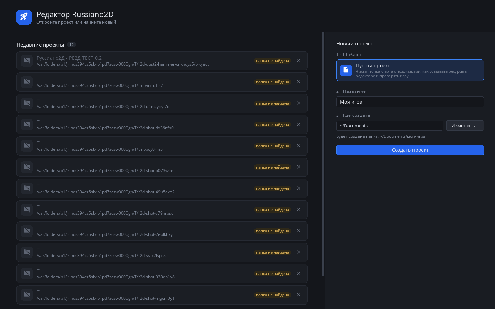

После создания проект сразу открывается в Editor. Слева находится дерево
файлов, сверху — вкладки и команды, снизу — Problems, Output, Console и граф
проекта. `Save` сохраняет активный документ, `Save All` — все изменённые
документы и студии.

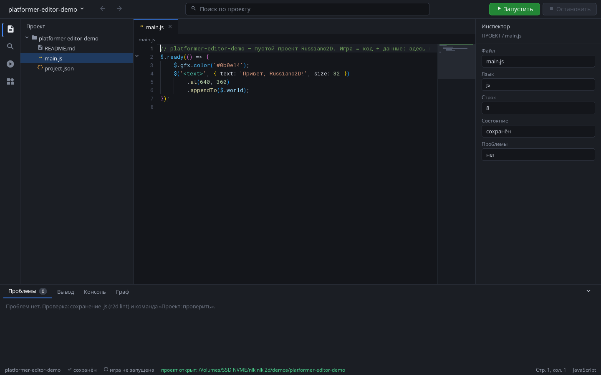

Открыть существующий проект можно через Project Manager или командой:

```bash
"$R2D_BINARY" edit путь/к/проекту
```

## 2. Палитра команд и создание ресурсов

`Cmd+Shift+P` на macOS или `Ctrl+Shift+P` на Windows/Linux открывает палитру.
Она ищет действия редактора и проектные операции. В демо использовались:

| Команда | Результат |
|---|---|
| `Файл: создать JS-файл игры` | создаёт `game.js` (или следующий свободный номер) и открывает редактор кода |
| `Ресурс: создать тайловую карту` | создаёт `level.tilemap.json` и открывает Tilemap Studio |
| `Ресурс: создать сцену визуальной новеллы` | создаёт `story/main.scene` и открывает Narrative Studio |
| `Проект: проверить` | запускает нативную проверку проекта и показывает диагностики в Problems |
| `Проект: собрать` | собирает проект через штатную команду `r2d` |

Первые два ресурса нужны, когда чистый `blank` проект становится игрой на
тайлах; последний открывает редактор истории. Создание карты, скрипта и сцены
проверяется через реальные методы Editor и соответствующие студии.

## 3. Платформер: от пустого проекта до финиша

### Создать карту

В пустом проекте вызовите `Ресурс: создать тайловую карту`. В Tilemap Studio
выберите тайлсет, настройте размер клетки и слой столкновений, затем нарисуйте
пол и платформы. Карта остаётся обычным `level.tilemap.json`, её можно читать,
сравнивать и проверять как данные проекта.

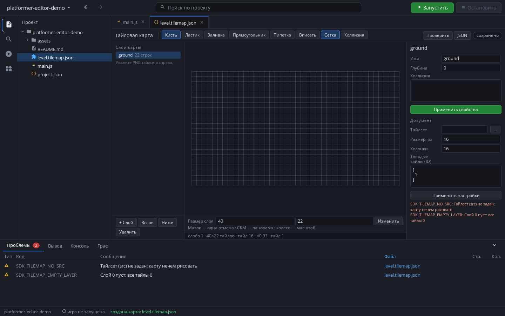

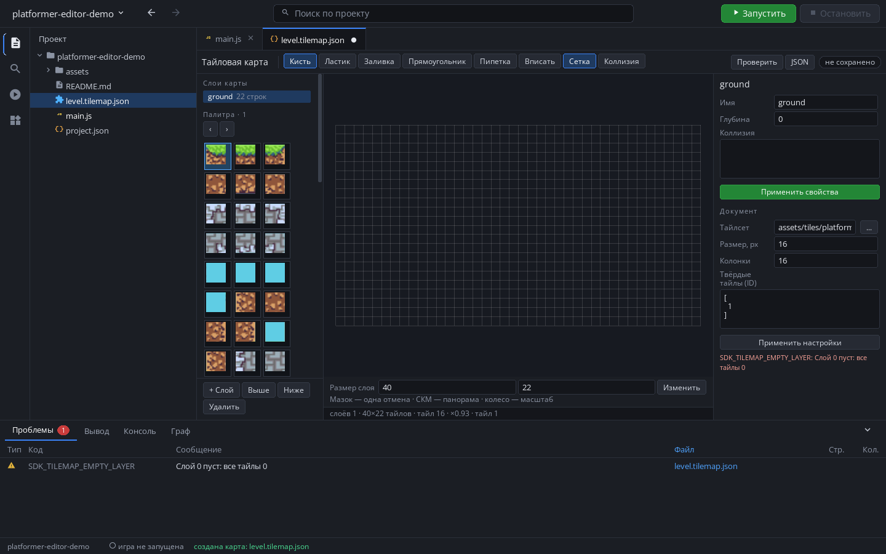

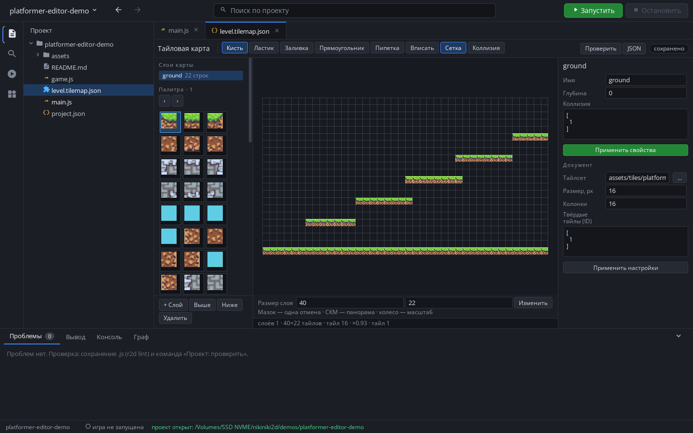

### Добавить игровую логику

Палитра создаёт `game.js`. В нём находится игровая логика на публичном `$` API:
управление, физика, анимация героя, камера, перезапуск и финиш. `main.js`
остаётся тонкой точкой входа и только импортирует модуль игры. Такой порядок
сохраняет код игры самостоятельным и не прячет сюжет или механику в launcher.

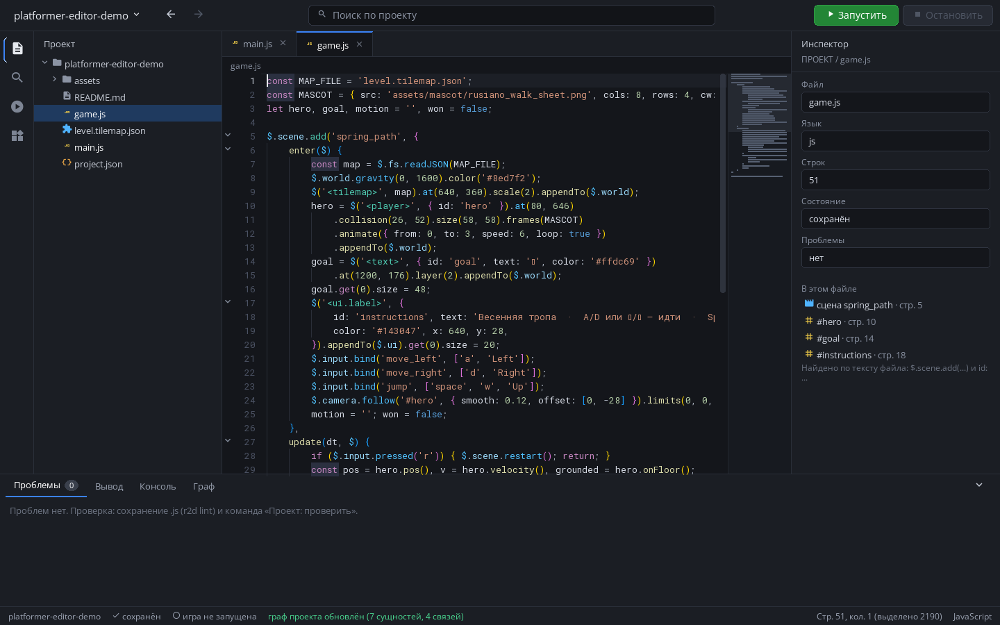

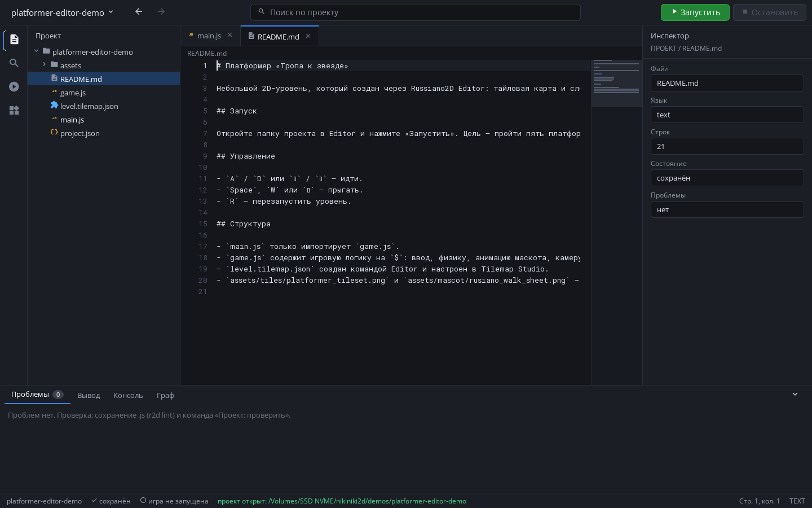

Перед запуском проект проверяется нативными командами:

```bash
"$R2D_BINARY" lint demos/platformer-editor-demo --json
"$R2D_BINARY" validate demos/platformer-editor-demo --json
```

Для коллизий игровая логика включает тела карты через `level.collisions(true)`;
слой карты помечен как solid. Камера меняет масштаб просмотра, а координаты
физики и тайлов остаются согласованными.

### Запустить и пройти уровень

Нажмите `Запустить` в Editor. Игрок управляется `A`/`D` или стрелками, прыгает
на `Space`/`W`/`↑`, а `R` начинает заново. На скриншоте ниже показан runtime,
открытый из созданного проекта.

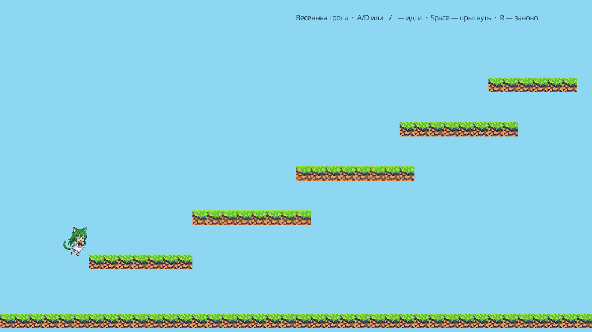

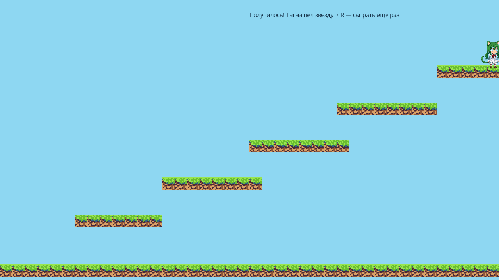

Фактический агентский проход прошёл все платформы и достиг флага без ошибок
физики. В тексте победы есть подсказка перезапустить уровень.

## 4. Визуальная новелла: авторинг в Editor

Новая ВН — отдельный проект `demos/rusya-love-vn`; она не является сценой
старого launcher. Создайте пустой проект через Project Manager, затем вызовите
`Ресурс: создать сцену визуальной новеллы`. Получится обычный текстовый ресурс
`story/main.scene`, открытый в Narrative Studio.

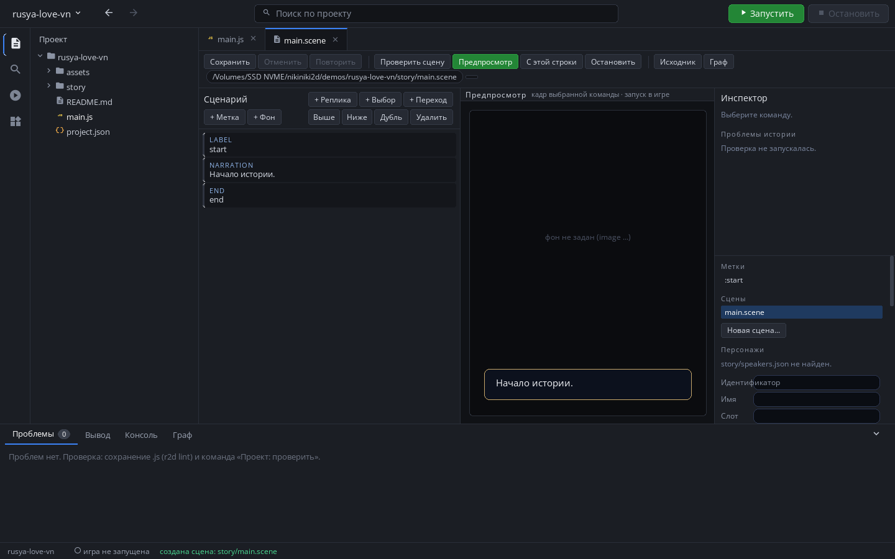

В Narrative Studio редактируются реплики, переходы, выборы и условия. Сюжет
новый: обычная студенческая история о совместной подготовке фестиваля и
отношениях с Руси-тян. Четыре решения меняют уровень взаимного доверия; добрый
маршрут приводит к признанию, а путь с давлением и игнорированием её ответа — к
отказу. Прохождение рассчитано примерно на 15 минут.

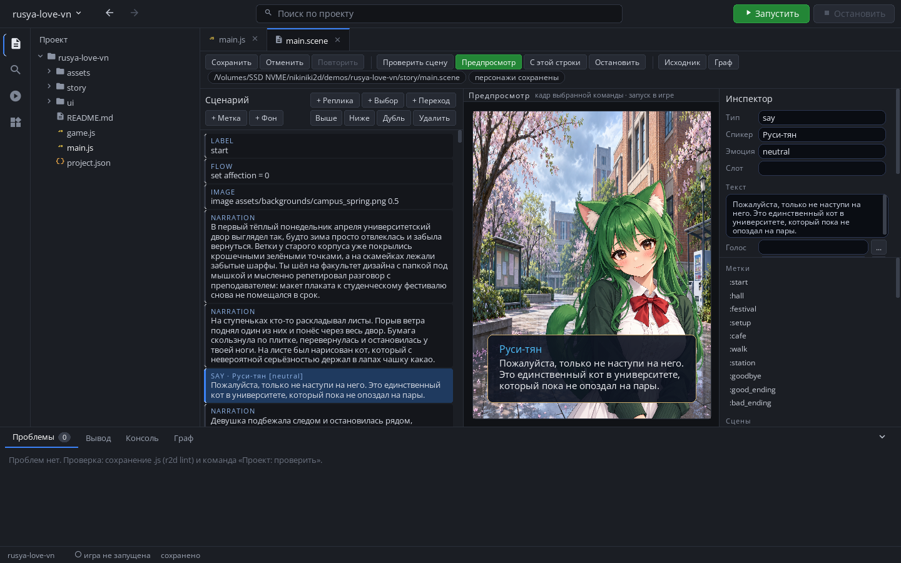

Кнопка «Граф» переключает список на обзор меток и ветвлений сцены. Это
скриншот именно этого экрана:

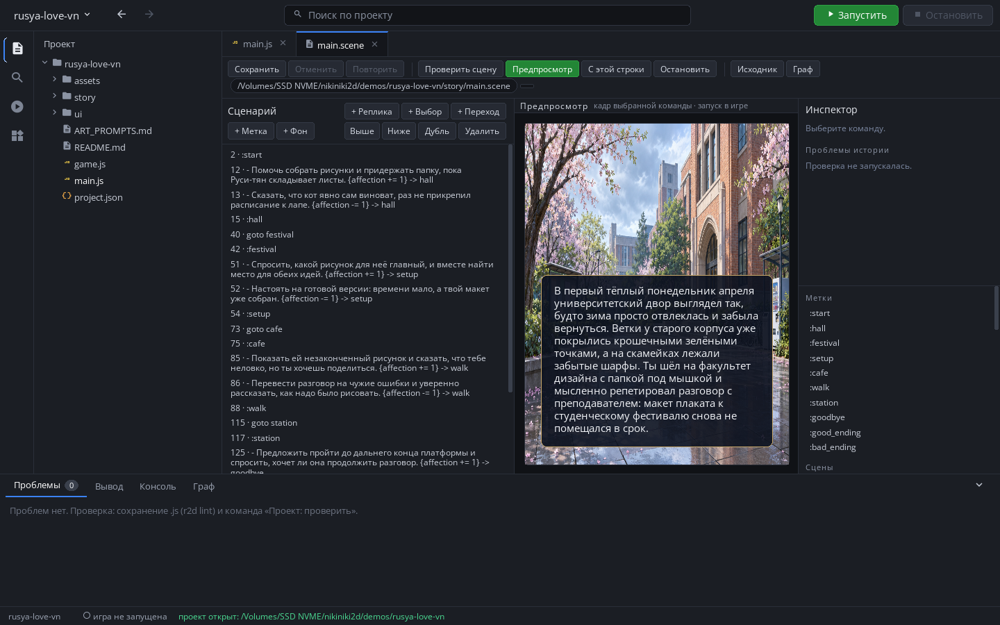

В Editor сейчас нет отдельной Timeline Studio с временной шкалой. Руси-тян ВН
собрана в Narrative Studio на `$.story`; экран выше показывает её реальные
метки и переходы. Для примера игрового `$.timeline` см. [демо Showcase](../demos/showcase/README.md).

### Персонажи и изображения

В Narrative Studio используется реестр `story/speakers.json`. Он связывает имя
говорящего с портретами; выражения Руси-тян подготовлены специально для этой
истории.

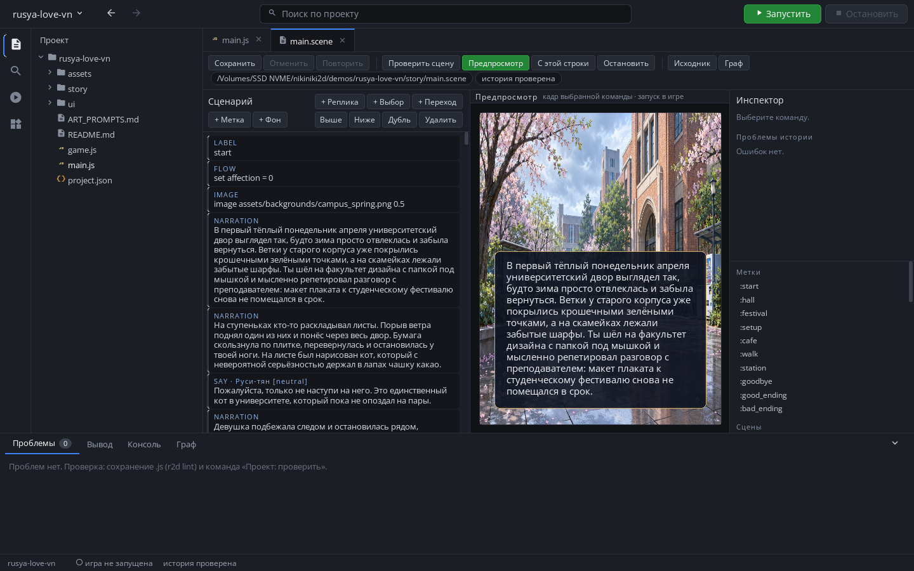

Фоны, портреты и финальная иллюстрация созданы через ImageGen для новой ВН.
Промпты и список выходных файлов сохранены в
[`demos/rusya-love-vn/ART_PROMPTS.md`](../demos/rusya-love-vn/ART_PROMPTS.md).
Старый сюжет и старые изображения не подключены.

### Код запуска и тема диалога

Точка входа `main.js` только импортирует `game.js`. Модуль `game.js` загружает
данные говорящих, задаёт тему `spring-romance` и открывает сцену из
`story/main.scene`. Поэтому реплики и развилки редактируются в Narrative
Studio, а не захардкожены в `main.js`.

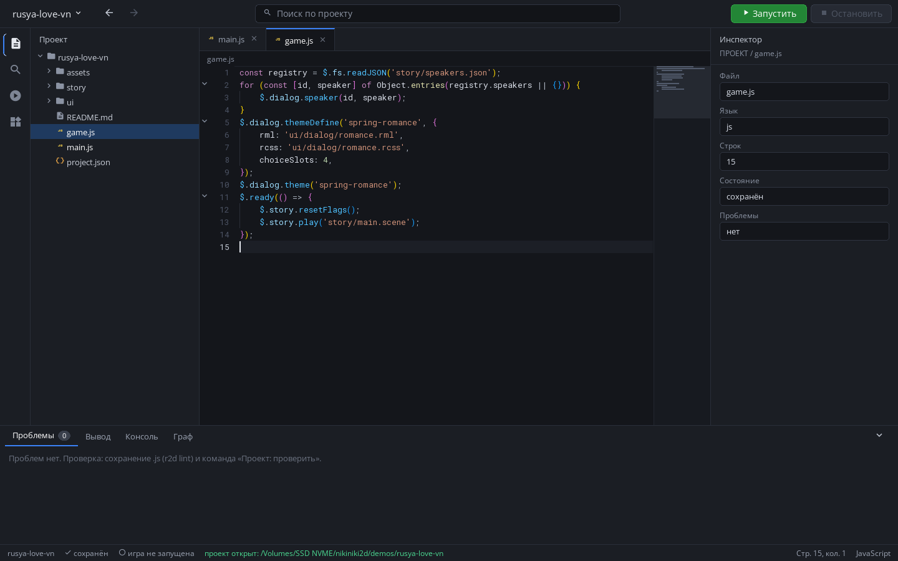

RML/RCSS тема редактируется в RmlUi Studio. Портрет расположен справа. Его слой
лежит за диалоговой плашкой: изображение видно над ней, а плашка перекрывает
нижнюю часть портрета. Текст и варианты выбора находятся поверх плашки.

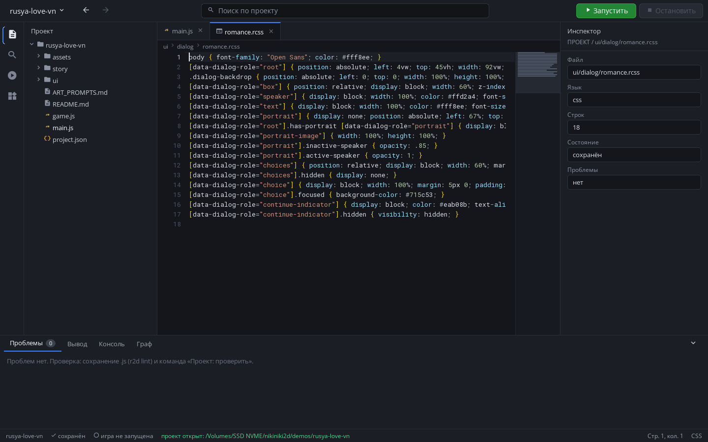

После сохранения Narrative Studio показывает результат проверки сцены и её
ссылок. Для проверки всего проекта используются `r2d lint`, `r2d validate` и
валидатор истории:

```bash
"$R2D_BINARY" lint demos/rusya-love-vn --json
"$R2D_BINARY" validate demos/rusya-love-vn --json
"$R2D_BINARY" story validate demos/rusya-love-vn/story \
  --assets-root demos/rusya-love-vn --json
```


### Запуск и две концовки

Из Editor нажмите `Запустить`. Во время игры можно читать текст клавишей
`Enter`, пробелом или левой кнопкой мыши; выборы доступны мышью и клавиатурой.

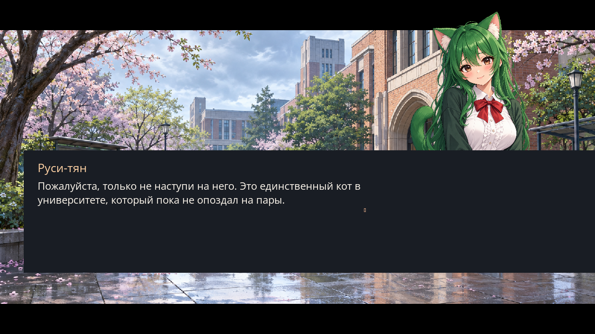

При внимательном отношении к Руси-тян достигается хорошая концовка:


Если перебивать её, давить и требовать немедленного ответа, герой получает
вежливый, но окончательный отказ:

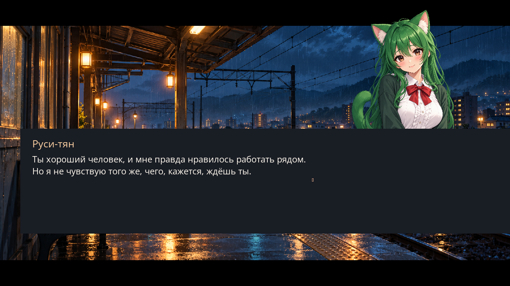

В хорошем маршруте есть отдельный крупный финальный арт:

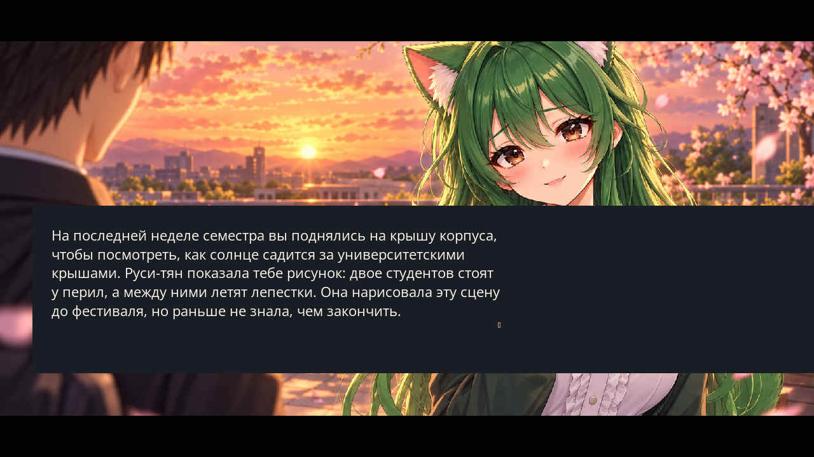

Обе ветки были пройдены runtime-агентом отдельно. Проверено четыре решения,
значения флага доверия, портрет в каждой концовке, загруженный RmlUi документ
и отсутствие ошибок движка.

## 5. Агентский режим Editor

Editor не реализует второй агентский backend. Он открывает проектный сценарий
`*.agent.json` и вызывает штатную команду `r2d agent`. Готовность соединения,
ответы запросов и итоговый отчёт остаются в Output; ошибки backend попадают в
Problems. Команда палитры:

```text
Агент: выполнить активный сценарий .agent.json
```

Регрессионная проверка `tests/agent/editor_agent_session_test.py` проходит
успешный handshake и запросы, проверяет видимый результат в Output и тестовый
отказ запроса. Это проверка Editor runtime без физического ввода мышью или
клавиатурой.

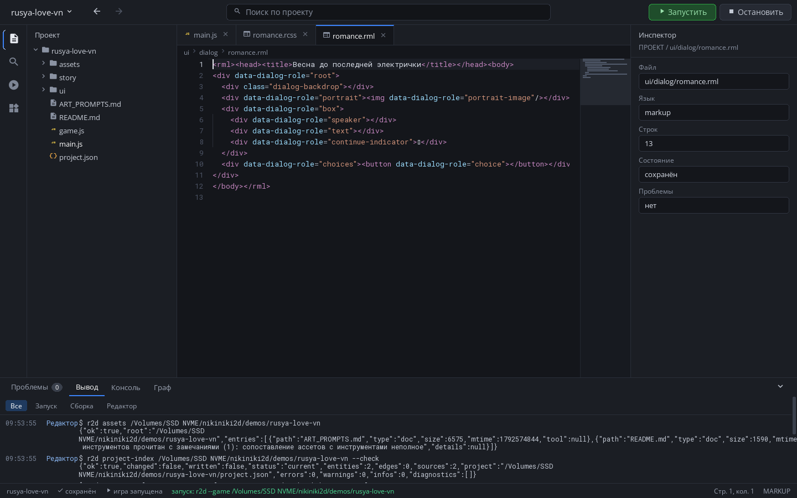

## 6. Что оказалось удобно и что потребовало доработки

| Наблюдение | Что сделали |
|---|---|
| Command Palette быстро открывает нужный файл или студию | Добавили явные действия для JS-файла, Tilemap и сцены ВН, которых не хватало чистому `blank` проекту |
| Ресурс карты сразу открывается в профильной студии | Авторили карту в Tilemap Studio и проверили сохранённый JSON |
| Narrative Studio хранит историю вне игрового bootstrap | Оставили `main.js` только импортом, сюжет хранится в `.scene` |
| Масштаб tilemap влиял на совпадение визуальных и физических координат | Оставили карту в исходных клетках, а масштаб показа задали камерой; коллизии создаются через `$` |
| Портрет закрывал текстовую плашку | Развели слои: портрет за подложкой, текст и варианты перед ней; новый порядок виден на скриншоте 19 |
| В диалоговом окне не загружался RML документ из-за формата URL | Исправили URL на `dialog://…` в `src/highlevel/dialog_view.js` и добавили регрессионное утверждение |

Более подробные наблюдения и текущие ограничения собраны в
[`editor/EDITOR_FIELD_NOTES.md`](editor/EDITOR_FIELD_NOTES.md). Агентские
скриншоты подтверждают состояние RmlUi и runtime; ручной осмотр системного
ввода, IME и поведения окна ОС остаётся отдельной GUI-приёмкой.

## 7. Скриншоты и файлы проектов

Все изображения этого руководства лежат в [`docs/editor/images/`](editor/images/).
Они сняты во время создания двух проектов и проверки их runtime. Проекты:

- [Платформер, созданный через Editor](../demos/platformer-editor-demo/README.md)
- [Новая романтическая ВН](../demos/rusya-love-vn/README.md)
- [Промпты и происхождение новых иллюстраций](../demos/rusya-love-vn/ART_PROMPTS.md)

