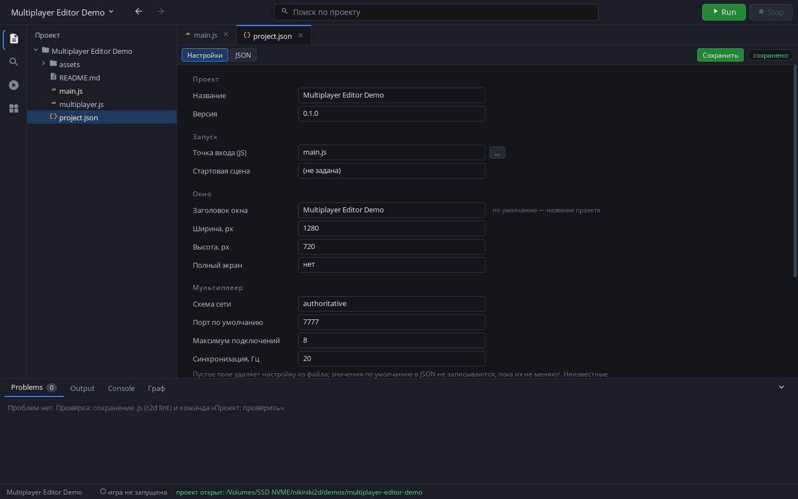
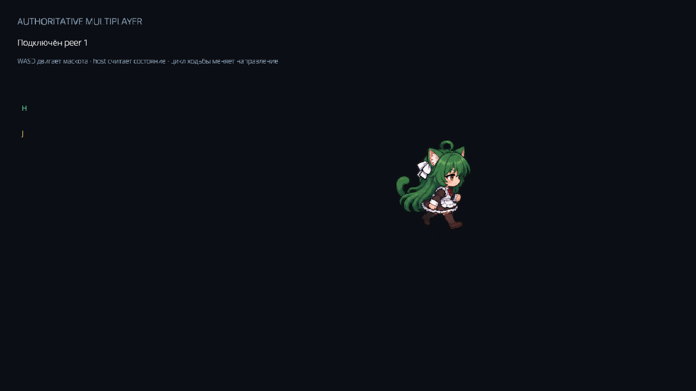
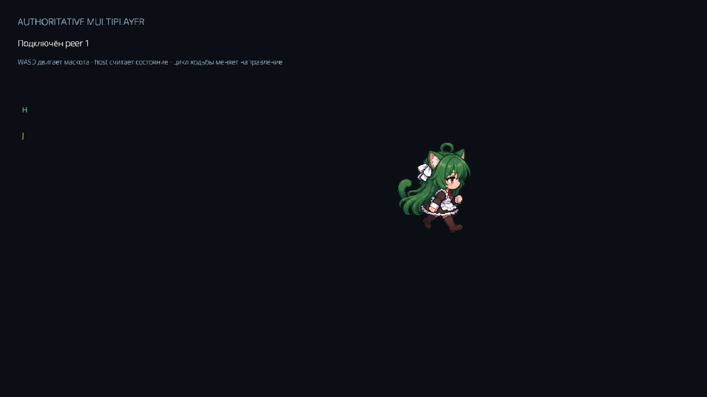
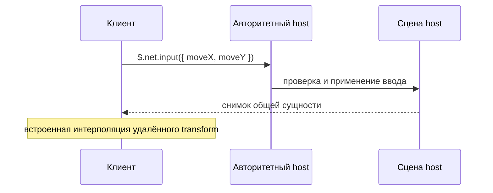

# Мультиплеер в Russiano2D

Практическое руководство по высокоуровневому `$.net`: от Project Settings и
первого подключения до авторитетной симуляции, репликации сущностей, RPC,
комнат и relay. Транспорт под капотом — встроенный [ENet](https://github.com/zpl-c/enet);
игровой код работает через `$` API и обычные узлы сцены.

Полный реальный проект: [Multiplayer Editor Demo](../demos/multiplayer-editor-demo/README.md).
Сводка методов API: [highlevel/net.md](highlevel/net.md).

## Быстрый запуск демо

Соберите `r2d` через xmake и укажите путь к бинарнику в `R2D_BINARY`. Из корня
репозитория запустите демо в двух окнах:

```sh
"$R2D_BINARY" --game demos/multiplayer-editor-demo
```

В первом окне нажмите **H**, чтобы открыть host на UDP-порту `7777`. Во втором
нажмите **J**, чтобы подключиться к `127.0.0.1`. Удерживайте **WASD**: обе копии
увидят движение одного и того же маскота. Host рассчитывает координаты, а
клиент отправляет направление ввода. Спрайт меняет направление и кадры ходьбы
по реплицируемому движению.




### Живой результат

Снимки сделаны из двух запущенных runtime-процессов после соединения и
удержания `D`. В этой сессии `$.net.peers().length` вернул `1` на host и клиенте;
позиция сущности выросла с `x=640` до `x=805` на host и `x≈781` на клиенте.
Разница отражает настроенный буфер интерполяции в `100` мс.

| Host | Client |
|---|---|
|  |  |

## Добавление мультиплеера через Editor

1. На стартовом экране Editor создайте или откройте проект.
2. Откройте `project.json` и вкладку **Настройки**.
3. В блоке **Мультиплеер** выберите топологию, порт, максимальное число
   подключений и частоту синхронизации. Эти параметры задают конфигурацию
   проекта; запуск сети остаётся явным действием игры.
4. Нажмите **«Создать multiplayer.js»**. Editor добавит bootstrap-функции
   `startHost()`, `joinHost()`, `syncEntity()` и `sendInput()` с текущими
   настройками. Он не меняет структуру проекта и не запускает сеть при открытии.
5. Импортируйте функции в `main.js` и привяжите их к меню или игровому вводу.
   В демо host запускается на `H`, клиент присоединяется на `J`.

Обычный результат генератора выглядит так:

```js
// multiplayer.js — сгенерированный Editor bootstrap
export const multiplayer = Object.freeze({
    topology: 'authoritative', port: 7777, maxPeers: 8, syncRate: 20,
});

export function startHost() {
    const started = $.net.start({
        topology: multiplayer.topology,
        authority: 'host',
        listen: multiplayer.port,
        maxPeers: multiplayer.maxPeers,
    });
    if (started) $.net.syncRate(multiplayer.syncRate);
    return started;
}

export function joinHost(address = '127.0.0.1') {
    const joined = $.net.join(address, multiplayer.port,
                              { topology: multiplayer.topology });
    if (joined) $.net.syncRate(multiplayer.syncRate);
    return joined;
}
```

## Модель сети

Архитектуру выбирает игра. `authoritative` — рекомендуемая отправная точка:
host владеет игровым состоянием, принимает намерения клиентов, проверяет их и
применяет к миру. При этом `$.net` также поддерживает `mesh`, `relay` и
`custom`; движок не ограничивает игру единственной схемой.

| Топология | Поведение | Начало сессии |
|---|---|---|
| `authoritative` | Host авторитетен; клиенты отправляют ввод и принимают состояние | `$.net.host(port)` / `$.net.join(address, port)` |
| `mesh` | Узлы соединяются напрямую; каждый может слушать и подключаться | `$.net.start({ topology: 'mesh', listen, connect })` |
| `relay` | Текущий игровой host пересылает сообщения peers | `$.net.relay.enable({ listen })` |
| `custom` | Игра задаёт собственные правила владения и протокол | `$.net.start({ topology: 'custom', ... })` |

Для авторитарного матча типичный поток такой:



## Сущности и репликация

Сетевой объект остаётся обычным `$`-узлом. Назначьте ему стабильный сетевой id
и одинаковые параметры на участниках:

```js
const avatar = $('<sprite>', { id: 'player-local' })
    .sprite('assets/player.png')
    .size(48, 64)
    .at(160, 240)
    .appendTo($.world);

avatar.net({
    id: 'player:peer-7',
    owner: 'host',
    fields: ['x', 'y', 'angle', 'hp', 'visible'],
    interpolation: true,
});

$.net.syncRate(20);             // снимки состояния в секунду
$.net.interpolationDelay(100);  // запас истории для плавного движения, мс
```

Короткая форма для существующей выборки:

```js
$('#shared-mascot').net({ id: 'demo:shared-mascot', owner: 'host' });
```

`x`, `y` и `angle` всегда включаются в репликацию; стандартный набор также
включает `hp`. Дополнительные поля перечисляются в `fields`, если узел умеет
читать и записывать их через `$`-обёртку. Параметр `owner` задаёт направление
состояния:

* `host` — host публикует состояние клиентам;
* `client` — host принимает состояние, которым владеет клиент;
* `local` — этот процесс публикует объект в mesh-схеме;
* `remote` — копия только получает состояние другого участника.

Движок синхронизирует зарегистрированные узлы и интерполирует удалённые
transform автоматически. Он не создаёт узлы, которых ещё нет в сцене, и не
удаляет их по сетевому событию: для динамических игроков, снарядов и лута игра
сама рассылает событие spawn/despawn, создаёт или удаляет `$`-узел и регистрирует
его с совпадающим id.

В mesh-схеме отправитель регистрирует локальный узел как `owner: 'local'`, а
получатель — как `owner: 'remote'`; сетевой id должен совпасть.

## Ввод и авторитетная симуляция

Клиент отправляет намерение, а не готовые координаты. Host ограничивает ввод,
скорость, границы и игровые правила:

```js
const ENTITY_ID = 'demo:shared-mascot';
const remoteMove = { x: 0, y: 0 };

$.net.on('input', (input) => {
    if (!$.net.isAuthority() || input.entity !== ENTITY_ID) return;
    remoteMove.x = Math.max(-1, Math.min(1, Number(input.moveX) || 0));
    remoteMove.y = Math.max(-1, Math.min(1, Number(input.moveY) || 0));
});

$.update((dt) => {
    const move = $.input.vec('wasd');
    if ($.net.isAuthority()) {
        // Host применяет свой ввод и последний принятый ввод клиента.
        const dx = move.x + remoteMove.x;
        const dy = move.y + remoteMove.y;
        mascot.at(mascot.x + dx * 220 * dt, mascot.y + dy * 220 * dt);
    } else if ($.net.online()) {
        $.net.input({ entity: ENTITY_ID, moveX: move.x, moveY: move.y });
    }
});
```

В полном демо host дополнительно нормализует диагональное направление и
ограничивает координаты мира. Клиент не может навязать host готовую позицию.
`$.net.applyInput()` и `$.net.predict(step)` доступны, когда игре нужно локально
предсказывать ввод; `$.net.acknowledge(state, seq)` принимает подтверждённое
состояние, а `$.net.prediction().visual(dt, options)` сглаживает коррекцию для
отображения.

## События, RPC и доставка

Сообщения передают игровые события и данные, которые не являются transform-ами:

```js
// Host: зарегистрировать действие и проверить права peer.
$.net.handle('door:open', (data, peerId) => {
    if (!canPeerOpenDoor(peerId, data.id)) return;
    openDoor(data.id);
});

// Клиент: вызвать действие на host.
const hostPeerId = $.net.peers()[0]?.id;
$.net.rpc('door:open', { id: 'north' }, { peer: hostPeerId });

// Host: сообщить участникам о начале раунда.
$.net.broadcast('round:start', { seed: 42 }, { delivery: 'reliable' });
$.net.on('round:start', (data, peerId) => beginRound(data.seed, peerId));
```

Выбирайте канал по смыслу данных:

| `delivery` | Использование |
|---|---|
| `reliable` | RPC, подтверждения и события, которые нельзя терять |
| `input` | частый ввод управления |
| `state` | быстро устаревающие обновления состояния |
| `bulk` | крупная надёжная передача |

ENet держит эти типы доставки на отдельных каналах. Для частых состояний не
используйте надёжную очередь без необходимости: задержавшееся старое состояние
обычно хуже, чем следующий свежий снимок.

## Комнаты и relay

Комната — высокоуровневая группа уже подключённых peers, а не служба поиска
матчей:

```js
// Host создаёт комнату внутри текущей сессии.
$.net.host(7777);
$.net.room.create('arena', { id: 'arena-eu' });
$.net.on('room:join', (peerId, room) => spawnPlayer(peerId, room));

// Клиент присоединяется к комнате на известном адресе host.
$.net.room.join('game.example.org', 7777, 'arena', { id: 'arena-eu' });
$.net.on('room:joined', (room) => showLobby(room));
```

Relay позволяет игровому host переслать сообщение подключённым участникам:

```js
$.net.relay.enable({ listen: 7777 });
$.net.relay.forward('chat:message', { text: 'Всем привет' }, peerId);
$.net.relay.broadcast('match:event', { kind: 'checkpoint', id: 'a2' });
```

Для интернет-матчей игре или внешней инфраструктуре всё ещё нужны адреса
серверов, matchmaking, аккаунты, аутентификация, проверка доступа, NAT
traversal и развёртывание relay-хостов. ENet и `$.net` не предоставляют эти
внешние службы автоматически.

## Проверка соединения и имитация проблем сети

В HUD можно показывать доступность, peers, RTT и счётчики:

```js
const status = $.net.status();
const peers = $.net.peers();
const traffic = $.net.stats();
// Например: status.active, status.authority, peers[0]?.rtt, traffic.received
```

Встроенная симуляция задержки и потерь помогает проверить реакцию игры:

```js
$.net.simulate({ loss: 4, delay: 80, jitter: 20, seed: 7 });
// Вернуть обычное локальное соединение:
$.net.simulate({ loss: 0, delay: 0, jitter: 0 });
```

Чтобы завершить соединение, используйте `$.net.disconnect(peerId)` для одного
peer или `$.net.leave()` для всей сессии. Опрос ENet выполняет движок; игровому
коду не нужен ручной poll-loop.

## Границы high-level API

| Возможность | Ответственность |
|---|---|
| ENet-соединения, peer lifecycle и каналы доставки | `$.net` поверх встроенного транспорта |
| Авторитетный host, mesh, relay и custom topology | Выбор игрового режима |
| Снимки opt-in `$`-сущностей и интерполяция | Игра создаёт узлы и задаёт стабильные сетевые id |
| Ввод, сообщения, RPC, комнаты и relay-пересылка | Игра проверяет права и применяет правила матча |
| Статус, peers, статистика и симуляция потерь/задержки | Игра выводит нужные метрики в UI |
| Matchmaking, аккаунты, авторизация, NAT traversal и hosted relay | Игра или серверная инфраструктура |

`$.net` закрывает сетевой слой игры, а не сетевой backend. Для публичного
интернет-матча host должен проверять каждый ввод и действие клиента.

## Спрайтовый пример из демо

В демо используется прозрачный четырёхнаправленный лист маскота: четыре строки
соответствуют направлениям, четыре столбца — кадрам цикла ходьбы. Это обычный
sprite sheet; тот же узел `$` регистрируется для сетевой репликации.


Реализация и Editor-сгенерированный bootstrap лежат в
[`demos/multiplayer-editor-demo`](../demos/multiplayer-editor-demo/README.md).
