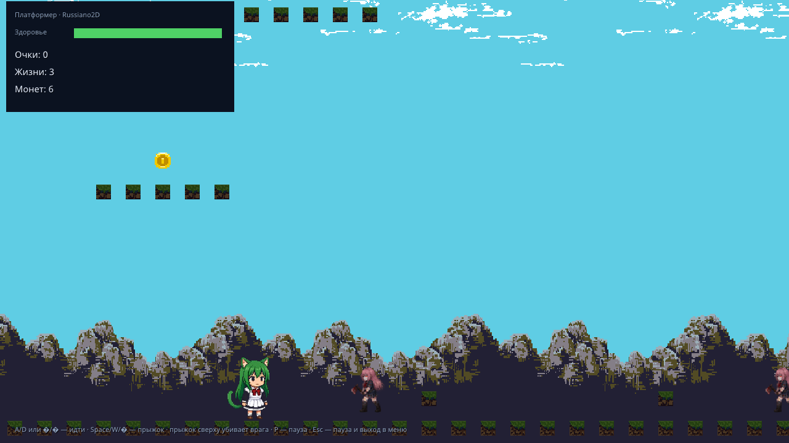
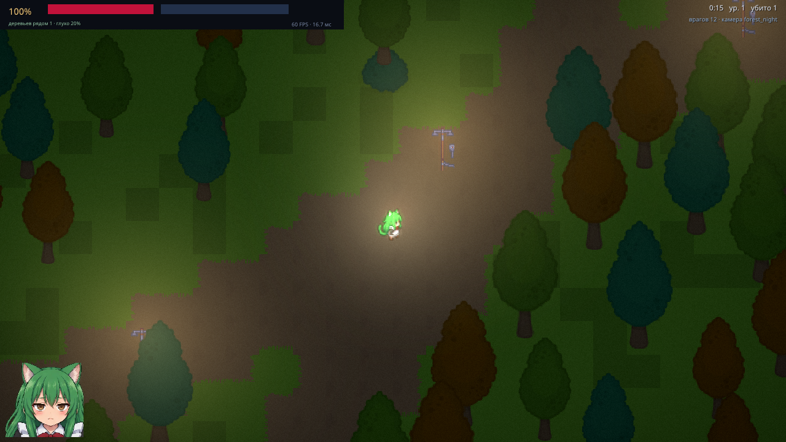
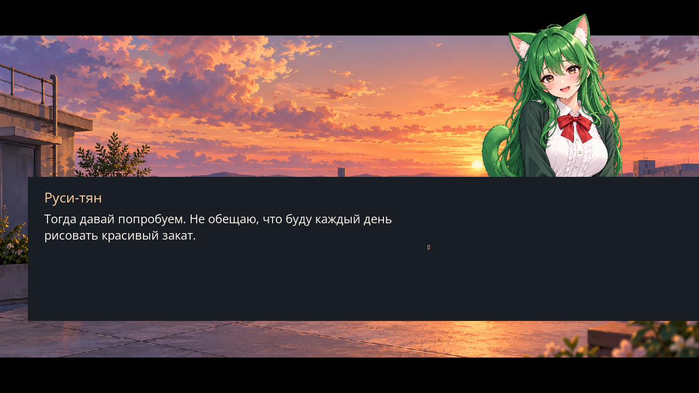

# Russiano2D — демо-проект

`demos/` — отдельная игра на движке: несколько сцен-демо, каждая показывает свой
слой движка — платформер (Box2D и анимация), «Типичная ночь в Мытищинском лесу»
(свет, частицы, волны), Re2DSprite (поворот головы из одной развёртки всего
персонажа) и Re2D World (2.5D от первого лица). Основные игровые модули —
`launcher`, `platformer`,
`shooter_witch`, `rotsprite` (сцена `re2dsprite`) и `re2d_world`. Отдельные
проекты из таблицы ниже открываются напрямую (`--game demos/<имя>`). Новый
платформер и новая ВН, созданные через Editor, лежат в
`demos/platformer-editor-demo` и `demos/rusya-love-vn`.
Запускается тем же бинарником, что и `game/`, и выбирается флагом `--game`.

## Запуск

Примеры используют `R2D_BINARY`; задайте путь к текущей Xmake-сборке по
[инструкции проверок](TESTING.md).

```bash
"$R2D_BINARY" --game demos                      # меню выбора
"$R2D_BINARY" --game demos --scene platformer   # сразу конкретная сцена
"$R2D_BINARY" --game demos --scene re2dsprite    # маскот из одной развёртки
```

Точка входа — `<каталог>/main.js`, то есть [`demos/main.js`](../demos/main.js).
`--scene <имя>` движок кладёт в `$.startScene`, и точка входа открывает
эту сцену минуя меню:

```js
// demos/main.js
const start = $.startScene || 'launcher';
$.scene.load($.scene.has(start) ? start : 'launcher', { transition: 'none' });
```

## Как устроено демо

Каждое демо — модуль с одним экспортом: функцией `install($)`, которая
регистрирует свою сцену. Общего кода нет: всё, что раньше лежало в
`demos/lib/` (кэш ассетов, пакет отрисовки, менеджер сцен, звук, привязки
клавиш), теперь умеет само высокоуровневое API `$`.

```js
// demos/platformer/index.js
export default function install($) {
    $.scene.add('platformer', {
        enter($) { /* построить уровень */ },
        exit() { /* убрать за собой */ },
        update(dt, $) { /* логика кадра */ },
        render($) { /* необязательно: своя отрисовка */ },
    });
}
```

Низкоуровневые подсистемы (BSP-порядок, полигоны видимости, рейкастинг) никуда
не делись — их показывает «Типичная ночь в Мытищинском лесу»: свет считается
полигонами видимости (нативный движок, для игры — `$.gfx.light.polygon`),
геометрия уходит в общий батч. Отдельные демо под
них убраны, чтобы не дублировать то же самое на пустых прямоугольниках.

Добавить своё демо: положить `demos/имя/index.js` с `install($)` и дописать
строку в список `MODULES` в `demos/main.js` — кнопка в меню появится сама
(подпись и иконка берутся из таблицы `TITLES` в `demos/launcher.js`).

## Вертикальные примеры (§31 спецификации)

Семь примеров — это законченные проекты, которые можно открыть отдельно
(`$R2D_BINARY --game demos/<имя>`) и которые проходят свои приёмочные
тесты. Они показывают, что движок выдерживает игру целиком, а не набор вызовов.

| Пример | Что показывает | Запуск и приёмка |
|---|---|---|
| `foundations` | фундамент платформера: управление, камера, физика, HUD, чекпойнты | `--game demos/foundations`; [README](../demos/foundations/README.md), `foundations_test` (25) |
| `melee` | контактный бой: окно атаки, три hurtbox → один удар, отражение снаряда, отдача в стену | `--game demos/melee`; [README](../demos/melee/README.md), `melee_test` (44) |
| `arena` | арена с фазами: отменяемая фаза, пул с потолком узлов, пауза, смерть ровно один раз, рестарт | `--game demos/arena`; [README](../demos/arena/README.md), [гайд](tutorial-arena.md), `arena_test` (62) |
| `roguerooms` | генерация комнат: seed → hash, валидация до публикации, жёсткие бюджеты, отмена | `--game demos/roguerooms`; [README](../demos/roguerooms/README.md), `roguerooms_test` (52) |
| `litsprites` | 2D-свет: маски препятствий, динамический occluder, неосвещённый слой, флипы атласа | `--game demos/litsprites`; [README](../demos/litsprites/README.md), [гайд](tutorial-litsprites.md), `litsprites_test` (25) |
| `showcase` | интеграция: RmlUi-HUD, смена языка на ходу, вставка timeline, слои музыки, scoped переход | `--game demos/showcase`; [README](../demos/showcase/README.md), `showcase_test` (56) |
| `recovery` | восстановление: битый слот из копии, битый ассет и safe reload, расхождение replay | `--game demos/recovery`; [README](../demos/recovery/README.md), [гайд](tutorial-recovery.md), `recovery_test` (66) |

Все семь обязаны собираться и запускаться как отдельные проекты — это проверяет
`python3 tests/demos_examples_test.py` (структура проекта, README, headless-запуск,
внешний вид в документации).

## Сцены

| Сцена | Что показывает | Ключевые вызовы |
|---|---|---|
| `re2d_world` | **Re2D: 2.5D от первого лица** над плоским миром — комната-коробка с текстурами, игрок (WASD + мышь), три добрых маскота Re2DSprite, которые замечают вас, поворачиваются, улыбаются и говорят. Описание — [README](../demos/re2d_world/README.md) | `$.camera.kind(Re2D)`, `$.re2d.room`, `.kind(Re2D)`, `.controls`, `$.re2dSprite.from`, `$.ui.doc` |
| `re2d_testroom` | **Re2D World: тестовая комната из SDK `.re2dmap`** — карта собрана `r2d world-compile`, грузится `$.re2dWorld`; ходьба по `world.support/blocked`; враги — пиксельный атлас 5 направлений × 8 состояний (40 кадров) с поворотом по камере и окклюзией `world.ray`; оружие от первого лица (3 вида, выстрел/перезарядка, без урона). Описание — [README](../demos/re2d_testroom/README.md) | `r2d world-compile`, `$.re2dWorld`, `world.support/blocked/ray`, `$.re2d.project`-совместимая JS-проекция, `ui.image`, `$.agent.expose` |
| `re2d_bsp_world` | **Re2D World: комнаты, этажи и АК** — XY BSP, вертикальные интервалы, оружие первого лица. Запуск отдельным проектом: `$R2D_BINARY --game demos/re2d_bsp_world`. [README](../demos/re2d_bsp_world/README.md) | `$.re2d.world`, `$.re2dSprite` |
| `re2d_world_renderer_lab` | **лаборатория рендерера World**: шесть камер с эталонными кадрами CPU/GPU, свет, тени, туман, порталы, прозрачность, декали; вложенная `acceptance`. Запуск: `$R2D_BINARY --game demos/re2d_world_renderer_lab` | `$.re2d.world`, `.light`, `.material`, `.sky` |
| `re2d_dust2` | **Dust II по маршрутам** — оригинальная карта из ячеек: A/B, спавны, двери, тоннели, рампы, клуб с музыкой (HRTF), NPC Re2DSprite, шаги и ветер. Запуск: `$R2D_BINARY --game demos/re2d_dust2 --seed 7`. [README](../demos/re2d_dust2/README.md) | `$.re2dWorldAudio(world)`, `.sky` (EXR), контроллер в стиле Quake |
| `re2dsprite` | **один атлас всего тела Руси-тян**: прототип головы, yaw −180..180°, pitch, nearest и привязка к пикселям. Стрелки — вращение, пробел — авто, Esc — меню. Базовый PNG и описание — [README](../demos/rotsprite/README.md) | `$.re2dSprite.create`, `.re2dPose`, `$.ui.doc` |
| `real2d` (отдельный проект) | **Real2D v4, стадия A**: голова из отдельных семантических компонентов — каждый угол yaw вычислен (12 anchors, Фурье K=3, растеризация реальных texels), RmlUi-HUD, автоповорот, перечитывание контейнера. Запуск: `$R2D_BINARY --game demos/real2d`. [README](../demos/real2d/README.md), план — [STAGE_A_PLAN.md](../demos/real2d/STAGE_A_PLAN.md) | `$.real2d.load/frame/info/provenance`, `<real2d>`, `.real2dPose` |
| `platformer-editor-demo` (отдельный проект) | Небольшой платформер, созданный через Project Manager, Tilemap Studio и Code Editor; прыжки по платформам до флага | `$R2D_BINARY --game demos/platformer-editor-demo`; [README](../demos/platformer-editor-demo/README.md), [Editor walkthrough](EDITOR_GUIDE.md) |
| `platformer` | Box2D, листы анимации, монеты, враги, параллакс, HUD, пауза | `.controls`, `.frames`, `.animate`, `.on('death')`, `<ui.*>` |
| `shooter_witch` | **ночной лес**: зомби-шутер в духе Vampire Survivors — авто-стрельба по ближайшему, волны, опыт, карты апгрейдов, фонари как единственный свет, тени от стволов, кровь и лужи | `<tilemap>` + `.autotile()`, `$.gfx.light.polygon`, `$.audio.zone/obstacles/damping`, `$.fx.*`, `$.gfx.postPreset` |
| `rusya-love-vn` (отдельный проект) | **«Весна до последней электрички»** — новая примерно 15-минутная романтическая ВН о Руси-тян: четыре решения, хорошая и плохая концовки; история редактируется в Narrative Studio, новая графика создана для этой демки | `$.story`, `$.dialog`, Narrative Studio, RmlUi theme; [README](../demos/rusya-love-vn/README.md), [Editor walkthrough](EDITOR_GUIDE.md) |

Демо `re2d_world`, `re2d_bsp_world`, `re2d_world_renderer_lab`, `re2d_dust2`,
`re2dsprite` и `real2d` показывают отклонённый 3D-авторинг Re2D/Real2D: они
собираются и запускаются только при `-DR2D_ENABLE_RE2D=ON` и не входят в первую
продакшн-цель (2D-платформер). Инструментов Re2D в SDK больше нет.

| Платформер | Типичная ночь в Мытищинском лесу | Новая ВН: хорошая концовка |
|---|---|---|
|  |  |  |

Скриншоты сцен проекта `demos/` обновляются командой
`python3 tools/make_screenshots.py`. Кадры Editor-проектов сняты во время
создания и опубликованы в [EDITOR_GUIDE.md](EDITOR_GUIDE.md).

## Управление

| Клавиша | Действие |
|---|---|
| `A` / `D` или `←` / `→` | идти |
| `Space` / `W` / `↑` | прыжок |
| мышь | прицел, стрельба, перетаскивание объектов |
| `Esc` | выход из демо в меню, из меню — выход |
| `F1` | показать/скрыть отладочный оверлей движка |
| `F5` | перезапустить скрипты вручную |

## Ассеты

Графика, звук и шрифты лежат в `demos/assets/`; полный список с лицензиями —
[`demos/assets/CREDITS.md`](../demos/assets/CREDITS.md). Маскот движка
(`art/mascot/russiano_mascot_sheet_a.png`, 8×4 кадра по 176×176) используется
как игрок в демо-платформере.

## Проверка без рук

Все демо можно открыть агентом — это то же, что делает
`tests/agent/demos_test.py`:

```bash
python3 tests/agent/demos_test.py              # все сцены
python3 tests/agent/demos_test.py shooter_witch  # только выбранные
```

Тест открывает каждую сцену, шагает кадры, проверяет журнал на ошибки
и сохраняет скриншот в `build/test_demo_<имя>.png`.

## Туториал

Как собрать такое же демо с нуля — [TUTORIAL.md](TUTORIAL.md): модуль и
сцены, мир с автотайлом и светом, герой с 8 направлениями, волны, кровь,
карточки апгрейдов, HUD на якорях, меню со своей музыкой и профилирование.

Re2DSprite v2: [большой PNG, мимика, костюмы и псевдоскелет](RE2DSPRITE_V2.md),
[API `$`](highlevel/re2dsprite.md). Демо `re2dsprite` — переключение костюмов,
моргание, ходьба/бег на месте и перетаскивание кистей; старое имя сцены
`rotsprite` осталось псевдонимом ([`demos/rotsprite/index.js`](../demos/rotsprite/index.js)).

## Вертикальные примеры спецификации

Отдельные небольшие проекты, каждый проверяется автоматически:

| Пример | Чему учит | Гайд | Проверка |
|---|---|---|---|
| `demos/foundations` | край платформы, склон, one-way, движущаяся платформа, зоны камеры, геймпад | — | `foundations_test` |
| `demos/melee` | окно атаки, несколько hurtbox, отражение снаряда, отдача, hit-фидбек | [tutorial-melee.md](tutorial-melee.md) | `melee_test` |
| `demos/showcase` | RmlUi HUD, локализация на ходу, вставка timeline, слои музыки, scoped переход | [tutorial-runtime-integration.md](tutorial-runtime-integration.md) | `showcase_test` |
| `demos/stress` | точки измерения производительности §35.2 (не игра, а стенд) | — | `tools/bench_stress.py` |

Запуск любого: `"$R2D_BINARY" --game demos/<имя>`.
