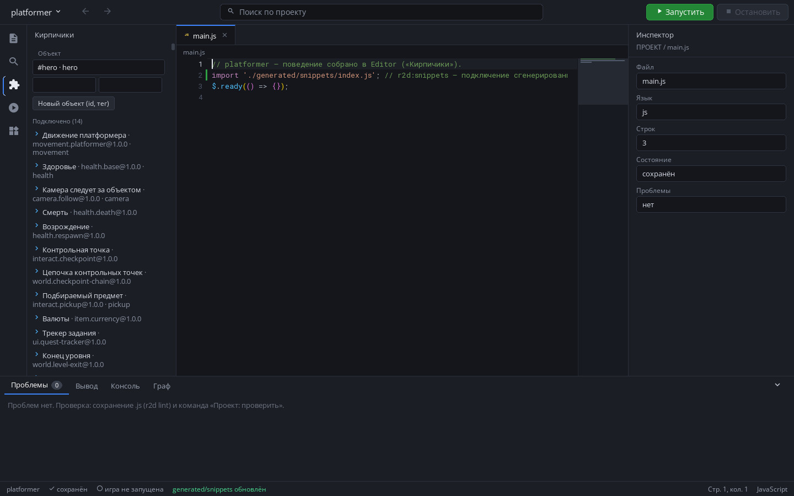
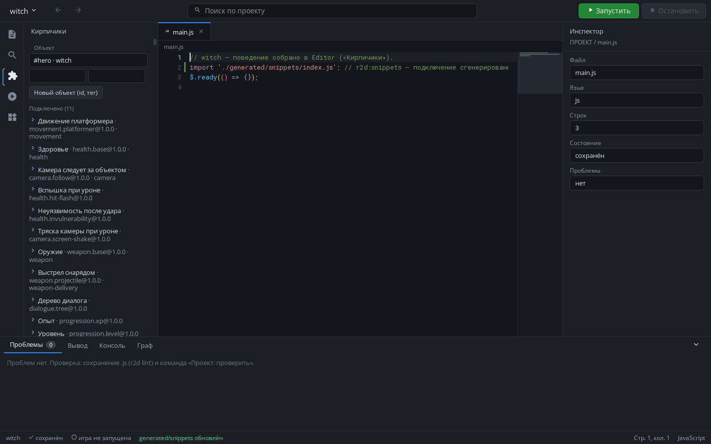
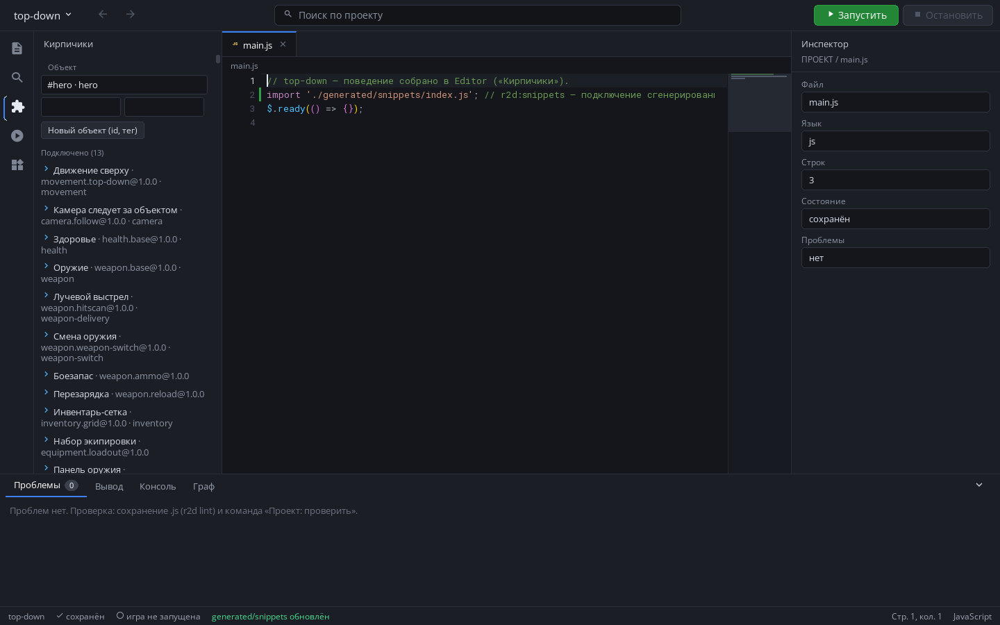
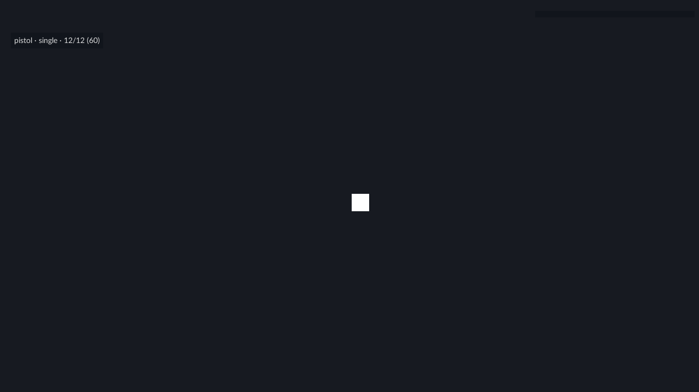
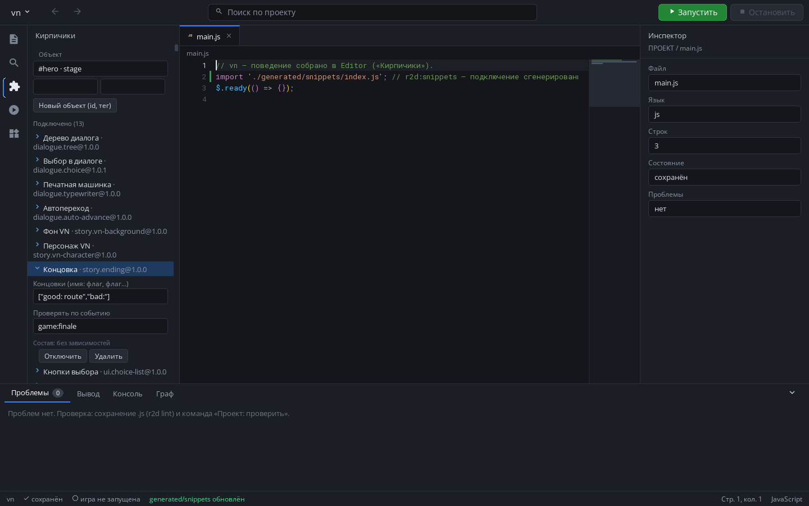
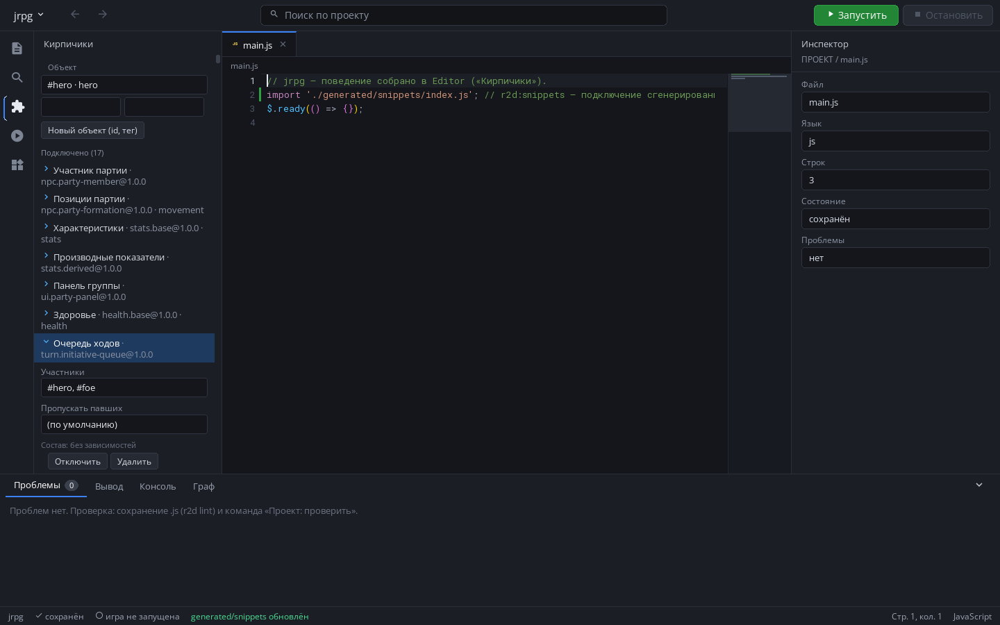
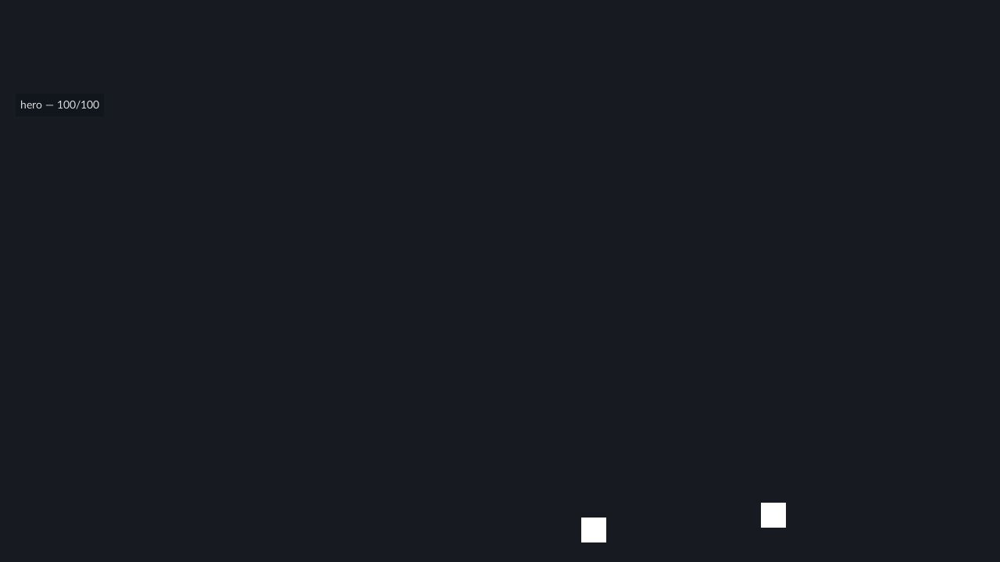
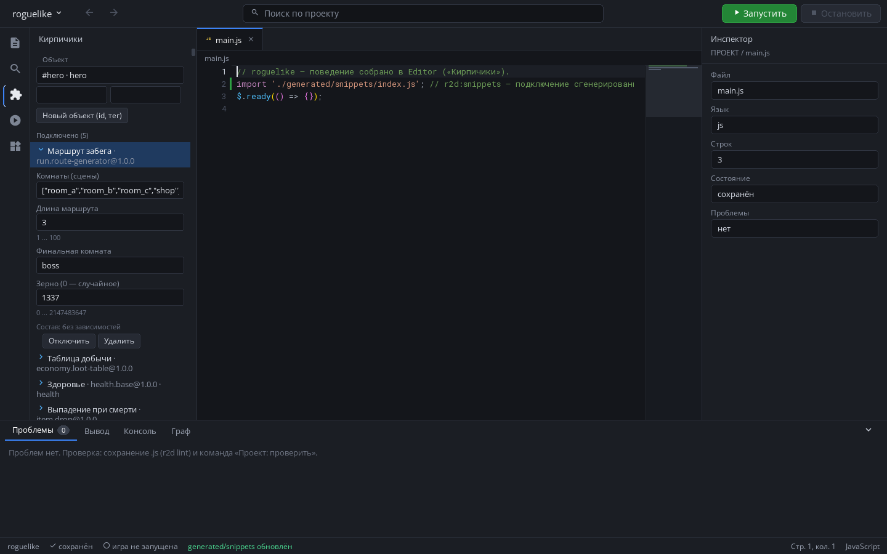
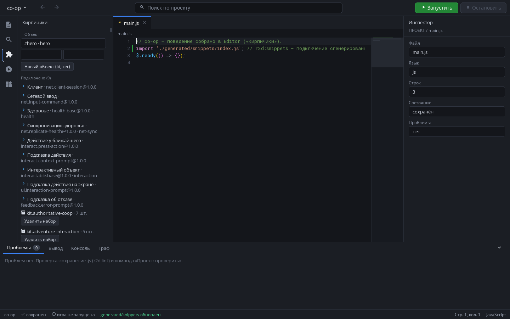
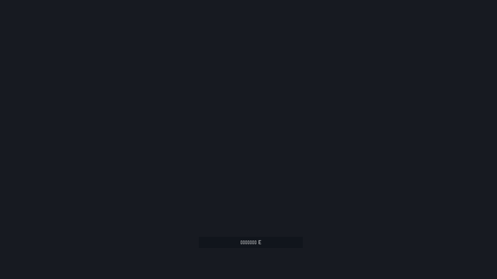

# Кирпичики: жанровые проекты, собранные в Editor

Снимки сделаны тестом `tests/agent/snippets_genre_projects_test.py --shots` в
настоящем Editor и runtime. Каждый проект: шаблон `blank` → Editor → панель
«Кирпичики» → «Новый объект» → набор жанра из каталога → «Сгенерировать» →
запуск игры. `main.js` поведения не содержит — только строку подключения
`generated/snippets` (её вставляет генератор). Графика — без спрайтов: набор
задаёт поведение, ресурсы назначаются в Inspector полей.

| Жанр | Набор | Editor | Игра |
|---|---|---|---|
| Платформер | `kit.project-platformer` |  |  |
| Witch | `kit.project-witch` |  |  |
| Top-down | `kit.project-top-down-action` |  |  |
| Визуальная новелла | `kit.project-vn-romance` |  |  |
| JRPG | `kit.project-jrpg` |  |  |
| Roguelike | `kit.roguelike-run` |  |  |
| Кооператив | `kit.project-coop-adventure` |  |  |

Подробно о пакетах, полях, генерации и кодах SNIP — [../SNIPPETS.md](../SNIPPETS.md).
